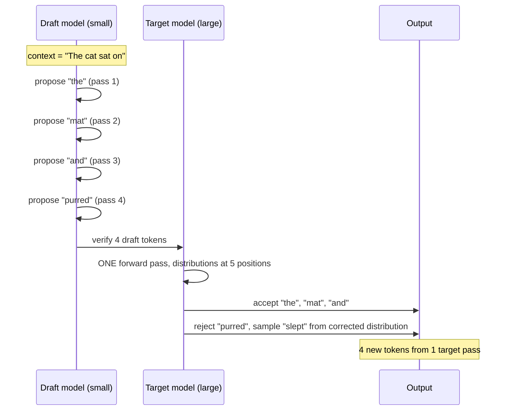
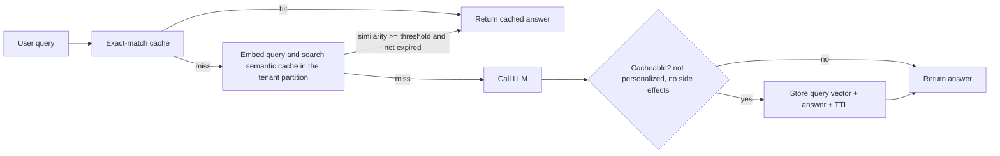
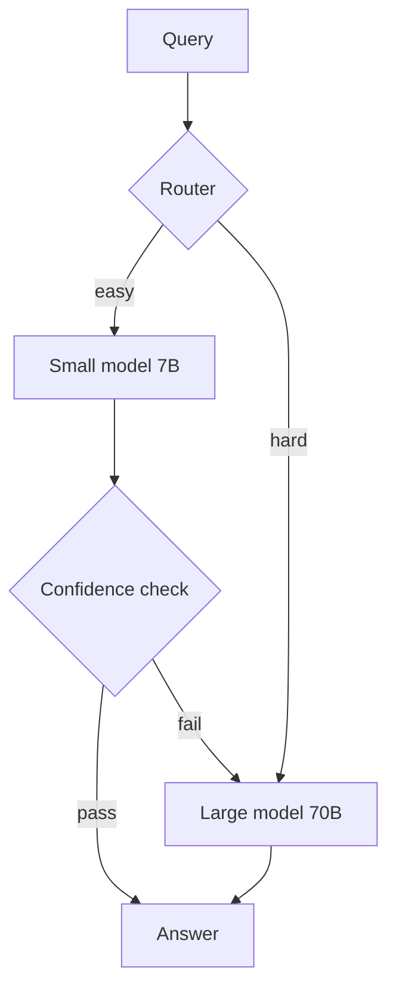
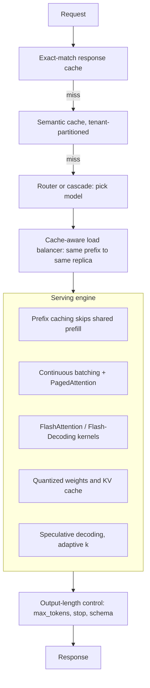

# Speculative Decoding, Prompt Caching and Other Inference Speedups

> **Level:** Beginner to Advanced · **Study time:** ~120 min · **Prerequisites:** [LLM Inference Fundamentals: Prefill, Decode, TTFT and Throughput](01-inference-fundamentals-prefill-decode-and-latency-metrics.md), [The KV Cache](02-kv-cache-explained.md), [GPU Fundamentals for LLMs: Compute-Bound vs Memory-Bound](03-gpu-fundamentals-compute-bound-vs-memory-bound.md), [Batching, Continuous Batching and PagedAttention](04-batching-continuous-batching-and-paged-attention.md), helpful: [How LLMs Generate Text: Decoding Strategies](../05-llms/03-text-generation-and-decoding-strategies.md)

## Table of contents

- [Why this matters](#why-this-matters)
- [Recap: why decoding is slow](#recap-why-decoding-is-slow)
- [A map of inference speedups](#a-map-of-inference-speedups)
- [Speculative decoding: the core idea](#speculative-decoding-the-core-idea)
- [The acceptance rule: rejection sampling that changes nothing](#the-acceptance-rule-rejection-sampling-that-changes-nothing)
- [How much faster? Expected speedup from the acceptance rate](#how-much-faster-expected-speedup-from-the-acceptance-rate)
- [Speculative decoding in code](#speculative-decoding-in-code)
- [When speculative decoding helps and when it hurts](#when-speculative-decoding-helps-and-when-it-hurts)
- [Variants: Medusa, EAGLE, n-gram lookup and self-speculation](#variants-medusa-eagle-n-gram-lookup-and-self-speculation)
- [FlashAttention recap](#flashattention-recap)
- [Prefix caching inside the serving engine](#prefix-caching-inside-the-serving-engine)
- [Provider prompt caching](#provider-prompt-caching)
- [Semantic caching of whole responses](#semantic-caching-of-whole-responses)
- [Output-length control](#output-length-control)
- [Model routing and cascades](#model-routing-and-cascades)
- [Going deeper: combining techniques in one stack](#going-deeper-combining-techniques-in-one-stack)
- [Going deeper: measuring, debugging and production practice](#going-deeper-measuring-debugging-and-production-practice)
- [Common mistakes and misconceptions](#common-mistakes-and-misconceptions)
- [Interview questions and model answers](#interview-questions-and-model-answers)
- [Key takeaways](#key-takeaways)
- [Further reading](#further-reading)
- [Next](#next)

## Why this matters

Once you have a KV cache, continuous batching and PagedAttention, the "obvious" speedups are used up, yet users still wait several seconds for long answers and the GPU bill is still large. The remaining wins come from a toolbox: **speculative decoding** makes each user's tokens arrive faster without changing the output distribution (with greedy decoding, not a single token changes, up to floating-point effects), **prefix caching** and **provider prompt caching** skip work you already did, **semantic caching** skips the model entirely, and **routing** sends easy questions to cheap models. Every serious serving stack (vLLM, SGLang, TensorRT-LLM, the big API providers) ships some mix of these. Interviewers love this area because each technique only helps in a specific regime, and a senior engineer is expected to say which one to use, why, and how to prove it worked.

## Recap: why decoding is slow

You learned in [the inference fundamentals chapter](01-inference-fundamentals-prefill-decode-and-latency-metrics.md) that generation has two phases:

- **Prefill**: the model reads the whole prompt in one parallel pass and fills the KV cache. Its latency shows up as **TTFT** (time to first token).
- **Decode**: the model produces output tokens one at a time. Each new token requires one full **forward pass** (running the input through every layer of the network once). Its latency shows up as **TPOT** (time per output token, also called inter-token latency).

The decode phase is the slow, expensive part for most chat workloads, and the reason is in [the GPU fundamentals chapter](03-gpu-fundamentals-compute-bound-vs-memory-bound.md): at small batch sizes, decode is **memory-bound**. That means the GPU spends most of its time *moving the model weights from memory to the compute units*, not doing arithmetic.

Our running example for this chapter is a **7B model** (7 billion parameters) in 16-bit precision, so 2 bytes per parameter:

$$\text{weight bytes} = 7 \times 10^9 \times 2 = 14 \times 10^9 \text{ bytes} = 14 \text{ GB}$$

Suppose the GPU's memory bandwidth is 2 TB/s (illustrative; real data-center GPUs are in the same order of magnitude). Every decode step must read all 14 GB of weights at least once, so the lower bound on time per step is:

$$\frac{14 \times 10^9 \text{ bytes}}{2 \times 10^{12} \text{ bytes/s}} = 0.007 \text{ s} = 7 \text{ ms}$$

Here is the key observation that powers this entire chapter:

> **Senior insight:** At batch size 1, reading the weights costs about 7 ms whether you compute 1 token or 5 tokens with them, because the arithmetic for 5 tokens is still tiny compared with what the GPU can do while the weights stream in. **In the memory-bound regime, extra tokens per forward pass are nearly free.** Speculative decoding exploits exactly this.

## A map of inference speedups

Before diving in, here is the whole toolbox in one table. "Lossless" means the output distribution is mathematically identical to running the original model normally.

| Technique | What work it skips or shrinks | Main metric it improves | Lossless? |
|---|---|---|---|
| Speculative decoding | Number of sequential target-model passes | TPOT (per-user decode speed) | Yes, with the standard acceptance rule |
| Medusa / EAGLE / n-gram lookup | Same, with cheaper or no draft model | TPOT | Yes for EAGLE and n-gram; Medusa depends on mode |
| FlashAttention | Memory traffic inside attention | Prefill time, long-context speed | Yes (exact) |
| Prefix caching (engine) | Recomputing KV for a shared prompt prefix | TTFT, prefill compute | Yes |
| Provider prompt caching | Same, offered by an API vendor | TTFT and input-token cost | Yes |
| Semantic caching | The whole model call | Everything, on a hit | **No**: returns an answer to a *different* question |
| Output-length control | Unneeded output tokens | End-to-end latency and output cost | Changes outputs (by design) |
| Routing and cascades | Big-model calls for easy queries | Cost, often latency | Changes outputs (by design) |

The rest of the chapter walks through these roughly from "pure engineering trick" to "product decision".

## Speculative decoding: the core idea

> **Analogy:** A senior editor (the big model) is slow to write but can read a paragraph at a glance. A junior writer (the small model) writes fast but makes mistakes. Instead of the editor writing every word, the junior drafts the next few words, and the editor checks them all in one glance: "first three words are exactly what I would have written, the fourth is wrong, I'll replace it." The editor's time is spent glancing, not writing, so the paragraph is finished much sooner, and it reads exactly as if the editor had written it alone.

Now precisely. **Speculative decoding** (Leviathan, Kalman and Matias, 2023, "Fast Inference from Transformers via Speculative Decoding"; independently Chen et al., 2023, "Accelerating Large Language Model Decoding with Speculative Sampling", where it is called **speculative sampling**) uses two models:

- The **target model**: the large, high-quality model whose outputs you actually want (for example a 70B model, or our 7B model).
- The **draft model**: a much smaller, faster model with the **same tokenizer** (for example a 0.5B or 1B model from the same family) that guesses what the target will say.

One iteration of the algorithm:

1. **Draft:** the draft model generates $k$ tokens autoregressively (one after another, as usual). $k$ is the **speculation length**, typically 3 to 8. This is cheap because the draft model is small.
2. **Verify:** the target model runs **one** forward pass over the context plus all $k$ draft tokens. Because a Transformer computes a next-token distribution at *every* position in parallel (exactly like prefill), this single pass yields the target's distribution for each of the $k$ draft positions, plus one more position after the last draft token.
3. **Accept or reject:** walk through the draft tokens left to right. Keep each one that passes the acceptance test (next section). At the first rejection, replace that token with one sampled from a corrected distribution and throw away the rest of the draft.
4. **Bonus token:** if all $k$ draft tokens are accepted, you also get the target's own prediction for position $k+1$ for free, since step 2 already computed it.
5. **Roll back:** discard the KV cache entries of rejected draft tokens (in both models), then start the next iteration from the new end of the sequence.

So every iteration produces **at least 1 and at most $k+1$ tokens** for the cost of one target pass plus $k$ cheap draft passes.



Here is the same iteration as a token timeline:

```text
context:      The cat sat on
draft  (k=4): the   mat   and   purred
target check: OK    OK    OK    REJECT -> resample -> "slept"
output:       The cat sat on the mat and slept
              (4 new tokens for 1 target pass + 4 tiny draft passes)
```

> **Common mistake:** Thinking the target model "only checks" and is therefore cheaper per token. The target runs a full forward pass every iteration. The win comes from producing several tokens per pass, not from a cheaper pass.

### Why verifying $k$ tokens costs about the same as generating one

In the verify step the target processes $k+1$ positions at once. Its matrix multiplications go from "weight matrix times 1 vector" to "weight matrix times $k+1$ vectors". The weights are read from memory once either way. Recall **arithmetic intensity** (FLOPs performed per byte moved from memory, from [the GPU chapter](03-gpu-fundamentals-compute-bound-vs-memory-bound.md)): processing 5 tokens instead of 1 multiplies FLOPs by about 5 while bytes moved stay roughly the same, so arithmetic intensity rises about 5x. At batch size 1 the GPU was starving for work, so this extra arithmetic hides inside the time spent streaming weights.

For our 7B example, a verify pass over 5 positions still costs roughly the ~7 ms weight-read floor (illustrative; attention over the KV cache and kernel overheads add a little). If each pass yields 3 to 4 tokens on average (the accepted drafts plus the corrected or bonus token), you have produced 3 to 4 tokens in the time plain decoding produces 1.

## The acceptance rule: rejection sampling that changes nothing

The magic property of speculative decoding is that it is **lossless**: the tokens you get have *exactly* the same probability distribution as sampling from the target model alone. Not approximately; exactly. This is what lets providers enable it silently.

### Notation

At a given position, let:

- $p(x)$: the target model's probability for token $x$ (after temperature, top-p and so on are applied).
- $q(x)$: the draft model's probability for token $x$ (usually computed with the same sampling settings, which maximizes acceptance; for exactness, what matters is that $q$ is precisely the distribution the draft actually sampled from).
- $x$: the token the draft model actually proposed, sampled from $q$.

### The rule

Accept the draft token $x$ with probability:

$$P(\text{accept } x) = \min\left(1, \frac{p(x)}{q(x)}\right)$$

- If the target likes the token at least as much as the draft did ($p(x) \ge q(x)$), always accept.
- If the target likes it less, accept with probability $p(x)/q(x)$, which is the fraction of the draft's enthusiasm that the target shares.

If rejected, sample a replacement from the **residual distribution**:

$$p'(x) = \frac{\max\big(0,\ p(x) - q(x)\big)}{\sum_{y} \max\big(0,\ p(y) - q(y)\big)}$$

- $\max(0, p(x) - q(x))$: how much *more* the target wants token $x$ than the draft offered it. Tokens the draft over-proposed get 0.
- The denominator $\sum_y$ (sum over every token $y$ in the vocabulary) just renormalizes so $p'$ sums to 1.

This is a form of **rejection sampling**: a classic statistics technique that draws samples from a hard distribution by proposing from an easy one and probabilistically rejecting proposals. (Probability basics are in [the probability chapter](../00-foundations/04-probability-and-statistics.md).)

### Worked example by hand

A toy vocabulary of three tokens after "The pet is a":

| Token | Target $p$ | Draft $q$ | $p/q$ | $P(\text{accept})$ |
|---|---|---|---|---|
| cat | 0.6 | 0.3 | 0.6 / 0.3 = 2.0 | min(1, 2.0) = 1.0 |
| dog | 0.3 | 0.5 | 0.3 / 0.5 = 0.6 | 0.6 |
| fish | 0.1 | 0.2 | 0.1 / 0.2 = 0.5 | 0.5 |

Residual distribution: $\max(0, p - q)$ = cat: max(0, 0.6 - 0.3) = 0.3, dog: max(0, 0.3 - 0.5) = 0, fish: max(0, 0.1 - 0.2) = 0. Sum = 0.3, so $p'$ = (cat 1.0, dog 0, fish 0). Intuitively, the draft under-proposed "cat", so rejections are used to top up "cat".

Now check that the final output distribution equals $p$:

- Probability the draft proposes something that then gets rejected: dog is proposed 0.5 of the time and rejected with probability 1 - 0.6 = 0.4, giving 0.5 x 0.4 = 0.20. Fish: 0.2 x (1 - 0.5) = 0.2 x 0.5 = 0.10. Cat is never rejected. Total rejection probability = 0.20 + 0.10 = **0.30**.
- P(output cat) = P(propose cat and accept) + P(reject) x $p'$(cat) = 0.3 x 1.0 + 0.30 x 1.0 = **0.6** ✓
- P(output dog) = 0.5 x 0.6 + 0.30 x 0 = **0.3** ✓
- P(output fish) = 0.2 x 0.5 + 0.30 x 0 = **0.1** ✓

Exactly the target's distribution, even though the draft was quite wrong.

### Why it always works (proof sketch)

For any token $x$:

$$P(\text{output } x) = \underbrace{q(x)\min\left(1, \frac{p(x)}{q(x)}\right)}_{\text{proposed and accepted}} + \underbrace{P(\text{reject})\, p'(x)}_{\text{rejected, then resampled}}$$

- The first term simplifies to $\min(q(x), p(x))$.
- The total rejection probability is $1 - \sum_y \min(p(y), q(y))$, which equals $\sum_y \max(0, p(y) - q(y))$ (because for every token, $\min(p, q) + \max(0, p - q) = p$, and the $p$ values sum to 1). That is exactly the denominator of $p'$, so the second term simplifies to $\max(0, p(x) - q(x))$.
- Sum: $\min(q(x), p(x)) + \max(0, p(x) - q(x)) = p(x)$. ∎

### The acceptance rate

The **acceptance rate** $\alpha$ (alpha) is the probability that a draft token is accepted. For one position it equals the overlap of the two distributions:

$$\alpha = \sum_{x} \min\big(p(x), q(x)\big)$$

For our example: min(0.6, 0.3) + min(0.3, 0.5) + min(0.1, 0.2) = 0.3 + 0.3 + 0.1 = **0.7**, which matches 1 - 0.30 rejection probability. Equivalently $\alpha = 1 - \text{TV}(p, q)$, where **total variation distance** TV is half the sum of absolute differences: 0.5 x (0.3 + 0.2 + 0.1) = 0.3. The closer the draft imitates the target, the higher $\alpha$.

### The greedy special case

With **greedy decoding** (always pick the highest-probability token, temperature 0), $p$ and $q$ are one-hot (all probability on one token). The rule reduces to: **accept the draft token if and only if it equals the target's argmax** (the single token the target ranks highest), otherwise output the target's argmax. The output sequence is token-for-token the same as plain greedy decoding of the target.

> **Senior insight:** "Identical" holds in exact arithmetic. On real GPUs, a verify pass over 5 positions uses different kernel shapes than a 1-token pass, so floating-point rounding can differ slightly and flip a near-tie between two tokens. The same caveat already applies to batching. If you need bit-exact reproducibility, test it; do not assume it.

## How much faster? Expected speedup from the acceptance rate

### Expected tokens per target pass

Assume (a simplification from Leviathan et al.) that each draft token is accepted independently with probability $\alpha$. Then the first $i$ draft tokens are all accepted with probability $\alpha^i$. Each iteration always yields 1 token (either the corrected token at the first rejection or the bonus token), plus one for each accepted draft:

$$E[\text{tokens per iteration}] = 1 + \alpha + \alpha^2 + \dots + \alpha^k = \frac{1 - \alpha^{k+1}}{1 - \alpha}$$

- $\alpha$: acceptance rate, between 0 and 1.
- $k$: number of draft tokens per iteration.
- The fraction is the standard formula for a geometric series.

### Accounting for the draft's cost

Let $c$ be the cost of one draft pass divided by the cost of one target pass (for example $c = 0.05$ if the draft takes 5% as long). One iteration costs $k$ draft passes plus 1 target pass, i.e. $kc + 1$ target-pass units, versus 1 unit per token for plain decoding. The expected wall-clock **speedup** is:

$$\text{speedup} = \frac{1 - \alpha^{k+1}}{(1 - \alpha)(kc + 1)}$$

- Numerator over $(1-\alpha)$: tokens gained per iteration.
- $(kc + 1)$: time spent per iteration, measured in target passes.
- This assumes the verify pass costs the same as a normal 1-token pass, which is approximately true only when memory-bound.

### Worked example

Illustrative numbers: $\alpha = 0.8$, $k = 4$, $c = 0.05$.

1. $\alpha^{k+1} = 0.8^5$. Step by step: 0.8 x 0.8 = 0.64; x 0.8 = 0.512; x 0.8 = 0.4096; x 0.8 = 0.32768.
2. Tokens per iteration = (1 - 0.32768) / (1 - 0.8) = 0.67232 / 0.2 = **3.3616**. Check with the series: 1 + 0.8 + 0.64 + 0.512 + 0.4096 = 3.3616 ✓.
3. Iteration cost = 4 x 0.05 + 1 = 1.2 target passes.
4. Speedup = 3.3616 / 1.2 ≈ **2.80x**.

For our 7B model at ~7 ms per target pass, that is roughly 7 x 1.2 = 8.4 ms per iteration producing 3.36 tokens, about 2.5 ms per token instead of 7 ms (illustrative).

### How $\alpha$, $k$ and $c$ trade off

Same formula, other illustrative settings:

| $\alpha$ | $k$ | $c$ | Tokens per iteration | Iteration cost | Speedup |
|---|---|---|---|---|---|
| 0.8 | 1 | 0.05 | (1 - 0.64) / 0.2 = 1.80 | 1.05 | 1.71x |
| 0.8 | 2 | 0.05 | (1 - 0.512) / 0.2 = 2.44 | 1.10 | 2.22x |
| 0.8 | 4 | 0.05 | 3.36 | 1.20 | 2.80x |
| 0.8 | 8 | 0.05 | (1 - 0.1342) / 0.2 = 4.33 | 1.40 | 3.09x |
| 0.8 | 16 | 0.05 | (1 - 0.0225) / 0.2 = 4.89 | 1.80 | 2.72x |
| 0.5 | 4 | 0.05 | (1 - 0.03125) / 0.5 = 1.94 | 1.20 | 1.61x |
| 0.3 | 4 | 0.05 | (1 - 0.00243) / 0.7 = 1.43 | 1.20 | 1.19x |
| 0.3 | 4 | 0.20 | 1.43 | 1.80 | **0.79x (slower!)** |

Three lessons:

- **Acceptance rate dominates.** Dropping $\alpha$ from 0.8 to 0.3 cuts the speedup from 2.8x to about 1.2x.
- **Longer drafts have diminishing returns.** Tokens per iteration can never exceed $1/(1-\alpha)$ (5 when $\alpha = 0.8$), while draft cost grows linearly in $k$. The best $k$ is usually small. Real systems also pay more for verifying many tokens than this formula assumes, which pushes the optimum lower still.
- **A draft that is too big kills the gain.** With $c = 0.2$ and poor acceptance, you are slower than not speculating.

> **Interview tip:** If asked "what speedup does speculative decoding give?", never quote a single number. Say "it depends on acceptance rate, draft cost and batch size", write the formula, and plug in one example. Published papers commonly report around 2x to 3x for well-matched pairs at small batch, but measure on your own traffic.

## Speculative decoding in code

### From scratch: the acceptance rule

This NumPy script runs the single-token accept/reject step many times and checks that the output distribution matches the target, using the cat/dog/fish example.

```python
# pip install numpy
import numpy as np

rng = np.random.default_rng(0)

def speculative_step(p, q, rng):
    """Propose one token from the draft q, accept or correct it against the target p."""
    x = rng.choice(len(q), p=q)                  # draft proposes x ~ q
    if rng.random() < min(1.0, p[x] / q[x]):     # accept with prob min(1, p/q)
        return x, True
    residual = np.maximum(p - q, 0.0)            # where the target wants MORE than the draft gave
    residual /= residual.sum()                   # renormalize to a distribution
    return rng.choice(len(p), p=residual), False

p = np.array([0.6, 0.3, 0.1])   # target: cat, dog, fish
q = np.array([0.3, 0.5, 0.2])   # draft

N = 100_000
counts, accepted = np.zeros(3), 0
for _ in range(N):
    tok, ok = speculative_step(p, q, rng)
    counts[tok] += 1
    accepted += ok

print("output distribution:", counts / N)   # close to [0.6, 0.3, 0.1]
print("acceptance rate    :", accepted / N) # close to 0.7 = sum(min(p, q))
```

### From scratch: the full loop with a toy model pair

Here the "models" are bigram tables (the next-token distribution depends only on the previous token), which keeps the code tiny while preserving the algorithm's structure: draft $k$ tokens, one verify call, accept left to right, bonus token if everything passes.

```python
import numpy as np

V = 6                                   # tiny vocabulary
rng = np.random.default_rng(42)
P = rng.dirichlet(np.ones(V) * 0.3, size=V)               # target: P[prev] -> next-token dist
Q = 0.7 * P + 0.3 * rng.dirichlet(np.ones(V), size=V)     # draft: a blurred, cheaper copy

def target_forward(seq, drafts):
    """ONE target pass: distributions for each draft position plus one extra position."""
    prevs = [seq[-1]] + drafts           # in a bigram model, position i depends on token i-1
    return [P[t] for t in prevs]         # k + 1 distributions

def speculative_generate(context, n_new, k, rng):
    out, target_calls = list(context), 0
    while len(out) - len(context) < n_new:
        # 1) Draft k tokens autoregressively with the cheap model.
        drafts, q_dists, prev = [], [], out[-1]
        for _ in range(k):
            q = Q[prev]
            t = int(rng.choice(V, p=q))
            drafts.append(t); q_dists.append(q); prev = t
        # 2) Verify all k drafts with ONE target call.
        p_dists = target_forward(out, drafts)
        target_calls += 1
        # 3) Accept or reject left to right.
        for i, t in enumerate(drafts):
            p, q = p_dists[i], q_dists[i]
            if rng.random() < min(1.0, p[t] / q[t]):
                out.append(t)
            else:
                r = np.maximum(p - q, 0.0); r /= r.sum()
                out.append(int(rng.choice(V, p=r)))   # corrected token, rest of draft discarded
                break
        else:
            # 4) All k accepted: bonus token from the extra target position.
            out.append(int(rng.choice(V, p=p_dists[k])))
    return out[len(context):len(context) + n_new], target_calls

tokens, calls = speculative_generate([0], n_new=1000, k=4, rng=rng)
print(f"{len(tokens)} tokens in {calls} target calls = "
      f"{len(tokens) / calls:.2f} tokens per call (plain decoding: 1.00)")
```

In a real system, step 2 is a batched forward pass over the context plus drafts using the KV cache, and "discarding the rest of the draft" also means truncating both models' KV caches back to the last accepted token.

### Hugging Face Transformers: assisted generation

Transformers calls speculative decoding **assisted generation**. Pass a smaller model from the same family as `assistant_model`:

```python
# pip install transformers accelerate torch
import torch
from transformers import AutoModelForCausalLM, AutoTokenizer

target_id = "Qwen/Qwen2.5-7B-Instruct"     # our 7B target
draft_id = "Qwen/Qwen2.5-0.5B-Instruct"    # same tokenizer family, ~14x fewer parameters

tok = AutoTokenizer.from_pretrained(target_id)
draft_tok = AutoTokenizer.from_pretrained(draft_id)
# Version note: torch_dtype= is deprecated in recent Transformers (v4.56+ and v5) in favor of dtype=;
# older versions only understand torch_dtype=.
target = AutoModelForCausalLM.from_pretrained(target_id, torch_dtype=torch.bfloat16, device_map="auto")
draft = AutoModelForCausalLM.from_pretrained(draft_id, torch_dtype=torch.bfloat16, device_map="auto")

inputs = tok("Explain the KV cache in two sentences.", return_tensors="pt").to(target.device)

# Speculative decoding with a draft model (greedy: output matches plain greedy decoding,
# up to floating-point effects).
# Gotcha: Qwen2.5-7B and Qwen2.5-0.5B share a tokenizer but pad their embedding matrices to
# different config.vocab_size values (152064 vs 151936). Transformers compares vocab_size, so it
# treats them as different tokenizers and raises a ValueError unless you pass both tokenizers,
# which switches to "universal assisted decoding" (works, with some re-tokenization overhead).
# For a pair with identical vocab_size, pass only assistant_model (passing assistant_tokenizer errors).
out = target.generate(**inputs, assistant_model=draft, tokenizer=tok, assistant_tokenizer=draft_tok,
                      max_new_tokens=128, do_sample=False)
print(tok.decode(out[0], skip_special_tokens=True))

# Prompt lookup decoding: no draft model, drafts are copied from n-gram matches in the prompt
out = target.generate(**inputs, prompt_lookup_num_tokens=10, max_new_tokens=128)
```

### vLLM (conceptual, version-fragile)

In production you would enable speculation in the serving engine. vLLM's configuration for this has changed several times across releases, so treat the following as the shape of the idea and check the docs for your version:

```python
# pip install vllm   (Linux + NVIDIA GPU; flag names vary by version)
from vllm import LLM, SamplingParams

llm = LLM(
    model="Qwen/Qwen2.5-7B-Instruct",
    speculative_config={
        "model": "Qwen/Qwen2.5-0.5B-Instruct",   # or a method such as "ngram" / an EAGLE head
        "num_speculative_tokens": 4,              # k
    },
    # Draft and target must share a vocabulary; check that your vLLM version supports a
    # separate draft model and this exact pair (embedding sizes differ here, see above).
    enable_prefix_caching=True,                   # covered later; on by default in recent releases
)
outputs = llm.generate(["Summarize: ..."], SamplingParams(temperature=0.0, max_tokens=200))
```

## When speculative decoding helps and when it hurts

The worked example assumed the verify pass is "free" because the GPU is memory-bound. That assumption is the whole story.

| Condition | Effect on speculative decoding | Why |
|---|---|---|
| Small batch (1 to ~8 concurrent sequences) | **Helps** | Memory-bound; idle compute absorbs the extra verify tokens |
| Large batch (high concurrency, GPU busy) | Little help or **hurts** | Already compute-bound; verifying $k+1$ tokens per sequence multiplies FLOPs, rejected tokens are wasted compute |
| Predictable text (code, JSON, extraction, summarization, quoting retrieved text) | **Helps a lot** | High acceptance rate |
| Creative, high-temperature text | Helps less | Lower acceptance; distributions are flatter and harder to imitate |
| Draft from a different tokenizer or poorly aligned to the target | **Hurts** | Low acceptance, or not usable at all without token translation |
| Long outputs | Helps more in absolute terms | Decode dominates end-to-end latency |
| Prefill-dominated requests (long prompt, short answer) | Little help | Speculation speeds decode, not prefill |
| GPU memory is tight | Can hurt throughput | Draft weights and draft KV cache take memory, which reduces the maximum batch size |

### A worked counter-example: the compute-bound case

Suppose the GPU already runs 64 sequences per step and is compute-bound, so step time scales with FLOPs. With $k = 4$, every sequence now verifies 5 positions, so each target step does about 5x the FLOPs and takes about 5x as long. With $\alpha = 0.8$, each sequence still only gains 3.36 tokens per step. Ignoring the draft cost entirely:

$$\text{speedup} \approx \frac{3.36}{5} \approx 0.67$$

That is a 33% slowdown in throughput (illustrative, an extreme case). Where the crossover sits depends on the hardware: the arithmetic intensity of the weight matmuls is roughly the number of tokens processed per step, so on a GPU whose ridge point is near 300 FLOPs/byte (roughly an H100 in BF16), 64 sequences x 5 verify positions = 320 tokens per step lands at the ridge, while 64 tokens per step without speculation is still memory-bound for the weights. Real systems sit between the two regimes, which is why production engines reduce $k$ or turn speculation off as load rises.

> **Senior insight:** Speculative decoding is a **latency** optimization that spends extra compute. It trades total FLOPs (wasted on rejected drafts) for fewer sequential steps. When compute is the scarce resource (high load, cost-optimized batch serving), it is the wrong tool. When per-user latency is the scarce resource (interactive coding assistants, low-concurrency premium tiers), it is one of the best tools available.

### Choosing a draft model

- **Same tokenizer and vocabulary.** Verification compares token IDs. Different tokenizers require extra machinery and usually perform worse. Also check the embedding (vocab) size: family members can share a tokenizer but pad the vocabulary differently, which some libraries treat as a mismatch.
- **Same family and similar post-training.** A 0.5B instruct model from the same family as a 7B instruct target imitates its style much better than an unrelated small model.
- **Distill the draft on the target's own outputs** to raise $\alpha$ (see [Distilling Large Language Models](../07-model-compression/06-distilling-large-language-models.md)). Papers such as DistillSpec (Zhou et al., 2023) do exactly this.
- **Match the chat template and system prompt.** A draft fed a different template drafts the wrong kind of text.
- **Quantize the draft** if it helps $c$; the target's output stays exact because only the target decides what is accepted.

## Variants: Medusa, EAGLE, n-gram lookup and self-speculation

A separate draft model is operationally annoying: a second set of weights, a second KV cache, and the need for a well-matched small sibling. The variants below remove some or all of that.

### Medusa: extra prediction heads

**Medusa** (Cai et al., 2024, "Medusa: Simple LLM Inference Acceleration Framework with Multiple Decoding Heads") adds several small extra **heads** (tiny output layers) on top of the target model's final hidden state. Head 1 guesses the token 2 positions ahead, head 2 the token 3 positions ahead, and so on, all from the *same* forward pass. There is no separate draft model.

Each head proposes its top few candidates, which combine into a **tree** of possible continuations. **Tree attention** (an attention mask that lets each candidate branch see only its own ancestors) verifies many branches in a single target pass, and the longest accepted branch wins.

- **Medusa-1** trains only the heads on a frozen backbone, so the backbone's behavior is unchanged.
- **Medusa-2** fine-tunes backbone and heads together for higher acceptance, which changes the model.
- The paper proposes a "typical acceptance" scheme for sampling that accepts more drafts but is not exactly distribution-preserving. With greedy decoding, verification is exact.

### EAGLE: drafting in feature space

**EAGLE** (Li et al., 2024, "EAGLE: Speculative Sampling Requires Rethinking Feature Uncertainty") trains a very small draft network (about one Transformer layer) that reads the target's internal hidden features (the hidden-state vector just before the output layer), not just tokens, and predicts the next feature, then reuses the target's own output layer to get token probabilities. Because it sees the target's "thoughts", it imitates the target far better than an independent small model. It uses tree drafts and standard speculative sampling, so it is lossless.

- **EAGLE-2** (Li et al., 2024) builds the draft tree dynamically, expanding branches where the draft is confident.
- **EAGLE-3** (Li et al., 2025) predicts tokens directly using features fused from several target layers and trains the draft under conditions that mimic inference.

EAGLE-style heads are widely supported in serving engines as of the mid-2020s, but each target model needs its own trained head.

### N-gram and prompt lookup decoding: no draft model at all

> **Analogy:** If you are retyping a document someone handed you, you can guess the next ten words just by finding where you are in the original.

**Prompt lookup decoding** (an open-source technique by Saxena, 2023, later added to Hugging Face Transformers; a closely related method is LLMA, Yang et al., 2023, "Inference with Reference: Lossless Acceleration of Large Language Models") takes the last few generated tokens (an **n-gram**: a run of $n$ consecutive tokens), searches the prompt for the same n-gram, and proposes whatever followed it there as the draft. The draft costs almost nothing ($c \approx 0$).

It shines when the output copies from the input: summarization with quotes, RAG answers citing passages, code editing (rewriting a file with small changes), document Q&A, and structured extraction. It does nothing for free-form generation with no overlap.

### Self-speculation and other ideas (conceptual)

- **Self-speculative decoding** uses the target model itself as the draft by running only part of it: skipping some intermediate layers (Zhang et al., 2023, "Draft & Verify: Lossless Large Language Model Acceleration via Self-Speculative Decoding") or exiting early after the first few layers (Elhoushi et al., 2024, "LayerSkip"). No second model, and the draft shares weights and part of the KV computation.
- **Lookahead decoding** (Fu et al., 2024, "Break the Sequential Dependency of LLM Inference Using Lookahead Decoding") generates n-gram candidates in parallel with Jacobi-style fixed-point iteration (guess several future tokens at once, then refine all of them in parallel passes until they stop changing), without any draft model.
- **Multi-token prediction (MTP)** trains the model during pretraining to predict several future tokens (Gloeckle et al., 2024, "Better & Faster Large Language Models via Multi-token Prediction"). The DeepSeek-V3 technical report (2024) notes its MTP module can be reused for speculative decoding.
- **Tree-based verification** in general (for example SpecInfer, Miao et al., 2023) checks many candidate continuations at once to raise the expected accepted length.

### Comparison

| Method | Draft source | Extra training | Lossless | Best for | Main cost or risk |
|---|---|---|---|---|---|
| Draft model | Separate small LM, same tokenizer | None if a sibling exists; distillation helps | Yes | General chat at low batch | Extra weights and KV memory, need a matched sibling |
| Medusa | Extra heads on target | Train heads (Medusa-2 also tunes backbone) | Medusa-1 with greedy or standard verification yes; typical acceptance no; Medusa-2 changes the model itself | Single-model deployments | Lower acceptance far ahead; tree overhead |
| EAGLE family | Tiny feature-level head | Train head per target model | Yes | Highest acceptance at low batch | Head must be trained and maintained per model version |
| N-gram / prompt lookup | Copy from prompt or history | None | Yes | Editing, RAG, extraction, summarization | Near-zero gain when output does not copy input |
| Self-speculation | Partial target (layer skip / early exit) | Sometimes (LayerSkip trains for it) | Yes | Memory-tight deployments | Needs model support; acceptance varies |

## FlashAttention recap

FlashAttention is fully taught in [Modern LLM Architecture](../04-transformers/08-modern-llm-architecture-improvements.md#flashattention-exact-attention-fewer-memory-trips); here is what you need for inference conversations.

- **What it is:** an exact attention kernel (Dao et al., 2022) that computes attention in tiles inside the GPU's small, fast on-chip memory (**SRAM**) and never writes the full $N \times N$ score matrix to the large, slower main GPU memory (**HBM**). It uses an "online softmax" that updates running maxima and sums tile by tile.
- **What it saves:** memory traffic and memory footprint, not FLOPs. Attention memory becomes linear in sequence length; compute stays quadratic.
- **Where it helps in inference:** mostly **prefill** of long prompts (big attention matrices) and long-context workloads. Later versions (FlashAttention-2, Dao, 2023; FlashAttention-3, Shah et al., 2024) improve GPU utilization and add newer-hardware features.
- **Decode needs a different split.** During decode there is only 1 query token per sequence, so the standard kernel cannot keep the GPU busy. **Flash-Decoding** (Dao and collaborators, 2023) splits the long KV cache into chunks processed in parallel and combines the partial results, which speeds up long-context decode. Libraries such as FlashInfer package these kernels with paged KV caches.
- **Combines with everything else** in this chapter. It is a kernel-level improvement, not a strategy choice.

## Prefix caching inside the serving engine

### The idea

> **Analogy:** A barista who makes the same base espresso for every latte can pull one shot and keep it ready, then add only the customer-specific milk and syrup.

Most production prompts share a long beginning: the same system prompt, tool definitions, few-shot examples, or the same retrieved document asked about repeatedly. In a multi-turn chat, every new turn resends the entire conversation so far. Prefill recomputes the KV cache for all of it each time.

**Prefix caching** keeps the KV cache blocks of previously seen prompt prefixes in GPU memory and reuses them when a new request starts with the *exact same tokens*. Only the new suffix needs prefill.

### How engines implement it

With [PagedAttention](04-batching-continuous-batching-and-paged-attention.md), the KV cache is already stored in fixed-size blocks. vLLM's **automatic prefix caching** gives each full block a hash computed from its tokens *and the hash of the block before it*, so a block's identity encodes the entire prefix up to that point. A new request walks its blocks from the start and reuses every block whose hash is already cached. SGLang's **RadixAttention** (Zheng et al., 2024, "SGLang: Efficient Execution of Structured Language Model Programs") stores cached prefixes in a **radix tree** (a prefix tree with compressed edges), which naturally shares branches such as many conversations forking from one system prompt. Unused blocks are evicted, typically least-recently-used first, when memory is needed for active requests.

```text
Request A: [SYS SYS SYS SYS][TOOLS TOOLS TOOLS][user: "refund?"]
Request B: [SYS SYS SYS SYS][TOOLS TOOLS TOOLS][user: "shipping time?"]
            \___________ cached, reused ______/ \__ new prefill __/

Request C: [Today is 2026-10-23][SYS SYS SYS SYS][TOOLS ...]
            \_ one changed token at the front: NOTHING after it can be reused _/
```

### Code: why the prefix must match exactly

```python
import hashlib

BLOCK = 4          # tokens per KV block (real engines use e.g. 16)
cache = set()      # set of cached block hashes

def block_hashes(tokens):
    """Chained hash: each block's hash depends on ALL tokens before it."""
    hashes, parent = [], ""
    for i in range(0, len(tokens) - len(tokens) % BLOCK, BLOCK):   # full blocks only
        h = hashlib.sha256((parent + str(tokens[i:i + BLOCK])).encode()).hexdigest()[:8]
        hashes.append(h)
        parent = h
    return hashes

def prefill(tokens):
    """Return (tokens served from cache, total tokens), then cache this prompt's blocks."""
    hashes = block_hashes(tokens)
    hit_blocks = 0
    for h in hashes:
        if h not in cache:
            break                          # first miss ends the reusable prefix
        hit_blocks += 1
    cache.update(hashes)
    return hit_blocks * BLOCK, len(tokens)

system_prompt = list(range(100, 116))                 # 16 tokens = 4 blocks
print(prefill(system_prompt + [1, 2, 3, 4]))          # (0, 20)   cold cache
print(prefill(system_prompt + [7, 8, 9, 10]))         # (16, 20)  system prompt reused
print(prefill([999] + system_prompt + [7, 8, 9]))     # (0, 20)   one token in front breaks it
```

### Worked example: what you save

Illustrative: a support bot with a 2,000-token system prompt plus tool definitions, and a 100-token user message.

- Without prefix caching: prefill 2,000 + 100 = 2,100 tokens.
- With a cache hit: prefill only 100 tokens. Fraction of prefill skipped = 2,000 / 2,100 ≈ 0.952, so about **95%** of prefill work is skipped.

Because prefill time grows with prompt length, TTFT drops sharply on hits. Decode speed (TPOT) is unchanged: prefix caching speeds up reading the prompt, not writing the answer.

### Designing prompts for cache hits

- **Static first, dynamic last.** System prompt, tool schemas, few-shot examples and shared documents go at the front; user-specific data, timestamps and the question go at the end.
- **Make serialization deterministic.** Sort tool definitions and JSON keys consistently; avoid random IDs, per-request timestamps or whitespace drift in the prefix.
- **Append, do not rewrite, conversation history.** Summarizing or editing early turns invalidates everything after the edit.
- **Route requests with the same prefix to the same replica** (**cache-aware routing** or session affinity). Each GPU replica has its own cache; round-robin load balancing scatters a conversation across replicas and destroys hit rates.

> **Common mistake:** Putting "Current date and time: ..." on the first line of the system prompt. Every request then has a unique first block and the hit rate drops to near zero.

## Provider prompt caching

Hosted API vendors expose the same mechanism as **prompt caching** (also called context caching), with billing attached. As of the mid-2020s:

- OpenAI applies prompt caching automatically to prompts above a minimum length (1,024 tokens when it launched in 2024) and bills cached input tokens at a discount.
- Google's Gemini API offers explicit **context caching**, where you create a cache object with a time-to-live (TTL), and has also added implicit caching.
- Other vendors let you mark explicit cache breakpoints in the prompt, sometimes charging a premium to write the cache and a large discount to read it.

The exact minimum lengths, TTLs, discounts and write premiums vary by vendor and change often, so check current documentation. The durable concepts:

- Caches match on **exact prefixes**, the same as engine prefix caching.
- Caches **expire** after minutes of inactivity unless you pay to keep them longer.
- Responses usually report how many input tokens were served from cache. **Log that field**; it is your hit-rate metric.

### Worked example: cost

Illustrative prices (not any vendor's real list price): input tokens cost \$2.00 per million, cached input tokens cost 25% of that (\$0.50 per million). A RAG-over-a-manual app sends a 10,000-token shared prefix plus 500 new tokens, 1,000 times per hour. Ignore output tokens and the first cache miss.

- Without caching: 1,000 x 10,500 = 10,500,000 input tokens. Cost = 10.5 x \$2.00 = **\$21.00 per hour**.
- With caching: cached tokens = 1,000 x 10,000 = 10,000,000, cost 10 x \$0.50 = \$5.00. Uncached tokens = 1,000 x 500 = 500,000, cost 0.5 x \$2.00 = \$1.00. Total = **\$6.00 per hour**.
- Saving = (21 - 6) / 21 ≈ 71%, plus lower TTFT.

> **Senior insight:** Prompt caching changes architecture decisions. "Put the whole 50-page manual in the prompt" can become cheaper than building retrieval for small, stable corpora, because the manual is a cached prefix. It does not change the quality trade-offs of long context (see [Prompting vs RAG vs Fine-Tuning](../05-llms/08-prompting-vs-rag-vs-fine-tuning-decision-guide.md)).

> **Common mistake:** Sharing one prefix cache across tenants without thinking about side channels. If a cache hit makes TTFT measurably shorter, an attacker can probe whether someone else recently sent a particular prompt prefix. Self-hosted multi-tenant platforms should isolate caches per tenant (for example by mixing a per-tenant salt into the block hash), at the cost of fewer shared hits.

## Semantic caching of whole responses

### The idea

Prefix caching reuses *part of the computation*. A response cache reuses *the whole answer*: if a question has been answered before, return the stored answer without calling the model at all. Two flavors:

- **Exact-match cache:** key = hash of the normalized request (model, prompt version, parameters, full prompt). Safe and cheap, but "How do I reset my password?" and "how can I reset my password" are different keys.
- **Semantic cache:** embed the query into a vector (see [Text Embeddings and Similarity Search](../08-rag/02-text-embeddings-and-similarity-search.md)), look up the nearest stored query in a vector index, and if the **cosine similarity** (the cosine of the angle between two vectors, 1.0 meaning same direction) exceeds a **threshold**, return that query's stored answer.

> **Analogy:** A help-desk worker who recognizes "this is basically the same question as the last ten" and reads out the standard answer. Great for FAQs, dangerous when two questions *sound* alike but are not.



### Risks (this is where interviews go)

| Risk | Example | Mitigation |
|---|---|---|
| **Wrong match** (false hit) | "How do I cancel my *order*?" matched to a cached answer for "How do I cancel my *subscription*?"; negations such as "Can I take X with Y" vs "Can I *not* take..." | High threshold tuned on labeled query pairs; domain-tuned embedder; verify candidate with a reranker or small judge model; cache only narrow FAQ-style intents |
| **Staleness** | Cached refund policy from before the policy changed; prices; "latest" anything | TTLs; invalidate entries when source documents change (tag entries with document IDs and versions); do not cache time-sensitive intents |
| **Cross-tenant or cross-user leakage** | Tenant A's answer, containing their customer names or internal data, served to tenant B | Partition the cache by tenant (and by user or role for personalized content); include permission scope in the key; never cache answers built from user-private data in a shared partition (see [Secure Multi-Tenant RAG](../08-rag/13-secure-multi-tenant-rag.md)) |
| **Version skew** | Old model or old prompt version answers served after an upgrade | Include model version and prompt version in the partition key |
| **Cache poisoning** | A prompt-injected or hallucinated answer gets cached and served to many users | Cache only answers that passed guardrails or evaluation; allow quick purge; sample hits for review |
| **Lost variety or context** | Multi-turn questions like "and what about the second one?" depend on history | Only cache single-turn, context-free queries, or include a conversation-state hash in the key |

### Code: a minimal semantic cache with the safety rails

```python
# pip install sentence-transformers numpy
import time
import numpy as np
from sentence_transformers import SentenceTransformer

class SemanticCache:
    def __init__(self, embed, threshold=0.92, ttl_s=3600):
        self.embed, self.threshold, self.ttl_s = embed, threshold, ttl_s
        self.partitions = {}   # partition key -> list of (vector, answer, created_at)

    @staticmethod
    def _key(tenant_id, model_version, prompt_version):
        # Never share entries across tenants, models or prompt versions.
        return (tenant_id, model_version, prompt_version)

    def get(self, query, **part):
        rows = self.partitions.get(self._key(**part), [])
        if not rows:
            return None
        v, now = self.embed(query), time.time()
        best, best_sim = None, -1.0
        for vec, answer, created in rows:          # a real system uses a vector index
            if now - created > self.ttl_s:
                continue                           # expired: treat as missing
            sim = float(vec @ v)                   # cosine similarity (vectors are normalized)
            if sim > best_sim:
                best, best_sim = answer, sim
        return best if best_sim >= self.threshold else None

    def put(self, query, answer, **part):
        self.partitions.setdefault(self._key(**part), []).append(
            (self.embed(query), answer, time.time()))

model = SentenceTransformer("all-MiniLM-L6-v2")
embed = lambda s: model.encode(s, normalize_embeddings=True)

cache = SemanticCache(embed, threshold=0.92)
acme = dict(tenant_id="acme", model_version="m-2026-01", prompt_version="v7")
cache.put("How do I reset my password?", "Settings > Security > Reset password.", **acme)

print(cache.get("how can I reset my password", **acme))    # likely a hit; depends on threshold
print(cache.get("How do I reset my password?",              # None: different tenant partition
                tenant_id="globex", model_version="m-2026-01", prompt_version="v7"))

# Probe the false-hit risk yourself: compare similarities of near-miss pairs.
a, b = embed("How do I cancel my order?"), embed("How do I cancel my subscription?")
print(f"near-miss similarity: {float(a @ b):.3f}")
```

Run the last line on pairs from your own domain. Small general-purpose embedders often score such near-misses high, which is exactly why the threshold must be tuned on labeled data and not guessed.

> **Interview tip:** When proposing a semantic cache, say in the same breath how you would measure its **false-hit rate**: sample cache hits, have humans or an LLM judge (see [Evaluating LLMs](../05-llms/10-llm-evaluation-metrics-and-llm-as-a-judge.md)) label whether the cached answer correctly answers the new query, and set the threshold to keep false hits below an agreed budget.

## Output-length control

The cheapest token is the one you never generate. End-to-end latency is roughly:

$$T_{\text{total}} \approx \text{TTFT} + (N_{\text{out}} - 1) \times \text{TPOT}$$

- $T_{\text{total}}$: time until the last token arrives.
- TTFT: time to first token (dominated by queueing and prefill).
- $N_{\text{out}}$: number of output tokens; the first arrives at TTFT, so $N_{\text{out}} - 1$ gaps follow (see [Inference Fundamentals](01-inference-fundamentals-prefill-decode-and-latency-metrics.md)).
- TPOT: time per output token.

Illustrative example for our 7B model: TTFT = 300 ms, TPOT = 20 ms.

- 500 output tokens: 0.3 + 499 x 0.020 = 0.3 + 9.98 = **10.28 s**.
- 150 output tokens: 0.3 + 149 x 0.020 = 0.3 + 2.98 = **3.28 s**.

Cutting output by 70% cuts latency by about 68% here, which beats most kernel-level optimizations, and output tokens are also typically priced higher than input tokens by API vendors.

Techniques, from simplest to strongest:

| Technique | How | Watch out for |
|---|---|---|
| `max_tokens` cap | Hard limit on generated tokens | Truncation mid-sentence or mid-JSON; detect `finish_reason == "length"` and handle it |
| Prompt for brevity | "Answer in at most 3 sentences"; give a short example answer | Models follow length instructions only approximately |
| Stop sequences | Stop at a delimiter such as `"\n\n"` or a closing tag | Accidentally stopping early if the delimiter appears naturally |
| Structured outputs | Short JSON schema with enums and bounded fields (see [Structured Outputs](../05-llms/05-structured-outputs-and-function-calling.md)) | Overly verbose keys and free-text fields still add tokens |
| Do not echo inputs | Return IDs or diffs instead of restating documents or whole files | Downstream code must reconstruct the full result |
| Reasoning budget | For reasoning models, set the effort or thinking-token budget per task (see [Reasoning Models](../05-llms/12-reasoning-models-and-test-time-compute.md)) | Hidden reasoning tokens are output tokens: they cost money and time even if the user never sees them |
| Fine-tune for concision | Train on short, high-quality answers | Needs evaluation to confirm quality did not drop |

> **Senior insight:** Streaming does not reduce total latency, but it changes *perceived* latency: users start reading after TTFT. For chat, optimize TTFT and stream; for machine consumers (an agent waiting for a JSON tool call), total latency is what matters and output length is the lever.

## Model routing and cascades

### The idea

> **Analogy:** A hospital triage desk. Most patients see a nurse practitioner; only complex cases go to the specialist. The specialist's expensive time is spent where it matters.

Not every query needs the biggest model. "What are your opening hours?" does not need a frontier model; "Compare these two contracts' indemnity clauses" might.

- **Routing**: a **router** (a classifier, rules, or a small LLM) looks at the query *before* generation and sends it to one model, for example our 7B model or a 70B model.
- **Cascade**: send every query to the small model first; check the answer with a cheap **confidence signal**; **escalate** to the big model only if the check fails. FrugalGPT (Chen, Zaharia and Zou, 2023) popularized LLM cascades.



(This diagram combines both: a router first, and a cascade fallback on the small path.)

### Worked example: cost and latency

Illustrative: the small model costs 0.1 units per query, the large model 1.0 unit. 70% of traffic is easy.

- **Always large:** 1.0 unit per query.
- **Perfect router:** 0.7 x 0.1 + 0.3 x 1.0 = 0.07 + 0.30 = **0.37 units**, a 63% saving.
- **Cascade** (everyone tries small, 30% escalate): 1.0 x 0.1 + 0.3 x 1.0 = 0.10 + 0.30 = **0.40 units**. Slightly more expensive than perfect routing, and escalated queries pay *both* latencies (small model, then large), but it needs no upfront classifier and the check sees the actual answer.

Real routers are not perfect: sending a hard query to the small model costs quality, sending an easy one to the big model costs money. You tune the router's threshold along a cost versus quality curve.

### Router and confidence signals

| Signal | Used in | Pros | Cons |
|---|---|---|---|
| Rules (query length, keywords, product area, customer tier) | Routing | Transparent, free | Brittle, misses subtle difficulty |
| Trained classifier on query embeddings | Routing | Cheap, learns from data | Needs labels of "which model was good enough" |
| Learned preference-based router (for example RouteLLM, Ong et al., 2024) | Routing | Generalizes across model pairs | Needs preference data; can drift |
| Token log-probabilities of the small model's answer | Cascade | Free byproduct | Often poorly calibrated after instruction tuning and RLHF |
| Self-consistency (agree across several samples) | Cascade | Strong signal | Multiplies small-model cost |
| Verifier: schema validation, unit tests, retrieval-grounding check, small judge model | Cascade | Task-specific and reliable | Must build per task |

> **Senior insight:** Routing is a product decision disguised as an infrastructure one. You need an evaluation set labeled by difficulty, metrics broken down by route, and monitoring for drift: if the traffic mix shifts toward harder queries, a fixed router silently degrades quality. Treat the router as a model with its own [evaluation and regression tests](../05-llms/11-building-an-llm-evaluation-framework-and-regression-tests.md).

Related approaches: making the small model better through [distillation](../07-model-compression/06-distilling-large-language-models.md) or [quantizing](../07-model-compression/04-llm-quantization-gptq-awq-and-outliers.md) the large one, which shift the whole cost curve instead of choosing a point on it.

## Going deeper: combining techniques in one stack

These techniques act at different layers, so they mostly stack. A typical production request path:



### Which metric each layer moves

| Layer | TTFT | TPOT | Throughput / cost | Quality risk |
|---|---|---|---|---|
| Response caches | Huge win on hit | Huge win on hit | Huge win on hit | Semantic: wrong or stale answers |
| Routing / cascades | Small model faster | Small model faster | Large win | Misrouted hard queries |
| Prefix caching | Large win on hit | None | Saves prefill compute | None |
| Continuous batching | Can worsen slightly under load | Can worsen slightly | Large win | None |
| Speculative decoding | None or slight cost | Large win at low batch | Neutral to negative at high batch | None (lossless) |
| Quantization | Win with low-precision compute (FP8, INT8); weight-only can be neutral or worse for compute-bound prefill | Win (less memory traffic) | Win (bigger batches) | Small, must evaluate |
| Output-length control | None | None | Win | Truncation, terseness |

### Interactions to know

- **Speculative decoding vs continuous batching.** They pull in opposite directions: batching fills idle compute with *other users'* tokens; speculation fills it with *your own future* tokens. Once batching has used up the idle compute, speculation has little left to exploit. Engines therefore adapt $k$ to load or disable speculation above a batch-size threshold.
- **Speculative decoding plus quantization.** Compatible. Quantizing the target speeds both normal and verify passes. Quantizing the draft lowers $c$. Acceptance can shift slightly if the draft becomes a worse imitator. See [the debugging case on quantized models](../11-system-design/06-debugging-case-quantized-llm-not-faster.md) for why memory savings do not always mean speed.
- **Speculative decoding plus prefix caching.** Compatible: prefix caching shortens prefill, speculation shortens decode. The draft model needs its own KV cache and ideally its own prefix cache.
- **Speculative decoding plus structured output.** Grammar-constrained decoding (forcing valid JSON) must be applied consistently to draft and target distributions; engines support this to varying degrees. JSON outputs are usually very predictable, so acceptance is high.
- **Prefix caching vs memory for batching.** Cached blocks occupy the same KV memory pool that active requests need. Under pressure, the engine evicts cached prefixes, so hit rate falls exactly when load is highest. Monitor both together.
- **Semantic cache in front of routing.** Put response caches first: they skip everything. But partition keys must include the model route if different models give materially different answers.

> **Senior insight:** Optimize in this order of payoff per engineering effort, after measuring: (1) do not generate what you do not need (output length, caching whole answers where safe), (2) do not recompute what you already computed (prefix caching), (3) use the smallest model that meets the quality bar (routing, distillation, quantization), (4) make each token cheaper or faster (batching, kernels, speculation). Skipping to step 4 is the most common way teams waste a quarter.

Disaggregating prefill and decode onto separate GPU pools, and other platform-level choices, are covered in [Optimizing and Benchmarking LLM Latency and Cost](07-optimizing-and-benchmarking-llm-latency-and-cost.md) and [the multi-tenant inference platform design](../11-system-design/03-design-a-multi-tenant-llm-inference-platform.md).

## Going deeper: measuring, debugging and production practice

### What to measure

| Technique | Metrics |
|---|---|
| Speculative decoding | Acceptance rate per position; mean accepted length (tokens per target step); TPOT p50/p95; throughput at your real concurrency levels; GPU memory used by the draft |
| Prefix / prompt caching | Cache hit rate in tokens (cached input tokens / total input tokens); TTFT for hits vs misses; eviction rate; cost per request |
| Semantic caching | Hit rate; **false-hit rate** from sampled review; staleness incidents; latency of the lookup itself |
| Output-length control | Output token distribution (p50/p95); truncation rate (`finish_reason == "length"`); quality score vs length |
| Routing / cascades | Share of traffic per route; escalation rate; quality per route on a labeled eval set; cost per query; latency for escalated queries |

Always benchmark with **your traffic mix and your concurrency**. A speculative decoding benchmark at batch 1 on code says nothing about batch 64 on creative writing.

### Debugging playbook

**"We enabled speculative decoding and nothing got faster."**

1. Check the **acceptance rate**. Low values point to a tokenizer or chat-template mismatch, a draft from another model family, sampling settings differing between draft and target, or a high temperature.
2. Check the **batch size** in production. If the GPU is already compute-bound, speculation cannot help; consider enabling it only for low-load periods or premium low-latency tiers.
3. Check **draft cost** $c$. A draft that is 20% of the target's size is often too slow. Try $k$ smaller, a smaller draft, or an EAGLE or n-gram method.
4. Check **where time goes**. If TTFT dominates (long prompts, short answers), speculation is aimed at the wrong phase; look at prefix caching and [chunked prefill](04-batching-continuous-batching-and-paged-attention.md#chunked-prefill-mixing-prefill-with-decode) (splitting a long prompt's prefill into pieces interleaved with other requests' decode steps).
5. Check **CPU and scheduling overhead**: small models can become bottlenecked by Python or kernel-launch overhead rather than the GPU.

**"Our prompt cache hit rate is low."**

1. Diff the first few hundred tokens of consecutive requests: timestamps, request IDs, user names or reordered tool lists near the start are the usual culprits.
2. Check that prompts exceed the vendor's minimum cacheable length and arrive within the cache TTL.
3. Check load balancing: are requests with the same prefix landing on different replicas?
4. Check for different LoRA adapters or model versions, which cannot share KV.
5. Check memory pressure: high eviction under load means the cache is too small for your prefix variety.

**"Users get wrong answers that look like someone else's question."** Almost certainly the semantic cache: inspect hits around that time, the similarity scores, and the partition key.

### Rollout practice

- Ship speedups behind **feature flags** with a **canary** (see [Model Deployment Patterns](../10-mlops/04-model-deployment-patterns.md)). Even "lossless" changes can expose numerical differences or bugs in new code paths.
- For lossy techniques (semantic caching, routing, output limits), run your **evaluation suite** before rollout and keep monitoring quality metrics after (see [Monitoring ML and LLM Systems](../10-mlops/06-monitoring-ml-and-llm-systems-in-production.md)).
- Record which optimization path served each request in your traces (cache hit, route, speculation on/off) so you can slice quality and latency by it later.

## Common mistakes and misconceptions

- **"Speculative decoding is an approximation."** With the standard acceptance rule it reproduces the target distribution exactly. Some variants (Medusa's typical acceptance, relaxed acceptance schemes) trade exactness for speed; know which one you run.
- **"Speculative decoding reduces compute."** It increases total FLOPs (rejected drafts, draft model). It reduces the number of *sequential* target steps, which reduces latency when the GPU is memory-bound.
- **"It always helps."** At high batch sizes or with low acceptance, it can slow throughput down.
- **"Any small model can be the draft."** It needs the same tokenizer and should imitate the target well; family siblings or distilled drafts work best.
- **"Longer drafts are better."** Expected tokens per iteration is capped at $1/(1 - \alpha)$ while draft cost grows linearly with $k$.
- **"Prefix caching speeds up generation."** It speeds up prefill (TTFT), not decode (TPOT).
- **"Similar prompts share a cache."** Prefix and prompt caches need an *exact* token prefix. One changed token at position 10 invalidates the cache from position 10 onward (in block-based engines, from the start of the block containing it).
- **"Semantic caching is just another cache."** It returns the answer to a *different* question. Treat it as a model with a false-positive rate, staleness and security risks.
- **"FlashAttention makes attention linear."** Memory becomes linear; compute stays quadratic. It also helps prefill more than short-context decode.
- **"Routing is free money."** Misrouted hard queries cost quality, and the router itself can drift as traffic changes.
- **"max_tokens is a quality-neutral way to save cost."** It truncates; brevity must come from the prompt, schema or training.

## Interview questions and model answers

<details>
<summary><b>Q1. What are KV cache, paged attention, and speculative decoding? (Focus: speculative decoding.)</b></summary>

**Short answer:** The KV cache stores each token's attention keys and values so decode does not recompute them; PagedAttention stores that cache in fixed-size blocks like virtual memory pages so many requests share GPU memory with almost no fragmentation (only the partly filled last block per sequence is wasted). Speculative decoding is a latency optimization for the decode phase: a small draft model proposes $k$ tokens, the large target model verifies all of them in one forward pass, and an acceptance rule keeps the matching prefix and corrects the first mismatch. Because decode at small batch is memory-bound, verifying several tokens costs about the same as generating one, so you get several tokens per target pass, and with rejection sampling the output distribution is exactly the target's.

**Deeper answer and follow-ups:**
- KV cache and PagedAttention are covered in depth in [The KV Cache](02-kv-cache-explained.md) and [Batching, Continuous Batching and PagedAttention](04-batching-continuous-batching-and-paged-attention.md).
- Acceptance rule: accept draft token $x$ with probability $\min(1, p(x)/q(x))$; on rejection sample from $\text{norm}(\max(0, p - q))$; if all $k$ pass, take a bonus token from the target. With greedy decoding this is "accept if it equals the target's argmax".
- Expected tokens per target pass: $(1 - \alpha^{k+1})/(1 - \alpha)$. Example: $\alpha = 0.8$, $k = 4$ gives 3.36 tokens per pass; with a draft costing 5% of a target pass, speedup ≈ 3.36 / 1.2 ≈ 2.8x (illustrative).
- Variants avoid a separate draft: Medusa heads, EAGLE feature-level drafting, n-gram prompt lookup, self-speculation by layer skipping.
- How the three relate: the KV cache makes decode incremental, PagedAttention makes the cache memory-efficient enough for big batches, and speculative decoding attacks the remaining sequential bottleneck for each user. Speculation also needs KV rollback for rejected tokens, which block-based caches handle naturally.
- Pitfall: it helps at small batch and with predictable text; at high batch the GPU is compute-bound and speculation can reduce throughput.
- How to measure and operate it: track acceptance rate and mean accepted length per target step, and compare TPOT p50/p95 with speculation on vs off at your real concurrency levels. Budget GPU memory for the draft's weights and KV cache (it shrinks the batch you can hold), ship it behind a flag, and run the regression suite to catch sampling-config mismatches even though the method is lossless.

</details>

<details>
<summary><b>Q2. Our LLM service is too slow (or too expensive). Would batching, speculative decoding, or a smaller model help?</b></summary>

**Short answer:** It depends on which metric is failing and which regime the GPU is in, so I would measure first: TTFT vs TPOT, queue time, GPU utilization and typical batch size. Batching helps throughput and cost when the GPU is underutilized, but does not make a single user faster. Speculative decoding helps per-user decode latency when batches are small and text is predictable, and does little or harm at high load. A smaller model (or a quantized or distilled one, or routing easy queries to one) helps latency, throughput and cost at once but risks quality, so it needs an evaluation gate.

**Deeper answer and follow-ups:**
- Diagnose by symptom:

  | Symptom | Likely best lever |
  |---|---|
  | Low GPU utilization, small batches, high cost per token | Continuous batching, raise concurrency |
  | Long queue times at peak | Batching plus more replicas or autoscaling |
  | Slow streaming (high TPOT) for one user at low load | Speculative decoding, quantization |
  | High TTFT with long, repeated prompts | Prefix or prompt caching, chunked prefill |
  | Very long answers | Output-length control |
  | Many simple queries on a frontier model | Routing or cascade to a smaller model |
  | Everything slow and memory-bound | Smaller or quantized model |

- Batching vs speculation compete for the same idle compute: batching fills it with other users' tokens (throughput), speculation fills it with your own future tokens (latency). At high concurrency, batching wins.
- Example numbers (illustrative): a 7B model at batch 1 with ~7 ms per step; speculation with $\alpha = 0.8$, $k = 4$ cuts per-token time to roughly 2.5 ms. At batch 64 on a compute-bound GPU, the same settings can reduce throughput by about a third.
- A smaller model is the only lever that reduces memory, compute and latency simultaneously, but you must quantify the quality drop on your eval set. Routing gives a middle ground: 70% of traffic on a model costing a tenth reduces cost to about 0.37 of baseline (illustrative).
- Why smaller is faster at decode: when memory-bound, time per step scales with weight bytes read. Our 7B model in 16-bit reads 14 GB per step (~7 ms at 2 TB/s); a 3B model reads ~6 GB (~3 ms), and the 7B model in 4-bit reads ~3.5 GB (~1.75 ms). These are lower bounds before overheads (illustrative).
- Subtle point: if the small model alone passes your eval, serve it directly. Using it as a draft still costs a full target pass per iteration, so speculation can never beat the small model on its own; speculation is for when you need the big model's exact outputs.
- Failure modes: batching raises per-user TTFT and TPOT as the batch grows; speculation's gains evaporate when traffic grows; a smaller model often holds the average score but fails on the hard tail, so check quality per slice, not just overall.
- How to prove the choice: replay production prompts in a load test sweeping concurrency (for example 1, 8, 32, 64), plot TTFT and TPOT p95 against tokens per second per GPU (cost per million tokens), and pick the option that meets the latency SLO at the lowest cost. Gate any lossy change on the eval suite and roll out by canary.
- Follow-up "what would you do first?": the cheapest, risk-free wins: check batching is on, enable prefix caching, fix prompt layout, cap output length. Then speculation for latency-critical tiers. Then model-size changes behind an evaluation gate.

</details>

<details>
<summary><b>Q3. Why does speculative sampling produce exactly the target model's distribution?</b></summary>

**Short answer:** It is rejection sampling. The probability of outputting token $x$ is "proposed and accepted" plus "rejected and resampled". The first term is $\min(p(x), q(x))$, the second works out to $\max(0, p(x) - q(x))$, and the two add up to $p(x)$.

**Deeper answer and follow-ups:**
- Accept with $\min(1, p/q)$; total rejection probability $= 1 - \sum \min(p, q) = \sum \max(0, p - q)$, which is exactly the normalizer of the residual distribution, so it cancels.
- Example: $p = (0.6, 0.3, 0.1)$, $q = (0.3, 0.5, 0.2)$. Rejection probability = 0.5 x 0.4 + 0.2 x 0.5 = 0.30; residual puts all mass on token 1; output = (0.3 + 0.30, 0.3, 0.1) = (0.6, 0.3, 0.1).
- Applied position by position, left to right, conditioned on the accepted prefix, so the whole sequence has the target's joint distribution.
- Exactness needs two things: $p$ must be the target's distribution after the requested sampling transformations (temperature, top-p), otherwise you are exactly sampling the wrong distribution; and $q$ must be exactly the distribution the draft sampled from. Applying the same temperature and top-p to the draft is not required for correctness, but mismatched settings lower acceptance.
- Caveat: exactness is mathematical; GPU floating-point differences between kernel shapes can cause tiny deviations, as with batching.

</details>

<details>
<summary><b>Q4. Acceptance rate is 0.6, k = 5, and a draft pass costs 10% of a target pass. What speedup do you expect?</b></summary>

**Short answer:** Expected tokens per iteration $= (1 - 0.6^6)/(1 - 0.6) \approx 2.38$; iteration cost $= 5 \times 0.1 + 1 = 1.5$ target passes; speedup $\approx 2.38 / 1.5 \approx 1.59$x, assuming memory-bound verification.

**Deeper answer and follow-ups:**
- Arithmetic: $0.6^2 = 0.36$, $0.6^3 = 0.216$, $0.6^4 = 0.1296$, $0.6^5 = 0.07776$, $0.6^6 = 0.046656$. Then $(1 - 0.046656)/0.4 = 0.953344/0.4 = 2.38336$, and $2.38336/1.5 \approx 1.589$.
- Would $k = 3$ be better? $(1 - 0.6^4)/0.4 = 0.8704/0.4 = 2.176$; cost $= 1.3$; speedup $\approx 1.674$. Yes: with modest acceptance, shorter drafts win.
- Real numbers deviate because acceptance is not independent across positions (it drops after hard tokens) and verification is not perfectly free.
- Measure acceptance per position on real traffic and tune $k$, or use dynamic draft lengths and trees (EAGLE-2 style).

</details>

<details>
<summary><b>Q5. Why does speculative decoding help less, or even hurt, at large batch sizes?</b></summary>

**Short answer:** Its gain comes from using idle compute while the GPU waits on memory. At large batches, continuous batching has already filled that compute with other users' tokens, so the GPU is compute-bound. Verifying $k+1$ tokens per sequence then multiplies FLOPs, rejected drafts are pure waste, and the draft model takes memory that could have held more sequences.

**Deeper answer and follow-ups:**
- Illustrative extreme: compute-bound step, $k = 4$, $\alpha = 0.8$: about 5x the FLOPs per step for 3.36x the tokens, about 0.67x throughput.
- Second-order cost: draft weights and draft KV cache reduce the KV memory pool, lowering maximum batch size.
- Mitigations: adaptive $k$ based on load, disabling speculation above a batch threshold, cheaper drafts (EAGLE heads, n-gram lookup), dedicating speculation to latency-sensitive tiers.
- Phrase it as: speculation trades compute for latency, so use it when compute is cheap relative to latency.

</details>

<details>
<summary><b>Q6. Compare a separate draft model, Medusa, EAGLE and prompt lookup decoding. Which would you use for a code-editing assistant?</b></summary>

**Short answer:** For code editing I would start with prompt lookup (n-gram) decoding because outputs heavily copy the input file, it needs no training and costs almost nothing; then add an EAGLE-style head or a family draft model for the non-copied parts if latency still matters.

**Deeper answer and follow-ups:**
- Draft model: simple, general, lossless; costs extra memory and needs a tokenizer-compatible sibling.
- Medusa: extra heads on the target predict several future positions in one pass, verified with tree attention; heads trained per model; typical acceptance is not exactly lossless.
- EAGLE: tiny draft network reading the target's hidden features; high acceptance, lossless with tree verification; must be trained and maintained for each target version.
- Prompt lookup: drafts come from matching the latest n-gram in the prompt; near-zero cost; gains only when output overlaps input (editing, RAG quoting, extraction).
- Engines can combine or select methods; the operational cost of maintaining per-model heads often decides the choice.

</details>

<details>
<summary><b>Q7. How does prefix caching work, and why might our cache hit rate be low?</b></summary>

**Short answer:** The engine keeps KV cache blocks for previously seen prompt prefixes, keyed by chained hashes of their tokens, and reuses them when a new request starts with the exact same tokens, skipping that part of prefill. Low hit rates usually come from dynamic content near the start of the prompt, non-deterministic serialization, requests for the same prefix landing on different replicas, or eviction under memory pressure.

**Deeper answer and follow-ups:**
- Chained hashing means one changed token invalidates every block after it, so put static content first and dynamic content last.
- Benefit: TTFT and prefill compute; no effect on TPOT. Example: 2,000-token shared prefix plus 100-token question skips about 95% of prefill on a hit.
- Fixes: move timestamps and user data to the end, sort tools and JSON keys, append rather than rewrite history, use cache-aware routing, size the KV pool for your prefix variety, monitor cached-token ratio.
- Provider prompt caching is the hosted equivalent with discounted cached input tokens, minimum lengths and TTLs that vary by vendor.
- Multi-tenant concern: shared caches can leak via timing; isolate per tenant if that matters.

</details>

<details>
<summary><b>Q8. Design a semantic cache for a multi-tenant customer-support bot. What can go wrong?</b></summary>

**Short answer:** Put an exact-match cache first, then a semantic cache partitioned by tenant, model version and prompt version, with a tuned similarity threshold, TTLs and invalidation when source documents change, and only cache non-personalized, single-turn, side-effect-free answers. The main risks are wrong matches, stale answers and cross-tenant leakage.

**Deeper answer and follow-ups:**
- Wrong matches: "cancel my order" vs "cancel my subscription", negations. Tune the threshold on labeled pairs, optionally verify candidates with a reranker or small judge, and measure the false-hit rate by sampling.
- Staleness: tag entries with source document IDs and versions; purge on update; TTL per intent.
- Leakage: never share partitions across tenants; include user or role scope for personalized answers, or simply do not cache them.
- Poisoning: only cache answers that passed guardrails; support fast purge.
- Metrics: hit rate, false-hit rate, latency and cost saved, incidents. Traces should record that an answer came from cache.
- Relation to other caches: prefix caching is exact and lossless; semantic caching is approximate and lossy.

</details>

<details>
<summary><b>Q9. Routing vs cascades: how do they differ and how would you evaluate a router?</b></summary>

**Short answer:** A router picks a model before generating, so each query pays for one model; a cascade always tries the small model and escalates on low confidence, so escalated queries pay twice in cost and latency but the decision uses the actual answer. Evaluate either on a labeled set by plotting quality against cost across thresholds and choosing the point that meets the quality bar.

**Deeper answer and follow-ups:**
- Illustrative costs: perfect routing with 70% easy traffic at a tenth of the price costs 0.37 of baseline; a cascade with 30% escalation costs 0.40.
- Router options: rules, embedding classifiers, preference-trained routers (RouteLLM), LLM-based routers (watch their own cost and latency).
- Cascade signals: schema validity, unit tests, groundedness checks, self-consistency, judge models; raw log-probs are often poorly calibrated.
- Production: monitor per-route quality, escalation rate and traffic-mix drift; include the router in regression tests.

</details>

<details>
<summary><b>Q10. Does speculative decoding change the model's outputs? What about the time to first token?</b></summary>

**Short answer:** With the standard acceptance rule, the output distribution is exactly the target's (and greedy output is identical up to floating-point effects). TTFT is essentially unchanged or very slightly worse, because speculation only accelerates decode, and the draft model also has to prefill the prompt.

**Deeper answer and follow-ups:**
- Lossy variants exist (typical acceptance, relaxed thresholds); confirm which mode your engine uses.
- The draft's prefill is cheap relative to the target's, but not zero; with prefix caching both caches can be reused.
- Evaluate anyway: run your regression suite with speculation on and off to catch implementation bugs, sampling-config mismatches or numeric drift.

</details>

## Key takeaways

- Decode at small batch is memory-bound: reading the weights dominates, so processing a few extra tokens per forward pass is nearly free.
- Speculative decoding: a draft proposes $k$ tokens, the target verifies them in one pass, accept with $\min(1, p/q)$, resample from $\text{norm}(\max(0, p - q))$ on rejection, bonus token if all pass. Output distribution is exactly the target's.
- Acceptance rate $\alpha = \sum_x \min(p(x), q(x))$; expected tokens per pass $= (1 - \alpha^{k+1})/(1 - \alpha)$; speedup $= $ that divided by $(kc + 1)$.
- It is a latency optimization that spends compute: great at low batch with predictable text, useless or harmful at high batch, low acceptance or with an expensive draft.
- Batching vs speculation vs a smaller model: batching buys throughput and cost when the GPU is underused, speculation buys per-user TPOT at low load, a smaller model buys everything but must pass an eval gate. Measure TTFT, TPOT and batch size first, then choose.
- Drafts need the same tokenizer and should imitate the target; distillation raises acceptance. Medusa, EAGLE, n-gram lookup and self-speculation remove or shrink the separate draft.
- FlashAttention is an exact, IO-aware kernel: linear memory, same FLOPs, biggest gains in long prefill; Flash-Decoding targets long-context decode.
- Prefix caching reuses KV blocks for an exact token prefix: cuts TTFT and prefill cost, not TPOT. Put static content first, dynamic content last, and route same-prefix traffic to the same replica.
- Provider prompt caching is the billed equivalent; discounts, minimums and TTLs are vendor- and year-specific, so log cached-token counts.
- Semantic caching returns answers to *different* questions: partition by tenant, model and prompt version, tune thresholds on labeled data, add TTLs and invalidation, and measure false hits.
- Output length is often the biggest latency lever: $T \approx \text{TTFT} + (N_{\text{out}} - 1) \times \text{TPOT}$; reasoning tokens count as output.
- Routing picks a model upfront; cascades escalate on low confidence. Both need eval sets, per-route metrics and drift monitoring.
- Order of attack: generate less, recompute less, use a smaller model where quality allows, then make each token faster. Measure each step on real traffic and concurrency.

## Further reading

- "Fast Inference from Transformers via Speculative Decoding", Leviathan, Kalman and Matias, 2023.
- "Accelerating Large Language Model Decoding with Speculative Sampling", Chen et al. (DeepMind), 2023.
- "Medusa: Simple LLM Inference Acceleration Framework with Multiple Decoding Heads", Cai et al., 2024.
- "EAGLE: Speculative Sampling Requires Rethinking Feature Uncertainty", Li et al., 2024; "EAGLE-2", Li et al., 2024; "EAGLE-3", Li et al., 2025.
- "SpecInfer: Accelerating Large Language Model Serving with Tree-based Speculative Inference and Verification", Miao et al., 2023.
- "DistillSpec: Improving Speculative Decoding via Knowledge Distillation", Zhou et al., 2023.
- "Inference with Reference: Lossless Acceleration of Large Language Models", Yang et al., 2023.
- "Draft & Verify: Lossless Large Language Model Acceleration via Self-Speculative Decoding", Zhang et al., 2023; "LayerSkip: Enabling Early Exit Inference and Self-Speculative Decoding", Elhoushi et al., 2024.
- "Break the Sequential Dependency of LLM Inference Using Lookahead Decoding", Fu et al., 2024.
- "Better & Faster Large Language Models via Multi-token Prediction", Gloeckle et al., 2024.
- "FlashAttention: Fast and Memory-Efficient Exact Attention with IO-Awareness", Dao et al., 2022; "FlashAttention-2", Dao, 2023.
- "Efficient Memory Management for Large Language Model Serving with PagedAttention", Kwon et al., 2023.
- "SGLang: Efficient Execution of Structured Language Model Programs", Zheng et al., 2024 (RadixAttention).
- "FrugalGPT: How to Use Large Language Models While Reducing Cost and Improving Performance", Chen, Zaharia and Zou, 2023.
- "RouteLLM: Learning to Route LLMs with Preference Data", Ong et al., 2024.
- Official documentation: vLLM (speculative decoding, automatic prefix caching), Hugging Face Transformers (assisted generation, prompt lookup decoding), and your API vendor's prompt caching guide.

## Next

Next chapter: [LLM Serving Frameworks: vLLM, SGLang, TGI, TensorRT-LLM, llama.cpp and Ollama](06-serving-frameworks-vllm-sglang-tgi-tensorrt-llm-and-ollama.md), where you will see how these techniques are exposed and configured in real engines.

Related chapters:
- [Optimizing and Benchmarking LLM Latency and Cost](07-optimizing-and-benchmarking-llm-latency-and-cost.md), for measuring the effect of everything in this chapter.
- [Batching, Continuous Batching and PagedAttention](04-batching-continuous-batching-and-paged-attention.md), the technique speculation competes with for idle compute.
- [Distilling Large Language Models into Smaller Ones](../07-model-compression/06-distilling-large-language-models.md), for training better draft and routed-to models.
- [Practical LLM Quantization](../07-model-compression/04-llm-quantization-gptq-awq-and-outliers.md), which stacks with every technique here.
- [Secure Multi-Tenant RAG](../08-rag/13-secure-multi-tenant-rag.md), for the isolation principles behind safe caching.
- [System Design: A Multi-Tenant LLM Inference Platform](../11-system-design/03-design-a-multi-tenant-llm-inference-platform.md), where these pieces come together in a design interview.
