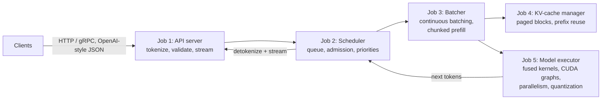
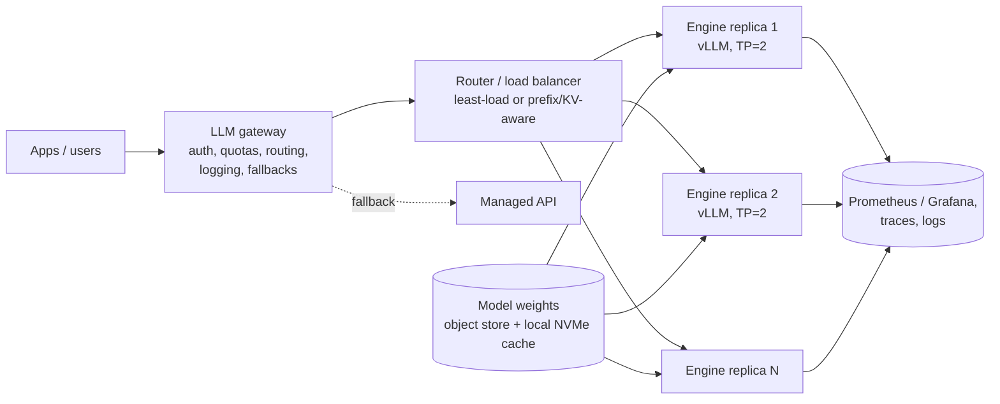

# LLM Serving Frameworks: vLLM, SGLang, TGI, TensorRT-LLM, llama.cpp and Ollama

> **Level:** Beginner to Advanced · **Study time:** ~90 min · **Prerequisites:** [LLM Inference Fundamentals](01-inference-fundamentals-prefill-decode-and-latency-metrics.md), [The KV Cache](02-kv-cache-explained.md), [GPU Fundamentals](03-gpu-fundamentals-compute-bound-vs-memory-bound.md), [Batching, Continuous Batching and PagedAttention](04-batching-continuous-batching-and-paged-attention.md)

## Table of contents

- [Why this matters](#why-this-matters)
- [From `model.generate()` to a serving engine](#from-modelgenerate-to-a-serving-engine)
- [The five jobs of a serving engine](#the-five-jobs-of-a-serving-engine)
- [A toy serving engine in 40 lines](#a-toy-serving-engine-in-40-lines)
- [The landscape: who is who](#the-landscape-who-is-who)
- [Comparison table and typical use cases](#comparison-table-and-typical-use-cases)
- [OpenAI-compatible endpoints](#openai-compatible-endpoints)
- [Deploying a 7B model with vLLM](#deploying-a-7b-model-with-vllm)
- [Memory math behind the flags](#memory-math-behind-the-flags)
- [Multi-GPU serving with tensor and pipeline parallelism](#multi-gpu-serving-with-tensor-and-pipeline-parallelism)
- [Quantized formats and which engine runs them](#quantized-formats-and-which-engine-runs-them)
- [Quick starts for the other engines](#quick-starts-for-the-other-engines)
- [Managed APIs vs self-hosting](#managed-apis-vs-self-hosting)
- [Going deeper: running engines in production](#going-deeper-running-engines-in-production)
- [Going deeper: advanced serving features](#going-deeper-advanced-serving-features)
- [A checklist for choosing a serving stack](#a-checklist-for-choosing-a-serving-stack)
- [Common mistakes and misconceptions](#common-mistakes-and-misconceptions)
- [Interview questions and model answers](#interview-questions-and-model-answers)
- [Key takeaways](#key-takeaways)
- [Further reading](#further-reading)
- [Next](#next)

## Why this matters

Almost every company that runs open-weight LLMs (models whose weights you can download and run on your own hardware: Llama, Qwen, Mistral, Gemma, DeepSeek and so on) does it through one of a handful of serving engines: vLLM, SGLang, TensorRT-LLM, Hugging Face TGI, or, on laptops and edge devices, llama.cpp and Ollama. The engine you pick, and how you configure it, can change throughput and cost per token by several times on the same hardware. Interviewers for senior AI/ML roles expect you to explain what these engines actually do, compare them sensibly, configure one (and explain each flag in terms of GPU memory), and argue the "self-host vs managed API" decision with numbers rather than vibes. This chapter turns the mechanisms you learned in the previous chapters (prefill, decode, KV cache, continuous batching, PagedAttention) into concrete tools and decisions.

## From `model.generate()` to a serving engine

Let's start with the simplest possible way to serve an LLM: load it with Hugging Face Transformers and wrap `model.generate()` in a web endpoint.

```python
# pip install transformers torch fastapi uvicorn
# A NAIVE server: correct, but do not use this in production.
import torch
from fastapi import FastAPI
from transformers import AutoModelForCausalLM, AutoTokenizer

MODEL = "Qwen/Qwen2.5-0.5B-Instruct"   # tiny model so it runs anywhere
tok = AutoTokenizer.from_pretrained(MODEL)
model = AutoModelForCausalLM.from_pretrained(MODEL, dtype=torch.bfloat16)  # transformers < 4.56: torch_dtype=
app = FastAPI()

@app.post("/generate")
def generate(prompt: str, max_new_tokens: int = 64):
    ids = tok(prompt, return_tensors="pt").input_ids
    out = model.generate(ids, max_new_tokens=max_new_tokens)
    return {"text": tok.decode(out[0, ids.shape[1]:], skip_special_tokens=True)}
# Run with: uvicorn naive_server:app --port 8000
```

This works. With one user it is even reasonably fast. Now imagine 50 users sending requests at once:

- Each request is processed **one at a time** (or in a fixed batch that waits for its slowest member). The GPU sits mostly idle during decode, because decode is **memory-bound**: it reads all the weights to produce one token per sequence (see [GPU Fundamentals](03-gpu-fundamentals-compute-bound-vs-memory-bound.md)).
- The **KV cache** (the stored keys and values of every previous token, see [The KV Cache](02-kv-cache-explained.md)) is allocated as one big contiguous tensor per request, sized for the maximum length, wasting most of the memory.
- There is no streaming, no queue, no timeouts, no metrics, no way to cancel a request when the user closes the tab.

> **Analogy:** `model.generate()` is a single chef who cooks one order from start to finish before looking at the next ticket. A **serving engine** is a professional kitchen: an expediter (the scheduler) keeps every burner busy, ingredients (GPU memory) are stored in labeled bins instead of one giant pot per order, and orders go out as soon as each one is ready.

**Definition.** An **LLM serving engine** (also called an **inference server** or **serving framework**) is software that loads a model onto hardware and serves many concurrent generation requests efficiently, by combining a request scheduler, a batching strategy, KV-cache memory management, optimized GPU kernels and a network API.

**Quick recap of terms used throughout** (each is covered in depth in the prerequisite chapters):

| Term | One-line meaning |
|---|---|
| Prefill | Processing the whole prompt in one parallel forward pass; compute-bound; produces the first output token |
| Decode | Generating the remaining tokens one per forward pass; each step re-reads all weights and the KV cache, so it is memory-bound |
| Memory-bound vs compute-bound | Limited by how fast bytes move out of GPU memory vs by how fast the GPU does arithmetic |
| TTFT | Time to first token: queueing time plus prefill; what a user feels as "it started answering" |
| ITL | Inter-token latency: the gap between streamed tokens during decode |
| Throughput | Total tokens per second across all users; it drives cost per token |
| SLO, p95 | Service-level objective, a latency target such as "p95 TTFT under 500 ms", where p95 is the value 95% of requests beat |

## The five jobs of a serving engine

Every engine in this chapter does the same five jobs. They differ in *how well* and *on what hardware*.



1. **API layer.** Accepts requests over HTTP (usually an OpenAI-compatible JSON API) or gRPC, applies the **chat template** (the model-specific format that turns a list of messages into one prompt string, with special tokens marking roles), tokenizes, validates limits, and **streams** tokens back as they are produced using **Server-Sent Events (SSE)**, a simple HTTP mechanism where the server keeps the connection open and pushes `data: ...` lines.
2. **Scheduling.** Decides which waiting requests to admit into the next step, which to pause (**preempt**) when memory runs out, and in what order (first-come-first-served, priorities, fairness across tenants).
3. **Batching.** Runs many sequences through the model in each forward pass. Modern engines use **continuous batching** (also called **in-flight batching** or **iteration-level scheduling**): requests join and leave the batch at every decode step instead of waiting for the whole batch to finish. **Chunked prefill** splits a long prompt into pieces so it does not stall everyone else's decode. Both are covered in [Batching, Continuous Batching and PagedAttention](04-batching-continuous-batching-and-paged-attention.md).
4. **KV-cache management.** Allocates KV memory in fixed-size **blocks** (pages) as sequences grow (**PagedAttention**), frees them when a sequence finishes, and can **reuse** blocks across requests that share a prefix (**prefix caching**).
5. **Kernels and execution.** Runs the math fast: fused attention kernels (FlashAttention, FlashInfer), quantized matrix-multiply kernels (for example Marlin for 4-bit weights), **CUDA graphs** (recording a sequence of GPU kernel launches once and replaying it, which removes CPU launch overhead in the many tiny decode steps), and multi-GPU parallelism.

> **Interview tip:** When asked "what does vLLM do?", do not say "it runs the model faster". Say: "It is a serving engine whose main ideas are continuous batching plus PagedAttention for KV memory, which together let it keep far more sequences in a batch, so the memory-bound decode phase amortizes each weight read over more tokens. Around that it adds optimized kernels, prefix caching, quantization support, multi-GPU parallelism and an OpenAI-compatible server."

## A toy serving engine in 40 lines

Here is the mechanism in plain Python, no GPU required. It simulates a scheduler with a tiny paged KV pool: 8 blocks of 16 tokens each. Each loop iteration is one engine **step** (one forward pass).

```python
from collections import deque
from dataclasses import dataclass

BLOCK_SIZE = 16      # tokens per KV-cache block (vLLM's default block size is also 16)
TOTAL_BLOCKS = 8     # a deliberately tiny KV pool: 8 * 16 = 128 tokens total

@dataclass
class Request:
    rid: str
    prompt_len: int
    max_new: int
    generated: int = 0
    blocks: int = 0

    def tokens(self) -> int:
        return self.prompt_len + self.generated

def blocks_needed(n_tokens: int) -> int:
    return -(-n_tokens // BLOCK_SIZE)  # ceiling division

waiting = deque([Request("A", 20, 5), Request("B", 40, 3),
                 Request("C", 50, 4), Request("D", 10, 2)])
running: list[Request] = []
free = TOTAL_BLOCKS

step = 0
while waiting or running:
    step += 1
    # 1) Admission: prefill waiting requests (FIFO) while their prompt fits in free blocks
    while waiting and blocks_needed(waiting[0].prompt_len) <= free:
        r = waiting.popleft()
        r.blocks = blocks_needed(r.prompt_len)
        free -= r.blocks
        running.append(r)
    # 2) Decode: every running request produces ONE token in this same step
    for r in running:
        extra = blocks_needed(r.tokens() + 1) - r.blocks   # grow KV if a block fills up
        if extra > free:
            continue  # toy: wait a step (real engines preempt or swap a request)
        free -= extra
        r.blocks += extra
        r.generated += 1
    # 3) Retire finished requests and return their blocks to the pool
    done = [r for r in running if r.generated >= r.max_new]
    for r in done:
        running.remove(r)
        free += r.blocks
    print(f"step {step}: running={[r.rid for r in running]} "
          f"finished={[r.rid for r in done]} waiting={[r.rid for r in waiting]} free_blocks={free}")

# step 1: running=['A', 'B'] finished=[] waiting=['C', 'D'] free_blocks=3
# step 2: running=['A', 'B'] finished=[] waiting=['C', 'D'] free_blocks=3
# step 3: running=['A'] finished=['B'] waiting=['C', 'D'] free_blocks=6
# step 4: running=['A', 'C', 'D'] finished=[] waiting=[] free_blocks=1
# step 5: running=['C'] finished=['A', 'D'] waiting=[] free_blocks=4
# step 6: running=['C'] finished=[] waiting=[] free_blocks=4
# step 7: running=[] finished=['C'] waiting=[] free_blocks=8
```

Read the trace slowly, because it contains most of the ideas in this chapter:

- **Step 1:** A (20 tokens) needs $\lceil 20/16 \rceil = 2$ blocks, B (40 tokens) needs $\lceil 40/16 \rceil = 3$ blocks. That leaves $8 - 2 - 3 = 3$ free. C needs $\lceil 50/16 \rceil = 4 > 3$, so it waits.
- **Head-of-line blocking:** D needs only 1 block and *would* fit, but strict FIFO keeps it behind C. Real schedulers have policies for this (priorities, skipping ahead, fairness).
- **Step 3:** B finishes after 3 tokens and frees its 3 blocks (now 6 free). The batch did not wait for A to finish: that is **continuous batching**.
- **Step 4:** C (4 blocks) and D (1 block) join mid-flight while A is still decoding: $6 - 4 - 1 = 1$ free.
- Memory is allocated **block by block** as sequences grow, not reserved for the maximum length up front: that is the essence of **PagedAttention**.

Real engines add one more thing the toy skips: when a running sequence needs a new block and none are free, the scheduler **preempts** a sequence (frees its blocks and later recomputes them, or swaps them to CPU memory). Frequent preemption is a key symptom you will learn to look for in production.

## The landscape: who is who

Now that you know the five jobs, here is a short tour of the main engines. Details change fast (the year is 2026 and most of these projects ship releases every few weeks), so focus on each engine's *design center*: the problem it was built to solve.

### vLLM

- **What:** An open-source, Python-first serving engine that started at UC Berkeley, introduced in "Efficient Memory Management for Large Language Model Serving with PagedAttention" (Kwon et al., SOSP 2023). Now a large community project under the PyTorch Foundation umbrella.
- **Design center:** High-throughput GPU serving of almost any Hugging Face model, with the broadest model and hardware coverage (NVIDIA, AMD ROCm, Google TPU, Intel and others through plugins, with varying maturity).
- **Key features:** PagedAttention, continuous batching, chunked prefill, automatic prefix caching, tensor/pipeline/expert parallelism, many quantization formats, multi-LoRA serving, speculative decoding, structured outputs, an OpenAI-compatible server, and an offline batch API (`LLM` class).
- **Typical use:** The default choice for self-hosting open models on GPUs.

### SGLang

- **What:** An open-source engine from LMSYS (the team behind Chatbot Arena), introduced in "SGLang: Efficient Execution of Structured Language Model Programs" (Zheng et al., 2023; NeurIPS 2024).
- **Design center:** Workloads with lots of **shared prefixes** and **structured generation**: multi-turn chat, agents, few-shot prompts, tree-of-thought style branching, JSON output.
- **Key features:** **RadixAttention**, which stores KV cache in a **radix tree** (a prefix tree where each edge holds a run of tokens) so any request sharing a prefix with an earlier one reuses its KV automatically; fast **constrained decoding** (forcing output to match a JSON schema or regex) using compressed finite-state machines and grammar backends; a frontend language for multi-call LLM programs; strong performance on large **Mixture-of-Experts (MoE)** models such as DeepSeek (models whose MLP layers contain many "expert" sub-networks, of which each token uses only a few).
- **Typical use:** Agentic and multi-turn workloads, structured output at scale, and teams that want top performance with an API very similar to vLLM's.

> **Senior insight:** vLLM and SGLang have converged a lot: both have continuous batching, paged KV, prefix caching, structured outputs and OpenAI-compatible servers. Today the honest answer to "which is faster?" is "benchmark both on *your* model, hardware and traffic pattern". Differences show up in specific features (cache-aware routing, specific MoE kernels, a particular quantization path) rather than in the core design.

### Hugging Face Text Generation Inference (TGI)

- **What:** Hugging Face's production server: a **Rust** router (HTTP, queueing, batching) in front of Python model shards (one process per GPU, each holding a slice of the model), shipped as a Docker image.
- **Design center:** Easy, production-ready deployment of Hub models, tightly integrated with Hugging Face Inference Endpoints.
- **Key features:** Continuous batching, tensor parallelism (`--num-shard`), paged attention and FlashAttention kernels, quantization (bitsandbytes, GPTQ, AWQ, FP8 and others), a "Messages API" compatible with OpenAI chat completions, Prometheus metrics, OpenTelemetry tracing.
- **Status note:** In late 2025 Hugging Face announced that TGI was moving to maintenance mode and pointed users toward engines such as vLLM and SGLang (which Inference Endpoints also support). Check the repository's current status before choosing it for a new project; you may still meet it in existing systems and interviews.

### NVIDIA TensorRT-LLM and Triton Inference Server

- **TensorRT-LLM** is NVIDIA's open-source library for running LLMs as fast as possible on NVIDIA GPUs. Historically you **compiled** a model into a **TensorRT engine** (an optimized, hardware-specific execution plan) ahead of time; newer versions also offer a PyTorch-based workflow and a `trtllm-serve` command with an OpenAI-compatible API, which removes much of the old build friction. Features: in-flight batching, paged KV cache, highly tuned kernels, FP8 on Hopper (H100/H200) and FP4 formats on Blackwell (B200 and later), speculative decoding, multi-GPU and multi-node parallelism.
- **Triton Inference Server** is NVIDIA's general-purpose model server (not to be confused with the Triton *language* from OpenAI for writing GPU kernels). It serves models from many frameworks (TensorRT, PyTorch, ONNX, Python, and backends for TensorRT-LLM and vLLM) behind HTTP/gRPC, with dynamic batching, model ensembles (pipelines of models), versioning and metrics. NVIDIA has been rebranding and folding parts of this stack into **NVIDIA Dynamo**, a distributed inference framework (2025) focused on multi-node features such as disaggregated prefill/decode and KV-aware routing (both explained later in this chapter); it can use vLLM, SGLang or TensorRT-LLM as its engine. NVIDIA also packages optimized containers as **NIM** microservices.
- **Design center:** Squeezing maximum performance out of NVIDIA hardware, especially the newest generations, at the cost of more setup and less portability.

### llama.cpp

- **What:** A C/C++ inference library and set of tools built on the **ggml** tensor library, started by Georgi Gerganov in 2023.
- **Design center:** Running LLMs **anywhere**: laptops, Apple Silicon (Metal), CPUs with SIMD instructions, consumer GPUs (CUDA, ROCm, Vulkan), phones, Raspberry Pis.
- **Key features:** The **GGUF** file format (a single file containing weights, tokenizer and metadata), many quantization levels (from about 1.5 to 8 bits per weight), partial **GPU offload** (put some layers on the GPU, the rest on CPU), and `llama-server`, a lightweight HTTP server with OpenAI-compatible endpoints and parallel slots.
- **Typical use:** Local and edge inference, CPU-only servers, privacy-sensitive offline apps, hobby and prototyping work. It is *not* designed to beat vLLM on a multi-user GPU server.

### Ollama

- **What:** A developer-friendly wrapper that makes local LLMs feel like Docker images: `ollama pull`, `ollama run`. It historically used llama.cpp as its engine and has since added its own engine for some model families.
- **Design center:** The easiest possible local experience: one install, a model library, automatic GPU detection, a background service on `localhost:11434`.
- **Key features:** A **Modelfile** (like a Dockerfile for models: base model, system prompt, parameters, template), native REST API plus an OpenAI-compatible endpoint, GGUF models, automatic loading/unloading of models from memory.
- **Typical use:** Local development, demos, desktop apps, internal tools for a few users. Not a high-concurrency production server.

### Other names you may hear

| Name | One-line description |
|---|---|
| LMDeploy | Serving toolkit from the InternLM team (Shanghai AI Lab) with its own fast TurboMind engine |
| MLC LLM | Compiler-based deployment (Apache TVM lineage) for phones, browsers (WebGPU) and diverse GPUs |
| Ray Serve, KServe | Orchestration layers that *host* engines like vLLM on clusters (scaling, routing), not engines themselves |
| llm-d | Kubernetes-native distributed serving stack (2025) built around vLLM with KV-aware routing |
| Text Embeddings Inference (TEI) | Hugging Face server specialized for embedding and reranker models (useful for RAG) |

## Comparison table and typical use cases

This is the table to have in your head for interviews. "Best at" reflects each project's design focus, not a benchmark result.

| | vLLM | SGLang | TGI | TensorRT-LLM (+ Triton / Dynamo) | llama.cpp | Ollama |
|---|---|---|---|---|---|---|
| Maintainer | Open-source community (Berkeley origin) | Open-source (LMSYS origin) | Hugging Face | NVIDIA | Open-source (ggml-org) | Ollama Inc. (open-source core) |
| Core language | Python + CUDA/C++ kernels | Python + CUDA kernels | Rust router + Python shards | C++/CUDA, Python API | C/C++ | Go wrapper around a C/C++ engine |
| Hardware | NVIDIA, AMD, TPU, others (varying maturity) | NVIDIA, AMD, others | NVIDIA, AMD, Intel Gaudi | NVIDIA only | CPU, Apple Metal, CUDA, ROCm, Vulkan | Same as llama.cpp |
| Signature idea | PagedAttention | RadixAttention + fast constrained decoding | Production-ready Rust router | Compiled, hardware-tuned engines | GGUF + runs anywhere | One-command local UX |
| Batching | Continuous + chunked prefill | Continuous + chunked prefill | Continuous | In-flight | Parallel slots (basic continuous) | Limited parallel requests |
| Quant formats | AWQ, GPTQ, FP8, INT8, bitsandbytes, GGUF (partial), more | AWQ, GPTQ, FP8, INT8, more | AWQ, GPTQ, bitsandbytes, FP8, more | FP8, FP4, INT8 SmoothQuant, INT4 AWQ, more | GGUF (Q2 to Q8, k-quants, i-quants) | GGUF |
| API | OpenAI-compatible + offline Python | OpenAI-compatible + native + frontend DSL | Native + OpenAI Messages API | `trtllm-serve` OpenAI-compatible; Triton HTTP/gRPC | OpenAI-compatible `llama-server` | Native REST + OpenAI-compatible |
| Ease of setup | Easy (`pip`, Docker) | Easy (`pip`, Docker) | Easy (Docker) | Harder (more knobs, NVIDIA stack) | Easy (build or download binary) | Easiest |
| Typical use | Default high-throughput GPU serving | Prefix-heavy, agentic, structured output | Existing HF-centric deployments | Max performance on NVIDIA fleets | Local, CPU, edge, Apple Silicon | Local dev, demos, desktop |
| Main weakness | Many knobs; fast-moving flags | Fast-moving; smaller ecosystem than vLLM | Maintenance mode (check status) | Vendor lock-in, complexity | Not built for many concurrent users | Not built for production scale |

> **Common mistake:** Comparing Ollama to vLLM on a multi-user benchmark and concluding "Ollama is slow". They solve different problems. Ollama optimizes the experience of one developer on one machine; vLLM optimizes aggregate tokens per second for hundreds of concurrent users on datacenter GPUs.

A quick way to place each engine on a map:

```text
                    many concurrent users / datacenter GPUs
                                    ^
                                    |
          TensorRT-LLM (+Triton/Dynamo)   vLLM   SGLang
          (max perf, NVIDIA only)    (broadest)  (prefix + structured)
                                    |
                    TGI (existing HF deployments)
                                    |
   hard to set up <-----------------+-----------------> easy to set up
                                    |
                               llama.cpp
                     (CPU, Apple Silicon, edge, GGUF)
                                    |
                                  Ollama
                         (one developer, one laptop)
                                    v
                       single user / local hardware
```

## OpenAI-compatible endpoints

### What "OpenAI-compatible" means

OpenAI's REST API became the de facto standard interface for LLMs. An engine is **OpenAI-compatible** when it exposes the same URL paths and JSON shapes, most importantly:

| Endpoint | Purpose |
|---|---|
| `POST /v1/chat/completions` | Chat: a list of `messages` in, an assistant message out (optionally streamed) |
| `POST /v1/completions` | Legacy raw-text completion: a `prompt` string in, text out |
| `GET /v1/models` | Lists the model names the server serves |
| `POST /v1/embeddings` | Embeddings (when an embedding model is served) |

The payoff is huge: the same client code works against a managed API, vLLM, SGLang, TGI's Messages API, `trtllm-serve`, `llama-server` and Ollama. You only change `base_url`, `api_key` and the model name.

```python
# pip install openai
# Works against vLLM (port 8000 by default), SGLang (30000), llama-server (8080),
# Ollama (http://localhost:11434/v1), etc. Only base_url and model change.
from openai import OpenAI

client = OpenAI(base_url="http://localhost:8000/v1", api_key="not-needed-locally")

# Non-streaming call
resp = client.chat.completions.create(
    model="qwen-7b",  # must match the server's served model name
    messages=[
        {"role": "system", "content": "You are a spam filter. Answer SPAM or HAM."},
        {"role": "user", "content": "WIN a FREE iPhone!!! Click now"},
    ],
    temperature=0.0,
    max_tokens=5,
)
print(resp.choices[0].message.content)
print(resp.usage)  # prompt_tokens, completion_tokens, total_tokens

# Streaming call: tokens arrive as Server-Sent Events
stream = client.chat.completions.create(
    model="qwen-7b",
    messages=[{"role": "user", "content": "Explain the KV cache in one sentence."}],
    stream=True,
)
for chunk in stream:
    delta = chunk.choices[0].delta.content if chunk.choices else None
    if delta:
        print(delta, end="", flush=True)
```

### What the endpoint does behind the scenes

When the server receives `messages`, it applies the model's **chat template** (stored in the tokenizer config, usually as a Jinja template) to build the actual prompt string, for example adding `<|im_start|>system ... <|im_end|>` markers for Qwen-style models. Getting the template wrong is one of the most common causes of "the model gives weird answers when self-hosted but fine on the provider's playground".

### Where compatibility ends

"Compatible" usually means "the common subset works". Watch out for:

- **Parameters that differ or are missing:** `logprobs` detail, `n` > 1, `seed`, JSON-schema `response_format`, and tool calling (often needs a model-specific **tool-call parser** flag on the server, because each model family formats tool calls differently).
- **Extra parameters:** non-standard sampling options (`top_k`, `min_p`, `repetition_penalty`) go through `extra_body` in the OpenAI Python client.
- **Newer APIs and errors:** newer OpenAI endpoints (such as the Responses API) are supported unevenly, and context-length or rate-limit errors look different across servers.

> **Interview tip:** A strong design answer puts an **OpenAI-compatible gateway** in front of all models (managed and self-hosted). The application talks to one interface; the gateway handles routing, auth, rate limits, logging and fallbacks. This keeps you free to swap engines or providers later. Structured outputs and tool calling are covered in [Structured Outputs, JSON Mode and Function Calling](../05-llms/05-structured-outputs-and-function-calling.md).

## Deploying a 7B model with vLLM

Our running example for the rest of the chapter: **serve a 7B instruction-tuned model** (think Qwen2.5-7B-Instruct or Mistral-7B-Instruct) for an internal assistant, first on one 24 GB GPU (for example an NVIDIA L4 or A10G), then on two.

> **Version warning:** vLLM moves fast. Flag names, defaults and even the engine internals have changed across versions (for example, the "V1" engine re-architecture in 2025 changed several defaults, such as enabling prefix caching and chunked prefill by default). Always check `vllm serve --help` and the docs for the exact version you pin. The *concepts* below are durable.

### Installing and launching

```bash
# Option A: pip (Linux + NVIDIA GPU; pin a version in real deployments)
pip install vllm

vllm serve Qwen/Qwen2.5-7B-Instruct \
  --served-model-name qwen-7b \
  --max-model-len 8192 \
  --gpu-memory-utilization 0.90 \
  --tensor-parallel-size 1 \
  --max-num-seqs 128 \
  --port 8000 \
  --api-key "$VLLM_API_KEY"

# Option B: the official Docker image (pin a specific tag instead of latest)
docker run --gpus all --ipc=host -p 8000:8000 \
  -v ~/.cache/huggingface:/root/.cache/huggingface \
  -e HF_TOKEN="$HF_TOKEN" \
  vllm/vllm-openai:<pinned-version> \
  --model Qwen/Qwen2.5-7B-Instruct --max-model-len 8192
```

`--ipc=host` (or a large `--shm-size`) matters because multi-process parallelism uses shared memory, and Docker's default is tiny.

### The important flags, explained

| Flag | What it controls | How to think about it |
|---|---|---|
| `--max-model-len` | Maximum total tokens (prompt + output) per sequence | Defaults to the model's maximum context, which may be 32K to 128K+. Setting it to what you really need frees memory and avoids startup errors when the KV cache cannot fit even one max-length sequence. |
| `--gpu-memory-utilization` | Fraction of each GPU's memory vLLM may use (default 0.9 in recent versions) | vLLM pre-allocates this budget at startup: weights first, then a profiling pass for activations, and **everything left becomes KV-cache blocks**. Higher means more concurrent sequences; too high risks out-of-memory if something else uses the GPU. |
| `--tensor-parallel-size` (`-tp`) | Number of GPUs to split each layer across | Use when the model does not fit on one GPU, or to get more KV memory and lower latency. Must divide the number of attention heads (see the multi-GPU section below). |
| `--pipeline-parallel-size` | Number of GPU groups holding different layers | Mostly for multi-node, when one node's GPUs are not enough. |
| `--quantization` | Quantization method (for example `awq`, `gptq`, `fp8`) | Often auto-detected from the checkpoint's config; `fp8` can also quantize an FP16 checkpoint on the fly on supported GPUs. |
| `--dtype` | Compute dtype (`auto`, `bfloat16`, `float16`) | `auto` follows the checkpoint. Use `float16` on older GPUs without BF16 support (pre-Ampere). |
| `--kv-cache-dtype` | Storage type for KV cache (`auto`, `fp8`) | `fp8` roughly halves KV memory, doubling capacity; small quality risk, validate on your evals. |
| `--max-num-seqs` | Maximum sequences in a batch per step | Caps concurrency; higher improves throughput until KV memory or latency targets bind. |
| `--max-num-batched-tokens` | Token budget per step (prefill + decode) | With chunked prefill, controls the trade-off between time to first token (bigger chunks) and inter-token latency for running requests (smaller chunks). |
| `--enable-prefix-caching` | Reuse KV for shared prompt prefixes | Default-on in recent versions. Big win for long shared system prompts and multi-turn chat. |
| `--enforce-eager` | Disable CUDA graphs | Saves some memory and startup time, but decode gets slower. Useful for debugging. |
| `--served-model-name` | The `model` name clients send | Decouple API names from Hugging Face repo paths. |
| `--api-key` | Simple bearer-token check | Fine for internal use; put real auth in a gateway. |
| `--enable-lora`, `--lora-modules` | Serve LoRA adapters on top of the base model | See multi-LoRA serving below. |
| `--trust-remote-code` | Allow model repos to run custom Python | Security risk: only for repos you trust and have reviewed. |

### Offline batch inference

For batch jobs (labeling a dataset, generating synthetic data, running evals) you do not need an HTTP server at all. vLLM's offline API batches everything for maximum throughput:

```python
# pip install vllm   (needs a supported GPU)
from vllm import LLM, SamplingParams

llm = LLM(model="Qwen/Qwen2.5-7B-Instruct", max_model_len=4096,
          gpu_memory_utilization=0.90)
params = SamplingParams(temperature=0.0, max_tokens=5)

emails = ["WIN a FREE iPhone!!! Click now", "Lunch at 1pm tomorrow?"]
conversations = [
    [{"role": "system", "content": "Answer SPAM or HAM."},
     {"role": "user", "content": e}] for e in emails
]
outputs = llm.chat(conversations, params)   # applies the chat template for you
for e, o in zip(emails, outputs):
    print(e, "->", o.outputs[0].text.strip())
```

### Smoke-testing the server

```bash
curl http://localhost:8000/v1/models -H "Authorization: Bearer $VLLM_API_KEY"
curl http://localhost:8000/health        # 200 when the engine is ready
curl http://localhost:8000/metrics       # Prometheus metrics (queue, KV usage, latency histograms)
```

## Memory math behind the flags

The flags only make sense once you can do the memory budget by hand. This is also the single most common "go deeper" interview follow-up.

### Step 1: how much memory goes to the KV cache?

$$
M_{\text{KV}} = U \cdot M_{\text{GPU}} - M_{\text{weights}} - M_{\text{other}}
$$

- $M_{\text{KV}}$: memory left for KV-cache blocks.
- $U$: the `--gpu-memory-utilization` fraction (for example 0.90).
- $M_{\text{GPU}}$: total GPU memory.
- $M_{\text{weights}}$: model weights = number of parameters × bytes per parameter.
- $M_{\text{other}}$: activations during the forward pass, CUDA graphs, framework buffers. It depends on the model, batch settings and version; vLLM measures it with a profiling run at startup.

**Worked example (7B model, FP16, one 24 GB GPU).** Assume $M_{\text{other}} = 1.6$ GB (an illustrative number; read the real one from the startup logs).

- $U \cdot M_{\text{GPU}} = 0.90 \times 24 = 21.6$ GB
- $M_{\text{weights}} = 7 \times 10^9 \times 2 \text{ bytes} = 14 \times 10^9$ bytes $= 14$ GB
- $M_{\text{KV}} = 21.6 - 14 - 1.6 = 6.0$ GB

### Step 2: how many tokens fit?

The KV cache per token (derived in [The KV Cache](02-kv-cache-explained.md)) is:

$$
b_{\text{token}} = 2 \cdot L \cdot H_{\text{kv}} \cdot d_{\text{head}} \cdot p
$$

- $2$: one key vector and one value vector.
- $L$: number of transformer layers.
- $H_{\text{kv}}$: number of key/value heads (smaller than the number of query heads when the model uses grouped-query attention, GQA).
- $d_{\text{head}}$: dimension of each head.
- $p$: bytes per stored number (2 for FP16/BF16, 1 for FP8).

For a classic 7B configuration without GQA (Llama-2-7B style: $L = 32$, $H_{\text{kv}} = 32$, $d_{\text{head}} = 128$, FP16). We use it because it makes the KV pressure easy to see; the Qwen2.5-7B model in our launch command actually uses GQA ($L = 28$, $H_{\text{kv}} = 4$, $d_{\text{head}} = 128$, about $2 \times 28 \times 4 \times 128 \times 2 = 57{,}344$ bytes $= 56$ KiB per token, roughly 9x less) and has about 7.6B parameters (about 15 GB of BF16 weights), so its real numbers differ. The classic configuration gives:

- $2 \times 32 = 64$
- $64 \times 32 = 2{,}048$
- $2{,}048 \times 128 = 262{,}144$
- $262{,}144 \times 2 = 524{,}288$ bytes $= 512$ KiB $= 0.5$ MiB per token

Tokens that fit:

$$
N_{\text{tokens}} = \frac{M_{\text{KV}}}{b_{\text{token}}} = \frac{6.0 \times 10^9}{524{,}288} \approx 11{,}444 \text{ tokens}
$$

(Check: $524{,}288 \times 11{,}444 = 5{,}999{,}951{,}872 \approx 6.0 \times 10^9$.)

### Step 3: what does that mean for concurrency?

- If every request used the full 8,192 tokens our launch command allows (`--max-model-len 8192`): $11{,}444 / 8{,}192 \approx 1.4$, so only **1** full-length sequence fits at once. Even at 4,096 tokens per request: $11{,}444 / 4{,}096 \approx 2.8$, so only **2**.
- If a typical request uses about 1,000 tokens (prompt + answer): about **11** sequences fit.

That is why a 7B FP16 model on a 24 GB card feels sluggish under load: the KV cache, not compute, limits the batch. Three levers, all of which map to flags:

| Lever | Flag | Effect in our example |
|---|---|---|
| Quantize weights to 4-bit (AWQ/GPTQ) | `--quantization awq` (or auto-detected) | Weights $\approx 7 \times 10^9 \times 0.5 = 3.5$ GB, plus scales; call it ~4 GB (illustrative). $M_{\text{KV}} = 21.6 - 4 - 1.6 = 16$ GB, so $16 \times 10^9 / 524{,}288 \approx 30{,}500$ tokens: about **2.7x** more. |
| FP8 KV cache | `--kv-cache-dtype fp8` | $b_{\text{token}}$ halves to 262,144 bytes, so token capacity doubles (for the same $M_{\text{KV}}$). |
| Use a GQA model | (model choice) | A model with 8 KV heads instead of 32 needs a quarter of the KV per token. Most modern models already use GQA (see [Modern LLM Architecture](../04-transformers/08-modern-llm-architecture-improvements.md)). |

> **Senior insight:** Cap `--max-model-len` at what your product needs. It does not reserve memory per request (PagedAttention allocates on demand), but the engine must be able to fit at least one max-length sequence, and very long requests can monopolize the cache and trigger preemptions for everyone else. Enforce prompt-length limits at the gateway as well.

## Multi-GPU serving with tensor and pipeline parallelism

### When you need more than one GPU

1. **The model does not fit.** A 70B model in FP16 needs $70 \times 10^9 \times 2 = 140$ GB for weights alone: more than an 80 GB GPU such as an A100 or H100 holds (larger-memory GPUs such as the 141 GB H200 or 192 GB B200 and MI300X can hold the weights, but leave little room for KV cache).
2. **The model fits but the KV cache does not** (our 7B example above).
3. **You need lower latency per token.** Splitting each layer across GPUs means each GPU reads fewer weight bytes per step.

### Tensor parallelism (TP)

> **Analogy:** Four people translate one long page together, each taking a quarter of every paragraph, then they quickly swap notes at the end of each paragraph. That "swap notes" step is fast only if they sit at the same table.

**Tensor parallelism** splits each weight matrix inside every layer across $T$ GPUs (the Megatron-LM scheme, Shoeybi et al., 2019). Attention heads are divided among GPUs (each GPU computes a subset of heads, and stores the KV cache for only those heads), and MLP matrices are split by columns then rows. After the attention block and after the MLP block, GPUs combine partial results with an **all-reduce** (a collective operation that sums tensors across GPUs and gives every GPU the result). That is two all-reduces per layer, every decode step, so TP needs a fast interconnect such as **NVLink** (NVIDIA's high-bandwidth GPU-to-GPU link) and is normally kept **inside one machine**. The training-side view of the same idea is in [Distributed Training](../02-deep-learning/10-distributed-training-and-training-memory.md).

```text
Tensor parallel, T = 2, one transformer layer, one decode step

              GPU 0                              GPU 1
   Attention: heads 0-15 + their KV     Attention: heads 16-31 + their KV
              \                                  /
               +----------- all-reduce ---------+     (after attention)
              /                                  \
   MLP: 1st matrix, half of columns     MLP: 1st matrix, other half of columns
        2nd matrix, matching rows            2nd matrix, matching rows
              \                                  /
               +----------- all-reduce ---------+     (after MLP)
```

**Constraint:** the number of query attention heads must be divisible by $T$, and the number of KV heads must either be divisible by $T$ or, when $T$ is larger, divide $T$ evenly. That is why TP sizes are usually 1, 2, 4 or 8. Models with few KV heads (for example 8) can use TP up to 8 without replicating them; beyond that, engines replicate KV heads across GPUs, which wastes memory.

### Worked example: our 7B model on two GPUs (TP = 2)

Each GPU holds half the weights and half the KV heads:

- Weights per GPU: $14 / 2 = 7$ GB
- KV memory per GPU: $21.6 - 7 - 1.6 = 13.0$ GB (keeping the illustrative 1.6 GB overhead)
- KV bytes per token *per GPU*: $524{,}288 / 2 = 262{,}144$ (only 16 of the 32 heads live here)
- Tokens that fit: $13.0 \times 10^9 / 262{,}144 \approx 49{,}591$

Each token's KV is spread across both GPUs, so the whole system holds about 49,600 tokens versus 11,444 on one GPU. **Doubling the GPUs gave about 4.3x the KV capacity** ($49{,}591 / 11{,}444 \approx 4.33$), because the fixed cost of the weights is now shared. That is a non-obvious, very interview-worthy result.

### Pipeline parallelism (PP) and data parallelism (DP)

- **Pipeline parallelism** places different *layers* on different GPUs (layers 0-15 on node A, 16-31 on node B). Communication happens only at the boundary, so it tolerates slower links and is used **across nodes**. It does not reduce per-token latency (a token still passes through all layers in sequence), and it needs many requests in flight to keep all stages busy.
- **Data parallelism** for serving simply means **multiple independent replicas** of the model behind a load balancer. It scales throughput linearly and is the simplest way to scale once one replica's latency is acceptable.
- **Expert parallelism (EP)** is for **Mixture-of-Experts** models (see [Modern LLM Architecture](../04-transformers/08-modern-llm-architecture-improvements.md)): different experts live on different GPUs, and tokens are routed to them with all-to-all communication.

| Strategy | What is split | Communication | Use when | Latency effect |
|---|---|---|---|---|
| Tensor (TP) | Each layer's matrices | 2 all-reduces per layer per step (best with NVLink) | Model or KV too big for one GPU; want lower per-token latency | Lowers it (until communication dominates) |
| Pipeline (PP) | Groups of layers | Activations at stage boundaries only | Model too big for one node | No improvement; adds some |
| Data (replicas) | Nothing: full copies | None between replicas | Need more throughput | None (per request) |
| Expert (EP) | MoE experts | All-to-all token routing | Large MoE models | Depends on routing balance |

A common recipe: **TP inside a node, PP across nodes, replicas for throughput.** For example, a 70B FP16 model on a node of 8 × 80 GB GPUs: TP = 4 gives two replicas per node, or TP = 8 gives one replica with more KV memory and lower latency. Which is better depends on whether you are throughput-bound or latency-bound, so benchmark both.

```bash
# 70B on 4 GPUs in one node (illustrative; check memory with your exact model)
vllm serve meta-llama/Llama-3.1-70B-Instruct --tensor-parallel-size 4 --max-model-len 16384

# Two nodes with 8 GPUs each: TP inside the node, PP across nodes (requires a Ray
# cluster or the engine's multi-node launcher; setup details are version-specific)
vllm serve <model> --tensor-parallel-size 8 --pipeline-parallel-size 2
```

> **Common mistake:** Using TP = 8 across PCIe-only GPUs with no NVLink and expecting linear speedups. The all-reduces become the bottleneck. On PCIe boxes, prefer smaller TP plus more replicas, or PP.

## Quantized formats and which engine runs them

Quantization stores weights (and sometimes activations and KV cache) in fewer bits. The theory (scales, zero points, outliers, GPTQ and AWQ internals) is in [Practical LLM Quantization](../07-model-compression/04-llm-quantization-gptq-awq-and-outliers.md) and [Number Formats and Model Memory](../07-model-compression/01-number-formats-and-model-memory.md). Here we care about the *serving* view: which file format, which engine, which GPU.

| Format | What it is | Bits | Speed story | Hardware sweet spot | Engines |
|---|---|---|---|---|---|
| **AWQ** | Activation-aware weight quantization (Lin et al., 2023): protects salient weight channels using activation statistics | 4-bit weights, FP16 activations (W4A16) | Less memory to read during decode, so faster for memory-bound decode at small/medium batch; dequantization overhead can hurt at large batch | Any modern NVIDIA GPU; good for fitting big models on small GPUs | vLLM, SGLang, TGI, TensorRT-LLM, LMDeploy |
| **GPTQ** | Post-training quantization using approximate second-order information (Frantar et al., 2022) | Usually 4-bit (also 3, 8) weights, W4A16 | Similar to AWQ; fast kernels such as Marlin make both efficient | Same as AWQ | vLLM, SGLang, TGI, TensorRT-LLM |
| **FP8** | 8-bit floating point (E4M3 for weights/activations), often W8A8 | 8-bit weights and activations | Halves weight memory *and* uses FP8 tensor cores, so it speeds up compute-bound prefill too; usually very small quality loss | NVIDIA Hopper (H100/H200), Ada (L4, L40S), Blackwell; recent AMD | vLLM, SGLang, TGI, TensorRT-LLM |
| **INT8 (SmoothQuant, W8A8)** | 8-bit integer weights and activations with outlier smoothing | 8 | Uses INT8 tensor cores; good on GPUs without FP8 (Ampere: A100, A10G) | Ampere | TensorRT-LLM, vLLM |
| **FP4 / NVFP4 / MXFP4** | 4-bit floating point with fine-grained block scales | 4 | Native FP4 tensor cores | NVIDIA Blackwell and later (NVFP4, MXFP4); AMD MI350-series (MXFP4) | TensorRT-LLM, vLLM, SGLang (support maturing) |
| **GGUF** | llama.cpp's single-file format with many quant types: `Q8_0`, `Q5_K_M`, `Q4_K_M`, `IQ3_XXS`, ... | About 1.5 to 8 | Designed for CPU, Apple Silicon and consumer GPUs; mixed CPU/GPU offload | Laptops, Macs, CPUs, edge | llama.cpp, Ollama, LM Studio; partial support in vLLM |
| **bitsandbytes (NF4, INT8)** | On-the-fly quantization popular for QLoRA fine-tuning | 4 or 8 | Saves memory but is generally *slower* than AWQ/GPTQ/FP8 kernels for serving | Experiments, fine-tuning | Transformers, TGI, vLLM |

How to read GGUF names: `Q4_K_M` means 4-bit weights using the "k-quant" block scheme, **M**edium variant (some sensitive tensors kept at higher precision); counting block scales and those higher-precision tensors it averages closer to 4.8 bits per weight. `Q8_0` is near-lossless 8-bit (about 8.5 bits per weight with scales). As a rough rule people use `Q4_K_M` or `Q5_K_M` as the default quality/size trade-off, but always test on your task.

A quick memory table for our 7B model (weights only, ignoring scales and metadata):

| Precision | Bytes per param | 7B weights |
|---|---|---|
| FP16/BF16 | 2 | $7 \times 10^9 \times 2 = 14$ GB |
| FP8 / INT8 | 1 | $7 \times 10^9 \times 1 = 7$ GB |
| 4-bit (AWQ, GPTQ, Q4) | 0.5 | $7 \times 10^9 \times 0.5 = 3.5$ GB |

> **Senior insight:** "Quantized" does not automatically mean "faster". Weight-only 4-bit (W4A16) speeds up the memory-bound decode phase, but at large batch sizes the workload becomes compute-bound and the dequantization work can make it *slower* than FP16 or FP8. If latency did not improve after quantizing, check whether the engine used a fast kernel for that format on that GPU, and whether you were memory-bound in the first place. This exact scenario is worked through in [Debugging Case: A Quantized LLM Uses Less Memory but Latency Is Unchanged](../11-system-design/06-debugging-case-quantized-llm-not-faster.md).

## Quick starts for the other engines

These commands show the *shape* of each tool. Flags change across versions; treat them as starting points and check `--help`.

### SGLang

```bash
pip install "sglang[all]"   # extras and install method vary by version; Docker images also exist
python -m sglang.launch_server --model-path Qwen/Qwen2.5-7B-Instruct \
  --tp 1 --port 30000 --mem-fraction-static 0.85
# OpenAI-compatible API at http://localhost:30000/v1
```

Note the different spelling of similar ideas: `--mem-fraction-static` plays a role similar to vLLM's `--gpu-memory-utilization`, and `--tp` is tensor parallel size. Prefix reuse through RadixAttention is on by default.

Structured output works through the standard OpenAI `response_format` with a JSON schema on both SGLang and recent vLLM (engine-specific extras also exist and change between versions):

```python
from openai import OpenAI
client = OpenAI(base_url="http://localhost:30000/v1", api_key="none")
schema = {"type": "object",
          "properties": {"label": {"type": "string", "enum": ["SPAM", "HAM"]},
                         "confidence": {"type": "number"}},
          "required": ["label", "confidence"]}
resp = client.chat.completions.create(
    model="Qwen/Qwen2.5-7B-Instruct",  # the served model name; check GET /v1/models
    messages=[{"role": "user", "content": "Classify: WIN a FREE iPhone!!!"}],
    response_format={"type": "json_schema",
                     "json_schema": {"name": "spam_label", "schema": schema}},
)
print(resp.choices[0].message.content)  # a JSON string matching the schema
```

### Hugging Face TGI

```bash
docker run --gpus all --shm-size 1g -p 8080:80 \
  -v $PWD/data:/data \
  ghcr.io/huggingface/text-generation-inference:<pinned-version> \
  --model-id Qwen/Qwen2.5-7B-Instruct \
  --num-shard 1 --max-input-tokens 4096 --max-total-tokens 8192
# Native: POST /generate, /generate_stream   OpenAI-style: POST /v1/chat/completions
```

### TensorRT-LLM

```bash
# Recent versions: serve directly with an OpenAI-compatible server
# (the classic flow was: convert checkpoint -> trtllm-build engine -> serve via Triton)
trtllm-serve Qwen/Qwen2.5-7B-Instruct --host 0.0.0.0 --port 8000 --tp_size 1
```

The classic engine-build workflow is worth knowing for interviews: you compile for a *specific* GPU type, maximum batch size, maximum sequence lengths and precision. Change any of these and you rebuild. That compile step is where much of the speed comes from, and also where much of the operational friction comes from.

### llama.cpp

```bash
# Build from source or download a release binary, then:
#   -c         context size in tokens (shared among the parallel slots)
#   -ngl       number of layers to offload to the GPU (99 = all that exist)
#   --parallel number of concurrent request slots
llama-server -m ./qwen2.5-7b-instruct-q4_k_m.gguf -c 8192 -ngl 99 --parallel 4 --port 8080
# OpenAI-compatible API at http://localhost:8080/v1
```

`-ngl` is the key llama.cpp idea: with a GPU too small for the whole model, offload as many layers as fit and run the rest on CPU. It works, but the CPU layers dominate latency.

### Ollama

```bash
ollama pull qwen2.5:7b        # downloads a GGUF build (usually a 4-bit quant by default)
ollama run qwen2.5:7b "Is 'WIN a FREE iPhone' spam?"
# Background service on http://localhost:11434
#   native API:        POST /api/chat, /api/generate
#   OpenAI-compatible: http://localhost:11434/v1/chat/completions
```

A **Modelfile** customizes a model (comments in a Modelfile start with `#`):

```text
FROM qwen2.5:7b
PARAMETER temperature 0
PARAMETER num_ctx 8192
SYSTEM You are a spam filter. Answer only SPAM or HAM.
```

```bash
ollama create spam-filter -f Modelfile
ollama run spam-filter "Lunch at 1pm tomorrow?"
```

> **Common mistake:** Forgetting that Ollama's default context window is small (it has varied by version) and silently truncates long prompts. Set `num_ctx` explicitly when you feed it long RAG contexts.

## Managed APIs vs self-hosting

### The options

- **Managed API, per token:** a provider's closed model (OpenAI, Google Gemini and others) or hosted open-weight models (for example Together AI, Fireworks, or cloud platforms such as AWS Bedrock and Google Vertex AI).
- **Dedicated managed endpoints:** a provider runs an engine like vLLM on GPUs reserved for you (for example Hugging Face Inference Endpoints, SageMaker). You pay per GPU-hour.
- **Self-hosting:** you run the engine on your own cloud GPUs or on-premises hardware.

### The trade-offs

| Dimension | Managed API (per token) | Self-hosted (per GPU-hour) |
|---|---|---|
| Cost at low volume | Cheap: you pay only for what you use | Expensive: idle GPUs still cost money |
| Cost at high, steady volume | Grows linearly with tokens | Can be much cheaper per token if utilization is high |
| Model quality | Access to frontier closed models | Limited to open-weight models (often strong, but check your task) |
| Privacy and data residency | Data leaves your network (contracts, zero-retention options and regional hosting help) | Data stays in your VPC or data center; required by some regulations |
| Control | Provider picks versions, deprecations, rate limits | You pin exact weights and engine versions; custom fine-tunes, LoRA adapters, sampling, logprobs |
| Latency | Network round trip plus shared-tenant queues; can vary | Can be lower and more predictable (co-located, dedicated), but you must engineer it |
| Operational burden | Near zero | High: GPU capacity, drivers, upgrades, autoscaling, on-call, security patches |
| Time to market | Hours | Days to weeks |
| Scaling spikes | Provider absorbs (within rate limits) | You need headroom or slow GPU autoscaling |

### Break-even math

The cost per million tokens when self-hosting:

$$
C_{\text{self}} = \frac{P_{\text{GPU}}}{u \cdot R \cdot 3600 / 10^6}
$$

- $C_{\text{self}}$: dollars per million tokens.
- $P_{\text{GPU}}$: price of the GPU(s) per hour.
- $R$: sustained throughput in tokens per second when the server is busy (measured with your real traffic mix).
- $u$: average utilization (fraction of the time the server is actually busy, between 0 and 1).
- $3600 / 10^6$: converts tokens per second into millions of tokens per hour.

**Worked example (all numbers illustrative, not real prices).** One GPU costs \$2.00 per hour and our 7B deployment sustains $R = 1{,}000$ output tokens per second. (That $R$ is a round number for the arithmetic, not a measurement: a 7B FP16 model on a 300 GB/s L4 with only about 11 sequences in the batch is bandwidth-limited to roughly $300 / 14 \approx 21$ decode steps per second, so a few hundred tokens per second; a faster GPU, 4-bit weights or a GQA model raise it. Measure $R$ on your own setup.)

- Tokens per hour at full load: $1{,}000 \times 3{,}600 = 3{,}600{,}000 = 3.6$ million.
- At $u = 1.0$: $C_{\text{self}} = 2.00 / 3.6 \approx \$0.56$ per million tokens.
- At $u = 0.25$ (busy only a quarter of the time, typical for spiky internal tools): effective tokens per hour $= 0.25 \times 3.6 = 0.9$ million, so $C_{\text{self}} = 2.00 / 0.9 \approx \$2.22$ per million tokens: four times worse.
- Running 24/7 for a 730-hour month costs $730 \times 2.00 = \$1{,}460$ regardless of traffic.

Now add what the formula leaves out: engineer time to build and operate the platform, redundancy (at least two replicas for availability doubles GPU cost), and evaluation work to confirm the open model is good enough. Also compare like with like: APIs price input and output tokens separately (output is usually several times more expensive), while a GPU-hour pays for both, so convert using your real input-to-output token ratio. Self-hosting usually wins only when **volume is high and steady**, **privacy or control is a hard requirement**, or you need **customization** (fine-tunes, many LoRA adapters, special decoding) that APIs do not offer.

> **Senior insight:** The answer is rarely all-or-nothing. A common mature setup is a **hybrid**: an OpenAI-compatible gateway routes high-volume, simple, or sensitive traffic to self-hosted open models, and rare, hard requests to a frontier API. The gateway also provides fallback when one side is down. Cost and latency optimization in depth is in [Optimizing and Benchmarking LLM Latency and Cost](07-optimizing-and-benchmarking-llm-latency-and-cost.md).

## Going deeper: running engines in production

Starting `vllm serve` is the easy 5%. Here is the other 95% a senior engineer is expected to know.

### Deployment architecture



Building the API layer around a model in general is covered in [Building a Scalable Inference API](../10-mlops/05-building-a-scalable-inference-api.md), and the full platform design in [System Design: A Multi-Tenant LLM Inference Platform](../11-system-design/03-design-a-multi-tenant-llm-inference-platform.md).

### Health, startup and cold starts

- **Readiness vs liveness:** the process is alive long before the model is loaded. Only mark a replica ready (Kubernetes readiness probe on `/health`) after weights are loaded and the engine has warmed up (CUDA graphs captured).
- **Cold starts are slow:** downloading 14 GB of weights, loading them into GPU memory, profiling and capturing CUDA graphs can take minutes. Mitigations: bake or pre-pull container images, cache weights on local NVMe or a shared volume, use `safetensors` (memory-mappable, fast loading), keep warm spare capacity, and avoid scaling to zero for latency-sensitive services.
- **Graceful shutdown:** stop routing new requests, let in-flight streams finish (or time out), then exit. Otherwise every deploy cuts off users mid-answer.

### Autoscaling: scale on the right signal

CPU utilization is meaningless for a GPU server, and GPU "utilization" (the fraction of time a kernel is running) is misleading too: it can read near 100% while a memory-bound decode is far from peak throughput. Better signals:

- **Queue depth** (requests waiting) and **time in queue**.
- **KV-cache usage** (fraction of blocks in use) and **preemption count**.
- **Latency SLOs:** p95 **time to first token (TTFT)** and **inter-token latency (ITL)** (defined in [LLM Inference Fundamentals](01-inference-fundamentals-prefill-decode-and-latency-metrics.md)).

Engines expose these on `/metrics` in Prometheus format (exact metric names differ by engine and version). Because new GPU replicas take minutes to come up, scale on *leading* indicators (queue growth) and keep headroom. If pods, Deployments, startup and readiness probes, the HorizontalPodAutoscaler or the cluster autoscaler are new to you, read [Kubernetes in five minutes (for ML engineers)](../10-mlops/04-model-deployment-patterns.md#kubernetes-in-five-minutes-for-ml-engineers) first.

### Routing between replicas

Round-robin load balancing throws away prefix caching: a user's second turn lands on a replica that does not have the first turn's KV. Better routers are:

- **Least-load:** send to the replica with the fewest running/waiting requests or the most free KV.
- **Session affinity / prefix-aware routing:** hash the conversation ID or prompt prefix so follow-up requests go to the replica that already caches it. SGLang's router, llm-d, NVIDIA Dynamo and the vLLM production stack all offer variants of **KV-aware** or **cache-aware routing**.

### Limits, timeouts and abuse protection

- Cap `max_tokens` and prompt length at the gateway; one 100K-token request can starve the KV cache.
- Set request timeouts and **cancel generation when the client disconnects** (engines support aborting requests; make sure your proxy propagates the disconnect).
- Rate-limit per tenant in tokens per minute, not just requests per minute.

### Observability and debugging

| Symptom | Likely cause | What to check / do |
|---|---|---|
| High TTFT, low ITL | Queueing or long prefills | Queue depth; enable chunked prefill; add replicas; prefix caching for shared prompts |
| ITL spikes when long prompts arrive | Prefill stalls decode | Chunked prefill with a smaller per-step token budget; consider prefill/decode disaggregation |
| Throughput far below expectations | Small batches (KV-starved), CUDA graphs disabled, wrong kernels | KV usage and batch size metrics; `--enforce-eager` accidentally on; quantization kernel actually used (startup logs) |
| Frequent preemptions | KV cache too small for the traffic | Lower `--max-num-seqs`, quantize weights or KV, add GPUs (TP), cap context length |
| OOM at startup | `--max-model-len` too large, or `--gpu-memory-utilization` too high with another process on the GPU | Read the startup memory log line; reduce either |
| Garbage or repetitive output only when self-hosted | Wrong chat template, wrong EOS/stop tokens, wrong dtype | Compare the rendered prompt with the model card; check `generation_config.json`; try `bfloat16` |
| Same prompt, temperature 0, different answers | Batch-dependent floating-point differences | Expected in most engines; see the interview question below |

> **Senior insight:** Always benchmark with a **realistic traffic shape**: the distribution of prompt lengths, output lengths and arrival rates from your logs. An engine tuned for 200-token chats behaves completely differently on 8,000-token RAG prompts. Engines ship benchmark scripts (for example `vllm bench serve` in recent vLLM), and the next chapter covers methodology.

## Going deeper: advanced serving features

### Prefix caching vs RadixAttention

Both reuse KV for repeated prefixes, so the shared part of the prompt skips prefill.

- **vLLM's automatic prefix caching** hashes each full KV block (the hash covers the block's tokens and all tokens before it). A new request whose first $k$ blocks match cached blocks reuses them. Cached blocks are evicted with an LRU-style policy (least recently used goes first) when memory is needed.
- **SGLang's RadixAttention** keeps a radix tree over token sequences, matching at token granularity and handling branching (many requests forking from one shared prefix, as in agents or tree search) naturally, with cache-aware scheduling that prefers requests that hit the cache.

The practical lesson for both: **put the stable part of the prompt first** (system prompt, tool definitions, few-shot examples, retrieved documents that repeat), and the variable part last. A timestamp at the top of the system prompt destroys the cache hit rate. Prompt caching in general is covered in [Speculative Decoding, Prompt Caching and Other Inference Speedups](05-speculative-decoding-caching-and-other-speedups.md).

### Multi-LoRA serving

If you fine-tuned 50 customer-specific LoRA adapters (see [Fine-Tuning LLMs: Full Fine-Tuning, LoRA and QLoRA](../05-llms/07-fine-tuning-full-lora-and-qlora.md)), you do not need 50 deployments. Engines can keep one base model in memory and apply a different small adapter per request in the same batch, using specialized kernels (ideas from "S-LoRA: Serving Thousands of Concurrent LoRA Adapters", Sheng et al., 2023, and "Punica", Chen et al., 2023).

```bash
vllm serve Qwen/Qwen2.5-7B-Instruct --enable-lora \
  --lora-modules acme=/adapters/acme globex=/adapters/globex \
  --max-loras 4 --max-lora-rank 16
# Clients select an adapter by passing model="acme" or model="globex"
```

Trade-offs: some throughput overhead versus the plain base model, a cap on how many adapters are active in one batch, and adapters must share the base model and a maximum rank.

### Speculative decoding in engines

Engines support speculative decoding (a small draft model or extra prediction heads propose several tokens, the big model verifies them in one pass; see [chapter 05](05-speculative-decoding-caching-and-other-speedups.md)). In practice it helps most at **low batch sizes** where decode is memory-bound and the GPU has spare compute. At high load, verification work competes with real requests and the benefit can shrink or vanish, so measure it under realistic concurrency. Configuration syntax differs between engines and versions.

### Prefill/decode disaggregation

Prefill is compute-bound; decode is memory-bound. Running both on the same GPUs means they interfere (a long prefill delays everyone's next token). **Disaggregated serving** runs prefill on one pool of GPUs and decode on another, transferring the KV cache between them over a fast network. Research: "DistServe" (Zhong et al., 2024) and "Splitwise" (Patel et al., 2024). Production support exists in NVIDIA Dynamo, llm-d, SGLang and vLLM (maturity varies). It pays off at large scale with strict TTFT and ITL targets; for a single small deployment, chunked prefill is usually enough.

### Determinism and reproducibility

Even with `temperature=0`, outputs can differ between runs: kernels may sum numbers in a different order depending on what else is in the batch, and floating-point addition is not associative. Some engines have added batch-invariant modes at a throughput cost. Interview question Q12 below covers causes and mitigations.

### Security

- Do not expose engine ports directly to the internet; put them behind a gateway with authentication.
- Avoid `--trust-remote-code` on untrusted model repos (it executes arbitrary Python).
- Prefer `safetensors` over pickle-based `.bin` checkpoints (pickle loading can execute code).
- Pin and scan container images; engines have had security advisories like any other server software.

## A checklist for choosing a serving stack

Walk through these questions in order. They double as the skeleton of a system design answer.

1. **Where must it run?**
   - Laptop, Mac, CPU-only, edge device, offline: **llama.cpp** (embed it) or **Ollama** (developer convenience).
   - Datacenter or cloud GPUs: continue.
2. **Do you need a closed frontier model, or is an open-weight model good enough?** Evaluate on your own task first ([Evaluating LLMs](../05-llms/10-llm-evaluation-metrics-and-llm-as-a-judge.md)). If only a frontier model works, use a **managed API** and stop here.
3. **Is volume high and steady enough, or privacy/control strict enough, to justify self-hosting?** Do the break-even math with realistic utilization and include people cost. If not, use a **managed open-model API** or a **dedicated endpoint**.
4. **What hardware do you have?**
   - NVIDIA only, and you want the last bit of performance with a team that can absorb complexity: **TensorRT-LLM** (directly, via Triton, or via Dynamo/NIM).
   - Mixed or non-NVIDIA hardware, or you want the broadest model support and community: **vLLM**.
5. **What does the workload look like?**
   - Heavy prefix sharing (long shared system prompts, multi-turn chat, agents, few-shot), lots of structured JSON output: **SGLang** is a strong candidate; benchmark against vLLM.
   - Offline batch jobs: vLLM's or SGLang's offline APIs, maximizing batch size.
   - Many fine-tuned variants: an engine with multi-LoRA serving.
6. **Does the engine support your exact model architecture and quantization format on your GPU, with fast kernels?** Check the support matrix for the version you will pin.
7. **What are your latency SLOs (p95 TTFT, ITL) and throughput targets?** Benchmark 2-3 candidate engines with your real traffic shape, at the concurrency you expect.
8. **Can you operate it?** Metrics, health checks, autoscaling signals, upgrade cadence, security posture, team familiarity. A slightly slower engine your team understands beats a faster one nobody can debug at 3 a.m.
9. **Keep it swappable:** OpenAI-compatible API behind a gateway, so changing engines later is a configuration change, not a rewrite.

## Common mistakes and misconceptions

- **"vLLM is a model."** It is an engine that runs models. The model is the weights; the engine is how they are executed and served.
- **"Higher `--gpu-memory-utilization` is always better."** It increases KV capacity, but if anything else shares the GPU (another process, a monitoring agent, a second engine) you will hit out-of-memory errors under load.
- **"`--max-model-len` reserves that much memory for every request."** With PagedAttention, memory is allocated on demand. The setting is a cap and a startup feasibility check, not a per-request reservation.
- **"Two GPUs give twice the capacity."** With tensor parallelism you can get *more* than twice the KV capacity (weights are shared), but per-token latency improves less than 2x because of all-reduce communication.
- **"Quantization always makes inference faster."** It reduces weight (or KV) memory; speed depends on kernels, batch size and whether you are memory-bound or compute-bound.
- **"OpenAI-compatible means identical behavior."** The core endpoints match, but tool calling, structured output, logprobs and error behavior differ. Test the features you rely on.
- **Ignoring the chat template.** Sending raw text to a chat model, or using the wrong template, quietly degrades quality.
- **Benchmarking with one request at a time.** That measures single-stream latency, not serving capacity. Measure throughput and latency percentiles across a range of concurrency levels.
- **Choosing by blog-post benchmarks.** Results depend heavily on model, GPU, versions and traffic shape, and engines leapfrog each other release by release. Run your own.

## Interview questions and model answers

<details>
<summary><b>Q1. What does an LLM serving engine like vLLM do that a simple <code>model.generate()</code> behind a web server does not?</b></summary>

**Short answer:** It turns a model into a high-throughput multi-user service. It schedules many requests, batches them continuously at every decode step, manages KV-cache memory in pages so far more sequences fit in a batch, reuses KV for shared prefixes, runs optimized kernels (FlashAttention-style attention, quantized GEMMs, CUDA graphs), splits models across GPUs, and exposes a streaming OpenAI-compatible API with metrics. The core win is that decode is memory-bound, so a bigger batch amortizes each weight read over more tokens.

**Deeper answer and follow-ups:**
- Naive serving pre-allocates KV for the maximum length per request and uses static batches that wait for the slowest sequence, so most GPU memory and time are wasted.
- Continuous batching (Orca, Yu et al., 2022) adds and removes sequences each step; PagedAttention (Kwon et al., 2023) allocates KV in fixed blocks on demand, nearly eliminating fragmentation. Chunked prefill keeps long prompts from stalling other users' decode.
- Pitfall: claiming the engine makes a single request dramatically faster. The biggest gains are in *throughput under concurrency*; single-stream latency gains come mostly from kernels and CUDA graphs.

</details>

<details>
<summary><b>Q2. Compare vLLM, SGLang, TensorRT-LLM, TGI, llama.cpp and Ollama. When would you pick each?</b></summary>

**Short answer:** vLLM is the default for high-throughput GPU serving with the broadest model and hardware support. SGLang shines on prefix-heavy and structured workloads (agents, multi-turn, JSON) thanks to RadixAttention and fast constrained decoding. TensorRT-LLM gives top performance on NVIDIA GPUs at the cost of complexity and lock-in. TGI is Hugging Face's Rust-routed server, common in existing deployments but now in maintenance mode. llama.cpp runs GGUF models on CPUs, Apple Silicon and edge devices. Ollama wraps that experience for one-command local development.

**Deeper answer and follow-ups:**
- Axes to compare: hardware, model coverage, quantization formats, batching and caching features, API, ease of operation, community and release cadence.
- vLLM and SGLang have converged; benchmark both on your workload.
- TensorRT-LLM historically required compiling an engine per GPU type and max shapes; newer versions reduce this with a PyTorch workflow and `trtllm-serve`. Triton Inference Server is a general model server with TensorRT-LLM (or vLLM) as a backend.
- llama.cpp and Ollama: great for single-user local inference and privacy; not built for hundreds of concurrent users.
- How to decide in practice: shortlist two engines that support your model, format and GPU, replay a sample of real traffic at the target concurrency, and compare **goodput** (requests per second that meet the TTFT and ITL SLOs) per dollar, plus operability (metrics, upgrade pain, team familiarity). Raw peak tokens per second alone can favor a configuration that misses the latency SLO.

</details>

<details>
<summary><b>Q3. Explain <code>--gpu-memory-utilization</code> and <code>--max-model-len</code> in vLLM. How do they interact, and what goes wrong if you set them badly?</b></summary>

**Short answer:** `--gpu-memory-utilization` is the fraction of GPU memory vLLM pre-allocates; after weights and activation overhead, all the rest becomes KV-cache blocks. `--max-model-len` caps prompt plus output tokens per sequence. Too high a utilization causes OOM if anything else uses the GPU; too long a max length can fail at startup (not even one sequence fits) or let a few huge requests hog the cache and cause preemptions.

**Deeper answer and follow-ups:**
- KV budget: $M_{\text{KV}} = U \cdot M_{\text{GPU}} - M_{\text{weights}} - M_{\text{other}}$. Example: $0.9 \times 24 - 14 - 1.6 = 6.0$ GB for a 7B FP16 model (overhead illustrative).
- Per-token KV for a 7B model without GQA: $2 \times 32 \times 32 \times 128 \times 2 = 524{,}288$ bytes, so about 11,444 tokens fit: only 2 full 4,096-token sequences.
- PagedAttention allocates on demand, so max length is a cap, not a reservation; but the engine checks that one max-length sequence fits.
- Levers: 4-bit weights (about 30,500 tokens in the same example), FP8 KV cache (2x), GQA models, tensor parallelism.
- Read the startup log: vLLM prints the number of KV blocks or the maximum concurrency it computed. That is the first thing to check when throughput is low.

</details>

<details>
<summary><b>Q4. You need to serve a 70B model on a node with 8 × 80 GB GPUs. How do you configure parallelism?</b></summary>

**Short answer:** In FP16 the weights alone are about 140 GB, so one GPU is not enough. I would use tensor parallelism inside the node over NVLink: TP = 4 (about 35 GB of weights per GPU) gives two replicas per node, or TP = 8 gives one replica with more KV memory and lower per-token latency. I would benchmark both against the latency SLO and throughput target. With FP8 weights (about 70 GB) TP = 2 might suffice, giving four replicas.

**Deeper answer and follow-ups:**
- TP splits every layer's matrices; two all-reduces per layer per step, so it needs NVLink and stays within a node. Heads must divide evenly by TP size.
- Total KV capacity (in tokens) grows superlinearly with TP because the weight cost per GPU shrinks, leaving more of each GPU for KV.
- More replicas (data parallelism) generally give better aggregate throughput; bigger TP gives lower latency and room for long contexts.
- Pipeline parallelism across nodes only when one node is not enough; it does not reduce per-token latency and needs many in-flight requests to fill the pipeline.
- Follow-up "PCIe-only GPUs?": all-reduce over PCIe is slow, so prefer smaller TP, quantization to fit fewer GPUs, and more replicas.

</details>

<details>
<summary><b>Q5. Why can SGLang outperform other engines on agentic and multi-turn workloads?</b></summary>

**Short answer:** Those workloads resend long shared prefixes (system prompt, tool definitions, conversation history) on every call. SGLang's RadixAttention keeps the KV cache in a radix tree keyed by token sequences, so any new request automatically reuses the longest cached prefix and skips most of its prefill, and its scheduler favors cache hits. It also has fast constrained decoding for JSON and tool-call formats, which agents use constantly.

**Deeper answer and follow-ups:**
- Saving prefill directly cuts TTFT and frees compute for other requests; branching (several calls forking from one context) maps naturally onto a tree.
- vLLM's automatic prefix caching (block-hash based) captures much of the same benefit; the gap depends on workload and versions.
- Multi-replica deployments need cache-aware routing, otherwise each turn may land on a replica without the cache.
- Prompt design matters as much as the engine: stable content first, variable content last.
- How to measure: track the engine's prefix-cache hit rate and TTFT before and after. A hit rate near zero usually means something variable sits early in the prompt (a timestamp, a user ID) or the router is not cache-aware.

</details>

<details>
<summary><b>Q6. Should we use a managed LLM API or self-host an open model? Walk me through the decision.</b></summary>

**Short answer:** Start with quality: if only a frontier closed model meets the bar, use the API. Otherwise compare cost at our real utilization, privacy and data-residency requirements, need for control (pinned versions, fine-tunes, LoRA, logprobs), latency predictability, and the operational burden we can absorb. Self-hosting tends to win at high, steady volume or under strict privacy rules; APIs win for low or spiky volume, speed to market and frontier quality. Often the answer is a hybrid behind one gateway.

**Deeper answer and follow-ups:**
- Cost per million tokens self-hosted: $C = P_{\text{GPU}} / (u \cdot R \cdot 3600 / 10^6)$. Illustrative: \$2/hour, 1,000 tokens/s gives about \$0.56 per million at full utilization but about \$2.22 at 25% utilization.
- Hidden costs: redundancy (two or more replicas), on-call, upgrades, evaluation, GPU availability.
- Privacy: APIs offer zero-retention and regional options, but some regulations or contracts still require data to stay in your network.
- Latency: self-hosting avoids shared-tenant queues only if you engineer capacity headroom. A gateway gives fallback between providers and self-hosted models.

</details>

<details>
<summary><b>Q7. Our vLLM deployment's throughput is far below the numbers we expected. How do you debug it?</b></summary>

**Short answer:** First confirm the benchmark is realistic (enough concurrency, real prompt and output lengths). Then check the engine's own view: KV-cache usage, number of running vs waiting requests, preemptions and batch size from `/metrics` and startup logs. Low throughput usually means small batches because the KV cache is tiny, CUDA graphs disabled, a slow kernel path for the quantization format, or long prefills interfering with decode.

**Deeper answer and follow-ups:**
- Startup log: how many KV blocks or what maximum concurrency? If tiny, reduce `--max-model-len`, quantize weights or KV, or add TP.
- Flags: `--enforce-eager` left on, `--max-num-seqs` too low, wrong dtype, a quantization method that fell back to slow kernels.
- Client and hardware: a single-threaded benchmark or buffering proxy, GPU throttling, PCIe instead of NVLink for TP, another process on the GPU.
- Measure TTFT and ITL separately: high TTFT points to queueing or prefill; high ITL points to large batches, long contexts or prefill interference (tune chunked prefill).
- Reproduce with the engine's own benchmark tool to separate engine problems from client problems.

</details>

<details>
<summary><b>Q8. What does "OpenAI-compatible" mean for a serving engine, and what are its limits?</b></summary>

**Short answer:** The engine exposes the same paths and JSON schemas as OpenAI's API, mainly `/v1/chat/completions`, `/v1/completions`, `/v1/models` and sometimes `/v1/embeddings`, including SSE streaming. Existing SDKs and tools work by changing `base_url`. The limits are in the long tail: tool calling, JSON-schema outputs, logprobs, `n`, seeds, newer endpoints and error semantics may differ or need extra server flags.

**Deeper answer and follow-ups:**
- The server applies the model's chat template to `messages`; wrong templates silently hurt quality.
- Tool calling usually needs a model-specific parser on the server because each model family emits tool calls in its own format.
- Engine-specific sampling parameters go through `extra_body`.
- Architecture: one OpenAI-compatible gateway for all backends gives portability, consistent logging, quotas and fallbacks.
- Test: contract tests in CI for every feature your app depends on, run against each backend.

</details>

<details>
<summary><b>Q9. We have 40 customers, each with their own LoRA fine-tune of the same 7B base model. How would you serve them?</b></summary>

**Short answer:** Use multi-LoRA serving: one deployment holds the base model once and loads small adapters, applying different adapters to different requests within the same batch using specialized kernels. Clients select an adapter by model name. This is far cheaper than 40 separate deployments, most of which would sit idle.

**Deeper answer and follow-ups:**
- A rank-16 adapter is tiny compared to the base model, so many fit; the engine caps active adapters per batch (`--max-loras`) and can keep others in CPU memory.
- Mechanism (S-LoRA, Sheng et al., 2023; Punica, Chen et al., 2023): batched kernels apply different low-rank updates to different rows of one batch.
- Trade-offs: some throughput overhead, adapters must share the base model and a maximum rank, first-use loading adds latency.
- Operations: adapter registry and versioning, per-tenant quotas; a customer with huge steady traffic may deserve a dedicated merged deployment.

</details>

<details>
<summary><b>Q10. Which quantized format would you choose for (a) H100 serving, (b) an A10G or L4 with a model that barely fits, and (c) a laptop?</b></summary>

**Short answer:** (a) FP8 (W8A8): it halves memory and uses Hopper's FP8 tensor cores, speeding up prefill and decode with usually minimal quality loss. (b) A 4-bit weight-only format such as AWQ or GPTQ with fast kernels (or FP8 on L4, which supports it), to free memory for the KV cache. (c) GGUF, typically `Q4_K_M` or `Q5_K_M`, with llama.cpp or Ollama.

**Deeper answer and follow-ups:**
- Weight-only 4-bit helps memory-bound decode; at large batch sizes dequantization overhead can make it slower than FP16/FP8.
- FP8 KV cache is a separate knob that doubles KV capacity; validate quality on long-context tasks.
- Evaluate on your own task set (not just perplexity) and confirm a fast kernel exists for that format on that GPU in your engine version.
- On Blackwell-class GPUs, 4-bit floating-point formats (NVFP4, MXFP4) with native tensor-core support become the new option.

</details>

<details>
<summary><b>Q11. How would you autoscale a fleet of LLM serving replicas on Kubernetes?</b></summary>

**Short answer:** Scale on LLM-specific signals, not CPU: queue depth and time waiting, KV-cache utilization, preemptions, and p95 TTFT against the SLO. Because GPU replicas take minutes to start (image pull, weight loading, CUDA graph capture), scale on leading indicators, keep warm headroom, and make startup fast with cached weights and pre-pulled images.

**Deeper answer and follow-ups:**
- GPU utilization percentage is misleading for memory-bound decode: it can be near 100% while throughput is far from peak.
- Readiness probes must wait for the model to load; drain gracefully on scale-down; route by load or prefix rather than round-robin.
- Cost: scale-to-zero saves money but gives terrible cold starts; use it only for non-interactive workloads.
- Tools: KEDA or custom metrics autoscalers on Prometheus metrics; KServe, Ray Serve, llm-d or NVIDIA Dynamo provide higher-level orchestration.

</details>

<details>
<summary><b>Q12. Why can the same prompt at temperature 0 give different outputs on a production vLLM server?</b></summary>

**Short answer:** Floating-point arithmetic is not associative, and GPU kernels may sum numbers in a different order depending on batch size and which other requests share the batch. The logits therefore differ very slightly between runs, and when two tokens are nearly tied, the argmax can flip; after one different token, the rest of the text diverges.

**Deeper answer and follow-ups:**
- Other causes: different engine or model versions behind a load balancer, prefix-cache hits vs misses changing the computation path, different TP sizes across replicas, sampling seeds when temperature is above 0.
- Mitigations: pin versions and configuration, use batch-invariant or deterministic modes where the engine offers them (they cost throughput), and route evals to a dedicated configuration.
- Testing: design LLM regression tests that tolerate small variation (semantic checks, multiple samples) rather than exact string matches; see [Building an LLM Evaluation Framework and Regression Tests](../05-llms/11-building-an-llm-evaluation-framework-and-regression-tests.md).

</details>

## Key takeaways

- A **serving engine** does five jobs: API (chat templates, streaming), scheduling, continuous batching, KV-cache management and fast kernels. The big win is throughput under concurrency.
- **vLLM:** default high-throughput GPU engine, PagedAttention, broadest model and hardware support. **SGLang:** RadixAttention prefix reuse and fast structured output, great for agents and multi-turn. **TensorRT-LLM:** maximum NVIDIA performance, more complexity. **TGI:** Hugging Face's Rust-routed server, now in maintenance mode. **llama.cpp / Ollama:** GGUF, CPU, Apple Silicon and local use.
- **OpenAI-compatible** endpoints let one client talk to every backend; tool calling, structured outputs and logprobs are where compatibility breaks.
- vLLM's KV budget: $U \cdot M_{\text{GPU}} - M_{\text{weights}} - M_{\text{other}}$. A 7B FP16 model on 24 GB leaves only about 6 GB for KV, about 11,400 tokens at 0.5 MiB per token (illustrative overhead).
- `--max-model-len` is a cap, not a reservation; `--gpu-memory-utilization` sizes the KV pool; `--tensor-parallel-size` splits layers across GPUs; `--quantization` selects the format. Flags change across versions: pin and check `--help`.
- **Tensor parallelism** stays inside a node (NVLink, two all-reduces per layer); **pipeline parallelism** spans nodes; **replicas** scale throughput. TP = 2 on our 7B example gave about 4.3x the KV capacity.
- Quantization formats: **FP8** for Hopper/Ada/Blackwell, **AWQ/GPTQ** 4-bit weight-only to fit models and speed memory-bound decode, **GGUF** for llama.cpp/Ollama. Quantized is not automatically faster.
- Self-hosting cost per million tokens scales with $1/u$: utilization is everything. Hybrid gateway setups are common.
- In production: readiness after model load, graceful drain, autoscale on queue depth, KV usage and TTFT (not CPU), prefix-aware routing, request cancellation, length caps.
- Choose by: where it runs, model quality, volume and privacy, hardware, workload shape, format support, SLO benchmarks and team operability. Keep it swappable behind a gateway.

## Further reading

- Kwon et al., 2023. "Efficient Memory Management for Large Language Model Serving with PagedAttention." SOSP 2023. (The vLLM paper.)
- Yu et al., 2022. "Orca: A Distributed Serving System for Transformer-Based Generative Models." OSDI 2022. (Iteration-level scheduling, the origin of continuous batching.)
- Zheng et al., 2023 (arXiv). "SGLang: Efficient Execution of Structured Language Model Programs." NeurIPS 2024. (RadixAttention and compressed FSM decoding.)
- Agrawal et al., 2024. "Taming Throughput-Latency Tradeoff in LLM Inference with Sarathi-Serve." OSDI 2024. (Chunked prefill.)
- Zhong et al., 2024. "DistServe: Disaggregating Prefill and Decoding for Goodput-optimized Large Language Model Serving." OSDI 2024.
- Patel et al., 2024. "Splitwise: Efficient Generative LLM Inference Using Phase Splitting." ISCA 2024.
- Shoeybi et al., 2019. "Megatron-LM: Training Multi-Billion Parameter Language Models Using Model Parallelism." (Tensor parallelism.)
- Sheng et al., 2023. "S-LoRA: Serving Thousands of Concurrent LoRA Adapters."
- Dao et al., 2022. "FlashAttention: Fast and Memory-Efficient Exact Attention with IO-Awareness."
- Lin et al., 2023. "AWQ: Activation-aware Weight Quantization for LLM Compression and Acceleration." (MLSys 2024.)
- Frantar et al., 2022. "GPTQ: Accurate Post-Training Quantization for Generative Pre-trained Transformers." (ICLR 2023.)
- Official documentation and repositories (check the version you deploy):
  - vLLM: https://docs.vllm.ai and https://github.com/vllm-project/vllm
  - SGLang: https://github.com/sgl-project/sglang
  - Hugging Face TGI: https://github.com/huggingface/text-generation-inference
  - NVIDIA TensorRT-LLM: https://github.com/NVIDIA/TensorRT-LLM
  - NVIDIA Triton Inference Server: https://github.com/triton-inference-server/server
  - llama.cpp: https://github.com/ggml-org/llama.cpp
  - Ollama: https://github.com/ollama/ollama

## Next

- **Next chapter:** [Optimizing and Benchmarking LLM Latency and Cost](07-optimizing-and-benchmarking-llm-latency-and-cost.md): how to benchmark these engines properly and tune them against latency SLOs and cost targets.
- **Related:**
  - [Batching, Continuous Batching and PagedAttention](04-batching-continuous-batching-and-paged-attention.md) and [The KV Cache](02-kv-cache-explained.md) for the mechanisms behind the flags.
  - [Practical LLM Quantization](../07-model-compression/04-llm-quantization-gptq-awq-and-outliers.md) for how AWQ, GPTQ, GGUF and FP8 work inside.
  - [Building a Scalable Inference API](../10-mlops/05-building-a-scalable-inference-api.md) and [Model Deployment Patterns](../10-mlops/04-model-deployment-patterns.md) for the surrounding service.
  - [System Design: A Multi-Tenant LLM Inference Platform](../11-system-design/03-design-a-multi-tenant-llm-inference-platform.md) to apply this chapter in a full design interview.
  - [Debugging Case: Rising p95 Latency and Memory Usage in an Inference Service](../11-system-design/08-debugging-case-rising-p95-latency-and-memory.md).
