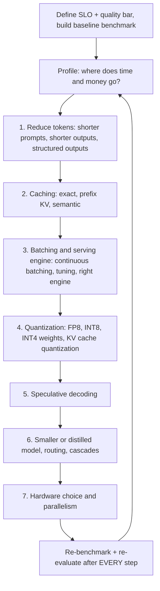
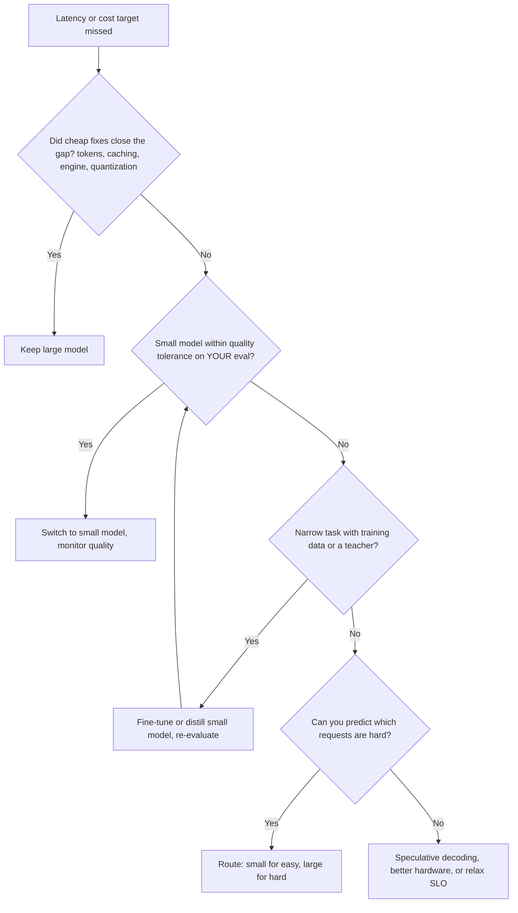
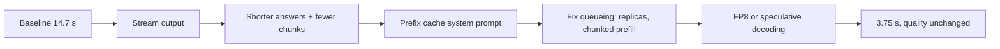

# Optimizing and Benchmarking LLM Latency and Cost

> **Level:** Beginner to Advanced · **Study time:** ~120 min · **Prerequisites:** [LLM Inference Fundamentals](01-inference-fundamentals-prefill-decode-and-latency-metrics.md), [The KV Cache](02-kv-cache-explained.md), [GPU Fundamentals](03-gpu-fundamentals-compute-bound-vs-memory-bound.md), [Batching and PagedAttention](04-batching-continuous-batching-and-paged-attention.md), [Speculative Decoding and Caching](05-speculative-decoding-caching-and-other-speedups.md), [Serving Frameworks](06-serving-frameworks-vllm-sglang-tgi-tensorrt-llm-and-ollama.md)

## Table of contents

- [Why this matters](#why-this-matters)
- [1. The vocabulary: latency, throughput and percentiles](#1-the-vocabulary-latency-throughput-and-percentiles)
- [2. How context length and output length drive latency](#2-how-context-length-and-output-length-drive-latency)
- [3. Measure first: latency budgets and Amdahl's law](#3-measure-first-latency-budgets-and-amdahls-law)
- [4. The optimization playbook in priority order](#4-the-optimization-playbook-in-priority-order)
- [5. When to use a smaller model instead of optimizing a larger one](#5-when-to-use-a-smaller-model-instead-of-optimizing-a-larger-one)
- [6. Cost arithmetic: self-hosted GPUs vs API pricing](#6-cost-arithmetic-self-hosted-gpus-vs-api-pricing)
- [7. Benchmarking methodology](#7-benchmarking-methodology)
- [8. Benchmarking tools](#8-benchmarking-tools)
- [9. Latency SLOs and capacity planning](#9-latency-slos-and-capacity-planning)
- [10. Worked scenario: accurate answers, latency too high](#10-worked-scenario-accurate-answers-latency-too-high)
- [11. Going deeper: senior-level production concerns](#11-going-deeper-senior-level-production-concerns)
- [Common mistakes and misconceptions](#common-mistakes-and-misconceptions)
- [Interview questions and model answers](#interview-questions-and-model-answers)
- [Key takeaways](#key-takeaways)
- [Further reading](#further-reading)
- [Next](#next)

## Why this matters

Almost every LLM product hits the same wall after the demo works: the answers are good, but they take 12 seconds and the monthly GPU or API bill is frightening. The previous chapters in this part gave you the individual tools (KV cache, continuous batching, speculative decoding, serving engines). This chapter is about using them like an engineer: measure where the time and money actually go, apply fixes in the order that gives the most benefit for the least risk, and prove the result with a benchmark that would survive scrutiny. Interviewers love this topic because it separates people who have read about vLLM from people who have actually run a load test, read a p99 number and known whether to trust it. By the end you should be able to answer "how would you make this faster and cheaper?" with a structured plan, real arithmetic and a credible benchmarking method.

---

## 1. The vocabulary: latency, throughput and percentiles

These terms are taught in depth in [LLM Inference Fundamentals](01-inference-fundamentals-prefill-decode-and-latency-metrics.md). Here is a compact recap, because every later section uses them.

> **Analogy:** Think of a coffee shop. **Latency** is how long *you* wait from ordering to holding your coffee. **Throughput** is how many coffees the shop makes per hour. A shop can raise throughput by making 10 drinks at once, but if you have to wait for the batch to fill, *your* wait goes up. Most LLM optimization is a negotiation between these two.

### 1.1 Core definitions

- **Prefill:** the first phase of generation, where the model reads the whole prompt in one parallel pass and builds the **KV cache** (the attention key and value vectors of every token seen so far, stored so later steps do not recompute them). It is mostly **compute-bound** (limited by arithmetic speed).
- **Decode:** the second phase, where the model generates output tokens one at a time. At small batch sizes it is **memory-bandwidth-bound** (limited by how fast weights and KV cache can be read from GPU memory). See [GPU Fundamentals](03-gpu-fundamentals-compute-bound-vs-memory-bound.md).
- **TTFT (time to first token):** time from when the request is sent until the first output token arrives. It includes network, queueing and prefill. It is what makes a chat UI feel "responsive".
- **ITL (inter-token latency):** the time gap between two consecutive output tokens during streaming. Every request produces many ITL samples.
- **TPOT (time per output token):** the average gap per output token for one request, after the first token.
- **E2E latency (end-to-end latency):** time from sending the request until the last token arrives.
- **Throughput:** work completed per unit time for the whole system, usually **output tokens per second** or **requests per second (RPS)**.
- **Concurrency:** the number of requests in flight at the same moment.
- **Percentile (pXX):** the value below which XX% of measurements fall. **p50** is the median (typical experience), **p95** and **p99** describe the slow tail (what your unluckiest users feel).
- **SLO (service level objective):** a target you commit to, for example "p95 TTFT under 800 ms".
- **Goodput:** the throughput of requests that *meet* the SLO. Requests that finish but violate the SLO do not count. This term was popularized for LLM serving by the DistServe paper (Zhong et al., 2024).

### 1.2 The latency formula

$$
T_{\text{E2E}} \approx T_{\text{TTFT}} + (N_{\text{out}} - 1) \times T_{\text{TPOT}}
$$

- $T_{\text{E2E}}$: end-to-end latency of one request.
- $T_{\text{TTFT}}$: time to first token.
- $N_{\text{out}}$: number of output tokens generated.
- $T_{\text{TPOT}}$: average time per output token after the first.

**Worked example (7B model, illustrative numbers).** TTFT = 200 ms, TPOT = 25 ms, the answer is 300 tokens.

- Tokens after the first: $300 - 1 = 299$.
- Decode time: $299 \times 0.025 = 7.475$ s.
- E2E: $0.2 + 7.475 = 7.675$ s.

Rearranging gives the way benchmark tools compute TPOT from measurements:

$$
T_{\text{TPOT}} = \frac{T_{\text{E2E}} - T_{\text{TTFT}}}{N_{\text{out}} - 1} = \frac{7.675 - 0.2}{299} = \frac{7.475}{299} = 0.025 \text{ s}
$$

Notice the headline lesson already: 7.5 of the 7.7 seconds are decode. **Output length is usually the single largest driver of E2E latency.**

### 1.3 Throughput vs latency, precisely

$$
\text{Throughput}_{\text{tokens}} = \frac{\sum_i N_{\text{out}, i}}{T_{\text{wall}}}
$$

- $N_{\text{out}, i}$: output tokens of request $i$.
- $T_{\text{wall}}$: wall-clock duration of the measurement window.

**Example:** 400 requests each producing 250 tokens finish in a 60 s window. Total tokens $= 400 \times 250 = 100{,}000$. Throughput $= 100{,}000 / 60 \approx 1{,}667$ tokens/s, and $400 / 60 \approx 6.67$ RPS.

Throughput is a **system** property; latency is a **per-request** property. Batching more requests together raises throughput (the GPU does more useful work per weight read) but usually raises per-request ITL, because each decode step now does more work. See [Batching](04-batching-continuous-batching-and-paged-attention.md).

### 1.4 Little's Law: the bridge between them

$$
L = \lambda \times W
$$

- $L$: average number of requests in the system (concurrency).
- $\lambda$: average arrival rate (requests per second).
- $W$: average time a request spends in the system (latency, in seconds).

**Example:** 10 RPS with an average E2E of 8 s means $10 \times 8 = 80$ requests in flight on average. If your server can only hold 40 sequences in its KV cache, the other 40 are waiting in a queue, and that waiting shows up as TTFT. Little's Law holds for any stable system regardless of the arrival distribution, which makes it a great sanity check on benchmark results.

---

## 2. How context length and output length drive latency

This is a favorite interview question, so let us make it concrete with a 7B model on one GPU.

### 2.1 Input (context) length mostly affects TTFT

Prefill processes all $N_{\text{in}}$ prompt tokens in parallel. Its cost is counted in **FLOPs** (floating-point operations; a GPU's speed is quoted in FLOP/s). A standard rule of thumb for a **dense** transformer's forward pass (every parameter is used for every token; for a mixture-of-experts model, use only the parameters active per token):

$$
\text{FLOPs}_{\text{prefill}} \approx 2 \times P \times N_{\text{in}}
$$

- $P$: number of model parameters.
- $N_{\text{in}}$: number of input tokens.
- The factor 2 counts one multiply and one add per parameter per token.

This ignores the attention score computation, which grows with $N_{\text{in}}^2$ and becomes significant at long contexts (tens of thousands of tokens).

**Worked example.** $P = 7 \times 10^9$, $N_{\text{in}} = 2{,}000$:

- FLOPs $= 2 \times 7\times10^9 \times 2{,}000 = 2.8 \times 10^{13}$ (28 TFLOPs).
- An H100 SXM is specified at roughly 989 TFLOP/s dense BF16. Assume (illustratively) 50% utilization: about 495 TFLOP/s.
- Prefill time $\approx 28 / 495 \approx 0.057$ s, so about 57 ms.

Double the prompt to 4,000 tokens and prefill roughly doubles (a bit more due to the quadratic attention term). **Context length scales TTFT roughly linearly at moderate lengths, and worse than linearly at very long lengths.**

### 2.2 Output length multiplies decode time

Each output token requires one decode step. At small batch sizes each step must read all model weights from GPU memory (HBM), plus the KV cache for that sequence:

$$
T_{\text{step}} \gtrsim \frac{B_{\text{weights}} + B_{\text{KV}}}{\text{BW}}
$$

- $T_{\text{step}}$: time for one decode step (lower bound, ideal).
- $B_{\text{weights}}$: bytes of model weights.
- $B_{\text{KV}}$: bytes of KV cache read for all sequences in the batch.
- $\text{BW}$: GPU memory bandwidth in bytes per second.

**Worked example.** A 7B model in FP16 has $7\times10^9 \times 2 = 14$ GB of weights. An H100 SXM has about 3.35 TB/s of HBM bandwidth.

- Weights only: $14 / 3{,}350 \approx 0.00418$ s, so about 4.2 ms per step, or at most about 239 tokens/s for a single sequence.

### 2.3 Context length also slows decode (through the KV cache)

For a Llama-2-7B-style model (32 layers, hidden size 4,096, standard multi-head attention, FP16), the KV cache per token is:

$$
2 \times n_{\text{layers}} \times d_{\text{model}} \times \text{bytes} = 2 \times 32 \times 4{,}096 \times 2 = 524{,}288 \text{ bytes} \approx 0.5 \text{ MiB}
$$

(The first 2 is "one K and one V".) See [The KV Cache](02-kv-cache-explained.md) for the derivation.

- With 4,000 tokens of context: $524{,}288 \times 4{,}000 \approx 2.1$ GB of KV cache.
- Batch of 1: each step reads $14 + 2.1 = 16.1$ GB, so $16.1 / 3{,}350 \approx 4.8$ ms. About 15% slower than with an empty context.
- Batch of 16, each with 4,000 tokens: KV is $16 \times 2.1 \approx 33.6$ GB, now larger than the weights. Each step reads about $14 + 33.6 = 47.6$ GB, so about 14.2 ms per step, but produces 16 tokens: roughly $16 / 0.0142 \approx 1{,}127$ tokens/s total.

These are idealized lower bounds; real systems reach some fraction of peak bandwidth. The pattern is what matters:

| Change | Effect on TTFT | Effect on ITL | Effect on E2E | Effect on throughput |
|---|---|---|---|---|
| Longer prompt | Up (roughly linear, then super-linear) | Slightly up (bigger KV reads) | Up a little | Down (more prefill work, fewer sequences fit in KV memory) |
| Longer output | None | Slightly up over time (KV grows) | Up a lot (linear in tokens) | Down in RPS, tokens/s roughly unchanged |
| Bigger batch / more concurrency | Up (queueing, prefill contention) | Up | Up | Up until saturation |
| Grouped-query attention (GQA) in the model | Small | Down (smaller KV) | Down | Up (more sequences fit) |

> **Interview tip:** When asked how context and output length affect latency, say: "Input length is paid mostly once, in prefill, so it shows up in TTFT. Output length is paid per token in decode, which is memory-bound, so it multiplies E2E latency. Long contexts also make every decode step slower and shrink how many requests fit in KV memory, which hurts throughput." Then give one number.

**Grouped-query attention (GQA)** lets several query heads share one key/value head, so the KV cache per token shrinks by that sharing factor (for example 4x or 8x) with little quality loss. It is explained in [Modern LLM Architecture](../04-transformers/08-modern-llm-architecture-improvements.md).

---

## 3. Measure first: latency budgets and Amdahl's law

> **Analogy:** A doctor does not prescribe surgery before taking your temperature. "Make it faster" without a measurement is surgery without a diagnosis.

### 3.1 Define the target before touching anything

Ask three questions:

1. **Which latency?** TTFT (chat feel), E2E (an API that returns JSON in one piece), or ITL (smooth streaming)?
2. **Which percentile, at what load?** "p95 E2E under 3 s at 20 RPS" is a target. "Faster" is not.
3. **What quality must be preserved?** Every optimization must be re-checked against your evaluation set. See [Building an LLM Evaluation Framework](../05-llms/11-building-an-llm-evaluation-framework-and-regression-tests.md).

### 3.2 Build a latency budget from traces

A **latency budget** is a breakdown of where the time goes for a request, built from **distributed tracing** (each step of a request records a timed **span**). A RAG request might look like this (illustrative):

```text
request ─┬─ auth + network ............  50 ms
         ├─ embed query ...............  30 ms
         ├─ vector search + rerank ..... 370 ms
         ├─ queue wait in LLM server ... 300 ms
         ├─ prefill (3,000 tokens) ..... 250 ms   <- TTFT ends here (~1.0 s)
         └─ decode (299 tokens x 25 ms)  7,475 ms
                                         --------
                                         ~8.5 s E2E
```

Decode is 88% of the request. Shaving 100 ms off retrieval is almost pointless for E2E (though it would help TTFT).

### 3.3 Amdahl's law: the cap on any single fix

$$
S = \frac{1}{(1 - p) + \dfrac{p}{s}}
$$

- $S$: overall speedup of the whole request.
- $p$: fraction of total time spent in the part you are improving.
- $s$: speedup of that part alone.

**Example A:** decode is $p = 0.8$ of latency and you make it $s = 2$ times faster: $S = 1 / (0.2 + 0.4) = 1/0.6 \approx 1.67$.

**Example B:** retrieval is $p = 0.05$ and you make it infinitely fast ($p/s \to 0$): $S = 1/0.95 \approx 1.05$. A heroic effort for a 5% gain.

> **Senior insight:** Amdahl's law is why a profile beats intuition. Teams routinely spend weeks on the part that is interesting rather than the part that is slow.

### 3.4 What to look at during diagnosis

| Symptom in metrics | Likely cause | First things to try |
|---|---|---|
| High TTFT, low GPU utilization | Slow retrieval, tool calls, cold starts, network | Trace the pre-LLM pipeline, parallelize, cache |
| High TTFT that rises with load | Queueing, prefill contention | More replicas, chunked prefill, admission control |
| High TTFT on long prompts only | Prefill cost | Trim prompt, prefix caching |
| High ITL at low load | Model too big for hardware bandwidth | Quantization, speculative decoding, smaller model, faster GPU |
| High ITL only at high load | Batch too large, long prefills interrupting decode | Cap batch size, chunked prefill, scale out |
| High E2E with normal ITL | Outputs are long | Shorter outputs, structured outputs, max_tokens |
| p99 far above p95 | Preemption, KV cache swapping, GC pauses, noisy neighbors, retries | Engine logs, KV utilization metrics, isolate tenants |

Some terms in this table are covered later: chunked prefill and batch caps in section 4.3, `max_tokens` and structured outputs in 4.1, admission control in 9.3. **Preemption** means that when KV cache memory runs out, the engine pauses a running request and frees its KV blocks, then later recomputes them or swaps them back from CPU memory (**KV cache swapping**); the affected request suddenly takes seconds longer, which is why it shows up in p99 rather than p50.

---

## 4. The optimization playbook in priority order

The order below runs roughly from **cheapest and safest** to **most expensive and risky**. It is not a law (sometimes your serving engine is so badly misconfigured that step 3 is the obvious first move), but it is a strong default and a great structure for an interview answer.



| Step | Primarily improves | Effort | Quality risk | Typical when |
|---|---|---|---|---|
| 1. Reduce tokens | E2E, TTFT, cost | Low | Low to medium (test it) | Always first |
| 2. Caching | TTFT, cost, E2E on hits | Low to medium | Low (exact/prefix), medium (semantic) | Repeated prefixes or repeated questions |
| 3. Batching and engine | Throughput, cost, tail latency | Medium | None (same math) | Self-hosting |
| 4. Quantization | ITL, memory, cost | Medium | Low to medium | Self-hosting, memory-bound decode |
| 5. Speculative decoding | ITL at low/moderate load | Medium to high | None (lossless when done correctly) | Latency-critical, spare compute |
| 6. Smaller model / routing | Everything | Medium to high | Medium to high | Big quality headroom or narrow task |
| 7. Hardware | Everything | High (money, ops) | None | After software is tuned |

### 4.1 Reduce tokens

> **Analogy:** The fastest way to shorten a meeting is to cut agenda items, not to talk faster.

Tokens are both the unit of latency and the unit of billing, so removing tokens is the rare optimization that improves every metric at once. Tokenization is covered in [Tokenization](../04-transformers/01-tokenization.md).

**Input-side techniques**

- **Prompt trimming:** remove redundant instructions, stale few-shot examples and boilerplate. Many production system prompts grow by accretion to thousands of tokens.
- **Retrieve less, better:** in RAG, send 4 well-reranked chunks instead of 15 mediocre ones. See [Reranking](../08-rag/08-reranking-and-query-transformation.md).
- **Compress conversation history:** summarize older turns instead of resending the whole transcript every turn.
- **Stable prefix layout:** put static content (system prompt, tool definitions, few-shot examples) first and dynamic content (user question, retrieved documents) last, so prefix caching (section 4.2) can reuse it.

**Output-side techniques (usually the bigger win)**

- **Ask for brevity explicitly** and set **`max_tokens`** (a hard cap on output length) as a safety net, not as the main control, because a cap can truncate an answer mid-sentence.
- **Structured outputs:** when the consumer is code, ask for a compact JSON schema rather than prose. A classification returned as `{"label": "refund"}` is a handful of tokens; an explanatory paragraph is hundreds. See [Structured Outputs](../05-llms/05-structured-outputs-and-function-calling.md).
- **Short keys and enums** in schemas; avoid asking the model to repeat the input back.
- **Control reasoning length:** reasoning models generate hidden "thinking" tokens that cost latency and money just like visible ones. Use reasoning-effort or thinking-budget controls where available. See [Reasoning Models](../05-llms/12-reasoning-models-and-test-time-compute.md).
- **Streaming:** does not reduce E2E, but makes perceived latency equal to TTFT for human readers. Always stream in chat UIs.

**Worked example (7B model, illustrative rates):** prefill at 10,000 tokens/s, decode at 25 ms/token.

| | Input tokens | Output tokens | Prefill | Decode | Total |
|---|---|---|---|---|---|
| Before | 2,000 | 400 | 2,000 / 10,000 = 0.20 s | 400 x 0.025 = 10.00 s | 10.20 s |
| After | 1,200 | 150 | 1,200 / 10,000 = 0.12 s | 150 x 0.025 = 3.75 s | 3.87 s |

A 62% latency reduction ($1 - 3.87/10.20 \approx 0.62$) with zero infrastructure change. Cutting output tokens did almost all of the work.

> **Common mistake:** Optimizing the prompt for input length while ignoring output length. On most APIs output tokens are also priced several times higher than input tokens, so verbose answers hurt twice.

### 4.2 Caching

Caching is covered in mechanism-level depth in [Speculative Decoding, Prompt Caching and Other Speedups](05-speculative-decoding-caching-and-other-speedups.md). Here is the decision view.

| Cache type | What is stored | Hit condition | Saves | Risk |
|---|---|---|---|---|
| **Exact response cache** | Final answer keyed by a hash of (model, prompt, parameters) | Byte-identical request | The whole LLM call | Stale answers; useless with personalization |
| **Prefix (KV) cache** | KV cache blocks for a shared prompt prefix | Request starts with the same tokens | Prefill of the shared part (TTFT, compute) | Almost none for quality; output is the same. Sharing a cache across tenants can leak prompt content through timing side channels, so isolate per tenant where that matters |
| **Semantic cache** | Answer keyed by an embedding of the question | Similar meaning above a threshold | The whole LLM call | Wrong answer for a "similar but different" question |

- **Prefix caching** is supported by self-hosted engines (vLLM automatic prefix caching, SGLang's RadixAttention from "SGLang: Efficient Execution of Structured Language Model Programs", Zheng et al., 2024) and by several API providers, which often bill cached input tokens at a discount. Check your provider's current terms; details change often.
- **Semantic caching** embeds the incoming question (see [Text Embeddings](../08-rag/02-text-embeddings-and-similarity-search.md)), looks for a past question with cosine similarity above a threshold, and returns its stored answer. "What is your refund policy?" and "How do refunds work?" can share an answer. "Cancel order 123" and "Cancel order 456" must not. Tune the threshold on labeled pairs and scope the cache by tenant and user permissions.

**Expected latency with a cache:**

$$
E[T] = h \times T_{\text{hit}} + (1 - h) \times T_{\text{miss}}
$$

- $h$: cache hit rate (fraction of requests served from cache).
- $T_{\text{hit}}$: latency on a hit.
- $T_{\text{miss}}$: latency on a miss.

**Example (illustrative):** $h = 0.3$, $T_{\text{hit}} = 50$ ms, $T_{\text{miss}} = 3{,}000$ ms. $E[T] = 0.3 \times 50 + 0.7 \times 3{,}000 = 15 + 2{,}100 = 2{,}115$ ms. The mean drops by about 30%.

> **Senior insight:** With a 30% hit rate, the slowest 70% of requests are all misses, so **p95 and p99 barely move**: the overall p95 becomes roughly the p93 of the misses ($(0.95 - 0.3)/0.7 \approx 0.93$) and the overall p99 roughly their p98.6. (A cache can still help the tail indirectly if it removes enough load to shorten queues.) Response caches improve mean and median cost and latency; they rarely fix a tail-latency SLO. Prefix caching is different: it speeds up *every* request that shares the prefix, including the slow ones.

### 4.3 Batching and serving engine choice

If you self-host, the serving engine is where the biggest "free" throughput lives. Details are in [Batching, Continuous Batching and PagedAttention](04-batching-continuous-batching-and-paged-attention.md) and [Serving Frameworks](06-serving-frameworks-vllm-sglang-tgi-tensorrt-llm-and-ollama.md).

- **Continuous batching** (introduced as iteration-level scheduling in "Orca", Yu et al., 2022) adds and removes sequences from the running batch at every decode step, so the GPU never waits for the slowest request in a static batch.
- **PagedAttention** ("Efficient Memory Management for Large Language Model Serving with PagedAttention", Kwon et al., 2023) stores KV cache in fixed-size blocks, which wastes far less memory, so more sequences fit and throughput rises.
- **Chunked prefill** splits a long prompt's prefill into chunks interleaved with decode steps, so one 30,000-token prompt does not freeze everyone else's token stream (the idea behind "Sarathi-Serve", Agrawal et al., 2024).

Key knobs (names vary by engine and version; check the docs for yours):

| Knob | Raising it | Lowering it |
|---|---|---|
| Max concurrent sequences in a batch | Higher throughput, higher ITL and TTFT | Lower latency, lower throughput, higher cost |
| Max tokens per scheduler step (prefill budget) | Faster prefill, more ITL spikes for others | Smoother ITL, slower TTFT for long prompts |
| GPU memory fraction for KV cache | More concurrent sequences | Fewer, but leaves room for other processes |
| Tensor parallel degree | Lower per-token latency for big models, more GPUs | Fewer GPUs, maybe more replicas instead |

> **Senior insight:** "Two replicas with tensor parallel 1" versus "one replica with tensor parallel 2" is a real trade-off. TP splits each layer across GPUs, lowering ITL but adding communication overhead. Independent replicas usually give more total throughput if the model fits on one GPU. Benchmark both.

### 4.4 Quantization

**Quantization** stores weights (and sometimes activations and KV cache) in fewer bits, for example 8-bit or 4-bit integers or 8-bit floating point (FP8) instead of 16-bit. Full coverage is in the [Model Compression](../07-model-compression/01-number-formats-and-model-memory.md) part, especially [Practical LLM Quantization](../07-model-compression/04-llm-quantization-gptq-awq-and-outliers.md).

Why it speeds up decode: from section 2.2, a memory-bound decode step is limited by bytes read. A 7B model in INT4 is about 3.5 GB instead of 14 GB (a little more in practice for quantization scales and layers kept in 16-bit), so the idealized weight-read floor drops from about 4.2 ms to about $3.5 / 3{,}350 \approx 1.04$ ms per step.

| Variant | Main benefit | Watch out for |
|---|---|---|
| Weight-only INT4/INT8 (GPTQ, AWQ) | Lower memory, faster memory-bound decode at small batch | Dequantization overhead; gains shrink at large batch where you become compute-bound |
| FP8 weights and activations | Faster compute on GPUs with FP8 tensor cores (for example Hopper generation) | Needs hardware support and calibrated scales |
| KV cache quantization (FP8/INT8) | More sequences fit, longer contexts | Small accuracy loss on long-context tasks; test it |

> **Common mistake:** Expecting quantization to always cut latency. If the kernel for your format is slow, or the workload is compute-bound at high batch, memory drops but latency stays flat. This exact puzzle is the subject of [Debugging Case: A Quantized LLM Uses Less Memory but Latency Is Unchanged](../11-system-design/06-debugging-case-quantized-llm-not-faster.md).

### 4.5 Speculative decoding

**Speculative decoding** ("Fast Inference from Transformers via Speculative Decoding", Leviathan, Kalman and Matias, 2023; and "Accelerating Large Language Model Decoding with Speculative Sampling", Chen et al., 2023) uses a cheap **draft** (a small model, n-gram lookup, or extra prediction heads as in Medusa or EAGLE) to propose several tokens, then the big **target** model verifies them all in one forward pass. With the correct acceptance rule, the output distribution is identical to the target model's. See [chapter 05](05-speculative-decoding-caching-and-other-speedups.md) for the mechanism.

If each drafted token is accepted with probability $\alpha$ (treated as independent) and the draft proposes $\gamma$ tokens, the expected number of tokens produced per target forward pass is:

$$
E[\text{tokens}] = \frac{1 - \alpha^{\gamma + 1}}{1 - \alpha}
$$

- $\alpha$: per-token acceptance rate (between 0 and 1).
- $\gamma$: number of tokens the draft proposes per step (the symbol used in the original paper; [chapter 05](05-speculative-decoding-caching-and-other-speedups.md) calls the same quantity $k$).

**Example:** $\alpha = 0.8$, $\gamma = 4$. $\alpha^5 = 0.32768$. $E = (1 - 0.32768)/0.2 = 0.67232/0.2 \approx 3.36$ tokens per target pass, versus 1 without speculation. The real speedup is lower because the draft costs time and a verification pass is slightly more expensive than a normal step.

When it helps and when it does not:

- **Helps:** low to moderate batch sizes, where decode is memory-bound and the GPU has spare compute to verify extra tokens almost for free. Predictable text (code, structured output, quoting from context) has high acceptance.
- **Hurts or does nothing:** high-concurrency serving where the GPU is already compute-saturated; creative high-temperature sampling with low acceptance; when the draft model steals memory needed for KV cache.

### 4.6 Smaller or distilled models, routing and cascades

Covered in detail in section 5. The mechanics:

- **Distillation** trains a small **student** model to imitate a large **teacher** on your task ([Distilling LLMs](../07-model-compression/06-distilling-large-language-models.md)).
- **Routing** sends each request to one of several models based on a classifier's prediction of difficulty ("RouteLLM: Learning to Route LLMs with Preference Data", Ong et al., 2024).
- **Cascading** tries the small model first and escalates to the big one only if a confidence check fails ("FrugalGPT", Chen, Zaharia and Zou, 2023).

**Expected cost with routing (illustrative prices per million tokens):** small model \$0.10, large model \$1.00, 70% of traffic routed to small:

$$
E[C] = r \, c_{\text{small}} + (1 - r)\, c_{\text{large}} = 0.7 \times 0.10 + 0.3 \times 1.00 = 0.07 + 0.30 = 0.37
$$

- $r$: fraction routed to the small model.
- $c_{\text{small}}, c_{\text{large}}$: cost per unit of traffic for each model.

That is a 63% saving versus sending everything to the large model. A cascade where every request first hits the small model and 30% escalate costs $0.10 + 0.3 \times 1.00 = 0.40$, slightly more, and escalated requests pay *both* latencies. Use a router when you can predict difficulty up front; use a cascade when you can only judge quality after seeing an answer.

### 4.7 Hardware choice

Only after the software is tuned should you buy your way out. For decode, **memory bandwidth** and **memory capacity** matter more than peak FLOPs; for prefill-heavy workloads (long prompts, short answers, like classification or RAG with large contexts), compute matters more.

| GPU (vendor specs, approximate) | Memory | Bandwidth | Typical fit |
|---|---|---|---|
| NVIDIA L4 | 24 GB | ~300 GB/s | Small models (quantized 7-8B), cost-efficient, low throughput |
| NVIDIA A100 80GB | 80 GB | ~2.0 TB/s | General workhorse, no FP8 tensor cores |
| NVIDIA H100 SXM | 80 GB | ~3.35 TB/s | High throughput, FP8 support |
| NVIDIA H200 | 141 GB | ~4.8 TB/s | Large models and long contexts (more KV room) |

Newer generations and other vendors' accelerators exist and change yearly; the durable lesson is to compare on **cost per million tokens at your SLO**, measured on your workload, not on spec-sheet FLOPs. A cheaper GPU that meets the SLO at 60% of the throughput can still win on cost.

---

## 5. When to use a smaller model instead of optimizing a larger one

> **Analogy:** If you need to cross town quickly, tuning a moving truck's engine is the wrong project when a scooter would carry your one box.

Optimization techniques on a large model typically give gains measured in tens of percent to a few times. Switching from a 70B to an 8B model changes the bytes read per decode step by roughly 9x, which no amount of tuning on the 70B matches. The question is whether quality survives.

### 5.1 Decision criteria

Choose the smaller model when **all** of these hold:

1. **The quality gap on *your* evaluation set is within tolerance.** Not on public leaderboards. Run your task-specific eval; see [Evaluating LLMs](../05-llms/10-llm-evaluation-metrics-and-llm-as-a-judge.md).
2. **The latency or cost target is out of reach for the large model** even after the cheap steps (tokens, caching, engine tuning, quantization).
3. **The task is narrow and well-defined:** classification, extraction, routing, summarization in a fixed format, SQL for a known schema. Small models fine-tuned on narrow tasks often match large general models.
4. **Volume is high**, so the per-request saving multiplies into real money, and you can afford the one-time cost of fine-tuning ([LoRA and QLoRA](../05-llms/07-fine-tuning-full-lora-and-qlora.md)) or distillation.

Keep the larger model (and optimize it) when the task needs broad world knowledge, multi-step reasoning, long-tail coverage, or when traffic is low enough that the engineering cost of a second model outweighs the savings. A **hybrid router** is often the senior answer: small model for the easy majority, big model for the hard tail.



### 5.2 A worked comparison (illustrative numbers)

A support-ticket classifier with 12 categories, measured on a 1,000-ticket labeled eval set:

| Option | Accuracy (illustrative) | p95 E2E (illustrative) | Relative cost |
|---|---|---|---|
| 70B general model, few-shot prompt | 94% | 2.8 s | 1.0x |
| 70B, FP8 + prefix caching + short JSON output | 94% | 1.1 s | 0.5x |
| 8B general model, few-shot prompt | 86% | 0.6 s | 0.12x |
| 8B LoRA fine-tuned on 5,000 labeled tickets | 95% | 0.3 s | 0.10x |

The fine-tuned small model matches the 70B on accuracy (the 1-point gap is within noise, see the tip below) and wins clearly on latency and cost. That is common for narrow tasks and almost never true for open-ended reasoning. Notice also that the optimized 70B row came first: you only know the small model is worth it by comparing against a *tuned* baseline, not a naive one.

> **Interview tip:** Say "quality gap on our eval, measured with confidence intervals" rather than "the small model seemed fine". With 1,000 examples, the standard error on 94% accuracy is about $\sqrt{0.94 \times 0.06 / 1000} \approx 0.0075$ (0.75 points), so a single model's 95% interval is about $\pm 1.5$ points. The difference between two models scored independently has a standard error of about $\sqrt{2} \times 0.75 \approx 1.06$ points, so gaps under roughly 2 points are within noise. Because both models are scored on the *same* items, a paired test (McNemar's test, or a paired bootstrap) is tighter and is the right tool.

---

## 6. Cost arithmetic: self-hosted GPUs vs API pricing

All prices in this section are **illustrative**. Real GPU rental and API prices vary by vendor, region, commitment and year, and fall over time. The method is what you need to learn.

### 6.1 Self-hosted cost per million tokens

$$
C_{\text{1M}} = \frac{P_{\text{GPU}} \times G}{T \times 3600 \times U} \times 10^6
$$

- $C_{\text{1M}}$: cost per million **output** tokens (the input tokens of the same requests are included, since they ride along in the same GPU-hours).
- $P_{\text{GPU}}$: price per GPU-hour (dollars).
- $G$: GPUs per replica.
- $T$: sustained output tokens per second per replica **at your SLO and your real input/output mix**, measured by benchmark.
- $3600$: seconds per hour.
- $U$: average utilization, the fraction of that capacity actually used over the day (traffic is not flat, and you need headroom).

**Worked example.** $P_{\text{GPU}} = \$2.50$/hour (illustrative), $G = 1$, $T = 1{,}500$ tokens/s measured at a 5:1 input:output token ratio within SLO (illustrative).

- Tokens per hour at full use: $1{,}500 \times 3{,}600 = 5{,}400{,}000 = 5.4$M.
- At $U = 1$: $2.50 / 5.4 \approx \$0.46$ per million output tokens.
- At a realistic $U = 0.4$: $0.46 / 0.4 \approx \$1.16$ per million output tokens.

Utilization is the term people forget. A GPU idle at night still costs money.

### 6.2 Effective API cost at the same mix

API prices are usually quoted separately for input and output. Convert to the same unit (per million output tokens, including the input that comes with them):

$$
C_{\text{API}} = p_{\text{out}} + k \times p_{\text{in}}
$$

- $p_{\text{in}}, p_{\text{out}}$: price per million input and output tokens.
- $k$: input tokens per output token (here 5).

With illustrative $p_{\text{in}} = \$0.50$, $p_{\text{out}} = \$1.50$: $C_{\text{API}} = 1.50 + 5 \times 0.50 = \$4.00$ per million output tokens.

### 6.3 Daily workload comparison

Workload (illustrative): 100M input tokens and 20M output tokens per day, peak traffic 3x the daily average, and you keep one spare GPU (N+1 redundancy).

**API:** $100 \times 0.50 + 20 \times 1.50 = 50 + 30 = \$80$/day.

**Self-hosted:**

- Average output rate: $20{,}000{,}000 / 86{,}400 \approx 231.5$ tokens/s.
- Peak: $231.5 \times 3 \approx 694$ tokens/s, which fits in one GPU (1,500 tokens/s). Plus one spare: 2 GPUs.
- Cost: $2 \times 2.50 \times 24 = \$120$/day. **API wins.**

**At 10x the volume** (1,000M input, 200M output per day):

- API: $1{,}000 \times 0.50 + 200 \times 1.50 = 500 + 300 = \$800$/day.
- Average $\approx 2{,}315$ tokens/s, peak $\approx 6{,}944$ tokens/s, $\lceil 6{,}944 / 1{,}500 \rceil = \lceil 4.63 \rceil = 5$ GPUs, plus a spare = 6 GPUs.
- Cost: $6 \times 60 = \$360$/day. **Self-hosting is cheaper on infrastructure.**

```python
# cost_compare.py: illustrative self-host vs API calculator (no external deps)
import math

def api_cost_per_day(in_m: float, out_m: float, p_in: float, p_out: float) -> float:
    """in_m/out_m are millions of tokens per day; prices are $ per million tokens."""
    return in_m * p_in + out_m * p_out

def gpus_needed(out_m_per_day: float, per_gpu_tok_s: float,
                peak_factor: float = 3.0, spare: int = 1) -> int:
    avg_tok_s = out_m_per_day * 1e6 / 86_400          # average output tokens/s
    peak_tok_s = avg_tok_s * peak_factor               # size for the peak, not the average
    return math.ceil(peak_tok_s / per_gpu_tok_s) + spare

GPU_HOUR = 2.50      # illustrative $/GPU-hour
PER_GPU = 1_500      # illustrative output tok/s per GPU at SLO (from YOUR benchmark)

for scale in (1, 2, 10):
    in_m, out_m = 100 * scale, 20 * scale
    api = api_cost_per_day(in_m, out_m, p_in=0.50, p_out=1.50)
    g = gpus_needed(out_m, PER_GPU)
    self_host = g * GPU_HOUR * 24
    print(f"{scale:>3}x  API ${api:,.0f}/day  self-host {g} GPUs ${self_host:,.0f}/day")

# Output:
#   1x  API $80/day  self-host 2 GPUs $120/day
#   2x  API $160/day  self-host 2 GPUs $120/day
#  10x  API $800/day  self-host 6 GPUs $360/day
```

### 6.4 What the simple math leaves out

- **People cost:** on-call, upgrades, security patches, capacity planning. Even a fraction of an engineer's time can outweigh a few hundred dollars a day of GPU savings.
- **Model quality:** the API model and the self-hosted open-weight model are usually *different models*. Compare cost at equal quality on your eval.
- **Discounts:** reserved or committed GPU capacity is cheaper than on-demand; spot or preemptible capacity is cheaper still but can vanish. Many API providers offer discounted asynchronous **batch APIs** for work that can wait hours, and discounted cached input tokens.
- **Data residency and privacy:** sometimes the decision is made by compliance, not cost.
- **Step functions:** GPUs come in whole units, so self-hosting cost moves in steps while API cost is linear. At low volume the spare GPU alone can dominate.

> **Senior insight:** The break-even is a curve, not a point. In the example, 2 GPUs cost \$120/day and can absorb a peak of 1,500 tokens/s, which at a 3x peak factor means up to an average of 500 tokens/s, or $500 \times 86{,}400 = 43.2$M output tokens per day. The API costs \$4.00 per million output tokens, so it reaches \$120/day at 30M/day. Between 30M and 43.2M output tokens per day, self-hosting on 2 GPUs is cheaper on infrastructure alone; above 43.2M you need a third GPU and the comparison resets.

---

## 7. Benchmarking methodology

> **Analogy:** Testing a restaurant by sending one customer at 3 pm tells you nothing about Friday at 8 pm. A good benchmark recreates Friday at 8 pm.

A benchmark you cannot trust is worse than none, because it gives false confidence. This section is the part most candidates get wrong.

### 7.1 What to record per request

For every request, record: scheduled send time, actual send time, time of each streamed token (or chunk), completion time, input token count, output token count, status (success, error, timeout). From these you derive:

- TTFT = first token time minus **scheduled** send time (see 7.5 for why "scheduled").
- ITL samples = differences between consecutive token times.
- TPOT = (E2E minus TTFT) / (output tokens minus 1).
- E2E = completion time minus scheduled send time.
- System throughput (tokens/s, RPS), goodput, and error rate over the steady-state window.

> **Common mistake:** Counting streamed chunks as tokens. Servers may pack several tokens into one chunk. Count tokens with the model's tokenizer, or use the token counts the server reports in its usage field.

### 7.2 Realistic workloads

- **Use real length distributions.** Sample input and output lengths from production logs (or a public conversational dataset if you have none, such as ShareGPT-style conversations, which several serving benchmarks use). A fixed "128 in, 128 out" test misses everything interesting about long prompts and long answers.
- **Control output length deliberately.** Models stop at different points. Benchmarks often set `max_tokens` to the sampled target length and ask the server to ignore end-of-sequence (an option in some engines' benchmark modes) so the measured output length matches the distribution. Report which you did.
- **Use the same tokenizer** as the served model when computing lengths.
- **Realistic prefix sharing:** if production shares a 1,500-token system prompt across all requests, so should the benchmark. If the benchmark sends identical prompts but production does not, prefix caching makes the benchmark look unrealistically fast.
- **Same sampling settings** as production (temperature, top-p, stop sequences, structured-output constraints). Constrained decoding and speculative decoding acceptance rates both depend on them.

### 7.3 Warmup and steady state

The first requests after startup are slow for reasons production rarely sees: CUDA graph capture, kernel autotuning, JIT compilation, memory allocation, empty caches, autoscaler cold starts. So:

1. Send warmup requests (for example a few dozen, or a minute of traffic) and **discard** them.
2. Measure over a **steady-state window** long enough to collect enough samples (section 7.6).
3. Optionally drop a short ramp-down at the end, when in-flight requests drain and the load is lower than intended.

### 7.4 Closed-loop vs open-loop load generation

| | **Closed-loop** (fixed users) | **Open-loop** (arrival rate) |
|---|---|---|
| What it simulates | $N$ virtual users; each sends a request, waits for the reply (plus optional think time), then sends the next | Requests arrive on a schedule (often a **Poisson process**: random, independent arrivals at average rate $\lambda$) regardless of whether earlier ones finished |
| Control variable | Concurrency $N$ | Arrival rate $\lambda$ (RPS) |
| When the server slows down | Users wait, so fewer requests are sent: load self-throttles | Requests keep arriving, queues grow, latency rises sharply |
| Realistic for | Internal tools with a fixed pool of workers, batch jobs with a fixed number of parallel workers | Public APIs and products with many independent users |
| Main risk | Hides overload and suffers from coordinated omission (section 7.5) | Can overwhelm a system (which is the point: you find the breaking point) |

```text
Closed-loop, 2 users:            Open-loop, 2 req/s (Poisson):
user1: [req]---[req]----[req]    arrivals: |  | |    |   ||  |  |
user2: [req]-----[req]--[req]    each arrival starts a request
 next request waits for reply    no matter what is still running
```

A **concurrency sweep** runs closed-loop tests at $N = 1, 2, 4, 8, \dots$ and plots latency against achieved throughput. A **rate sweep** runs open-loop tests at increasing $\lambda$. Both produce the classic **latency-throughput curve**:

```text
p95 latency
   ^
   |                                   *
   |                                *
   |                             *     <- knee: past here, queues explode
   |                    *  *  *
   |  *   *    *   *
   +-------------------------------------> throughput (RPS or tokens/s)
                          ^
             max throughput that still meets the SLO = your capacity
```

Your **capacity** per replica is the highest load at which the SLO percentile is still met, not the peak throughput the server can physically push.

### 7.5 Coordinated omission

**Coordinated omission** (a term coined by Gil Tene) is when the load generator unintentionally coordinates with the system under test: when the system stalls, the client stops sending, so the stall is under-recorded. Closed-loop tools that measure from the moment a request was *actually* sent are vulnerable.

**Worked example.** A client intends to send one request per second for 100 s. Normal latency is 0.1 s. Once during the test, the server stalls for 10 s.

*Coordinated (naive) client:* the request that hits the stall takes 10 s; the client waits, so the 9 requests it would have sent during the stall are never sent.

- Samples: 91 (90 fast at 0.1 s, 1 slow at 10 s).
- p95 by nearest rank: position $\lceil 0.95 \times 91 \rceil = \lceil 86.45 \rceil = 87$, which is a fast sample: **0.1 s**.
- Mean: $(90 \times 0.1 + 10) / 91 = 19/91 \approx 0.21$ s.

*Correct (open-loop) measurement:* the 9 requests are sent on schedule during the stall, queue up, and finish when the server recovers, waiting roughly 9, 8, ..., 1 s.

- Samples: 100 (90 fast, 10 slow at about 10, 9, 8, ..., 1 s).
- p95: position 95 = the 5th smallest slow sample: about **5 s**.
- Mean: $(90 \times 0.1 + (10+9+\dots+1)) / 100 = (9 + 55)/100 = 0.64$ s.

The naive p95 is **50 times better** than what real users experienced. Fixes:

- Use **open-loop** load generation (Poisson or constant arrival rate).
- Measure latency from the **intended (scheduled) send time**, not the actual send time.
- Make sure the client itself is not the bottleneck: enough connections in the HTTP client's connection pool, enough CPU, async I/O. A saturated client looks exactly like a slow server.

### 7.6 Computing percentiles correctly

**Nearest-rank definition:** sort the $n$ samples ascending; the $p$-th percentile is the value at position $\lceil p \times n \rceil$ (1-indexed). Libraries like NumPy default to **linear interpolation** between neighboring samples instead, which gives slightly different numbers. Either is fine if you report which.

**Tiny example: 10 E2E latencies (ms):** 120, 130, 125, 140, 135, 900, 128, 132, 138, 2000.

- Sorted: 120, 125, 128, 130, 132, 135, 138, 140, 900, 2000.
- Mean: sum is 3,948, so mean = 394.8 ms. Misleading: no request took anywhere near 395 ms.
- Nearest-rank p50: position $\lceil 5 \rceil = 5$: **132 ms**.
- Nearest-rank p95: position $\lceil 9.5 \rceil = 10$: **2,000 ms**. p99: position $\lceil 9.9 \rceil = 10$: also 2,000 ms.

With 10 samples, p95 and p99 are both just "the max". You cannot measure a tail you have not sampled.

**How many samples?** The number of samples beyond the $p$-th percentile is about $n(1-p)$. To have, say, 50 samples in the tail beyond p99: $n = 50 / 0.01 = 5{,}000$ requests. Rules of thumb:

- p50: a few hundred requests is usually enough.
- p95: at least a thousand.
- p99: several thousand, and run the test more than once.
- Report **confidence intervals** (bootstrap them, as below) and run repeated trials to see run-to-run variance.

**Never average percentiles.** If replica A reports p95 = 1 s and replica B reports p95 = 3 s, the fleet p95 is *not* 2 s. Merge the raw samples or mergeable **histograms** (for example HdrHistogram, or Prometheus histogram buckets) and compute the percentile from the merged data.

**Per-request vs per-token percentiles.** ITL percentiles are computed over all token gaps (millions of samples), while TTFT and E2E are per request. A p99 ITL spike often means a long prefill from another request interrupted decoding: chunked prefill targets exactly that.

```python
# percentiles.py: from-scratch nearest-rank vs NumPy, plus a bootstrap CI
# pip install numpy
import math
import numpy as np

def nearest_rank(samples: list[float], p: float) -> float:
    """p in (0, 100]. Returns the nearest-rank percentile."""
    s = sorted(samples)
    k = math.ceil(p / 100 * len(s))          # 1-indexed position
    return s[k - 1]

lat_ms = [120, 130, 125, 140, 135, 900, 128, 132, 138, 2000]
for p in (50, 95, 99):
    print(p, nearest_rank(lat_ms, p), round(float(np.percentile(lat_ms, p)), 1))
# 50 132 133.5
# 95 2000 1505.0
# 99 2000 1901.0

def bootstrap_ci(samples, p, n_boot=2000, alpha=0.05, seed=0):
    """Confidence interval for a percentile by resampling with replacement."""
    rng = np.random.default_rng(seed)
    x = np.asarray(samples)
    stats = [np.percentile(rng.choice(x, size=len(x), replace=True), p)
             for _ in range(n_boot)]
    return np.percentile(stats, [100 * alpha / 2, 100 * (1 - alpha / 2)])

# With a realistic sample (simulated here): lognormal latencies, 5,000 requests
sim = np.random.default_rng(1).lognormal(mean=0.0, sigma=0.5, size=5000)
print("p99 = %.2f s, 95%% CI = %s" % (np.percentile(sim, 99), bootstrap_ci(sim, 99)))
```

### 7.7 An open-loop load generator in Python

This is a compact but realistic client for an **OpenAI-compatible** streaming endpoint (vLLM, SGLang, TGI and others expose one). SDK details change between versions, so treat it as a template.

```python
# loadgen.py: open-loop (Poisson) load generator measuring TTFT, ITL, E2E
# pip install openai numpy   (API surface is version-dependent; check your SDK)
import asyncio, random, time
import numpy as np
from openai import AsyncOpenAI

# max_retries=0: the SDK retries failed requests by default, which would hide errors
# and inflate latency; a benchmark must see every failure.
client = AsyncOpenAI(base_url="http://localhost:8000/v1", api_key="EMPTY", max_retries=0)
MODEL = "my-7b-model"

async def one_request(prompt: str, max_tokens: int, scheduled: float) -> dict:
    token_times = []
    try:
        stream = await client.chat.completions.create(
            model=MODEL,
            messages=[{"role": "user", "content": prompt}],
            max_tokens=max_tokens,
            temperature=0.0,
            stream=True,
        )
        async for chunk in stream:
            if chunk.choices and chunk.choices[0].delta.content:
                token_times.append(time.perf_counter())   # chunk arrival (may hold >1 token)
    except Exception as e:
        return {"ok": False, "error": repr(e)}
    end = time.perf_counter()
    if not token_times:
        return {"ok": False, "error": "no tokens"}
    return {
        "ok": True,
        # measured from the SCHEDULED time, which avoids coordinated omission
        "ttft": token_times[0] - scheduled,
        "e2e": end - scheduled,
        "itl": list(np.diff(token_times)),
        "chunks": len(token_times),
    }

async def run_open_loop(rate_rps: float, duration_s: float, workload, warmup_s: float = 30):
    start = time.perf_counter()
    tasks = []
    t = random.expovariate(rate_rps)                  # Poisson: exponential gaps
    while t < warmup_s + duration_s:
        prompt, max_toks = random.choice(workload)    # sample from REAL length distributions
        scheduled = start + t
        await asyncio.sleep(max(0.0, scheduled - time.perf_counter()))
        task = asyncio.create_task(one_request(prompt, max_toks, scheduled))
        tasks.append((t >= warmup_s, task))           # tag warmup requests to discard
        t += random.expovariate(rate_rps)
    results = [(keep, await task) for keep, task in tasks]
    return [r for keep, r in results if keep]

def summarize(results):
    ok = [r for r in results if r["ok"]]
    ttft = [r["ttft"] for r in ok]
    e2e = [r["e2e"] for r in ok]
    itl = [x for r in ok for x in r["itl"]]
    for name, xs in (("TTFT", ttft), ("ITL", itl), ("E2E", e2e)):
        p50, p95, p99 = np.percentile(xs, [50, 95, 99])
        print(f"{name}: p50={p50:.3f}s p95={p95:.3f}s p99={p99:.3f}s n={len(xs)}")
    print(f"errors: {len(results) - len(ok)} / {len(results)}")

if __name__ == "__main__":
    workload = [("Summarize: " + "lorem ipsum " * 400, 200),
                ("What is our refund policy?", 120)]   # replace with sampled production prompts
    res = asyncio.run(run_open_loop(rate_rps=4.0, duration_s=300, workload=workload))
    summarize(res)
```

Things this sketch deliberately shows: Poisson arrivals, latency measured from the scheduled time, warmup discarded, errors counted rather than silently dropped. Things a production harness adds: token counts from the tokenizer or the usage field, a rate sweep loop, results saved as raw samples (not just summaries), and a check that the client host's CPU is not saturated.

### 7.8 Reporting results so they can be trusted

A benchmark result without its configuration is an anecdote. Report at least:

| Category | Include |
|---|---|
| Hardware | GPU model and count, interconnect (PCIe or NVLink), CPU, host memory |
| Software | Serving engine and exact version, CUDA and driver versions, key engine flags (max batch, prefill chunk size, prefix caching on/off, TP degree) |
| Model | Exact checkpoint, precision or quantization format, draft model if speculative |
| Workload | Input and output length distributions (with percentiles), dataset source, prefix-sharing ratio, sampling parameters, streaming on/off |
| Load | Open or closed loop, rate or concurrency levels, warmup, steady-state duration, number of requests per level, number of repeated runs |
| Results | p50/p95/p99 of TTFT, ITL and E2E; throughput (tokens/s, RPS); goodput at the SLO; error and timeout rate; GPU utilization and KV cache utilization |
| Environment | Client location relative to server (same host, same zone, internet), any proxies or gateways in the path |

> **Interview tip:** When you mention a number in an interview, attach its context: "about 40 ms ITL at p95, for a 7B FP8 model on one H100 at 16 concurrent requests with 1,000-token prompts". That one sentence signals you have done this for real.

---

## 8. Benchmarking tools

Tools evolve quickly; know the categories and what each is good at, then check current docs.

| Tool | Type | Load model | Strengths | Limitations |
|---|---|---|---|---|
| **Serving-engine benchmark scripts** (vLLM's serving benchmark, SGLang's `bench_serving`) | LLM-aware CLI | Open-loop rate, optional concurrency cap | Reports TTFT, TPOT, ITL, E2E percentiles; built-in datasets; token-accurate | Tied to OpenAI-style APIs; less flexible scenario scripting |
| **NVIDIA GenAI-Perf** (built on Triton's perf_analyzer) and its successors | LLM-aware CLI | Concurrency or request rate | LLM metrics, synthetic length distributions, works with many backends | NVIDIA ecosystem focus; evolving tool names and flags |
| **LLMPerf** (Ray project) | LLM-aware Python | Concurrency | Simple cross-provider comparisons | Less control over arrival processes |
| **Locust** | General load testing, Python | Closed-loop users by default (pacing per user possible) | Easy to script complex user journeys in Python, web UI, distributed workers | Not LLM-aware: TTFT and ITL need custom instrumentation; watch for coordinated omission |
| **k6** | General load testing, JavaScript scripts | Both: closed-model executors (virtual users) and open-model executors (constant or ramping arrival rate) | Good open-loop support, thresholds as pass/fail checks in CI | Not LLM-aware out of the box; streaming metrics need custom code |

A typical serving-engine benchmark invocation looks like this (flags vary by version; in recent vLLM releases the script is exposed as a `vllm bench serve` subcommand, in older ones as `benchmarks/benchmark_serving.py`):

```bash
# Illustrative: rate sweep against a running OpenAI-compatible server.
# Check `--help` for your installed version; flag names change between releases.
for rate in 1 2 4 8 16; do
  vllm bench serve \
    --model my-org/my-7b-model \
    --dataset-name sharegpt --dataset-path ./sharegpt.json \
    --request-rate "$rate" \
    --num-prompts 2000 \
    --percentile-metrics ttft,tpot,itl,e2el \
    --metric-percentiles 50,95,99 \
    --save-result
done
```

> **Senior insight:** Use an LLM-aware tool for engine tuning (it measures tokens correctly), and a general tool like k6 or Locust for **end-to-end** tests through your real gateway, auth, retrieval and post-processing, because that is what users experience.

---

## 9. Latency SLOs and capacity planning

### 9.1 Writing a good LLM SLO

An SLO needs a metric, a percentile, a threshold, a window and a load condition. For LLMs, set separate SLOs per phase because they reflect different user experiences (all values illustrative):

- **TTFT p95 < 800 ms** (chat feels responsive).
- **ITL p95 < 60 ms** (streaming reads smoothly; human reading speed is far slower than this).
- **E2E p95 < 5 s** for non-streaming API calls.
- **Error rate < 0.1%** over 30 days.

Different products need different SLOs: a code-completion feature lives or dies on TTFT and E2E of very short outputs, while an overnight document-summarization job only cares about throughput and cost. Different request classes (short chat vs long-document analysis) may need separate SLOs or separate pools. Background on SLOs in general: the Google SRE book's chapter on service level objectives.

### 9.2 Why latency explodes near full load

Basic queueing theory gives the intuition. For the simplest queue (the **M/M/1** model: random arrivals, random service times, one server), average time in system is:

$$
W = \frac{1}{\mu - \lambda}
$$

- $\mu$: service rate (requests per second the server can handle).
- $\lambda$: arrival rate.
- Requires $\lambda < \mu$, otherwise the queue grows forever.

**Example:** $\mu = 10$ RPS.

- $\lambda = 5$: $W = 1/5 = 0.2$ s.
- $\lambda = 9$: $W = 1/1 = 1$ s.
- $\lambda = 9.9$: $W = 1/0.1 = 10$ s.

Going from 50% to 99% utilization makes latency 50 times worse. LLM servers are batch servers and do not follow M/M/1 exactly, but the shape (a sharp knee near saturation) is the same, which is why you plan for headroom.

### 9.3 Capacity planning, step by step

1. **Forecast peak load** (RPS at the busiest minute, not the daily average) and the request mix (length distributions).
2. **Benchmark one replica** with a rate sweep on that mix. Find the max rate where all SLOs hold: the **per-replica capacity**.
3. **Compute replicas** with headroom:

$$
R = \left\lceil \frac{\lambda_{\text{peak}}}{c \times u_{\text{target}}} \right\rceil
$$

- $R$: replicas needed.
- $\lambda_{\text{peak}}$: forecast peak arrival rate.
- $c$: per-replica capacity at SLO from the benchmark.
- $u_{\text{target}}$: target utilization (for example 0.7, leaving 30% headroom for bursts and failures).

**Example (illustrative):** peak 30 RPS, $c = 4$ RPS per replica, $u_{\text{target}} = 0.7$. $30 / (4 \times 0.7) = 30 / 2.8 \approx 10.7$, so $R = 11$ replicas. Without headroom it would be $\lceil 7.5 \rceil = 8$.

4. **Check memory:** using Little's Law, in-flight requests at peak $= \lambda \times W$. Each replica must hold its share of sequences in KV cache at the real context lengths (see [The KV Cache](02-kv-cache-explained.md)).
5. **Plan for failures and deploys:** N+1 or N+2 replicas, rolling deploys that never drop below capacity.
6. **Autoscale on the right signal:** queue depth, pending requests, KV cache utilization or TTFT, not CPU utilization (a poor signal for a GPU-bound server; raw GPU "utilization" is also misleading, since it only reports whether a kernel was running). Remember model **cold start** (downloading tens of GB of weights and loading them can take minutes), so scale early or keep warm spares.
7. **Protect the SLO under overload:** admission control (reject or queue with a timeout), priority classes (interactive before batch), per-tenant rate limits, and **load shedding** (fail fast with a clear error rather than making everyone slow). See [Building a Scalable Inference API](../10-mlops/05-building-a-scalable-inference-api.md) and [System Design: A Multi-Tenant LLM Inference Platform](../11-system-design/03-design-a-multi-tenant-llm-inference-platform.md).

---

## 10. Worked scenario: accurate answers, latency too high

This is the classic interview prompt. Here is a full answer, with illustrative numbers.

**Situation:** an internal RAG support assistant uses a 70B model (BF16, tensor parallel across 4 GPUs). Users love the answer quality but complain it is slow. Product's target: **p95 TTFT under 1 s and p95 E2E under 4 s** at a peak of 5 RPS.

### Step 1: Clarify and baseline

Questions to ask: Is the UI streaming? Which percentile is hurting? At what load? What is the quality bar, and do we have an eval set? (Yes: 500 graded questions with an accuracy metric.) Then build an open-loop benchmark at 5 RPS using real questions, and add tracing to every stage.

### Step 2: Latency budget of a typical p95 request

| Stage | Time (illustrative) |
|---|---|
| Network + auth | 50 ms |
| Retrieval + reranking | 400 ms |
| Queue wait in LLM server | 1,200 ms |
| Prefill: 6,000 input tokens (10 chunks + long system prompt) | 800 ms |
| Decode: 350 output tokens x 35 ms | 12,250 ms |
| **Total E2E** | **14,700 ms** |

TTFT (no streaming yet) effectively equals E2E for the user. Decode is $12{,}250 / 14{,}700 \approx 83\%$ of latency, so Amdahl says to attack output length and per-token speed first.

### Step 3: Apply the playbook, re-checking quality after each step



1. **Stream the output.** Perceived latency becomes TTFT $= 50 + 400 + 1{,}200 + 800 = 2{,}450$ ms. Not done, but users see text 6x sooner.
2. **Reduce tokens.** Answers averaged 350 tokens, but product wants concise answers of about 120 tokens: add a format instruction plus a structured outline. Reranking lets us send 4 chunks instead of 10, so input drops from 6,000 to 2,500 tokens.
   - Decode: $120 \times 35 = 4{,}200$ ms.
   - Prefill (roughly proportional to input): $800 \times 2{,}500 / 6{,}000 \approx 333$ ms.
   - Eval: accuracy unchanged (verified), user ratings slightly up because answers are easier to read.
3. **Prefix caching.** 1,000 of the 2,500 input tokens are the static system prompt and examples, placed first. With prefix caching, only 1,500 tokens need prefill: $800 \times 1{,}500 / 6{,}000 = 200$ ms.
4. **Fix queueing.** The 1,200 ms queue wait came from long prefills blocking the scheduler and too little capacity at peak. Enable chunked prefill and add a replica based on the rate sweep: queue wait at p95 drops to about 100 ms. (Fewer output tokens per request also frees capacity, by Little's Law.)
5. **Per-token speed.** FP8 weights (on FP8-capable GPUs) or a speculative decoding draft brings ITL from 35 ms to 25 ms (illustrative). Eval: no measurable accuracy change. Decode: $120 \times 25 = 3{,}000$ ms.

### Step 4: Result

| Stage | Before | After |
|---|---|---|
| Network + auth | 50 | 50 |
| Retrieval + reranking | 400 | 400 |
| Queue wait | 1,200 | 100 |
| Prefill | 800 | 200 |
| Decode | 12,250 | 3,000 |
| **TTFT** | 2,450 (once streaming) | **750** |
| **E2E** | 14,700 | **3,750** |

Check: TTFT $= 50 + 400 + 100 + 200 = 750$ ms, E2E $= 750 + 3{,}000 = 3{,}750$ ms. Both SLOs met (750 < 1,000 and 3,750 < 4,000), and GPU cost per request dropped because each request now uses far fewer tokens.

### Step 5: What if it still was not enough?

- **Evaluate a smaller model** (for example an 8B model fine-tuned or distilled on the assistant's own logs) against the 500-question eval. If it is within tolerance, ITL might drop several-fold. If not, **route**: simple FAQ-type questions to the small model, complex ones to the 70B.
- **Semantic cache** for the top repeated questions (common in support), scoped by permission.
- **Faster hardware** with more memory bandwidth for the 70B.

### Step 6: Lock it in

Add the benchmark to CI as a performance regression test (fail the build if p95 TTFT at 5 RPS rises more than, say, 10%), add production dashboards for TTFT, ITL, E2E percentiles and output length, and alert on output length drift, since a prompt change that makes answers longer silently undoes everything. See [Monitoring ML and LLM Systems](../10-mlops/06-monitoring-ml-and-llm-systems-in-production.md) and [CI/CD and Testing for ML Pipelines](../10-mlops/07-ci-cd-and-testing-for-ml-pipelines.md).

> **Interview tip:** The structure matters more than the specific numbers: clarify the target, measure and break down, fix the biggest slice first, verify quality after every change, then lock in with monitoring and regression tests.

---

## 11. Going deeper: senior-level production concerns

### 11.1 Optimizations interact, sometimes badly

| Combination | Interaction |
|---|---|
| Speculative decoding + large batches | Gains shrink or turn negative as the GPU becomes compute-bound; some teams enable it only below a load threshold |
| Quantization + large batches | Weight-only quantization gains shrink at high batch where compute dominates; FP8 compute helps more there |
| Prefix caching + load balancing | Round-robin spreads identical prefixes across replicas, destroying hit rates; **cache-aware (prefix-affinity) routing** sends requests with the same prefix to the same replica |
| Bigger batch + TTFT SLO | Throughput rises, but new requests wait for prefill slots; chunked prefill and prefill budgets manage this |
| Shorter outputs + quality | Over-compressed answers may drop needed caveats; measure helpfulness, not just correctness |

### 11.2 Prefill-decode disaggregation

Prefill is compute-bound and bursty; decode is memory-bound and steady. Running both on the same GPUs means they interfere. **Disaggregated serving** runs prefill and decode on separate GPU pools and transfers the KV cache between them, letting you scale and tune each for its own SLO (TTFT for prefill, ITL for decode). See "DistServe" (Zhong et al., 2024) and "Splitwise" (Patel et al., 2024). It adds complexity (KV transfer bandwidth, two pools to scale), so it pays off mainly at large scale.

### 11.3 Tail latency at scale

In "The Tail at Scale" (Dean and Barroso, 2013), the key observation is that when one user request fans out to many backend calls in parallel, the slowest call decides the total, so rare per-call slowness becomes common per-request slowness. Sequential chains suffer too: an agent that makes 5 sequential LLM calls, each with p99 = 4 s, has about $1 - 0.99^5 \approx 4.9\%$ of requests containing at least one call slower than 4 s, so the per-call p99 becomes roughly the request's p95, on top of the summed latencies. Tactics: reduce the number of sequential calls, parallelize independent ones, set per-call timeouts, and in some cases **hedge** (send a duplicate request after a delay and take whichever returns first), at the cost of extra load. See [Agent Design Patterns](../09-agents/03-agent-design-patterns.md).

### 11.4 Multi-tenant fairness

One tenant sending 100k-token documents can raise everyone's TTFT. Use per-tenant quotas measured in tokens (not just requests), separate pools for long-context work, priority scheduling and fair queuing.

### 11.5 Measuring in production, not just in the lab

- Instrument TTFT, ITL, E2E, input and output token counts per request, tagged by route, model version and tenant.
- Serving engines expose metrics (for example, vLLM exports Prometheus metrics including TTFT and per-token latency histograms, running and waiting request counts, and KV cache usage; names vary by version).
- Watch **output length distribution** as a first-class metric: it is the hidden driver of latency and cost.
- Compare production percentiles with your benchmark at the same load. If they diverge, your benchmark workload is not realistic.
- Trace-level tools are covered in [LLMOps: Tracing and Langfuse](../10-mlops/08-llmops-tracing-prompt-management-and-langfuse.md). A full debugging walk-through of a rising-tail incident is in [Debugging Case: Rising p95 Latency and Memory](../11-system-design/08-debugging-case-rising-p95-latency-and-memory.md).

### 11.6 Continuous performance regression testing

Performance regresses silently: an engine upgrade changes a default, a prompt edit adds 800 tokens, a new model version writes longer answers. Run a fixed benchmark (fixed workload, fixed hardware, fixed rate) on every release candidate, compare against the last baseline with a tolerance band, and gate the deploy. Pair it with canary deployments that compare live latency percentiles between old and new versions ([Model Deployment Patterns](../10-mlops/04-model-deployment-patterns.md)).

### 11.7 Cost levers beyond the model

- Move non-interactive work (nightly summarization, backfills, evals) to discounted batch APIs or to off-peak capacity on your own GPUs.
- Mix reserved capacity for the baseline with on-demand or spot for peaks.
- Track **cost per successful task**, not just cost per token: a cheaper model that needs two retries or causes escalations to humans can cost more overall.

---

## Common mistakes and misconceptions

- **Optimizing before measuring.** Without a latency budget you may spend weeks on a 5% slice (Amdahl's law).
- **Reporting the mean.** Means hide tails: if 98% of requests take 0.1 s and 2% take 10 s, the mean is about 0.3 s, which looks healthy, while p99 is 10 s.
- **Trusting p99 from 200 requests.** Only 2 samples sit beyond p99. Collect thousands, report confidence intervals, repeat runs.
- **Averaging percentiles across replicas or time windows.** Merge raw samples or histograms instead.
- **Closed-loop tests for an open system.** They self-throttle and hide overload; combined with measuring from the actual send time, they produce coordinated omission.
- **Fixed-length synthetic prompts.** "128 in, 128 out" misses long-prompt prefill, long-answer decode and realistic cache behavior.
- **Benchmarks with unrealistic cache hits.** Sending the same prompt repeatedly makes prefix caching look magical.
- **Skipping warmup.** First requests include compilation and graph capture; they inflate tails.
- **A slow client.** A CPU-bound or connection-limited load generator makes the server look slow.
- **"Quantization always makes it faster."** It always saves memory; speed depends on kernels, batch size and whether you are memory-bound.
- **"Speculative decoding is free."** It costs memory and compute, and can slow down a saturated server.
- **"Throughput and latency are the same thing."** Batching raises throughput while usually raising per-request latency.
- **Comparing self-hosting to an API at 100% GPU utilization.** Real average utilization is often far lower; include it, plus people cost.
- **Optimizing latency and forgetting quality.** Re-run the eval after every change; shorter answers and smaller models can silently drop accuracy.
- **Ignoring output length drift in production.** A prompt or model change that lengthens answers undoes your latency work.

---

## Interview questions and model answers

<details>
<summary><b>Q1. How would you optimize LLM inference latency and cost?</b></summary>

**Short answer:** First I define the target (which metric, which percentile, at what load, with what quality bar) and build a realistic benchmark plus tracing to see where time and money go. Then I apply fixes from cheapest to most invasive: reduce tokens (shorter prompts, much shorter outputs, structured outputs), add caching (prefix KV caching, then exact or semantic response caching), tune batching and the serving engine, quantize, add speculative decoding, consider a smaller, distilled or routed model, and only then change hardware. After each step I re-benchmark and re-run the quality eval.

**Deeper answer and follow-ups:**
- Rationale for the order: token reduction and caching improve latency and cost at once with little risk; engine tuning is free throughput; quantization and speculative decoding need validation; model changes carry the most quality risk; hardware costs the most money.
- Use $T_{\text{E2E}} \approx T_{\text{TTFT}} + (N_{\text{out}}-1)\,T_{\text{TPOT}}$ to show why output length usually dominates.
- Use Amdahl's law to prioritize: if decode is 80% of time, a 2x decode speedup gives $1/(0.2+0.4) \approx 1.67$x overall.
- Cost: measure tokens/s per GPU at SLO, convert to cost per million tokens including utilization, compare with API pricing at the same input:output mix.
- Pitfalls: optimizing the mean instead of p95; optimizing a slice that is not the bottleneck; regressions in quality.
- Production: separate SLOs per request class (chat vs long-document vs batch), track cost per *successful task* rather than per token, and gate releases on a fixed performance benchmark so a later prompt or model change that lengthens outputs is caught.

</details>

<details>
<summary><b>Q2. A model is producing accurate answers, but latency is too high. How would you optimize it?</b></summary>

**Short answer:** Clarify which latency is too high (TTFT, ITL or E2E) and the target, then trace a slow request to get a latency budget. Typically decode dominates, so I first stream the output and cut output length, trim the prompt and retrieved context, enable prefix caching for the static prompt, fix queueing with capacity and chunked prefill, then reduce per-token time with quantization or speculative decoding. If that is not enough, I evaluate a smaller fine-tuned or distilled model, or route easy requests to it. Quality is re-checked on the eval set after each change because "accurate" is the constraint we must not break.

**Deeper answer and follow-ups:**
- Example budget (illustrative): 14.7 s E2E with 12.25 s in decode (350 tokens x 35 ms). Shorter answers (120 tokens), fewer chunks (6,000 to 2,500 input tokens), prefix caching, a replica plus chunked prefill (queue 1.2 s to 0.1 s) and FP8 (35 to 25 ms/token) bring it to 750 ms TTFT and 3.75 s E2E.
- Diagnose by symptom: high TTFT that grows with load means queueing; high ITL at low load means the model is too big for the hardware's bandwidth; normal ITL but high E2E means outputs are too long.
- Non-LLM parts matter for TTFT: retrieval, reranking, tool calls, auth. Parallelize independent steps.
- Lock in the gain with performance regression tests and production dashboards on output length and latency percentiles.
- Pitfall: switching to a smaller model first, before the cheap wins, and losing accuracy unnecessarily.
- Other failure modes: `max_tokens` truncating answers mid-sentence, brevity instructions dropping needed caveats, and a lab win that does not show up in production. Confirm each change with the same open-loop benchmark and then with live percentiles on a canary.

</details>

<details>
<summary><b>Q3. Would you use batching, a smaller model, speculative decoding, quantization, or caching?</b></summary>

**Short answer:** It depends on the bottleneck and the goal, and they are often combined. Batching (continuous batching) raises throughput and lowers cost but slightly raises per-request latency. Caching helps when prefixes or questions repeat. Quantization helps memory-bound decode and lets more fit in memory. Speculative decoding cuts per-token latency at low to moderate load without changing the output distribution. A smaller model is the biggest lever but carries the most quality risk, so it needs an eval.

**Deeper answer and follow-ups:**

| Technique | Best for | Improves | Risk or cost |
|---|---|---|---|
| Continuous batching | High-traffic self-hosting | Throughput, cost | Higher ITL at large batch |
| Prefix caching | Shared system prompts, multi-turn chat, RAG templates | TTFT, prefill cost | Minimal |
| Semantic or exact cache | Repeated questions | Mean latency and cost | Staleness, wrong hits; does not fix p99 |
| Quantization | Memory-bound decode, fitting on fewer GPUs | ITL, memory, cost | Small quality loss, kernel support |
| Speculative decoding | Latency-critical, low or moderate batch | ITL | Draft memory; less useful when compute-saturated |
| Smaller or distilled model | Narrow tasks, large quality headroom | Everything | Quality regression |

- Expected tokens per verification step for speculative decoding: $(1-\alpha^{\gamma+1})/(1-\alpha)$; with $\alpha=0.8$, $\gamma=4$ that is about 3.36.
- A cache with hit rate 30% cuts mean latency by about 30% but leaves p95 nearly unchanged, because the tail is all misses.
- Senior framing: "Batching is for throughput, the others mostly for latency; caching and token reduction help both."
- Measure each lever by the metric it targets: batching by the latency-throughput curve at the SLO; caching by hit rate and TTFT on hits vs misses; quantization by ITL at batch 1 *and* at production batch, plus the eval score; speculative decoding by acceptance rate and ITL across load levels (disable it above the load where it stops helping).

</details>

<details>
<summary><b>Q4. When would you use a smaller model instead of optimizing a larger one?</b></summary>

**Short answer:** When the smaller model, possibly fine-tuned or distilled for the task, is within the quality tolerance on my own eval set, and the latency or cost target cannot be reached by optimizing the large model with the cheap techniques. This is most common for narrow, high-volume tasks like classification, extraction, routing or fixed-format summarization.

**Deeper answer and follow-ups:**
- Model size directly sets bytes read per decode step: going from 70B to 8B cuts it by roughly 9x, more than any tuning of the 70B can.
- Process: optimize the large model first to get a fair baseline, then compare the small model on the same eval with confidence intervals (with 1,000 examples at ~94%, the standard error is about 0.75 points per model and about 1 point on the difference, so use a paired test such as McNemar's on the same items).
- If the general small model falls short, fine-tune with LoRA on task data or distill from the large model's outputs, then re-evaluate.
- If only some requests are hard, route: small model for the easy majority, large for the hard tail. Cascades work when difficulty can only be judged after answering, but escalated requests pay both latencies.
- Keep the large model for open-ended reasoning, broad knowledge, long-tail inputs, or low volume where a second model is not worth the engineering cost.
- Production: roll the small model out through shadow or canary traffic, watch live quality signals (user feedback, escalation rate, judge scores) because an offline eval can miss rare inputs, and keep the large model as a fallback path.

</details>

<details>
<summary><b>Q5. How would you benchmark p50, p95, and p99 latency under concurrent requests?</b></summary>

**Short answer:** Replay a realistic workload (input and output length distributions from production, realistic prefix sharing, same sampling settings) with an open-loop load generator at a fixed arrival rate, measure from the scheduled send time to avoid coordinated omission, discard warmup, collect enough samples for the tail (thousands of requests for p99), and sweep rates to find the knee. Report TTFT, ITL and E2E percentiles with full hardware and configuration details.

**Deeper answer and follow-ups:**
- Open-loop (Poisson arrivals) models many independent users; closed-loop (fixed users) self-throttles when the server slows and hides queueing.
- Coordinated omission example: a 10 s stall in a 1 req/s test makes the naive p95 0.1 s while the true p95 is about 5 s.
- Sample size: samples beyond the $p$-th percentile are about $n(1-p)$; for 50 samples beyond p99 you need 5,000 requests. Bootstrap confidence intervals; repeat runs.
- Compute percentiles over raw samples (state nearest-rank or interpolation); never average percentiles across replicas; merge histograms.
- Ensure the client is not the bottleneck (connection pool, CPU, async I/O).
- If the requirement is stated as concurrency ("at 64 concurrent users"), also run a closed-loop concurrency sweep, but report the achieved RPS next to each level and relate the two with Little's Law ($L = \lambda W$). Report percentiles separately for TTFT, ITL and E2E, and per input/output length bucket, because a blended p99 mixes short and long requests.
- Tools: serving-engine benchmark scripts or GenAI-Perf for token-level metrics; k6 (open-model arrival-rate executors) or Locust for end-to-end tests through the real gateway.

</details>

<details>
<summary><b>Q6. How do context length and output length affect latency?</b></summary>

**Short answer:** Context (input) length is paid mostly once during prefill, so it mainly raises TTFT, roughly linearly at moderate lengths and worse at very long lengths due to quadratic attention. Output length is paid per token during decode, so it multiplies E2E latency, and it is usually the dominant factor. Long contexts also make each decode step slower (more KV cache to read) and reduce how many requests fit in memory, which lowers throughput.

**Deeper answer and follow-ups:**
- Prefill FLOPs $\approx 2 P N_{\text{in}}$: a 7B model with 2,000 tokens needs about $2.8\times10^{13}$ FLOPs, around 57 ms at an illustrative 50% of an H100's ~989 TFLOP/s.
- Decode step $\gtrsim (B_{\text{weights}} + B_{\text{KV}})/\text{BW}$: 14 GB of FP16 7B weights on ~3.35 TB/s is about 4.2 ms per step; adding 4,000 tokens of KV (~2.1 GB for a Llama-2-7B-style model) makes it about 4.8 ms.
- At batch 16 with 4,000-token contexts, KV (about 33.6 GB) outweighs the weights, so KV reads dominate decode.
- E2E $\approx$ TTFT $+ (N_{\text{out}}-1)\times$TPOT: 300 tokens at 25 ms is 7.5 s of decode versus 0.2 s TTFT.
- Mitigations: prompt trimming and prefix caching for input; brevity, structured outputs and `max_tokens` for output; GQA models and KV cache quantization for long contexts.
- How to measure: sweep input length with output fixed (TTFT vs $N_{\text{in}}$ is roughly a line that curves up at long contexts), then output length with input fixed (E2E vs $N_{\text{out}}$ is a line whose slope is TPOT). In production, correlate each request's latency with its token counts before blaming the model or hardware.

</details>

<details>
<summary><b>Q7. What is the difference between throughput and latency?</b></summary>

**Short answer:** Latency is how long one request takes (per-user experience: TTFT, ITL, E2E). Throughput is how much work the whole system completes per unit time (tokens/s or requests/s). They trade off: batching more requests raises throughput and lowers cost per token, but usually increases each request's latency. The goal is maximum throughput that still meets the latency SLO, which is called goodput.

**Deeper answer and follow-ups:**
- Little's Law connects them: concurrency $L = \lambda W$. At 10 RPS and 8 s latency, 80 requests are in flight.
- Example: 400 requests x 250 tokens in 60 s is about 1,667 tokens/s and 6.67 RPS, regardless of whether each request took 2 s or 20 s.
- Near saturation latency explodes (M/M/1: $W = 1/(\mu-\lambda)$; at $\mu=10$, going from $\lambda=5$ to $9.9$ moves $W$ from 0.2 s to 10 s), so capacity is defined at the SLO, not at peak throughput.
- Offline batch jobs optimize throughput (cost); chat optimizes TTFT and ITL; APIs returning whole JSON optimize E2E.
- Two different "tokens/s" numbers: per-request decode speed ($1/T_{\text{TPOT}}$, for example 40 tokens/s at 25 ms TPOT) is a *latency* metric, while tokens/s summed over all requests is *throughput*. Vendor claims sometimes blur them.
- Failure mode: quoting peak tokens/s from a saturated benchmark as capacity. Always report throughput together with the latency percentiles achieved at that load, as one point on the latency-throughput curve.

</details>

<details>
<summary><b>Q8. What is coordinated omission, and how do you avoid it?</b></summary>

**Short answer:** It is a measurement bias where the load generator waits for slow responses before sending the next request, so it sends fewer requests exactly when the system is slow and under-records the bad period. Avoid it with open-loop load at a fixed arrival schedule and by measuring latency from the intended send time.

**Deeper answer and follow-ups:**
- Example: intended 1 req/s for 100 s, one 10 s stall. Naive: 91 samples, p95 = 0.1 s, mean 0.21 s. Correct: 100 samples, p95 about 5 s, mean 0.64 s.
- Also caused by client-side limits: a too-small HTTP connection pool or saturated client CPU queues requests inside the client.
- Tools with open-model executors (for example k6's constant-arrival-rate) or LLM benchmark scripts with a request-rate option help, but you must still check how latency is timestamped.

</details>

<details>
<summary><b>Q9. How do you compare the cost of self-hosting an open-weight model against using an API?</b></summary>

**Short answer:** Benchmark tokens per second per GPU at my SLO and real input:output mix, convert to cost per million tokens including realistic utilization, and compare with the API's effective price at the same mix. Then add people cost, redundancy, and the quality difference between the two models.

**Deeper answer and follow-ups:**
- Formula: $C_{1M} = \dfrac{P_{\text{GPU}} G}{T \cdot 3600 \cdot U}\times10^6$. Illustrative: \$2.50/hour, 1,500 tokens/s gives \$0.46 per million at full use, \$1.16 at 40% utilization.
- API effective price per million output tokens at 5:1 input:output with illustrative \$0.50 in / \$1.50 out: $1.50 + 5 \times 0.50 = \$4.00$.
- Daily example: at 20M output tokens/day the API costs \$80 vs \$120 for 2 self-hosted GPUs; at 10x volume, \$800 vs \$360.
- GPUs are step functions (whole units, N+1 spares); API cost is linear. At low or spiky volume the API usually wins.
- Other factors: data residency, vendor lock-in, rate limits, ability to fine-tune, batch API and cached-input discounts.

</details>

<details>
<summary><b>Q10. How would you do capacity planning for an LLM service with a latency SLO?</b></summary>

**Short answer:** Forecast peak RPS and the request length mix, run a rate sweep on one replica to find the highest rate that still meets all SLOs, divide peak by that capacity times a target utilization for headroom, add N+1 redundancy, verify KV memory with Little's Law, and autoscale on queue depth or KV usage rather than CPU, keeping cold-start time in mind.

**Deeper answer and follow-ups:**
- $R = \lceil \lambda_{\text{peak}} / (c\,u_{\text{target}}) \rceil$. Illustrative: 30 RPS peak, 4 RPS per replica, 70% target gives $\lceil 10.7 \rceil = 11$ replicas.
- Separate pools or priorities for long-context and batch traffic so they do not hurt interactive TTFT.
- Overload protection: admission control, per-tenant token quotas, load shedding with clear errors.
- Re-plan when the mix changes: longer prompts or answers reduce per-replica capacity even at the same RPS.

</details>

<details>
<summary><b>Q11. You quantized a model to INT4 and memory dropped, but latency did not improve. Why?</b></summary>

**Short answer:** Weight-only INT4 quantization only speeds up the part of the work limited by reading weights. If the server runs at large batch sizes it may be compute-bound, if the dequantization kernels are slow or unsupported on that GPU the savings are eaten, and if time is dominated by something else (queueing, prefill, retrieval, KV cache reads) the weight bytes were never the bottleneck.

**Deeper answer and follow-ups:**
- Check batch size and GPU compute utilization; compare ITL at batch 1 vs production batch.
- Check the engine actually uses an optimized kernel for that format on that hardware.
- Check the latency budget: if queue wait dominates, quantization's freed memory should be spent on more concurrent sequences, which raises throughput rather than single-request speed.
- Full walk-through: [Debugging Case: A Quantized LLM Uses Less Memory but Latency Is Unchanged](../11-system-design/06-debugging-case-quantized-llm-not-faster.md).

</details>

<details>
<summary><b>Q12. Your p50 latency is fine but p99 is 10x worse. How do you investigate?</b></summary>

**Short answer:** Confirm the measurement is trustworthy (enough samples, open-loop, no client bottleneck), then correlate slow requests with their attributes: input length, output length, tenant, replica, time, and engine events. Common causes are very long prompts or answers, long prefills interrupting decode, KV cache preemption or swapping under memory pressure, queueing bursts, retries, cold replicas and noisy neighbors.

**Deeper answer and follow-ups:**
- Plot latency against output tokens: if p99 requests are simply the longest answers, normalize by TPOT and set `max_tokens` or brevity instructions.
- Look at engine metrics: waiting queue length, KV cache usage near 100%, preemption counts.
- Check ITL p99: spikes suggest prefill interference; enable chunked prefill or disaggregate.
- Fan-out: multi-call agents amplify tails; reduce sequential calls, add timeouts, consider hedging.
- See [Debugging Case: Rising p95 Latency and Memory Usage](../11-system-design/08-debugging-case-rising-p95-latency-and-memory.md).

</details>

<details>
<summary><b>Q13. What is goodput and why is it better than raw throughput for LLM serving?</b></summary>

**Short answer:** Goodput is the rate of requests (or tokens) completed *within* the SLO. Raw throughput keeps rising as you push more load, even while latency becomes unacceptable; goodput peaks and then falls, so it identifies the real usable capacity.

**Deeper answer and follow-ups:**
- Example: at 8 RPS a replica completes 8 RPS with 99% meeting the SLO (goodput about 7.9); at 12 RPS it completes 11 RPS but only 60% within SLO (goodput about 6.6). The second looks better on throughput but is worse for users.
- Used as the optimization target in DistServe (Zhong et al., 2024).
- Track it in production as "fraction of requests meeting SLO" alongside throughput.

</details>

---

## Key takeaways

- **Measure first:** define metric, percentile, load and quality bar; trace a latency budget; use Amdahl's law to pick what to fix.
- $T_{\text{E2E}} \approx T_{\text{TTFT}} + (N_{\text{out}}-1)\,T_{\text{TPOT}}$: output length usually dominates latency.
- Input length mainly hits TTFT (prefill, compute-bound); output length multiplies decode (memory-bound); long contexts also slow decode and cut concurrency via KV cache.
- **Playbook order:** reduce tokens, cache, batching and engine tuning, quantization, speculative decoding, smaller or routed models, hardware. Re-benchmark and re-evaluate after each step.
- Response caches help mean latency and cost but rarely p99; prefix caching speeds up every request that shares the prefix.
- Batching raises throughput and lowers cost but raises per-request latency; capacity is the max load that still meets the SLO (goodput).
- Choose a smaller model when it is within tolerance on **your** eval and a tuned large model still misses the target; fine-tune or distill for narrow tasks; route when only some requests are hard.
- Self-hosted cost per 1M tokens $= P_{\text{GPU}} G / (T \cdot 3600 \cdot U) \times 10^6$; utilization, redundancy and people cost decide whether it beats an API.
- Benchmark with realistic length distributions, realistic prefix sharing, warmup discarded and open-loop arrivals.
- Avoid coordinated omission: measure from the scheduled send time and make sure the client is not the bottleneck.
- Tail percentiles need many samples ($n(1-p)$ samples beyond the percentile); report confidence intervals; never average percentiles.
- Report hardware, engine version, flags, precision, workload, load model and sample counts with every number.
- Latency explodes near saturation; plan headroom, autoscale on queue depth or KV usage, and protect SLOs with admission control and load shedding.
- Lock in gains with performance regression tests in CI and production monitoring of latency percentiles and output length.

---

## Further reading

- "Efficient Memory Management for Large Language Model Serving with PagedAttention", Kwon et al., 2023 (the vLLM paper).
- "Orca: A Distributed Serving System for Transformer-Based Generative Models", Yu et al., OSDI 2022 (iteration-level scheduling).
- "Fast Inference from Transformers via Speculative Decoding", Leviathan, Kalman and Matias, 2023.
- "Accelerating Large Language Model Decoding with Speculative Sampling", Chen et al., 2023.
- "DistServe: Disaggregating Prefill and Decoding for Goodput-optimized Large Language Model Serving", Zhong et al., 2024.
- "Splitwise: Efficient Generative LLM Inference Using Phase Splitting", Patel et al., 2024.
- "Taming Throughput-Latency Tradeoff in LLM Inference with Sarathi-Serve", Agrawal et al., 2024.
- "SGLang: Efficient Execution of Structured Language Model Programs", Zheng et al., 2024 (RadixAttention prefix caching).
- "FrugalGPT: How to Use Large Language Models While Reducing Cost and Improving Performance", Chen, Zaharia and Zou, 2023.
- "RouteLLM: Learning to Route LLMs with Preference Data", Ong et al., 2024.
- "The Tail at Scale", Dean and Barroso, Communications of the ACM, 2013.
- Gil Tene, "How NOT to Measure Latency" (conference talk) and the HdrHistogram project, on coordinated omission and percentile measurement.
- *Site Reliability Engineering* (Beyer, Jones, Petoff and Murphy, eds., O'Reilly, 2016), chapter "Service Level Objectives".
- vLLM documentation, including its benchmarking and metrics pages: https://docs.vllm.ai
- Locust documentation: https://docs.locust.io
- Grafana k6 documentation, especially the section on open and closed load models.
- NVIDIA GenAI-Perf documentation (part of the Triton Inference Server tooling).

---

## Next

**Next chapter:** [Number Formats and Model Memory: FP32, FP16, BF16, FP8, INT8 and INT4](../07-model-compression/01-number-formats-and-model-memory.md), the start of the model compression part, which explains in depth the quantization and distillation levers used in this chapter's playbook.

**Related chapters:**

- [Speculative Decoding, Prompt Caching and Other Inference Speedups](05-speculative-decoding-caching-and-other-speedups.md)
- [LLM Serving Frameworks: vLLM, SGLang, TGI, TensorRT-LLM, llama.cpp and Ollama](06-serving-frameworks-vllm-sglang-tgi-tensorrt-llm-and-ollama.md)
- [Distilling Large Language Models into Smaller Ones](../07-model-compression/06-distilling-large-language-models.md)
- [Building a Scalable Inference API](../10-mlops/05-building-a-scalable-inference-api.md)
- [Monitoring ML and LLM Systems in Production](../10-mlops/06-monitoring-ml-and-llm-systems-in-production.md)
- [System Design: A Multi-Tenant LLM Inference Platform](../11-system-design/03-design-a-multi-tenant-llm-inference-platform.md)
- [Debugging Case: A Quantized LLM Uses Less Memory but Latency Is Unchanged](../11-system-design/06-debugging-case-quantized-llm-not-faster.md)
- [Debugging Case: Rising p95 Latency and Memory Usage in an Inference Service](../11-system-design/08-debugging-case-rising-p95-latency-and-memory.md)
