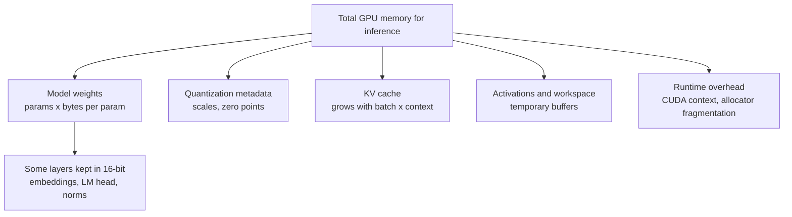
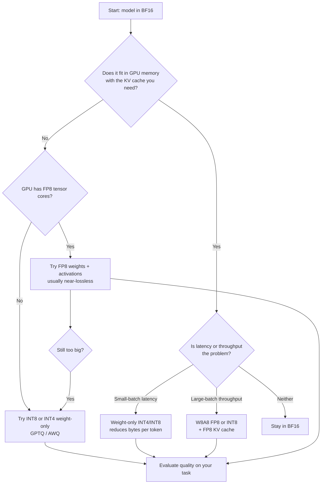

# Number Formats and Model Memory: FP32, FP16, BF16, FP8, INT8 and INT4

> **Level:** Beginner to Advanced · **Study time:** ~90 min · **Prerequisites:** Basic Python. Helpful but not required: [Mixed-Precision Training](../02-deep-learning/09-mixed-precision-training.md), [GPU Fundamentals for LLMs: Compute-Bound vs Memory-Bound](../06-llm-inference/03-gpu-fundamentals-compute-bound-vs-memory-bound.md), [The KV Cache](../06-llm-inference/02-kv-cache-explained.md)

## Table of contents

- [Why this matters](#why-this-matters)
- [Bits and bytes: the unit of everything](#bits-and-bytes-the-unit-of-everything)
- [Integers: INT8, UINT8 and INT4](#integers-int8-uint8-and-int4)
- [Floating point anatomy: sign, exponent, mantissa](#floating-point-anatomy-sign-exponent-mantissa)
- [The formats one by one](#the-formats-one-by-one)
- [The big comparison table](#the-big-comparison-table)
- [Range vs precision: the central trade-off](#range-vs-precision-the-central-trade-off)
- [Seeing the formats in code](#seeing-the-formats-in-code)
- [Model memory: parameters times bytes](#model-memory-parameters-times-bytes)
- [Why fewer bytes also means faster tokens: memory bandwidth](#why-fewer-bytes-also-means-faster-tokens-memory-bandwidth)
- [Hardware support for formats](#hardware-support-for-formats)
- [What quantization is: a preview](#what-quantization-is-a-preview)
- [Going deeper: choosing formats in production](#going-deeper-choosing-formats-in-production)
- [Common mistakes and misconceptions](#common-mistakes-and-misconceptions)
- [Interview questions and model answers](#interview-questions-and-model-answers)
- [Key takeaways](#key-takeaways)
- [Further reading](#further-reading)
- [Next](#next)

## Why this matters

Every number inside a neural network, every weight (a learned parameter) and every activation (an intermediate output computed by a layer for a given input), is stored in some binary format, and that choice decides how much GPU memory you need, how fast tokens come out, and whether training silently blows up into `NaN`. A 70-billion-parameter model needs about 280 GB just for its weights in FP32, but only about 35 GB in INT4: that is the difference between needing a multi-GPU server and fitting on a single card. **Quantization**, storing those numbers in fewer bits (for example INT4 instead of FP32) plus a few scale factors, is the main tool for shrinking that cost; it is defined precisely in [What quantization is](#what-quantization-is-a-preview). Interviewers for AI/ML roles ask "compare FP32, FP16, BF16, INT8 and INT4" and "how much memory does a 70B model need?" constantly, because the answers reveal whether you can do capacity planning and reason about cost. This chapter gives you the vocabulary and the arithmetic; the following chapters in this module build quantization techniques on top of it.

---

## Bits and bytes: the unit of everything

> **Analogy:** A bit is a light switch: on or off. A row of 8 switches can be set in $2^8 = 256$ different patterns. A number format is simply an agreed rulebook that says "this pattern of switches means this number".

A **bit** (binary digit) is the smallest unit of information: a single 0 or 1. A **byte** is a group of 8 bits. Memory sizes, file sizes and GPU capacity are all measured in bytes.

The key counting fact:

$$\text{number of distinct patterns} = 2^{n}$$

- $n$: the number of bits.
- $2^n$: how many different values the format can possibly represent, no matter what rulebook you use.

Tiny example: with $n = 4$ bits, $2^4 = 2 \times 2 \times 2 \times 2 = 16$ patterns. With $n = 8$, $2^8 = 256$. With $n = 16$, $2^{16} = 65{,}536$. With $n = 32$, $2^{32} = 4{,}294{,}967{,}296$ (about 4.3 billion).

This is the first big idea of the chapter: **a 4-bit format can only ever name 16 distinct numbers.** Everything clever in quantization is about choosing *which* 16 (or 256) numbers to name.

### Units: GB vs GiB

You will see two conventions, and mixing them causes "my math says it fits but it doesn't" bugs.

| Unit | Meaning | Bytes |
|---|---|---|
| **GB** (gigabyte, decimal) | $10^9$ bytes | 1,000,000,000 |
| **GiB** (gibibyte, binary) | $2^{30}$ bytes | 1,073,741,824 |

A GiB is about 7.4% larger than a GB. GPU tools such as `nvidia-smi` report memory in MiB (binary), while model cards and marketing often use GB (decimal). Example: 14 GB of weights is $14 \times 10^9 / 1{,}073{,}741{,}824 \approx 13.04$ GiB. In this chapter, "GB" means decimal unless stated otherwise.

---

## Integers: INT8, UINT8 and INT4

### Unsigned integers

An **unsigned integer** (UINT) uses all its bits for magnitude, so it can only be zero or positive. The bit pattern is read as a binary number: each position is worth a power of two.

```text
UINT8 pattern:  1  0  1  1  0  0  1  0
position value: 128 64 32 16 8  4  2  1
value = 128 + 32 + 16 + 2 = 178
```

Range of an $n$-bit unsigned integer:

$$0 \;\text{ to }\; 2^{n} - 1$$

For **UINT8**: $0$ to $2^8 - 1 = 255$.

### Signed integers and two's complement

A **signed integer** (INT) can be negative. Virtually all hardware uses **two's complement**, a scheme where the highest bit carries a *negative* weight. For INT8, the leftmost bit is worth $-128$ instead of $+128$.

```text
INT8 pattern:   1    1  1  1  1  1  1  1
position value: -128 64 32 16 8  4  2  1
value = -128 + 64 + 32 + 16 + 8 + 4 + 2 + 1 = -1

INT8 pattern:   1    0  0  0  0  0  0  0
value = -128                      (the most negative INT8)

INT8 pattern:   0    1  1  1  1  1  1  1
value = 64+32+16+8+4+2+1 = 127    (the most positive INT8)
```

Range of an $n$-bit signed integer:

$$-2^{n-1} \;\text{ to }\; 2^{n-1} - 1$$

- $n$: number of bits.
- $-2^{n-1}$: the most negative value (only the top bit set).
- $2^{n-1} - 1$: the most positive value (all bits set except the top one).

Worked by hand:

- **INT8** ($n = 8$): $-2^7 = -128$ to $2^7 - 1 = 127$. That is 256 values.
- **INT4** ($n = 4$): $-2^3 = -8$ to $2^3 - 1 = 7$. That is 16 values.
- **UINT4** ($n = 4$): $0$ to $2^4 - 1 = 15$.

Notice the range is lopsided: INT8 reaches $-128$ but only $+127$. Many quantization schemes deliberately use only $-127$ to $127$ so that the grid is symmetric around zero (more on that in the [next chapter](02-quantization-fundamentals-scale-and-zero-point.md)).

> **Key insight:** Integers are evenly spaced. The gap between neighbors is always exactly 1. They have *perfectly uniform precision* but a *tiny range*. To store a neural network weight like $-0.0371$ in INT8, you must pair the integer with a **scale factor** (a real number you multiply by). That pairing is what quantization is. Going back, multiplying the stored integer by its scale to recover an approximate real value, is called **dequantization**.

### Packing INT4: two numbers per byte

Memory is addressed in bytes, and almost no general-purpose hardware has a native 4-bit storage type. So INT4 values are **packed**: two 4-bit numbers are stored side by side in one byte, and a GPU kernel unpacks them on the fly.

```python
# pip install numpy
import numpy as np

def pack_int4(q: np.ndarray) -> np.ndarray:
    """Pack signed 4-bit values (range -8..7, even length) into bytes, two per byte."""
    assert q.min() >= -8 and q.max() <= 7 and q.size % 2 == 0
    nibbles = (q.astype(np.int8) & 0x0F).astype(np.uint8)   # keep low 4 bits (two's complement)
    return nibbles[0::2] | (nibbles[1::2] << 4)              # low nibble = even idx, high = odd idx

def unpack_int4(packed: np.ndarray) -> np.ndarray:
    low = (packed & 0x0F).astype(np.int8)
    high = (packed >> 4).astype(np.int8)
    out = np.empty(packed.size * 2, dtype=np.int8)
    out[0::2], out[1::2] = low, high
    return np.where(out > 7, out - 16, out)                  # sign-extend 4-bit values

q = np.array([-8, 7, 3, -1], dtype=np.int8)
p = pack_int4(q)
print(p.nbytes, "bytes for", q.size, "values")   # 2 bytes for 4 values
print(unpack_int4(p))                            # [-8  7  3 -1]
```

A **nibble** is half a byte (4 bits). The sign-extension step works because a 4-bit pattern above 7 (for example `1111` = 15 unsigned) really means $15 - 16 = -1$ in two's complement.

---

## Floating point anatomy: sign, exponent, mantissa

### Intuition: scientific notation in base 2

> **Analogy:** Scientific notation, like $6.02 \times 10^{23}$ or $1.6 \times 10^{-19}$, lets you write huge and tiny numbers with a few digits. The digits ($6.02$) give the *precision*; the exponent ($23$) gives the *scale*. Floating point is the same idea in base 2, with a fixed number of bits for each part.

A **floating-point number** stores three fields:

```text
 ┌──────┬────────────────┬──────────────────────────┐
 │ sign │    exponent    │   mantissa (fraction)    │
 └──────┴────────────────┴──────────────────────────┘
  1 bit     E bits               M bits
  +/-     "how big"          "which value at that size"
```

- **Sign bit**: 0 means positive, 1 means negative.
- **Exponent**: an integer that picks the power of two, that is, the *scale* or "zoom level". More exponent bits means a wider **range** (larger and smaller numbers).
- **Mantissa** (also called **significand** or **fraction**): the digits after the binary point. More mantissa bits means finer **precision** (more values packed between neighboring powers of two).

### The decoding formula

For a "normal" number (the usual case):

$$x = (-1)^{s} \times 2^{\,e - b} \times \left(1 + \frac{m}{2^{M}}\right)$$

- $s$: the sign bit (0 or 1). $(-1)^0 = +1$, $(-1)^1 = -1$.
- $e$: the exponent field read as an unsigned integer.
- $b$: the **bias**, a fixed offset that lets a stored unsigned exponent represent negative powers. For an $E$-bit exponent, $b = 2^{E-1} - 1$.
- $m$: the mantissa field read as an unsigned integer.
- $M$: the number of mantissa bits.
- The leading "1 +" is the **implicit leading bit**: since every normal binary number starts with 1, it is not stored, which buys one free bit of precision.

Biases for the formats in this chapter: FP32 and BF16 ($E = 8$): $b = 2^7 - 1 = 127$. FP16 ($E = 5$): $b = 15$. FP8 E4M3 ($E = 4$): $b = 7$. FP8 E5M2 ($E = 5$): $b = 15$.

### Worked example: decoding -6.5 in FP16

FP16 has 1 sign bit, 5 exponent bits, 10 mantissa bits. The number $-6.5$ is stored as:

```text
 sign  exponent   mantissa
  1     10001     1010000000
```

Step by step:

1. Sign: $s = 1$, so the factor is $(-1)^1 = -1$.
2. Exponent: `10001` in binary $= 16 + 1 = 17$. Subtract the bias: $17 - 15 = 2$. Scale factor $2^2 = 4$.
3. Mantissa: `1010000000` in binary $= 512 + 128 = 640$. Divide by $2^{10} = 1024$: $640 / 1024 = 0.625$. Add the implicit 1: $1.625$.
4. Combine: $-1 \times 4 \times 1.625 = -6.5$. Correct.

### Special values

Floating-point formats reserve some patterns for special meanings:

- **Zero**: exponent and mantissa all zeros. There are two zeros, $+0$ and $-0$.
- **Infinity** (`inf`): exponent all ones, mantissa zero (IEEE-style formats). Produced on **overflow**, when a result is too big to represent.
- **NaN** ("not a number"): exponent all ones, mantissa nonzero. Produced by invalid operations like $0/0$ or $\infty - \infty$. Once a NaN appears, it spreads through every computation that touches it.
- **Subnormal** (or denormal) numbers: when the exponent field is all zeros, the implicit leading bit becomes 0 instead of 1. This lets the format represent values smaller than the smallest normal number, with gradually decreasing precision. When a value is too small even for subnormals, it **underflows** to zero.

### Machine epsilon: a precise measure of precision

**Machine epsilon** ($\varepsilon$) is the gap between 1.0 and the next larger representable number:

$$\varepsilon = 2^{-M}$$

- $M$: number of mantissa bits.

Because the mantissa gives a fixed number of steps between each pair of powers of two, the *relative* spacing of numbers is roughly constant across the whole range: a value $x$ is stored with a relative rounding error of at most about $\varepsilon / 2$. Example for FP16 ($M = 10$): $\varepsilon = 2^{-10} = 1/1024 \approx 0.000977$. So near 1.0, FP16 can distinguish $1.0$ from $1.000977$ but not from $1.0001$.

A handy rule of thumb: a format with $M$ mantissa bits gives about $(M + 1) \times \log_{10} 2 \approx 0.301 \times (M + 1)$ significant decimal digits. FP32: $0.301 \times 24 \approx 7.2$ digits. FP16: $0.301 \times 11 \approx 3.3$ digits. BF16: $0.301 \times 8 \approx 2.4$ digits.

---

## The formats one by one

Here is the bit layout of every floating-point format we care about, drawn to scale (one character per bit).

```text
FP32   S EEEEEEEE MMMMMMMMMMMMMMMMMMMMMMM     1 + 8 + 23 = 32 bits
TF32   S EEEEEEEE MMMMMMMMMM                  1 + 8 + 10 = 19 bits (compute only)
FP16   S EEEEE MMMMMMMMMM                     1 + 5 + 10 = 16 bits
BF16   S EEEEEEEE MMMMMMM                     1 + 8 +  7 = 16 bits
E4M3   S EEEE MMM                             1 + 4 +  3 =  8 bits
E5M2   S EEEEE MM                             1 + 5 +  2 =  8 bits
FP4    S EE M                                 1 + 2 +  1 =  4 bits (E2M1)
```

Look at the pattern: BF16 is FP32 with the mantissa chopped short, and FP16 trades exponent bits for mantissa bits. That one picture explains most of the behavior below.

### FP32 (single precision)

**FP32** is the IEEE 754 32-bit format and the historical default for deep learning. It has a huge range (up to about $3.4 \times 10^{38}$) and about 7 decimal digits of precision. It is the safe "reference" format: when you debug numerical problems, you compare against FP32. Its downside is cost: 4 bytes per number, and the slowest matrix math on modern accelerators.

### TF32 (an aside)

**TF32** ("TensorFloat-32") is not a storage format. It is a mode in which NVIDIA **tensor cores** (specialized matrix-multiply units, see [Hardware support for formats](#hardware-support-for-formats)) since the Ampere generation take FP32 inputs, use only 10 of the mantissa bits internally, and accumulate in FP32. You get FP32 range with FP16-level mantissa precision for much faster matmuls. In PyTorch it is controlled by `torch.set_float32_matmul_precision("high")` (or the older `torch.backends.cuda.matmul.allow_tf32` flag). Worth knowing because "my FP32 results differ slightly between GPUs" is sometimes TF32.

### FP16 (half precision)

**FP16** is the IEEE 754 16-bit format: 5 exponent bits, 10 mantissa bits. It halves memory and runs much faster on tensor cores, and its precision (about 3.3 digits) is enough for neural network weights. Its weakness is **range**: the largest value is only **65,504**, and the smallest normal value is about $6.1 \times 10^{-5}$. Gradients below about $6 \times 10^{-8}$ (the smallest FP16 subnormal, $2^{-24}$) underflow to zero, values between that and the smallest normal keep only a few bits of precision, and large activations can overflow to `inf`. That is why FP16 training needs **loss scaling**: multiply the loss by a large constant (say 1,024) so the backward pass produces gradients big enough to be representable, then divide them back before the weight update (covered in [Mixed-Precision Training](../02-deep-learning/09-mixed-precision-training.md)).

Where 65,504 comes from: the largest normal exponent field is `11110` $= 30$, so $2^{30-15} = 2^{15} = 32{,}768$. The largest mantissa is all ones, $1 + 1023/1024 = 1.999023...$. Multiply: $32{,}768 \times 1.999023 \approx 65{,}504$.

### BF16 (brain floating point)

**BF16** ("bfloat16") was introduced by Google Brain and popularized on TPUs. It keeps FP32's 8 exponent bits, so it has **the same range as FP32** (up to about $3.4 \times 10^{38}$), but only 7 mantissa bits, so precision is coarse ($\varepsilon = 2^{-7} = 0.0078125$, about 2.4 digits). Converting FP32 to BF16 is basically dropping the bottom 16 bits (with rounding).

Why it won for LLM training: overflow and underflow are what kill training runs, and BF16 almost never overflows, so you can usually skip loss scaling. Neural networks tolerate the lost precision surprisingly well, especially when matrix multiplications accumulate in FP32 internally. Today most LLMs are trained and released in BF16.

### FP8: E4M3 and E5M2

**FP8** squeezes a float into one byte. Since 8 bits are not enough for one design to do everything, there are two standard variants, described in "FP8 Formats for Deep Learning" (Micikevicius et al., 2022) and standardized through the Open Compute Project (OCP):

- **E4M3**: 4 exponent bits, 3 mantissa bits. More precision, less range. Max value **448**. This variant (often written `float8_e4m3fn`, "fn" meaning finite: no infinities) gives up infinity and keeps only one NaN pattern per sign to stretch the range. Typically used for **weights and activations** (the forward pass and inference).
- **E5M2**: 5 exponent bits, 2 mantissa bits. More range, less precision. Max value **57,344**, follows IEEE conventions (has `inf` and NaN). Typically used for **gradients** in training, which span a wider range of magnitudes.

Checking E4M3's max: the top pattern `0 1111 111` is reserved for NaN, so the largest finite value is `0 1111 110`. Exponent $15 - 7 = 8$, so $2^8 = 256$. Mantissa `110` $= 6$, so $1 + 6/8 = 1.75$. Value $256 \times 1.75 = 448$.

Checking E5M2's max: `0 11110 11`. Exponent $30 - 15 = 15$, so $2^{15} = 32{,}768$. Mantissa $1 + 3/4 = 1.75$. Value $32{,}768 \times 1.75 = 57{,}344$.

With so few bits, FP8 is almost always used with **scaling factors** (per tensor, or per block of values) that shift the data into the representable range, much like integer quantization. FP8 is covered in practice in [Practical LLM Quantization](04-llm-quantization-gptq-awq-and-outliers.md).

### FP4 and microscaling formats (newer, version-dependent)

Recent accelerators (for example NVIDIA's Blackwell generation, 2024-2025) added 4-bit floating point, **E2M1**, which can only represent $\pm\{0, 0.5, 1, 1.5, 2, 3, 4, 6\}$. On its own that is useless, so it is paired with a shared scale per small block of values. The OCP "Microscaling (MX)" specification (2023) defines formats like MXFP8, MXFP6 and MXFP4 that share an 8-bit power-of-two scale across a block of 32 values; NVIDIA's NVFP4 uses smaller blocks of 16 with an FP8 scale. Treat the details as fast-moving (as of 2026); the durable idea is **"tiny format plus a shared per-block scale"**.

### INT8 and INT4 as model formats

Integers, as you saw, have uniform spacing and no exponent. On their own they cannot represent $0.0371$. In models, INT8 and INT4 always travel with a **scale** (and sometimes a **zero point**):

$$x \approx s \cdot q$$

- $x$: the original real value (for example a weight).
- $q$: the stored integer (INT8: $-128$ to $127$; INT4: $-8$ to $7$).
- $s$: a floating-point scale, shared by a whole tensor, a row (channel) or a small group of values.

So "INT8 range" in practice means $[-128s, 127s]$ with a uniform step of $s$. A **zero point** $z$ is an optional integer offset, $x \approx s \cdot (q - z)$, that shifts the grid when the data is not centered on zero (for example all-positive values after a ReLU). The [next chapter](02-quantization-fundamentals-scale-and-zero-point.md) owns the details of choosing $s$.

### NF4 (4-bit NormalFloat)

**NF4** was introduced in "QLoRA: Efficient Finetuning of Quantized LLMs" (Dettmers et al., 2023). It is a 4-bit data type with 16 fixed levels in $[-1, 1]$, but the levels are **not evenly spaced**: they are placed at quantiles of a normal (bell-curve) distribution, so they are dense near zero and sparse near $\pm 1$.

> **Analogy:** If most of your customers live near the city center, you put more bus stops downtown and fewer in the suburbs. Trained weights are roughly bell-shaped around zero, so NF4 puts more of its 16 "stops" near zero.

Key facts:

- The 16 levels include an exact 0, with 7 negative levels and 8 positive levels (asymmetric so that zero is representable exactly).
- Each block of 64 weights is divided by its largest absolute value (**absmax**) so it fits in $[-1, 1]$; the absmax is stored as the block's scale.
- **Double quantization** then quantizes those scales themselves to 8 bits, cutting the scale overhead from about 0.5 bits per parameter to about 0.127 bits per parameter (numbers from the QLoRA paper).
- NF4 is a **storage** format: weights are dequantized to BF16 (or FP16) on the fly for computation. No hardware does NF4 math natively.

---

## The big comparison table

| Format | Bits (S/E/M) | Bytes | Max magnitude | Smallest positive normal | Precision near 1.0 ($\varepsilon$) | Typical use |
|---|---|---|---|---|---|---|
| FP32 | 1/8/23 | 4 | ~$3.4 \times 10^{38}$ | ~$1.2 \times 10^{-38}$ | $2^{-23} \approx 1.2 \times 10^{-7}$ | Master weights, optimizer states, reference/debug, small classic models |
| FP16 | 1/5/10 | 2 | 65,504 | ~$6.1 \times 10^{-5}$ | $2^{-10} \approx 9.8 \times 10^{-4}$ | Inference, older mixed-precision training (with loss scaling) |
| BF16 | 1/8/7 | 2 | ~$3.4 \times 10^{38}$ | ~$1.2 \times 10^{-38}$ | $2^{-7} \approx 7.8 \times 10^{-3}$ | Default for LLM training and serving |
| FP8 E4M3 | 1/4/3 | 1 | 448 | $2^{-6} \approx 0.0156$ | $2^{-3} = 0.125$ | FP8 inference, forward pass in FP8 training (with scales) |
| FP8 E5M2 | 1/5/2 | 1 | 57,344 | $2^{-14} \approx 6.1 \times 10^{-5}$ | $2^{-2} = 0.25$ | Gradients in FP8 training |
| INT8 | integer | 1 | $127s$ (with scale $s$) | uniform step $s$ | uniform step $s$ | W8A8 inference, CPU/mobile inference, KV cache |
| INT4 | integer | 0.5 | $7s$ | uniform step $s$ | uniform step $s$ | Weight-only LLM quantization (GPTQ, AWQ, GGUF) |
| NF4 | 16 lookup levels | 0.5 | absmax of block | nonuniform, dense near 0 | nonuniform | QLoRA base weights, bitsandbytes 4-bit loading |

All floating-point numbers in this table (max, smallest normal, $\varepsilon$) were checked against the standard definitions; INT8/INT4/NF4 ranges depend on the scale you pair them with.

Names in the "Typical use" column that this chapter only previews: **W8A8** means 8-bit weights and 8-bit activations (see [naming conventions](#naming-conventions-you-will-hear-w4a16-w8a8-fp8-kv)); the **KV cache** is the per-token attention memory kept during generation (see [Overhead](#overhead-why-real-numbers-are-bigger-than-the-table)); **GPTQ** and **AWQ** are popular INT4 weight-quantization algorithms and **GGUF** is the llama.cpp file format (all in [Practical LLM Quantization](04-llm-quantization-gptq-awq-and-outliers.md)); **bitsandbytes** is the library that implements NF4 for QLoRA.

> **Interview tip:** If you only memorize one row-by-row story, make it this: "FP32 is 4 bytes and the reference. FP16 and BF16 are 2 bytes; FP16 has more precision but a max of about 65k, BF16 has FP32's range but less precision, which is why training prefers BF16. FP8 and INT8 are 1 byte, INT4 and NF4 are half a byte, and they need scale factors because their range or precision is too small on their own."

---

## Range vs precision: the central trade-off

With a fixed number of bits, every extra exponent bit you add is a mantissa bit you lose. You are choosing between:

- **Range** (dynamic range): how large and how small the numbers can be before overflow or underflow.
- **Precision** (resolution): how finely you can distinguish neighboring values.

> **Analogy:** Imagine a ruler with exactly 100 tick marks. You can spread them over 1 meter (each tick is 1 cm, fine precision, small range) or over 100 meters (each tick is 1 m, huge range, coarse precision). You cannot have both with the same number of ticks. Floating point is a clever ruler whose ticks get wider as you move away from zero, so the *relative* precision stays constant.

### Concrete examples of representable values

Here is what happens when you store some real numbers in each 16-bit and 8-bit format (round to nearest). These values were computed with NumPy and `ml_dtypes`.

| True value | FP16 | BF16 | FP8 E4M3 | FP8 E5M2 | What it shows |
|---|---|---|---|---|---|
| 3.14159265 | 3.140625 | 3.140625 | 3.25 | 3.0 | Fewer mantissa bits, coarser value |
| 0.1 | 0.0999755859375 | 0.10009765625 | 0.1015625 | 0.09375 | 0.1 is never exact in binary |
| 1.0001 | 1.0 | 1.0 | 1.0 | 1.0 | Small differences vanish |
| 1.004 | 1.00390625 | 1.0078125 | 1.0 | 1.0 | FP16 is finer than BF16 near 1 |
| 300 | 300.0 | 300.0 | 288.0 | 320.0 | FP8 steps are 32 or 64 here |
| 500 | 500.0 | 500.0 | overflow | 512.0 | E4M3 max is 448 |
| 70,000 | `inf` (overflow) | 70,144 | overflow | `inf` | FP16 max is 65,504; BF16 keeps going |
| 0.00000001 ($10^{-8}$) | 0.0 (underflow) | ~$1.0012 \times 10^{-8}$ | 0.0 | 0.0 | BF16 has FP32's tiny range |

"Overflow" for E4M3 means the result is not representable: depending on the library and settings it becomes NaN or saturates to 448. Production FP8 recipes avoid this with scaling.

### Working two examples by hand

**Why 70,000 becomes 70,144 in BF16.** $70{,}000$ lies between $2^{16} = 65{,}536$ and $2^{17} = 131{,}072$. In that interval, BF16's 7 mantissa bits split the span into $2^7 = 128$ equal steps, so each step is $65{,}536 / 128 = 512$. Now $70{,}000 / 512 = 136.72$. The two neighbors are $136 \times 512 = 69{,}632$ and $137 \times 512 = 70{,}144$. The distances are $70{,}000 - 69{,}632 = 368$ and $70{,}144 - 70{,}000 = 144$, so it rounds to $70{,}144$. The relative error is $144 / 70{,}000 \approx 0.2\%$: big in absolute terms, small in relative terms, and within BF16's guaranteed bound of $\varepsilon / 2 = 2^{-8} \approx 0.39\%$.

**Why 1.004 survives FP16 but not BF16 exactly.** Near 1.0, FP16's step is $2^{-10} = 0.0009765625$. $0.004 / 0.0009765625 = 4.096$, so the nearest representable value is $1 + 4 \times 0.0009765625 = 1.00390625$. BF16's step near 1 is $2^{-7} = 0.0078125$; $0.004$ is just over half a step ($0.00390625$), so it rounds *up* to $1.0078125$.

### Why this matters for neural networks

- **Weights** are usually small numbers in a narrow range (often roughly $|w| < 1$). They need moderate precision but not much range, which is why they quantize well, even to 4 bits.
- **Activations** in large transformers can contain rare **outliers**: a few channels with magnitudes 10-100x larger than the rest (documented in "LLM.int8()", Dettmers et al., 2022). These stress range and make activation quantization much harder than weight quantization. See [Practical LLM Quantization](04-llm-quantization-gptq-awq-and-outliers.md).
- **Gradients** span many orders of magnitude, often very small. They need range, which is why FP16 training needs loss scaling and FP8 training uses E5M2 for gradients.
- **Accumulators** (running sums inside a matrix multiply) need precision: adding a tiny number to a large one in low precision loses the tiny one entirely ($1.0 + 0.0001 = 1.0$ in FP16). Hardware therefore multiplies in low precision but **accumulates in FP32** (or INT32 for integer math).

> **Senior insight:** Range problems are catastrophic and loud (`inf`, NaN, training divergence). Precision problems are gradual and silent (slightly worse **perplexity**, the exponential of the average per-token cross-entropy on held-out text, where lower is better; drifting accuracy). That is why the industry moved from FP16 to BF16 for training: it traded a silent, tolerable cost for removing a loud, fatal one.

---

## Seeing the formats in code

### From scratch: pull the bits apart

```python
# pip install numpy
import numpy as np

def fp16_fields(x: float) -> tuple[int, int, int]:
    """Return (sign, exponent_field, mantissa_field) of x stored as FP16."""
    bits = int(np.array(x, dtype=np.float16).view(np.uint16))
    return bits >> 15, (bits >> 10) & 0x1F, bits & 0x3FF

def decode_fp16(sign: int, exp: int, man: int) -> float:
    """Apply the floating-point formula by hand (bias 15, 10 mantissa bits)."""
    if exp == 0x1F:                                   # all-ones exponent
        return float("nan") if man else (-1) ** sign * float("inf")
    if exp == 0:                                      # subnormal: no implicit 1
        return (-1) ** sign * 2.0 ** (1 - 15) * (man / 1024)
    return (-1) ** sign * 2.0 ** (exp - 15) * (1 + man / 1024)

s, e, m = fp16_fields(-6.5)
print(s, format(e, "05b"), format(m, "010b"))   # 1 10001 1010000000
print(decode_fp16(s, e, m))                     # -6.5

# BF16 is "the top 16 bits of FP32". Truncating vs rounding matters:
x = np.float32(1.004)
top16 = int(np.array(x).view(np.uint32)) >> 16
print(hex(top16))                               # 0x3f80, which is exactly 1.0 (truncated)
# Proper conversion rounds to nearest-even and gives 1.0078125 (see the table above).
```

### With libraries: format metadata and casting

`ml_dtypes` (used by JAX) adds BF16 and FP8 types to NumPy; PyTorch has them natively (FP8 dtypes since PyTorch 2.1).

```python
# pip install numpy ml_dtypes
import numpy as np
import ml_dtypes as md

formats = {
    "fp32": np.float32, "fp16": np.float16, "bf16": md.bfloat16,
    "e4m3": md.float8_e4m3fn, "e5m2": md.float8_e5m2,
}
for name, dt in formats.items():
    fi = md.finfo(dt)
    print(f"{name}: bits={fi.bits} max={float(fi.max):.4g} "
          f"min_normal={float(fi.tiny):.4g} eps={float(fi.eps):.4g}")
# fp32: bits=32 max=3.403e+38 min_normal=1.175e-38 eps=1.192e-07
# fp16: bits=16 max=6.55e+04 min_normal=6.104e-05 eps=0.0009766
# bf16: bits=16 max=3.39e+38 min_normal=1.175e-38 eps=0.007812
# e4m3: bits=8 max=448 min_normal=0.01562 eps=0.125
# e5m2: bits=8 max=5.734e+04 min_normal=6.104e-05 eps=0.25

x = np.array([3.14159265, 0.1, 300.0], dtype=np.float32)
print(x.astype(md.bfloat16).astype(np.float32).tolist())  # [3.140625, 0.10009765625, 300.0]
```

The PyTorch equivalent:

```python
# pip install torch
import torch

for dt in (torch.float32, torch.float16, torch.bfloat16,
           torch.float8_e4m3fn, torch.float8_e5m2):
    fi = torch.finfo(dt)
    print(dt, fi.bits, fi.max, fi.tiny, fi.eps)

w = torch.randn(4, 4)                       # FP32 by default
print(w.element_size(), w.to(torch.bfloat16).element_size())   # 4 2
```

`element_size()` returns bytes per element. It is the single most useful number for the memory math that comes next.

---

## Model memory: parameters times bytes

### The core formula

> **Analogy:** A model's weights are like a library of books. The number of books is fixed (the parameter count). The format decides whether each book is a thick hardcover (FP32, 4 bytes) or a thin pamphlet (INT4, half a byte). The shelf space you need is books times thickness.

A **parameter** is one learned number (a weight or bias). A "7B model" has about 7 billion of them.

$$\text{weight memory (bytes)} = N_{\text{params}} \times \text{bytes per parameter}$$

- $N_{\text{params}}$: number of parameters (for example $7 \times 10^9$).
- bytes per parameter: 4 for FP32, 2 for FP16/BF16, 1 for FP8/INT8, 0.5 for INT4/NF4 (before overhead).

Tiny example: $7 \times 10^9 \times 2 \text{ bytes} = 14 \times 10^9$ bytes $= 14$ GB.

A mental shortcut: **in FP16/BF16, a model needs about 2 GB per billion parameters.** In INT8, about 1 GB per billion. In INT4, about 0.5 GB per billion.

### Worked table: 7B, 13B and 70B

| Model size | FP32 (4 B) | FP16 / BF16 (2 B) | FP8 / INT8 (1 B) | INT4 / NF4 (0.5 B) |
|---|---|---|---|---|
| 7B | $7 \times 4 = 28$ GB | $7 \times 2 = 14$ GB | $7 \times 1 = 7$ GB | $7 \times 0.5 = 3.5$ GB |
| 13B | $13 \times 4 = 52$ GB | $13 \times 2 = 26$ GB | $13 \times 1 = 13$ GB | $13 \times 0.5 = 6.5$ GB |
| 70B | $70 \times 4 = 280$ GB | $70 \times 2 = 140$ GB | $70 \times 1 = 70$ GB | $70 \times 0.5 = 35$ GB |

In GiB, divide by 1.0737: for example 140 GB is about 130.4 GiB and 35 GB is about 32.6 GiB.

What these numbers mean for hardware (weights only, before any overhead):

- A 7B model in BF16 (14 GB) fits on a 24 GB consumer GPU. In INT4 (3.5 GB) it fits on a laptop GPU or runs on a CPU.
- A 13B model in BF16 (26 GB) does *not* fit on a 24 GB GPU, but in INT8 (13 GB) or INT4 (6.5 GB) it does.
- A 70B model in BF16 (140 GB) needs at least two 80 GB GPUs. In INT4 (35 GB) its weights fit on one 48 GB or 80 GB GPU.

### Where parameter counts come from (a sanity check)

For a standard decoder-only transformer (see [The Full Transformer Architecture](../04-transformers/05-the-full-transformer-architecture.md)) with $L$ layers and hidden size $d$, a classic approximation is:

$$N_{\text{params}} \approx 12 \, L \, d^2 \;+\; \text{embeddings}$$

- $L$: number of transformer layers.
- $d$: hidden (model) dimension.
- $12 d^2$ per layer: about $4d^2$ for the attention projections (Q, K, V, output) plus about $8d^2$ for a feed-forward block that expands to $4d$.
- Embeddings: vocabulary size $\times\, d$ (twice if input and output embeddings are not shared).

Example with Llama 2 7B's shape ($L = 32$, $d = 4096$): $12 \times 32 \times 4096^2 = 12 \times 32 \times 16{,}777{,}216 = 6{,}442{,}450{,}944$, about 6.44B. Llama 2 uses a SwiGLU feed-forward with intermediate size 11,008 (three matrices), a 32,000-token vocabulary with separate input and output embeddings, and small norm weights. Counting exactly: per layer $4 \times 4096^2 + 3 \times 4096 \times 11{,}008 = 67{,}108{,}864 + 135{,}266{,}304 = 202{,}375{,}168$; times 32 layers $= 6{,}476{,}005{,}376$; plus embeddings $2 \times 32{,}000 \times 4096 = 262{,}144{,}000$; plus norms $65 \times 4096 = 266{,}240$. Total $6{,}738{,}415{,}616$, which matches the published "6.7B". So the "7B" model really needs $6.74 \times 2 \approx 13.5$ GB in BF16.

### Overhead: why real numbers are bigger than the table

The table above counts **weights only**. Real deployments need more. Here is the full picture for inference:



**1. Quantization metadata.** INT4 and NF4 weights need scales. With **group-wise quantization**, one FP16 scale (2 bytes = 16 bits) is stored per group of, say, 128 weights:

$$\text{effective bits per weight} = b_{\text{weight}} + \frac{b_{\text{scale}} + b_{\text{zero}}}{g}$$

- $b_{\text{weight}}$: bits of the quantized value (4 for INT4).
- $b_{\text{scale}}$: bits per scale (16 for FP16).
- $b_{\text{zero}}$: bits per zero point (0 if symmetric).
- $g$: group size (number of weights sharing one scale).

Example: $4 + 16/128 = 4 + 0.125 = 4.125$ bits per weight, which is $4.125 / 8 = 0.515625$ bytes per weight. With a 16-bit zero point as well: $4 + 32/128 = 4.25$ bits. NF4 with block size 64 and an FP32 absmax per block: $4 + 32/64 = 4.5$ bits; double quantization brings it to about $4.127$ bits.

**2. Unquantized layers.** Embeddings, the output layer (LM head) and normalization weights are often kept in 16-bit for quality. Worked example for Llama 2 7B in 4-bit with group size 128:

- Quantized part: $6{,}738{,}415{,}616 - 262{,}144{,}000 \approx 6.476 \times 10^9$ params (ignoring the tiny norms). Times $0.515625$ bytes $\approx 3.34$ GB.
- Embeddings and LM head in FP16: $262{,}144{,}000 \times 2 \approx 0.52$ GB.
- Total $\approx 3.34 + 0.52 = 3.86$ GB, noticeably more than the naive 3.5 GB (illustrative: exact sizes depend on the tool and settings).

**3. KV cache.** During generation, the model caches attention keys and values for every past token (fully explained in [The KV Cache](../06-llm-inference/02-kv-cache-explained.md)). Its size:

$$\text{KV bytes} = 2 \times L \times n_{\text{kv}} \times d_{\text{head}} \times \text{bytes} \times T \times B$$

- $2$: one tensor for keys, one for values.
- $L$: layers. $n_{\text{kv}}$: number of key/value heads. $d_{\text{head}}$: dimension per head.
- bytes: bytes per element of the cache (2 for FP16, 1 for FP8 or INT8 KV cache).
- $T$: tokens per sequence (context length). $B$: batch size (concurrent sequences).

Llama 2 7B ($L = 32$, $n_{\text{kv}} = 32$, $d_{\text{head}} = 128$, FP16): per token $2 \times 32 \times 32 \times 128 \times 2 = 524{,}288$ bytes $= 0.5$ MiB. For $T = 4096$ tokens: $0.5 \times 4096 = 2048$ MiB $= 2$ GiB **per sequence**. A batch of 8 such sequences needs 16 GiB of KV cache, more than the 13.5 GB of weights. Models with grouped-query attention (GQA, where several query heads share one key/value head) shrink this: Llama 2 70B uses 80 layers with only 8 KV heads, giving $2 \times 80 \times 8 \times 128 \times 2 = 327{,}680$ bytes $= 320$ KiB per token.

**4. Activations and runtime.** Temporary activation buffers, the CUDA context and framework overhead, and allocator fragmentation commonly add from a few hundred MB to a couple of GB (illustrative; measure on your stack). Serving engines like vLLM pre-allocate a fixed fraction of GPU memory up front and fill the rest with KV cache blocks.

### Putting it together: will it fit? (illustrative)

Running example: serve a 7B model on a 24 GB GPU, batch of 4 sequences at 4,096 tokens.

| Component | BF16 weights | INT4 weights |
|---|---|---|
| Weights | 13.5 GB | ~3.9 GB |
| KV cache (FP16): $4 \times 2$ GiB | ~8.6 GB | ~8.6 GB |
| Runtime and activations (illustrative) | ~1.5 GB | ~1.5 GB |
| **Total** | **~23.6 GB** (dangerously tight) | **~14 GB** (comfortable) |

(8 GiB of KV cache is $8 \times 1.0737 \approx 8.6$ GB.) The INT4 version frees almost 10 GB, which you can spend on longer contexts or a bigger batch. **This is the real business value of quantization: memory you save on weights becomes KV cache capacity, which becomes throughput.**

### Training memory is a different, much bigger story

For training with the Adam optimizer in mixed precision, a common rule is about **16 bytes per parameter** before activations: 2 (BF16 weights) + 2 (BF16 gradients) + 4 (FP32 master weights) + 4 (Adam first moment) + 4 (Adam second moment). For 7B: $7 \times 16 = 112$ GB. That is why full fine-tuning of a 7B model does not fit on a single 80 GB GPU without tricks, and why [LoRA and QLoRA](../05-llms/07-fine-tuning-full-lora-and-qlora.md) exist. Details live in [Distributed Training and Training Memory](../02-deep-learning/10-distributed-training-and-training-memory.md).

### Code: a memory estimator

```python
BYTES_PER_PARAM = {"fp32": 4.0, "fp16": 2.0, "bf16": 2.0, "fp8": 1.0,
                   "int8": 1.0, "int4": 0.5, "nf4": 0.5}

def weight_gb(n_params: float, fmt: str, group_size: int | None = None,
              scale_bits: int = 16) -> float:
    """Weight memory in decimal GB, optionally including per-group scale overhead."""
    bytes_pp = BYTES_PER_PARAM[fmt]
    if group_size:                                    # add one scale per group
        bytes_pp += scale_bits / 8 / group_size
    return n_params * bytes_pp / 1e9

def kv_cache_gb(layers: int, kv_heads: int, head_dim: int, tokens: int,
                batch: int, bytes_per_elem: float = 2.0) -> float:
    return 2 * layers * kv_heads * head_dim * bytes_per_elem * tokens * batch / 1e9

for size in (7e9, 13e9, 70e9):
    row = {f: round(weight_gb(size, f), 1) for f in ("fp32", "bf16", "int8", "int4")}
    print(f"{size / 1e9:.0f}B", row)
# 7B {'fp32': 28.0, 'bf16': 14.0, 'int8': 7.0, 'int4': 3.5}
# 13B {'fp32': 52.0, 'bf16': 26.0, 'int8': 13.0, 'int4': 6.5}
# 70B {'fp32': 280.0, 'bf16': 140.0, 'int8': 70.0, 'int4': 35.0}

print(round(weight_gb(7e9, "int4", group_size=128), 2))           # 3.61
print(round(kv_cache_gb(32, 32, 128, tokens=4096, batch=4), 2))   # 8.59
```

### Code: measuring a real model with Hugging Face

The exact arguments are version-dependent: recent `transformers` releases accept `dtype=` and older ones use `torch_dtype=`, and older releases loaded weights in FP32 unless told otherwise. Check your installed version.

```python
# pip install torch transformers accelerate bitsandbytes   (bitsandbytes needs a supported GPU)
import torch
from transformers import AutoModelForCausalLM, BitsAndBytesConfig

name = "Qwen/Qwen2.5-0.5B"   # small model so this runs on modest hardware

model_bf16 = AutoModelForCausalLM.from_pretrained(name, dtype=torch.bfloat16)  # older transformers: torch_dtype=
n = sum(p.numel() for p in model_bf16.parameters())
print(f"params: {n / 1e9:.3f}B, expected BF16 size: {n * 2 / 1e9:.2f} GB")
print(f"reported footprint: {model_bf16.get_memory_footprint() / 1e9:.2f} GB")

nf4 = BitsAndBytesConfig(
    load_in_4bit=True,
    bnb_4bit_quant_type="nf4",              # NormalFloat4 levels
    bnb_4bit_use_double_quant=True,         # quantize the per-block scales too
    bnb_4bit_compute_dtype=torch.bfloat16,  # dequantize to BF16 for the matmuls
)
model_nf4 = AutoModelForCausalLM.from_pretrained(name, quantization_config=nf4, device_map="auto")
print(f"NF4 footprint: {model_nf4.get_memory_footprint() / 1e9:.2f} GB")
# Expect NF4 to come out a bit under half of BF16 here (about 0.45 GB vs 0.99 GB), far
# above the naive quarter, because only the Linear layers are quantized: the large
# embedding matrix stays in 16-bit, and the scales add a little overhead.
```

Note: Qwen2.5-0.5B ties its input and output embeddings, and the embeddings are a large fraction of such a small model, so the 4-bit saving looks smaller than it would on a 7B model. This is a good example of why you measure instead of trusting the naive formula.

---

## Why fewer bytes also means faster tokens: memory bandwidth

### Two different resources: capacity and bandwidth

> **Analogy:** GPU memory is a warehouse. **Capacity** is how much the warehouse holds. **Bandwidth** is how fast the loading dock can move boxes to the workers (the compute cores). A smaller box format helps with both: more boxes fit, and more boxes go through the dock per second.

- **Memory capacity**: how many bytes the GPU can hold (for example 24 GB, 80 GB).
- **Memory bandwidth**: how many bytes per second can move between GPU memory (HBM, the stacked high-bandwidth memory on data-center GPUs, or GDDR on consumer cards) and the compute units, measured in GB/s or TB/s.

### Why decoding is bandwidth-bound

When an LLM generates text, the **decode** phase produces one token at a time (see [Inference Fundamentals](../06-llm-inference/01-inference-fundamentals-prefill-decode-and-latency-metrics.md)). To produce each token, every weight matrix must be read from memory once. With a small batch, each weight is used for only about 2 floating-point operations (one multiply, one add) per sequence, and modern GPUs can do hundreds of operations in the time it takes to fetch one byte. So the cores sit idle waiting for data: the workload is **memory-bandwidth-bound** (full treatment in [GPU Fundamentals](../06-llm-inference/03-gpu-fundamentals-compute-bound-vs-memory-bound.md)).

That gives a simple lower bound on time per token at batch size 1:

$$t_{\text{token}} \;\gtrsim\; \frac{\text{bytes of weights read per token}}{\text{memory bandwidth}}$$

- $t_{\text{token}}$: time to generate one token.
- bytes of weights read per token: roughly the weight memory (for dense models).
- memory bandwidth: bytes per second the GPU memory can deliver.

### Worked example (illustrative bandwidth)

Assume an illustrative GPU with **2,000 GB/s** of memory bandwidth (roughly the class of a data-center GPU from the early 2020s). A 7B model:

| Format | Weight bytes | Time per token (lower bound) | Max tokens/s (upper bound) |
|---|---|---|---|
| BF16 | 14 GB | $14 / 2000 = 0.007$ s $= 7$ ms | $1 / 0.007 \approx 143$ |
| INT8 | 7 GB | $7 / 2000 = 0.0035$ s $= 3.5$ ms | $\approx 286$ |
| INT4 | 3.5 GB | $3.5 / 2000 = 0.00175$ s $= 1.75$ ms | $\approx 571$ |

And a 70B model in INT4 (35 GB): $35 / 2000 = 17.5$ ms per token, at most about 57 tokens/s. In BF16 it would not fit on one such GPU at all.

**So quantization helps twice:** fewer bytes stored (capacity) *and* fewer bytes moved per token (bandwidth). Halving the bytes roughly halves the minimum decode time when you are bandwidth-bound.

### Why the real speedup is smaller than the ideal

These are ceilings, not predictions. Real speedups are smaller because:

1. **Dequantization costs compute.** Weight-only INT4 kernels unpack nibbles and multiply by scales before doing FP16 math. If the kernel is poor, this overhead eats the savings.
2. **The KV cache is also read every token.** In the Llama 2 7B example, a single 4,096-token sequence has 2 GiB of KV cache, which must also be read for each new token. At long contexts or large batches, KV reads can rival or exceed weight reads, and weight quantization alone does not touch them. FP8 or INT8 KV cache quantization addresses this part.
3. **Prefill and large batches are compute-bound.** Processing a long prompt, or decoding with a large batch, reuses each weight for many tokens. Then the bottleneck is arithmetic, not bytes, and weight-only INT4 (which still computes in FP16) gives little or no speedup; it may even be slower due to dequantization. Only formats with native low-precision math (INT8 or FP8 tensor cores, with activations also quantized) speed up compute-bound work.
4. **Missing kernels.** If the serving stack has no optimized kernel for your format on your GPU, it may dequantize the whole weight to FP16 and run a normal matmul, giving memory savings but no speed.

This exact scenario, "we quantized and memory dropped but latency did not", is a full case study: [Debugging Case: A Quantized LLM Uses Less Memory but Latency Is Unchanged](../11-system-design/06-debugging-case-quantized-llm-not-faster.md).

> **Senior insight (mixture of experts):** For a mixture-of-experts (MoE) model, *capacity* depends on total parameters (all experts must be stored), but per-token *bandwidth* at small batch depends mostly on active parameters. Mixtral 8x7B, for example, has about 46.7B total parameters but uses about 12.9B per token (figures published by Mistral AI). So it needs memory like a ~47B model but decodes closer to a ~13B model, until batching makes most experts active anyway.

---

## Hardware support for formats

A format being *storable* is not the same as being *fast*. Speed comes from **tensor cores** (NVIDIA's name) or matrix engines (AMD "matrix cores", Google TPU "MXUs", Intel AMX): specialized units that multiply small matrices in a specific low-precision format and accumulate at higher precision. If the hardware has no unit for your format, the software must convert to a supported one first.

### General pattern by GPU generation

The details change every generation, so treat this as the durable shape of the story, not a spec sheet (as of 2026; always check the vendor's documentation for the exact GPU).

| Era (NVIDIA example) | Representative GPUs | Formats with tensor-core math (added that generation) |
|---|---|---|
| Volta (2017) | V100 | FP16 (first tensor cores) |
| Turing (2018) | T4, RTX 20xx | INT8 and INT4 added |
| Ampere (2020) | A100, RTX 30xx | BF16 and TF32 added |
| Ada Lovelace / Hopper (2022) | L4, L40S, RTX 40xx / H100 | FP8 (E4M3 and E5M2) added; Hopper no longer lists INT4 tensor-core math |
| Blackwell (2024-2025) | B200, RTX 50xx | FP4 and FP6, microscaling block formats |

Other vendors follow the same broad trend: Google TPUs have used BF16 natively for years (BF16 originated there), AMD's Instinct MI300 series supports FP8 with newer parts adding lower-precision floats, and modern x86 server CPUs include instructions for INT8 dot products and BF16.

Practical consequences:

- **BF16 on older GPUs** (for example V100 or T4) is emulated or unsupported, so FP16 is the practical 16-bit choice there.
- **FP8 inference** needs Ada, Hopper or newer (or equivalent from other vendors). On older GPUs, FP8 weights can be stored but are upcast for computation.
- **INT4 LLM inference** is almost always **weight-only**: 4-bit storage, 16-bit math, done by custom kernels. It works on almost any GPU and even CPUs (llama.cpp), because the win is bandwidth, not 4-bit arithmetic.
- **NF4** has no hardware math anywhere; it is always dequantized.
- Marketing "TFLOPS" for low-precision formats are often quoted *with* structured sparsity, which doubles the headline number. Compare dense numbers.

> **Interview tip:** When asked "should we use FP8?", the first follow-up question you ask is "on what hardware?". The answer is very different on an A100 (no FP8 tensor cores) vs an H100 (native FP8).

---

## What quantization is: a preview

**Quantization** is the process of mapping numbers from a high-precision format (usually FP32 or BF16) to a lower-precision format (FP8, INT8, INT4, NF4) by choosing a small set of representable values and rounding each original number to the nearest one, using **scale factors** (and sometimes **zero points**) so that the small format's grid covers the range of the actual data. It reduces memory and bandwidth (and, with hardware support, compute), at the cost of a **quantization error** that you must keep small enough not to hurt model quality. Quantization can be applied after training (**post-training quantization**, PTQ) or simulated during training (**quantization-aware training**, QAT), and to weights only or to weights and activations.

A 10-second taste, using the simplest scheme (**absmax**, symmetric INT8): the scale is the largest absolute value divided by 127.

```python
# pip install numpy
import numpy as np

w = np.array([0.5, -1.2, 0.03, 2.54], dtype=np.float32)
scale = np.abs(w).max() / 127                 # 2.54 / 127 = 0.02
q = np.round(w / scale).astype(np.int8)       # [25, -60, 2, 127]  (0.03/0.02 = 1.5 rounds to 2)
w_hat = q.astype(np.float32) * scale          # [0.5, -1.2, 0.04, 2.54]
print(scale, q, w_hat, np.abs(w - w_hat).max())
# the 0.03 weight came back as 0.04: an error of 0.01, half a step
```

Four FP32 numbers (16 bytes) became four INT8 numbers plus one scale (4 + 4 = 8 bytes). For a big tensor the single scale is negligible, so the saving approaches 4x. The rest of this module goes deep:

- [Quantization Fundamentals: Scale, Zero Point, Symmetric and Asymmetric](02-quantization-fundamentals-scale-and-zero-point.md)
- [Post-Training Quantization vs Quantization-Aware Training](03-ptq-vs-qat-and-calibration.md)
- [Practical LLM Quantization: Outliers, LLM.int8(), SmoothQuant, GPTQ, AWQ, GGUF and FP8](04-llm-quantization-gptq-awq-and-outliers.md)

---

## Going deeper: choosing formats in production

### Naming conventions you will hear: W4A16, W8A8, FP8 KV

Production quantization is described by *what* is quantized:

| Label | Weights | Activations | Where the speed comes from | Typical fit |
|---|---|---|---|---|
| W16A16 (BF16/FP16) | 16-bit | 16-bit | Baseline | Quality reference, training |
| W8A16 / W4A16 (weight-only) | 8 or 4-bit | 16-bit | Less memory and bandwidth; math still 16-bit | Small-batch, latency-sensitive decoding; fitting big models on fewer GPUs |
| W8A8 (INT8) | INT8 | INT8 | INT8 tensor cores for compute plus bandwidth savings | High-throughput serving on GPUs with INT8 support; CPU inference |
| W8A8 (FP8) | FP8 | FP8 | FP8 tensor cores; usually smaller accuracy loss than INT8 | High-throughput serving on Hopper-class and newer |
| FP8 / INT8 KV cache | any | any | Halves KV cache memory and KV bandwidth | Long contexts, large batches |

> **Senior insight:** Weight-only quantization is a *memory and bandwidth* optimization. Weight-and-activation quantization is additionally a *compute* optimization. Pick based on which resource is your bottleneck, which you find by profiling, not guessing.

### A decision flow



### How to measure

Never trust the formula alone; measure:

- **Memory**: in PyTorch, `torch.cuda.max_memory_allocated()` after a representative request, plus `nvidia-smi` for the whole process (which includes the CUDA context and the caching allocator's reserved memory). In serving engines, look at how many KV cache blocks or tokens of capacity the engine reports at startup: that is the number that sets your maximum concurrency.
- **Speed**: measure time to first token (prefill) and time per output token (decode) separately, at the batch sizes and context lengths you actually serve. A format that wins at batch 1 may lose at batch 64. See [Optimizing and Benchmarking LLM Latency and Cost](../06-llm-inference/07-optimizing-and-benchmarking-llm-latency-and-cost.md).
- **Quality**: compare against the BF16 baseline on (1) perplexity on a held-out text set, a quick smoke test, and (2) your real task evals, because perplexity can barely move while specific capabilities (math, code, long-context retrieval, non-English languages) degrade. See [Evaluating LLMs](../05-llms/10-llm-evaluation-metrics-and-llm-as-a-judge.md).

```python
# pip install torch   (requires a CUDA GPU)
import torch

torch.cuda.reset_peak_memory_stats()
# ... load model and run one representative generate() call here ...
print(f"peak allocated: {torch.cuda.max_memory_allocated() / 2**30:.2f} GiB")
print(f"reserved by allocator: {torch.cuda.memory_reserved() / 2**30:.2f} GiB")
```

### How to debug numerical problems

| Symptom | Likely cause | First thing to try |
|---|---|---|
| Output becomes NaN or `inf` in FP16 but not BF16/FP32 | Overflow past 65,504 (large activations, attention logits) | Run in BF16; or keep the offending op (softmax, norms) in FP32 |
| Training loss stalls in FP16, gradients are zero | Gradient underflow | Use loss scaling or switch to BF16 |
| FP8 model gives garbage | Missing or stale scaling factors; values above 448 in E4M3 | Check the per-tensor scales and calibration; fall back to BF16 for sensitive layers |
| INT8 model much worse than expected | Activation outliers crushing the scale | Use per-channel scales, outlier handling (LLM.int8(), SmoothQuant) or weight-only INT8 |
| Quantized model fine on short prompts, worse on long ones | KV cache quantization error accumulates, or long-context ability was hurt | Evaluate long-context tasks separately; try a higher-precision KV cache |
| Results differ slightly between GPUs in FP32 | TF32 enabled on one and not the other, or different kernel accumulation order | Check `torch.get_float32_matmul_precision()`; accept small nondeterminism |

A useful debugging technique is **layer-wise comparison**: run the same input through the BF16 and the quantized model, capture every layer's output with forward hooks, and compute the relative error per layer. The layer where error jumps is where to look.

### Cost implications at scale

Memory is usually the binding constraint for LLM serving cost:

- If quantization lets a 70B model run on 1 GPU instead of 2, you halve the GPU count per replica (and remove inter-GPU communication). That can be a large saving, but only if quality holds on your task.
- If the model already fits, quantization's benefit shows up as **more KV cache capacity**, hence larger batches, hence higher throughput per GPU and lower cost per token.
- The trade is never free: you pay with engineering time (calibration, kernel compatibility, evaluation) and with some quality risk. In regulated or high-stakes domains, the evaluation cost can dominate.

> **Senior insight:** Frame quantization decisions as "bytes per useful token". Weights, KV cache and activations all cost bytes. Quantize where the bytes are: weights when the model barely fits, KV cache when contexts are long, activations when you are compute-bound at large batch.

---

## Common mistakes and misconceptions

> **Common mistake:** "FP16 and BF16 are the same because both are 16 bits." They split their bits differently. FP16 has more precision and a max of 65,504; BF16 has FP32's range with less precision. A model that overflows in FP16 can be perfectly fine in BF16.

> **Common mistake:** "BF16 is more precise than FP16 because it is newer." It is the opposite: BF16 has 7 mantissa bits vs FP16's 10. BF16 wins on range, not precision.

> **Common mistake:** "A 4-bit 7B model is exactly 3.5 GB." Scales, zero points and 16-bit embeddings and LM head add overhead; around 3.9 GB is typical for 4-bit group-128 on a Llama-2-7B-shaped model (illustrative).

> **Common mistake:** "Weights are the only memory that matters." For serving, the KV cache can exceed the weights at long contexts and large batches. Always budget KV cache, activations and runtime overhead.

> **Common mistake:** "Quantization always makes inference faster." It always reduces weight memory, but speed depends on whether you are bandwidth-bound or compute-bound, and on kernel support for your format on your GPU. Weight-only INT4 often does nothing for prefill or large-batch throughput.

> **Common mistake:** "INT8 and FP8 are interchangeable since both are 1 byte." INT8 has a uniform grid that needs a well-chosen scale; FP8 has a logarithmic grid that tolerates a wider spread of values. They have different hardware support and different accuracy behavior, especially with outliers.

> **Common mistake:** Mixing GB and GiB. $80 \times 10^9$ bytes is about 74.5 GiB, and that missing 5.5 "GB" matters when you are planning near the limit. Know which unit each number uses: a data-center GPU sold as "80 GB" actually has close to 80 GiB of HBM (`nvidia-smi` shows roughly 80,000 MiB or more), while model sizes on model cards are usually decimal GB.

> **Common mistake:** Forgetting that some libraries load models in FP32 by default. A 7B model loaded in FP32 takes 28 GB and may OOM on a GPU where BF16 would fit easily. Always set the dtype explicitly.

> **Common mistake:** "Lower precision means the model computes in that precision end to end." Matmuls accumulate in FP32 (or INT32), and sensitive operations like softmax, normalization and loss are often kept in FP32. Mixed precision is the norm.

---

## Interview questions and model answers

<details>
<summary><b>Q1. Explain quantization and compare FP32, FP16, BF16, INT8, and INT4.</b></summary>

**Short answer:** Quantization maps model numbers from a high-precision format to a lower-precision one, using scale factors so the small format covers the data's range, to save memory, bandwidth and sometimes compute at the cost of a small rounding error. FP32 is 4 bytes with huge range and about 7 decimal digits: the reference. FP16 and BF16 are 2 bytes; FP16 has 10 mantissa bits but a max of 65,504, while BF16 keeps FP32's 8-bit exponent (same range) with only 7 mantissa bits, so it is the default for LLM training. INT8 is 1 byte and INT4 half a byte; they are uniform integer grids that need a scale (per tensor, channel or group) and are used mainly for inference, INT8 often for weights and activations and INT4 typically weight-only.

**Deeper answer and follow-ups:**

- Layouts (sign/exponent/mantissa): FP32 1/8/23, FP16 1/5/10, BF16 1/8/7. INT8 range $-128$ to $127$, INT4 $-8$ to $7$, both used as $x \approx s \cdot q$.
- Memory for a 7B model: 28 GB (FP32), 14 GB (FP16/BF16), 7 GB (INT8), 3.5 GB (INT4) plus metadata overhead.
- Precision near 1.0: FP32 $\approx 1.2 \times 10^{-7}$, FP16 $\approx 9.8 \times 10^{-4}$, BF16 $\approx 7.8 \times 10^{-3}$. Integers have a uniform step equal to the scale.
- Quality: BF16/FP16 inference is essentially lossless vs FP32 for LLMs; INT8 weight-only is usually near-lossless; INT4 needs good methods (GPTQ, AWQ, group-wise scales) and loses a little, more on small models and hard tasks.
- Hardware: FP16 tensor cores since Volta, BF16 since Ampere, INT8 since Turing, FP8 since Ada/Hopper. INT4 LLM inference is usually weight-only with 16-bit math.
- Variants to mention: PTQ vs QAT, weight-only vs weight-and-activation, per-tensor vs per-channel vs per-group scales, and newer FP8 and NF4.
- Pitfall to call out: activation outliers make INT8 activations hard; this is why FP8 or outlier-aware methods exist.
- Failure modes by format: FP16 overflows past 65,504 (loud NaNs); BF16 loses small updates if sums are not accumulated in FP32; INT8 activations get crushed by outliers; INT4 degrades most on small models and on reasoning, code and long-context tasks (quiet).
- How to measure the trade-off: perplexity delta against the BF16 baseline as a smoke test, then your real task evals, plus peak memory and prefill and decode latency at production batch sizes. A format is "good enough" only relative to a quality budget you set in advance.

</details>

<details>
<summary><b>Q2. How does quantization reduce memory consumption?</b></summary>

**Short answer:** Memory for weights is parameters times bytes per parameter. Quantization lowers the bytes per parameter: from 4 (FP32) or 2 (BF16) to 1 (INT8/FP8) or about 0.5 (INT4), so a 70B model goes from 140 GB in BF16 to about 35 GB in INT4. The small extra cost is the scales and zero points, plus any layers kept in 16-bit. And because decoding reads every weight for every token, fewer bytes also means less memory bandwidth per token, which speeds up bandwidth-bound decoding.

**Deeper answer and follow-ups:**

- Formula: $\text{bytes} = N \times b$. 70B: $70 \times 10^9 \times 2 = 140$ GB (BF16), $\times 1 = 70$ GB (INT8), $\times 0.5 = 35$ GB (INT4).
- Overhead: group-wise INT4 with an FP16 scale per 128 weights costs $4 + 16/128 = 4.125$ bits per weight. NF4 with double quantization is about 4.127 bits. Embeddings and LM head often stay in 16-bit.
- Two kinds of savings: **capacity** (fits on fewer or smaller GPUs; frees space for KV cache, enabling bigger batches) and **bandwidth** (decode lower bound $t \gtrsim \text{bytes} / \text{bandwidth}$, so halving bytes roughly halves minimum time per token at small batch).
- What it does *not* reduce by default: the KV cache (unless you quantize it separately, for example FP8 KV), activations, and runtime overhead.
- For training, weight quantization alone does not remove optimizer state memory; QLoRA works by freezing a 4-bit base model and training small 16-bit adapters.
- Pitfall: memory savings do not guarantee latency savings (dequantization overhead, compute-bound prefill, missing kernels).
- Realistic ratios: FP32 to INT8 is 4x; BF16 to INT4 is about 3.5x after overhead (Llama 2 7B: 13.5 GB to about 3.9 GB). Going below 4 bits saves more memory but quality usually drops faster; "The case for 4-bit precision" (Dettmers and Zettlemoyer, 2022) found 4-bit to be close to the best accuracy per total model bit.
- How to measure: compare `model.get_memory_footprint()` or `torch.cuda.max_memory_allocated()` before and after, and in a serving engine compare the KV cache capacity it reports at startup. That capacity, which sets maximum concurrency, is the production number that should go up.

</details>

<details>
<summary><b>Q3. Why is BF16 usually preferred over FP16 for training large models?</b></summary>

**Short answer:** Because BF16 has the same 8-bit exponent as FP32, it has the same dynamic range, so activations and gradients almost never overflow or underflow. FP16's max is 65,504 and its small values underflow, so FP16 training needs loss scaling and still risks NaN spikes. Networks tolerate BF16's lower precision well, especially since matmuls accumulate in FP32 and master weights are kept in FP32.

**Deeper answer and follow-ups:**

- BF16 $\varepsilon = 2^{-7}$ vs FP16 $2^{-10}$: FP16 is 8x finer near 1.0, so FP16 is sometimes preferred for *inference* on older GPUs where BF16 is not supported.
- Range failures are loud and fatal (divergence); precision losses are gradual. Trading the latter for removing the former is a good deal at scale.
- Hardware: BF16 tensor cores from Ampere onward; on V100 or T4 you use FP16 with loss scaling.
- Follow-up "do you still need FP32 anywhere?": yes, master weights and optimizer states (in standard mixed precision), and numerically sensitive ops like softmax and normalization. See [Mixed-Precision Training](../02-deep-learning/09-mixed-precision-training.md).

</details>

<details>
<summary><b>Q4. How much GPU memory do you need to serve a 70B model? Walk me through the estimate.</b></summary>

**Short answer:** Start with weights: 70B times 2 bytes is 140 GB in BF16, about 70 GB in FP8 or INT8, about 35-40 GB in INT4 with overhead. Then add the KV cache, which depends on layers, KV heads, head dimension, context length and batch size, plus a few GB for activations and runtime. In BF16 you need at least two 80 GB GPUs; in INT4 the weights fit on one, and the remaining memory sets how many concurrent long-context requests you can serve.

**Deeper answer and follow-ups:**

- KV cache formula: $2 \times L \times n_{kv} \times d_{head} \times \text{bytes} \times T \times B$. For a Llama-2-70B shape (80 layers, 8 KV heads via GQA, head dim 128, FP16): 320 KiB per token, so 4,096 tokens is 1.25 GiB per sequence, and 32 such sequences need 40 GiB.
- Example: INT4 weights (~37 GB, illustrative) + 32 x 4K-token sequences (~43 GB) already exceeds one 80 GB GPU; you trade off batch size, context length, KV precision (FP8 KV halves it) or add a second GPU.
- Multi-GPU: tensor parallelism splits weights and KV cache across GPUs but adds communication; also leave headroom (do not plan to 100%).
- Mention GB vs GiB and that serving engines reserve memory up front.
- A strong answer ends with "then I would measure: load it in the target engine and read the reported KV cache capacity".

</details>

<details>
<summary><b>Q5. We quantized our model to INT4 and memory dropped by about 70%, but latency barely changed. Why might that be?</b></summary>

**Short answer:** INT4 weight-only quantization reduces bytes, which helps only when the workload is memory-bandwidth-bound, like small-batch decoding. If the latency is dominated by prefill of long prompts or by large-batch decoding, the work is compute-bound and the math still runs in FP16, so there is little gain. Other common causes are dequantization overhead from a slow or missing kernel, KV cache reads dominating at long context, and time spent outside the model (tokenization, network, queueing).

**Deeper answer and follow-ups:**

- Profile prefill (TTFT) and decode (time per output token) separately; INT4 should help decode most at small batch.
- Check the kernel: is the engine using an optimized INT4 GEMM (general matrix multiply kernel; for example Marlin-style or ExLlama-style kernels) for your GPU, or dequantizing whole matrices to FP16?
- Check KV cache share: at 4K+ tokens per sequence, KV bytes per token can rival INT4 weight bytes; consider FP8 KV.
- For compute-bound regimes, use W8A8 (FP8 or INT8) to use low-precision tensor cores.
- Full walkthrough: [Debugging Case: A Quantized LLM Uses Less Memory but Latency Is Unchanged](../11-system-design/06-debugging-case-quantized-llm-not-faster.md).

</details>

<details>
<summary><b>Q6. What are FP8 E4M3 and E5M2, and when do you use each?</b></summary>

**Short answer:** Both are 1-byte floats. E4M3 has 4 exponent and 3 mantissa bits, max 448, more precision; it is used for weights and activations in inference and the forward pass. E5M2 has 5 exponent and 2 mantissa bits, max 57,344, more range; it is used for gradients in FP8 training. Both rely on per-tensor or per-block scaling factors to keep values in range. This hybrid split is the classic recipe, not a law: with fine-grained block scaling, some recent large-scale recipes (for example DeepSeek-V3, 2024) use E4M3 for all tensors, gradients included.

**Deeper answer and follow-ups:**

- Source: "FP8 Formats for Deep Learning" (Micikevicius et al., 2022), standardized via OCP.
- E4M3 (the "fn" variant) drops infinities and keeps a single NaN mantissa pattern to extend its max from 240 (IEEE-style) to 448. E5M2 keeps IEEE semantics.
- Precision near 1: E4M3 step 0.125, E5M2 step 0.25. Example: 300 becomes 288 in E4M3, 320 in E5M2.
- Scaling: delayed scaling (from a history of absmax values) or just-in-time per-block scaling; newer microscaling formats share a scale per block of 16-32 values.
- FP8 vs INT8: FP8's logarithmic grid handles wide distributions and outliers better, so FP8 W8A8 often loses less accuracy than INT8 W8A8; requires Ada/Hopper-class hardware or newer.

</details>

<details>
<summary><b>Q7. What is NF4 and why does it work better than plain INT4 for LLM weights?</b></summary>

**Short answer:** NF4 (NormalFloat4, from the QLoRA paper, Dettmers et al., 2023) is a 4-bit type whose 16 levels are placed at quantiles of a normal distribution instead of evenly spaced. Since trained weights are roughly bell-shaped around zero, putting more levels near zero lowers the average rounding error compared with uniform INT4 at the same 4 bits. Each block of 64 weights is normalized by its absmax, and double quantization compresses those scales.

**Deeper answer and follow-ups:**

- Includes an exact zero; levels are asymmetric (7 negative, 8 positive).
- Overhead: absmax scale per 64 weights in FP32 is $32/64 = 0.5$ bits per weight; double quantization brings it to about 0.127 bits.
- It is a storage format only: weights are dequantized to BF16 for each matmul, so it saves memory and bandwidth but not compute, and bitsandbytes NF4 inference is often slower than optimized INT4 kernels (GPTQ/AWQ formats).
- Main use: QLoRA fine-tuning, where a frozen NF4 base model plus 16-bit LoRA adapters lets you fine-tune large models on one GPU. See [Fine-Tuning LLMs](../05-llms/07-fine-tuning-full-lora-and-qlora.md).

</details>

<details>
<summary><b>Q8. A model produces NaNs when you run it in FP16, but it works in BF16 and FP32. What is going on and how do you fix it?</b></summary>

**Short answer:** Almost certainly overflow: some activation or intermediate value (often in attention logits, MLP outputs or a residual stream) exceeds FP16's maximum of 65,504, becomes `inf`, and then turns into NaN (for example `inf - inf` inside a softmax). BF16 has FP32's range, so it does not overflow. The fix is to run in BF16 if the hardware supports it, otherwise keep the overflowing operations in FP32 or rescale them.

**Deeper answer and follow-ups:**

- Diagnose with forward hooks that check `torch.isinf` / `torch.isnan` per layer and log the max absolute activation; the first layer exceeding ~65k is the culprit.
- Many models trained in BF16 have activation magnitudes never constrained to FP16 range, so FP16 inference of BF16-trained models can fail.
- Mitigations: BF16; FP32 for softmax, norms and residual adds; clamping (a hack, can hurt quality); for training, loss scaling handles gradient *underflow*, not forward overflow.
- Related: in FP16 training, zero gradients point to underflow, solved by loss scaling.

</details>

<details>
<summary><b>Q9. Why is a downloaded "4-bit" 7B model larger than 3.5 GB?</b></summary>

**Short answer:** Because 3.5 GB assumes exactly half a byte per parameter for every parameter. In practice each group of weights stores a scale (and maybe a zero point), embeddings and the output layer are usually kept in 16-bit, and files include metadata. A typical result is around 3.9-4.5 GB depending on group size and which layers stay in higher precision (illustrative range).

**Deeper answer and follow-ups:**

- Group-128 with FP16 scale: 4.125 bits per weight. Adding an FP16 zero point: 4.25 bits.
- Llama 2 7B: 262M embedding and LM head parameters in FP16 is about 0.52 GB alone.
- Mixed schemes (like some GGUF quant types) keep sensitive tensors at higher bit widths, so "Q4" files average more than 4 bits per weight.
- Smaller group size means better accuracy but more overhead: group 32 with FP16 scale is $4 + 16/32 = 4.5$ bits.

</details>

<details>
<summary><b>Q10. Integer vs floating-point quantized formats: when would you choose INT8 over FP8, or vice versa?</b></summary>

**Short answer:** INT8 has a uniform grid, broad hardware support (GPUs since Turing, CPUs, mobile NPUs) and fast integer math, but it needs careful scale choice and suffers when data has outliers. FP8 has a logarithmic grid that handles wide distributions more gracefully, so it usually needs less calibration and loses less accuracy for LLM activations, but it requires newer accelerators. On Hopper-class or newer GPUs, FP8 is often the default first step; on older GPUs, CPUs and edge devices, INT8 is the practical choice.

**Deeper answer and follow-ups:**

- Uniform vs logarithmic: INT8 with scale $s$ has absolute error up to $s/2$ everywhere; FP8 has roughly constant relative error, so small values are represented relatively better.
- For weights (narrow, well-behaved distributions), INT8 weight-only is usually near-lossless either way.
- For activations with outliers, INT8 needs tricks like per-channel or per-token scales, SmoothQuant or mixed-precision decomposition (LLM.int8()).
- Always verify kernel support in your serving engine for the exact format on the exact GPU.

</details>

---

## Key takeaways

- An $n$-bit format can represent at most $2^n$ distinct values: 16 for 4-bit, 256 for 8-bit.
- Signed $n$-bit integers range from $-2^{n-1}$ to $2^{n-1}-1$: INT8 is $-128$ to $127$, INT4 is $-8$ to $7$; UINT8 is $0$ to $255$.
- Floats store sign, exponent (range) and mantissa (precision): $x = (-1)^s \cdot 2^{e-b} \cdot (1 + m/2^M)$.
- FP32 (1/8/23) is the reference; FP16 (1/5/10) has more precision but max 65,504; BF16 (1/8/7) has FP32's range with less precision and is the LLM training default.
- FP8 comes in E4M3 (max 448, weights and activations) and E5M2 (max 57,344, gradients); both need scaling factors.
- INT8 and INT4 are uniform grids that always travel with a scale: $x \approx s \cdot q$. NF4 puts its 16 levels at normal quantiles and is storage-only.
- Range failures are loud (NaN, `inf`, divergence); precision failures are quiet (slow quality drift).
- Weight memory = parameters x bytes per parameter: 7B is 28/14/7/3.5 GB, 13B is 52/26/13/6.5 GB, 70B is 280/140/70/35 GB in FP32/BF16/INT8/INT4.
- Real memory adds quantization metadata (about 4.125 bits per weight for group-128 INT4), 16-bit embeddings, KV cache, activations and runtime overhead.
- KV cache per token is $2 \times L \times n_{kv} \times d_{head} \times \text{bytes}$; at long contexts and large batches it can exceed the weights.
- Decoding is memory-bandwidth-bound, so fewer bytes per weight means fewer bytes moved per token: time per token is at least weight bytes divided by bandwidth.
- Weight-only INT4 speeds up small-batch decode but often not prefill or large-batch serving; W8A8 FP8/INT8 targets compute-bound workloads.
- Hardware decides what is fast: FP16 (Volta+), INT8 (Turing+), BF16 (Ampere+), FP8 (Ada/Hopper+), FP4 (Blackwell-class); always ask "on what GPU?".
- Always measure memory, latency (prefill and decode separately) and task quality against a BF16 baseline.

---

## Further reading

- IEEE Standard for Floating-Point Arithmetic (IEEE 754-2019): the official definition of FP32 and FP16.
- David Goldberg, "What Every Computer Scientist Should Know About Floating-Point Arithmetic" (ACM Computing Surveys, 1991): the classic explanation of rounding, epsilon and special values.
- Micikevicius et al., "Mixed Precision Training" (ICLR 2018): FP16 training with FP32 master weights and loss scaling.
- Kalamkar et al., "A Study of BFLOAT16 for Deep Learning Training" (2019): why BF16's range makes training robust.
- Micikevicius et al., "FP8 Formats for Deep Learning" (2022): the E4M3 and E5M2 definitions.
- Open Compute Project, "OCP Microscaling Formats (MX) Specification" (2023), and Rouhani et al., "Microscaling Data Formats for Deep Learning" (2023): block-scaled FP8, FP6 and FP4.
- Jacob et al., "Quantization and Training of Neural Networks for Efficient Integer-Arithmetic-Only Inference" (CVPR 2018): the foundation of INT8 inference.
- Gholami et al., "A Survey of Quantization Methods for Efficient Neural Network Inference" (2021): a broad overview.
- Dettmers et al., "LLM.int8(): 8-bit Matrix Multiplication for Transformers at Scale" (2022): activation outliers in LLMs.
- Dettmers et al., "QLoRA: Efficient Finetuning of Quantized LLMs" (2023): NF4 and double quantization.
- Frantar et al., "GPTQ: Accurate Post-Training Quantization for Generative Pre-trained Transformers" (2022), and Lin et al., "AWQ: Activation-aware Weight Quantization for LLM Compression and Acceleration" (2023): the main INT4 weight-only methods.
- PyTorch documentation on `torch.finfo` and tensor dtypes, and the Hugging Face Transformers documentation on quantization (bitsandbytes, GPTQ, AWQ integrations).
- NVIDIA architecture whitepapers (Volta, Turing, Ampere, Hopper, Blackwell) for exact per-generation format support.

---

## Next

Continue with **[Quantization Fundamentals: Scale, Zero Point, Symmetric and Asymmetric](02-quantization-fundamentals-scale-and-zero-point.md)**, where you will learn exactly how to choose scales and zero points and compute quantization error by hand.

Related chapters:

- [Mixed-Precision Training: FP32, FP16 and BF16](../02-deep-learning/09-mixed-precision-training.md): loss scaling and FP32 master weights.
- [Distributed Training and Training Memory](../02-deep-learning/10-distributed-training-and-training-memory.md): the 16-bytes-per-parameter training budget and how to split it.
- [The KV Cache: What It Is and Why It Dominates Memory](../06-llm-inference/02-kv-cache-explained.md): the other big consumer of inference memory.
- [GPU Fundamentals for LLMs: Compute-Bound vs Memory-Bound](../06-llm-inference/03-gpu-fundamentals-compute-bound-vs-memory-bound.md): arithmetic intensity and the roofline model.
- [Practical LLM Quantization: Outliers, LLM.int8(), SmoothQuant, GPTQ, AWQ, GGUF and FP8](04-llm-quantization-gptq-awq-and-outliers.md): putting these formats to work.
- [Debugging Case: A Quantized LLM Uses Less Memory but Latency Is Unchanged](../11-system-design/06-debugging-case-quantized-llm-not-faster.md): the bandwidth vs compute story as an interview case.
