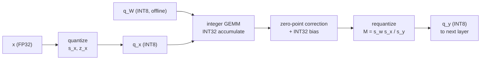

# Quantization Fundamentals: Scale, Zero Point, Symmetric and Asymmetric

> **Level:** Beginner to Advanced · **Study time:** ~100 min · **Prerequisites:** [Number Formats and Model Memory](01-number-formats-and-model-memory.md), [Linear Algebra for Machine Learning](../00-foundations/02-linear-algebra-for-ml.md), [Python Tooling for ML](../00-foundations/06-python-numpy-pandas-pytorch-essentials.md)

## Table of contents

- [Why this matters](#why-this-matters)
- [1. The big idea: snapping real numbers onto a small integer grid](#1-the-big-idea-snapping-real-numbers-onto-a-small-integer-grid)
- [2. Affine quantization: scale and zero point](#2-affine-quantization-scale-and-zero-point)
- [3. Computing scale and zero point from min and max (worked example)](#3-computing-scale-and-zero-point-from-min-and-max-worked-example)
- [4. Symmetric quantization: fixing the zero point at 0](#4-symmetric-quantization-fixing-the-zero-point-at-0)
- [5. NumPy implementation: per-tensor quantize and dequantize](#5-numpy-implementation-per-tensor-quantize-and-dequantize)
- [6. Outliers: one big value stretches the whole range](#6-outliers-one-big-value-stretches-the-whole-range)
- [7. Choosing the clipping range: rounding error vs clipping error](#7-choosing-the-clipping-range-rounding-error-vs-clipping-error)
- [8. Granularity: per-tensor, per-channel and per-group](#8-granularity-per-tensor-per-channel-and-per-group)
- [9. Integer matrix multiplication with scales and zero points](#9-integer-matrix-multiplication-with-scales-and-zero-points)
- [10. The same ideas in PyTorch](#10-the-same-ideas-in-pytorch)
- [11. Going deeper: measuring and debugging quantization error](#11-going-deeper-measuring-and-debugging-quantization-error)
- [12. Going deeper: quantization at LLM scale and in production](#12-going-deeper-quantization-at-llm-scale-and-in-production)
- [Common mistakes and misconceptions](#common-mistakes-and-misconceptions)
- [Interview questions and model answers](#interview-questions-and-model-answers)
- [Key takeaways](#key-takeaways)
- [Further reading](#further-reading)
- [Next](#next)

## Why this matters

Every time someone runs a 7B-parameter LLM on a laptop, serves a vision model on a phone, or squeezes a 70B model onto fewer GPUs, they are relying on **quantization**: storing and computing with low-bit integers instead of 16- or 32-bit floats. Every quantization method you will hear about later (GPTQ, AWQ, SmoothQuant, GGUF files, INT8 TensorRT engines, QLoRA's 4-bit base model) is built on the same two numbers per block of values: a **scale** and a **zero point**. If you understand how those two numbers are chosen, where they are stored, and how they enter a matrix multiplication, you can reason about accuracy loss, memory savings and speed for any of these methods. Interviewers ask "explain scale and zero point" and "symmetric vs asymmetric?" precisely because the answers reveal whether you understand the mechanism or just know the library flags.

## 1. The big idea: snapping real numbers onto a small integer grid

### Intuition

Imagine you must describe the heights of everyone in a building, but you are only allowed to write down whole numbers between 0 and 255. You could decide: "number 0 means 150 cm, and each step means 0.25 cm". Then 170 cm becomes $(170 - 150) / 0.25 = 80$, and anyone reading "80" can turn it back into 170 cm. You lost some detail (170.1 cm also becomes 80), but you can now store each height in a single byte.

That is quantization: pick a **step size** and an **offset**, then replace every real number by the nearest allowed integer.

> **Analogy:** A ruler with only 256 tick marks. You get to choose two things: how far apart the ticks are (the scale) and where on the ruler the real value 0 lands (the zero point). Every measurement is then reported as "the nearest tick".

### Precise definitions

- **Quantization** (in this chapter): mapping values from a large, nearly continuous set (for example FP32 floats) to a small, discrete set of integers, so they can be stored and processed more cheaply. (Do not confuse it with "product quantization" in vector search, which compresses vectors with learned codebooks; see [Vector Search Algorithms](../08-rag/06-vector-search-ann-hnsw-ivf-and-product-quantization.md).)
- **Bit width** $b$: how many bits each integer uses. With $b$ bits you get $2^b$ distinct integers, called **quantization levels**. INT8 has 256 levels, INT4 has 16.
- **Integer range** $[q_{\min}, q_{\max}]$: the smallest and largest allowed integers. These depend on the bit width and on whether the integers are **signed** (can be negative) or **unsigned** (non-negative only).
- **Quantization grid**: the set of real values that the integers represent. In this chapter the grid is **uniform**: neighboring levels are always the same distance apart. (Non-uniform grids such as NF4 or FP4 exist; see section 12.)
- **Rounding**: replacing a real number by the nearest integer.
- **Clamping** (or **clipping**): forcing a value that falls outside $[q_{\min}, q_{\max}]$ to the nearest end of the range.
- **Quantization error**: the difference between the original value and the value you get back after quantizing and converting back.
- **Weights vs activations**: weights are a layer's learned parameters, fixed after training, so they can be quantized once, offline. Activations are the values flowing between layers at inference time; they change with every input, so their range must be estimated from sample data or measured on the fly. A linear layer multiplies the two in a **GEMM** (general matrix multiply), the operation that dominates the compute of most networks.

The integer ranges you will use constantly (number formats themselves are covered in [Number Formats and Model Memory](01-number-formats-and-model-memory.md)):

| Integer type | Bits | $q_{\min}$ | $q_{\max}$ | Levels | General rule |
|---|---|---|---|---|---|
| INT8 (signed) | 8 | -128 | 127 | 256 | $[-2^{b-1},\ 2^{b-1}-1]$ |
| INT8, "narrow" / restricted range | 8 | -127 | 127 | 255 | drops -128 so the range is symmetric |
| UINT8 (unsigned) | 8 | 0 | 255 | 256 | $[0,\ 2^{b}-1]$ |
| INT4 (signed) | 4 | -8 | 7 | 16 | $[-2^{b-1},\ 2^{b-1}-1]$ |
| INT4, narrow | 4 | -7 | 7 | 15 | symmetric variant |
| UINT4 (unsigned) | 4 | 0 | 15 | 16 | $[0,\ 2^{b}-1]$ |

### The picture

```text
Real values (FP32), spread over [x_min, x_max]:

   x_min                    0.0                                   x_max
     |-----------------------|-------------------------------------|
     .   .   .   .   .   .   .   .   .   .   .   .   .   .   .   .     <- grid points,
     0   1   2   3   4   5   6   7   8   9  10  11  12  13  14  15        spaced s apart
                             ^
                             zero point z = 6 (the integer that means real 0.0)

Each real value is snapped to the nearest grid point and stored as that integer.
```

There are only two knobs: the spacing between grid points (the scale) and which integer sits at real zero (the zero point). The rest of this chapter is about choosing those knobs well.

## 2. Affine quantization: scale and zero point

### Intuition

The most general uniform scheme is a straight-line (affine) mapping between reals and integers: divide by a step size, then shift. This is called **affine quantization** or **asymmetric quantization**, because the real range it covers does not have to be centered on zero. Symmetric quantization (section 4) is simply the special case $z = 0$.

### The quantize formula

$$q = \operatorname{clamp}\!\left(\operatorname{round}\!\left(\frac{x}{s}\right) + z,\ q_{\min},\ q_{\max}\right)$$

- $x$: the original real value (for example an FP32 weight or activation).
- $s$: the **scale**, a positive real number equal to the step size between neighboring grid points, in the same units as $x$. Small scale means a fine grid.
- $z$: the **zero point**, an integer in $[q_{\min}, q_{\max}]$. It is the integer code that represents the real value 0 exactly.
- $\operatorname{round}(\cdot)$: round to the nearest integer.
- $\operatorname{clamp}(v, a, b)$: returns $a$ if $v < a$, $b$ if $v > b$, otherwise $v$.
- $q$: the stored integer.

### The dequantize formula

**Dequantization** converts the integer back to an approximate real value:

$$\hat{x} = s \cdot (q - z)$$

- $\hat{x}$ ("x hat"): the reconstructed value. It is always exactly one of the grid points.
- $q - z$: how many steps above or below real zero this code is.
- Multiplying by $s$ converts "steps" back into real units.

The **quantization error** is $e = x - \hat{x}$.

### Tiny example by hand

Suppose $s = 0.5$, $z = 3$, and UINT4 (range 0 to 15). Quantize $x = 1.3$:

1. $x / s = 1.3 / 0.5 = 2.6$
2. $\operatorname{round}(2.6) = 3$
3. $3 + z = 3 + 3 = 6$
4. clamp to $[0, 15]$: stays 6. So $q = 6$.
5. Dequantize: $\hat{x} = 0.5 \times (6 - 3) = 0.5 \times 3 = 1.5$
6. Error: $e = 1.3 - 1.5 = -0.2$

Now quantize $x = 9.0$: $9.0 / 0.5 = 18$, $18 + 3 = 21$, clamp to 15. Dequantize: $0.5 \times (15 - 3) = 6.0$. Error $= 3.0$. That value was **clipped**: it was outside the representable range $[s(q_{\min} - z),\ s(q_{\max} - z)] = [-1.5,\ 6.0]$.

### The error bound

For any value inside the representable range, rounding moves it at most half a step, so

$$\lvert x - \hat{x} \rvert \le \frac{s}{2}$$

Values outside the range suffer **clipping error**, which can be arbitrarily large. Remember this split; it drives every design decision later.

### Why the zero point is an integer

You might ask: why not allow any real offset? Because we want the real value 0 to be **exactly representable**. If $x = 0$, then $q = \operatorname{round}(0) + z = z$ and $\hat{x} = s(z - z) = 0$ with zero error. This matters because zeros are everywhere in neural networks: zero padding in convolutions, ReLU outputs, masked positions, sparse weights. If 0 were stored as 0.003, every padded pixel would inject a small bias that accumulates across a layer. This requirement is spelled out in Jacob et al., 2018 (see Further reading), the paper behind the integer-only inference scheme that TensorFlow Lite popularized.

> **Senior insight:** "Zero must be exactly representable" is also why practical implementations extend the range to include 0: they use $\min(x_{\min}, 0)$ and $\max(x_{\max}, 0)$. A tensor whose values are all in $[2, 5]$ still gets a grid that reaches down to 0.

## 3. Computing scale and zero point from min and max (worked example)

### Deriving the formulas

We want the smallest real value $x_{\min}$ to land on $q_{\min}$ and the largest $x_{\max}$ to land on $q_{\max}$. Ignoring rounding for a moment, the quantize formula says:

$$q_{\min} = \frac{x_{\min}}{s} + z, \qquad q_{\max} = \frac{x_{\max}}{s} + z$$

Subtract the first from the second and $z$ disappears:

$$q_{\max} - q_{\min} = \frac{x_{\max} - x_{\min}}{s} \quad\Longrightarrow\quad s = \frac{x_{\max} - x_{\min}}{q_{\max} - q_{\min}}$$

Then solve the first equation for $z$ and round it so it is an integer:

$$z = \operatorname{clamp}\!\left(\operatorname{round}\!\left(q_{\min} - \frac{x_{\min}}{s}\right),\ q_{\min},\ q_{\max}\right)$$

- $x_{\min}, x_{\max}$: the chosen real range (here simply the min and max of the data, after extending to include 0).
- $q_{\max} - q_{\min}$: the number of steps available (255 for 8 bits, 15 for 4 bits).
- The scale is literally "real range divided by number of steps".
- The zero point is "where real 0 lands", rounded to an integer. Rounding $z$ shifts the grid by at most half a step, which is the price of making 0 exact.

This is called **min-max** range selection, the simplest option. Section 7 discusses better ones.

### Complete worked example: UINT8 asymmetric

Our running example is a small vector of activations from one layer (values chosen so the arithmetic stays readable; illustrative):

$$x = [-1.0,\ -0.4237,\ 0.0,\ 0.3142,\ 0.9,\ 1.55]$$

We quantize to UINT8, so $q_{\min} = 0$, $q_{\max} = 255$.

**Step 1: range.** $x_{\min} = -1.0$, $x_{\max} = 1.55$. The range already contains 0, so no extension is needed.

**Step 2: scale.**

$$s = \frac{1.55 - (-1.0)}{255 - 0} = \frac{2.55}{255} = 0.01$$

**Step 3: zero point.**

$$z = \operatorname{round}\!\left(0 - \frac{-1.0}{0.01}\right) = \operatorname{round}(100) = 100$$

So real 0.0 is stored as the integer 100. It lies within $[0, 255]$, so no clamping.

**Step 4: quantize each element** ($q = \operatorname{round}(x / 0.01) + 100$):

| $x$ | $x / s$ | round | $+ z$ | $q$ |
|---|---|---|---|---|
| -1.0 | -100.0 | -100 | 0 | 0 |
| -0.4237 | -42.37 | -42 | 58 | 58 |
| 0.0 | 0.0 | 0 | 100 | 100 |
| 0.3142 | 31.42 | 31 | 131 | 131 |
| 0.9 | 90.0 | 90 | 190 | 190 |
| 1.55 | 155.0 | 155 | 255 | 255 |

**Step 5: dequantize** ($\hat{x} = 0.01 \times (q - 100)$) and **step 6: error** ($e = x - \hat{x}$):

| $x$ | $q$ | $q - z$ | $\hat{x}$ | $e = x - \hat{x}$ |
|---|---|---|---|---|
| -1.0 | 0 | -100 | -1.00 | 0.0 |
| -0.4237 | 58 | -42 | -0.42 | -0.0037 |
| 0.0 | 100 | 0 | 0.00 | 0.0 |
| 0.3142 | 131 | 31 | 0.31 | 0.0042 |
| 0.9 | 190 | 90 | 0.90 | 0.0 |
| 1.55 | 255 | 155 | 1.55 | 0.0 |

**Step 7: summarize the reconstruction error.**

- Maximum absolute error: $0.0042$, which respects the bound $s/2 = 0.005$.
- **Mean squared error (MSE)**, the average of squared errors:

$$\text{MSE} = \frac{(-0.0037)^2 + 0.0042^2}{6} = \frac{0.00001369 + 0.00001764}{6} = \frac{0.00003133}{6} \approx 5.22 \times 10^{-6}$$

- Real 0.0 came back as exactly 0.0, as promised.
- Storage: six FP32 values took $6 \times 4 = 24$ bytes. Now we store six bytes plus one scale (4 bytes as FP32) and one zero point (1 byte). For a tiny vector the metadata dominates; for a tensor with millions of values it is negligible. Keep that thought for section 8.

> **Common mistake:** Real scales are almost never round numbers. We picked values so that $s = 0.01$ exactly; in practice you get something like $s = 0.0124367$, and that is fine. The scale is stored as a float (FP32 or FP16).

## 4. Symmetric quantization: fixing the zero point at 0

### Intuition

Many tensors, especially neural network **weights**, are roughly centered on zero: about as many negatives as positives, with similar magnitudes. For these we can simplify by forcing the zero point to 0 and centering the grid on zero. This is **symmetric quantization**.

> **Analogy:** A thermometer for outdoor temperatures is naturally centered on 0 (it reads both frost and heat), so you print it symmetric. A ruler for measuring lengths starts at 0 and only goes up, because lengths cannot be negative. Symmetric quantization is the thermometer; asymmetric quantization lets you slide and stretch the ruler to fit whatever range you have.

### Formulas

With $z = 0$, using a signed integer type and usually the narrow range $[-q_{\max}, q_{\max}]$ (for INT8, $[-127, 127]$):

$$s = \frac{\max \lvert x \rvert}{q_{\max}}, \qquad q = \operatorname{clamp}\!\left(\operatorname{round}\!\left(\frac{x}{s}\right),\ -q_{\max},\ q_{\max}\right), \qquad \hat{x} = s \cdot q$$

- $\max \lvert x \rvert$: the largest absolute value in the tensor (the **absmax**). This sets the range $[-\max\lvert x\rvert, +\max\lvert x\rvert]$.
- $q_{\max}$: 127 for INT8, 7 for INT4 in the narrow convention.
- No zero point appears anywhere, which simplifies the integer arithmetic (section 9).

Why the narrow range? Signed INT8 can store -128, but using it would make the grid lopsided (one extra level on the negative side). Many specifications (for example TensorFlow Lite's 8-bit spec for weights) use $[-127, 127]$ so that $+a$ and $-a$ are always both representable. Some libraries instead divide by 127.5 or use the full $[-128, 127]$ range; the conventions differ slightly, so check the library you use.

### Worked example: weights, INT8 symmetric

A row of weights (illustrative):

$$w = [-0.635,\ -0.2013,\ 0.0,\ 0.0874,\ 0.3,\ 0.52]$$

1. $\max\lvert w \rvert = 0.635$
2. $s = 0.635 / 127 = 0.005$
3. Quantize and dequantize:

| $w$ | $w / s$ | $q$ | $\hat{w} = s \cdot q$ | $e = w - \hat{w}$ |
|---|---|---|---|---|
| -0.635 | -127.0 | -127 | -0.635 | 0.0 |
| -0.2013 | -40.26 | -40 | -0.200 | -0.0013 |
| 0.0 | 0.0 | 0 | 0.000 | 0.0 |
| 0.0874 | 17.48 | 17 | 0.085 | 0.0024 |
| 0.3 | 60.0 | 60 | 0.300 | 0.0 |
| 0.52 | 104.0 | 104 | 0.520 | 0.0 |

Maximum error $0.0024 \le s/2 = 0.0025$. Notice the codes 105 to 127 are never used: the range was set by the negative side (-0.635), so the positive side wastes 23 of its levels. For roughly symmetric data this waste is small. Asymmetric quantization of the same row would give $s = (0.52 + 0.635)/255 \approx 0.00453$, about 10% finer, at the cost of carrying a zero point through the math.

### Worked example: where symmetric hurts (ReLU activations)

After a **ReLU** (the activation function $\max(0, x)$; see [Neural Networks from Scratch](../02-deep-learning/01-neural-networks-from-scratch.md)), activations are never negative. Take

$$a = [0.0,\ 0.2963,\ 0.7519,\ 1.27]$$

**Symmetric INT8:** $s = 1.27 / 127 = 0.01$.

| $a$ | $a/s$ | $q$ | $\hat{a}$ | $e$ |
|---|---|---|---|---|
| 0.0 | 0.0 | 0 | 0.00 | 0.0 |
| 0.2963 | 29.63 | 30 | 0.30 | -0.0037 |
| 0.7519 | 75.19 | 75 | 0.75 | 0.0019 |
| 1.27 | 127.0 | 127 | 1.27 | 0.0 |

All 127 negative codes are wasted. We effectively have a 7-bit quantizer.

**Asymmetric UINT8:** $x_{\min} = 0$, $x_{\max} = 1.27$, so $s = 1.27/255 \approx 0.0049804$ and $z = \operatorname{round}(0 - 0/s) = 0$.

| $a$ | $a/s$ | $q$ | $\hat{a} = s \cdot q$ | $e$ |
|---|---|---|---|---|
| 0.0 | 0.0 | 0 | 0.0 | 0.0 |
| 0.2963 | 59.49 | 59 | 0.29384 | 0.00246 |
| 0.7519 | 150.97 | 151 | 0.75204 | -0.00014 |
| 1.27 | 255.0 | 255 | 1.27 | 0.0 |

The step size halved (0.00498 vs 0.01), so the worst-case error bound halved too (0.00249 vs 0.005). Here $z$ happened to be 0 because the data starts at 0; with data in, say, $[-0.17, 3.0]$ (typical after GELU, a smooth ReLU variant used in transformers that dips slightly below zero), $z$ would be a small positive integer.

### When to use which

| | Symmetric | Asymmetric (affine) |
|---|---|---|
| **What** | $z = 0$, range $[-\alpha, \alpha]$ with $\alpha = $ absmax or a clip value | Any range $[\beta, \alpha]$, integer $z$ shifts the grid |
| **Parameters stored** | Scale only | Scale and zero point |
| **Best for** | Data roughly centered on 0: weights, many pre-activation tensors | Skewed or one-sided data: activations after ReLU, GELU, softmax outputs |
| **Pros** | Simplest and fastest integer math (no cross terms); smaller metadata | Uses the full grid for skewed data, so lower error |
| **Cons** | Wastes up to half the levels on one-sided data | Extra arithmetic and storage for $z$; slightly more complex kernels |
| **Typical production default** | Weights (INT8 per-channel, many INT4 schemes) | Activations in INT8 CNN inference; INT4 weight schemes that store zero points (for example many GPTQ/AWQ checkpoints) |

> **Interview tip:** A crisp one-liner: "Symmetric for weights because they are centered on zero and it keeps the GEMM free of zero-point cross terms; asymmetric for activations like post-ReLU outputs because they are one-sided and symmetric would waste half the grid."

## 5. NumPy implementation: per-tensor quantize and dequantize

Here is a from-scratch implementation of both schemes. It is written with broadcasting in mind, so the same functions work later for per-channel and per-group quantization. Install with `pip install numpy`.

```python
import numpy as np


def int_range(bits: int, signed: bool, narrow: bool = False) -> tuple[int, int]:
    """Return (q_min, q_max) for a b-bit integer type."""
    if signed:
        q_min, q_max = -(2 ** (bits - 1)), 2 ** (bits - 1) - 1
        if narrow:                     # e.g. INT8 -> [-127, 127]
            q_min += 1
    else:
        q_min, q_max = 0, 2 ** bits - 1
    return q_min, q_max


def quantize(x, scale, zero_point, q_min, q_max):
    """q = clamp(round(x / s) + z). Returns int32 codes (real kernels pack them into int8/int4)."""
    q = np.round(x / scale) + zero_point
    return np.clip(q, q_min, q_max).astype(np.int32)


def dequantize(q, scale, zero_point):
    """x_hat = s * (q - z). Cast to float first to avoid unsigned-integer wraparound."""
    return scale * (q.astype(np.float64) - zero_point)


def qparams_asymmetric(x_min, x_max, q_min, q_max, eps=1e-12):
    """Min-max affine parameters. Works on scalars or arrays (for per-channel/group)."""
    x_min = np.minimum(x_min, 0.0)     # make sure real 0 is inside the range
    x_max = np.maximum(x_max, 0.0)
    scale = np.maximum((x_max - x_min) / (q_max - q_min), eps)   # eps avoids divide-by-zero
    zero_point = np.clip(np.round(q_min - x_min / scale), q_min, q_max).astype(np.int32)
    return scale, zero_point


def qparams_symmetric(abs_max, q_max, eps=1e-12):
    """Symmetric parameters: s = absmax / q_max, z = 0."""
    scale = np.maximum(abs_max / q_max, eps)
    return scale, np.zeros(np.shape(scale), dtype=np.int32)


# --- Asymmetric UINT8 on the worked example from section 3 ---
x = np.array([-1.0, -0.4237, 0.0, 0.3142, 0.9, 1.55])
q_min, q_max = int_range(8, signed=False)                      # (0, 255)
s, z = qparams_asymmetric(x.min(), x.max(), q_min, q_max)
q = quantize(x, s, z, q_min, q_max)
x_hat = dequantize(q, s, z)
print(s, z)                       # about 0.01 and 100
print(q)                          # [  0  58 100 131 190 255]
print(np.abs(x - x_hat).max())    # about 0.0042
print(np.mean((x - x_hat) ** 2))  # about 5.22e-06

# --- Symmetric INT8 (narrow range) on the weights from section 4 ---
w = np.array([-0.635, -0.2013, 0.0, 0.0874, 0.3, 0.52])
q_min, q_max = int_range(8, signed=True, narrow=True)         # (-127, 127)
s, z = qparams_symmetric(np.abs(w).max(), q_max)
q = quantize(w, s, z, q_min, q_max)
print(q)                          # [-127  -40    0   17   60  104]
print(np.abs(w - dequantize(q, s, z)).max())   # about 0.0024
```

A few details worth noticing, because they are classic bugs:

- `np.round` uses **round half to even** ("banker's rounding"): `np.round(2.5)` is 2.0, not 3.0. Many quantization kernels also round half to even (PyTorch's quantize functions and CUDA's `__float2int_rn`, for example), but others round half away from zero (for example TensorFlow Lite's reference kernels, which use `std::round`). Mismatched rounding between a reference implementation and a kernel produces tiny off-by-one differences that look like bugs.
- `dequantize` casts to float before subtracting. If `q` were stored as `np.uint8`, then `q - z` would wrap around (for example `np.uint8(5) - np.uint8(10)` is 251), giving garbage.
- `eps` protects against a constant tensor (for example all zeros), where $x_{\max} - x_{\min} = 0$ would make the scale 0 and the division blow up.

## 6. Outliers: one big value stretches the whole range

### Intuition

> **Analogy:** You make a bar chart of daily coffee sales, and one day a conference ordered 500 cups. To fit that bar, the y-axis stretches so far that every normal day becomes an indistinguishable stub at the bottom.

Min-max quantization behaves the same way. The scale is set by the extremes, so a single **outlier** (a value far from the bulk of the distribution) makes the step size large for everyone.

### Worked example: same vector, one outlier

Replace the last value 1.55 with 24.5:

$$x = [-1.0,\ -0.4237,\ 0.0,\ 0.3142,\ 0.9,\ 24.5]$$

UINT8 min-max:

- $s = (24.5 - (-1.0)) / 255 = 25.5 / 255 = 0.1$ (10 times larger than before)
- $z = \operatorname{round}(0 - (-1.0)/0.1) = \operatorname{round}(10) = 10$

| $x$ | $x/s$ | $q$ | $\hat{x}$ | $e = x - \hat{x}$ |
|---|---|---|---|---|
| -1.0 | -10.0 | 0 | -1.0 | 0.0 |
| -0.4237 | -4.237 | 6 | -0.4 | -0.0237 |
| 0.0 | 0.0 | 10 | 0.0 | 0.0 |
| 0.3142 | 3.142 | 13 | 0.3 | 0.0142 |
| 0.9 | 9.0 | 19 | 0.9 | 0.0 |
| 24.5 | 245.0 | 255 | 24.5 | 0.0 |

What happened:

- The five "normal" values now use only the codes 0 to 19: 20 of the 256 levels. That is about $\log_2 20 \approx 4.3$ bits of real resolution, even though we pay for 8.
- The error bound grew from 0.005 to 0.05. In this tiny sample the MSE rose from $5.22 \times 10^{-6}$ to $(0.0237^2 + 0.0142^2)/6 = (0.00056169 + 0.00020164)/6 \approx 1.27 \times 10^{-4}$, about 24 times worse. On a large tensor, where rounding errors are spread evenly, error power grows with $s^2$, so a 10 times larger step means roughly 100 times larger MSE.

This is the central problem of quantizing modern LLMs: their activations contain a few feature dimensions with values tens of times larger than the rest (Dettmers et al., 2022, "LLM.int8()"). Section 7 shows the first line of defense (clipping); section 8 shows the second (finer granularity); [Practical LLM Quantization](04-llm-quantization-gptq-awq-and-outliers.md) covers the specialized methods.

## 7. Choosing the clipping range: rounding error vs clipping error

### Intuition

> **Analogy:** A photographer shooting a bright window inside a dim room. Expose for the window and the room turns black. Expose for the room and the window "blows out" to pure white. Usually you accept a few blown-out highlights to see detail everywhere else.

We do not have to set the range to the true min and max. We can choose a narrower **clipping range** $[\beta, \alpha]$, deliberately clamping the rare extreme values so that the step size for the common values gets smaller. Choosing this range from sample data is part of **calibration** (covered in detail in [PTQ vs QAT](03-ptq-vs-qat-and-calibration.md)).

### The two error sources

- **Rounding error** (also called granular or quantization noise): error for values inside the range, at most $s/2$ each. If values are spread across many levels, the error is roughly uniform on $[-s/2, s/2]$, whose variance is

$$\mathbb{E}[e^2] \approx \frac{s^2}{12}$$

  - $s^2/12$ is the variance of a uniform distribution of width $s$. Halving $s$ divides this by 4.
- **Clipping error** (also called overload or saturation error): for a value beyond the range, the error is the distance to the edge, $\lvert x \rvert - \alpha$ for symmetric clipping at $\alpha$. It grows without bound.

For symmetric $b$-bit quantization with clip value $\alpha$, $s = \alpha / q_{\max}$, so the total expected squared error is approximately

$$\text{MSE}(\alpha) \approx \underbrace{\frac{1}{12}\left(\frac{\alpha}{q_{\max}}\right)^2 \cdot P(\lvert x\rvert \le \alpha)}_{\text{rounding, grows with } \alpha} \;+\; \underbrace{\mathbb{E}\big[(\lvert x\rvert - \alpha)^2 \,;\, \lvert x\rvert > \alpha\big]}_{\text{clipping, shrinks with } \alpha}$$

- $\alpha$: the clip threshold.
- $P(\lvert x\rvert \le \alpha)$: fraction of values inside the range.
- The second term: average squared overshoot, counted only for values beyond $\alpha$.

Large $\alpha$ means no clipping but coarse rounding; small $\alpha$ means fine rounding but heavy clipping. The best $\alpha$ sits in between and depends on the shape of the distribution's tails and on the bit width (with fewer bits, rounding error is larger, so clipping more aggressively pays off).

### Worked example: when clipping helps and when it hurts

Go back to the outlier vector. If we clip to the old range $[-1.0, 1.55]$ (so $s = 0.01$, $z = 100$), the five normal values return to errors of at most 0.0042, but the outlier 24.5 is clamped to code 255, which dequantizes to 1.55: an error of $22.95$, squared $526.70$. The MSE becomes $(0.0037^2 + 0.0042^2 + 22.95^2)/6 \approx 87.8$. For this 6-element vector, clipping is a disaster.

Now an illustrative large tensor: 1,000,000 values, with the bulk spread evenly over $[-1.0, 1.55]$, plus a few values at 24.5. Using the $s^2/12$ approximation for the total squared error:

| Scenario | No clipping ($s = 0.1$) | Clip to $[-1.0, 1.55]$ ($s = 0.01$) | Winner |
|---|---|---|---|
| 1 outlier | $999{,}999 \times 0.1^2/12 \approx 833$ | $999{,}999 \times 0.01^2/12 + 22.95^2 \approx 8.3 + 526.7 = 535$ | Clipping |
| 10 outliers | $999{,}990 \times 0.1^2/12 \approx 833$ | $\approx 8.3 + 10 \times 526.7 \approx 5{,}275$ | No clipping |

The lesson: whether clipping helps depends on how much mass sits in the tails, which is exactly why we search for the range instead of guessing.

> **Senior insight:** MSE is a proxy. Some outliers carry crucial information (in LLMs, clipping the large activation outlier features hurts quality badly, which is the core finding of LLM.int8()). Always validate the choice of range on the downstream metric, not only on tensor MSE.

### Range selection methods

| Method | What it does | When to use | Pros | Cons |
|---|---|---|---|---|
| **Min-max** | $\alpha$ = observed max (and $\beta$ = min) | Weights at 8 bits; well-behaved tensors | Simple, no clipping, deterministic | Wrecked by a single outlier |
| **Percentile** | $\alpha$ = for example the 99.9th or 99.99th percentile of $\lvert x\rvert$ | Activations with long tails | Cheap, robust to rare outliers | Percentile is a hyperparameter; may clip important values |
| **MSE-optimal** | Search over candidate $\alpha$, pick the one minimizing $\lVert x - \hat{x}\rVert^2$ | Low bit widths (INT4), weights | Directly minimizes reconstruction error | Search cost; MSE may not match task loss |
| **KL / entropy** | Pick $\alpha$ minimizing KL divergence between original and quantized histograms | Activations in INT8 CNN deployment (the approach NVIDIA TensorRT popularized as "entropy calibration") | Preserves distribution shape | Histogram binning details matter; slower |
| **Learned** | Treat $\alpha$ or $s$ as trainable (for example LSQ, PACT) | Quantization-aware training | Best accuracy at very low bits | Needs training; see [PTQ vs QAT](03-ptq-vs-qat-and-calibration.md) |

(KL divergence is defined in [Softmax, Entropy, Cross-Entropy and KL Divergence](../00-foundations/05-softmax-entropy-cross-entropy-and-kl-divergence.md).)

### Code: percentile and MSE-optimal clipping

```python
import numpy as np
# (reuses int_range, quantize, dequantize from section 5)

def symmetric_mse(x, alpha, bits):
    """Reconstruction MSE of symmetric quantization with clip value alpha."""
    q_min, q_max = int_range(bits, signed=True, narrow=True)
    s = alpha / q_max
    x_hat = dequantize(quantize(x, s, 0, q_min, q_max), s, 0)
    return np.mean((x - x_hat) ** 2)


rng = np.random.default_rng(0)
x = rng.standard_normal(100_000)               # bulk: standard normal
x[:5] = [12.0, -15.0, 9.0, 11.0, -10.0]        # a handful of large outliers

bits = 4
abs_max = np.abs(x).max()                      # min-max (absmax) choice
p999 = np.percentile(np.abs(x), 99.9)          # percentile choice
candidates = np.linspace(0.02, 1.0, 200) * abs_max
mses = np.array([symmetric_mse(x, a, bits) for a in candidates])
best = candidates[mses.argmin()]               # MSE-optimal choice (grid search)

for name, a in [("absmax", abs_max), ("p99.9", p999), ("mse-opt", best)]:
    print(f"{name:8s} alpha={a:6.2f}  mse={symmetric_mse(x, a, bits):.5f}")
# Expect absmax to have by far the largest MSE at 4 bits; the other two clip near
# a few standard deviations and are much closer to each other. With this seed:
# absmax alpha=15.00 mse~0.377, p99.9 alpha~3.29 mse~0.022, mse-opt alpha~2.52 mse~0.017.
```

## 8. Granularity: per-tensor, per-channel and per-group

### Intuition

So far we used one scale (and zero point) for an entire tensor. But a weight matrix is made of many rows, and different rows can have very different ranges. One ruler for everything means the row with the biggest values decides the tick spacing for all rows.

> **Analogy:** One shared T-shirt size for a whole team versus a tailored size per person. Per-tensor is "one size fits all", per-channel is "one size per person", and per-group is "a tailor who also adjusts each sleeve".

**Granularity** is how many values share one set of quantization parameters.

- **Per-tensor**: one $(s, z)$ for the whole tensor.
- **Per-channel** (also called per-axis or, for weights, per-output-channel): one $(s, z)$ per slice along one axis. For a linear layer weight of shape `[out_features, in_features]` (PyTorch's layout), that usually means one scale per row, that is, per output neuron. For a convolution weight `[out_channels, in_channels, kH, kW]`, one per output channel (filter).
- **Per-group** (also called group-wise or block-wise): each row is further cut into contiguous groups of $g$ elements along the input dimension (commonly $g$ = 32, 64 or 128), and each group gets its own $(s, z)$.
- **Per-token** (for activations): one scale per row of the activation matrix, that is, per token. It plays the same role for activations that per-channel plays for weights (section 9 explains why these two combine nicely).

```text
Weight matrix W, shape [out_features=4, in_features=8]

per-tensor (1 scale)     per-channel (4 scales)    per-group, g=4 (8 scales)
+-----------------+      +-----------------+       +--------+--------+
|                 |      | s0 ............ |       | s00    | s01    |
|       s         |      | s1 ............ |       | s10    | s11    |
|                 |      | s2 ............ |       | s20    | s21    |
|                 |      | s3 ............ |       | s30    | s31    |
+-----------------+      +-----------------+       +--------+--------+
                         one ruler per row          one ruler per 4 weights in a row
```

### Why finer granularity improves accuracy: worked example

A 2-row weight matrix, INT8 symmetric (illustrative). Row 0 has small weights, row 1 has large ones, which is very common in practice:

$$W = \begin{bmatrix} 0.012 & -0.021 & 0.004 & -0.008 \\ 1.137 & -0.802 & 0.4561 & -1.27 \end{bmatrix}$$

**Per-tensor:** absmax over the whole matrix is 1.27, so $s = 1.27 / 127 = 0.01$.

Row 0: $W/s = [1.2, -2.1, 0.4, -0.8]$, rounded $q = [1, -2, 0, -1]$, dequantized $[0.01, -0.02, 0.0, -0.01]$.

| Row 0 weight | $\hat{w}$ (per-tensor) | Error | Relative error |
|---|---|---|---|
| 0.012 | 0.01 | 0.002 | 17% |
| -0.021 | -0.02 | -0.001 | 5% |
| 0.004 | 0.0 | 0.004 | 100% (erased) |
| -0.008 | -0.01 | 0.002 | 25% |

Row 0 uses only 4 distinct codes out of 255: it has effectively been quantized to about 2 bits. Row 1 is fine: $W/s = [113.7, -80.2, 45.61, -127]$, $q = [114, -80, 46, -127]$, $\hat{w} = [1.14, -0.80, 0.46, -1.27]$, errors at most 0.0039 (under 1% relative).

**Per-channel:** row 0 gets its own scale $s_0 = 0.021 / 127 \approx 0.00016535$; row 1 keeps $s_1 = 0.01$.

Row 0: $W/s_0 = [72.57, -127.0, 24.19, -48.38]$, $q = [73, -127, 24, -48]$.

| Row 0 weight | $q$ | $\hat{w} = s_0 \cdot q$ | Error |
|---|---|---|---|
| 0.012 | 73 | 0.012071 | -0.000071 |
| -0.021 | -127 | -0.021000 | 0.0 |
| 0.004 | 24 | 0.003969 | 0.000031 |
| -0.008 | -48 | -0.007937 | -0.000063 |

Row 0's maximum error fell from 0.004 to about 0.000071, roughly 56 times smaller, and row 1 is unchanged. The cost: one extra scale.

### Per-group: the same story inside a row (INT4)

At 4 bits there are only 15 levels in the narrow symmetric range, so variation **within** a row matters too. A single row of 8 weights, INT4 symmetric (narrow, $q \in [-7, 7]$), illustrative:

$$r = [0.02,\ -0.01,\ 0.03,\ -0.016,\ \ 0.95,\ -1.4,\ 0.6,\ 1.15]$$

**One scale for the row:** $s = 1.4/7 = 0.2$. The first four values divide to $[0.1, -0.05, 0.15, -0.08]$, which all round to 0. The first half of the row is erased entirely. The second half: $[4.75, -7, 3, 5.75] \to [5, -7, 3, 6] \to [1.0, -1.4, 0.6, 1.2]$.

**Group size 4 (two groups):**

- Group 1: $s = 0.03/7 \approx 0.0042857$. $r/s = [4.67, -2.33, 7.0, -3.73] \to q = [5, -2, 7, -4] \to \hat{r} \approx [0.02143, -0.00857, 0.03, -0.01714]$. Errors at most about 0.0014.
- Group 2: $s = 1.4/7 = 0.2$, same as before.

Group-wise quantization saves the small weights. This is exactly why 4-bit LLM weight formats (GPTQ, AWQ, llama.cpp's k-quants and legacy formats) are almost always group-wise.

### What finer granularity costs

**1. Metadata storage.** Each group stores a scale (often FP16, 16 bits) and possibly a zero point. The **effective bits per weight** are

$$\text{bpw} = b + \frac{b_s + b_z}{g}$$

- $b$: bits per quantized weight (for example 4).
- $b_s$: bits per scale (16 for FP16).
- $b_z$: bits per zero point (0 for symmetric; 4, 8 or 16 for asymmetric depending on format).
- $g$: number of weights sharing those parameters.

Worked numbers:

| Scheme | Calculation | Effective bits per weight |
|---|---|---|
| INT8 per-tensor | $8 + \text{negligible}$ | about 8.0 |
| INT8 per-channel, FP32 scale, rows of 4096 | $8 + 32/4096$ | about 8.008 |
| INT4, $g = 128$, FP16 scale, symmetric | $4 + 16/128$ | 4.125 |
| INT4, $g = 128$, FP16 scale + FP16 zero point | $4 + 32/128$ | 4.25 |
| INT4, $g = 32$, FP16 scale (the layout of llama.cpp's legacy Q4_0: 32 weights in 18 bytes) | $4 + 16/32$ | 4.5 |
| Toy example above, $g = 4$, FP16 scale | $4 + 16/4$ | 8.0 (pointless) |

Applied to our running **7B model** (decimal GB, weights only, illustrative; real files differ because embeddings and the output layer are often kept at higher precision):

- FP16: $7 \times 10^9 \times 2$ bytes $= 14$ GB.
- Pure 4-bit with no metadata: $7 \times 10^9 \times 0.5$ bytes $= 3.5$ GB.
- INT4, $g = 128$, FP16 scale only: $7 \times 10^9 \times 4.125 / 8 \approx 3.61$ GB. The scales alone are $7 \times 10^9 / 128 = 54.7$ million values $\times$ 2 bytes $\approx 109$ MB.
- INT4, $g = 128$, FP16 scale and zero: $7 \times 10^9 \times 4.25 / 8 \approx 3.72$ GB.

QLoRA (Dettmers et al., 2023) took this further with **double quantization**: it quantizes the per-block scales themselves (to 8 bits, in second-level blocks of 256) to cut metadata from 0.5 to about 0.127 bits per parameter for its 64-weight blocks. Metadata overhead is a real line item at LLM scale.

**2. Kernel complexity and speed.** More scales mean more loads and more multiplies inside the matrix-multiplication kernel, and some granularities do not fit integer GEMMs at all (section 9 explains which). Group size must also divide the layer width and align with how the kernel tiles the matrix.

**3. Calibration and engineering complexity.** More parameters to compute, store, serialize and validate; more format variants across serving frameworks.

| Granularity | Params per weight matrix `[O, K]` | Accuracy | Metadata cost | Kernel friendliness | Typical use |
|---|---|---|---|---|---|
| Per-tensor | 1 | Lowest | Negligible | Best: one scale for the whole GEMM | INT8 activations (static), simple INT8 weights |
| Per-channel | $O$ | Good at 8 bits | Tiny | Very good: scale factors out per output row | Default for INT8 weights in CNNs and LLMs |
| Per-group ($g$) | $O \times K/g$ | Best at 4 bits and below | 0.125 to 0.5 bits per weight | Needs specialized kernels | INT4/INT3 LLM weights (GPTQ, AWQ, GGUF) |
| Per-token (activations) | one per row of $X$ | Better than per-tensor for LLM activations | Computed on the fly | Good: factors out per output row | Dynamic INT8/FP8 activation quantization in LLMs |

### Code: per-channel and per-group in NumPy

```python
import numpy as np
# (reuses int_range, quantize, dequantize, qparams_symmetric, qparams_asymmetric from section 5)

def quantize_per_channel_symmetric(W, bits=8):
    """One scale per output row of W (shape [out_features, in_features])."""
    q_min, q_max = int_range(bits, signed=True, narrow=True)
    abs_max = np.abs(W).max(axis=1, keepdims=True)       # shape [out, 1]
    s, z = qparams_symmetric(abs_max, q_max)
    return quantize(W, s, z, q_min, q_max), s             # s broadcasts over each row


def quantize_per_group(W, group_size=128, bits=4, symmetric=True):
    """Group-wise quantization along the input dimension."""
    out_f, in_f = W.shape
    assert in_f % group_size == 0, "group size must divide in_features"
    Wg = W.reshape(out_f, in_f // group_size, group_size)  # [out, n_groups, g]
    if symmetric:
        q_min, q_max = int_range(bits, signed=True, narrow=True)   # INT4 -> [-7, 7]
        s, z = qparams_symmetric(np.abs(Wg).max(axis=2, keepdims=True), q_max)
    else:
        q_min, q_max = int_range(bits, signed=False)               # UINT4 -> [0, 15]
        s, z = qparams_asymmetric(Wg.min(axis=2, keepdims=True),
                                  Wg.max(axis=2, keepdims=True), q_min, q_max)
    q = quantize(Wg, s, z, q_min, q_max)
    return q, s, z                                         # s, z: [out, n_groups, 1]


def dequantize_per_group(q, s, z):
    return dequantize(q, s, z).reshape(q.shape[0], -1)


# The 2x4 example from this section
W = np.array([[0.012, -0.021, 0.004, -0.008],
              [1.137, -0.802, 0.4561, -1.27]])
qW, sW = quantize_per_channel_symmetric(W)
print(qW)          # row 0: [73 -127 24 -48], row 1: [114 -80 46 -127]

# Compare granularities on a random "layer" whose rows have different ranges
rng = np.random.default_rng(42)
W = rng.standard_normal((256, 1024)) * rng.uniform(0.01, 1.0, size=(256, 1))
for g in (1024, 128, 32):                                  # g = in_features means per-channel
    q, s, z = quantize_per_group(W, group_size=g, bits=4)
    err = np.mean((W - dequantize_per_group(q, s, z)) ** 2)
    print(f"INT4 group size {g:5d}: MSE = {err:.2e}")
# Expect the MSE to decrease as the group size shrinks.
```

## 9. Integer matrix multiplication with scales and zero points

Storing integers saves memory. To also save compute, we want the matrix multiplication itself to run on integers, using fast integer hardware (for example INT8 tensor cores on NVIDIA GPUs, or VNNI dot-product instructions on recent x86 CPUs). The question is: where do the scales and zero points go?

### Symmetric case: the scales factor out

A single output of a linear layer is a dot product (see [Linear Algebra for Machine Learning](../00-foundations/02-linear-algebra-for-ml.md)):

$$y = \sum_{j=1}^{K} w_j x_j$$

Substitute the dequantized forms $w_j \approx s_w q_{w,j}$ and $x_j \approx s_x q_{x,j}$ (symmetric, $z = 0$):

$$y \approx \sum_{j=1}^{K} (s_w q_{w,j})(s_x q_{x,j}) = s_w s_x \underbrace{\sum_{j=1}^{K} q_{w,j}\, q_{x,j}}_{\text{pure integer dot product}}$$

- $K$: the inner (reduction) dimension, for example 4096.
- $s_w, s_x$: weight and activation scales. Because they do not depend on $j$, they move outside the sum.
- The sum is computed entirely in integers; only one float multiply per output remains.

**Hand example.** Weights $w = [0.5, -0.3, 0.2]$ with $s_w = 0.01$ give $q_w = [50, -30, 20]$. Inputs $x = [2.0, 0.8, -0.2]$ with $s_x = 0.02$ give $q_x = [100, 40, -10]$.

1. Integer dot product: $50 \times 100 + (-30) \times 40 + 20 \times (-10) = 5000 - 1200 - 200 = 3600$
2. Rescale: $y = s_w s_x \times 3600 = 0.01 \times 0.02 \times 3600 = 0.0002 \times 3600 = 0.72$
3. Check in floating point: $0.5 \times 2.0 + (-0.3) \times 0.8 + 0.2 \times (-0.2) = 1.0 - 0.24 - 0.04 = 0.72$. It matches (these values happen to be exactly on the grid).

### Why the accumulator is INT32

Each INT8 product can be as large as $(-128) \times (-128) = 16{,}384$. Summing $K = 4096$ of them can reach $4096 \times 16{,}384 = 67{,}108{,}864$. That overflows INT16 (max 32,767) after just two products but fits comfortably in INT32 (max about 2.1 billion). So INT8 GEMMs multiply INT8 inputs and **accumulate** (keep the running sum) in INT32. Low-bit weight-only kernels typically accumulate in FP16 or FP32 instead.

### Requantizing the output

If the next layer also wants INT8 input, we convert the INT32 accumulator directly to an INT8 output with scale $s_y$ and zero point $z_y$, a step called **requantization**:

$$q_y = \operatorname{clamp}\!\left(\operatorname{round}\!\left(M \cdot \text{acc}\right) + z_y\right), \qquad M = \frac{s_w s_x}{s_y}$$

- $\text{acc}$: the INT32 accumulator.
- $M$: the combined rescale factor, known ahead of time when all scales are fixed (static quantization).

Continuing the example with $s_y = 0.01$, $z_y = 0$: $M = 0.0002 / 0.01 = 0.02$, so $q_y = \operatorname{round}(0.02 \times 3600) = 72$, which means $\hat{y} = 0.01 \times 72 = 0.72$.

On integer-only hardware (phones, microcontrollers), $M$ itself is stored as a fixed-point integer multiplier plus a bit shift ($M \approx M_0 \cdot 2^{-n}$), so the whole layer runs without any floating-point unit. The **bias** is stored as INT32 with scale $s_w s_x$ and zero point 0, so it can be added straight into the accumulator. Both tricks come from Jacob et al., 2018.



### Asymmetric case: zero points create cross terms

With zero points, $w_j \approx s_w(q_{w,j} - z_w)$ and $x_j \approx s_x(q_{x,j} - z_x)$. Expanding the product:

$$\sum_{j=1}^{K} (q_{w,j} - z_w)(q_{x,j} - z_x) = \sum_j q_{w,j} q_{x,j} \;-\; z_x \sum_j q_{w,j} \;-\; z_w \sum_j q_{x,j} \;+\; K z_w z_x$$

- $\sum_j q_{w,j} q_{x,j}$: the main integer GEMM.
- $z_x \sum_j q_{w,j}$: the row sum of the weights is known offline, so this is precomputed per output.
- $z_w \sum_j q_{x,j}$: depends on the input, so it must be computed at runtime (once per input vector, shared across all output rows). This is extra work.
- $K z_w z_x$: a constant.

If the weights are symmetric ($z_w = 0$), the third and fourth terms vanish, leaving only a precomputable correction. That is the hardware reason behind the standard recipe **"symmetric weights, asymmetric activations"**.

**Hand check.** Keep the previous example but quantize $x$ asymmetrically with the same $s_x = 0.02$ and $z_x = 10$: $q_x = [100 + 10, 40 + 10, -10 + 10] = [110, 50, 0]$.

1. Main term: $50 \times 110 + (-30) \times 50 + 20 \times 0 = 5500 - 1500 + 0 = 4000$
2. Correction: $z_x \sum_j q_{w,j} = 10 \times (50 - 30 + 20) = 10 \times 40 = 400$
3. Corrected accumulator: $4000 - 400 = 3600$, the same as before, so $y = 0.72$ again.

### Which granularities fit an integer GEMM?

In matrix form, a linear layer computes $Y = X W^\top$ with $X$ of shape `[T, K]` (T tokens) and $W$ of shape `[O, K]`:

$$Y_{t,o} = \sum_{k=1}^{K} X_{t,k} W_{o,k}$$

A scale can be pulled out of the sum only if it does not depend on the summed index $k$:

| Scale varies along | Example | Factors out of the sum? | Consequence |
|---|---|---|---|
| Nothing | per-tensor $s_x$, $s_w$ | Yes | One multiply per output |
| Output channel $o$ | per-channel weights $s_w[o]$ | Yes | Scale vector applied to output columns |
| Token $t$ | per-token activations $s_x[t]$ | Yes | $Y_{t,o} = s_x[t]\, s_w[o] \sum_k q_X q_W$: an outer product of scales |
| Input channel $k$ | per-channel activations $s_x[k]$ | **No** | Breaks the integer GEMM |
| Groups along $k$ | per-group weights $s_w[o, g]$ | Only within each group | Need per-group partial sums, each rescaled, or dequantize on the fly |

Two important consequences:

- LLM activation outliers live in specific **input channels** $k$, which is exactly the axis that cannot carry its own scale in an integer GEMM. That is why methods like SmoothQuant mathematically migrate the difficulty from activations into weights (covered in [Practical LLM Quantization](04-llm-quantization-gptq-awq-and-outliers.md)).
- Group-wise INT4 weights are mostly used in **weight-only** quantization, often written **W4A16** (4-bit weights, 16-bit activations). The kernel loads packed 4-bit weights, dequantizes them in registers using the group scales, and does the multiply in FP16/BF16. The win is memory bandwidth, not integer math. By contrast **W8A8** means both weights and activations are INT8 and the GEMM itself runs in integers.

### Code: integer matmul with zero-point correction in NumPy

```python
import numpy as np
# (reuses int_range, quantize, qparams_asymmetric, quantize_per_channel_symmetric)

rng = np.random.default_rng(1)
W = rng.normal(0.0, 0.05, size=(4, 16))        # 4 output neurons, K = 16 inputs
x = rng.normal(0.8, 1.0, size=16)              # skewed activations (mostly positive)

# Weights: symmetric INT8, per output channel (z_w = 0)
qW, sW = quantize_per_channel_symmetric(W)     # sW shape [4, 1]

# Activations: asymmetric UINT8, per tensor
q_min, q_max = int_range(8, signed=False)
sx, zx = qparams_asymmetric(x.min(), x.max(), q_min, q_max)
qx = quantize(x, sx, zx, q_min, q_max)

# Integer accumulation: sum_j qW * (qx - zx) = qW @ qx - zx * rowsum(qW)
row_sums = qW.sum(axis=1)                      # precomputable offline
acc = qW @ qx - zx * row_sums                  # integers (INT32 in a real kernel)

y_quant = sW[:, 0] * sx * acc                  # one float rescale per output
y_ref = W @ x
print(np.round(y_ref, 4))
print(np.round(y_quant, 4))
print("max abs diff:", np.abs(y_quant - y_ref).max())   # small relative to the outputs
```

## 10. The same ideas in PyTorch

PyTorch exposes quantized tensors that store integer codes plus scale and zero point. Install with `pip install torch`.

> **Version note (2026):** The low-level functions below (`torch.quantize_per_tensor`, `torch.quantize_per_channel`, observers in `torch.ao.quantization`) were stable for years, but they are now on the way out: recent PyTorch 2.x releases emit a deprecation warning saying the quantized tensor creation functions (and the `torch.quint8`/`torch.qint8` dtypes they produce) will be removed in a future release, and PyTorch's quantization workflows are moving into the separate `torchao` library, whose higher-level APIs have also changed names across releases. The code below runs on PyTorch 2.x (with that warning); use it to understand the mechanism, and check current `torchao` docs for end-to-end model quantization.

```python
import torch
from torch.ao.quantization.observer import MinMaxObserver, PerChannelMinMaxObserver

# --- Per-tensor affine (asymmetric) UINT8, using the section 3 example ---
x = torch.tensor([-1.0, -0.4237, 0.0, 0.3142, 0.9, 1.55])
qx = torch.quantize_per_tensor(x, scale=0.01, zero_point=100, dtype=torch.quint8)
print(qx.int_repr())        # integer codes: 0, 58, 100, 131, 190, 255
print(qx.dequantize())      # approximately [-1.00, -0.42, 0.00, 0.31, 0.90, 1.55]
print(qx.q_scale(), qx.q_zero_point())

# --- Let an observer compute scale and zero point from data (min-max) ---
obs = MinMaxObserver(dtype=torch.quint8, qscheme=torch.per_tensor_affine)
obs(x)                                   # records running min and max
scale, zero_point = obs.calculate_qparams()
print(scale, zero_point)                 # about 0.01 and 100

# --- Per-channel symmetric INT8 weights, using the section 8 example ---
W = torch.tensor([[0.012, -0.021, 0.004, -0.008],
                  [1.137, -0.802, 0.4561, -1.27]])
w_obs = PerChannelMinMaxObserver(ch_axis=0, dtype=torch.qint8,
                                 qscheme=torch.per_channel_symmetric)
w_obs(W)
scales, zps = w_obs.calculate_qparams()  # one scale per row; zero points are 0
qW = torch.quantize_per_channel(W, scales, zps, axis=0, dtype=torch.qint8)
print(qW.int_repr())                     # [[73, -128, 24, -49], [114, -81, 46, -128]] (divisor 127.5, see below)
print((W - qW.dequantize()).abs().max())  # about 0.005 (just under row 1's s/2)
```

Note that PyTorch's symmetric observers divide the absmax by $(q_{\max} - q_{\min})/2 = 127.5$ rather than 127, so the codes can differ by one from our hand calculation (above, the absmax lands exactly on $-127.5$ and rounds half to even to $-128$, so the full range $[-128, 127]$ is used, while section 8 gave $[73, -127, 24, -48]$ and $[114, -80, 46, -127]$). This is a convention difference, not a bug, and it is a good example of why you should never compare quantized outputs across libraries bit for bit without checking conventions.

For LLMs you will rarely call these functions directly. Libraries such as bitsandbytes (through Hugging Face Transformers' `BitsAndBytesConfig`), GPTQ and AWQ toolkits, llama.cpp, vLLM and TensorRT-LLM apply group-wise schemes and ship fused kernels. Those are covered in [Practical LLM Quantization](04-llm-quantization-gptq-awq-and-outliers.md) and [LLM Serving Frameworks](../06-llm-inference/06-serving-frameworks-vllm-sglang-tgi-tensorrt-llm-and-ollama.md).

## 11. Going deeper: measuring and debugging quantization error

### How to measure

Measure at three levels, from cheapest to most meaningful:

1. **Tensor level.** MSE, maximum absolute error, and the **signal-to-quantization-noise ratio (SQNR)**:

$$\text{SQNR}_{\text{dB}} = 10 \log_{10} \frac{\sum_i x_i^2}{\sum_i (x_i - \hat{x}_i)^2}$$

- Numerator: total signal power. Denominator: total error power.
- Higher is better. Each extra bit halves the step size, which divides the rounding-error power by 4, adding about $10 \log_{10} 4 \approx 6.02$ dB. So going from 8 to 4 bits costs roughly 24 dB if nothing else changes.

2. **Layer level.** Run the same calibration batch through the float model and the quantized model, and compare each layer's output (MSE, SQNR or cosine similarity). Errors accumulate through layers, so also compare with "only this layer quantized" to find the sensitive ones.

3. **Task level.** The metric that matters: accuracy, mAP, perplexity (how well a language model predicts held-out text; lower is better), or task scores from your evaluation suite (see [Evaluating LLMs](../05-llms/10-llm-evaluation-metrics-and-llm-as-a-judge.md)). Tensor-level error is only a proxy.

```python
import numpy as np

def sqnr_db(x, x_hat):
    """Signal-to-quantization-noise ratio in decibels."""
    noise = np.sum((x - x_hat) ** 2)
    return np.inf if noise == 0 else 10 * np.log10(np.sum(x ** 2) / noise)
```

### A debugging checklist

When a quantized model's quality drops more than expected:

| Symptom | Likely cause | Check |
|---|---|---|
| Garbage outputs everywhere | Wrong axis for per-channel scales, transposed weight layout, unsigned wraparound in dequantize, wrong zero-point sign | Quantize then dequantize one layer and compare to the float weights; error should be at most $s/2$ per element |
| One layer has a huge error | An outlier channel stretching a per-tensor range, or a tiny-range channel | Plot per-channel min/max; switch that tensor to per-channel or per-group, or keep that layer in higher precision |
| Errors only on some inputs | Activation range calibrated on unrepresentative data, so real inputs get clipped | Log the fraction of clamped activations in production; recalibrate on representative data ([PTQ vs QAT](03-ptq-vs-qat-and-calibration.md)) |
| Division by zero or NaN | Constant or all-zero channel gives range 0 | Use an epsilon floor on the scale |
| Results differ slightly from a reference | Different rounding mode or range convention (127 vs 127.5, narrow vs full range) | Compare conventions before comparing numbers |
| Good tensor MSE, poor task metric | A few important values (for example LLM outlier features) are being clipped | Evaluate on the task; try less clipping, mixed precision, or outlier-aware methods |

> **Senior insight:** The first experiment in any quantization debug is a **per-layer sensitivity sweep**: quantize one layer at a time, measure the task metric, and rank layers. Typically a small number of layers (often the first and last, or layers feeding attention) account for most of the loss, and keeping just those in higher precision (**mixed-precision quantization**) recovers most of the accuracy at a small memory cost.

## 12. Going deeper: quantization at LLM scale and in production

### Why quantization speeds up LLM decoding

During token-by-token generation, an LLM reads every weight from GPU memory for every generated token, but does little arithmetic per weight. This makes decoding **memory-bandwidth bound** (see [GPU Fundamentals for LLMs](../06-llm-inference/03-gpu-fundamentals-compute-bound-vs-memory-bound.md)). Shrinking our 7B model from 14 GB (FP16) to about 3.6 GB (INT4, $g = 128$) means roughly 3.9 times fewer bytes to move per token, which is where weight-only quantization's speedup comes from. Two caveats a senior engineer should state:

- The speedup only materializes with kernels that read the packed integers and dequantize on the fly. If the framework dequantizes the whole weight back to FP16 in memory before multiplying, you save memory but not time. This exact situation is analyzed in [Debugging Case: A Quantized LLM Uses Less Memory but Latency Is Unchanged](../11-system-design/06-debugging-case-quantized-llm-not-faster.md).
- In compute-bound phases (prefill, where a long prompt is processed in one parallel pass, and large batches), weight-only quantization helps little, and the dequantization work can even slow things down. W8A8 or FP8 compute helps there instead.

### Choosing bits, scheme and granularity: practical defaults

These are common starting points, not laws (they evolve with hardware and libraries):

| Situation | Common starting point | Why |
|---|---|---|
| CNN on CPU/mobile, INT8 | Weights: symmetric INT8 per-channel. Activations: asymmetric UINT8/INT8 per-tensor, static calibration | Integer-only kernels, mature tooling |
| LLM, memory-limited single GPU or laptop | Weight-only INT4, group size 32 to 128, symmetric or asymmetric | Bandwidth-bound decoding; groups protect accuracy |
| LLM serving at high throughput on recent GPUs | W8A8 (INT8 or FP8), per-channel weights and per-token activations | Compute-bound batches benefit from low-precision matmul |
| Very low bits (3-bit and below) | Small groups, error-compensating methods (GPTQ-style), or QAT | Rounding error dominates; needs smarter rounding |

**Group size trade-off in one line:** smaller groups mean better accuracy but more metadata and more kernel work; 128 is a popular middle ground for INT4 LLM weights, and 32 or 64 are used when accuracy matters more than size.

### Beyond uniform integer grids

Uniform INT grids are not the only option. Short pointers:

- **Floating-point low-bit formats** (FP8 E4M3/E5M2, FP4) space their levels non-uniformly: dense near zero, sparse far away, which suits bell-shaped weight distributions. They still use per-tensor or per-block scales. See [Number Formats and Model Memory](01-number-formats-and-model-memory.md).
- **Microscaling (MX) formats** from the Open Compute Project specification (2023) attach a shared power-of-two scale to every block of 32 elements, which is group-wise quantization baked into the number format. NVIDIA's NVFP4 (Blackwell generation) similarly uses small blocks with an FP8 scale per block plus a per-tensor scale. Hardware support is generation-specific, so check what your target GPU supports.
- **NF4** (NormalFloat 4-bit, from QLoRA) places its 16 levels at quantiles of a normal distribution, so each level is used about equally often for normally distributed weights. See [Fine-Tuning LLMs: Full, LoRA and QLoRA](../05-llms/07-fine-tuning-full-lora-and-qlora.md).
- **Codebook / vector quantization** stores indices into a learned table of values or vectors. It is more flexible but needs lookup-based kernels.

### Production concerns

- **Serialization:** a quantized checkpoint is not just integers. It includes scales, zero points, group size, bit packing order, symmetric flag and which layers were skipped. Mismatched metadata between the exporter and the serving runtime is a frequent source of silent garbage. Version the quantization config alongside the model (see [Data Versioning, Model Versioning and the Model Registry](../10-mlops/02-data-and-model-versioning-and-model-registry.md)).
- **Static vs dynamic activation quantization:** static means activation scales are fixed from calibration data (fastest, but can clip in production if inputs drift); dynamic means scales are computed per batch or per token at runtime (robust, small overhead). Both are discussed in [PTQ vs QAT](03-ptq-vs-qat-and-calibration.md).
- **Monitoring:** log the fraction of clamped activations and compare output distributions of the quantized and reference models on a shadow sample. A quantized model can degrade on a new input distribution that never appeared during calibration (see [Monitoring ML and LLM Systems in Production](../10-mlops/06-monitoring-ml-and-llm-systems-in-production.md)).
- **Hardware-friendly scales:** power-of-two scales turn rescaling into bit shifts, which is cheaper on simple hardware but slightly less accurate than arbitrary float scales.

## Common mistakes and misconceptions

- **"The zero point is the minimum value."** No. The zero point is the integer that represents real **0**. With UINT8 and data in $[-1.0, 1.55]$, the minimum maps to code 0 and real zero maps to code 100.
- **Forgetting to include 0 in the range.** If all values are in $[2, 5]$ and you use that range directly, real 0 is not representable and padded or masked zeros get distorted.
- **Using symmetric quantization on one-sided data** like post-ReLU activations. Half the levels are wasted, doubling the step size.
- **Using per-tensor scales for INT4 weights.** At 4 bits, one outlier row or column erases the small weights entirely; use group-wise quantization.
- **Thinking finer granularity is free.** Group size 32 with FP16 scales adds 0.5 bits per weight, which is 12.5% on top of a 4-bit model, and needs kernel support.
- **Assuming lower bits always means faster.** Weight-only INT4 helps bandwidth-bound decoding; it may not help (or may hurt) compute-bound prefill or large batches, and it does nothing without proper kernels.
- **Judging quality only by tensor MSE.** Clipping a few LLM outlier features can look great on MSE and destroy perplexity.
- **Integer overflow bugs:** subtracting zero points in `uint8`, or accumulating INT8 products in a 16-bit type.
- **Per-channel quantization of activations along the input dimension** in an integer GEMM. The scale sits inside the sum and cannot be factored out.
- **Comparing outputs across libraries bit for bit** without checking rounding mode, narrow vs full range, and the divisor used for symmetric scales.

## Interview questions and model answers

<details>
<summary><b>Q1. Explain scale and zero point.</b></summary>

**Short answer:** Uniform quantization maps a real value to an integer with $q = \text{clamp}(\text{round}(x/s) + z)$ and back with $\hat{x} = s(q - z)$. The scale $s$ is the step size: the real distance between two adjacent integer codes, computed as (real range) / (number of integer steps), for example $(x_{\max} - x_{\min})/255$ for 8 bits. The zero point $z$ is the integer code that represents real 0 exactly, which shifts the grid so an asymmetric real range fits the integer range. Within the range, error is at most $s/2$.

**Deeper answer and follow-ups:**
- Formulas: $s = (x_{\max} - x_{\min})/(q_{\max} - q_{\min})$, $z = \text{round}(q_{\min} - x_{\min}/s)$, clamped to the integer range.
- Example: data in $[-1.0, 1.55]$ to UINT8 gives $s = 2.55/255 = 0.01$ and $z = 100$; $x = 0.3142$ becomes $\text{round}(31.42) + 100 = 131$, which dequantizes to $0.31$ (error 0.0042).
- Why $z$ is an integer: so real 0 is exact. Zero padding, ReLU zeros and masks must not inject bias.
- Range is extended to include 0 before computing parameters.
- Scale is stored as a float (FP32 or FP16), zero point as a small integer; one pair per tensor, per channel or per group.
- Pitfall: the zero point is not "the minimum"; the minimum maps to $q_{\min}$.
- Failure modes: a constant tensor gives $s = 0$ (floor it with an epsilon); subtracting $z$ in `uint8` wraps around; a convention mismatch silently shifts every value (converting UINT8 codes to INT8 shifts both $q$ and $z$ by 128).
- How to measure: round-trip a tensor and check that every in-range error is at most $s/2$; log the fraction of clamped values.
- Production variant: some formats store a float offset instead of an integer zero point (llama.cpp's Q4_1 reconstructs $d \cdot q + m$, block scale times code plus block minimum). It fits the range slightly better but gives up exact zero, acceptable for weights (no padding) but not for activations.

</details>

<details>
<summary><b>Q2. Compare symmetric and asymmetric quantization.</b></summary>

**Short answer:** Symmetric quantization forces $z = 0$ and uses a range centered on zero, $[-\alpha, \alpha]$ with $s = \alpha/127$ for INT8. Asymmetric (affine) quantization allows any range $[\beta, \alpha]$ by adding an integer zero point. Symmetric is simpler and makes integer matmuls cheaper, so it is the default for weights, which are roughly centered on zero. Asymmetric uses the full grid for skewed data such as post-ReLU activations, where symmetric would waste half the levels.

**Deeper answer and follow-ups:**
- Example: ReLU outputs in $[0, 1.27]$. Symmetric INT8: $s = 0.01$ and all negative codes unused. Asymmetric UINT8: $s \approx 0.00498$, half the step and half the worst-case error.
- Compute cost: with zero points, $\sum (q_w - z_w)(q_x - z_x)$ expands into cross terms. If weights are symmetric, only $z_x \sum q_w$ remains, and it is precomputable from weight row sums. Asymmetric weights add a runtime term $z_w \sum q_x$.
- Storage: asymmetric stores an extra zero point per scale (matters at group granularity: 4.125 vs 4.25 bits per weight for $g = 128$ with FP16 zeros).
- Narrow range $[-127, 127]$ is common for symmetric INT8 so that $\pm a$ are both representable.
- Standard recipe: symmetric per-channel weights, asymmetric (or unsigned) per-tensor or per-token activations. For INT4 LLM weights, both variants are used; asymmetric often helps slightly when groups are skewed.
- Failure mode: symmetric on one-sided data loses one bit. Tolerable at 8 bits, severe at 4 bits, where 16 levels become effectively 8.
- Hardware reality: GPU INT8 stacks such as TensorRT use symmetric scales for activations too, accepting that lost bit for simpler kernels; CPU and mobile stacks (TFLite, PyTorch's x86 backend) commonly use asymmetric activations.
- How to measure: quantize the same calibration tensors both ways, compare SQNR, then confirm on the task metric.

</details>

<details>
<summary><b>Q3. What are per-channel and group-wise quantization?</b></summary>

**Short answer:** They are granularities, meaning how many values share one scale and zero point. Per-tensor uses one pair for the whole tensor. Per-channel uses one pair per output channel, for example per row of a linear layer's weight matrix. Group-wise (per-group) splits each row into contiguous blocks of, say, 128 input weights and gives each block its own scale. Finer granularity lets each part of the tensor use a range that fits it, so one large row or block no longer forces a coarse step on everything else.

**Deeper answer and follow-ups:**
- Example: rows with absmax 0.021 and 1.27 under one INT8 scale ($s = 0.01$): the small row collapses to about 4 distinct codes and a weight of 0.004 is erased. Per-channel cuts that row's max error from 0.004 to about 0.00007.
- Cost: metadata, effective bits $= b + (b_s + b_z)/g$. INT4, $g = 128$, FP16 scale: 4.125 bits; with FP16 zero: 4.25; $g = 32$: 4.5. For a 7B model at $g = 128$ the scales alone are about 109 MB.
- Kernel compatibility: per-output-channel and per-token scales factor out of the GEMM sum; per-group scales along the reduction dimension require per-group partial sums or on-the-fly dequantization (W4A16 kernels).
- Typical use: per-channel for INT8 weights; group-wise for INT4 and lower LLM weights (GPTQ, AWQ, GGUF formats), where 15 or 16 levels cannot tolerate wide ranges.
- Trade-off of group size: smaller means more accurate but more memory and kernel overhead; 128 is a popular default, 32 or 64 when accuracy is tight.
- Classic CNN case: depthwise convolutions (MobileNet-style) and weights with batch norm folded in have per-channel ranges that differ widely, so per-tensor INT8 loses noticeable accuracy and per-channel recovers most of it (Krishnamoorthi, 2018).
- Failure modes: scales applied along the wrong axis (often a transposed weight layout) produce garbage; a group size that does not divide the layer width; per-channel activation scales along the input dimension break the integer GEMM.
- How to measure: sweep per-channel, $g = 128, 64, 32$ and plot the task metric (for example perplexity) against effective bits per weight; pick the knee of the curve.

</details>

<details>
<summary><b>Q4. Walk me through quantizing a small vector to INT8 by hand. What is the maximum error?</b></summary>

**Short answer:** Find min and max (extended to include 0), compute $s = (\max - \min)/255$ and $z = \text{round}(-\min/s)$ for UINT8, then $q = \text{clamp}(\text{round}(x/s) + z, 0, 255)$ and $\hat{x} = s(q - z)$. For values inside the range the error is at most $s/2$; clipped values can have larger errors.

**Deeper answer and follow-ups:**
- $x = [-1.0, -0.4237, 0, 0.3142, 0.9, 1.55]$: $s = 0.01$, $z = 100$, $q = [0, 58, 100, 131, 190, 255]$, $\hat{x} = [-1.0, -0.42, 0, 0.31, 0.9, 1.55]$, max error 0.0042, MSE about $5.2 \times 10^{-6}$.
- Rounding noise is roughly uniform, so expected squared error is about $s^2/12$ on large tensors.
- Follow-up "what if one value were 24.5?": $s$ becomes 0.1, the normal values use only 20 of 256 codes, and the error bound grows tenfold.
- Mention rounding mode (half to even in NumPy and many kernels, half away from zero in others such as TFLite's reference kernels) and clamping of $z$.

</details>

<details>
<summary><b>Q5. Why must real zero be exactly representable, and how do you guarantee it?</b></summary>

**Short answer:** Zeros are structurally important: zero padding, ReLU outputs, attention masks and pruned weights. If 0 were stored as a small nonzero value, every such position would add a systematic bias that accumulates through sums. Making the zero point an integer and extending the range to include 0 guarantees $q = z$ dequantizes to exactly 0.

**Deeper answer and follow-ups:**
- Implementation: $x_{\min} \leftarrow \min(x_{\min}, 0)$, $x_{\max} \leftarrow \max(x_{\max}, 0)$, then round $z$ to an integer.
- Cost: rounding $z$ shifts the grid by up to half a step, so the extremes may move slightly.
- Symmetric quantization gets this for free since $z = 0$.
- Reference: Jacob et al., 2018 make this an explicit requirement for integer-only inference.

</details>

<details>
<summary><b>Q6. How do you choose the clipping range? Explain the trade-off.</b></summary>

**Short answer:** A wider range avoids clipping but makes the step size larger, increasing rounding error for all values; a narrower range shrinks the step but clips outliers, whose error grows without bound. You pick the range that minimizes total error on representative data, using min-max, a percentile (for example 99.99th), an MSE search, or a KL-divergence (entropy) search, and then validate on the task metric.

**Deeper answer and follow-ups:**
- Approximate error: $\frac{1}{12}(\alpha/q_{\max})^2$ for in-range values plus $\mathbb{E}[(\lvert x\rvert - \alpha)^2]$ for clipped ones.
- Example: a million values with one outlier at 24.5 versus a bulk in $[-1, 1.55]$: clipping wins (total squared error about 535 vs 833); with ten such outliers, not clipping wins (about 833 vs 5,275).
- Lower bit widths favor more aggressive clipping because rounding error is larger.
- Weights are usually fine with min-max at INT8; activations usually need calibration-based clipping.
- Pitfall: in LLMs, clipping outlier activation features hurts quality even if MSE improves; use outlier-aware methods instead.

</details>

<details>
<summary><b>Q7. How does an INT8 matrix multiplication work with scales and zero points? Why INT32 accumulators?</b></summary>

**Short answer:** With symmetric quantization, $\sum_j w_j x_j \approx s_w s_x \sum_j q_{w,j} q_{x,j}$: the scales factor out, the inner dot product runs in integer arithmetic, and one float (or fixed-point) multiply per output rescales it. Products of INT8 values reach about 16,000 and thousands of them are summed, so the running sum needs 32 bits to avoid overflow.

**Deeper answer and follow-ups:**
- Example: $q_w = [50, -30, 20]$, $q_x = [100, 40, -10]$, $s_w = 0.01$, $s_x = 0.02$: integer sum 3600, times 0.0002 gives 0.72, matching the float result.
- Zero points expand into $\sum q_w q_x - z_x \sum q_w - z_w \sum q_x + K z_w z_x$; with symmetric weights only the precomputable $z_x \sum q_w$ remains.
- Requantization: $q_y = \text{round}(M \cdot \text{acc}) + z_y$ with $M = s_w s_x / s_y$, often implemented as an integer multiplier plus shift; bias stored as INT32 with scale $s_w s_x$.
- Overflow math: $4096 \times 16{,}384 \approx 6.7 \times 10^7$, far below the INT32 limit of about $2.1 \times 10^9$.
- Follow-up: per-output-channel and per-token scales factor out; per-input-channel activation scales do not.

</details>

<details>
<summary><b>Q8. Why are weights usually quantized per-channel but activations per-tensor or per-token, not per-input-channel?</b></summary>

**Short answer:** In $Y = XW^\top$ the sum runs over the input-channel index $k$. A weight scale per output channel and an activation scale per token do not depend on $k$, so they factor out of the integer dot product. An activation scale per input channel varies inside the sum and breaks the integer GEMM. Weights are also static, so fine-grained scales are computed once offline, whereas activation scales must be calibrated or computed at runtime.

**Deeper answer and follow-ups:**
- $Y_{t,o} \approx s_x[t]\, s_w[o] \sum_k q_X[t,k]\, q_W[o,k]$: an outer product of two scale vectors applied after the integer GEMM.
- LLM activation outliers sit in a few input channels, which is exactly the axis that cannot be scaled; SmoothQuant moves that per-channel scaling into the weights mathematically.
- Dynamic per-token quantization is cheap: one absmax per row at runtime.
- Group-wise weight scales along $k$ are handled by weight-only kernels that dequantize to FP16 before multiplying, or by per-group partial sums.

</details>

<details>
<summary><b>Q9. You quantize a 7B LLM to INT4 with group size 128. How much memory do the weights take, and what would change with group size 32?</b></summary>

**Short answer:** With FP16 scales and no zero points, effective bits per weight are $4 + 16/128 = 4.125$, so about $7 \times 10^9 \times 4.125/8 \approx 3.6$ GB versus 14 GB in FP16. With FP16 zero points as well, 4.25 bits, about 3.7 GB. Group size 32 raises it to $4 + 16/32 = 4.5$ bits (about 3.9 GB) or 5.0 bits with FP16 zeros, in exchange for better accuracy.

**Deeper answer and follow-ups:**
- Scale storage at $g = 128$: $7 \times 10^9 / 128 \approx 54.7$ million scales, about 109 MB in FP16.
- Real checkpoints differ because embeddings and the output layer are often kept in higher precision, and the KV cache and activations are extra at runtime.
- QLoRA's double quantization quantizes the scales themselves to reduce metadata overhead.
- Speed: decoding is bandwidth bound, so fewer bytes per token help, if the kernel reads packed INT4 directly.

</details>

<details>
<summary><b>Q10. A model's accuracy dropped a lot after INT8 quantization. How do you debug it?</b></summary>

**Short answer:** First verify correctness (quantize-dequantize one layer and check the error is within $s/2$, check axes and zero-point signs). Then measure per-layer error and run a per-layer sensitivity sweep to find which layers cause the drop. Common fixes: per-channel instead of per-tensor weights, better clipping or recalibration on representative data, keeping sensitive layers in higher precision, or moving to quantization-aware training.

**Deeper answer and follow-ups:**
- Compare float and quantized layer outputs on the same batch with SQNR or cosine similarity; look for a sudden drop.
- Inspect ranges: per-channel min/max plots reveal outlier channels and near-zero-range channels.
- Check calibration data matches production inputs; log the fraction of clamped activations.
- Check convention mismatches: rounding mode, narrow vs full range, unsigned wraparound.
- If PTQ cannot recover accuracy, use QAT or outlier-aware methods ([PTQ vs QAT](03-ptq-vs-qat-and-calibration.md), [Practical LLM Quantization](04-llm-quantization-gptq-awq-and-outliers.md)).

</details>

## Key takeaways

- Uniform quantization: $q = \text{clamp}(\text{round}(x/s) + z)$, dequantization $\hat{x} = s(q - z)$.
- **Scale** = step size = real range / number of integer steps. **Zero point** = the integer that represents real 0 exactly.
- From min-max: $s = (x_{\max} - x_{\min})/(q_{\max} - q_{\min})$, $z = \text{round}(q_{\min} - x_{\min}/s)$; extend the range to include 0 first.
- In-range error is at most $s/2$ (about $s^2/12$ mean squared); out-of-range values suffer unbounded clipping error.
- **Symmetric** ($z = 0$, $s = \max\lvert x\rvert / q_{\max}$): weights, cheap integer math. **Asymmetric**: one-sided activations such as post-ReLU, uses the full grid.
- A single outlier stretches the range and wastes levels: in our example the normal values used only 20 of 256 codes.
- Clipping trades rounding error for clipping error; choose with min-max, percentile, MSE search or KL, and validate on the task metric.
- **Granularity:** per-tensor, per-channel (per output row), per-group (blocks of e.g. 128 along the input dimension), per-token for activations.
- Finer granularity improves accuracy, costs metadata ($b + (b_s + b_z)/g$ bits per weight) and kernel complexity.
- INT8 GEMM: $y \approx s_w s_x \sum q_w q_x$, INT32 accumulation, then requantize with $M = s_w s_x / s_y$.
- Scales that vary along the reduction dimension cannot be factored out; that is why activations are per-tensor or per-token, never per input channel, in integer GEMMs.
- Symmetric weights kill the expensive zero-point cross term; "symmetric weights, asymmetric activations" is the classic INT8 recipe.
- INT4 LLM weights are almost always group-wise and weight-only (W4A16); the speedup comes from memory bandwidth and requires kernels that read packed weights.
- Measure at tensor (MSE, SQNR, about 6 dB per bit), layer, and task level; debug with per-layer sensitivity sweeps.

## Further reading

- Jacob et al., 2018, "Quantization and Training of Neural Networks for Efficient Integer-Arithmetic-Only Inference" (CVPR). The affine scheme, integer zero point, INT32 bias and fixed-point requantization. https://arxiv.org/abs/1712.05877
- Krishnamoorthi, 2018, "Quantizing deep convolutional networks for efficient inference: A whitepaper". Practical comparison of symmetric/asymmetric and per-tensor/per-channel. https://arxiv.org/abs/1806.08342
- Nagel et al., 2021, "A White Paper on Neural Network Quantization". Clear treatment of range setting, granularity and hardware considerations. https://arxiv.org/abs/2106.08295
- Gholami et al., 2021, "A Survey of Quantization Methods for Efficient Neural Network Inference". https://arxiv.org/abs/2103.13630
- Wu et al., 2020, "Integer Quantization for Deep Learning Inference: Principles and Empirical Evaluation" (NVIDIA). Calibration methods (max, percentile, entropy) compared.
- Dettmers et al., 2022, "LLM.int8(): 8-bit Matrix Multiplication for Transformers at Scale". Outlier features in LLM activations.
- Dettmers et al., 2023, "QLoRA: Efficient Finetuning of Quantized LLMs". NF4 and double quantization.
- Open Compute Project, 2023, "OCP Microscaling Formats (MX) Specification". Block-scaled low-bit formats.
- PyTorch documentation on quantization and the `torchao` library documentation (check the version you use).

## Next

Continue with [Post-Training Quantization vs Quantization-Aware Training](03-ptq-vs-qat-and-calibration.md), which shows how to choose ranges from calibration data, when post-training quantization is enough, and how fake quantization lets a model learn to tolerate rounding.

Related chapters:

- [Number Formats and Model Memory: FP32, FP16, BF16, FP8, INT8 and INT4](01-number-formats-and-model-memory.md) for the formats themselves.
- [Practical LLM Quantization: Outliers, LLM.int8(), SmoothQuant, GPTQ, AWQ, GGUF and FP8](04-llm-quantization-gptq-awq-and-outliers.md) for how these fundamentals are applied to LLMs.
- [GPU Fundamentals for LLMs: Compute-Bound vs Memory-Bound](../06-llm-inference/03-gpu-fundamentals-compute-bound-vs-memory-bound.md) for why fewer bytes means faster decoding.
- [Debugging Case: A Quantized LLM Uses Less Memory but Latency Is Unchanged](../11-system-design/06-debugging-case-quantized-llm-not-faster.md) for a system-design view of quantization in production.
- [Mixed-Precision Training: FP32, FP16 and BF16](../02-deep-learning/09-mixed-precision-training.md) for low-precision floats during training.
