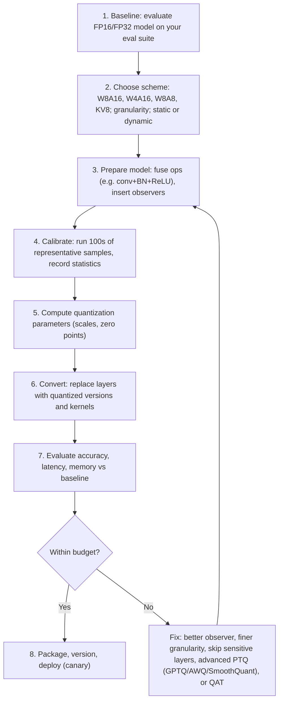
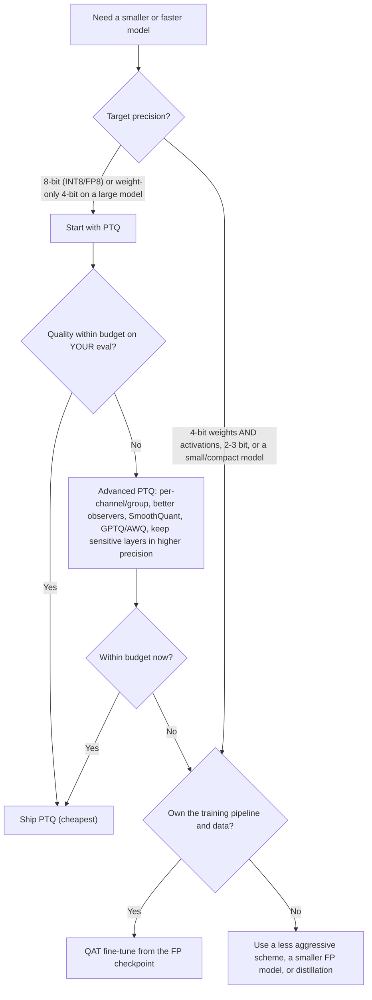

# Post-Training Quantization vs Quantization-Aware Training

> **Level:** Beginner to Advanced · **Study time:** ~80 min · **Prerequisites:** [Number Formats and Model Memory](01-number-formats-and-model-memory.md), [Quantization Fundamentals: Scale, Zero Point, Symmetric and Asymmetric](02-quantization-fundamentals-scale-and-zero-point.md), [Backpropagation and Gradient Descent](../02-deep-learning/02-backpropagation-and-gradient-descent.md), [GPU Fundamentals: Compute-Bound vs Memory-Bound](../06-llm-inference/03-gpu-fundamentals-compute-bound-vs-memory-bound.md)

## Table of contents

- [Why this matters](#why-this-matters)
- [A two-minute recap of quantization](#a-two-minute-recap-of-quantization)
- [What can be quantized: weights, activations and the KV cache](#what-can-be-quantized-weights-activations-and-the-kv-cache)
- [Weight-only vs weight-and-activation quantization](#weight-only-vs-weight-and-activation-quantization)
- [Dynamic vs static quantization](#dynamic-vs-static-quantization)
- [The post-training quantization (PTQ) workflow](#the-post-training-quantization-ptq-workflow)
- [Calibration data: the quiet make-or-break input](#calibration-data-the-quiet-make-or-break-input)
- [Quantization-aware training (QAT)](#quantization-aware-training-qat)
- [PTQ vs QAT: how to choose](#ptq-vs-qat-how-to-choose)
- [Evaluating accuracy degradation](#evaluating-accuracy-degradation)
- [Going deeper: production practice and debugging](#going-deeper-production-practice-and-debugging)
- [Common mistakes and misconceptions](#common-mistakes-and-misconceptions)
- [Interview questions and model answers](#interview-questions-and-model-answers)
- [Key takeaways](#key-takeaways)
- [Further reading](#further-reading)
- [Next](#next)

## Why this matters

Almost every LLM you can self-host in 2026 is offered in quantized variants: INT8, FP8, INT4, GGUF files (the model file format used by llama.cpp and Ollama, usually holding quantized weights) and so on. Almost every edge vision model runs in INT8 too. Somebody had to decide *how* those models were quantized: after training with a little calibration data (PTQ), or by teaching the model to tolerate quantization during training (QAT). That decision drives cost (how many GPUs you need), latency, and whether the compressed model quietly breaks on the inputs your users actually send. Interviewers for senior AI/ML roles love this topic because it mixes numerics, hardware, training and evaluation, and because "we quantized it and it looked fine on perplexity" is a classic production failure story. By the end of this chapter you should be able to pick a scheme, run it, and prove it did not break anything that matters.

## A two-minute recap of quantization

The previous chapter, [Quantization Fundamentals](02-quantization-fundamentals-scale-and-zero-point.md), covers this in full. Here is just enough to read the rest of this chapter.

> **Analogy:** Quantization is like rounding prices to the nearest 5 cents. You lose a little precision, but every price now fits on a smaller price tag.

**Quantization** maps real numbers (stored as 32-bit or 16-bit floats) onto a small set of integer levels, for example the 256 levels of **INT8** (8-bit integer) or the 16 levels of **INT4**. **Dequantization** maps the integers back to approximate real numbers.

$$q = \text{clamp}\left(\text{round}\left(\frac{x}{s}\right) + z,\; q_{\min},\; q_{\max}\right) \qquad \hat{x} = s\,(q - z)$$

- $x$: the original real value (a weight or an activation).
- $s$: the **scale**, the real-valued step size between neighboring integer levels.
- $z$: the **zero point**, the integer that represents real 0 (it is 0 in **symmetric** quantization).
- $q_{\min}, q_{\max}$: the integer range, for example $-128$ and $127$ for signed INT8 (the full range; symmetric schemes often use the narrow range $[-127, 127]$ instead, as in the previous chapter, and with $s = \max|x| / 127$ the two give identical codes for in-range values), or $0$ and $255$ for UINT8.
- $\text{clamp}$: forces a value into the range, so anything outside gets **clipped** to the nearest edge.
- $q$: the stored integer. $\hat{x}$: the reconstructed (dequantized) value.

**Tiny example (symmetric INT8).** Suppose the largest absolute value we care about is $2.54$. Then $s = 2.54 / 127 = 0.02$ and $z = 0$.

- $x = 0.373$: $0.373 / 0.02 = 18.65$, round to $19$, so $\hat{x} = 19 \times 0.02 = 0.38$. **Rounding error** $= 0.007$.
- $x = 3.00$: $3.00 / 0.02 = 150$, clamped to $127$, so $\hat{x} = 127 \times 0.02 = 2.54$. **Clipping error** $= 0.46$.

Two kinds of error, then: rounding error (small, everywhere) and clipping error (potentially large, only for values outside the range). Almost everything in this chapter is about choosing $s$ (and $z$) well, and about who chooses it: a calibration procedure after training (PTQ) or the training process itself (QAT).

One more recap term: **granularity**. One scale can be shared by a whole tensor (**per-tensor**), by each output channel or row (**per-channel**), by each small block of, say, 128 consecutive weights (**per-group**), or by each token's activation vector (**per-token**). Finer granularity means less error but more scales to store and handle. Details are in the [previous chapter](02-quantization-fundamentals-scale-and-zero-point.md).

## What can be quantized: weights, activations and the KV cache

A neural network at inference time stores and moves three big kinds of numbers. Each can be quantized separately.

```text
            input activations X (computed at runtime, change every request)
                    |
                    v
   +--------------------------------+
   |  Linear layer:  Y = X @ W^T    |  <-- weights W (fixed after training)
   +--------------------------------+
                    |
                    v
            output activations Y  -->  next layer ...

   In a transformer's attention layers, the keys K and values V of all
   previous tokens are also kept in memory: the KV cache (grows with
   sequence length and batch size).
```

- **Weights:** the learned parameters. They are fixed after training, so you can inspect every single one before deployment. That makes them the easiest thing to quantize.
- **Activations:** the intermediate outputs flowing between layers. They depend on the input, so you do not know their exact values ahead of time. You must either measure typical ranges in advance (with **calibration data**, defined below) or compute ranges on the fly.
- **KV cache:** in a decoder transformer, each layer stores the **key** and **value** vectors of every previous token so it does not recompute them during generation. See [The KV Cache](../06-llm-inference/02-kv-cache-explained.md). It is technically a stored activation, but it behaves like a third category because it can dominate memory at long context and large batch.

| What | Known before deployment? | Memory share | Main benefit of quantizing | Main risk |
|---|---|---|---|---|
| Weights | Yes, exactly | Fixed: about (parameters x bytes per parameter) | Smaller model, less memory bandwidth per token | Rounding error in sensitive layers |
| Activations | No, input-dependent | Usually small at a time, but they feed every matrix multiply | Enables integer or FP8 matrix multiplies (real compute speedup) | **Outliers**: rare huge values blow up the scale |
| KV cache | No, grows during generation | Grows with batch x sequence length; can exceed the weights | More concurrent requests and longer context per GPU | Attention errors accumulate over long contexts |

### Running example: a 7B model

Let us use a 7-billion-parameter decoder (shaped like Llama-2-7B: 32 layers, hidden size 4096, standard multi-head attention, no grouped-query attention).

**Weights:**

- FP16: $7 \times 10^9 \times 2$ bytes $= 14 \times 10^9$ bytes $= 14$ GB.
- INT8: $7 \times 10^9 \times 1$ byte $= 7$ GB.
- INT4: $7 \times 10^9 \times 0.5$ bytes $= 3.5$ GB, plus scales. With one FP16 scale per group of 128 weights, the scales add $16 / 128 = 0.125$ bits per weight, so the total is $4.125$ bits per weight: $7 \times 10^9 \times 4.125 / 8 \approx 3.61 \times 10^9$ bytes, about $3.6$ GB.

**KV cache per token** (FP16):

$$\text{bytes per token} = 2 \times L \times d_{\text{model}} \times b$$

- $2$: one key vector and one value vector.
- $L$: number of layers ($32$).
- $d_{\text{model}}$: hidden size, the width of each key or value vector summed over heads ($4096$).
- $b$: bytes per number ($2$ for FP16).

$2 \times 32 \times 4096 \times 2 = 524{,}288$ bytes $= 512$ KiB per token. One 4096-token conversation needs $524{,}288 \times 4096 = 2{,}147{,}483{,}648$ bytes $= 2$ GiB. A batch of 8 such conversations needs 16 GiB, more than the FP16 weights themselves. Quantizing the KV cache to 8 bits halves that to 8 GiB.

> **Senior insight:** "Quantize the model" is ambiguous. Always ask: weights, activations, KV cache, or which combination? Each one buys you something different, and each has different accuracy risk.

## Weight-only vs weight-and-activation quantization

### The naming convention

People describe schemes as **W*x*A*y***: weights stored in *x* bits, activations in *y* bits. Sometimes a KV cache tag is added (for example "KV8").

| Name | Weights | Activations | Typical use |
|---|---|---|---|
| W16A16 | FP16/BF16 | FP16/BF16 | Unquantized baseline |
| W8A16 | INT8 | FP16/BF16 | Safe weight-only compression |
| W4A16 | INT4 (per-group) | FP16/BF16 | The most common LLM compression for low-batch serving (GPTQ, AWQ, many GGUF variants; GPTQ and AWQ are PTQ methods covered below) |
| W8A8 (INT8) | INT8 | INT8 | High-throughput serving on GPUs with INT8 tensor cores; CPUs |
| W8A8 (FP8) | FP8 | FP8 | High-throughput serving on GPUs with FP8 support (NVIDIA Hopper and newer, recent AMD) |
| W4A8, W4A4 | INT4 | INT8 or 4-bit | Research and newer hardware; harder to keep accurate |

### Weight-only quantization (W8A16, W4A16)

> **Analogy:** You ship furniture flat-packed (small, cheap to move), and assemble each piece at the destination right before using it. The furniture is used at full size; only the transport got cheaper.

In **weight-only quantization**, weights are stored in low precision, but the actual math runs in FP16 or BF16. A specialized **kernel** (the low-level GPU function that performs an operation such as a matrix multiply, called a **GEMM**, general matrix multiply) loads the INT4 weights from memory, dequantizes them in fast on-chip registers, and multiplies them with FP16 activations.

Why does that help if the math is still FP16? Because during LLM token generation (**decode**), each step processes only one new token per sequence, so the GPU spends most of its time *reading weights from memory*, not doing math. That is called being **memory-bandwidth-bound** (see [GPU Fundamentals](../06-llm-inference/03-gpu-fundamentals-compute-bound-vs-memory-bound.md) and [Inference Fundamentals](../06-llm-inference/01-inference-fundamentals-prefill-decode-and-latency-metrics.md)).

**Worked example (illustrative numbers).** Assume a GPU with 2 TB/s of memory bandwidth, batch size 1, and that each decode step must read all weights once.

- FP16: $14 \text{ GB} / 2 \text{ TB/s} = 14 / 2000 \text{ s} = 7$ ms per token (a lower bound), so at most about $1000 / 7 \approx 143$ tokens per second.
- INT4 (3.6 GB): $3.6 / 2000 \text{ s} = 1.8$ ms per token, at most about $1000 / 1.8 \approx 556$ tokens per second.

Real numbers are lower (kernel overheads, KV cache reads, other layers), but the direction is right: fewer bytes to read means faster memory-bound decoding.

What weight-only quantization does **not** give you:

- **No faster math.** During **prefill** (processing the whole prompt at once) or at large batch sizes, the GPU becomes **compute-bound** (limited by arithmetic throughput). The math is still FP16, and the kernel now also spends work dequantizing, so W4A16 can be no faster, or even slower, than FP16 there.
- **No activation savings.** Activations and the KV cache are unchanged unless quantized separately.

### Weight-and-activation quantization (W8A8)

> **Analogy:** Instead of only shipping smaller boxes, you also rebuild the factory to work with smaller parts. Every machine is faster, but now every part on the assembly line must fit the smaller format, including the occasional giant one.

In **weight-and-activation quantization**, both inputs of the matrix multiply are low precision, so the multiply itself runs on integer (INT8) or FP8 **tensor cores** (specialized matrix-math units in NVIDIA GPUs). Per vendor spec sheets, dense INT8 peak throughput on A100- and H100-class GPUs is roughly 2x their dense FP16 peak, and FP8 on Hopper-class GPUs is similarly about 2x FP16. That is a real compute speedup, which helps prefill and large-batch serving.

For INT8, the accumulation happens in INT32, and the result is rescaled back to floating point:

$$Y \approx s_X \, s_W \, (Q_X Q_W^\top)$$

- $Q_X, Q_W$: the INT8 activation and weight matrices (symmetric, zero point 0 for simplicity).
- $Q_X Q_W^\top$: computed in integer arithmetic with INT32 accumulators (each product of two INT8 values can reach $127 \times 127 = 16{,}129$ in magnitude, or $16{,}384$ if $-128$ is used, and a dot product sums thousands of them, which would overflow 8 or 16 bits).
- $s_X, s_W$: the activation and weight scales; multiplying by them converts the integer result back to real units.

**Tiny example.** A 1x2 activation row $x = [1.0, -0.5]$ and one weight row $w = [0.4, 0.8]$. True dot product: $1.0 \times 0.4 + (-0.5) \times 0.8 = 0.4 - 0.4 = 0$.

- Activation scale $s_X = 1.0 / 127$. $Q_x = [\text{round}(127), \text{round}(-63.5)] = [127, -64]$ (NumPy and PyTorch round exact halves to the nearest even integer, so $-63.5 \to -64$ and $63.5 \to 64$).
- Weight scale $s_W = 0.8 / 127$. $Q_w = [\text{round}(0.4 \times 127 / 0.8), \text{round}(127)] = [\text{round}(63.5), 127] = [64, 127]$.
- Integer dot product: $127 \times 64 + (-64) \times 127 = 8128 - 8128 = 0$.
- Rescale: $s_X s_W \times 0 = 0$. Exact in this case, and in general within rounding error.
- Floating-point caveat: if you compute the scale first, `0.4 / (0.8 / 127)` evaluates to $63.4999\ldots$ rather than exactly $63.5$, so it rounds to $63$. The integer dot product becomes $127 \times 63 - 64 \times 127 = -127$ and the result is $s_X s_W \times (-127) \approx -0.0063$: still within rounding error of the true 0, which is the point.

The catch is **activation outliers**: in large transformers, a few hidden dimensions carry values far larger than the rest ("LLM.int8()", Dettmers et al., 2022, reports outlier features up to about 20x larger, and later work found even more extreme "massive activations" in some models). With a single per-tensor scale, the outlier stretches the range and every normal value gets squeezed into a handful of integer levels. Weights are usually well-behaved; activations are where W8A8 accuracy goes to die. Techniques that fix this (per-token activation scales, SmoothQuant, mixed-precision outlier handling) are the subject of [Practical LLM Quantization](04-llm-quantization-gptq-awq-and-outliers.md).

### Trade-off summary

| Aspect | Weight-only (W8A16, W4A16) | Weight-and-activation (W8A8 INT8 or FP8) |
|---|---|---|
| Memory for weights | 2x (INT8) to about 4x (INT4) smaller than FP16 | 2x smaller (8-bit) |
| Memory bandwidth per decode step | Big savings, especially W4 | Savings from 8-bit weights |
| Matrix multiply math | Still FP16/BF16 (dequantize in kernel) | INT8 or FP8 tensor cores: real compute speedup |
| Best regime | Small batch, memory-bound decode, fitting a big model on a small GPU | Large batch, prefill-heavy, throughput-oriented serving |
| Accuracy risk | Lower: weights are static and usually well-behaved | Higher: activation outliers, input-dependent ranges |
| Needs calibration data? | Simple round-to-nearest: no. GPTQ/AWQ: yes, a small set | Static activation scales: yes. Dynamic per-token scales: no |
| Kernel and hardware needs | Mixed-precision kernels (for example Marlin-style W4A16 kernels in vLLM); widely available | INT8 or FP8 GEMM support; FP8 needs Hopper/Ada-class or newer NVIDIA GPUs or recent AMD |
| Failure mode | Faster only when memory-bound; can be slower at large batch | Silent quality loss on inputs with unusual activation ranges |

> **Interview tip:** The killer sentence is: "Weight-only quantization saves memory and bandwidth, so it speeds up memory-bound decode. Weight-and-activation quantization unlocks low-precision tensor cores, so it speeds up compute-bound work, but activation outliers make it harder to keep accurate." Then mention that any speedup requires a kernel that actually exists for your hardware and format.

> **Senior insight:** No kernel, no speedup. If your serving stack has no fused kernel for your format, it may dequantize the whole weight matrix to FP16 in memory first, which saves storage but no bandwidth or time. That is the root cause in the debugging case [A Quantized LLM Uses Less Memory but Latency Is Unchanged](../11-system-design/06-debugging-case-quantized-llm-not-faster.md).

## Dynamic vs static quantization

Weights are always known ahead of time, so their scales can always be precomputed. The interesting question is: **when do you compute the activation scales?**

> **Analogy:** Static quantization is a tailor who measures 500 customers once and sews every shirt in a few fixed sizes. Dynamic quantization measures each customer as they walk in. The second fits better but slows the line down.

- **Dynamic quantization:** activation scales are computed at runtime, for each batch or each token, from the actual min and max (or absolute max) of the values present. No calibration data is needed for activations. Cost: an extra reduction pass (find the max) and a quantize step on every forward pass, and the next layer often cannot consume integers directly.
- **Static quantization:** activation scales are computed once, ahead of time, by running **calibration data** through the model and recording ranges. At runtime the scales are constants, so operations can be fused and kept in integer form end to end. Cost: you need representative calibration data, and inputs outside the calibrated range get clipped.

**Worked example.** At runtime a layer receives activations $[0.5, -1.2, 3.0, 0.1]$. Symmetric INT8.

*Dynamic:* absolute max $= 3.0$, $s = 3.0 / 127 \approx 0.023622$.

- $3.0 / 0.023622 = 127.0 \to 127 \to \hat{x} = 3.0$. No clipping.
- $0.1 / 0.023622 \approx 4.23 \to 4 \to \hat{x} \approx 0.0945$. Small rounding error.

*Static:* calibration saw a maximum absolute value of $2.0$, so $s = 2.0 / 127 \approx 0.015748$.

- $3.0 / 0.015748 \approx 190.5 \to$ clamped to $127 \to \hat{x} = 127 \times 0.015748 \approx 2.0$. **Clipping error of 1.0.**
- $0.1 / 0.015748 \approx 6.35 \to 6 \to \hat{x} \approx 0.0945$. Same small rounding error.

The static scale is finer (better for typical values) but fails on the input that exceeds what calibration saw. That is exactly how calibration mismatch hurts.

| | Dynamic quantization | Static quantization |
|---|---|---|
| Activation scales computed | At runtime, per batch or per token | Once, offline, from calibration data |
| Needs calibration data | No (for activations) | Yes |
| Runtime overhead | Extra max-reduction and quantize per layer | Minimal; scales are constants and can be fused |
| Robustness to unusual inputs | High: range adapts to each input | Lower: out-of-range values clip |
| Typical home | PyTorch dynamic quantization of `nn.Linear` on CPU (LSTMs, BERT-style models); per-token dynamic FP8/INT8 activations in LLM serving | CNNs on mobile and edge accelerators (TensorRT, TFLite, integer-only NPUs); static FP8 activation scales |
| Main risk | Overhead; a single outlier still stretches that token's range | Calibration-serving distribution mismatch |

> **Senior insight:** Modern LLM W8A8 recipes often mix the two: static per-channel weight scales plus **dynamic per-token** activation scales. Per-token means each token's vector gets its own scale, so one weird token does not ruin the others. Granularity and timing are independent knobs.

## The post-training quantization (PTQ) workflow

**Post-training quantization (PTQ)** quantizes an already-trained model without (much) further training. You take the floating-point model, optionally show it a small amount of calibration data, compute quantization parameters, and convert. It takes minutes to hours, not days, and needs no labels and no training pipeline.

> **Analogy:** PTQ is like resizing a finished painting to fit a smaller frame. You choose the crop and scaling carefully, but you do not repaint it.

### Step by step



New terms in that flow:

- **Operator fusion:** merging adjacent operations into one, for example folding a **batch normalization** layer's scale and shift into the preceding convolution's weights, so there is one fewer thing to quantize and one less rounding step.
- **Observer:** a small module attached to a tensor during calibration that watches values go by and records statistics (min, max, histogram). After calibration, the observer turns those statistics into a scale and zero point.
- **Quantization parameters (qparams):** the scales and zero points for every quantized tensor.

### Choosing the range: observers and the clipping trade-off

How an observer turns statistics into a range is the heart of PTQ quality. Recall the two error types: a wide range means no clipping but coarse rounding; a narrow range means fine rounding but clipping of the outliers.

**Worked example.** Calibration activations are $[0.1, 0.2, 0.3, 0.4, 10.0]$. Symmetric INT8.

*Min-max observer* (range set by the largest absolute value, $10.0$): $s = 10.0 / 127 \approx 0.07874$.

| $x$ | $x / s$ | round | $\hat{x}$ | error |
|---|---|---|---|---|
| 0.1 | 1.27 | 1 | 0.0787 | 0.0213 |
| 0.2 | 2.54 | 3 | 0.2362 | 0.0362 |
| 0.3 | 3.81 | 4 | 0.3150 | 0.0150 |
| 0.4 | 5.08 | 5 | 0.3937 | 0.0063 |
| 10.0 | 127.0 | 127 | 10.0 | 0 |

The four "normal" values get only integer levels 1 to 5 out of 127 available. Relative errors are up to 21% ($0.0213 / 0.1$).

*Clip at 0.4* (as a percentile observer might): $s = 0.4 / 127 \approx 0.0031496$.

- $0.1 / 0.0031496 \approx 31.75 \to 32 \to \hat{x} \approx 0.1008$, error $0.0008$.
- $10.0 \to$ clamped to $127 \to \hat{x} = 0.4$, error $9.6$.

Neither is obviously right. Which is better depends on whether that $10.0$ matters to the model. In LLMs, those outliers often *do* matter, which is why clipping them is not a free lunch.

| Observer / range method | How it picks the range | Pros | Cons |
|---|---|---|---|
| Min-max | Smallest and largest value seen | Simple, no clipping on calibration data | One outlier wastes resolution |
| Moving-average min-max | Exponential moving average of per-batch min and max | Less sensitive to a single extreme batch | Still outlier-sensitive |
| Percentile | For example the 99.99th percentile of absolute values | Ignores rare extremes | Clips them, which can hurt if they matter |
| MSE-minimizing | Searches for the clipping value that minimizes reconstruction error | Principled balance of the two errors | Slower; optimizes a proxy, not task accuracy |
| Entropy (KL divergence) | Picks the range whose quantized histogram is closest in KL divergence to the original | Popularized by NVIDIA TensorRT INT8 calibration | Slower; histogram-based heuristics |

The KL divergence used by the entropy method is explained in [Softmax, Entropy, Cross-Entropy and KL Divergence](../00-foundations/05-softmax-entropy-cross-entropy-and-kl-divergence.md).

### Beyond round-to-nearest: advanced PTQ

The simplest PTQ, **round-to-nearest (RTN)**, rounds each weight independently. Smarter PTQ methods still avoid full training but use calibration data (or, in the first case, statistics already stored in the model) to reduce error:

- **Cross-layer equalization and bias correction** ("Data-Free Quantization Through Weight Equalization and Bias Correction", Nagel et al., 2019): rescale channels between consecutive layers so ranges are balanced, and correct the systematic shift that rounding introduces in layer outputs. As the title says, the original method is data-free: it estimates the shift from batch-norm statistics; an empirical variant of bias correction uses calibration data instead.
- **AdaRound** ("Up or Down? Adaptive Rounding for Post-Training Quantization", Nagel et al., 2020): learns, per weight, whether to round up or down, to minimize each layer's *output* error on calibration data rather than each weight's own error.
- **GPTQ** (Frantar et al., 2022): quantizes weights one column at a time and updates the remaining weights to compensate, using second-order statistics gathered from calibration inputs.
- **AWQ** (Lin et al., 2023): uses activation magnitudes from calibration data to find the few weight channels that matter most and protects them by scaling.
- **SmoothQuant** (Xiao et al., 2022): migrates activation outliers into the weights with a per-channel scaling so W8A8 becomes feasible.

The LLM-specific ones are covered in depth in [Practical LLM Quantization](04-llm-quantization-gptq-awq-and-outliers.md). The point here: "PTQ" is a spectrum, from "round every weight" to "a small optimization problem per layer." All of them need no full retraining, and most of them need calibration data.

### PTQ in code: from scratch, then PyTorch

First the mechanism in NumPy: static per-tensor activation calibration with two observers.

```python
# pip install numpy
import numpy as np

def quantize_sym(x, scale, qmin=-128, qmax=127):
    """Symmetric quantize then dequantize (returns the reconstructed floats)."""
    q = np.clip(np.round(x / scale), qmin, qmax)
    return q * scale

rng = np.random.default_rng(0)

# Calibration activations: mostly small values plus a few rare outliers.
calib = rng.normal(0, 1, size=10_000)
calib[:5] = 25.0                       # 5 outliers out of 10,000

# Observer 1: min-max (absolute max)
s_minmax = np.abs(calib).max() / 127

# Observer 2: 99.9th percentile of absolute values
s_pct = np.percentile(np.abs(calib), 99.9) / 127

# "Serving" data drawn from the same distribution (no outliers this time)
serve = rng.normal(0, 1, size=10_000)
for name, s in [("min-max", s_minmax), ("percentile", s_pct)]:
    err = np.mean((serve - quantize_sym(serve, s)) ** 2)
    print(f"{name:10s} scale={s:.4f}  MSE on serving data={err:.2e}")
# Expect the percentile scale to be much smaller and give a much lower MSE here,
# because 5 outliers inflated the min-max range for everyone else.
```

Now the standard PyTorch "eager mode" static PTQ flow for a small CNN, the kind used for a mobile image classifier. These APIs live in `torch.ao.quantization`. **Version note:** PyTorch has been moving quantization work into the separate `torchao` library, and the older `torch.ao.quantization` flows are deprecated in recent 2.x releases (importing it emits a `DeprecationWarning` announcing removal, and quantized-tensor creation functions are deprecated too), so this code may stop working in a future release. It ran as shown on PyTorch 2.14 (CPU) with warnings. The concepts (stubs, qconfig, prepare, calibrate, convert) are durable; check the docs for your version.

```python
# pip install torch   (CPU build is fine; quantized CPU kernels use the x86 or qnnpack backend)
import torch
import torch.nn as nn
import torch.ao.quantization as tq

class TinyCNN(nn.Module):
    def __init__(self):
        super().__init__()
        self.quant = tq.QuantStub()        # marks where float -> int8 happens
        self.conv = nn.Conv2d(3, 8, 3)
        self.bn = nn.BatchNorm2d(8)
        self.relu = nn.ReLU()
        self.pool = nn.AdaptiveAvgPool2d(1)
        self.fc = nn.Linear(8, 2)          # e.g. "cat" vs "not cat"
        self.dequant = tq.DeQuantStub()    # marks where int8 -> float happens

    def forward(self, x):
        x = self.quant(x)
        x = self.relu(self.bn(self.conv(x)))
        x = self.pool(x).flatten(1)
        x = self.fc(x)
        return self.dequant(x)

model = TinyCNN().eval()                   # PTQ works on a trained model in eval mode

# 1) Fuse conv + bn + relu into one module (BN is folded into conv weights).
model = tq.fuse_modules(model, [["conv", "bn", "relu"]])

# 2) Choose a quantization config: observers for weights and activations.
model.qconfig = tq.get_default_qconfig("x86")   # per-channel weights, histogram activations

# 3) Insert observers.
prepared = tq.prepare(model)

# 4) Calibrate: run representative inputs. Replace random tensors with real images!
with torch.inference_mode():
    for _ in range(32):
        prepared(torch.randn(8, 3, 32, 32))

# 5-6) Compute scales/zero points and swap in quantized modules.
quantized = tq.convert(prepared)
print(quantized)   # shows QuantizedConvReLU2d, QuantizedLinear, with scale and zero_point
```

And dynamic quantization, which needs no calibration at all (weights INT8, activation scales computed per batch at runtime):

```python
import torch
import torch.nn as nn

# A small text classifier head, e.g. our spam filter on top of sentence features.
spam_head = nn.Sequential(nn.Linear(768, 256), nn.ReLU(), nn.Linear(256, 2)).eval()

dq = torch.ao.quantization.quantize_dynamic(
    spam_head, {nn.Linear}, dtype=torch.qint8   # quantize only Linear layers
)
with torch.inference_mode():
    logits = dq(torch.randn(4, 768))
print(logits.shape)   # torch.Size([4, 2])
```

For LLMs, people rarely hand-write this. They use tools such as Hugging Face Transformers' quantization integrations (for example `BitsAndBytesConfig` for on-the-fly 8-bit and 4-bit weight loading), GPTQ/AWQ tooling, NVIDIA's ModelOpt, or the vLLM project's `llm-compressor`. These APIs change quickly, so treat any snippet as a sketch and read the current docs. Conceptually they all do the same thing:

```python
# Conceptual sketch only: argument names vary by library and version.
# recipe = W8A8(weights="int8 per-channel static", activations="int8 per-token dynamic",
#               ignore=["lm_head"], smoothing=0.8)
# calib = load_dataset(<your own representative prompts>).select(range(512))
# quantized_model = apply(recipe, model, calibration_data=calib, max_seq_len=2048)
# quantized_model.save_pretrained("my-model-w8a8")   # then evaluate before serving
```

## Calibration data: the quiet make-or-break input

> **Analogy:** Calibration data is the test drive before you set a car's speedometer. If you only test-drive in a parking lot, the needle will be beautifully precise up to 30 km/h and pinned at the limit on the highway.

**Calibration data** is a small, unlabeled sample of inputs you run through the model during PTQ so the quantization procedure can observe realistic internal values. It is not used to update the model's weights through backpropagation; it is used to *measure*.

### What it is used for

| Method | What the calibration data is used to estimate |
|---|---|
| Static activation quantization | Activation ranges (min, max, histograms) at every quantized tensor, which become the fixed scales |
| Static KV cache scales (for example FP8 KV cache) | Ranges of keys and values per layer or head |
| Bias correction, AdaRound, BRECQ (block-wise reconstruction, Li et al., 2021) | Layer outputs to match, so rounding choices minimize output error |
| GPTQ | Second-order statistics of each layer's inputs (roughly $X X^\top$), which decide how to compensate for rounding error |
| AWQ | Average activation magnitude per input channel, which identifies "salient" weight channels to protect |
| SmoothQuant | Per-channel activation maxima, which set the smoothing factors |

Pure round-to-nearest weight-only quantization and fully dynamic activation quantization need **no** calibration data. That is one reason `bitsandbytes`-style on-the-fly quantization is so convenient.

### How much is enough

There is no universal number, but practice has settled on small sets:

- **CNNs and vision models:** commonly on the order of a few hundred to a thousand or so images. Range statistics usually stabilize quickly.
- **LLMs:** the GPTQ paper used 128 random segments of 2048 tokens from the C4 dataset (a large cleaned web-crawl corpus), and "128 samples" became a common default in tooling. Many practitioners use a few hundred to around a thousand samples, especially for chat or multilingual models.

What matters more than the count is **coverage**: enough variety that every layer sees the kinds of activations it will see in production. Signs you need more or better data: quantized metrics change noticeably when you re-run calibration with a different random subset (high variance means the statistics have not stabilized), or particular slices regress.

> **Common mistake:** Using your evaluation set as calibration data. That leaks information and makes the quantized model look better than it is. Keep calibration, validation and test data separate, exactly as in [Train/Validation/Test Splits](../01-classical-ml/01-ml-workflow-data-splits-and-cross-validation.md).

### Representativeness: what "matching production" means for an LLM

Calibration data should match serving traffic along every axis that changes activations:

- **Domain and task:** code, legal text, medical notes, casual chat.
- **Language and script:** a model calibrated on English only may have badly calibrated ranges for Urdu, Chinese or emoji-heavy text.
- **Format:** if you serve a chat model, calibrate on text wrapped in the model's **chat template** (the special tokens that mark system, user and assistant turns). Raw web text never contains those tokens, and some of them trigger large activations.
- **Length:** if production prompts are 8K-token RAG contexts, calibrating only on 512-token snippets misses how activations and KV values behave at later positions.
- **Output style:** JSON, tool calls, long reasoning traces.

### How domain mismatch hurts

1. **Clipped ranges (static scales).** Serving inputs produce larger activations than any calibration sample, so they clip, exactly like the $3.0 \to 2.0$ example earlier. This can show up as degraded or garbage output on a specific input type only.
2. **Wasted resolution.** Calibration saw unusually large values that production rarely produces, so the scale is too coarse for real traffic.
3. **Overfitting the error compensation.** GPTQ-style methods minimize error *on the calibration inputs*. If those are all English web text, the weight adjustments are tuned for English web text, and quality on code or another language can degrade more than with naive rounding. The AWQ authors report their method is less sensitive to the calibration set's distribution than GPTQ, because it uses calibration data only to measure per-channel activation magnitudes and to grid-search a single scaling exponent per layer, rather than updating the weights themselves to reconstruct the calibration outputs, but no method is immune.

**Running example, spam filter.** You quantize a transformer-based spam classifier with static INT8 activations, calibrating on 500 English marketing emails. Production also receives Arabic-script phishing emails and emails that are mostly URLs and base64 blobs. Overall accuracy drops 0.3 points (illustrative), which looks fine, but recall on the Arabic phishing slice collapses because its token embeddings and attention patterns produce activations outside the calibrated ranges. The fix is not "more calibration data", it is *representative* calibration data: sample from real production logs (respecting privacy rules), stratified by language and message type.

```python
# Conceptual: building a representative LLM calibration set (pip install transformers)
import random

def build_calibration_set(prod_logs, tokenizer, n=512, max_len=2048, seed=0):
    """prod_logs: list of dicts like {"messages": [...], "slice": "code" | "legal" | ...}"""
    random.seed(seed)
    by_slice = {}
    for ex in prod_logs:
        by_slice.setdefault(ex["slice"], []).append(ex)
    per_slice = max(1, n // len(by_slice))            # stratify: every slice is covered
    samples = []
    for slice_name, items in by_slice.items():
        for ex in random.sample(items, min(per_slice, len(items))):
            # Use the SAME chat template the server will use.
            text = tokenizer.apply_chat_template(ex["messages"], tokenize=False)
            # The template text already contains special tokens such as BOS, so do not
            # let the tokenizer add them again (a double BOS is a silent mismatch).
            samples.append(tokenizer(text, add_special_tokens=False,
                                     truncation=True, max_length=max_len))
    return samples
```

> **Senior insight:** Version your calibration set like code. If someone re-quantizes next quarter with a different calibration sample and quality shifts, you want to know which dataset produced which artifact. Store its hash alongside the model in the registry ([Data and Model Versioning](../10-mlops/02-data-and-model-versioning-and-model-registry.md)).

## Quantization-aware training (QAT)

> **Analogy:** An athlete who will compete at high altitude trains at high altitude beforehand. **QAT** makes the model "train at altitude": it experiences quantization noise during training and learns weights that still work under it.

**Quantization-aware training (QAT)** inserts simulated quantization into the model during training (usually fine-tuning a pretrained model), so the weights adapt to the rounding and clipping they will face at inference. After training, the model is converted to a truly quantized model, and its accuracy is typically closer to the floating-point original than PTQ at the same bit width; the advantage is small at 8-bit and largest at low bit widths. The canonical reference is "Quantization and Training of Neural Networks for Efficient Integer-Arithmetic-Only Inference" (Jacob et al., 2018).

### Fake quantization

During QAT, the model still runs in floating point. Each quantized tensor passes through a **fake quantization** node: quantize then immediately dequantize.

$$\text{FakeQuant}(x) = s \cdot \left(\text{clamp}\left(\text{round}\left(\frac{x}{s}\right) + z,\; q_{\min},\; q_{\max}\right) - z\right)$$

The output is a float, but it can only take values on the quantization grid. The forward pass therefore *sees exactly the error that real quantization will cause*, so the loss reflects it, and training can push weights toward values that survive rounding.

**Where does $s$ come from during QAT?** In the standard recipe each fake-quant node carries an observer (as in PTQ) that keeps updating $s$ and $z$ from running statistics of the values passing through; alternatively $s$ is learned directly (see learnable scales below). Late in training the observers are frozen, and so are batch-norm running statistics, so the grid stops moving and the weights can settle onto it. That is what the `disable_observer` and `freeze_bn_stats` calls in the API example below do.

```text
QAT forward pass (training)                    After convert (inference)

 x (fp32) --> FakeQuant --+                     x_int8 --+
                          |                              |
 W (fp32) --> FakeQuant --+--> matmul (fp32)    W_int8 --+--> int8 matmul -> rescale
                                  |                                   |
                             FakeQuant (output)                   y_int8 / y_fp
                                  |
                               loss
```

**Worked example.** INT8 symmetric, $s = 0.1$, $z = 0$, so the representable range is $[-12.8, 12.7]$.

- $x = 0.37$: $0.37 / 0.1 = 3.7 \to 4 \to 0.4$. FakeQuant output $= 0.4$.
- $x = 15.0$: $150 \to$ clamped to $127 \to 12.7$. FakeQuant output $= 12.7$.

### The problem: rounding has no useful gradient

Backpropagation (see [Backpropagation and Gradient Descent](../02-deep-learning/02-backpropagation-and-gradient-descent.md)) needs the derivative of every operation. But $\text{round}(\cdot)$ is a staircase: flat almost everywhere (derivative 0) and jumping at the steps (derivative undefined). If you backpropagate honestly, every gradient through a fake-quant node is zero, and nothing learns.

```text
 round(v)                    true derivative           STE "pretend" derivative
   3 |        ___              |                          |
   2 |    ___|                 |  0  0  0  0  0          1|-------------------
   1 |___|                     |  (spikes at steps)       |
     +-----------> v           +-------------> v          +-------------> v
```

### The straight-through estimator (STE)

The **straight-through estimator (STE)** (popularized for neural networks in "Estimating or Propagating Gradients Through Stochastic Neurons for Conditional Computation", Bengio, Leonard and Courville, 2013) simply *pretends* the rounding step is the identity function during the backward pass. The usual QAT version also zeroes gradients for values that were clipped:

$$\frac{\partial\, \text{FakeQuant}(x)}{\partial x} \approx \begin{cases} 1 & \text{if } q_{\min} \le \frac{x}{s} + z \le q_{\max} \\ 0 & \text{otherwise (clipped)} \end{cases}$$

- Inside the range: the gradient passes straight through unchanged, as if no rounding happened.
- Outside the range: clipping really does make the output constant with respect to $x$, so the gradient is 0.

**Worked example (continuing).** Suppose the loss gradient arriving at the FakeQuant output is $\frac{\partial L}{\partial \hat{x}} = 2.0$.

- For $x = 0.37$ (inside range): $\frac{\partial L}{\partial x} \approx 2.0 \times 1 = 2.0$.
- For $x = 15.0$ (clipped): $\frac{\partial L}{\partial x} \approx 2.0 \times 0 = 0$.

The gradient is "wrong" in a precise sense, but it points in a useful direction, and in practice it works well for 8-bit and often 4-bit QAT.

**Learnable scales.** Instead of setting $s$ from observers, some QAT methods make it a trainable parameter: **PACT** (Choi et al., 2018) learns the activation clipping value, and **LSQ**, "Learned Step Size Quantization" (Esser et al., 2019), learns the step size $s$ with its own STE-derived gradient. This lets training find the best rounding vs clipping balance directly from the loss.

### QAT from scratch in PyTorch

The classic trick for STE in PyTorch: `x + (q(x) - x).detach()`. In the forward pass this equals `q(x)`. In the backward pass, the detached part contributes no gradient, so the gradient flows as if the output were `x`.

```python
# pip install torch
import torch
import torch.nn as nn

def fake_quant_ste(x, scale, qmin=-8, qmax=7):
    """Symmetric fake quantization with a clipped straight-through estimator (INT4 here)."""
    v = x / scale
    q = torch.clamp(torch.round(v), qmin, qmax) * scale     # forward value on the grid
    ste = x + (q - x).detach()                               # forward = q, backward = identity
    in_range = ((v >= qmin) & (v <= qmax)).to(x.dtype)
    # Zero the gradient for clipped values, keep the forward value q:
    return ste * in_range + (q * (1 - in_range)).detach()

class QATLinear(nn.Linear):
    """Linear layer whose weights are fake-quantized to INT4 per output channel."""
    def forward(self, x):
        w = self.weight
        scale = w.detach().abs().amax(dim=1, keepdim=True).clamp(min=1e-8) / 7  # per-row scale
        return nn.functional.linear(x, fake_quant_ste(w, scale), self.bias)

# Tiny regression demo: house prices from 4 features (synthetic).
torch.manual_seed(0)
X = torch.randn(512, 4)
y = X @ torch.tensor([3.0, -2.0, 0.5, 1.0]) + 0.1 * torch.randn(512)

model = nn.Sequential(QATLinear(4, 16), nn.ReLU(), QATLinear(16, 1))
opt = torch.optim.Adam(model.parameters(), lr=1e-2)
for step in range(500):
    loss = nn.functional.mse_loss(model(X).squeeze(-1), y)
    opt.zero_grad()
    loss.backward()            # gradients flow through round() thanks to the STE
    opt.step()
print(f"final training MSE with INT4 fake-quant weights: {loss.item():.4f}")
```

In a real project you would start from a model already trained in floating point, swap in fake-quant layers, and fine-tune for a fraction of the original training, rather than training from scratch.

### QAT with the PyTorch API

```python
# Version note: eager-mode torch.ao.quantization QAT is being superseded by torchao.
import torch
import torch.ao.quantization as tq
from torch.ao.nn.intrinsic.qat import freeze_bn_stats

model = TinyCNN()                                   # from the PTQ example, already trained
model.train()
model = tq.fuse_modules_qat(model, [["conv", "bn", "relu"]])
model.qconfig = tq.get_default_qat_qconfig("x86")   # FakeQuantize modules + observers
qat_model = tq.prepare_qat(model)                   # inserts fake-quant nodes

optimizer = torch.optim.SGD(qat_model.parameters(), lr=1e-4)  # small LR: fine-tuning
for epoch in range(3):
    for images, labels in train_loader:             # your real training data
        loss = torch.nn.functional.cross_entropy(qat_model(images), labels)
        optimizer.zero_grad()
        loss.backward()
        optimizer.step()
    if epoch == 1:
        qat_model.apply(tq.disable_observer)        # freeze scales late in training
        qat_model.apply(freeze_bn_stats)            # freeze BN running statistics

qat_model.eval()
int8_model = tq.convert(qat_model)                  # real INT8 model for deployment
```

For LLMs, the `torchao` library provides QAT flows (for example int8 dynamic activations with int4 weights) designed to match its inference kernels. API names change between releases, so look them up rather than memorizing them.

### What QAT costs

| Cost | Why |
|---|---|
| Compute | A training run (usually a short fine-tune) with extra fake-quant ops; for a 7B+ LLM this means multi-GPU training memory (see [Distributed Training and Training Memory](../02-deep-learning/10-distributed-training-and-training-memory.md)) |
| Data | Needs training data from the original task, ideally the original distribution; often unavailable for third-party models |
| Engineering | A training pipeline, hyperparameter tuning (learning rate, when to freeze observers and BN), and a careful export that matches the deployment runtime exactly |
| Risk | Fine-tuning can cause **catastrophic forgetting** of capabilities not covered by the QAT data (see [Catastrophic Forgetting](../05-llms/09-catastrophic-forgetting-contamination-and-memorization.md)) |
| Iteration time | Hours to days per experiment vs minutes for PTQ |

**QAT for LLMs.** Full QAT on billions of parameters is expensive, and the original pretraining data is usually not available. Research such as "LLM-QAT: Data-Free Quantization Aware Training for Large Language Models" (Liu et al., 2023) generated training data from the model itself to sidestep the data problem. Some model vendors have published official QAT checkpoints of open models (Google did this for Gemma 3 in 2025 and reported a much smaller quality drop than naive PTQ of the same models), showing that vendors who own the training pipeline can make low-bit variants better than third-party PTQ. For most application teams, though, LLM quantization is PTQ.

> **Common mistake:** Calling QLoRA "QAT". In QLoRA ([Fine-Tuning LLMs: Full, LoRA and QLoRA](../05-llms/07-fine-tuning-full-lora-and-qlora.md)) the base model is quantized to 4 bits *once*, frozen, and small LoRA adapters are trained in higher precision on top. The base weights never learn to tolerate rounding, and there is no STE through the base weights. The adapters may partially compensate for quantization error, but it is a memory-saving fine-tuning method, not a quantization-optimization method.

## PTQ vs QAT: how to choose

| | Post-training quantization (PTQ) | Quantization-aware training (QAT) |
|---|---|---|
| What happens | Quantize a trained model; calibrate ranges (and optionally optimize rounding per layer) | Simulate quantization during (fine-)training; weights adapt to it |
| Data needed | Small unlabeled calibration set (often hundreds of samples), or none | Labeled or task training data, often a substantial amount |
| Compute | Minutes to hours on one GPU, even for large models | A training run, from hours to days, multi-GPU for LLMs |
| Accuracy at 8-bit | Usually close to baseline for most models | Usually very close to baseline |
| Accuracy at 4-bit and below | Weight-only 4-bit with GPTQ/AWQ often acceptable for LLMs; W4A4 or very small models often degrade badly | Typically recovers much of the gap; the go-to for very low bit widths |
| Engineering complexity | Low to moderate | High: training pipeline, hyperparameters, export matching runtime |
| Works on third-party models | Yes | Only if you can fine-tune and have suitable data |
| Iteration speed | Fast, easy to A/B many schemes | Slow |
| Main failure modes | Outliers, calibration mismatch, sensitive layers | Training instability, overfitting/forgetting, train-deploy numeric mismatch |

### Decision flow



Rules of thumb a senior engineer would state:

- **Choose PTQ** when: the target is 8-bit, or weight-only 4-bit on a large LLM; you do not own the training data or pipeline (a third-party open model); you need to iterate fast or quantize many models; the measured degradation is within your budget.
- **Choose QAT** when: you need very low precision (4-bit activations, 2 to 3 bit weights) where PTQ collapses; the model is small and "tight" (compact CNNs such as MobileNet-style networks with depthwise convolutions are famously more sensitive to PTQ than large over-parameterized models); you deploy to integer-only edge hardware where you cannot fall back to higher precision for sensitive layers; you ship the model to millions of devices, so a one-time training cost is amortized; and you control the training pipeline.
- **Always try PTQ first.** It is cheap, and it gives you the baseline gap QAT has to beat. If QAT does not clearly win on your eval, its cost is not justified.
- **Consider alternatives** too: a smaller model trained or distilled in full precision ([Knowledge Distillation Fundamentals](05-knowledge-distillation-fundamentals.md)) can beat an aggressively quantized larger one, and distillation can be combined with QAT (the FP model as teacher).

> **Senior insight:** Large LLMs are surprisingly robust to weight-only PTQ because they are heavily over-parameterized and weight distributions are well-behaved. That is why the LLM ecosystem is overwhelmingly PTQ-based, while QAT has a stronger tradition in mobile vision and very-low-bit research.

## Evaluating accuracy degradation

Quantization is lossy. The question is never "did it change?" but "did it change anything that matters, for anyone, beyond our budget?" A good evaluation compares the quantized model against its *own* full-precision baseline under identical conditions, in layers from cheap to expensive.

### Layer 1: perplexity

**Perplexity** measures how surprised a language model is by a held-out text. Lower is better.

$$\text{PPL} = \exp\left(-\frac{1}{N}\sum_{i=1}^{N} \ln p(t_i \mid t_{<i})\right)$$

- $N$: number of tokens evaluated.
- $t_i$: the $i$-th actual token; $t_{<i}$: all tokens before it.
- $p(t_i \mid t_{<i})$: the probability the model assigned to the correct next token.
- $\ln$: natural logarithm; the term inside the sum is negative, the minus sign makes the average positive (the average **negative log-likelihood**, NLL).
- $\exp$: converts average NLL back into an "effective number of choices" the model is hesitating between.

**Worked example, 3-word sentence "the cat sat".** Suppose the baseline model assigns probabilities $0.5, 0.25, 0.125$ to the three correct tokens.

- NLLs: $-\ln 0.5 = 0.6931$, $-\ln 0.25 = 1.3863$, $-\ln 0.125 = 2.0794$.
- Average: $(0.6931 + 1.3863 + 2.0794) / 3 = 4.1588 / 3 = 1.3863$.
- PPL $= e^{1.3863} = 4.0$. (Check: the geometric mean of the probabilities is $(0.5 \times 0.25 \times 0.125)^{1/3} = 0.015625^{1/3} = 0.25$, and $1 / 0.25 = 4$.)

The quantized model assigns $0.45, 0.25, 0.10$:

- NLLs: $0.7985$, $1.3863$, $2.3026$. Sum $= 4.4874$, average $= 1.4958$.
- PPL $= e^{1.4958} \approx 4.46$. (Check: $(0.45 \times 0.25 \times 0.10)^{1/3} = 0.01125^{1/3} \approx 0.2241$, and $1 / 0.2241 \approx 4.46$.)

Perplexity rose from 4.0 to about 4.46, an 11.6% relative increase. On real models, quantization changes perplexity by much smaller amounts at 8-bit, and the change grows as bit width falls.

**Perplexity rules:** same tokenizer, same evaluation text, same context length and sliding-window stride, and only compare a model to its own baseline (perplexities of models with different tokenizers are not comparable). Perplexity is a good, cheap *smoke test*: if it jumps, something is broken. But a small perplexity change does **not** prove task quality is preserved, because it averages over all tokens, and the tokens that matter for your task (a number in a math answer, a closing brace in JSON) are a tiny fraction.

A close cousin: compute the **KL divergence** between the baseline's and the quantized model's next-token distributions on the same text, and the **top-1 agreement** rate (how often both predict the same most-likely token). These measure "how different is the new model from the old" directly, which is often what you actually want to know.

### Layer 2: task benchmarks

Standard benchmarks (knowledge, reasoning, math, code, instruction following), usually run with a harness such as EleutherAI's **lm-evaluation-harness**, give a broader picture. See [Evaluating LLMs: Metrics, Benchmarks and LLM-as-a-Judge](../05-llms/10-llm-evaluation-metrics-and-llm-as-a-judge.md). Reasoning-heavy and math tasks, where one wrong token derails a long chain, are often more sensitive to quantization than multiple-choice knowledge questions.

### Layer 3: your own evaluation set

Public benchmarks are not your product. Build an eval set from real (anonymized) production traffic with expected outputs or grading rubrics, and run it through the same pipeline as production: same prompt templates, decoding parameters, retrieval context, tools. This is the test that should gate deployment. See [Building an LLM Evaluation Framework and Regression Tests](../05-llms/11-building-an-llm-evaluation-framework-and-regression-tests.md).

### Layer 4: per-slice and worst-case analysis

Averages hide damage. Break results down by language, domain, input length, customer tier, task type. Look at the worst slice, not the mean.

There is also the problem of **flips**. "Accuracy is Not All You Need" (Dutta et al., 2024) pointed out that compressed models can match the baseline's accuracy while changing *which* questions they get right.

**Worked example (illustrative).** 1,000 test questions. Baseline: 700 correct. Quantized: 700 correct. Same accuracy. But 40 questions went from right to wrong and 40 from wrong to right.

- Flip rate $= (40 + 40) / 1000 = 8\%$.
- For users, 40 previously working queries now fail. If those are concentrated in one customer's workflow, that customer sees a regression even though the dashboard says "no change."

So track **paired** metrics: per-example agreement with the baseline, right-to-wrong count, and the slice where the right-to-wrong flips concentrate.

### Layer 5: long-context and structured-output checks

Two areas are both business-critical and especially sensitive:

- **Long context.** KV cache quantization error and attention errors accumulate across thousands of positions; calibration may have used short sequences. Test retrieval from long documents (needle-in-a-haystack style probes, long-document QA, multi-turn conversations near the context limit) at the lengths you actually serve.
- **Structured outputs.** JSON, function calls and code have zero tolerance for a wrong token. Measure parse success rate, schema adherence, correct tool selection and argument accuracy. See [Structured Outputs and Function Calling](../05-llms/05-structured-outputs-and-function-calling.md).

Also watch generation pathologies that do not show up in log-likelihood scores: repetition loops, premature end-of-sequence, wrong language, refusals changing (safety behavior can shift after quantization, so rerun your safety evals; see [LLM Safety and Guardrails](../05-llms/13-llm-safety-guardrails-and-responsible-ai.md)).

### Summary of the evaluation stack

| Layer | Measures | Cost | Catches | Misses |
|---|---|---|---|---|
| Perplexity / KL / top-1 agreement | Token-level distribution shift | Very low | Broken quantization, gross degradation | Task-specific and rare-token damage |
| Public benchmarks | General capabilities | Moderate | Reasoning/math/code regressions | Your domain, your formats |
| Own eval set | Your product's tasks | Moderate | What users would notice | Rare slices if the set is small |
| Per-slice and flips | Distribution of damage | Low on top of the above | Hidden regressions for specific users | Slices you did not define |
| Long-context and structured output | Critical capabilities | Moderate | Format breakage, long-range failures | Other capabilities |
| Performance (latency, throughput, memory) | Whether you got the benefit | Moderate | "Smaller but not faster" | Quality issues |

### Doing the comparison rigorously

- **Hold everything else fixed:** same prompts, templates, decoding parameters (greedy decoding is easiest for diffs), max lengths, serving engine version.
- **Use paired statistics.** Both models answer the same items, so compute the difference per item and bootstrap a confidence interval on the difference. A 0.5-point drop on 200 items is well within noise.

**Worked example (illustrative): is a 1-point drop real?** 500 eval items. Baseline gets 350 right, quantized 345. Paired view: 15 items went right-to-wrong, 10 wrong-to-right, 475 unchanged. The per-item difference $d_i$ is $-1$, $+1$ or $0$, with mean $\bar{d} = (10 - 15)/500 = -0.01$, a 1.0-point drop.

- Standard error: $\text{SE} = \sqrt{\text{Var}(d)/n}$ with $n = 500$ items and $\text{Var}(d) \approx 25/500 - 0.01^2 \approx 0.05$, so $\text{SE} \approx \sqrt{0.05/500} = 0.01$, that is 1.0 point.
- 95% interval: $-1.0 \pm 1.96$ points, roughly $[-3.0, +1.0]$.

The drop is not statistically significant, yet the interval still includes a 3-point drop, so with a 1-point budget you cannot sign off: add items (the SE shrinks with $\sqrt{n}$) rather than declaring "no regression." A **bootstrap** (resample the 500 items with replacement thousands of times, recompute $\bar{d}$ each time, take the 2.5th and 97.5th percentiles) gives about the same interval without the formula; **McNemar's test** is the classic paired significance test and uses only the discordant items (15 vs 10).

- **Set a budget up front**, for example "no more than 1 point absolute drop overall, no slice drops more than 3 points, JSON validity at least 99.5%" (illustrative numbers). Decide before looking at results.
- **Measure the benefit too:** memory, time to first token, inter-token latency and throughput under realistic load ([Optimizing and Benchmarking LLM Latency and Cost](../06-llm-inference/07-optimizing-and-benchmarking-llm-latency-and-cost.md)). A quantized model that is not faster or cheaper is pure risk.

```python
# pip install torch transformers
# Paired perplexity + top-1 agreement between a baseline and a quantized model.
import torch

@torch.inference_mode()
def compare(base_model, quant_model, tokenizer, texts, max_len=1024, device="cuda"):
    nll_base = nll_quant = n_tokens = agree = 0.0
    for text in texts:
        ids = tokenizer(text, return_tensors="pt", truncation=True,
                        max_length=max_len).input_ids.to(device)
        targets = ids[:, 1:]
        lp_b = torch.log_softmax(base_model(ids).logits[:, :-1].float(), dim=-1)
        lp_q = torch.log_softmax(quant_model(ids).logits[:, :-1].float(), dim=-1)
        nll_base -= lp_b.gather(-1, targets.unsqueeze(-1)).sum().item()
        nll_quant -= lp_q.gather(-1, targets.unsqueeze(-1)).sum().item()
        agree += (lp_b.argmax(-1) == lp_q.argmax(-1)).sum().item()
        n_tokens += targets.numel()
    ppl_b = torch.exp(torch.tensor(nll_base / n_tokens)).item()
    ppl_q = torch.exp(torch.tensor(nll_quant / n_tokens)).item()
    return {"ppl_base": ppl_b, "ppl_quant": ppl_q, "top1_agreement": agree / n_tokens}
```

## Going deeper: production practice and debugging

### Sensitivity analysis and mixed precision

Not all layers are equally fragile. A standard senior workflow:

1. **Layer-wise sensitivity scan:** quantize one layer (or one block) at a time, leaving the rest in FP16, and measure the metric drop (perplexity or KL to baseline is a cheap proxy). Rank layers by damage.
2. **Keep the worst offenders in higher precision.** Common candidates: the first layer (input embedding or first conv), the final classifier or LLM **`lm_head`** (the output projection to vocabulary logits), layers right after known outlier sources, and in some models the first and last transformer blocks.
3. **Re-measure** the whole model, since errors interact across layers.

This produces a **mixed-precision** model: most layers low-bit, a few higher. The cost is a little memory and sometimes a less uniform kernel path.

### Measuring per-layer error: SQNR

When something is wrong, compare intermediate tensors between the FP model and the quantized model on the same input. A common metric is the **signal-to-quantization-noise ratio (SQNR)**:

$$\text{SQNR}_{\text{dB}} = 10 \log_{10} \frac{\sum_i x_i^2}{\sum_i (x_i - \hat{x}_i)^2}$$

- $x_i$: the FP reference value of the tensor element; $\hat{x}_i$: the quantized model's value for the same element.
- Numerator: signal energy. Denominator: error (noise) energy.
- Higher is better; each extra bit of a well-used uniform quantizer adds roughly 6 dB.

**Tiny example.** $x = [1.0, -2.0]$, $\hat{x} = [1.1, -1.9]$. Signal $= 1 + 4 = 5$. Noise $= 0.01 + 0.01 = 0.02$. Ratio $= 250$. SQNR $= 10 \log_{10} 250 \approx 10 \times 2.398 = 23.98$ dB.

A sudden SQNR drop at one layer, which then propagates, points directly at the problem layer.

### A debugging playbook for "the quantized model is worse"

1. **Reproduce with a fixed set of failing inputs** and compare against FP16 with greedy decoding.
2. **Check the obvious:** was the right config applied (look at the saved qparams)? Were calibration inputs preprocessed exactly like serving inputs (same normalization for images, same chat template for LLMs)? Is the eval using the same tokenizer and template as the baseline?
3. **Per-layer SQNR or KL**, find where error explodes.
4. **Inspect that layer's statistics:** max vs 99.9th percentile of activations (outliers?), the fraction of values clipped, per-channel ranges (one channel dominating a per-tensor scale?).
5. **Apply the matching fix:** finer granularity (per-channel or per-group weights, per-token activations), a better observer, outlier handling (SmoothQuant-style smoothing), keeping the layer in higher precision, or better calibration data.
6. **If you exhaust PTQ options**, consider QAT or a different bit width.

### KV cache quantization in practice

- **What it buys:** each halving of KV bytes roughly doubles how many tokens fit in the cache, which means larger batches or longer contexts per GPU, which means higher throughput and lower cost per token. For the 7B example, the KV cache at 8 bits is 256 KiB per token instead of 512 KiB.
- **FP8 KV cache** (on hardware that supports it) is the common low-risk option in serving engines, with scales either fixed (calibrated) or simply 1.0 depending on the engine; lower-bit KV schemes are more aggressive.
- **Keys and values behave differently.** Keys tend to have outlier *channels*, while values are better behaved, which is why research such as KIVI ("KIVI: A Tuning-Free Asymmetric 2bit Quantization for KV Cache", Liu et al., 2024) quantizes keys per-channel and values per-token.
- **Evaluate at long context.** KV quantization error is invisible on short prompts and shows up as degraded recall deep into long contexts.

### Hardware and kernel reality

- **Speedups depend on format, hardware and engine together.** INT8 tensor cores exist on NVIDIA Turing, Ampere and newer; FP8 tensor cores arrive with Ada Lovelace and Hopper; newer generations (Blackwell) add 4-bit floating-point formats. CPUs and mobile NPUs have their own integer support. A format without a fast kernel on your hardware gives memory savings at best.
- **Weight-only speedups shrink as batch size grows,** because serving shifts from memory-bound to compute-bound. Benchmark at your production concurrency, not just batch size 1.
- **Train-deploy numeric mismatch:** QAT simulates a particular rounding mode, granularity and fusion pattern. If the deployment runtime rounds or fuses differently, some of the QAT benefit is lost. Make the QAT config match the target runtime.

### Cost and capacity implications

Quantization's business case is usually one of these, and you should be able to quantify which one you are getting:

- **Fewer or cheaper GPUs:** a 70B model at FP16 (about 140 GB of weights) needs multiple 80 GB GPUs; at INT4 (about 35 GB plus scales) its weights fit on one, leaving room for KV cache.
- **More concurrency:** smaller weights and KV cache free memory for more simultaneous sequences.
- **Lower latency:** memory-bound decode gets faster with fewer bytes per step.
- **Edge feasibility:** the model fits on a phone or embedded device at all.

### Treat quantized models as release artifacts

- Version the quantization recipe, calibration dataset hash, library versions and hardware target together with the weights in the model registry.
- Put the full evaluation stack above into CI as a regression gate ([CI/CD and Testing for ML Pipelines](../10-mlops/07-ci-cd-and-testing-for-ml-pipelines.md)).
- Roll out with a canary or shadow deployment and compare live metrics against the FP16 model ([Model Deployment Patterns](../10-mlops/04-model-deployment-patterns.md)); monitor for slice-level regressions after launch ([Monitoring ML and LLM Systems](../10-mlops/06-monitoring-ml-and-llm-systems-in-production.md)).
- Re-check calibration when traffic shifts: a new language or customer segment can push static activation ranges out of bounds, just like data drift for classical models ([Data Drift and Concept Drift](../01-classical-ml/08-data-drift-concept-drift-and-retraining.md)).

## Common mistakes and misconceptions

- **"Quantized means faster."** Only if a suitable kernel exists and the workload is limited by what you shrank. Weight-only INT4 helps memory-bound decode; it can be neutral or slower for compute-bound prefill and large batches.
- **"4-bit means 4x smaller."** Scales, zero points, unquantized layers (embeddings, `lm_head`, norms) and the KV cache all add up. Measure actual memory.
- **Calibrating on random or generic data** when serving a specific domain, language or chat format. The model looks fine on generic perplexity and breaks on real traffic.
- **Calibrating on the evaluation set.** Leaks information and inflates results.
- **Judging quality by perplexity alone.** Small perplexity changes can coexist with broken JSON, failed math, or a collapsed slice.
- **Looking only at averages.** Equal accuracy can hide many flips; the worst slice is what customers notice.
- **Evaluating at short context only** when production uses long prompts or long conversations, especially with KV cache quantization.
- **Jumping to QAT before trying good PTQ.** Better granularity, observers, outlier handling and mixed precision often close the gap at a fraction of the cost.
- **Running QAT with a different numeric recipe than the deployment runtime,** or forgetting to freeze batch-norm statistics and observers late in QAT, which causes instability.
- **Treating QLoRA as QAT.** The 4-bit base model in QLoRA is frozen; it never learns to tolerate quantization.
- **Forgetting to benchmark the benefit.** If latency, throughput and cost did not improve at production load, you took quality risk for nothing.

## Interview questions and model answers

<details>
<summary><b>Q1. Compare post-training quantization (PTQ) and quantization-aware training (QAT).</b></summary>

**Short answer:** PTQ quantizes an already-trained model: you compute scales from the weights and from a small calibration set, optionally optimize rounding per layer (GPTQ, AWQ, AdaRound), and convert. It is cheap, fast, needs no labels and works on third-party models. QAT inserts fake quantization into the forward pass during fine-tuning, uses the straight-through estimator to backpropagate through rounding, and lets the weights adapt to quantization noise. It costs a training run and data, but usually recovers more accuracy, especially at very low bit widths or for small sensitive models.

**Deeper answer and follow-ups:**
- PTQ data: hundreds of unlabeled samples (GPTQ's paper used 128 sequences of 2048 tokens). QAT data: task training data, often far more.
- PTQ compute: minutes to hours. QAT: a fine-tuning run, multi-GPU for LLMs.
- Fake quant: $\hat{x} = s\,(\text{clamp}(\text{round}(x/s)+z,\; q_{\min},\; q_{\max}) - z)$ in floating point, so the loss sees the real quantization error.
- STE: treat round as identity in backward; zero gradient where clipped.
- Accuracy: at 8-bit both are usually close to baseline; at W4A4 or 2 to 3 bit, PTQ often degrades badly while QAT recovers much of the gap.
- Failure modes: PTQ suffers from outliers and calibration mismatch; QAT from instability, forgetting, and train-deploy numeric mismatch.
- Pitfall: claiming QAT is always better. It is usually better at the same bit width given a good training setup (at 8-bit the difference is often negligible), but its cost is only justified when PTQ misses your quality budget.
- How to decide in practice: run PTQ first, measure the gap to the FP baseline on your own eval and worst slice, and adopt QAT only if that gap exceeds the budget and QAT measurably closes it. Ship QAT only with an export path whose rounding, granularity and fusion match the serving runtime.

</details>

<details>
<summary><b>Q2. When would you choose PTQ over QAT?</b></summary>

**Short answer:** Almost always first, and permanently whenever it meets the quality budget. Specifically: 8-bit targets (INT8 or FP8), weight-only 4-bit on large LLMs, third-party models where I lack training data or pipeline, when I need fast iteration across many schemes or models, or when compute budget for training is not available.

**Deeper answer and follow-ups:**
- Large LLMs are over-parameterized and have well-behaved weights, so W8A16, W4A16 (GPTQ/AWQ) and FP8 W8A8 are usually acceptable via PTQ.
- Escalation ladder: RTN PTQ, then better observers and granularity, then outlier handling (SmoothQuant, per-token scales), then GPTQ/AWQ, then mixed precision for sensitive layers, and only then QAT.
- Choose QAT when PTQ fails the budget and: very low bits (activations at 4 bits, weights at 2 to 3 bits), compact models (depthwise-conv mobile CNNs), integer-only edge hardware with no fallback precision, a model deployed at huge scale so training cost amortizes, and you own the training data.
- Also consider a smaller full-precision or distilled model as an alternative to aggressive quantization.
- Follow-up "how would you justify QAT to management?": show the measured PTQ gap on the business eval, estimate the QAT cost, and the value of the quality recovered.

</details>

<details>
<summary><b>Q3. How does calibration data affect quantization quality?</b></summary>

**Short answer:** Calibration data is what PTQ uses to measure the model's internal values: activation ranges for static scales, KV ranges, and for GPTQ/AWQ/SmoothQuant the activation statistics that drive weight adjustments. If it does not represent production traffic, static ranges are wrong (clipping or wasted resolution) and error-compensation methods optimize for the wrong distribution, so quality drops, often only on specific slices.

**Deeper answer and follow-ups:**
- Size: small sets suffice; 128 to ~1000 samples is typical for LLMs, hundreds of images for CNNs. Coverage beats count; check stability by re-running with different subsets.
- Representativeness axes: domain, language, format (use the serving chat template), sequence length, output style (JSON, tools).
- Mismatch example: static scale from calibration max 2.0 gives $s = 2.0/127$; a serving activation of 3.0 clips to 2.0, error 1.0. Dynamic scaling would not clip it.
- GPTQ fits weights to the calibration inputs' statistics, so it can overfit to the calibration domain; AWQ's authors report it is less sensitive, but no method is immune.
- Not needed: RTN weight-only and fully dynamic activation quantization.
- Pitfalls: calibrating on the eval set (leakage); preprocessing calibration inputs differently from serving inputs; not versioning the calibration set.
- How to measure and maintain it: ablate calibration sets (generic vs in-domain) and compare slice-level results; for static scales, periodically replay sampled production traffic and measure how often activations exceed the calibrated ranges, and re-calibrate when a new language or customer segment pushes that up.

</details>

<details>
<summary><b>Q4. How do you evaluate the accuracy degradation?</b></summary>

**Short answer:** Compare the quantized model against its own full-precision baseline under identical conditions, in layers: perplexity, KL divergence and top-1 agreement as a cheap smoke test; standard task benchmarks; my own production-derived eval set as the deployment gate; per-slice and worst-case analysis including flips; targeted long-context and structured-output tests; and finally latency, throughput and memory to confirm the benefit. All against a degradation budget set in advance.

**Deeper answer and follow-ups:**
- Perplexity $= \exp(-\frac{1}{N}\sum \ln p(t_i \mid t_{<i}))$. Example: probabilities 0.5, 0.25, 0.125 give PPL 4.0; 0.45, 0.25, 0.10 give about 4.46. Only compare with same tokenizer, text, context length and stride.
- Perplexity averages over all tokens, so it can miss damage to the few tokens that matter (numbers, braces, tool names).
- Flips: equal accuracy can hide many right-to-wrong changes (e.g. 40 right-to-wrong and 40 wrong-to-right in 1000 questions, illustrative). Track paired agreement and where flips concentrate.
- Long-context (needle-style retrieval, long-document QA at production lengths), especially with KV cache quantization; structured output (parse rate, schema adherence, tool-call accuracy); safety evals; generation pathologies like repetition loops.
- Statistics: paired per-item differences with bootstrap confidence intervals; hold decoding parameters fixed (greedy is easiest).
- "Not significant" is not "no regression": check that the interval's worst end stays within budget. A 1-point drop on 500 items (15 right-to-wrong, 10 wrong-to-right) has a 95% interval of roughly $[-3, +1]$ points, too wide to sign off on a 1-point budget. McNemar's test on the discordant items is the classic paired test.
- After offline eval: canary or shadow deployment and slice-level monitoring.

</details>

<details>
<summary><b>Q5. What are the trade-offs of weight-only versus weight-and-activation quantization?</b></summary>

**Short answer:** Weight-only (W8A16, W4A16) shrinks the model and the bytes read per decode step, so it speeds up memory-bound, small-batch decoding and lets big models fit on smaller GPUs, with relatively low accuracy risk since weights are static and well-behaved. But the math still runs in FP16, so it does not speed up compute-bound prefill or large-batch serving, and can even be slower there. Weight-and-activation (W8A8 INT8 or FP8) enables low-precision tensor cores for real compute speedups, but activations are input-dependent and have outliers, so accuracy is harder to keep and it needs calibration or dynamic scaling and hardware support.

**Deeper answer and follow-ups:**
- 7B example: FP16 weights 14 GB, INT4 about 3.6 GB with per-group-128 FP16 scales. At an illustrative 2 TB/s, the decode lower bound drops from 7 ms to 1.8 ms per token.
- W8A8 math: $Y \approx s_X s_W (Q_X Q_W^\top)$, integer accumulation in INT32, then rescale.
- Activation outliers (Dettmers et al., 2022) make per-tensor activation scales fail; fixes: per-token scales, SmoothQuant, mixed precision.
- Kernel availability: W4A16 needs fused dequant-GEMM kernels; FP8 needs Hopper/Ada-class or newer GPUs. No kernel, no speedup.
- Choice by regime: latency-sensitive, low-concurrency, or memory-constrained: weight-only. Throughput-oriented, high-concurrency, prefill-heavy: W8A8/FP8. They can be combined with KV cache quantization.
- How to measure: for each candidate scheme, benchmark time to first token, inter-token latency and throughput at production batch size and concurrency, alongside accuracy on the same eval. The winner often differs between a latency-bound chat endpoint and an offline batch job.

</details>

<details>
<summary><b>Q6. What is the straight-through estimator and why is it needed?</b></summary>

**Short answer:** Rounding is a step function whose derivative is zero almost everywhere, so backpropagation through a quantizer would give zero gradients and nothing would learn. The STE uses the real quantized value in the forward pass but pretends the quantizer is the identity in the backward pass (gradient 1), usually with gradient 0 where values were clipped.

**Deeper answer and follow-ups:**
- Formula: $\partial \text{FakeQuant}/\partial x \approx 1$ if within range, else 0.
- Example: upstream gradient 2.0; for $x = 0.37$ (in range) the gradient is 2.0; for $x = 15.0$ clipped at 12.7, it is 0.
- PyTorch trick: `x + (q(x) - x).detach()`.
- It is a biased estimator; it works well at 8-bit and often 4-bit, and gets less reliable at very low bit widths, which motivated learned step sizes (LSQ, Esser et al., 2019), PACT (Choi et al., 2018) and other refinements.
- Cited origin: Bengio, Leonard and Courville, 2013.

</details>

<details>
<summary><b>Q7. Explain dynamic vs static quantization. When would you use each?</b></summary>

**Short answer:** Both precompute weight scales. Static quantization also fixes activation scales offline from calibration data, so runtime is minimal and ops can stay in integer form, but out-of-range inputs clip. Dynamic quantization computes activation scales at runtime from each batch or token, so it needs no calibration and adapts to unusual inputs, at the cost of an extra reduction per layer.

**Deeper answer and follow-ups:**
- Example: activations $[0.5, -1.2, 3.0, 0.1]$. Dynamic scale $3.0/127$ represents 3.0 exactly; a static scale from a calibrated max of 2.0 clips 3.0 to 2.0.
- Static: CNNs on edge accelerators and integer-only NPUs where every op must be integer.
- Dynamic: LSTMs and BERT-style models on CPU (PyTorch `quantize_dynamic`), and per-token dynamic activation scaling in LLM W8A8/FP8 serving, which handles token-to-token variation.
- Granularity (per-tensor, per-channel, per-token) is a separate knob from timing (static vs dynamic).

</details>

<details>
<summary><b>Q8. You quantized a 7B model to INT4. Memory dropped, but latency did not improve. What do you check?</b></summary>

**Short answer:** Whether a fused low-bit kernel is actually used, and whether the workload is memory-bound. If the engine dequantizes weights to FP16 before a standard GEMM, or if the benchmark is dominated by compute-bound prefill or large batches, weight-only INT4 will not speed things up.

**Deeper answer and follow-ups:**
- Profile: which kernels run (fused W4A16 kernels vs dequantize-then-GEMM), GPU utilization, achieved memory bandwidth.
- Split the latency into time to first token (prefill, compute-bound) and inter-token latency (decode, memory-bound); INT4 helps the second.
- Check batch size and concurrency: at high batch, decode becomes compute-bound and the dequant overhead can make W4A16 slower.
- Other bottlenecks: KV cache reads at long context, CPU-side tokenization or scheduling, network.
- Options: a W4A16-optimized engine and kernel, W8A8/FP8 for compute-bound workloads, KV cache quantization, speculative decoding. Full walkthrough: [A Quantized LLM Uses Less Memory but Latency Is Unchanged](../11-system-design/06-debugging-case-quantized-llm-not-faster.md).

</details>

<details>
<summary><b>Q9. A quantized model's overall accuracy is fine, but one customer reports regressions. How do you debug?</b></summary>

**Short answer:** Reproduce on that customer's inputs and treat it as a slice problem. Compare per-example outputs with the FP baseline to find flips, then check whether their traffic is underrepresented in calibration (language, format, length), and trace per-layer error on failing inputs to find where quantization error explodes.

**Deeper answer and follow-ups:**
- Paired comparison on the slice: right-to-wrong count, top-1 agreement, KL to baseline.
- Check calibration coverage: does the calibration set include their language, document format, chat template, typical length?
- Per-layer SQNR or KL on failing inputs; look for clipping fractions and outlier channels in the layer where error spikes.
- Fixes: add representative data to calibration and re-quantize; use dynamic per-token activation scales instead of static ones; keep sensitive layers in higher precision; finer granularity.
- Add the slice to the regression suite so it cannot silently regress again.

</details>

<details>
<summary><b>Q10. Why and how would you quantize the KV cache, and what are the risks?</b></summary>

**Short answer:** At long context and high concurrency the KV cache can exceed the weights in memory, so quantizing it (commonly to FP8 or INT8) roughly doubles the tokens that fit, enabling bigger batches or longer contexts and lower cost per token. The risk is accumulated attention error over long sequences, so it must be evaluated at production context lengths.

**Deeper answer and follow-ups:**
- 7B example (32 layers, hidden 4096, FP16): $2 \times 32 \times 4096 \times 2 = 524{,}288$ bytes per token, so a 4096-token sequence needs 2 GiB; 8 sequences need 16 GiB, more than the 14 GB of weights. 8-bit KV halves this.
- Keys have outlier channels, values less so; methods like KIVI (Liu et al., 2024) quantize keys per-channel and values per-token.
- Scales may be calibrated (static) or computed dynamically, depending on the engine.
- Evaluate with long-context retrieval and multi-turn tests, not short prompts.

</details>

<details>
<summary><b>Q11. How do you decide which layers to keep in higher precision?</b></summary>

**Short answer:** Run a sensitivity analysis: quantize one layer or block at a time, measure the drop in a cheap proxy (KL to the baseline, perplexity, or a small eval), rank layers by damage, keep the most sensitive ones in higher precision, then re-evaluate the full model because errors interact.

**Deeper answer and follow-ups:**
- Frequent candidates: first layer, final classifier or LLM `lm_head`, embeddings, layers fed by outlier-heavy activations.
- Use per-layer SQNR to spot where error is introduced vs where it merely propagates.
- Trade-off: each kept layer costs memory and may break a uniform fast kernel path; budget them.
- Integer-only edge hardware may not allow mixed precision, which is one reason QAT is more common there.

</details>

<details>
<summary><b>Q12. Does QAT make sense for LLMs? How does it relate to QLoRA?</b></summary>

**Short answer:** It can, but it is expensive: you need large-scale fine-tuning compute and data close to the pretraining or instruction-tuning distribution. Model vendors who own the pipeline do it to publish better low-bit checkpoints, and research such as LLM-QAT (Liu et al., 2023) uses model-generated data to avoid needing the original data. Most application teams use PTQ. QLoRA is not QAT: its 4-bit base is frozen and only higher-precision adapters train.

**Deeper answer and follow-ups:**
- QAT pays off for very low bits or when PTQ quality misses the budget at the scale of deployment.
- Risks: forgetting capabilities not covered by the QAT data; mismatch between simulated and deployed numerics.
- QLoRA adapters can partly compensate for the base model's quantization error on the fine-tuning task, but they do not make the base weights quantization-robust in general.
- Cheaper alternatives: advanced PTQ (GPTQ, AWQ), mixed precision, or distilling into a smaller FP model.

</details>

## Key takeaways

- Three things can be quantized: **weights** (static, easiest), **activations** (input-dependent, outlier-prone) and the **KV cache** (grows with batch and context, can exceed weights).
- **Weight-only (W4A16, W8A16)** saves memory and bandwidth, so it speeds up memory-bound decode; math is still FP16, so no compute speedup and possibly slower at large batch.
- **W8A8 (INT8 or FP8)** enables low-precision tensor cores for real compute speedups but is accuracy-risky because of **activation outliers**.
- **No kernel, no speedup:** the format, hardware and serving engine must all support it.
- **Static** quantization fixes activation scales from calibration (fast, clips unusual inputs); **dynamic** computes them at runtime (robust, small overhead). Granularity is a separate choice.
- **PTQ** = quantize a trained model with a small calibration set; cheap, fast, label-free, works on third-party models. Ranges are chosen by observers that trade **rounding error** against **clipping error**.
- **Calibration data** must represent production (domain, language, chat template, length, output format). Coverage beats size; 128 to ~1000 samples is typical for LLMs. Never calibrate on the eval set.
- **QAT** = fake quantization in the forward pass plus the **straight-through estimator** in the backward pass; weights learn to tolerate quantization. Costs a training run, data and a matching export.
- **Choose PTQ first**; escalate through better observers, granularity, outlier handling, GPTQ/AWQ and mixed precision; use **QAT** for very low bits, small sensitive models, integer-only edge hardware, and only if you own the training pipeline.
- **Evaluate in layers** against the model's own baseline: perplexity/KL/agreement, benchmarks, your own eval set, per-slice and flips, long-context and structured outputs, then latency and cost.
- Equal average accuracy can hide many **flips**; always look at the worst slice.
- Version the recipe and calibration set, gate releases with regression tests, roll out via canary, and monitor slices after launch.

## Further reading

- Jacob et al., 2018, "Quantization and Training of Neural Networks for Efficient Integer-Arithmetic-Only Inference" (CVPR). https://arxiv.org/abs/1712.05877
- Krishnamoorthi, 2018, "Quantizing deep convolutional networks for efficient inference: A whitepaper." https://arxiv.org/abs/1806.08342
- Nagel et al., 2021, "A White Paper on Neural Network Quantization." https://arxiv.org/abs/2106.08295
- Wu et al., 2020, "Integer Quantization for Deep Learning Inference: Principles and Empirical Evaluation" (NVIDIA).
- Bengio, Leonard and Courville, 2013, "Estimating or Propagating Gradients Through Stochastic Neurons for Conditional Computation" (straight-through estimator).
- Esser et al., 2019, "Learned Step Size Quantization" (ICLR 2020).
- Nagel et al., 2019, "Data-Free Quantization Through Weight Equalization and Bias Correction"; Nagel et al., 2020, "Up or Down? Adaptive Rounding for Post-Training Quantization" (AdaRound); Li et al., 2021, "BRECQ: Pushing the Limit of Post-Training Quantization by Block Reconstruction" (ICLR).
- Dettmers et al., 2022, "LLM.int8(): 8-bit Matrix Multiplication for Transformers at Scale." https://arxiv.org/abs/2208.07339
- Xiao et al., 2022, "SmoothQuant: Accurate and Efficient Post-Training Quantization for Large Language Models." https://arxiv.org/abs/2211.10438
- Frantar et al., 2022, "GPTQ: Accurate Post-Training Quantization for Generative Pre-trained Transformers." https://arxiv.org/abs/2210.17323
- Lin et al., 2023, "AWQ: Activation-aware Weight Quantization for LLM Compression and Acceleration." https://arxiv.org/abs/2306.00978
- Liu et al., 2023, "LLM-QAT: Data-Free Quantization Aware Training for Large Language Models."
- Liu et al., 2024, "KIVI: A Tuning-Free Asymmetric 2bit Quantization for KV Cache."
- Dutta et al., 2024, "Accuracy is Not All You Need" (flips in compressed models).
- PyTorch quantization documentation and the `torchao` library (https://github.com/pytorch/ao); NVIDIA TensorRT documentation on INT8 calibration; Hugging Face Transformers quantization documentation.
- EleutherAI lm-evaluation-harness: https://github.com/EleutherAI/lm-evaluation-harness

## Next

Next up: [Practical LLM Quantization: Outliers, LLM.int8(), SmoothQuant, GPTQ, AWQ, GGUF and FP8](04-llm-quantization-gptq-awq-and-outliers.md), where the outlier problem and the LLM-specific PTQ methods mentioned here get the full treatment.

Related chapters:

- [Quantization Fundamentals: Scale, Zero Point, Symmetric and Asymmetric](02-quantization-fundamentals-scale-and-zero-point.md)
- [The KV Cache: What It Is and Why It Dominates Memory](../06-llm-inference/02-kv-cache-explained.md)
- [GPU Fundamentals for LLMs: Compute-Bound vs Memory-Bound](../06-llm-inference/03-gpu-fundamentals-compute-bound-vs-memory-bound.md)
- [Fine-Tuning LLMs: Full Fine-Tuning, LoRA and QLoRA](../05-llms/07-fine-tuning-full-lora-and-qlora.md)
- [Building an LLM Evaluation Framework and Regression Tests](../05-llms/11-building-an-llm-evaluation-framework-and-regression-tests.md)
- [Knowledge Distillation Fundamentals](05-knowledge-distillation-fundamentals.md)
- [Debugging Case: A Quantized LLM Uses Less Memory but Latency Is Unchanged](../11-system-design/06-debugging-case-quantized-llm-not-faster.md)
