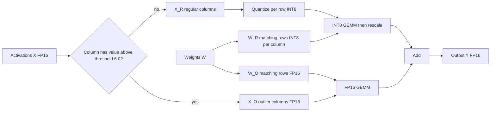
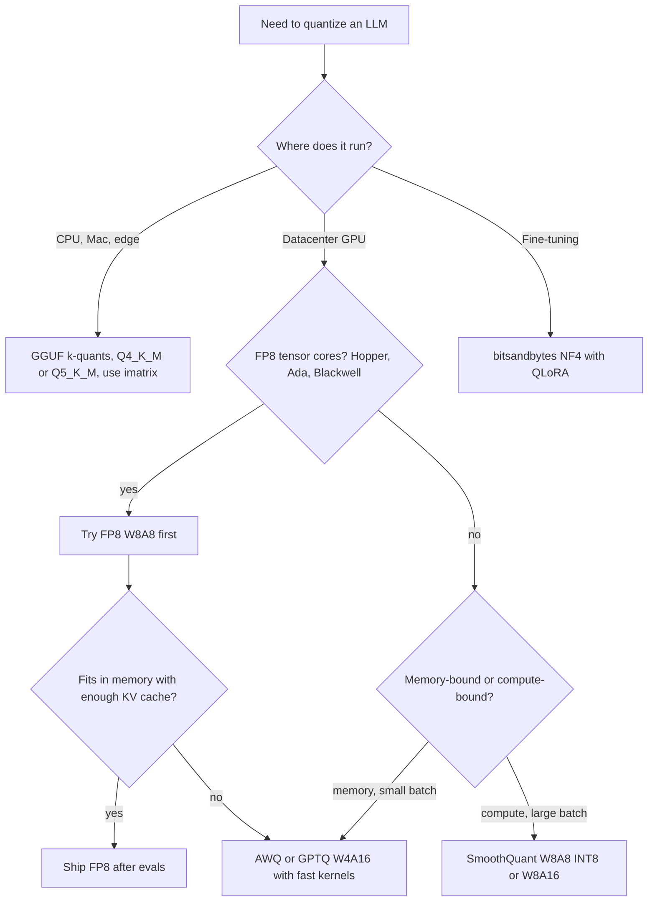

# Practical LLM Quantization: Outliers, LLM.int8(), SmoothQuant, GPTQ, AWQ, GGUF and FP8

> **Level:** Beginner to Advanced · **Study time:** ~120 min · **Prerequisites:** [Number Formats and Model Memory](01-number-formats-and-model-memory.md), [Quantization Fundamentals: Scale and Zero Point](02-quantization-fundamentals-scale-and-zero-point.md), [PTQ vs QAT and Calibration](03-ptq-vs-qat-and-calibration.md), [GPU Fundamentals: Compute-Bound vs Memory-Bound](../06-llm-inference/03-gpu-fundamentals-compute-bound-vs-memory-bound.md)

## Table of contents

- [Why this matters](#why-this-matters)
- [Quick recap: the quantization toolkit](#quick-recap-the-quantization-toolkit)
- [Why LLMs are harder to quantize: outlier features](#why-llms-are-harder-to-quantize-outlier-features)
- [LLM.int8(): mixed-precision decomposition](#llmint8-mixed-precision-decomposition)
- [SmoothQuant: moving the difficulty from activations to weights](#smoothquant-moving-the-difficulty-from-activations-to-weights)
- [GPTQ: second-order error compensation](#gptq-second-order-error-compensation)
- [AWQ: protecting salient weights with activation-aware scaling](#awq-protecting-salient-weights-with-activation-aware-scaling)
- [bitsandbytes NF4 and INT8 in Hugging Face](#bitsandbytes-nf4-and-int8-in-hugging-face)
- [GGUF and llama.cpp k-quants for CPU and edge](#gguf-and-llamacpp-k-quants-for-cpu-and-edge)
- [FP8 inference on modern GPUs](#fp8-inference-on-modern-gpus)
- [Putting it together: method comparison](#putting-it-together-method-comparison)
- [Choosing between 4-bit and 8-bit](#choosing-between-4-bit-and-8-bit)
- [Why lower precision does not always mean faster](#why-lower-precision-does-not-always-mean-faster)
- [Verifying real inference speedups](#verifying-real-inference-speedups)
- [Going deeper: production practice and the frontier](#going-deeper-production-practice-and-the-frontier)
- [Common mistakes and misconceptions](#common-mistakes-and-misconceptions)
- [Interview questions and model answers](#interview-questions-and-model-answers)
- [Key takeaways](#key-takeaways)
- [Further reading](#further-reading)
- [Next](#next)

## Why this matters

Most open-weight LLMs deployed in production are quantized in some form (weights, KV cache, or both): a 70B model in FP16 needs about 140 GB just for weights, which does not fit on a single 80 GB GPU, while a 4-bit version does. When you download a model from Hugging Face you will see suffixes like `-AWQ`, `-GPTQ-Int4`, `-FP8` or `Q4_K_M.gguf`, and you need to know what each one means, which hardware it runs well on, and how much quality it costs. Interviewers for senior AI/ML roles love this topic because it sits at the intersection of math (rounding error, Hessians), systems (memory bandwidth, kernels) and product judgment (quality versus cost). The classic trap question is "we quantized the model to 4-bit, memory went down, but latency did not improve: why?", and answering it well separates people who have read a blog post from people who have shipped models.

## Quick recap: the quantization toolkit

The previous chapters taught the basics. Here is the minimum you need for this one.

**Quantization** maps high-precision numbers (FP16, BF16) to a small set of low-precision values (INT8, INT4, FP8). With **symmetric absmax quantization**, you pick a **scale** $s$ so the largest absolute value maps to the largest integer:

$$s = \frac{\max_i |x_i|}{q_{\max}}, \qquad q_i = \text{clamp}\left(\text{round}\left(\frac{x_i}{s}\right), -q_{\max}, q_{\max}\right), \qquad \hat{x}_i = q_i \cdot s$$

- $x_i$: an original value (a weight or an activation).
- $q_{\max}$: the largest integer we allow, 127 for INT8, 7 for INT4.
- $s$: the scale, the real-number size of one integer "step".
- $q_i$: the stored integer.
- $\hat{x}_i$: the **dequantized** value, the approximation we compute with.

The **rounding error** $|x_i - \hat{x}_i|$ is at most $s/2$ (half a step), so a bigger scale means bigger errors for every value sharing it.

**Granularity** is how many values share one scale:

| Granularity | One scale per | Typical use | Notes |
|---|---|---|---|
| Per-tensor | Whole matrix | Simple INT8 | Cheapest, most sensitive to outliers |
| Per-channel | Each output channel (one row of PyTorch's out × in weight matrix) | INT8 weights | Standard for weights |
| Per-token | Each row of the activation matrix | Dynamic INT8/FP8 activations | Computed on the fly at runtime |
| Per-group | Each block of, say, 128 consecutive weights | 4-bit weights (GPTQ, AWQ) | More scales stored, much better accuracy |

We describe schemes with the shorthand **WxAy**: weights in x bits, activations in y bits. **W4A16** means 4-bit weights, 16-bit activations (**weight-only quantization**: weights are stored small but dequantized to FP16 before the multiply). **W8A8** means both weights and activations are 8-bit, so the matrix multiply itself runs on INT8 or FP8 hardware units (**weight-activation quantization**). Those units are **tensor cores**, the GPU's dedicated matrix-multiply circuits, which run lower-precision math at higher throughput.

**Two inference phases, two bottlenecks.** **Prefill** runs the whole prompt through the model in one pass, doing a lot of math per weight read, so it is usually **compute-bound** (limited by arithmetic speed). **Decode** then generates one token per step, re-reading every weight each step, so at small batch sizes it is **memory-bound** (limited by how fast bytes move from GPU memory). Which phase dominates decides whether a quantization scheme saves time; see [Prefill, Decode and Latency Metrics](../06-llm-inference/01-inference-fundamentals-prefill-decode-and-latency-metrics.md).

**Calibration data** is a small set of representative inputs (often a few hundred text samples) that you run through the model to observe activation ranges or to guide a quantization algorithm. **Post-training quantization (PTQ)** quantizes a trained model without retraining, and everything in this chapter is PTQ. See [PTQ vs QAT](03-ptq-vs-qat-and-calibration.md) for the alternative.

## Why LLMs are harder to quantize: outlier features

### The intuition

> **Analogy:** Imagine one ruler that must measure both ants and a giraffe. If the ruler has only 255 tick marks spread from 0 to 6 meters, every ant measures as "zero". One huge value forces a coarse ruler on everyone else.

That is exactly what a shared scale does. The scale is set by the largest absolute value, so a single huge number makes the step size large and destroys the precision of all the normal values sharing that scale.

### What the research found

In "LLM.int8(): 8-bit Matrix Multiplication for Transformers at Scale" (Dettmers, Lewis, Belkada and Zettlemoyer, 2022), the authors studied transformer activations, meaning the hidden-state vectors flowing into each linear layer. They found **emergent outlier features**: a handful of fixed **hidden dimensions** (feature positions in the vector) hold values far larger than the rest, often by an order of magnitude or more.

Key properties, as described in that paper and follow-up work:

- **They are systematic, not random.** The same few hidden dimensions are large across most tokens and most layers.
- **They emerge with scale.** In the paper's analysis of models up to 13B parameters, the outliers shift from sporadic to systematic around the 6.7B scale, which coincides with naive 8-bit quantization of activations starting to fail.
- **They matter.** Zeroing out these few dimensions badly hurts model quality, so you cannot just clip them.
- **They live in activations, not (mostly) in weights.** Weight values are roughly bell-shaped and well behaved.

Later work offered explanations, for example "Quantizable Transformers: Removing Outliers by Helping Attention Heads Do Nothing" (Bondarenko, Nagel and Blankevoort, 2023), which links outliers to attention heads learning to "not update" the residual stream (the running hidden-state vector each layer adds its output to), and "Massive Activations in Large Language Models" (Sun et al., 2024). You do not need to know the cause in an interview, but knowing that outliers are structured (fixed channels) is important, because every method below exploits that structure.

### A tiny numeric example

Take one token's activation vector with 4 hidden dimensions, where dimension 4 is an outlier:

$$x = [0.5,\ -1.2,\ 0.8,\ 60]$$

**With the outlier (INT8, per-tensor absmax):**

- $s = 60 / 127 = 0.4724$
- $0.5 / 0.4724 = 1.058 \rightarrow 1 \rightarrow 1 \times 0.4724 = 0.472$ (error 0.028, about 6%)
- $-1.2 / 0.4724 = -2.54 \rightarrow -3 \rightarrow -1.417$ (error 0.217, about 18%)
- $0.8 / 0.4724 = 1.693 \rightarrow 2 \rightarrow 0.945$ (error 0.145, about 18%)
- $60 / 0.4724 = 127 \rightarrow 127 \rightarrow 60.0$ (exact)

The normal values now use only integers 1, -3 and 2 out of the 255 available levels. Most of the INT8 range is wasted on empty space between 3 and 127.

**Without the outlier:**

- $s = 1.2 / 127 = 0.009449$
- $0.5 \rightarrow 52.92 \rightarrow 53 \rightarrow 0.5008$ (error 0.0008)
- $-1.2 \rightarrow -127 \rightarrow -1.2$ (exact)
- $0.8 \rightarrow 84.67 \rightarrow 85 \rightarrow 0.8031$ (error 0.0031)

The step size shrank 50x, so errors drop by roughly 35 to 50 times (and $-1.2$ becomes exact). One outlier made 8 bits behave like 2 or 3 bits for everyone else.

### Why not just use a separate scale per hidden dimension?

This is the key systems question, and it explains SmoothQuant later. A linear layer computes $Y = XW$, where $X$ is (tokens × in-features) and $W$ is (in-features × out-features):

$$Y_{ik} = \sum_{j} X_{ij} W_{jk}$$

- $i$: token index (row of $X$).
- $j$: input feature (hidden dimension, also called **input channel**; this chapter uses the three terms interchangeably), the index we sum over.
- $k$: output feature.

Suppose we quantize $X$ with a per-token scale $a_i$ and $W$ with a per-output-channel scale $b_k$, so $X_{ij} \approx a_i \tilde{X}_{ij}$ and $W_{jk} \approx b_k \tilde{W}_{jk}$, where tilde means "stored integer":

$$Y_{ik} \approx a_i\, b_k \sum_j \tilde{X}_{ij} \tilde{W}_{jk}$$

Both scales sit **outside** the sum, so the hardware does a pure integer matrix multiply (fast INT8 tensor cores) and applies one multiplication by $a_i b_k$ at the end. Now try a per-input-feature scale $c_j$ for activations (the natural fix for outliers, since outliers live in specific $j$):

$$Y_{ik} \approx b_k \sum_j c_j\, \tilde{X}_{ij} \tilde{W}_{jk}$$

Now $c_j$ is **inside** the sum. You can no longer use a plain integer GEMM (**GEMM** = general matrix multiply, the core kernel of every linear layer). That is why outliers are so painful: the dimension where they live is exactly the dimension where scales are inconvenient.

### Weights versus activations

| | Weights | Activations |
|---|---|---|
| Known when? | Offline, fixed after training | Only at runtime, change per input |
| Distribution | Roughly bell-shaped, few outliers | Systematic outlier channels |
| Can use slow, careful algorithms? | Yes (minutes to hours, once) | No, must be fast per request |
| Convenient scale granularity | Per output channel or group | Per token or per tensor |

This table explains the two families of LLM quantization:

1. **Weight-only (W4A16, W8A16):** quantize only the easy part, the weights. Avoids the activation outlier problem entirely. GPTQ, AWQ, NF4 and GGUF k-quants live here. Saves memory and helps memory-bound decoding.
2. **Weight-activation (W8A8 INT8 or FP8):** quantize both, so the matrix multiply runs in low precision. Must deal with outliers. LLM.int8(), SmoothQuant and FP8 live here. Helps compute-bound workloads.

> **Senior insight:** "Which family?" is mostly a question about whether your workload is memory-bound or compute-bound. We return to this in [Why lower precision does not always mean faster](#why-lower-precision-does-not-always-mean-faster).

## LLM.int8(): mixed-precision decomposition

### Intuition

> **Analogy:** A post office sorts 999 normal letters by machine and hand-carries the one oversized parcel. You do not slow down the machine for the parcel, and you do not jam the parcel into the machine.

LLM.int8() (Dettmers et al., 2022) splits each matrix multiply into two parts: the few outlier hidden dimensions are multiplied in FP16, and everything else is multiplied in INT8. The two results are added.

### The algorithm

1. **Find outlier columns of $X$:** any hidden dimension $j$ where some value has $|X_{ij}| \geq \tau$, with threshold $\tau = 6.0$ by default.
2. **Split** $X$ into outlier columns $X_O$ and regular columns $X_R$, and split the matching **rows** of $W$ into $W_O$ and $W_R$.
3. **Regular part:** quantize $X_R$ per row (per token) and $W_R$ per column (per output channel) to INT8, do an INT8 GEMM, rescale. The paper calls this **vector-wise quantization**.
4. **Outlier part:** compute $X_O W_O$ in FP16.
5. **Add:** $Y = X_R W_R + X_O W_O$.

$$XW = \underbrace{X_R W_R}_{\text{INT8, about } 99.9\% \text{ of values}} + \underbrace{X_O W_O}_{\text{FP16, a few dimensions}}$$

The paper reports that more than 99.9% of values are still multiplied in 8-bit while matching FP16 quality on models up to 175B parameters.



### Worked example

Two tokens, three hidden dimensions, where dimension 3 is an outlier (values 40 and 35 exceed 6.0):

$$X = \begin{bmatrix} 1 & 2 & 40 \\ -1 & 0.5 & 35 \end{bmatrix}, \qquad W = \begin{bmatrix} 1 & 0 \\ 0 & 1 \\ 0.5 & -0.5 \end{bmatrix}$$

Full product, row 1: $[1 \cdot 1 + 2 \cdot 0 + 40 \cdot 0.5,\ 1 \cdot 0 + 2 \cdot 1 + 40 \cdot (-0.5)] = [21, -18]$. Row 2: $[-1 + 17.5,\ 0.5 - 17.5] = [16.5, -17]$.

Decomposed:

- Outlier part (column 3 of $X$ times row 3 of $W$): row 1 $= 40 \times [0.5, -0.5] = [20, -20]$; row 2 $= 35 \times [0.5, -0.5] = [17.5, -17.5]$.
- Regular part (columns 1-2 of $X$ times rows 1-2 of $W$, which is the identity here): row 1 $= [1, 2]$; row 2 $= [-1, 0.5]$.
- Sum: $[21, -18]$ and $[16.5, -17]$. Identical.

The regular part now has absmax 2 (row 1) and 1 (row 2) instead of 40 and 35, so INT8 quantizes it precisely.

### From-scratch NumPy version

```python
# pip install numpy
import numpy as np

def absmax_int8(x, axis):
    """Symmetric INT8 quantization along an axis. Returns int8 values and scales."""
    scale = np.abs(x).max(axis=axis, keepdims=True) / 127.0
    scale = np.where(scale == 0, 1.0, scale)          # avoid divide by zero
    q = np.clip(np.round(x / scale), -127, 127).astype(np.int8)
    return q, scale

def llm_int8_matmul(X, W, threshold=6.0):
    outlier_cols = np.any(np.abs(X) >= threshold, axis=0)   # hidden dims with outliers
    XR, WR = X[:, ~outlier_cols], W[~outlier_cols, :]
    XO, WO = X[:, outlier_cols], W[outlier_cols, :]

    qx, sx = absmax_int8(XR, axis=1)   # per-token (row) scale
    qw, sw = absmax_int8(WR, axis=0)   # per-output-channel (column) scale
    # Integer GEMM with int32 accumulation, then one rescale: scales are outside the sum
    y_regular = (qx.astype(np.int32) @ qw.astype(np.int32)) * sx * sw
    y_outlier = XO @ WO                 # stays in high precision
    return y_regular + y_outlier

rng = np.random.default_rng(0)
X = rng.normal(size=(4, 16)).astype(np.float32)
X[:, 5] *= 40                            # one systematic outlier dimension
W = rng.normal(scale=0.1, size=(16, 8)).astype(np.float32)

ref = X @ W
qx, sx = absmax_int8(X, axis=1)          # naive: quantize everything to INT8
qw, sw = absmax_int8(W, axis=0)
naive = (qx.astype(np.int32) @ qw.astype(np.int32)) * sx * sw
print("naive INT8 max error:   ", np.abs(naive - ref).max())
print("LLM.int8() max error:   ", np.abs(llm_int8_matmul(X, W) - ref).max())
# Expect the LLM.int8() error to be clearly smaller.
```

### In practice

In Hugging Face, LLM.int8() is what you get with `BitsAndBytesConfig(load_in_8bit=True)` (shown in the [bitsandbytes section](#bitsandbytes-nf4-and-int8-in-hugging-face)). Its main win is **memory**: weights take about half the FP16 size. It is **not** primarily a speed technique. Finding outliers, gathering columns and running two GEMMs adds overhead, and in many setups (especially small batches) it runs slower than plain FP16. The bitsandbytes implementation has improved over the years, but treat LLM.int8() as "fit a bigger model with near-FP16 quality", not "go faster".

> **Interview tip:** If asked "how do outliers affect quantization?", LLM.int8() is the cleanest illustration: the authors showed naive INT8 breaks down around the scale where systematic outliers emerge, and fixed it by keeping exactly those dimensions in FP16.

## SmoothQuant: moving the difficulty from activations to weights

### Intuition

> **Analogy:** Two friends carry a couch. One is holding the heavy end and struggling, the other is barely lifting. Slide the couch so they share the weight evenly. Total weight is unchanged, but nobody drops it.

SmoothQuant ("SmoothQuant: Accurate and Efficient Post-Training Quantization for Large Language Models", Xiao, Lin, Seznec, Wu, Demouth and Han, 2022) observes that activations are hard to quantize (outliers) while weights are easy (flat). It mathematically moves part of the activation's range into the weights, so that **both** become moderately easy. This enables true W8A8 INT8 inference with ordinary INT8 GEMM kernels, which gives real speedups, not just memory savings.

### The math

For any positive vector $s$ (one value per input feature $j$), this identity holds exactly:

$$Y = XW = \left(X\, \text{diag}(s)^{-1}\right)\left(\text{diag}(s)\, W\right) = \hat{X}\hat{W}$$

- $\text{diag}(s)$: a diagonal matrix with $s_j$ on the diagonal.
- $\hat{X} = X\,\text{diag}(s)^{-1}$: column $j$ of the activations is **divided** by $s_j$.
- $\hat{W} = \text{diag}(s)\,W$: row $j$ of the weights is **multiplied** by $s_j$.

Dividing an outlier column by a large $s_j$ shrinks it, and the weight row absorbs the factor. SmoothQuant chooses:

$$s_j = \frac{\max(|X_j|)^{\alpha}}{\max(|W_j|)^{1-\alpha}}$$

- $\max(|X_j|)$: the largest absolute activation in input feature $j$, measured on calibration data.
- $\max(|W_j|)$: the largest absolute weight in row $j$ of $W$ (the weights that multiply feature $j$).
- $\alpha$: the **migration strength**, between 0 and 1. $\alpha = 0.5$ splits the difficulty evenly. Models with stronger outliers may need a larger $\alpha$ (the paper used higher values for some models).

Crucially, $\text{diag}(s)^{-1}$ does not cost anything at runtime: it is **folded** offline into the previous operation (the LayerNorm's learned per-feature multiplier $\gamma$, or the previous linear layer's weights), so $\hat{X}$ comes out of the previous layer already smoothed.

### Worked example

Two input features. Feature 1 is normal, feature 2 is an outlier:

- Feature 1: $\max|X_1| = 1$, $\max|W_1| = 1$
- Feature 2: $\max|X_2| = 64$, $\max|W_2| = 0.25$

With $\alpha = 0.5$:

- $s_1 = \sqrt{1} / \sqrt{1} = 1$ (unchanged)
- $s_2 = \sqrt{64} / \sqrt{0.25} = 8 / 0.5 = 16$

After smoothing:

- Activations, feature 2: $64 / 16 = 4$
- Weights, row 2: $0.25 \times 16 = 4$

Before, the activation range across features was 1 to 64 (a 64x spread that ruins a per-token scale). After, it is 1 to 4. The weights went from 0.25 to 4 in row 2, so the weight row maxima are now 1 and 4 instead of 1 and 0.25: still only a 4x spread, which an INT8 per-output-channel scale handles easily (a per-output-channel scale spans all input rows, so it does not isolate row 2; it just has to cover a modest range). With $\alpha = 0.5$, both maxima become $\sqrt{64 \times 0.25} = 4$: the difficulty is shared exactly.

### Code: verifying the identity

```python
import numpy as np

rng = np.random.default_rng(0)
X = rng.normal(size=(8, 4))
X[:, 1] *= 50                                 # outlier feature
W = rng.normal(scale=0.2, size=(4, 3))

alpha = 0.5
s = np.abs(X).max(axis=0) ** alpha / np.abs(W).max(axis=1) ** (1 - alpha)

X_s = X / s               # in a real model this division is folded into the LayerNorm
W_s = W * s[:, None]      # scale row j of W by s_j, done once offline

print(np.allclose(X @ W, X_s @ W_s))          # True: math is unchanged
print("activation per-feature max before:", np.abs(X).max(axis=0).round(2))
print("activation per-feature max after: ", np.abs(X_s).max(axis=0).round(2))
```

### Where SmoothQuant fits

- **Output:** W8A8 INT8 with per-tensor or per-token activation scales, running on INT8 tensor cores. The paper reports up to about 1.56x speedup and 2x memory reduction with negligible accuracy loss on the models it tested. Your speedup will depend on hardware, batch size and kernels.
- **Best for:** compute-heavy serving (large batches, long prompts) on GPUs with fast INT8 but no FP8 (for example NVIDIA A100).
- **Limits:** it only smooths the inputs of linear layers that follow a foldable operation, and it does not help 4-bit activations much. On FP8-capable GPUs, FP8 W8A8 is often simpler (see [FP8](#fp8-inference-on-modern-gpus)). The same "scale channels to balance difficulty" idea reappears inside AWQ.

## GPTQ: second-order error compensation

### Intuition

> **Analogy:** You are splitting a restaurant bill among friends and must round each share to whole dollars. If you round Alice's share down by 40 cents, you do not just shrug: you nudge the not-yet-rounded shares of the others up a bit so the total still comes out right. GPTQ does this with weights, and it uses calibration data to know which other weights can best absorb the error.

Plain **round-to-nearest (RTN)** quantizes each weight independently. Each rounding error is small, but thousands of them add up in the layer output. GPTQ ("GPTQ: Accurate Post-Training Quantization for Generative Pre-trained Transformers", Frantar, Ashkboos, Hoefler and Alistarh, 2022) quantizes weights **one column at a time** and after each step **updates the remaining unquantized weights** to cancel the error introduced so far. The update uses **second-order** information (second derivatives, the curvature of the error): how the layer's inputs correlate, captured in a matrix called the Hessian.

### The objective: layer-wise reconstruction

GPTQ does not look at the final model loss. It solves an easier problem independently for each linear layer: make the quantized layer produce the same outputs as the original on calibration inputs.

PyTorch stores a linear layer's weight as $W$ with shape (out-features × in-features) and computes $XW^\top$. With calibration inputs $X$ of shape (samples × in-features):

$$\hat{W} = \arg\min_{\hat{W}} \left\lVert X W^\top - X \hat{W}^\top \right\rVert_F^2$$

- $W$: original weights. $\hat{W}$: quantized weights (each entry must lie on the quantization grid).
- $X$: calibration activations entering this layer (collected by running a few hundred text samples through the model).
- $\lVert \cdot \rVert_F^2$: the sum of squared entries (squared reconstruction error).

Each output row $w$ (one neuron) can be solved independently. Writing $d = w - \hat{w}$ for that row's error, the loss is:

$$L(d) = d\, X^\top X\, d^\top = \tfrac{1}{2}\, d\, H\, d^\top, \qquad H = 2 X^\top X$$

$H$ is the **Hessian** of this loss: a square (in-features × in-features) matrix of second derivatives. Intuitively, entry $H_{jj}$ says how sensitive the output is to errors in input feature $j$ (large if feature $j$ has large activations), and off-diagonal $H_{jk}$ says whether errors in features $j$ and $k$ can cancel each other (they can if those inputs are correlated). Note that $H$ is the same for every row, because it depends only on $X$.

### The lineage: OBD, OBS, OBQ, GPTQ

- **Optimal Brain Damage** (LeCun, Denker and Solla, 1990) used second-order information (the diagonal of the Hessian) to decide which weights to **prune** with least harm.
- **Optimal Brain Surgeon** (Hassibi and Stork, 1993) used the full inverse Hessian: when you remove weight $q$, it gives the optimal update to **all other weights** to compensate.
- **Optimal Brain Quantization (OBQ)**, from "Optimal Brain Compression" (Frantar, Singh and Alistarh, 2022), realized that quantizing a weight is like "pruning" it to a grid value instead of zero, and applied the OBS update greedily, one weight at a time, always picking the weight that adds least error. Accurate, but far too slow for billion-parameter models.
- **GPTQ** (2022) made it fast enough for 175B-parameter models (the paper reports about four GPU hours) with three changes, below.

The OBS/OBQ update when quantizing weight $q$ (with $F$ the set of not-yet-quantized weights):

$$\delta_F = -\frac{w_q - \text{quant}(w_q)}{[H_F^{-1}]_{qq}} \cdot (H_F^{-1})_{:,q}, \qquad \Delta L = \frac{\left(w_q - \text{quant}(w_q)\right)^2}{2\,[H_F^{-1}]_{qq}}$$

- $w_q$: the weight being quantized; $\text{quant}(w_q)$: its nearest grid value.
- $H_F^{-1}$: the inverse Hessian restricted to the remaining weights $F$.
- $[H_F^{-1}]_{qq}$: its diagonal entry for $q$.
- $(H_F^{-1})_{:,q}$: its column for $q$, which says how to spread the correction across the other weights.
- $\delta_F$: the update added to the remaining weights.
- $\Delta L$: the increase in loss after the optimal compensation.

After quantizing $q$, it is removed from $F$, and the inverse Hessian is updated by one step of Gaussian elimination: $H^{-1} \leftarrow H^{-1} - \frac{1}{[H^{-1}]_{qq}} H^{-1}_{:,q} H^{-1}_{q,:}$.

### Worked example by hand

One output row with two weights $w = [0.7, 0.2]$. The grid has step 0.5 (allowed values ..., 0, 0.5, 1.0, ...). The calibration inputs are positively correlated:

$$X^\top X = \begin{bmatrix} 1 & 0.5 \\ 0.5 & 1 \end{bmatrix}, \quad H = \begin{bmatrix} 2 & 1 \\ 1 & 2 \end{bmatrix}, \quad H^{-1} = \frac{1}{3}\begin{bmatrix} 2 & -1 \\ -1 & 2 \end{bmatrix} = \begin{bmatrix} 0.667 & -0.333 \\ -0.333 & 0.667 \end{bmatrix}$$

Loss for an error vector $d = [d_1, d_2]$: $L = d_1^2 + 2(0.5)d_1 d_2 + d_2^2 = d_1^2 + d_1 d_2 + d_2^2$.

**Round-to-nearest:** $0.7 \rightarrow 0.5$, $0.2 \rightarrow 0$ (since $0.2/0.5 = 0.4$ rounds to 0). Error $d = [0.2, 0.2]$.
$L = 0.04 + 0.04 + 0.04 = 0.12$.

**GPTQ:**

1. Quantize $w_1$: $0.7 \rightarrow 0.5$, error $e = 0.7 - 0.5 = 0.2$.
2. Update $w_2$: $\delta_2 = -\frac{0.2}{0.667} \times (-0.333) = -0.3 \times (-0.333) = +0.1$. So $w_2 = 0.2 + 0.1 = 0.3$.
   Predicted loss so far: $\Delta L = 0.2^2 / (2 \times 0.667) = 0.04 / 1.333 = 0.03$. Check directly: $d = [0.2, -0.1]$, $L = 0.04 - 0.02 + 0.01 = 0.03$. Correct.
3. Quantize the updated $w_2 = 0.3$: $0.3 / 0.5 = 0.6 \rightarrow 1 \rightarrow 0.5$.
4. Final $\hat{w} = [0.5, 0.5]$, error $d = [0.7 - 0.5, 0.2 - 0.5] = [0.2, -0.3]$.
   $L = 0.04 + (0.2)(-0.3) + 0.09 = 0.04 - 0.06 + 0.09 = 0.07$.

GPTQ's loss is 0.07 versus 0.12 for RTN, about 42% lower. Why? The inputs are positively correlated, so rounding $w_1$ **down** can be partly cancelled by rounding $w_2$ **up**. RTN rounded both down and the errors stacked. Notice that GPTQ rounded $0.2$ to $0.5$, which looks "wrong" in isolation but is right for the layer output. That is the whole idea.

### GPTQ's three speedups over OBQ

1. **Fixed column order for all rows.** OBQ picks a different greedy order per row, so every row needs its own inverse Hessian updates. GPTQ found that quantizing columns in a fixed order (left to right) works almost as well for large layers. Since $H$ depends only on $X$, all rows share the same sequence of inverse Hessian updates, removing a huge amount of repeated work.
2. **Lazy batch updates.** Updating the entire remaining matrix after every single column is memory-bandwidth-bound and slow on GPUs. GPTQ processes blocks of columns (for example 128), applies updates within the block immediately, and applies the accumulated update to the rest of the matrix once per block.
3. **Cholesky reformulation and dampening.** Repeated inverse updates accumulate numerical errors in large models. GPTQ precomputes the needed rows of $H^{-1}$ with a Cholesky decomposition (a numerically stable way to factor a symmetric positive-definite matrix) and adds a small **dampening** term $\lambda I$ to $H$ (commonly about 1% of the mean diagonal) so it is safely invertible.

Two common options you will see in configs:

- **`group_size`** (for example 128): each group of 128 input columns gets its own scale, computed when GPTQ reaches that group. Better accuracy, tiny memory overhead.
- **`desc_act` / act-order:** quantize columns in order of decreasing $H_{jj}$ (most important inputs first, while there are still many weights left to absorb their error). Often improves accuracy. Historically, combining it with grouping made some inference kernels slower because groups no longer line up with memory order, so check your serving engine's support.

### From-scratch GPTQ in PyTorch (simplified, no blocking)

```python
# pip install torch
import torch

def quant(x, scale, qmin=-8, qmax=7):
    """Symmetric INT4 round-to-nearest with a given scale."""
    return torch.clamp(torch.round(x / scale), qmin, qmax) * scale

def gptq_quantize(W, X, damp=0.01):
    """W: (out, in) weights. X: (n_samples, in) calibration inputs to this layer."""
    W = W.clone().float()
    n_in = W.shape[1]
    H = 2 * X.T @ X                                          # (in, in), shared by all rows
    H += damp * H.diag().mean() * torch.eye(n_in)            # dampening for stability
    Hinv = torch.linalg.inv(H)
    scale = W.abs().amax(dim=1, keepdim=True) / 7            # per-output-row scale
    Q = torch.zeros_like(W)
    for j in range(n_in):                                    # one column at a time
        q = quant(W[:, j:j+1], scale).squeeze(1)
        Q[:, j] = q
        err = (W[:, j] - q) / Hinv[j, j]                     # scaled error, one per row
        # OBS update: push the error onto the columns not yet quantized
        W[:, j+1:] -= err.unsqueeze(1) * Hinv[j, j+1:].unsqueeze(0)
        # Remove column j from the inverse Hessian (one Gaussian elimination step)
        Hinv -= torch.outer(Hinv[:, j], Hinv[j, :]) / Hinv[j, j]
    return Q

torch.manual_seed(0)
n, d_in, d_out = 512, 64, 32
X = torch.randn(n, 16) @ torch.randn(16, d_in)               # correlated input features
W = torch.randn(d_out, d_in) * 0.1

scale = W.abs().amax(dim=1, keepdim=True) / 7
W_rtn = quant(W, scale)
W_gptq = gptq_quantize(W, X)

def out_err(Wq):
    return ((X @ W.T - X @ Wq.T) ** 2).mean().item()

print("RTN  output MSE:", out_err(W_rtn))
print("GPTQ output MSE:", out_err(W_gptq))   # expect noticeably lower than RTN
```

Real implementations add blocking, groups, act-order and Cholesky, and run layer by layer through the whole model, feeding each layer the outputs of the already-quantized previous layers.

### Using GPTQ with libraries

GPTQ tooling changes quickly. As of 2026 the common paths are Hugging Face Transformers' `GPTQConfig` (backed by Optimum and the GPTQModel library, which superseded the older AutoGPTQ) and vLLM's `llm-compressor`. Treat the code below as conceptual and check current docs.

```python
# pip install transformers optimum gptqmodel   (package names are version-dependent)
from transformers import AutoModelForCausalLM, AutoTokenizer, GPTQConfig

model_id = "mistralai/Mistral-7B-v0.1"          # any causal LM you have access to
tok = AutoTokenizer.from_pretrained(model_id)
cfg = GPTQConfig(bits=4, group_size=128, dataset="c4", tokenizer=tok, desc_act=False)

# Runs calibration and GPTQ layer by layer (needs a GPU; takes minutes to hours)
model = AutoModelForCausalLM.from_pretrained(model_id, quantization_config=cfg, device_map="auto")
model.save_pretrained("mistral-7b-gptq-int4")
tok.save_pretrained("mistral-7b-gptq-int4")
```

```python
# pip install llmcompressor   (API is version-fragile; older releases import oneshot
# from llmcompressor.transformers)
from llmcompressor import oneshot
from llmcompressor.modifiers.quantization import GPTQModifier

recipe = GPTQModifier(targets="Linear", scheme="W4A16", ignore=["lm_head"])
oneshot(
    model="mistralai/Mistral-7B-v0.1",
    dataset="open_platypus",
    recipe=recipe,
    max_seq_length=2048,
    num_calibration_samples=512,
    output_dir="mistral-7b-W4A16-gptq",
)
# Serve with: vllm serve ./mistral-7b-W4A16-gptq
```

> **Common mistake:** Assuming every layer must be quantized, or treating unquantized layers as a bug. Leaving `lm_head` (the final output projection) and sometimes embeddings unquantized is normal and intended. They are sensitive and are a small share of a large model's parameters.

## AWQ: protecting salient weights with activation-aware scaling

### Intuition

> **Analogy:** In a company, a small number of employees handle the biggest customers. If you cut everyone's training budget equally, you hurt those few disproportionately. Better: identify them by **how much traffic they handle**, not by their job title, and protect them.

AWQ ("AWQ: Activation-aware Weight Quantization for LLM Compression and Acceleration", Lin et al., 2023, MLSys 2024 best paper) makes three observations:

1. **A small fraction of weights matters most.** Keeping only about 1% of weight channels in FP16 dramatically improves 4-bit quality.
2. **Saliency is determined by activations, not weights.** The important input channels are those that see large activation magnitudes, because their weights get multiplied by big numbers, so their quantization error is amplified in the output. Picking channels by large weight magnitude works barely better than random.
3. **Mixed precision is hardware-unfriendly.** Storing 1% of channels in FP16 complicates kernels. So instead of keeping them in FP16, AWQ **scales them up** before quantization, which gives them relatively more precision, and folds the inverse scale into the activations.

### Why scaling up a channel protects it

Write weight quantization as $Q(w) = \Delta \cdot \text{round}(w / \Delta)$, where $\Delta$ is the step size for the group. For a weight $w$ in input channel $j$ with activation $x$:

$$Q(w \cdot s) \cdot \frac{x}{s} = \Delta' \cdot \text{round}\left(\frac{w s}{\Delta'}\right) \cdot \frac{x}{s}$$

- $s > 1$: the scale applied to channel $j$'s weights (and its inverse to the activation).
- $\Delta'$: the new step size of the group after scaling.

The rounding error of $\text{round}(\cdot)$ is roughly the same (up to 0.5 steps) regardless of $s$. If scaling one channel does not change the group's maximum, then $\Delta' = \Delta$, and the output error for this channel is divided by $s$. The error ratio is roughly $\frac{\Delta'}{\Delta} \cdot \frac{1}{s}$.

But you cannot make $s$ huge: once the scaled weight becomes the largest in its group, $\Delta'$ grows and **all** other weights in the group lose precision. So AWQ searches for a good $s$.

### The search (no backpropagation)

AWQ uses a simple parameterization:

$$s = s_X^{\alpha}, \qquad \alpha^* = \arg\min_{\alpha \in [0, 1]} \left\lVert Q\!\left(W \cdot \text{diag}(s)\right)\left(\text{diag}(s)^{-1} X\right) - W X \right\rVert$$

- Notation follows the AWQ paper: here $W$ is (out × in) and $X$ is (in × samples), so the layer output is $WX$ (the GPTQ section used samples × in, which is just the transpose).
- $s_X$: average activation magnitude per input channel, measured on calibration data.
- $\alpha$: one number per layer, found by a small grid search (for example 20 values). $\alpha = 0$ means no scaling (plain RTN); larger $\alpha$ protects high-activation channels more.
- The objective is the same layer-output error as GPTQ, but AWQ only searches over scales. It does **not** update weights with Hessian-based corrections and does **not** backpropagate.

The paper also optionally searches a clipping range for the weights. Because AWQ fits only a few statistics, it tends to depend less on the exact calibration set than reconstruction-heavy methods, which the authors highlight as better generalization (for example to instruction-tuned and multimodal models).

### Worked example

INT4 symmetric with $q_{\max} = 7$. One group's largest weight is 0.70, so $\Delta = 0.70 / 7 = 0.1$. A salient channel has weight $w = 0.14$ and a large activation $x = 20$.

**Plain RTN:** $0.14 / 0.1 = 1.4 \rightarrow 1 \rightarrow 0.10$. Weight error $0.04$. Output error $0.04 \times 20 = 0.8$.

**AWQ with $s = 2$:** scaled weight $0.28$ (still below 0.70, so $\Delta$ stays 0.1). $0.28 / 0.1 = 2.8 \rightarrow 3 \rightarrow 0.30$. At runtime the activation is divided by 2 (or equivalently the weight is), so the effective weight is $0.30 / 2 = 0.15$. Weight error $0.01$. Output error $0.01 \times 20 = 0.2$.

The worst-case error bound halved, from $\Delta/2 = 0.05$ to $\Delta/(2s) = 0.025$. (Any single example can be lucky or unlucky, but on average error shrinks by about $1/s$ as long as $\Delta$ does not grow.)

### From-scratch AWQ scale search

```python
import torch

def quant_group(w, group=128, bits=4):
    """Symmetric per-group INT4 on a (out, in) weight; groups run along the input dim."""
    out_f, in_f = w.shape
    wg = w.reshape(out_f, in_f // group, group)
    qmax = 2 ** (bits - 1) - 1
    scale = wg.abs().amax(dim=-1, keepdim=True).clamp(min=1e-8) / qmax
    q = torch.clamp(torch.round(wg / scale), -qmax - 1, qmax)
    return (q * scale).reshape(out_f, in_f)

def awq_search(W, X, group=128, grid=20):
    """W: (out, in). X: (n, in) calibration activations. Returns (mse, alpha, scales)."""
    act_mag = X.abs().mean(dim=0)                    # per-input-channel activation size
    y_ref = X @ W.T
    best = (float("inf"), None, None)
    for i in range(grid + 1):
        alpha = i / grid                             # alpha = 0 is plain RTN
        s = act_mag.pow(alpha).clamp(min=1e-4)
        s = s / (s.max() * s.min()).sqrt()           # normalization used in the reference code
        W_q = quant_group(W * s, group) / s          # scale columns up, quantize, fold back
        mse = ((X @ W_q.T - y_ref) ** 2).mean().item()
        if mse < best[0]:
            best = (mse, alpha, s)
    return best

torch.manual_seed(0)
d_in, d_out, n = 512, 256, 1024
X = torch.randn(n, d_in)
salient = torch.randperm(d_in)[: d_in // 100]        # about 1% of channels
X[:, salient] *= 20                                  # large activations in those channels
W = torch.randn(d_out, d_in) * 0.05

rtn_mse = ((X @ quant_group(W).T - X @ W.T) ** 2).mean().item()
awq_mse, alpha, _ = awq_search(W, X)
print(f"RTN mse {rtn_mse:.5f} | AWQ mse {awq_mse:.5f} at alpha={alpha}")
# AWQ can never be worse than RTN here, because alpha=0 reproduces RTN exactly.
```

### Using AWQ in practice

AWQ checkpoints are W4A16 with group size 128 and are widely supported for serving (vLLM, SGLang, TGI, TensorRT-LLM; see [serving frameworks](../06-llm-inference/06-serving-frameworks-vllm-sglang-tgi-tensorrt-llm-and-ollama.md)). Tooling is version-dependent: the original AutoAWQ package was deprecated in favor of newer toolkits such as llm-compressor, which offers an `AWQModifier` with a recipe similar to the GPTQ one above. To serve a pre-quantized model:

```bash
# vLLM usually auto-detects the method from the checkpoint's quantization config
vllm serve Qwen/Qwen2.5-7B-Instruct-AWQ --max-model-len 8192
```

### GPTQ vs AWQ at a glance

| | GPTQ | AWQ |
|---|---|---|
| Core idea | Quantize column by column, compensate error in remaining weights using inverse Hessian | Scale up salient input channels (by activation magnitude) before quantizing |
| Uses calibration data for | Hessian $H = 2X^\top X$ | Per-channel activation magnitudes, scale search |
| Changes weight values beyond rounding? | Yes, unquantized weights are adjusted | Only per-channel rescaling (folded back exactly), plus an optional clipping search |
| Backpropagation? | No | No |
| Typical format | W4A16 (also 3 and 8 bit), group 128 | W4A16, group 128 |
| Quantization time | Longer (Hessians, sequential columns) | Generally faster (grid search only) |
| Calibration overfitting risk | Higher in principle (fits reconstruction) | Lower in principle (fits few statistics) |
| Quality at 4-bit | Usually close to AWQ; depends on model and settings | Usually close to GPTQ; depends on model and settings |
| Can be combined? | Yes: AWQ-style scaling followed by GPTQ rounding is used in some toolkits | Yes |

> **Senior insight:** In practice the quality gap between well-tuned GPTQ and AWQ at 4-bit is usually small and model-dependent. The deciding factors are often **kernel support in your serving engine**, availability of a trusted pre-quantized checkpoint, and quantization time. Always evaluate on your own tasks.

## bitsandbytes NF4 and INT8 in Hugging Face

**bitsandbytes** is a library that quantizes weights **on the fly at load time**: no calibration, no separate quantization step. It provides two modes in Hugging Face Transformers.

**INT8 (LLM.int8()):** the mixed-precision decomposition described earlier.

**4-bit NF4:** introduced in "QLoRA: Efficient Finetuning of Quantized LLMs" (Dettmers, Pagnoni, Holtzman and Zettlemoyer, 2023). **NF4 (4-bit NormalFloat)** is a 4-bit data type whose 16 levels are not evenly spaced. They are placed at quantiles of a normal distribution, so more levels sit near zero where most weights are. Since pretrained weights are roughly normally distributed, each level gets used about equally often, which the paper argues is information-theoretically optimal for normal data. Other details:

- **Blockwise scales:** one absmax scale per block of 64 weights.
- **Double quantization:** the scales themselves are quantized to 8-bit (in blocks of 256 scales), saving memory.
- **Compute dtype:** weights are dequantized to BF16 or FP16 for the matmul. It is weight-only (W4A16 in spirit).

Worked example of double quantization's saving: an FP32 scale per 64 weights costs $32 / 64 = 0.5$ bits per weight. With 8-bit scales plus one FP32 second-level scale per 256 blocks: $8/64 + 32/(64 \times 256) = 0.125 + 0.00195 \approx 0.127$ bits per weight. That saves about 0.37 bits per parameter, which matches the QLoRA paper's reported figure. For a 70B model that is about $70 \times 10^9 \times 0.373 / 8 \approx 3.3$ GB.

```python
# pip install transformers accelerate bitsandbytes
import torch
from transformers import AutoModelForCausalLM, AutoTokenizer, BitsAndBytesConfig

model_id = "mistralai/Mistral-7B-v0.1"

nf4 = BitsAndBytesConfig(
    load_in_4bit=True,
    bnb_4bit_quant_type="nf4",            # or "fp4"
    bnb_4bit_use_double_quant=True,       # quantize the scales too
    bnb_4bit_compute_dtype=torch.bfloat16,
)
int8 = BitsAndBytesConfig(load_in_8bit=True, llm_int8_threshold=6.0)  # LLM.int8()

model = AutoModelForCausalLM.from_pretrained(model_id, quantization_config=nf4, device_map="auto")
print(f"{model.get_memory_footprint() / 1e9:.2f} GB")   # roughly a quarter of FP16 plus overhead
```

When to use bitsandbytes:

- **Yes:** QLoRA fine-tuning (the base model is frozen in NF4 while LoRA adapters train in BF16; see [Fine-Tuning: LoRA and QLoRA](../05-llms/07-fine-tuning-full-lora-and-qlora.md)), quick experiments, fitting a model on a small GPU for evaluation.
- **Usually not:** high-throughput production serving. Its kernels are generally not as fast as the specialized GPTQ/AWQ/FP8 kernels in dedicated serving engines. Many teams fine-tune with QLoRA, merge the adapter into a BF16 model, then re-quantize with AWQ, GPTQ or FP8 for serving.

## GGUF and llama.cpp k-quants for CPU and edge

**llama.cpp** is a C/C++ inference engine designed to run LLMs on CPUs, Apple Silicon (Metal), consumer GPUs and edge devices. **GGUF** is its file format (introduced in 2023, replacing the older GGML format): a single file that contains the quantized tensors **and** the metadata needed to run them (architecture, tokenizer, special tokens, chat template). Tools like Ollama and LM Studio build on llama.cpp and GGUF.

### Simple block quants

The basic types quantize blocks of 32 weights with one FP16 scale:

- **Q8_0:** 32 weights × 8 bits + one 16-bit scale $= 256 + 16 = 272$ bits, so $272 / 32 = 8.5$ bits per weight.
- **Q4_0:** 32 × 4 + 16 $= 144$ bits, so $144 / 32 = 4.5$ bits per weight.

This is why "4-bit" files are always somewhat larger than $\text{params} \times 0.5$ bytes: the scales cost real bits.

### k-quants

**k-quants** (names like Q4_K, Q5_K, Q6_K) use a two-level structure: a **super-block** of 256 weights is split into sub-blocks, each with its own scale (and minimum, for asymmetric types). The sub-block scales are themselves quantized, with one FP16 scale for the super-block. For example, Q4_K uses 8 sub-blocks of 32 weights with 6-bit scales and mins:

$$\frac{256 \times 4 + 8 \times (6 + 6) + 2 \times 16}{256} = \frac{1024 + 96 + 32}{256} = \frac{1152}{256} = 4.5 \text{ bits per weight}$$

The **suffix** describes a mix: in **Q4_K_M** ("medium"), most tensors use Q4_K, but some sensitive ones (for example parts of the attention value projection and the FFN down projection) use a higher-precision type such as Q6_K. **_S** (small) uses fewer upgrades, **_L** more. So "Q4_K_M" averages somewhat more than 4.5 bits per weight.

Further options:

- **Importance matrix (imatrix):** a calibration pass that records which weights see large activations (an AWQ-like idea) and weights the quantization error accordingly. It matters most for low-bit types.
- **I-quants** (names like IQ2_XXS, IQ3_S, IQ4_XS): newer types using lattice/codebook ideas for very low bit rates, generally used with an imatrix.

```bash
# Version-fragile: binary and script names have changed over time (for example quantize -> llama-quantize)
python convert_hf_to_gguf.py ./Mistral-7B-v0.1 --outfile mistral-7b-f16.gguf --outtype f16
./llama-imatrix -m mistral-7b-f16.gguf -f calibration.txt -o imatrix.dat      # optional
./llama-quantize --imatrix imatrix.dat mistral-7b-f16.gguf mistral-7b-Q4_K_M.gguf Q4_K_M
./llama-bench -m mistral-7b-Q4_K_M.gguf                                      # prompt and generation speed
```

Why GGUF for CPU and edge: on CPUs and laptops, generation speed is limited almost entirely by **memory bandwidth** (bytes of weights read per token), and llama.cpp has hand-tuned dequantize-and-dot-product kernels for each format on each architecture (AVX2, AVX-512, ARM NEON, Metal). Fewer bits per weight translates fairly directly into more tokens per second. On a datacenter GPU serving many users, you would usually choose vLLM or similar with AWQ, GPTQ or FP8 instead.

## FP8 inference on modern GPUs

**FP8** is an 8-bit floating-point format (covered in [Number Formats](01-number-formats-and-model-memory.md)). Two variants were standardized in "FP8 Formats for Deep Learning" (Micikevicius et al., 2022):

- **E4M3:** 4 exponent bits, 3 mantissa bits, max about 448. More precision, used for weights and activations in inference.
- **E5M2:** 5 exponent bits, 2 mantissa bits, max 57344. More range, mostly used for gradients in training.

**Hardware:** FP8 tensor cores exist on NVIDIA Hopper (H100, H200) and Ada Lovelace (L4, L40S, RTX 40-series), on Blackwell, and on AMD's MI300 series. NVIDIA A100 (Ampere) does **not** have FP8 tensor cores. Some engines can still load FP8 checkpoints on older GPUs as weight-only FP8 (saving memory), but the math runs in 16-bit.

**Why FP8 is easier than INT8 for activations:** INT8 has evenly spaced levels, so one outlier stretches the scale for everyone. A floating-point format spends bits on an **exponent**, so small and large values each get roughly the same **relative** precision. Outliers still matter (FP8 also needs a scale to fit within ±448), but they hurt far less. In practice, FP8 W8A8 with simple scaling is often close to lossless for large LLMs without SmoothQuant-style tricks.

**Common recipes:**

- **Weights:** per-tensor or per-channel FP8 scales, computed offline.
- **Activations:** either **static** per-tensor scales from calibration, or **dynamic** per-token scales computed at runtime (slightly more overhead, more robust).
- **KV cache:** FP8 KV cache halves its memory versus FP16, which allows longer contexts or larger batches (see [The KV Cache](../06-llm-inference/02-kv-cache-explained.md)).

```bash
# vLLM: dynamic FP8 quantization of a BF16 checkpoint at load time, plus FP8 KV cache
# (flags are version-dependent; check the docs for your vLLM release)
vllm serve meta-llama/Llama-3.1-8B-Instruct --quantization fp8 --kv-cache-dtype fp8
```

Since FP8 is W8A8, it speeds up the **compute-bound** parts (prefill, large batches) by using FP8 tensor cores, and it halves weight bytes for the **memory-bound** decode phase. That makes it the default "first quantization to try" on Hopper-class and newer GPUs.

**Even lower floats (as of 2026):** NVIDIA Blackwell adds FP4 tensor cores, with block-scaled formats such as **MXFP4** (OCP Microscaling: blocks of 32 FP4 values sharing a power-of-two scale) and NVIDIA's **NVFP4** (blocks of 16 with an FP8 scale). OpenAI's gpt-oss open-weight models (2025) shipped with MoE weights in MXFP4. This area is moving fast; the durable concept is **small blocks + shared scale + low-bit float**, which is the same "fight outliers with finer granularity" idea as group-wise INT4.

## Putting it together: method comparison

| Method | Scheme | Needs calibration? | Main benefit | Speed story | Best for |
|---|---|---|---|---|---|
| RTN (round-to-nearest) | W8A16 / W4A16 | No | Simple baseline | Depends on kernels | 8-bit weights, quick tests |
| LLM.int8() | W8A8 + FP16 outliers | No | Near-FP16 quality at half memory | Often slower than FP16 | Fitting big models, research |
| SmoothQuant | W8A8 INT8 | Yes (activation maxima) | True INT8 GEMMs | Faster in compute-bound regimes | INT8 GPUs without FP8 (A100) |
| GPTQ | W4A16, W3, W8 | Yes (Hessian) | Accurate 4-bit weights | Faster decode with good kernels (for example Marlin, ExLlama) | GPU serving, memory-limited |
| AWQ | W4A16 | Yes (activation stats) | Accurate 4-bit weights, robust | Same as GPTQ | GPU serving, memory-limited |
| bitsandbytes NF4 | W4 (dequant to BF16) | No | Zero-effort 4-bit, QLoRA | Usually not the fastest | Fine-tuning, experiments |
| GGUF k-quants | 2 to 8 bit, block-wise | Optional (imatrix) | Runs on CPU, Mac, edge | Fast where bandwidth-bound | Local and edge deployment |
| FP8 | W8A8 float | Optional (static scales) | Near-lossless, fast GEMMs | Faster prefill and decode on FP8 GPUs | H100-class and newer serving |



## Choosing between 4-bit and 8-bit

There is no universal answer. Walk through five factors, in this order.

### 1. Memory budget

Weights memory is roughly $\text{params} \times \text{bits} / 8$ bytes, plus scale overhead. With group size 128 and one FP16 scale per group, overhead is $16 / 128 = 0.125$ bits per weight, so INT4 is about 4.125 bits per weight (bpw).

| Model | FP16 | 8-bit | 4-bit (g128, about 4.125 bpw) |
|---|---|---|---|
| 7B | 14 GB | 7 GB | about 3.6 GB |
| 70B | 140 GB | 70 GB | about 36 GB |

Arithmetic for 7B at 4-bit: $7 \times 10^9 \times 4.125 / 8 = 3.61 \times 10^9$ bytes. For 70B: $70 \times 10^9 \times 4.125 / 8 = 36.1 \times 10^9$ bytes.

But weights are not the only thing in memory. The **KV cache** stores attention keys and values for every token in every active request. For a Llama-2-7B-style model (32 layers, hidden size 4096, standard multi-head attention, FP16):

$$\text{KV bytes per token} = 2 \times 32 \times 4096 \times 2 = 524{,}288 \text{ bytes} = 0.5 \text{ MiB}$$

(2 for keys and values, 32 layers, 4096 values each, 2 bytes per FP16 value.) A batch of 8 requests at 4096 tokens each is $32{,}768$ tokens, which is $32{,}768 \times 0.5 \text{ MiB} = 16 \text{ GiB}$: more than the FP16 weights. Models with grouped-query attention (GQA) have much smaller KV caches (see [Modern LLM Architecture](../04-transformers/08-modern-llm-architecture-improvements.md)), but the lesson holds: **freeing weight memory buys batch size and context length**, which often matters more than the weights themselves.

A 70B model on one 80 GB GPU: 8-bit (70 GB) leaves almost no room for KV cache, so it is impractical for serving; 4-bit (about 36 GB) leaves around 40 GB for KV cache and activations. Here 4-bit wins by necessity, or you use 8-bit across two GPUs.

### 2. Quality budget

As a general trend (not a guarantee for any specific model):

- **8-bit** (FP8 W8A8, INT8 weight-only, well-calibrated INT8 W8A8) is usually close to lossless on standard benchmarks.
- **4-bit weight-only with GPTQ or AWQ** usually shows a small but measurable degradation, which may or may not matter for your product.
- **Below 4 bits** (3-bit, 2-bit), degradation grows quickly unless you use specialized methods.

"The case for 4-bit precision: k-bit Inference Scaling Laws" (Dettmers and Zettlemoyer, 2022) found that for a fixed total memory budget, 4-bit is generally the best trade-off: a larger model at 4-bit tends to beat a smaller model at 16-bit. This is why "70B at 4-bit versus 13B at 16-bit" is usually not a close call.

### 3. Task sensitivity

Averages hide damage. Tasks that are often more sensitive to quantization include multi-step math and reasoning, code generation (one wrong token breaks the program), long-context retrieval, low-resource languages, and strict structured output. Smaller models also tend to suffer more from the same bit width than larger ones.

### 4. Hardware and kernels

A format is only fast if your hardware has a matching fast kernel:

- FP8 needs FP8 tensor cores (Hopper, Ada, Blackwell, MI300) for compute speedups.
- INT4 weight-only needs fused dequantize-and-multiply kernels (for example Marlin or Machete in vLLM, or TensorRT-LLM's kernels).
- CPUs and Macs: GGUF with llama.cpp.

### 5. Batch size and workload shape

- **Small batch, interactive chat** (memory-bound decode): 4-bit weight-only gives the largest per-token speedup, because it reads the fewest bytes.
- **Large batch, high throughput, long prompts** (compute-bound): W8A8 (FP8 or INT8) helps more, because 4-bit weight-only still does the math in 16-bit and adds dequantization work.

> **Interview tip:** Summarize as: "8-bit if I can afford the memory and want near-zero quality risk, especially FP8 on Hopper for high-throughput serving; 4-bit AWQ or GPTQ when memory is the binding constraint or for latency-sensitive low-batch decoding, after confirming on my own evals that quality on sensitive tasks holds up."

## Why lower precision does not always mean faster

This is one of the most common interview questions. Quantization always reduces **bytes**. Whether it reduces **time** depends on what the time is spent on. (Full background: [GPU Fundamentals](../06-llm-inference/03-gpu-fundamentals-compute-bound-vs-memory-bound.md) and [Prefill, Decode and Latency Metrics](../06-llm-inference/01-inference-fundamentals-prefill-decode-and-latency-metrics.md).)

### The roofline in one example

**Memory-bound decode, batch 1.** Generating one token requires reading every weight once. For a 7B model in FP16 that is about 14 GB. With an illustrative memory bandwidth of 2 TB/s:

$$\text{time per token} \geq \frac{14 \times 10^9 \text{ bytes}}{2 \times 10^{12} \text{ bytes/s}} = 7 \text{ ms} \quad (\text{at most about } 143 \text{ tokens/s})$$

At 4-bit (about 3.6 GB): $3.6 \times 10^9 / 2 \times 10^{12} = 1.8$ ms. An ideal speedup near 3.9x. Real speedups are lower because of attention, KV cache reads, dequantization work and overheads, but this is where weight-only quantization shines.

**Arithmetic intensity** is FLOPs performed per byte read. In decode at batch size $B$, each weight is read once and used in $B$ multiply-adds, which is $2B$ FLOPs:

- FP16 weights (2 bytes): intensity $= 2B / 2 = B$ FLOPs/byte.
- INT4 weights (0.5 bytes): intensity $= 2B / 0.5 = 4B$ FLOPs/byte.

A GPU becomes compute-bound when intensity exceeds its **ridge point** (peak FLOP/s divided by bandwidth), roughly 300 FLOPs/byte for an H100-class GPU in dense BF16 (illustrative). So, ignoring attention:

- FP16 decoding becomes compute-bound around $B \approx 300$.
- W4A16 decoding becomes compute-bound around $4B \approx 300$, so $B \approx 75$.

Beyond that point, W4A16 gives **no** speedup, because the multiply still happens in 16-bit, and dequantizing weights is **extra** work. It can even be slower than FP16. To go faster in the compute-bound regime you need lower-precision **math**: W8A8 FP8 or INT8 (or FP4 on the newest GPUs).

### The full list of reasons

| Cause | What happens | How to detect | Fix |
|---|---|---|---|
| No fused kernel | Engine dequantizes the whole weight to FP16 in a separate step, then runs an FP16 GEMM, so bytes are still read at full size | Profiler shows separate dequant kernels plus FP16 GEMMs | Use an engine and format with fused kernels (Marlin, ExLlama, TensorRT-LLM); check the method is actually recognized |
| Dequantization overhead | Unpacking 4-bit values and applying scales costs instructions | Kernel time per layer higher than expected | Better kernels, larger group size, or 8-bit |
| Compute-bound workload | Large batch or long prefill: math, not bytes, is the bottleneck | GPU compute utilization high; speedup vanishes as batch grows | W8A8 FP8/INT8 instead of weight-only |
| KV cache or attention dominates | Long contexts: reading the KV cache costs more than reading weights | Profile shows attention kernels dominating | KV cache quantization (FP8), GQA models, paged attention, shorter contexts |
| CPU or framework overhead | Python loops, tokenization, sampling, scheduling, kernel launch gaps | GPU idle gaps in a timeline (Nsight Systems, NVIDIA's timeline profiler) | CUDA graphs (record kernel launches once, replay them cheaply), a compiled serving engine, batching |
| Wrong hardware | FP8 on A100 has no FP8 tensor cores; INT4 on hardware without good kernels | Check GPU architecture and engine logs | Match format to hardware |
| Fallback paths | Some layers silently unquantized or emulated | Memory and kernel names do not match expectations | Inspect model loading logs and module types |
| LLM.int8() decomposition | Outlier detection and two GEMMs per layer | Slower than FP16 at small batch | Use it for memory, not speed |
| Small model or tiny batch | Kernel launch overhead and non-GEMM ops dominate | Many tiny kernels in profile | CUDA graphs, fusion, larger batch |
| Network or queueing | End-to-end latency dominated by things outside the model | Server-side model time is a small share of total | Fix the system, not the model |

> **Senior insight:** "Memory went down but latency did not" usually means one of three things: the fast kernel is not being used, you are compute-bound at your real batch size, or the time is going to attention, the KV cache or overheads. Your job is to measure which, not guess. This exact scenario is worked through in [Debugging Case: A Quantized LLM Not Faster](../11-system-design/06-debugging-case-quantized-llm-not-faster.md).

## Verifying real inference speedups

### A benchmarking checklist

1. **Same engine, same settings.** Compare FP16/BF16 vs quantized in the same serving engine, same version, same GPU, same max sequence length, same sampling settings.
2. **Realistic workload.** Use your production distribution of prompt lengths and output lengths, and realistic concurrency. A single short prompt at batch 1 tells you almost nothing about a chat service at 64 concurrent users.
3. **Measure the right metrics** (definitions in [Optimizing and Benchmarking LLM Latency and Cost](../06-llm-inference/07-optimizing-and-benchmarking-llm-latency-and-cost.md)):
   - **TTFT** (time to first token): dominated by prefill, compute-bound.
   - **TPOT / ITL** (time per output token / inter-token latency): dominated by decode, memory-bound at small batch.
   - **Throughput** (output tokens per second across all requests) at a given latency target.
   - **p50 and p95/p99**, not just averages.
   - **Peak GPU memory** and maximum batch size or context you can now support.
4. **Sweep batch size and sequence length.** Plot speedup versus batch size. Expect weight-only 4-bit gains to shrink as batch grows, and W8A8 gains to show up more at larger batch.
5. **Warm up and repeat.** Exclude the first runs (compilation, CUDA graph capture, caches), synchronize the GPU before reading timers, and report medians over several runs.
6. **Confirm optimized kernels are used.** Check engine startup logs (vLLM, for example, logs the quantization method and kernel it selected), and profile to see kernel names.
7. **Measure dequantization overhead.** In a profiler timeline, look for separate dequantize kernels or large time in GEMM kernels relative to the FP16 baseline.
8. **Check quality in the same run.** A speedup that comes with a broken output is not a speedup. Run your eval suite on the quantized model ([Building an LLM Evaluation Framework](../05-llms/11-building-an-llm-evaluation-framework-and-regression-tests.md)).
9. **Translate to cost.** Report cost per million tokens at your latency SLO (service-level objective, the latency target you committed to), or GPUs needed for your peak traffic. That is the number the business cares about.

### A minimal timing harness (Hugging Face)

This is for quick comparisons; for serving decisions, use your real engine's benchmark tools (for example vLLM's benchmarking scripts or `llama-bench`).

```python
import time
import torch

@torch.inference_mode()
def bench(model, tok, prompt, batch_size=1, new_tokens=128, warmup=2, iters=5):
    tok.pad_token = tok.pad_token or tok.eos_token
    inputs = tok([prompt] * batch_size, return_tensors="pt", padding=True).to(model.device)

    def timed(fn):
        torch.cuda.synchronize()          # GPU work is asynchronous: sync before timing
        t0 = time.perf_counter()
        fn()
        torch.cuda.synchronize()
        return time.perf_counter() - t0

    prefill = lambda: model(**inputs)     # one forward pass over the prompt
    generate = lambda: model.generate(**inputs, max_new_tokens=new_tokens,
                                      min_new_tokens=new_tokens, do_sample=False)
    for _ in range(warmup):
        generate()

    t_prefill = sorted(timed(prefill) for _ in range(iters))[iters // 2]
    t_total = sorted(timed(generate) for _ in range(iters))[iters // 2]
    per_token_ms = (t_total - t_prefill) / new_tokens * 1000
    return {
        "batch": batch_size,
        "prefill_ms": round(t_prefill * 1000, 1),
        "decode_ms_per_token": round(per_token_ms, 2),
        "throughput_tok_s": round(batch_size * new_tokens / t_total, 1),
        "peak_mem_gb": round(torch.cuda.max_memory_allocated() / 1e9, 2),
    }

# for bs in [1, 8, 32, 64]:
#     print(bench(fp16_model, tok, prompt, batch_size=bs))
#     print(bench(awq_model, tok, prompt, batch_size=bs))
```

### Seeing which kernels run

```python
from torch.profiler import profile, ProfilerActivity

with profile(activities=[ProfilerActivity.CPU, ProfilerActivity.CUDA]) as prof:
    model.generate(**inputs, max_new_tokens=16)

# Sort key name varies by PyTorch version ("cuda_time_total" in older, "device_time_total" in newer)
print(prof.key_averages().table(sort_by="cuda_time_total", row_limit=15))
```

What to look for:

- **Good sign:** GEMM kernels whose names indicate the quantized path (for example names containing "marlin", "gemm" variants with int4/fp8, or the engine's custom kernels), and total GEMM time lower than the FP16 baseline.
- **Bad sign:** separate "dequantize" kernels followed by standard FP16 GEMM kernels, or GEMM time unchanged.
- **Other signs:** attention kernels taking the largest share (KV-bound), or large gaps between kernels in an Nsight Systems timeline (CPU overhead).

## Going deeper: production practice and the frontier

### Calibration data

GPTQ, AWQ, SmoothQuant and static FP8 scales all depend on calibration data. The GPTQ paper used 128 random 2048-token segments from the C4 web corpus, and a few hundred samples is typical. Senior-level points:

- **Match the domain.** A code model calibrated on English web text may see different activation statistics than in production. Use a sample of real (privacy-safe) prompts or domain text.
- **Match the format.** For chat models, calibrate on text formatted with the chat template, since the template tokens shape activations.
- **Do not calibrate on your eval set.** That inflates scores, the same leakage problem as in classical ML.

### Evaluating a quantized model

- **Perplexity** (the exponential of the average next-token cross-entropy on held-out text; lower is better) is a cheap first check, but it can hide task-specific damage.
- Run **task evals** that match your product, including the sensitive categories above (math, code, long context, structured output, other languages).
- Compare **side by side** with the unquantized model on the same prompts and check agreement rate (how often outputs are identical or judged equivalent).
- Gate the rollout like any model change: offline evals, then shadow or canary traffic (see [Deployment Patterns](../10-mlops/04-model-deployment-patterns.md)).

### What else to quantize

- **KV cache:** FP8 (or INT8) KV cache halves KV memory and often matters more than weight quantization for long contexts. Quality impact is usually small but verify on long-context tasks.
- **Mixture-of-Experts (MoE) models:** expert weights dominate memory and are easy targets for 4-bit; the router and attention are often kept at higher precision. Calibration must exercise all experts, or rarely used experts get poor statistics.
- **LoRA adapters on a quantized base:** possible (that is QLoRA), but if you serve many adapters, check that your engine supports adapters on top of your quantized format.

### The frontier (as of 2026)

- **Rotation-based methods** such as QuaRot (Ashkboos et al., 2024) and SpinQuant (Liu et al., 2024) multiply weights and activations by orthogonal matrices (for example Hadamard transforms) that spread outlier energy across all channels, making activations much easier to quantize and enabling W4A4. Same goal as SmoothQuant, different tool.
- **Very low-bit weight methods** such as QuIP (Chee et al., 2023), QuIP# (Tseng et al., 2024) and AQLM (Egiazarian et al., 2024) use incoherence processing or learned codebooks to push toward 2 to 3 bits.
- **Quantization-aware training and low-precision training:** some model releases are trained or fine-tuned with quantization in mind, so the published low-bit checkpoint is the "native" one. See [PTQ vs QAT](03-ptq-vs-qat-and-calibration.md).
- **Hardware-native low-bit floats** (FP8, MXFP4, NVFP4) are shifting the default from integer tricks toward block-scaled float formats with direct tensor-core support.

### Combining with other compression

Quantization stacks with other techniques: distill a smaller model ([Knowledge Distillation](05-knowledge-distillation-fundamentals.md)), prune it ([Pruning and Low-Rank](07-pruning-low-rank-factorization-and-choosing-a-compression-method.md)), then quantize it. It also stacks with serving optimizations such as continuous batching and speculative decoding ([Speculative Decoding and Other Speedups](../06-llm-inference/05-speculative-decoding-caching-and-other-speedups.md)).

## Common mistakes and misconceptions

> **Common mistake:** "4-bit means 4x faster." It means up to about 4x fewer weight bytes. Speed depends on kernels, batch size and what dominates time. At large batch, 4-bit weight-only can be slower than FP16.

> **Common mistake:** Clipping outliers to make INT8 work. LLM outlier features carry important information; removing them badly hurts quality. Handle them (decomposition, smoothing, rotation, finer granularity, floating point), do not delete them.

> **Common mistake:** Judging quality only by perplexity or a single benchmark average. Check the tasks your users actually run, especially math, code, long context and structured output.

> **Common mistake:** Benchmarking at batch size 1 with a short prompt and extrapolating to production. Speedups can shrink or even change sign across batch sizes and sequence lengths.

> **Common mistake:** Forgetting the KV cache in memory planning. Weights fitting on the GPU is not the same as being able to serve useful batch sizes and context lengths.

> **Common mistake:** Thinking GPTQ "trains" the model. It uses no gradients and no backpropagation; it solves a layer-wise least-squares problem with closed-form updates. AWQ also uses no backpropagation.

> **Common mistake:** Assuming FP8 runs fast on any GPU. Without FP8 tensor cores (for example on A100), FP8 gives memory savings at best.

> **Common mistake:** Using bitsandbytes NF4 for high-throughput production serving by default. It is excellent for QLoRA and experiments; dedicated formats with optimized serving kernels are usually faster.

> **Common mistake:** Assuming a "Q4" GGUF file is exactly 4 bits per weight. Scales and mixed tensor types push the real figure to about 4.5 to 5 bits per weight.

## Interview questions and model answers

<details>
<summary><b>Q1. Explain GPTQ, AWQ, and practical LLM quantization.</b></summary>

**Short answer:** Practical LLM quantization usually means post-training, weight-only 4-bit (W4A16) or 8-bit weight-and-activation (W8A8, often FP8) quantization. GPTQ and AWQ are the two main calibration-based 4-bit weight methods. GPTQ quantizes each layer column by column and uses inverse-Hessian information from calibration activations to adjust the not-yet-quantized weights so the layer's output error stays small. AWQ observes that about 1% of input channels, the ones with large activations, matter most, and scales those channels up before quantization (folding the inverse scale into activations), choosing the scale by a small grid search. Both produce group-wise (typically 128) INT4 weights that run with fused dequantize-and-multiply kernels in engines like vLLM or TensorRT-LLM.

**Deeper answer and follow-ups:**
- Why weight-only: activations have systematic outlier channels that break INT8/INT4 activation quantization, while weights are well-behaved and can be processed offline with careful algorithms.
- GPTQ objective: $\min_{\hat W} \lVert XW^\top - X\hat W^\top \rVert^2$ per layer, with Hessian $H = 2X^\top X$. Lineage: Optimal Brain Surgeon to OBQ to GPTQ (fixed column order, lazy block updates, Cholesky, dampening).
- AWQ: $s = s_X^\alpha$, grid-search $\alpha$ per layer to minimize output error. No backprop, no weight reconstruction, less calibration overfitting.
- GPTQ vs AWQ trade-off: 4-bit quality is usually close; AWQ quantizes faster and leans less on the calibration set; GPTQ tooling more commonly ships 3-bit and 8-bit variants (the AWQ paper also reports INT3, but most AWQ checkpoints are 4-bit), and the AWQ paper notes the two are complementary. When both run on the same W4A16 kernel, serving speed is the same, so the choice comes from your evals and your engine's support.
- Other practical options: FP8 W8A8 on Hopper-class GPUs (near-lossless, speeds up compute-bound work), SmoothQuant for INT8 W8A8, bitsandbytes NF4 for QLoRA, GGUF k-quants for CPU/edge.
- Practical workflow: pick format by hardware and workload, quantize (or download a trusted checkpoint), evaluate on your tasks, benchmark at realistic load in your serving engine, then canary.
- Pitfall: choosing a method based on blog benchmarks rather than your own evals and your engine's kernel support.

</details>

<details>
<summary><b>Q2. What is the key idea behind GPTQ?</b></summary>

**Short answer:** Quantize a layer's weights one column at a time, and after each column, update the remaining unquantized weights to compensate for the rounding error just introduced, using the inverse Hessian of the layer-wise reconstruction loss. The Hessian $H = 2X^\top X$ comes from calibration inputs, so the compensation knows which other weights' inputs are correlated with the one just rounded and can cancel its error.

**Deeper answer and follow-ups:**
- Update rule (from Optimal Brain Surgeon): $\delta_F = -\frac{w_q - \text{quant}(w_q)}{[H_F^{-1}]_{qq}} (H_F^{-1})_{:,q}$.
- Tiny example: weights $[0.7, 0.2]$, grid step 0.5, correlated inputs. RTN gives $[0.5, 0]$ with loss 0.12; GPTQ shifts $w_2$ to 0.3, rounds it to 0.5, loss 0.07. It rounds "against intuition" so errors cancel.
- What makes it scale: same column order for all rows (shared inverse Hessian updates), lazy batched updates in blocks of about 128 columns, Cholesky-based inverse plus dampening for numerical stability. The paper reports quantizing 175B models in about four GPU hours.
- Options: group size (scale per 128 columns), act-order (process high-$H_{jj}$ columns first).
- It is layer-wise and greedy, not globally optimal; it uses no gradients through the network.
- Follow-up "risks?": overfitting to calibration data, numerical issues without dampening, and kernel slowdowns with act-order plus groups in some engines.

</details>

<details>
<summary><b>Q3. How does AWQ use activation information?</b></summary>

**Short answer:** AWQ runs calibration data through the model and measures the average activation magnitude of each input channel. Channels with large activations are "salient": their weights are multiplied by large numbers, so rounding errors there are amplified. AWQ protects them by multiplying each input channel's weights by a scale that grows with its activation magnitude (so salient channels get $s > 1$ relative to the rest) before quantization (and dividing the activations by $s$, folded into the previous op), which reduces their relative rounding error. The scale is $s = s_X^\alpha$ with $\alpha$ chosen by grid search to minimize the layer's output error.

**Deeper answer and follow-ups:**
- Key empirical finding: protecting about 1% of channels chosen by activation magnitude recovers most of the quality; choosing by weight magnitude barely helps.
- Why scaling works: error per element is about half a step $\Delta$; scaling by $s$ divides the effective error by $s$ as long as $\Delta$ (set by the group max) does not grow. Example: $w = 0.14$, $\Delta = 0.1$: RTN error 0.04; with $s = 2$ the error is 0.01.
- Why not too large: if the scaled weight becomes the group max, $\Delta$ grows and the other weights in the group lose precision. Hence the search.
- No backpropagation and no Hessian; only a few statistics are fitted, so it is less prone to overfitting calibration data.
- The output is a standard W4A16 group-128 format, hardware friendly, no mixed-precision storage.
- Failure modes in production: saliency is measured on calibration data, so calibrate on your domain and chat template (salient channels for code can differ from web text). Speed equals any other W4A16 checkpoint on the same kernel; AWQ buys quality, not latency.

</details>

<details>
<summary><b>Q4. How do outlier activations affect quantization?</b></summary>

**Short answer:** Quantization uses a shared scale set by the largest absolute value. LLMs above a few billion parameters develop systematic outlier features: a few hidden dimensions with values often an order of magnitude or more larger than the rest, across most tokens and layers. One outlier forces a huge scale, so all normal values collapse onto a handful of integer levels and lose precision. Clipping the outliers is not an option because they carry important information.

**Deeper answer and follow-ups:**
- Example: $[0.5, -1.2, 0.8, 60]$ with INT8 absmax: scale 0.472, so the small values become $1, -3, 2$, errors around 6 to 18%. Without the outlier, errors are below 1%.
- Why you cannot just use per-hidden-dimension activation scales: in $Y_{ik} = \sum_j X_{ij} W_{jk}$, a scale indexed by $j$ sits inside the sum and breaks pure integer GEMMs. Per-token and per-output-channel scales factor out.
- Fixes: weight-only quantization (avoid quantizing activations), LLM.int8() (keep outlier columns in FP16), SmoothQuant (migrate range into weights via per-channel scaling), FP8 (exponent gives relative precision), rotations like QuaRot/SpinQuant (spread outliers across channels), finer granularity (per-token, block scales).
- Outliers also motivate AWQ: high-activation channels are exactly the ones whose weights need protection.
- How to measure: record per-channel activation absmax on calibration data and plot it; outlier channels show up as spikes at the same index across tokens and layers. Then compare each layer's output error under naive INT8 against FP16 to find which layers break.

</details>

<details>
<summary><b>Q5. How would you choose between a 4-bit and 8-bit model?</b></summary>

**Short answer:** I decide from five factors: memory budget (including KV cache), quality budget on my actual tasks, hardware and kernel support, batch size and workload shape, and task sensitivity. 8-bit (especially FP8 W8A8 on Hopper-class GPUs) is usually near-lossless and speeds up compute-bound serving. 4-bit weight-only (AWQ/GPTQ) is the choice when memory is the binding constraint or for low-batch, latency-sensitive decoding, as long as evals on sensitive tasks hold up.

**Deeper answer and follow-ups:**
- Memory math: 70B is about 140 GB FP16, 70 GB at 8-bit, about 36 GB at 4-bit with group-128 scales. On one 80 GB GPU only 4-bit leaves room for KV cache.
- Quality: 4-bit usually shows a small, measurable drop; below 4 bits drops faster. For a fixed memory budget a bigger 4-bit model often beats a smaller 16-bit one (Dettmers and Zettlemoyer, 2022).
- Workload: small batch is memory-bound, so 4-bit reads fewer bytes and wins; large batch is compute-bound, so W4A16 has no math savings and W8A8 wins.
- Sensitivity: math, code, long context, structured output and low-resource languages degrade first; smaller models degrade more.
- Process: shortlist both, run task evals and side-by-side comparisons, benchmark both at realistic concurrency, choose the cheapest option meeting quality and latency SLOs.

</details>

<details>
<summary><b>Q6. How would you verify real inference speedups?</b></summary>

**Short answer:** Benchmark end to end in the real serving engine against an unquantized baseline with identical settings, using production-like prompt and output lengths and concurrency. Measure TTFT, time per output token, throughput and p95/p99 latency across a sweep of batch sizes and sequence lengths, plus peak memory. Then confirm with engine logs and a profiler that the optimized quantized kernels are actually running, and quantify dequantization overhead. Report quality alongside speed and translate to cost per token.

**Deeper answer and follow-ups:**
- Methodology: warm-up runs, GPU synchronization before timing, medians over repeats, fixed output lengths (min = max new tokens) so runs are comparable.
- Expect weight-only gains to be largest at small batch and shrink as batch grows; W8A8 gains appear more at large batch and in prefill.
- Profiling: PyTorch profiler or Nsight Systems; look for fused quantized GEMM kernels versus separate dequantize kernels followed by FP16 GEMMs; check share of time in attention and gaps from CPU overhead.
- Also measure capacity gains: max batch or context at the same latency SLO is often the real win from freed memory.
- Pitfalls: batch-1 micro-benchmarks, comparing different engines, ignoring quality, measuring wall time that includes tokenization or network but not separating it.

</details>

<details>
<summary><b>Q7. Why does lower precision not always produce faster inference?</b></summary>

**Short answer:** Quantization reduces bytes, but time is only reduced if bytes were the bottleneck and an efficient kernel exploits them. Common reasons for no speedup: no fused kernel (weights are dequantized to FP16 first), dequantization overhead, compute-bound workloads (large batch or prefill) where W4A16 still does 16-bit math, KV cache or attention dominating at long context, CPU and framework overhead, and hardware without native support (for example FP8 on A100).

**Deeper answer and follow-ups:**
- Roofline: decode at batch $B$ has intensity of about $B$ FLOPs/byte for FP16 and $4B$ for INT4 weights. With a ridge point near 300 FLOPs/byte (illustrative, H100-class), W4A16 becomes compute-bound around batch 75, after which it gains nothing and pays dequant costs.
- Ideal batch-1 example: 7B FP16 at 2 TB/s needs at least 7 ms/token; 4-bit about 1.8 ms. Real gains are smaller due to attention and overheads.
- LLM.int8() is a classic case: halves memory but is often slower than FP16 due to outlier decomposition.
- Diagnosis: profile, read engine logs, sweep batch sizes, check attention share. Fixes: switch to an engine/format with fused kernels, use W8A8 FP8 for compute-bound serving, quantize the KV cache, use CUDA graphs and continuous batching.

</details>

<details>
<summary><b>Q8. What is the difference between weight-only and weight-activation quantization, and when does each help?</b></summary>

**Short answer:** Weight-only (for example W4A16) stores weights in low precision and dequantizes them to 16-bit before multiplying, so it saves memory and bandwidth but not math. Weight-activation (W8A8) quantizes both, so the GEMM runs on INT8 or FP8 tensor cores, which saves compute. Weight-only helps memory-bound, small-batch decoding; weight-activation helps compute-bound prefill and large-batch serving.

**Deeper answer and follow-ups:**
- Weight-only avoids activation outliers entirely, so it can go to 4 bits with good quality.
- Weight-activation must handle outliers: SmoothQuant, LLM.int8(), FP8, rotations.
- Combinations exist: FP8 W8A8 plus FP8 KV cache; W4A8 schemes on some engines.
- Pick by profiling where your time goes at production batch sizes.

</details>

<details>
<summary><b>Q9. Explain SmoothQuant. Why is the transformation free at inference time?</b></summary>

**Short answer:** SmoothQuant rescales each input channel: activations are divided by $s_j$ and the corresponding weight rows are multiplied by $s_j$, so $XW$ is unchanged but activation outliers shrink and weights absorb some range. With $s_j = \max|X_j|^\alpha / \max|W_j|^{1-\alpha}$ and $\alpha \approx 0.5$, both become easy to quantize to INT8, enabling true W8A8 GEMMs. It is free because the division of activations is folded offline into the preceding LayerNorm or linear layer, and the multiplication is baked into the stored weights.

**Deeper answer and follow-ups:**
- Example: $\max|X_2| = 64$, $\max|W_2| = 0.25$, $\alpha = 0.5$ gives $s_2 = 16$; both maxima become 4.
- $\alpha$ is a knob: higher pushes more difficulty into weights, needed for models with stronger outliers.
- Limits: only linear layers whose input comes from a foldable op; does not by itself make 4-bit activations work.
- On FP8 hardware, FP8 W8A8 often reaches similar quality with less effort.

</details>

<details>
<summary><b>Q10. Why do 4-bit methods use group-wise scales such as group size 128, and what does it cost?</b></summary>

**Short answer:** With only 16 levels, one scale per whole row is too coarse: a single large weight in the row stretches the step for thousands of others. Giving every 128 weights their own scale limits each outlier's damage to its own group. The cost is extra storage, about 16/128 = 0.125 bits per weight for an FP16 scale (more if zero points are stored), plus a bit more work in the kernel.

**Deeper answer and follow-ups:**
- Smaller groups (for example 32 or 64) improve accuracy but add overhead and can slow kernels; 128 is a common sweet spot.
- The same idea appears in NF4 (blocks of 64), GGUF (blocks of 32 inside 256-weight super-blocks) and MXFP4/NVFP4 (blocks of 32/16).
- Effective size: a "4-bit" 7B model is about 3.6 GB rather than 3.5 GB.

</details>

<details>
<summary><b>Q11. When would you use GGUF with llama.cpp instead of AWQ or GPTQ on vLLM?</b></summary>

**Short answer:** GGUF with llama.cpp (or Ollama, LM Studio) is the choice for CPUs, Apple Silicon, laptops and edge devices, and for simple single-user local deployments. AWQ/GPTQ (or FP8) on vLLM, SGLang or TensorRT-LLM is the choice for multi-user GPU serving where continuous batching, paged attention and high-throughput kernels matter.

**Deeper answer and follow-ups:**
- GGUF bundles weights, tokenizer and chat template in one file; k-quants like Q4_K_M mix precisions per tensor; imatrix calibration helps low-bit types.
- On CPUs generation is bandwidth-bound, so fewer bits per weight translates fairly directly into tokens per second.
- Effective bits: Q4_0 is 4.5 bpw, Q8_0 is 8.5 bpw; Q4_K_M is somewhat above 4.5.
- Some GPU engines can load GGUF, but support and performance vary by version; native formats are usually preferred there.

</details>

<details>
<summary><b>Q12. Your 4-bit model matches the original on perplexity, but users report worse code generation. What do you do?</b></summary>

**Short answer:** Treat it as a real regression: perplexity is an average that can hide task-specific damage. Build or run a code-specific eval (pass rate on unit-tested problems) comparing FP16 and 4-bit, inspect failures, then try mitigations: recalibrate on code-heavy data, switch method or settings (AWQ vs GPTQ, smaller group size, act-order), keep sensitive layers at higher precision, or move to 8-bit/FP8 for that workload.

**Deeper answer and follow-ups:**
- Code is sensitive because one wrong token breaks syntax or logic; long generations accumulate small errors.
- Check calibration domain mismatch (web text vs code) and chat template formatting during calibration.
- Consider routing: use 8-bit for code requests, 4-bit for general chat, if cost matters.
- Add the code eval to the regression suite so future quantized releases are gated on it.

</details>

<details>
<summary><b>Q13. Should you quantize the KV cache, and how is it different from weight quantization?</b></summary>

**Short answer:** Often yes, especially for long contexts or large batches, where the KV cache can exceed the weights in memory. FP8 KV cache halves its size, allowing more concurrent requests or longer contexts, and reduces the bytes read by attention during decode. Unlike weights, the KV cache is produced at runtime, so its scales must be static (calibrated) or computed dynamically, and errors affect attention over every future token.

**Deeper answer and follow-ups:**
- Llama-2-7B-style KV at FP16 is 0.5 MiB per token; 8 requests at 4096 tokens is 16 GiB.
- Quality impact of FP8 KV is usually small but test long-context retrieval tasks.
- Interacts with GQA (fewer KV heads already shrink the cache) and paged attention (less fragmentation).

</details>

## Key takeaways

- LLMs above a few billion parameters develop **systematic activation outliers** in a few hidden dimensions; with a shared scale, they crush the precision of all other values, and they cannot simply be clipped.
- Per-token activation scales and per-output-channel weight scales factor out of a GEMM; per-input-channel activation scales do not. That is why outliers are hard and why **weight-only** quantization is so popular.
- **LLM.int8()** keeps outlier columns in FP16 and the rest (over 99.9% of values) in INT8: great memory savings, often not faster.
- **SmoothQuant** divides activation channels by $s_j$ and multiplies weight rows by $s_j$ (folded offline), with $s_j = \max|X_j|^\alpha / \max|W_j|^{1-\alpha}$, enabling real INT8 W8A8 speedups.
- **GPTQ** quantizes column by column and compensates the error in remaining weights using the inverse Hessian $H = 2X^\top X$ from calibration data (lineage: OBD, OBS, OBQ). Speed tricks: shared column order, lazy blocks, Cholesky plus dampening.
- **AWQ** finds the ~1% salient channels by **activation magnitude** and scales them up before quantizing, with $s = s_X^\alpha$ chosen by grid search. No backprop, little calibration overfitting.
- **NF4** (bitsandbytes) uses normal-quantile levels, block size 64 and double quantization; ideal for QLoRA, not usually the fastest serving format.
- **GGUF k-quants** (for example Q4_K_M) are block-scaled formats for llama.cpp on CPU, Mac and edge; real bits per weight are about 4.5 to 5 for "Q4" variants.
- **FP8** W8A8 is usually near-lossless for large LLMs (still verify on your tasks) and fast on Hopper, Ada, Blackwell and MI300; it does nothing for compute on A100.
- Choose 4-bit vs 8-bit by memory (including KV cache), quality on your tasks, hardware kernels, batch size and task sensitivity.
- Weight-only 4-bit speeds up **memory-bound** small-batch decode; at large batch it becomes compute-bound and can be slower than FP16. W8A8 helps compute-bound work.
- Verify speedups end to end in the real engine at realistic batch sizes and lengths, confirm fused kernels run, profile dequantization overhead, and evaluate quality in the same run.

## Further reading

- Dettmers, Lewis, Belkada and Zettlemoyer (2022). "LLM.int8(): 8-bit Matrix Multiplication for Transformers at Scale."
- Xiao, Lin, Seznec, Wu, Demouth and Han (2022). "SmoothQuant: Accurate and Efficient Post-Training Quantization for Large Language Models."
- Frantar, Ashkboos, Hoefler and Alistarh (2022). "GPTQ: Accurate Post-Training Quantization for Generative Pre-trained Transformers."
- Frantar, Singh and Alistarh (2022). "Optimal Brain Compression: A Framework for Accurate Post-Training Quantization and Pruning."
- Hassibi and Stork (1993). "Second Order Derivatives for Network Pruning: Optimal Brain Surgeon." LeCun, Denker and Solla (1990). "Optimal Brain Damage."
- Lin et al. (2023). "AWQ: Activation-aware Weight Quantization for LLM Compression and Acceleration."
- Dettmers, Pagnoni, Holtzman and Zettlemoyer (2023). "QLoRA: Efficient Finetuning of Quantized LLMs."
- Dettmers and Zettlemoyer (2022). "The case for 4-bit precision: k-bit Inference Scaling Laws."
- Micikevicius et al. (2022). "FP8 Formats for Deep Learning."
- Bondarenko, Nagel and Blankevoort (2023). "Quantizable Transformers: Removing Outliers by Helping Attention Heads Do Nothing."
- Sun, Chen, Kolter and Liu (2024). "Massive Activations in Large Language Models."
- Ashkboos et al. (2024). "QuaRot: Outlier-Free 4-Bit Inference in Rotated LLMs." Liu et al. (2024). "SpinQuant: LLM Quantization with Learned Rotations."
- Official documentation: Hugging Face Transformers quantization guides (bitsandbytes, GPTQ, AWQ), the vLLM quantization docs, the llm-compressor docs, and the llama.cpp repository (GGUF and quantization types).

## Next

- **Next chapter:** [Knowledge Distillation Fundamentals](05-knowledge-distillation-fundamentals.md)
- Related:
  - [Number Formats and Model Memory](01-number-formats-and-model-memory.md)
  - [Quantization Fundamentals: Scale and Zero Point](02-quantization-fundamentals-scale-and-zero-point.md)
  - [PTQ vs QAT and Calibration](03-ptq-vs-qat-and-calibration.md)
  - [GPU Fundamentals: Compute-Bound vs Memory-Bound](../06-llm-inference/03-gpu-fundamentals-compute-bound-vs-memory-bound.md)
  - [Optimizing and Benchmarking LLM Latency and Cost](../06-llm-inference/07-optimizing-and-benchmarking-llm-latency-and-cost.md)
  - [LLM Serving Frameworks](../06-llm-inference/06-serving-frameworks-vllm-sglang-tgi-tensorrt-llm-and-ollama.md)
  - [Debugging Case: A Quantized LLM Uses Less Memory but Latency Is Unchanged](../11-system-design/06-debugging-case-quantized-llm-not-faster.md)
  - [Fine-Tuning LLMs: Full Fine-Tuning, LoRA and QLoRA](../05-llms/07-fine-tuning-full-lora-and-qlora.md)
