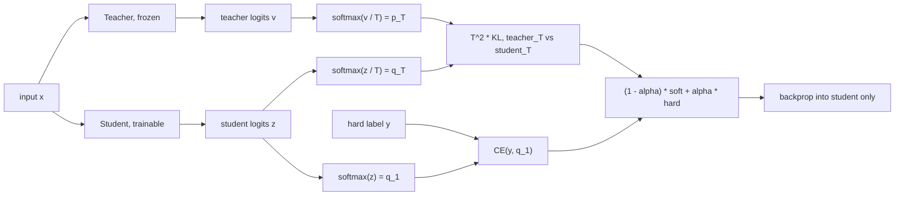

# Knowledge Distillation Fundamentals

> **Level:** Beginner to Advanced · **Study time:** ~80 min · **Prerequisites:** [Softmax, Entropy, Cross-Entropy and KL Divergence](../00-foundations/05-softmax-entropy-cross-entropy-and-kl-divergence.md), [Loss Functions](../02-deep-learning/04-loss-functions.md), [Backpropagation and Gradient Descent](../02-deep-learning/02-backpropagation-and-gradient-descent.md). Helpful: [Encoder-Only, Encoder-Decoder and Decoder-Only Models](../04-transformers/07-encoder-only-encoder-decoder-and-decoder-only-models.md)

## Table of contents

- [Why this matters](#why-this-matters)
- [The big idea: a teacher trains a student](#the-big-idea-a-teacher-trains-a-student)
- [Hard labels vs soft targets: dark knowledge](#hard-labels-vs-soft-targets-dark-knowledge)
- [Temperature: turning up the dark knowledge](#temperature-turning-up-the-dark-knowledge)
- [The classic distillation loss (Hinton et al., 2015)](#the-classic-distillation-loss-hinton-et-al-2015)
- [Why KL divergence, and forward vs reverse KL](#why-kl-divergence-and-forward-vs-reverse-kl)
- [Why the T squared factor](#why-the-t-squared-factor)
- [A complete PyTorch distillation training step](#a-complete-pytorch-distillation-training-step)
- [Three families: response-based, feature-based and relation-based](#three-families-response-based-feature-based-and-relation-based)
- [Case studies: DistilBERT, TinyBERT and friends](#case-studies-distilbert-tinybert-and-friends)
- [Going deeper: training schemes and what makes distillation work](#going-deeper-training-schemes-and-what-makes-distillation-work)
- [Production: cost, measurement and debugging](#production-cost-measurement-and-debugging)
- [Common mistakes and misconceptions](#common-mistakes-and-misconceptions)
- [Interview questions and model answers](#interview-questions-and-model-answers)
- [Key takeaways](#key-takeaways)
- [Further reading](#further-reading)
- [Next](#next)

## Why this matters

The most accurate models are usually too big, too slow or too expensive to serve: a 12-layer BERT classifier might blow your 20 ms latency budget, and a 70B LLM costs far more per request than a 7B one. **Knowledge distillation** is the standard way to transfer most of a big model's quality into a small, fast model that you can actually ship. It is behind well-known models such as DistilBERT and TinyBERT, behind many small "mini" or "flash" style LLMs, behind the draft models used in speculative decoding, and behind on-device vision models. In interviews it shows up as a fundamentals question ("explain distillation, why temperature, why KL") and as a system design lever ("your model is accurate but too slow, what do you do?"). A senior engineer is expected to explain the math cleanly, write the loss without bugs, and know when distillation beats quantization or pruning and when it does not.

---

## The big idea: a teacher trains a student

> **Analogy:** A master chef (the teacher) has decades of experience. An apprentice (the student) has a smaller brain budget and less time. The apprentice could learn only from recipe cards ("this dish is curry"), or could watch the master taste a dish and say "mostly curry, a bit like a stew, nothing like a dessert". The second kind of feedback is far richer. Distillation is the second kind.

Precise definitions:

- **Teacher model:** a large, accurate model that is already trained (or an ensemble of models). During distillation it is usually **frozen**, meaning its weights are not updated; we only run it forward to get its predictions.
- **Student model:** a smaller, cheaper model (fewer layers, narrower layers, or a different architecture) that we train to imitate the teacher, usually in addition to learning from the true labels.
- **Knowledge distillation (KD):** training the student so that its outputs (and sometimes its internal representations) match the teacher's. The name comes from "Distilling the Knowledge in a Neural Network" (Hinton, Vinyals and Dean, 2015). The idea of compressing a big model into a small one by training on its outputs is older: "Model Compression" (Buciluǎ, Caruana and Niculescu-Mizil, 2006) and "Do Deep Nets Really Need to be Deep?" (Ba and Caruana, 2014).
- **Transfer set:** the inputs we feed to both teacher and student during distillation. It can be the original labeled training set, extra unlabeled data, augmented data, or a mix. Because the teacher provides targets, the transfer set does not strictly need labels.

```text
               OFFLINE KNOWLEDGE DISTILLATION (the classic recipe)

  Step 1: train the teacher normally          Step 2: train the student
  ---------------------------------           -----------------------------------------
  data + labels --> [ BIG TEACHER ]           input x --> [ TEACHER (frozen) ] --> teacher outputs
                    (slow, accurate)                  \                               |
                                                       \                              v   match these
                                                        --> [ small STUDENT ] --> student outputs
                                                                                      ^
                                                            true label y -------------+  and these
  Step 3: deploy only the student (fast, cheap)
```

Why not just train the small model on the labels directly? You can, and that is your **baseline**. Distillation tends to beat it because the teacher's outputs carry more information per example than a single label, and because the teacher has already smoothed away some of the noise in the data. How much it helps depends on the task, the **capacity gap** (how much more capable the teacher is than the student) and the data, so you always measure it against that baseline.

> **Interview tip:** Always frame distillation as "compression via a better training signal". The student architecture is fixed in advance; distillation changes only *what the student is trained to predict*.

---

## Hard labels vs soft targets: dark knowledge

Our running example for the whole chapter: an image classifier with three classes, **cat, dog, car**. One training image shows a cat.

### Hard labels

A **hard label** is the ground-truth class written as a **one-hot vector**: a vector with a 1 in the correct class and 0 everywhere else.

$$y = [1,\ 0,\ 0] \quad (\text{cat, dog, car})$$

It says "this is a cat". It says nothing about how cat-like a dog is, or that this image is nothing like a car.

### Soft targets

A **soft target** is the teacher's full predicted probability distribution for the same image. Suppose the teacher's final layer outputs these **logits** (the raw, unnormalized scores before softmax):

$$v = [6,\ 4,\ 0]$$

The **softmax** function turns logits into probabilities that are positive and sum to 1 (full treatment in [the softmax chapter](../00-foundations/05-softmax-entropy-cross-entropy-and-kl-divergence.md)):

$$p_i = \frac{e^{v_i}}{\sum_{j} e^{v_j}}$$

- $v_i$: the teacher's logit for class $i$.
- $e^{v_i}$: the exponential, which makes every score positive and exaggerates differences.
- $\sum_j e^{v_j}$: the sum over all classes, which normalizes the result to sum to 1.

Worked by hand:

| Class | Logit $v_i$ | $e^{v_i}$ | $p_i = e^{v_i} / 459.0269$ |
|---|---|---|---|
| cat | 6 | 403.4288 | 0.8789 |
| dog | 4 | 54.5982 | 0.1189 |
| car | 0 | 1.0000 | 0.0022 |
| **sum** | | **459.0269** | **1.0000** |

So the soft target is $p = [0.8789,\ 0.1189,\ 0.0022]$.

### Dark knowledge

The small probabilities on the wrong classes are what Hinton called **dark knowledge**: information about how the teacher sees the *similarity structure* between classes, hidden in the parts of the output that a hard label throws away.

Look at the two wrong classes:

- dog gets 0.1189, car gets 0.0022.
- Ratio: $0.1189 / 0.0022 \approx 54$. In fact it is exactly $e^{4-0} = e^4 \approx 54.6$, because softmax ratios depend only on logit differences.

The teacher is saying: "this cat looks somewhat like a dog, and almost nothing like a car." That tells the student that cats and dogs share features (fur, ears, eyes) and that the decision boundary between them deserves care. The hard label $[1, 0, 0]$ treats "dog" and "car" as equally wrong.

| | Hard label | Soft target (teacher, T = 1) |
|---|---|---|
| Example | [1, 0, 0] | [0.8789, 0.1189, 0.0022] |
| Information about wrong classes | None | Relative similarity of every class |
| Entropy (uncertainty, in nats) | 0 | 0.380 |
| Can be wrong? | Only if the label is noisy | Yes, if the teacher is wrong |
| Per-example signal | One bit-ish fact: "cat" | A whole ranking plus confidence |
| Source | Human annotation | A trained model's forward pass |

**Entropy** here is $H(p) = -\sum_i p_i \ln p_i$, a measure of how spread out a distribution is (0 for one-hot, $\ln 3 \approx 1.099$ for uniform over three classes). Because it uses the natural log, its unit is the **nat**; with $\log_2$ the same quantity is measured in bits (1 nat $\approx$ 1.44 bits). Higher entropy soft targets carry more information per example and give gradients that vary less from example to example, which is why Hinton et al. observed that students trained on soft targets can learn from much less data than students trained on hard labels.

A famous illustration from the Hinton paper is handwritten digits: a particular "2" might get a tiny probability of being a "3" and a tiny probability of being a "7". Those tiny numbers tell the student *which* 2s look like 3s, which is real knowledge about the data.

> **Common mistake:** Confusing soft targets with **label smoothing**. Label smoothing replaces $[1, 0, 0]$ with something like $[0.9, 0.05, 0.05]$: the extra mass is spread *uniformly*, so it carries no similarity information. Soft targets spread mass *non-uniformly*, according to what the teacher learned. That difference is the whole point.

There is one problem. At $T = 1$ the useful numbers are tiny: 0.0022 for car. When a loss compares the student to these probabilities, such small values barely move the loss, so the dark knowledge has little influence. Temperature fixes this.

---

## Temperature: turning up the dark knowledge

> **Analogy:** Think of the teacher's output as a photo where the cat is very bright and the dog and car are almost black. Temperature is a brightness and contrast knob: turning it up brightens the dark regions so you can see the detail that was always there, without changing which object is brightest.

### Definition

**Temperature softmax** divides every logit by a number $T > 0$ before applying softmax:

$$p_i^{(T)} = \frac{e^{v_i / T}}{\sum_{j} e^{v_j / T}}$$

- $T$: the **temperature**. $T = 1$ gives the ordinary softmax.
- $T > 1$: logits are squeezed closer together, so the distribution gets **softer** (flatter, higher entropy).
- $T < 1$: logits are stretched apart, so the distribution gets **sharper** (closer to one-hot).
- As $T \to \infty$ the distribution approaches uniform; as $T \to 0$ it approaches one-hot at the argmax.
- Dividing every logit by the same positive number never changes their order, so **the predicted class (the argmax) never changes**.

You may have met the same knob in [LLM decoding](../05-llms/03-text-generation-and-decoding-strategies.md), where it controls randomness of sampling. In distillation it controls how much of the teacher's dark knowledge is exposed to the student.

### Worked example: teacher logits [6, 4, 0] at T = 1 and T = 4

**At T = 1** (computed above): $p^{(1)} = [0.8789,\ 0.1189,\ 0.0022]$.

**At T = 4**, step by step:

1. Divide logits by 4: $[6/4,\ 4/4,\ 0/4] = [1.5,\ 1.0,\ 0.0]$.
2. Exponentiate: $e^{1.5} = 4.4817$, $e^{1.0} = 2.7183$, $e^{0} = 1.0000$.
3. Sum: $4.4817 + 2.7183 + 1.0000 = 8.2000$.
4. Divide each by the sum: $4.4817 / 8.2000 = 0.5465$, $2.7183 / 8.2000 = 0.3315$, $1.0000 / 8.2000 = 0.1220$.

So $p^{(4)} = [0.5465,\ 0.3315,\ 0.1220]$ (sums to 1.0000).

| Temperature | cat | dog | car | Entropy (nats) | dog / car ratio |
|---|---|---|---|---|---|
| T = 1 | 0.8789 | 0.1189 | 0.0022 | 0.380 | $e^{4} \approx 54.6$ |
| T = 2 | 0.7054 | 0.2595 | 0.0351 | 0.714 | $e^{2} \approx 7.4$ |
| T = 4 | 0.5465 | 0.3315 | 0.1220 | 0.953 | $e^{1} \approx 2.7$ |
| T = 10 | 0.4224 | 0.3458 | 0.2318 | 1.070 | $e^{0.4} \approx 1.5$ |

What to notice:

- Cat is still the top class at every temperature.
- At $T = 4$ the car probability went from 0.0022 to 0.1220, so the student now gets a clearly visible signal that "car is the least likely, dog is in between".
- At $T = 10$ the distribution is getting close to uniform (0.333 each), and the ranking information starts to wash out (entropy 1.070 vs the maximum $\ln 3 \approx 1.099$). Too high a temperature also amplifies noise in the teacher's very low logits for clearly irrelevant classes, which ordinary training barely constrains. There is a sweet spot.

### Same temperature for teacher and student

During training, **both** teacher and student logits are divided by the same $T$, and the student is trained to match the teacher at that temperature. After training, the student is deployed at $T = 1$. The temperature is a training-time lens, not part of the deployed model.

Why soften the student too? If you matched the student's ordinary $\text{softmax}(z)$ to the teacher's $\text{softmax}(v/T)$, the student would be pushed to make its *deployed* predictions as flat as the teacher's $T = 4$ targets, roughly $z \approx v / T$, which means a systematically underconfident model. Softening both sides compares them through the same lens and lets the student keep teacher-sized logits.

```python
# pip install numpy
import numpy as np

def softmax_t(logits, T=1.0):
    """Temperature softmax, numerically stable (subtract the max first)."""
    z = np.asarray(logits, dtype=float) / T
    z = z - z.max()                  # does not change the result, avoids overflow
    e = np.exp(z)
    return e / e.sum()

teacher_logits = [6.0, 4.0, 0.0]     # cat, dog, car
for T in [1, 2, 4, 10]:
    print(T, np.round(softmax_t(teacher_logits, T), 4))
# 1 [0.8789 0.1189 0.0022]
# 2 [0.7054 0.2595 0.0351]
# 4 [0.5465 0.3315 0.122 ]
# 10 [0.4224 0.3458 0.2318]
```

> **Senior insight:** Common starting values for $T$ are roughly 2 to 5, and people tune it on a validation set. There is no universally best value: a teacher that is extremely confident (huge logit gaps) needs a higher $T$ to reveal anything, while a teacher that is already soft needs less.

---

## The classic distillation loss (Hinton et al., 2015)

The student learns from two signals at once: the true labels (so it stays anchored to reality) and the teacher's softened distribution (so it absorbs the dark knowledge).

$$\mathcal{L} = \alpha \cdot \text{CE}\big(y,\ q^{(1)}\big) + (1 - \alpha) \cdot T^2 \cdot \text{KL}\big(p^{(T)}\ \big\|\ q^{(T)}\big)$$

Every symbol:

- $y$: the one-hot hard label.
- $q^{(1)} = \text{softmax}(z)$: the student's ordinary probabilities, where $z$ are the student's logits.
- $q^{(T)} = \text{softmax}(z / T)$: the student's softened probabilities.
- $p^{(T)} = \text{softmax}(v / T)$: the teacher's softened probabilities (teacher logits $v$).
- $\text{CE}(y, q) = -\sum_i y_i \ln q_i$: **cross-entropy**, which for a one-hot label is just $-\ln(\text{probability the student gives the correct class})$.
- $\text{KL}(p \,\|\, q) = \sum_i p_i \ln \frac{p_i}{q_i}$: **Kullback-Leibler (KL) divergence**, a measure of how different distribution $q$ is from distribution $p$. It is 0 only when they are identical and positive otherwise.
- $\alpha \in [0, 1]$: how much weight goes to the hard-label term. The rest, $1 - \alpha$, goes to the distillation term.
- $T^2$: a scale factor that keeps the distillation gradients from shrinking when $T$ grows (explained in its own section below).

> **Common mistake:** Different papers and codebases put $\alpha$ on different terms. Hugging Face examples, the DistilBERT code and many blog posts each use their own convention. Always read which term $\alpha$ multiplies before you copy hyperparameters.

How to pick $\alpha$: Hinton et al. reported their best results with a considerably lower weight on the hard-label term than on the soft term, which in this chapter's convention means a smallish $\alpha$. In practice, sweep a few values (for example 0.1, 0.3, 0.5) together with $T$ on a validation set. Raise $\alpha$ when the teacher is noticeably wrong on your data; lower it when labels are scarce or noisy and the teacher is strong.



### Worked example: one cat image

Teacher logits $v = [6, 4, 0]$. Suppose the half-trained student outputs logits $z = [3, 2, 1]$. Use $T = 4$, $\alpha = 0.5$, true label cat.

**Step 1: student at T = 1 (for the hard loss).**
$e^{3} = 20.0855$, $e^{2} = 7.3891$, $e^{1} = 2.7183$, sum $= 30.1929$.
$q^{(1)} = [0.6652,\ 0.2447,\ 0.0900]$.

**Step 2: hard loss.**
$\text{CE} = -\ln(0.6652) = 0.4076$.

**Step 3: student at T = 4.**
$z / 4 = [0.75,\ 0.5,\ 0.25]$. $e^{0.75} = 2.1170$, $e^{0.5} = 1.6487$, $e^{0.25} = 1.2840$, sum $= 5.0497$.
$q^{(4)} = [0.4192,\ 0.3265,\ 0.2543]$.

**Step 4: teacher at T = 4** (from before): $p^{(4)} = [0.5465,\ 0.3315,\ 0.1220]$.

**Step 5: KL divergence, term by term.**

| Class | $p_i$ | $q_i$ | $p_i / q_i$ | $\ln(p_i / q_i)$ | $p_i \ln(p_i / q_i)$ |
|---|---|---|---|---|---|
| cat | 0.5465 | 0.4192 | 1.3037 | 0.2652 | 0.1450 |
| dog | 0.3315 | 0.3265 | 1.0153 | 0.0152 | 0.0050 |
| car | 0.1220 | 0.2543 | 0.4796 | -0.7348 | -0.0896 |
| **sum** | | | | | **0.0604** |

(Values computed at full precision and then rounded; the unrounded KL is 0.06038. Redoing the arithmetic from the rounded inputs shifts the last digit of some intermediate entries, for example $0.1220 / 0.2543 = 0.4797$, which is just rounding.)

Notice the individual terms can be negative; only the total is guaranteed to be non-negative.

**Step 6: scale and combine.**
$T^2 \cdot \text{KL} = 16 \times 0.06038 = 0.9661$ (using the rounded 0.0604 would give 0.9664).
$\mathcal{L} = 0.5 \times 0.4076 + 0.5 \times 0.9661 = 0.2038 + 0.4830 = 0.6868$ (0.6869 at full precision).

Interpretation: the student already ranks the classes correctly (cat > dog > car) so the hard loss is moderate, but it is too unsure about cat and far too generous to car compared with the teacher. The KL term pushes the car probability down and the cat probability up, in proportion to the teacher's view.

---

## Why KL divergence, and forward vs reverse KL

### Why KL and not, say, accuracy or MSE on probabilities

1. **It compares whole distributions.** KL looks at every class, weighted by how much probability the teacher puts there. That is exactly where dark knowledge lives. A metric that looks only at the top class (like accuracy, or hard pseudo-labels) throws it away.
2. **It is the natural "distance" for probabilities.** KL measures the extra information (in nats or bits) you pay when you use $q$ to describe data that really comes from $p$. It is zero only when $q = p$.
3. **It is cross-entropy in disguise, so it fits standard training.** Expand it:

$$\text{KL}(p \,\|\, q) = \sum_i p_i \ln p_i - \sum_i p_i \ln q_i = -H(p) + \text{CE}(p, q)$$

- $H(p) = -\sum_i p_i \ln p_i$: the entropy of the teacher's distribution.
- $\text{CE}(p, q) = -\sum_i p_i \ln q_i$: cross-entropy with *soft* targets.

The teacher is frozen, so $H(p)$ is a constant with respect to the student's weights. Therefore **minimizing KL is exactly the same as minimizing cross-entropy against the teacher's soft targets**: same gradients, the loss value just differs by a constant.

Check with our numbers: $H(p^{(4)}) = 0.9528$, $\text{CE}(p^{(4)}, q^{(4)}) = 1.0132$, and $1.0132 - 0.9528 = 0.0604$, which is the KL we computed. People often prefer to *log* the KL version because it reaches 0 when the student matches perfectly, which makes it easier to read on a dashboard.

4. **Clean gradient.** The gradient of $\text{KL}(p^{(T)} \| q^{(T)})$ with respect to student logit $z_i$ is simply

$$\frac{\partial\, \text{KL}}{\partial z_i} = \frac{1}{T}\left(q_i^{(T)} - p_i^{(T)}\right)$$

"Student probability minus teacher probability", the same elegant form as ordinary softmax plus cross-entropy. It is cheap and numerically well behaved when computed with log-softmax.

> **Senior insight:** MSE on logits is a legitimate alternative. Ba and Caruana (2014) trained students by regressing the teacher's logits, and Hinton et al. showed that in the high-temperature limit, KL distillation becomes equivalent to logit matching (see the next section). One wrinkle: softmax ignores adding the same constant to every logit, but MSE on raw logits penalizes that offset, so logits are usually mean-centered first. KL is the standard because it matches the probabilistic meaning of the output. Some later work found plain logit MSE competitive, so treat it as a tunable choice, not a law.

### Forward vs reverse KL

KL is **not symmetric**: $\text{KL}(p \| q) \neq \text{KL}(q \| p)$ in general. In our example:

- Forward: $\text{KL}(p^{(4)} \| q^{(4)}) = 0.0604$.
- Reverse: $\text{KL}(q^{(4)} \| p^{(4)}) = 0.0707$.

Which direction you choose changes what the student is pushed to do, especially when the student is too small to copy the teacher exactly. In the table below, a **mode** is a peak of a probability distribution: a region the model considers highly likely, such as one of several valid answers.

| | Forward KL: $\text{KL}(p_\text{teacher} \,\|\, q_\text{student})$ | Reverse KL: $\text{KL}(q_\text{student} \,\|\, p_\text{teacher})$ |
|---|---|---|
| Weighted by | Teacher probabilities | Student probabilities |
| Heavily penalizes | Student putting near-zero mass where the teacher puts mass | Student putting mass where the teacher puts near-zero mass |
| Behavior | **Mode-covering** (also called mean-seeking): spreads out to cover everything the teacher considers plausible | **Mode-seeking**: concentrates on one high-probability region of the teacher, ignores the rest |
| Risk | Student may put mass "between" modes, generating blends the teacher would never produce | Student may lose diversity, ignoring valid alternatives |
| Used in | Classic Hinton KD, almost all classification distillation | LLM distillation work such as MiniLLM (Gu et al., 2023); mixed or generalized divergences in GKD (Agarwal et al., 2024) |

```text
  Teacher has two modes (two good answers). Student can only make one bump.

  teacher p:     /\              /\
                /  \            /  \
  -------------/----\----------/----\-------------

  forward KL:          ______________
  (cover both)        /              \           <- wide bump spanning both,
  -------------------/----------------\---------    mass in the valley between

  reverse KL:    /\
  (pick one)    /  \                              <- sits on one mode, ignores the other
  -------------/----\---------------------------
```

For classification with a handful of classes the difference is usually small, and forward KL is the default. For text generation with huge vocabularies and many valid continuations it matters much more, which is covered in [Distilling Large Language Models](06-distilling-large-language-models.md).

---

## Why the T squared factor

> **Analogy:** If you turn the volume down on one speaker (the soft loss) every time you raise the temperature, you must turn the amplifier up to keep the balance with the other speaker (the hard loss). $T^2$ is that amplifier setting.

From the gradient above, the distillation term's gradient for logit $z_i$ is $\frac{1}{T}(q_i - p_i)$. As $T$ grows, two things shrink it:

1. The explicit $\frac{1}{T}$ factor (from dividing logits by $T$ inside the softmax, via the chain rule).
2. The difference $q_i - p_i$ itself, because both distributions get flatter and closer to uniform.

Hinton et al. made the second effect precise. For large $T$, use $e^x \approx 1 + x$ for small $x$, with $N$ classes and logits centered to mean zero:

$$q_i \approx \frac{1 + z_i / T}{N}, \qquad p_i \approx \frac{1 + v_i / T}{N}$$

so

$$\frac{\partial\, \text{KL}}{\partial z_i} = \frac{1}{T}(q_i - p_i) \approx \frac{1}{T} \cdot \frac{z_i - v_i}{N T} = \frac{z_i - v_i}{N T^2}$$

- $z_i, v_i$: student and teacher logits (mean-centered).
- $N$: number of classes.

Two conclusions:

1. **The soft gradient scales like $1/T^2$.** Multiplying the loss by $T^2$ cancels this, so the relative weight of the hard and soft terms stays roughly the same when you change $T$. Without it, raising $T$ from 1 to 4 would silently make the distillation term about 16 times weaker, and your $\alpha$ would mean something different for every $T$.
2. **In the high-temperature limit, distillation equals logit matching:** the gradient $\frac{z_i - v_i}{N T^2}$ is the gradient of $\frac{1}{2 N T^2} \sum_i (z_i - v_i)^2$, a squared error between logits. This connects Hinton's KD to Ba and Caruana's logit regression.

Numeric sanity check with our example at $T = 4$:

| | cat | dog | car |
|---|---|---|---|
| Unscaled soft gradient $\frac{1}{4}(q_i - p_i)$ | -0.0318 | -0.0013 | 0.0331 |
| Scaled by $T^2 = 16$ | -0.5093 | -0.0200 | 0.5293 |
| Hard-loss gradient $q_i^{(1)} - y_i$ for comparison | -0.3348 | 0.2447 | 0.0900 |

Without the $T^2$ factor, the soft term's gradients would be an order of magnitude smaller than the hard term's, and the teacher would barely be heard. (Signs: a negative gradient means gradient descent will *increase* that logit, so both terms push "cat" up.)

> **Interview tip:** The one-sentence answer is: "Soft-target gradients scale as $1/T^2$, so we multiply by $T^2$ to keep the soft and hard terms balanced regardless of the temperature we pick."

---

## A complete PyTorch distillation training step

First, the loss itself, written carefully. `F.kl_div` has an unusual interface that causes many real bugs:

- Its **first argument must be log-probabilities** (the student's `log_softmax`), not probabilities.
- Its **second argument is the target**: probabilities by default, or log-probabilities if you pass `log_target=True`.
- Use `reduction="batchmean"` to get the true KL averaged per example. `reduction="mean"` divides by batch size *times number of classes*, which silently shrinks the loss.

```python
# pip install torch
import torch
import torch.nn.functional as F

def distillation_loss(student_logits, teacher_logits, labels, T=4.0, alpha=0.5):
    """Hinton et al. (2015) loss: alpha * CE(hard) + (1 - alpha) * T^2 * KL(teacher_T || student_T)."""
    # Hard-label term at T = 1 (standard cross-entropy, takes raw logits)
    hard = F.cross_entropy(student_logits, labels)

    # Soft term: both sides softened by the SAME temperature
    student_log_probs = F.log_softmax(student_logits / T, dim=-1)   # log q_T
    teacher_probs = F.softmax(teacher_logits / T, dim=-1)           # p_T
    soft = F.kl_div(student_log_probs, teacher_probs, reduction="batchmean") * (T * T)

    return alpha * hard + (1 - alpha) * soft, hard.detach(), soft.detach()

# Reproduce the hand-worked example
s = torch.tensor([[3.0, 2.0, 1.0]])   # student logits
t = torch.tensor([[6.0, 4.0, 0.0]])   # teacher logits
y = torch.tensor([0])                 # cat
loss, hard, soft = distillation_loss(s, t, y, T=4.0, alpha=0.5)
print(round(loss.item(), 4), round(hard.item(), 4), round(soft.item(), 4))
# about 0.6869, 0.4076, 0.9661 (matches the table above)
```

Now a complete, runnable script: train a big teacher on a synthetic 3-class problem, then distill it into a much smaller student with both a response-based loss (logits) and a feature-based loss (hidden states, with a projection because the sizes differ). We also measure **agreement**, the fraction of inputs where student and teacher predict the same class.

```python
# pip install torch
import torch
import torch.nn as nn
import torch.nn.functional as F

torch.manual_seed(0)
device = "cuda" if torch.cuda.is_available() else "cpu"

# ---------- synthetic data: 3 classes (think cat / dog / car) ----------
N, D, C = 6000, 20, 3
X = torch.randn(N, D)
W_true = torch.randn(D, C)
y = (X @ W_true + 0.5 * torch.randn(N, C)).argmax(dim=1)    # noisy labels
X_train, y_train = X[:5000], y[:5000]
X_val, y_val = X[5000:], y[5000:]

class MLP(nn.Module):
    """Returns logits AND the last hidden representation (needed for feature distillation)."""
    def __init__(self, d_in, d_hidden, n_classes):
        super().__init__()
        self.body = nn.Sequential(
            nn.Linear(d_in, d_hidden), nn.ReLU(),
            nn.Linear(d_hidden, d_hidden), nn.ReLU(),
        )
        self.head = nn.Linear(d_hidden, n_classes)

    def forward(self, x):
        h = self.body(x)
        return self.head(h), h

def batches(X, y, bs=128):
    idx = torch.randperm(len(X))
    for i in range(0, len(X), bs):
        j = idx[i:i + bs]
        yield X[j].to(device), y[j].to(device)

@torch.no_grad()
def evaluate(model, X, y, reference=None):
    model.eval()
    logits, _ = model(X.to(device))
    pred = logits.argmax(dim=1).cpu()
    acc = (pred == y).float().mean().item()
    if reference is None:
        return acc
    ref_logits, _ = reference(X.to(device))
    agree = (pred == ref_logits.argmax(dim=1).cpu()).float().mean().item()
    return acc, agree

# ---------- 1) train the teacher normally ----------
teacher = MLP(D, 512, C).to(device)
opt_t = torch.optim.AdamW(teacher.parameters(), lr=1e-3)
for epoch in range(20):
    teacher.train()
    for xb, yb in batches(X_train, y_train):
        logits, _ = teacher(xb)
        loss = F.cross_entropy(logits, yb)
        opt_t.zero_grad()
        loss.backward()
        opt_t.step()
print("teacher val acc:", round(evaluate(teacher, X_val, y_val), 3))

# ---------- 2) distill into a small student ----------
student = MLP(D, 64, C).to(device)          # 64 hidden units vs 512
projector = nn.Linear(64, 512).to(device)   # maps student features into teacher feature space
opt_s = torch.optim.AdamW(list(student.parameters()) + list(projector.parameters()), lr=1e-3)

T, alpha, beta = 4.0, 0.5, 0.1              # beta weights the feature loss

teacher.eval()                              # freeze dropout / BatchNorm behavior
for p in teacher.parameters():
    p.requires_grad_(False)                 # no gradients, no optimizer state for the teacher

def distill_step(xb, yb):
    student.train()
    with torch.no_grad():                   # teacher forward only: saves memory and compute
        t_logits, t_feat = teacher(xb)
    s_logits, s_feat = student(xb)

    # response-based: logits (Hinton KD)
    hard = F.cross_entropy(s_logits, yb)
    soft = F.kl_div(
        F.log_softmax(s_logits / T, dim=-1),
        F.softmax(t_logits / T, dim=-1),
        reduction="batchmean",
    ) * T * T

    # feature-based: match hidden states after projecting 64 -> 512
    feat = F.mse_loss(projector(s_feat), t_feat)

    loss = alpha * hard + (1 - alpha) * soft + beta * feat
    opt_s.zero_grad()
    loss.backward()
    opt_s.step()
    return loss.item(), hard.item(), soft.item(), feat.item()

for epoch in range(20):
    for xb, yb in batches(X_train, y_train):
        total, hard, soft, feat = distill_step(xb, yb)
    if epoch % 5 == 0:
        print(f"epoch {epoch}: total={total:.3f} hard={hard:.3f} soft={soft:.3f} feat={feat:.3f}")

acc, agree = evaluate(student, X_val, y_val, reference=teacher)
print(f"student val acc={acc:.3f}, agreement with teacher={agree:.3f}")
# The projector is training-only scaffolding: deploy just `student`.
```

What the script demonstrates, line by line in spirit:

- The teacher is put in `eval()` mode and its parameters frozen. Forgetting `eval()` is a classic bug: dropout makes the teacher's targets noisy and BatchNorm layers would keep updating their running statistics.
- The teacher forward runs under `torch.no_grad()`, so no activations are stored for backprop. The teacher then costs only one forward pass per batch.
- The optimizer includes the projector, which is trained jointly and thrown away afterwards.
- Logging the three loss terms separately is how you catch a term that silently dominates or goes to zero.

For a fair experiment, also train the same 64-unit student on hard labels alone with the same budget, and compare. On a toy problem like this the gap may be small; the point of the script is the mechanics.

### The same idea with Hugging Face Transformers

> Version note: the `Trainer.compute_loss` signature has changed across `transformers` releases (newer versions pass extra keyword arguments such as `num_items_in_batch`). The `**kwargs` below keeps the sketch tolerant of that, but check the docs of your installed version.

```python
# pip install torch transformers datasets
import torch
import torch.nn.functional as F
from transformers import Trainer

class DistillationTrainer(Trainer):
    def __init__(self, *args, teacher_model=None, temperature=4.0, alpha=0.5, **kwargs):
        super().__init__(*args, **kwargs)
        self.teacher = teacher_model.to(self.args.device).eval()
        for p in self.teacher.parameters():
            p.requires_grad_(False)
        self.T, self.alpha = temperature, alpha

    def compute_loss(self, model, inputs, return_outputs=False, **kwargs):
        labels = inputs["labels"]
        model_inputs = {k: v for k, v in inputs.items() if k != "labels"}
        s_out = model(**model_inputs)
        with torch.no_grad():
            t_out = self.teacher(**model_inputs)

        hard = F.cross_entropy(s_out.logits, labels)
        soft = F.kl_div(
            F.log_softmax(s_out.logits / self.T, dim=-1),
            F.softmax(t_out.logits / self.T, dim=-1),
            reduction="batchmean",
        ) * self.T ** 2
        loss = self.alpha * hard + (1 - self.alpha) * soft
        return (loss, s_out) if return_outputs else loss

# Typical use: teacher = a BERT-base model fine-tuned on your task,
# student = AutoModelForSequenceClassification.from_pretrained("distilbert-base-uncased", num_labels=...).
# Both must share the same label order. Tokenize with the student's tokenizer: DistilBERT
# shares BERT's vocabulary but does not use token_type_ids (older transformers versions raise
# an error if you pass them, newer ones ignore them), and BERT works fine without them.
```

Teacher and student here receive the *same* `input_ids`, which only works if they share a tokenizer and vocabulary. When they do not (for example distilling between LLM families), you need extra machinery, discussed in the [LLM distillation chapter](06-distilling-large-language-models.md).

---

## Three families: response-based, feature-based and relation-based

The survey "Knowledge Distillation: A Survey" (Gou, Yu, Maybank and Tao, 2021) organizes distillation by *what* knowledge is transferred. This taxonomy is what interviewers usually mean.

> **Analogy:** Learning to play chess from a grandmaster. **Response-based:** you copy which moves they rate highly. **Feature-based:** you copy *how they look at the board* (what they notice on each square). **Relation-based:** you copy *which positions they consider similar to each other*, without copying their exact thoughts about any single one.

```text
  TEACHER                                   STUDENT
  input                                     input
    |                                         |
  [layer 1]                                 [layer 1]
  [layer 2]  ---- hint: h_T ----+           [layer 2] -- h_S --> [projector W] --+
  [layer 3]                     |                                                |
  [layer 4]                     +------------ feature loss: || W h_S - h_T ||^2 -+
    |                                         |
  logits v  -------- response loss: KL(softmax(v/T) || softmax(z/T)) --- logits z

  relation loss: compare distances / angles BETWEEN examples i, j, k
                 in teacher space vs student space
```

### Response-based distillation

**Response-based** distillation matches the teacher's final outputs: logits, softened probabilities, or for other tasks the final predictions (bounding boxes and class scores in detection, per-pixel class distributions in segmentation). Hinton KD is the canonical example.

- Simple, architecture-agnostic: the student can have a completely different internal design, as long as the output space is the same.
- Limitation: it only supervises the end of the network. For a deep student, the signal that reaches the early layers is indirect.

### Feature-based distillation

**Feature-based** distillation also matches **intermediate representations** (hidden activations, feature maps, attention maps), giving the student "step by step" guidance.

Key terms from "FitNets: Hints for Thin Deep Nets" (Romero et al., 2015):

- **Hint layer:** a chosen teacher layer whose output the student should imitate.
- **Guided layer:** the student layer that is trained to match the hint.
- **Regressor (projection):** a small learnable layer that maps the guided layer's output to the hint's shape, because the student is usually narrower.

The basic loss:

$$\mathcal{L}_\text{feat} = \big\| W\, h_S - h_T \big\|_2^2$$

- $h_T$: the teacher's hint representation, for example a vector of size 512 (or a $C_T \times H \times W$ feature map).
- $h_S$: the student's guided representation, for example size 64.
- $W$: the learnable projection, here a $512 \times 64$ matrix (a linear layer). For convolutional feature maps, a $1 \times 1$ convolution plays this role. If spatial sizes differ too, you also interpolate or pool.
- $\| \cdot \|_2^2$: squared Euclidean distance, averaged over elements in practice (MSE).

**Tiny numeric example.** Teacher hint $h_T = [1.0,\ 2.0]$ (2 dims), student feature $h_S = [3.0]$ (1 dim), projection $W = [[0.5],\ [0.5]]$ (a $2 \times 1$ matrix).
$W h_S = [0.5 \times 3.0,\ 0.5 \times 3.0] = [1.5,\ 1.5]$.
Differences: $1.5 - 1.0 = 0.5$ and $1.5 - 2.0 = -0.5$.
Squared error: $0.25 + 0.25 = 0.5$; MSE (mean over 2 elements) $= 0.25$. Gradient descent will now adjust both $W$ and the student so that the projected feature moves toward $[1.0, 2.0]$.

Practical details a senior engineer should know:

- **Why project the student up, not the teacher down?** Projecting the student into the teacher's space keeps the target fixed and well defined. Projecting the teacher down with a learnable matrix lets the loss "cheat" by collapsing the projection toward something trivial. Some methods use fixed or normalized teacher projections to avoid this.
- **Which layers to pair?** With a 12-layer teacher and a 4-layer student, a common **layer mapping** is uniform: student layer $m$ learns from teacher layer $3m$ (TinyBERT does this).
- **Scale matters.** Feature MSE can be orders of magnitude larger than the KL term. Normalize features (for example L2-normalize or layer-normalize them) or tune its weight $\beta$, and log each term.
- **Attention transfer** ("Paying More Attention to Attention", Zagoruyko and Komodakis, 2017) matches spatial attention maps derived from CNN feature maps instead of the raw features, which sidesteps channel-count mismatches. In transformers, TinyBERT and MiniLM match self-attention distributions directly.
- **Constraint:** feature-based methods need access to the teacher's internals (white-box teacher) and some architectural compatibility. With a black-box API teacher, you only have responses.

### Relation-based distillation

**Relation-based** distillation transfers the *relationships between examples* (or between layers) rather than any individual output. The student's internal space can be completely different from the teacher's; what must match is the *geometry*.

- "Relational Knowledge Distillation" (Park, Kim, Lu and Cho, 2019): matches normalized pairwise **distances** between examples in a batch, and **angles** formed by triplets of examples.
- "A Gift from Knowledge Distillation" (Yim et al., 2017): matches the "flow" between layers (FSP matrices: relations between two layers' feature maps).
- "Contrastive Representation Distillation" (Tian, Krishnan and Isola, 2020): a contrastive objective that makes a student's embedding of an input closer to the teacher's embedding of the same input than to those of other inputs.

Why relations? Because many tasks care about structure, not raw values. For an embedding model used in [vector search](../08-rag/02-text-embeddings-and-similarity-search.md), what matters is that "similar documents are close and different documents are far". Relation-based losses transfer exactly that, without forcing a 384-dim student to mimic a 1024-dim teacher coordinate by coordinate.

```python
import torch
import torch.nn.functional as F

def pairwise_dist(x, eps=1e-12):
    # x: (batch, dim). Squared differences for every pair, then a safe sqrt.
    sq = (x.unsqueeze(0) - x.unsqueeze(1)).pow(2).sum(-1)
    return (sq + eps).sqrt()

def rkd_distance_loss(student_emb, teacher_emb):
    """Relation-based (RKD-style distance) loss: match the shape of the batch, not the coordinates."""
    n = student_emb.size(0)
    off_diag = ~torch.eye(n, dtype=torch.bool, device=student_emb.device)
    with torch.no_grad():
        d_t = pairwise_dist(teacher_emb)[off_diag]
        d_t = d_t / d_t.mean()                  # normalize: scale-free comparison
    d_s = pairwise_dist(student_emb)[off_diag]
    d_s = d_s / d_s.mean()
    return F.smooth_l1_loss(d_s, d_t)

# Works even though dimensions differ (64 vs 512): only distances are compared.
loss = rkd_distance_loss(torch.randn(8, 64, requires_grad=True), torch.randn(8, 512))
```

### Comparison

| | Response-based | Feature-based | Relation-based |
|---|---|---|---|
| What is matched | Final outputs (logits, probabilities, boxes) | Intermediate activations, feature maps, attention maps | Distances, angles, similarities between examples or layers |
| Typical loss | KL at temperature T (or MSE on logits) | MSE / L2 after a projection; attention-map losses | Distance and angle losses, contrastive losses |
| Teacher access | Outputs only (works with black-box APIs that expose probabilities or logprobs; label-only APIs allow just hard distillation) | Internals needed (white-box) | Embeddings or internals needed |
| Architecture constraints | Same output space only | Layer mapping, projection when dims differ | Few: geometry is dimension-free |
| Strength | Simple, robust, strong baseline | Richer, layer-wise signal; helps deep, thin students | Transfers structure, great for embeddings and retrieval |
| Weakness | Only supervises the last layer | Choosing layers and scales is fiddly; can over-constrain a different architecture | Batch-composition sensitive; weaker alone for classification |
| Classic examples | Hinton KD, DistilBERT's soft-target term | FitNets, TinyBERT, MobileBERT, attention transfer | RKD, FSP, CRD |

In practice the strongest recipes **combine** them: a KL term on outputs plus feature or attention terms on a few chosen layers, plus the hard-label loss.

---

## Case studies: DistilBERT, TinyBERT and friends

These are the examples interviewers expect you to name. All numbers below are the headline claims from the original papers.

### DistilBERT

"DistilBERT, a distilled version of BERT: smaller, faster, cheaper and lighter" (Sanh, Debut, Chaumond and Wolf, 2019).

- **Student:** 6 transformer layers instead of BERT-base's 12, same hidden size. The token-type embeddings and the pooler were removed.
- **Initialization:** the student is initialized from the teacher by taking one layer out of every two. Good initialization is a large, often underrated part of why distillation works.
- **When:** distillation during **pretraining** (task-agnostic), so the resulting model can be fine-tuned on any downstream task like BERT.
- **Loss (a "triple loss"):** a soft-target distillation loss on the teacher's masked-language-model output distribution (with temperature), the usual masked language modeling loss on hard targets, and a **cosine embedding loss** aligning the directions of the student's and teacher's hidden state vectors (a feature-based term).
- **Headline result:** about 40% smaller and 60% faster than BERT-base while retaining 97% of its language understanding performance on the GLUE benchmark (a standard suite of nine English sentence and sentence-pair understanding tasks), as reported in the paper.

### TinyBERT

"TinyBERT: Distilling BERT for Natural Language Understanding" (Jiao et al., 2020).

- **Two-stage distillation:** *general distillation* on a large text corpus (task-agnostic), then *task-specific distillation* on the downstream task, using data augmentation to enlarge the transfer set.
- **Layer-wise losses on everything:** the embedding layer, every mapped transformer layer's hidden states (MSE after a learnable projection $W_h$, since TinyBERT's hidden size is smaller), every mapped layer's **attention matrices** (MSE), and the prediction layer (soft cross-entropy). This is feature-based plus response-based distillation.
- **Layer mapping:** uniform, so with a 4-layer student and 12-layer teacher, student layer $m$ learns from teacher layer $3m$.
- **Headline result:** the 4-layer TinyBERT is reported as 7.5x smaller and 9.4x faster at inference than BERT-base, while achieving over 96.8% of its performance on GLUE.

### Other names worth knowing

| Model / method | Year | Key idea |
|---|---|---|
| MobileBERT (Sun et al.) | 2020 | Thin, deep student with bottleneck layers; layer-wise feature and attention transfer from a specially designed teacher |
| MiniLM (Wang et al.) | 2020 | Distills only the **last** layer's self-attention distributions and value relations, so the student's layer count and hidden size are flexible |
| DeiT (Touvron et al.) | 2021 | Vision transformer trained with a **distillation token** that learns from a CNN teacher; "hard distillation" (training on the teacher's top-1 predicted label, explained below) worked well |
| Born-Again Networks (Furlanello et al.) | 2018 | Student with the *same* architecture as the teacher, trained by distillation, can outperform the teacher |
| Sequence-level KD (Kim and Rush) | 2016 | For sequence models: train the student on the teacher's generated outputs; the ancestor of today's LLM distillation |

> **Senior insight:** The trend from DistilBERT to TinyBERT to MiniLM is a trend in *where* the knowledge is taken from: from outputs only, to every layer, to a carefully chosen small set of internal signals that leaves the student's architecture free. That flexibility matters when the student must fit a specific hardware target.

---

## Going deeper: training schemes and what makes distillation work

### Offline, online and self-distillation

| Scheme | How it works | When to use | Pros | Cons |
|---|---|---|---|---|
| **Offline** | Train teacher first, freeze it, then train the student | Default; you have (or can buy) a strong teacher | Simple, teacher logits can be cached | Needs a strong pre-trained teacher |
| **Online** | Teacher and student (or several peers) train simultaneously and teach each other, e.g. "Deep Mutual Learning" (Zhang et al., 2018) | No strong teacher exists | No separate teacher training phase | More complex, more memory during training |
| **Self-distillation** | The model teaches itself: a previous generation (Born-Again Networks), or deeper layers teaching shallower ones | Squeezing extra accuracy at the same size | Can improve accuracy with no extra inference cost | Not compression by itself |
| **Ensemble distillation** | Teacher is an average of several models | Ensembles are accurate but N times more expensive to serve | One model captures much of the ensemble's gain | Need to train the ensemble first |

A related idea is **pseudo-labeling** or **self-training**, as in "Self-training with Noisy Student" (Xie et al., 2020): a teacher labels unlabeled data, often with hard labels, and a student (equal or larger, with noise added) learns from it. That is distillation used to *improve* accuracy rather than to compress.

### Why does distillation work at all?

Several complementary explanations, none complete on its own:

1. **More information per example.** Soft targets encode class similarities (dark knowledge).
2. **Regularization.** Soft targets are a smarter version of label smoothing; they discourage the student from overconfident, overfit predictions.
3. **Denoising.** If some hard labels are wrong, a good teacher's soft targets partly correct them.
4. **Easier optimization.** Matching a smooth function (the teacher) is easier than discovering it from noisy labels; feature hints give intermediate layers direct guidance.
5. **Unlabeled data becomes usable.** Any input can be labeled by the teacher, so the transfer set can be much larger than the labeled set.

### What makes a good teacher (it is not just accuracy)

- **Bigger is not always better.** "On the Efficacy of Knowledge Distillation" (Cho and Hariharan, 2019) found that much larger, more accurate teachers do not necessarily make better teachers for small students; the **capacity gap** can be too big for the student to follow. "Improved Knowledge Distillation via Teacher Assistant" (Mirzadeh et al., 2020) bridges the gap with an intermediate-size model: big teacher, then medium assistant, then small student.
- **Label smoothing in the teacher can hurt.** "When Does Label Smoothing Help?" (Müller, Kornblith and Hinton, 2019) showed that teachers trained with label smoothing can be worse teachers, because smoothing erases some of the inter-class similarity information that distillation relies on.
- **Calibration and consistency matter.** A model is **calibrated** when its confidence matches its accuracy (of the examples where it says 80%, about 80% are right). A teacher whose probabilities are meaningful in this sense transfers more useful structure than one that is wildly overconfident.

### What makes good distillation training

- **Train longer than you think.** "Knowledge distillation: A good teacher is patient and consistent" (Beyer et al., 2022) argued for viewing distillation as **function matching**: show teacher and student the *same* augmented view of each input (consistency), use aggressive augmentation, and train for a long schedule (patience). Students kept improving for a long time.
- **Fidelity is hard.** "Does Knowledge Distillation Really Work?" (Stanton et al., 2021) found that students often do *not* closely match their teachers' predictive distributions even when they have enough capacity to, largely due to optimization difficulty. A student can gain accuracy from distillation while still disagreeing with the teacher on many inputs.
- **Tune $T$ and $\alpha$ together**, on a validation set, with the hard-label-only student as the baseline.

### Hard distillation and black-box teachers

If you only get the teacher's top answer (for example a hosted API that returns text or a label but no probabilities), you can still do **hard distillation**: train on the teacher's predicted labels as if they were ground truth. You lose dark knowledge but keep the benefit of labeling large amounts of unlabeled data. DeiT found that hard distillation worked well for vision transformers. This is also how much LLM distillation via generated text works; see the [LLM distillation chapter](06-distilling-large-language-models.md), which also covers the licensing and terms-of-service questions around distilling from proprietary models.

---

## Production: cost, measurement and debugging

### Where distillation fits among compression methods

| Method | What changes | Typical effect | Training cost | Notes |
|---|---|---|---|---|
| **Distillation** | Architecture (fewer or narrower layers), trained from a teacher | Fewer FLOPs (floating-point operations) and parameters, so lower latency on any hardware | High: a full training run with the teacher in the loop | Most flexible; you choose the student's shape for your hardware |
| **Quantization** ([fundamentals](02-quantization-fundamentals-scale-and-zero-point.md)) | Number format of weights and activations | Less memory and bandwidth; speedup depends on kernels | Low (PTQ, post-training quantization) to medium (QAT, quantization-aware training) | Same architecture; often the first thing to try |
| **Pruning / low-rank** ([chapter](07-pruning-low-rank-factorization-and-choosing-a-compression-method.md)) | Removes weights, channels, heads or layers | Smaller model; speedup only if structured (whole channels, heads or layers removed) | Medium (prune plus fine-tune) | Pruning plus distillation is a strong combo |

They **stack**. A common production pipeline is: distill a smaller student, then quantize it, then serve it with an efficient runtime. Distillation also helps the other methods: [quantization-aware training](03-ptq-vs-qat-and-calibration.md) often uses the full-precision model as a distillation teacher for the quantized one, and structured pruning is usually followed by distillation from the unpruned model to recover accuracy.

### Cost of distillation itself

- **Teacher forward pass per step.** The teacher costs one forward pass per batch (no backward pass, no optimizer state). For a teacher much larger than the student, that forward pass can dominate training compute. Run the teacher in BF16 or even INT8 (it only needs inference quality), and on separate GPUs if memory is tight.
- **Caching teacher outputs (offline logits).** If the transfer set is fixed and you do not use random augmentation, compute teacher logits once and store them. For classification this is cheap. For language models it is not: storing a full 50,000-way distribution in FP16 is $50{,}000 \times 2 = 100{,}000$ bytes (about 100 KB) **per token**, so 1 billion tokens would need about 100 TB (illustrative arithmetic). The standard trick is to store only the **top-k** logits per token: with $k = 20$, an int32 index plus an FP16 value is $20 \times (4 + 2) = 120$ bytes per token, about 120 GB for 1 billion tokens.
- **Augmentation conflicts with caching.** If teacher and student must see the same random augmented view (the "consistent teacher" recipe), you need the teacher online.

### How to measure a distilled model

Measure against **two** reference points: the teacher (the ceiling) and the same student trained without distillation (the baseline). Distillation is only worth its cost if it beats the baseline meaningfully.

| Metric | Why |
|---|---|
| Task metric on held-out data (accuracy, F1, mAP, etc.; see [classification metrics](../01-classical-ml/04-classification-metrics-and-imbalanced-data.md)) | The thing users feel |
| Teacher-student **agreement** (top-1 match rate) and held-out KL | Fidelity: does it behave like the teacher, including on its mistakes? |
| Per-slice metrics (rare classes, long inputs, languages) | Students often lose most on rare or hard slices, hidden by the average |
| Calibration (for example expected calibration error) | Students can be over- or under-confident; matters if downstream logic uses probabilities |
| Latency p50 / p95 (median and 95th percentile), throughput, memory at your real batch size and hardware | The reason you distilled; measure on the target device, not on a training GPU |
| Cost per 1,000 requests | The business case |

> **Senior insight:** Agreement with the teacher is a better early-warning signal than accuracy when the teacher is already in production. If a distilled replacement agrees with the incumbent on, say, 97% of traffic (illustrative), you can examine the 3% of disagreements directly instead of waiting for accuracy labels. This is also how you plan a [shadow or canary rollout](../10-mlops/04-model-deployment-patterns.md).

### Debugging checklist

| Symptom | Likely cause | Fix |
|---|---|---|
| Soft loss is negative or huge | Passing probabilities instead of log-probabilities as `kl_div`'s first argument, or targets in log space without `log_target=True` | `F.kl_div(F.log_softmax(s/T), F.softmax(t/T), reduction="batchmean")` |
| Soft loss suspiciously tiny, teacher seems ignored | `reduction="mean"` (divides by classes too), or forgot the $T^2$ factor | Use `batchmean`, multiply by $T^2$ |
| Student no better than baseline | $T$ too low (teacher nearly one-hot) or too high (uniform); $\alpha$ convention flipped; capacity gap too large | Sweep $T$ and $\alpha$; try a teacher assistant or a bigger student |
| Training is noisy, results not reproducible | Teacher left in `train()` mode (dropout on, BatchNorm stats updating) | `teacher.eval()` and `torch.no_grad()` |
| Out of memory | Gradients or activations stored for the teacher | Freeze teacher params, `no_grad`, lower precision for the teacher |
| Feature loss dominates, accuracy drops | Feature MSE scale far larger than KL | Normalize features, lower $\beta$, log each term |
| Student good on average, bad on a class | Label index mismatch between teacher and student heads, or a teacher weakness copied | Assert identical label maps; check per-class teacher accuracy |
| Great offline, worse in production | Teacher and student saw different preprocessing or tokenization; [training-serving skew](../10-mlops/03-reproducibility-and-training-serving-skew.md) | Share one preprocessing path; test the exported student end to end |

### What changes at scale

- **Transfer set curation becomes the main lever.** With a fixed student size, the data you distill on (coverage of your production distribution, hard examples, augmentation) usually matters more than squeezing $T$.
- **Teacher serving is infrastructure.** For big teachers you may run a dedicated inference cluster that produces logits for the training cluster, or precompute top-k logits in a batch job.
- **Distributed training memory** now includes a second model; see [distributed training and training memory](../02-deep-learning/10-distributed-training-and-training-memory.md).
- **Versioning.** Record which teacher checkpoint, transfer set version, $T$, $\alpha$ and loss weights produced each student in your [model registry](../10-mlops/02-data-and-model-versioning-and-model-registry.md). When the teacher is updated, the student usually must be re-distilled.

---

## Common mistakes and misconceptions

1. **"Distillation makes the model smaller."** No. You choose the smaller architecture; distillation is the training method that makes that small architecture as good as possible.
2. **"Soft targets are just label smoothing."** Label smoothing spreads mass uniformly; soft targets spread it according to learned class similarity. Teachers trained with label smoothing can even be worse teachers.
3. **"Temperature changes the predicted class."** Dividing all logits by the same positive $T$ preserves their order. It changes confidence, not ranking.
4. **Applying temperature to only one side.** Teacher and student must be softened by the same $T$ in the soft term, and the hard term uses $T = 1$. Softening only the teacher trains the deployed student to be underconfident.
5. **Forgetting $T^2$.** The soft term's gradients shrink by about $1/T^2$, so without the factor the teacher is quietly drowned out.
6. **Getting `F.kl_div` backwards.** Its first argument is the *student's log-probabilities*, its second is the *teacher's probabilities*, and it computes KL(teacher || student). Reversing them changes both the math and the direction of KL.
7. **Leaving the teacher in training mode or computing its gradients.** Noisy targets, corrupted BatchNorm statistics, wasted memory.
8. **"A bigger teacher is always a better teacher."** The capacity gap can make huge teachers worse for tiny students.
9. **"KL is a distance."** It is not symmetric and does not satisfy the triangle inequality. Forward and reverse KL lead to different student behavior.
10. **Judging only by accuracy.** Also check agreement with the teacher, per-slice metrics, calibration, and latency on the real target hardware.
11. **Skipping the baseline.** Without "same student, hard labels only, same budget", you cannot claim distillation helped.
12. **Assuming the student will exceed the teacher.** It can happen (Born-Again Networks, noisy labels), but for compression the teacher is normally the ceiling.

---

## Interview questions and model answers

<details>
<summary><b>Q1. Explain knowledge distillation.</b></summary>

**Short answer:** Knowledge distillation is a training technique where a small student model learns to imitate a large, accurate teacher model, so that we can deploy the small model with most of the big model's quality. Instead of training the student only on hard labels, we also train it to match the teacher's output distribution, usually softened with a temperature, using a KL divergence loss. The student is then cheaper and faster at inference. The classic formulation is Hinton, Vinyals and Dean (2015).

**Deeper answer and follow-ups:**
- Loss: $\alpha \cdot \text{CE}(y, \text{softmax}(z)) + (1-\alpha) T^2 \cdot \text{KL}(\text{softmax}(v/T) \| \text{softmax}(z/T))$.
- Why it works: soft targets carry dark knowledge (class similarities), act as a smart regularizer, partially denoise labels, and let you use unlabeled data as a transfer set.
- Variants: response-based (logits), feature-based (hidden states, attention maps), relation-based (distances between examples); offline, online, self-distillation.
- Examples: DistilBERT (6 layers, reported 40% smaller, 60% faster, 97% of BERT's GLUE performance), TinyBERT.
- Pitfall: it does not shrink the model by itself; you pick the student architecture. Always compare to the same student trained without a teacher.
- How to measure: task metric against two reference points (teacher as ceiling, hard-label-only student as baseline), plus teacher-student agreement, per-slice metrics and latency on the target hardware.
- Production cost: every training step pays a teacher forward pass (or you cache teacher logits, top-k only for large vocabularies), and the student must be re-distilled when the teacher changes, so version teacher, transfer set, $T$ and $\alpha$ together.

</details>

<details>
<summary><b>Q2. What are teacher and student models?</b></summary>

**Short answer:** The teacher is a large, already-trained, accurate model (or an ensemble) that provides targets; it is usually frozen and only run forward. The student is the smaller model we actually want to deploy, trained to reproduce the teacher's behavior as well as the true labels. Typically the student has fewer or narrower layers, sometimes a different architecture entirely.

**Deeper answer and follow-ups:**
- Teacher requirements: accurate, reasonably calibrated, and producing outputs in the same label space as the student (same class order, same tokenizer if you match token distributions).
- Student design: chosen for the deployment target (latency budget, memory, hardware). Initializing it from the teacher's weights (DistilBERT took every other layer) helps a lot.
- Capacity gap: a much stronger teacher is not always better; a teacher assistant (intermediate model) can help.
- Special cases: online distillation (peers teach each other), self-distillation (same architecture), ensemble teacher.
- Engineering: teacher in `eval()` mode, parameters frozen, forward under `no_grad`, possibly in lower precision or with cached logits.
- Failure modes: the student copies the teacher's systematic errors and biases (check teacher per-class accuracy first); a label-map or tokenizer mismatch silently produces garbage targets (assert identical label maps).

</details>

<details>
<summary><b>Q3. How do soft targets differ from hard labels?</b></summary>

**Short answer:** A hard label is a one-hot vector: it says only which class is correct. A soft target is the teacher's full probability distribution, for example [0.88, 0.12, 0.002] for cat, dog, car. The small probabilities on wrong classes, called dark knowledge, tell the student how similar the classes are (this cat looks a bit like a dog and nothing like a car), so each example carries much more information.

**Deeper answer and follow-ups:**
- Information: hard label entropy is 0; soft targets have higher entropy (0.38 nats at T = 1, 0.95 at T = 4 in the cat example), which gives more informative, lower-variance gradients and lets students learn from less data.
- Soft targets are not label smoothing: smoothing spreads mass uniformly, soft targets spread it according to learned similarity.
- Soft targets can be wrong (teacher errors get copied), so we usually keep a hard-label term with weight $\alpha$.
- With a black-box teacher you may only get hard predictions: hard distillation still helps through extra labeled data but loses dark knowledge.
- Production cost: a hard label is one integer per example, a soft target is a full vector. For a 3-class problem that is trivial; for a 50,000-token vocabulary it is about 100 KB per token in FP16, which is why LLM pipelines store only top-k probabilities.

</details>

<details>
<summary><b>Q4. What is the role of temperature in distillation?</b></summary>

**Short answer:** Temperature divides the logits before the softmax, $\text{softmax}(z/T)$. With T > 1 the distribution gets softer, so the tiny probabilities on wrong classes become large enough to influence the loss and the student can learn the teacher's similarity structure. Both teacher and student use the same T in the distillation term, the argmax never changes, and the student is deployed at T = 1.

**Deeper answer and follow-ups:**
- Worked numbers: teacher logits [6, 4, 0] give [0.8789, 0.1189, 0.0022] at T = 1 and [0.5465, 0.3315, 0.1220] at T = 4. The car signal grows from 0.002 to 0.12.
- Too low: targets are nearly one-hot, little dark knowledge. Too high: near-uniform targets, ranking washes out, noise in irrelevant logits amplified.
- Typical starting range is roughly 2 to 5; tune on validation together with $\alpha$.
- The soft-term gradients shrink by about $1/T^2$, hence the $T^2$ multiplier.
- In the high-T limit, KD reduces to matching (mean-centered) logits with squared error.
- Why soften the student too: matching the student's T = 1 output to the teacher's softened targets would make the deployed student underconfident.
- Diagnostic: inspect the teacher's average entropy (or the mass on non-argmax classes) at each candidate T. Near zero means T is too low; close to $\ln(\text{number of classes})$ means T is too high.

</details>

<details>
<summary><b>Q5. Why is KL divergence commonly used?</b></summary>

**Short answer:** KL divergence measures how one probability distribution differs from another across all classes, weighted by the teacher's probabilities, so it captures the whole distribution including the dark knowledge. Since $\text{KL}(p\|q) = \text{CE}(p, q) - H(p)$ and the teacher's entropy $H(p)$ is a constant, minimizing KL is the same as minimizing cross-entropy against the teacher's soft targets. Its gradient with respect to the student's logits is simply $(q - p)/T$, which is clean and stable.

**Deeper answer and follow-ups:**
- It is zero only when the student matches the teacher exactly, which makes it a readable training metric (unlike soft cross-entropy, whose floor is the teacher's entropy).
- Numeric check: H = 0.9528, CE = 1.0132, KL = 0.0604 in the cat example.
- It is asymmetric. Forward KL (teacher || student) is mode-covering; reverse KL (student || teacher) is mode-seeking. Classic KD uses forward; some LLM distillation (MiniLLM) uses reverse, and GKD considers generalized divergences.
- Alternatives: MSE on logits (Ba and Caruana, 2014), which KD approaches at high T; Jensen-Shannon or total variation in some generative settings.
- PyTorch gotcha: `F.kl_div(student_log_probs, teacher_probs, reduction="batchmean")`.

</details>

<details>
<summary><b>Q6. How do response-based and feature-based distillation differ?</b></summary>

**Short answer:** Response-based distillation matches only the teacher's final outputs, typically temperature-softened logits with a KL loss. Feature-based distillation also matches intermediate representations such as hidden states, feature maps or attention matrices, usually with an MSE loss after a learnable projection when the dimensions differ. Response-based is simpler and works even with a black-box teacher (soft targets need the API to expose probabilities; otherwise you are limited to hard distillation); feature-based gives richer layer-by-layer guidance but needs access to the teacher's internals and a sensible layer mapping.

**Deeper answer and follow-ups:**
- Feature-based terminology (FitNets, 2015): hint layer (teacher), guided layer (student), regressor/projection $W$; loss $\|W h_S - h_T\|^2$. For CNNs, a 1x1 conv; for transformers, a linear layer.
- Layer mapping: for a 12-layer teacher and 4-layer student, student layer m learns from teacher layer 3m (TinyBERT).
- Risks of feature-based: scale mismatch between losses, over-constraining a student with a different architecture, choosing bad layers.
- Third family: relation-based (RKD, CRD) matches distances or angles between examples, independent of dimensions; great for embedding models.
- Real systems combine them: DistilBERT uses soft targets plus a cosine loss on hidden states; TinyBERT uses embeddings, hidden states, attention and predictions.
- Cost trade-off: for a classifier, a response target is a handful of numbers per example and easy to cache offline, while hidden states are sequence length times hidden size for every matched layer, so feature-based distillation usually needs the teacher running online.
- How to decide: start response-based, then add a feature term as an ablation and keep it only if the student beats the response-only version on validation; log each loss term separately.

</details>

<details>
<summary><b>Q7. Why do we multiply the distillation term by T squared?</b></summary>

**Short answer:** The gradient of the soft term with respect to a student logit is $(q_i - p_i)/T$, and at high temperature $q_i - p_i$ itself shrinks like $1/T$, so the total gradient scales as $1/T^2$. Multiplying by $T^2$ keeps the soft and hard terms balanced, so changing T does not silently change how much the student listens to the teacher.

**Deeper answer and follow-ups:**
- Derivation: with $e^x \approx 1 + x$ and centered logits, $q_i \approx (1 + z_i/T)/N$, $p_i \approx (1 + v_i/T)/N$, so the gradient is about $(z_i - v_i)/(N T^2)$.
- Consequence: high-T KD is logit matching with squared error.
- Numeric: in the cat example at T = 4, unscaled soft gradients are around 0.03 while the hard-loss gradients range from about 0.09 to 0.33 in magnitude; scaled by 16 they become comparable.
- Pitfall: if you change T while keeping alpha fixed and forget $T^2$, results become hard to compare across sweeps.

</details>

<details>
<summary><b>Q8. What is the difference between forward and reverse KL in distillation, and when would you pick each?</b></summary>

**Short answer:** Forward KL, $\text{KL}(p_\text{teacher}\|q_\text{student})$, is averaged under the teacher, so it heavily punishes the student for missing anything the teacher considers plausible: it is mode-covering. Reverse KL, $\text{KL}(q_\text{student}\|p_\text{teacher})$, is averaged under the student, so it punishes the student for putting mass where the teacher puts little: it is mode-seeking. Use forward KL for classification and as a default; consider reverse or mixed divergences for generative students that cannot cover all of a big teacher's modes.

**Deeper answer and follow-ups:**
- Small-capacity generative students under forward KL can spread probability between modes and produce low-quality blends; reverse KL makes them commit to high-quality regions at the cost of diversity.
- MiniLLM (Gu et al., 2023) uses reverse KL for LLMs; GKD (Agarwal et al., 2024) trains on student-generated sequences and supports different divergences.
- Values differ: 0.0604 forward vs 0.0707 reverse in the cat example.
- Reverse KL is harder to optimize for sequences because the expectation is over the student's own samples, which typically needs sampling and policy-gradient-like estimators.

</details>

<details>
<summary><b>Q9. Can a student ever outperform its teacher?</b></summary>

**Short answer:** Yes, sometimes. Born-Again Networks (Furlanello et al., 2018) showed that a student with the same architecture trained by distillation can beat its teacher, and Noisy Student self-training (with an equal-or-larger, noised student) improved over the teacher using unlabeled data. For compression, where the student is much smaller, the teacher is usually the ceiling and the realistic goal is to close most of the gap.

**Deeper answer and follow-ups:**
- Mechanisms: soft targets regularize and denoise labels; the transfer set can include more data than the teacher saw; augmentation and longer training help.
- A student can also beat the teacher on a particular slice while being worse overall, so check per-slice metrics.
- In interviews, avoid claiming "students always lose X%": it depends on the gap, task and data.

</details>

<details>
<summary><b>Q10. Is a bigger, more accurate teacher always better?</b></summary>

**Short answer:** No. Cho and Hariharan (2019) found that very large teachers can be worse teachers for small students because of the capacity gap: the student cannot represent the teacher's function, so it learns a poor approximation. Teacher assistants (Mirzadeh et al., 2020), early-stopped teachers, or a moderately sized teacher can work better.

**Deeper answer and follow-ups:**
- Teacher properties that matter beyond accuracy: calibration, smoothness, consistency under augmentation, not being trained with label smoothing (Müller et al., 2019).
- Practical approach: try two or three teacher sizes and pick by student validation performance, not teacher performance.
- Also weigh cost: a bigger teacher makes every distillation step and any logit caching more expensive.

</details>

<details>
<summary><b>Q11. You have a fine-tuned BERT-base classifier at 40 ms p95 latency and a 10 ms budget. How would you approach it?</b></summary>

**Short answer:** First profile and try the cheap wins: shorter max sequence length, dynamic batching, an optimized runtime, and INT8 quantization. If that is not enough, distill into a smaller student (for example a 4- to 6-layer model, initialized from the teacher or from a pre-distilled checkpoint like DistilBERT), using the fine-tuned BERT as teacher on the task data plus unlabeled in-domain text, then quantize the student. Validate accuracy, agreement with the old model and latency on the production hardware, and roll out via shadow then canary.

**Deeper answer and follow-ups:**
- Back-of-envelope: encoder compute scales roughly with layers times sequence length (and with width squared), so halving the layers alone gives only about 2x (DistilBERT reports about 60% faster). A 4x cut usually needs a shallower and narrower student combined with quantization and shorter sequences; measure rather than assume.
- Loss: hard CE plus temperature KL; optionally hidden-state and attention losses (TinyBERT-style) if the student is much smaller.
- Transfer set: labeled data plus teacher-labeled unlabeled production-like text (augmentation helps, as in TinyBERT).
- Baselines: the same student fine-tuned without distillation; the teacher as ceiling.
- Metrics: task F1 overall and per slice, agreement rate, calibration if thresholds depend on scores, p50/p95 latency and cost per 1,000 requests.
- Risks: tokenizer mismatch, label-map mismatch, preprocessing skew between training and serving.

</details>

<details>
<summary><b>Q12. Your distillation run shows the student is no better than the hard-label baseline. How do you debug it?</b></summary>

**Short answer:** First verify the loss implementation: `kl_div` gets student log-probabilities and teacher probabilities, `reduction="batchmean"`, the same T on both sides, the $T^2$ factor, and the right term multiplied by alpha. Then verify the teacher: in `eval()` mode, frozen, correct label map, and actually better than the student on this data. Then tune T and alpha, check loss-term magnitudes, and consider the capacity gap and the transfer set.

**Deeper answer and follow-ups:**
- Sanity tests: with student logits equal to teacher logits, the KL must be 0; the hand-worked example should reproduce known numbers.
- Log hard, soft and feature losses separately; a dominant feature MSE or a near-zero soft term is a red flag.
- Check teacher agreement on the validation set: if student-teacher agreement is not rising, the student is not learning from the teacher.
- If the teacher is overconfident (near one-hot even at T = 4), raise T; if it is noisy, lower T or increase alpha.
- Larger or more diverse transfer set, longer training with consistent augmentation (Beyer et al., 2022), teacher assistant for big gaps.

</details>

<details>
<summary><b>Q13. When would you choose distillation over quantization or pruning?</b></summary>

**Short answer:** Quantization is usually the first move because it is cheap (often post-training) and keeps the architecture. Distillation is the choice when you need a fundamentally smaller or different architecture, for example fewer layers to cut latency on hardware where low-bit kernels do not help, or a model that fits on device. It costs a real training run. The methods stack: distill, then quantize, and use distillation to recover accuracy after pruning or during QAT.

**Deeper answer and follow-ups:**
- Quantization reduces memory and bandwidth but the FLOP count is the same; its speedup depends on kernel and hardware support.
- Structured pruning reduces compute but usually needs fine-tuning, often with distillation from the unpruned model.
- Distillation gives the most freedom (any architecture) and often the largest compute reductions, at the highest engineering and compute cost.
- Decision factors: latency vs memory bottleneck, available training budget, access to teacher internals, whether you need to retrain anyway.

</details>

<details>
<summary><b>Q14. What is relation-based distillation and when is it useful?</b></summary>

**Short answer:** Relation-based distillation transfers the relationships between examples, such as pairwise distances or angles in embedding space (Relational Knowledge Distillation, Park et al., 2019), instead of individual outputs. It is useful when the geometry is what matters, especially for embedding and retrieval models, and when teacher and student embeddings have different dimensions.

**Deeper answer and follow-ups:**
- Distance loss: compute normalized pairwise distances within a batch for teacher and student and penalize the difference (smooth L1); angle loss does the same for triplets.
- Contrastive Representation Distillation (Tian et al., 2020) uses a contrastive objective between student and teacher embeddings.
- Advantages: dimension-free, does not force coordinate-level mimicry.
- Caveats: depends on batch composition and size; usually combined with a response-based loss for classification tasks.

</details>

---

## Key takeaways

- **Distillation trains a small student to imitate a large frozen teacher**; you choose the student architecture, distillation makes it as good as possible.
- **Hard labels** say only which class is right; **soft targets** carry **dark knowledge**, the teacher's view of class similarity.
- **Temperature** $\text{softmax}(z/T)$ with T > 1 softens distributions and exposes dark knowledge; it never changes the argmax; same T for teacher and student (softening only the teacher makes the student underconfident); deploy at T = 1.
- Worked numbers: teacher logits [6, 4, 0] give [0.8789, 0.1189, 0.0022] at T = 1 and [0.5465, 0.3315, 0.1220] at T = 4.
- **Classic loss:** $\alpha\,\text{CE}(y, q) + (1-\alpha)\,T^2\,\text{KL}(p_T \| q_T)$; check which term alpha multiplies in any codebase.
- **$T^2$** compensates for soft gradients scaling as $1/T^2$; at high T, KD becomes logit matching.
- **KL = soft cross-entropy minus the teacher's entropy (a constant)**, so minimizing either gives identical gradients; the gradient is $(q - p)/T$.
- **Forward KL** (teacher || student) is mode-covering and the default; **reverse KL** is mode-seeking and appears in LLM distillation.
- **Response-based** (outputs), **feature-based** (hidden states with a projection when sizes differ, hint layers), **relation-based** (distances or angles between examples).
- **DistilBERT:** 6 layers, initialized from every other teacher layer, triple loss, reported 40% smaller, 60% faster, 97% of performance. **TinyBERT:** two-stage, layer-wise hidden-state and attention distillation.
- In PyTorch: `F.kl_div(log_softmax(s/T), softmax(t/T), reduction="batchmean") * T*T`, teacher in `eval()` and under `no_grad`.
- Bigger teachers are not always better (capacity gap); label-smoothed teachers can be worse; long, consistent training helps.
- Measure against the teacher (ceiling) and the non-distilled student (baseline); track agreement, per-slice metrics, calibration and real-hardware latency.
- Distillation stacks with quantization and pruning: distill, then quantize; use distillation to recover accuracy after compression.

## Further reading

- Hinton, Vinyals and Dean, "Distilling the Knowledge in a Neural Network" (2015). The classic paper: soft targets, temperature, the $T^2$ factor.
- Buciluǎ, Caruana and Niculescu-Mizil, "Model Compression" (KDD 2006), and Ba and Caruana, "Do Deep Nets Really Need to be Deep?" (NeurIPS 2014). The precursors.
- Romero et al., "FitNets: Hints for Thin Deep Nets" (ICLR 2015). Feature-based distillation with hint layers.
- Zagoruyko and Komodakis, "Paying More Attention to Attention" (ICLR 2017). Attention transfer.
- Park, Kim, Lu and Cho, "Relational Knowledge Distillation" (CVPR 2019).
- Tian, Krishnan and Isola, "Contrastive Representation Distillation" (ICLR 2020).
- Sanh, Debut, Chaumond and Wolf, "DistilBERT, a distilled version of BERT: smaller, faster, cheaper and lighter" (2019).
- Jiao et al., "TinyBERT: Distilling BERT for Natural Language Understanding" (Findings of EMNLP 2020).
- Wang et al., "MiniLM: Deep Self-Attention Distillation for Task-Agnostic Compression of Pre-Trained Transformers" (NeurIPS 2020).
- Furlanello et al., "Born Again Neural Networks" (ICML 2018).
- Cho and Hariharan, "On the Efficacy of Knowledge Distillation" (ICCV 2019), and Mirzadeh et al., "Improved Knowledge Distillation via Teacher Assistant" (AAAI 2020).
- Müller, Kornblith and Hinton, "When Does Label Smoothing Help?" (NeurIPS 2019).
- Stanton et al., "Does Knowledge Distillation Really Work?" (NeurIPS 2021).
- Beyer et al., "Knowledge distillation: A good teacher is patient and consistent" (CVPR 2022).
- Gou, Yu, Maybank and Tao, "Knowledge Distillation: A Survey" (International Journal of Computer Vision, 2021).
- PyTorch documentation for `torch.nn.functional.kl_div` and `torch.nn.KLDivLoss` (note the log-probability input convention and `batchmean`).

## Next

- **Next chapter:** [Distilling Large Language Models into Smaller Ones](06-distilling-large-language-models.md): sequence-level KD, on-policy distillation, reverse KL for generation, synthetic data from teacher LLMs, and tokenizer mismatches.
- **Related:**
  - [Pruning, Low-Rank Factorization and Choosing a Compression Strategy](07-pruning-low-rank-factorization-and-choosing-a-compression-method.md)
  - [Post-Training Quantization vs Quantization-Aware Training](03-ptq-vs-qat-and-calibration.md) (QAT often uses distillation)
  - [Speculative Decoding, Prompt Caching and Other Inference Speedups](../06-llm-inference/05-speculative-decoding-caching-and-other-speedups.md) (small draft models are often distilled)
  - [Softmax, Entropy, Cross-Entropy and KL Divergence](../00-foundations/05-softmax-entropy-cross-entropy-and-kl-divergence.md) (refresher on the math)
