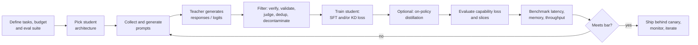
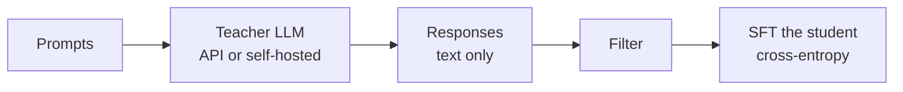
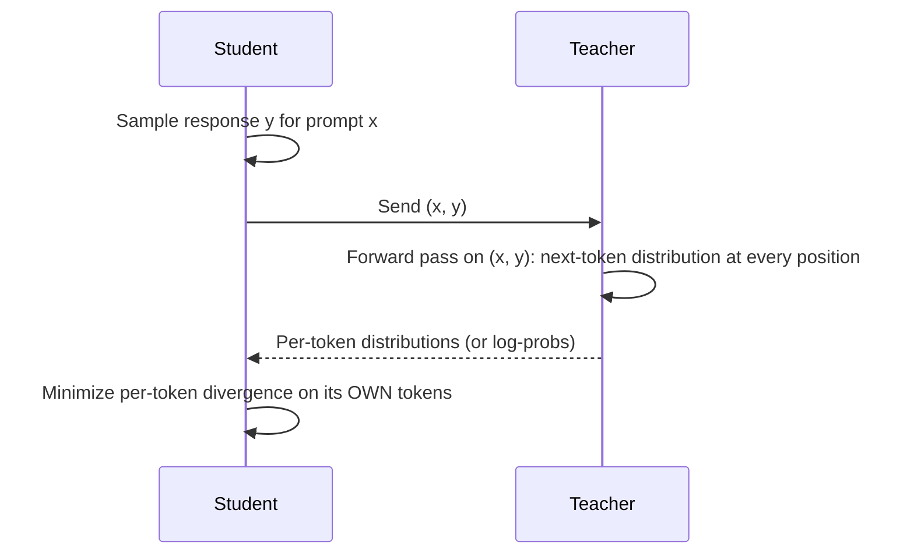
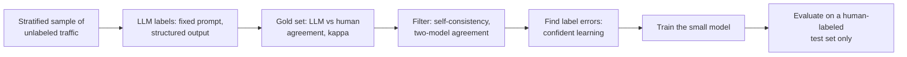
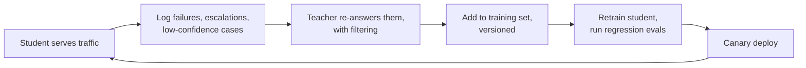

# Distilling Large Language Models into Smaller Ones

> **Level:** Beginner to Advanced · **Study time:** ~120 min · **Prerequisites:** [Knowledge Distillation Fundamentals](05-knowledge-distillation-fundamentals.md), [Softmax, Entropy, Cross-Entropy and KL Divergence](../00-foundations/05-softmax-entropy-cross-entropy-and-kl-divergence.md), [Fine-Tuning LLMs: Full Fine-Tuning, LoRA and QLoRA](../05-llms/07-fine-tuning-full-lora-and-qlora.md), [LLM Inference Fundamentals: Prefill, Decode, TTFT and Throughput](../06-llm-inference/01-inference-fundamentals-prefill-decode-and-latency-metrics.md)

## Table of contents

- [Why this matters](#why-this-matters)
- [The big picture and our running example](#the-big-picture-and-our-running-example)
- [Why distill an LLM at all](#why-distill-an-llm-at-all)
- [Recap: the distillation signal](#recap-the-distillation-signal)
- [Approach 1: logit-level distillation](#approach-1-logit-level-distillation)
- [Approach 2: sequence-level distillation](#approach-2-sequence-level-distillation)
- [Approach 3: on-policy distillation](#approach-3-on-policy-distillation)
- [Comparing the three approaches](#comparing-the-three-approaches)
- [Distilling into a task-specific classifier: the LLM-as-labeler pattern](#distilling-into-a-task-specific-classifier-the-llm-as-labeler-pattern)
- [Selecting the student architecture](#selecting-the-student-architecture)
- [Creating teacher data](#creating-teacher-data)
- [Filtering teacher outputs](#filtering-teacher-outputs)
- [Preserving reasoning, structured output and tool calling](#preserving-reasoning-structured-output-and-tool-calling)
- [Training the student](#training-the-student)
- [Measuring capability loss](#measuring-capability-loss)
- [Comparing latency, memory, throughput and quality fairly](#comparing-latency-memory-throughput-and-quality-fairly)
- [Going deeper: production practice and failure modes](#going-deeper-production-practice-and-failure-modes)
- [Licensing and terms-of-service constraints](#licensing-and-terms-of-service-constraints)
- [Common mistakes and misconceptions](#common-mistakes-and-misconceptions)
- [Interview questions and model answers](#interview-questions-and-model-answers)
- [Key takeaways](#key-takeaways)
- [Further reading](#further-reading)
- [Next](#next)

## Why this matters

The biggest models are the most capable, but they are also slow, expensive and impossible to run on a phone or inside a customer's private network. Most production LLM features do not need everything a frontier model knows: they need one narrow job done well, fast and cheaply. Distillation is how teams get there: a big model writes the curriculum, and a small model learns it. Many of the small open models you have heard of were trained partly this way (for example, the Gemma 2 and Llama 3.2 reports describe using larger models as teachers), and countless internal company models are "fine-tuned on outputs from a bigger model". In interviews, this topic is a favorite because it touches everything at once: loss functions, data engineering, evaluation discipline, inference performance and even legal constraints.

## The big picture and our running example

> **Analogy:** A master chef (the teacher) cannot cook in every restaurant. So the chef trains an apprentice (the student) on the restaurant's actual menu. The apprentice will never know everything the master knows, but for these 40 dishes, the apprentice can cook nearly as well, much faster and for a fraction of the salary.

**Knowledge distillation** is training a smaller model (the **student**) to imitate a larger, more capable model (the **teacher**), so the student inherits as much of the teacher's behavior as possible for the tasks you care about. The general idea, with soft targets and temperature, is covered in [Knowledge Distillation Fundamentals](05-knowledge-distillation-fundamentals.md). This chapter is about what changes when the models are **LLMs**: they generate long sequences token by token, they have huge vocabularies, they do multi-step reasoning, produce JSON and call tools, and the teacher is often only reachable through an API.

**Running example, "SupportBot":** a company runs a 70B-parameter open model as a customer-support assistant. For each ticket it must:

1. Classify the ticket into a JSON object: `{"category": ..., "priority": ..., "summary": ...}`.
2. Decide whether to call tools such as `lookup_order(order_id)` or `issue_refund(order_id, amount)`.
3. Write a short, policy-compliant reply, sometimes after reasoning about refund rules.

The 70B model is good but needs several GPUs and is slow. The goal: distill it into a **7B** student that runs on one GPU, with as little quality loss as possible. We will reuse this example throughout.

Here is the whole pipeline at a glance. Every box is a section of this chapter.



Two abbreviations in the diagram, both explained in detail below: **SFT** (supervised fine-tuning: ordinary next-token cross-entropy training on prompt and response pairs) and **KD loss** (a knowledge-distillation loss that pushes the student's next-token probabilities toward the teacher's).

Notice that step 1 is the eval suite, not the model. You cannot measure "capability loss" without a fixed yardstick decided before training.

## Why distill an LLM at all

There are four classic reasons. Each is a concrete engineering constraint, not a vague wish.

| Motivation | What the big model costs you | What a distilled student buys | SupportBot example |
|---|---|---|---|
| **Latency** | **Decode** (the token-by-token generation phase) speed is limited by how many bytes of weights the GPU must read per token, so a 10x bigger model is roughly 10x slower per token at small batch sizes | Faster time to first token and faster per-token speed | Agent replies feel instant instead of sluggish |
| **Cost** | More GPUs per replica, lower throughput per GPU | Many more requests per GPU-hour | Same traffic on a fraction of the GPUs |
| **On-device / edge** | Does not fit in phone or laptop memory | A 1B to 8B model, often quantized, fits locally | Offline ticket triage on a field technician's laptop |
| **Privacy and control** | Sending data to a third-party API may break data agreements; a giant self-hosted model is hard to operate | A small model you host inside your own network | Customer PII never leaves the company VPC |

Two more reasons appear in senior discussions:

- **Specialization**: a small model trained hard on one task can match or beat a general large model on that task, because all of its capacity goes to the job.
- **Prompt and context compression**: the teacher may need a 3,000-token system prompt with policies and few-shot examples. The student can be trained to behave as if it saw that prompt, without paying for it on every request (this is called **context distillation**, discussed later).

### When not to distill

Distillation is a training project: data generation, filtering, training runs, evals. Check the cheaper options first.

| Option | What it is | When it is enough | Where to learn more |
|---|---|---|---|
| Prompt a smaller off-the-shelf model | No training at all | The task is easy and current small models already pass your eval | [Prompt Engineering for Production](../05-llms/04-prompt-engineering-for-production.md) |
| Quantize the big model | Store weights in fewer bits | You mainly need memory savings and some speed, and quality must stay near the teacher's | [Practical LLM Quantization](04-llm-quantization-gptq-awq-and-outliers.md) |
| Speculative decoding on the big model | A small draft model proposes tokens, the big one verifies | You need exactly the big model's output distribution (identical outputs under greedy decoding, up to numerical noise) but faster | [Speculative Decoding, Prompt Caching and Other Inference Speedups](../06-llm-inference/05-speculative-decoding-caching-and-other-speedups.md) |
| Fine-tune on human-labeled data | Supervised training on real labels | You already have plenty of good human data | [Fine-Tuning LLMs](../05-llms/07-fine-tuning-full-lora-and-qlora.md) |
| **Distill** | Train a small model on the teacher's outputs or distributions | You need a much smaller model, lack human labels, and the task is narrow enough to fit in the student | This chapter |

> **Senior insight:** These options stack. A common production recipe is: distill a 70B teacher into a 7B student, then quantize the student to INT8 or INT4, then serve it with continuous batching. Each step attacks a different cost.

## Recap: the distillation signal

To understand the three LLM distillation approaches, you need just two ideas from [Softmax, Entropy, Cross-Entropy and KL Divergence](../00-foundations/05-softmax-entropy-cross-entropy-and-kl-divergence.md).

**Logits** are the raw scores a model outputs for every token in its vocabulary before softmax. **Softmax** turns logits into a probability distribution over the next token. An LLM produces one such distribution at every position of the sequence.

**KL divergence** measures how different one probability distribution is from another. In distillation, $p$ is the teacher's next-token distribution and $q_\theta$ is the student's.

$$
\mathrm{KL}(p \,\|\, q_\theta) = \sum_{v \in V} p(v) \log \frac{p(v)}{q_\theta(v)}
$$

- $V$: the vocabulary (all tokens the model can output).
- $v$: one token in the vocabulary.
- $p(v)$: teacher's probability for token $v$ at this position.
- $q_\theta(v)$: student's probability for token $v$; $\theta$ are the student's trainable weights.
- $\log$: natural logarithm, so KL is measured in **nats**.
- KL is always $\ge 0$ and equals 0 only when the two distributions are identical.

**Worked example.** A tiny vocabulary of 3 tokens: `refund`, `replace`, `wait`. The teacher predicts $p = [0.7, 0.2, 0.1]$. The student predicts $q = [0.5, 0.3, 0.2]$.

| Token | $p$ | $q$ | $p/q$ | $\ln(p/q)$ | $p \ln(p/q)$ |
|---|---|---|---|---|---|
| refund | 0.7 | 0.5 | 1.4 | 0.3365 | 0.2355 |
| replace | 0.2 | 0.3 | 0.6667 | -0.4055 | -0.0811 |
| wait | 0.1 | 0.2 | 0.5 | -0.6931 | -0.0693 |
| **Sum** | | | | | **0.0851** |

So $\mathrm{KL}(p\|q) \approx 0.0851$ nats. Training pushes this toward 0 by making the student put more probability on `refund`.

The order matters. Swap the arguments and you get the **reverse KL**, $\mathrm{KL}(q\|p)$:

| Token | $q$ | $p$ | $q/p$ | $\ln(q/p)$ | $q \ln(q/p)$ |
|---|---|---|---|---|---|
| refund | 0.5 | 0.7 | 0.7143 | -0.3365 | -0.1682 |
| replace | 0.3 | 0.2 | 1.5 | 0.4055 | 0.1216 |
| wait | 0.2 | 0.1 | 2.0 | 0.6931 | 0.1386 |
| **Sum** | | | | | **0.0920** |

$\mathrm{KL}(q\|p) \approx 0.0920 \ne 0.0851$. KL is not symmetric, and that asymmetry is the heart of on-policy distillation later.

```python
import numpy as np

def kl(p, q):
    """KL(p || q) in nats for two discrete distributions."""
    p, q = np.asarray(p, dtype=float), np.asarray(q, dtype=float)
    return float(np.sum(p * np.log(p / q)))

teacher = [0.7, 0.2, 0.1]
student = [0.5, 0.3, 0.2]
print(round(kl(teacher, student), 4))  # 0.0851  forward KL(p || q)
print(round(kl(student, teacher), 4))  # 0.092   reverse KL(q || p)
```

**Temperature** $T$ divides the logits before softmax: $T > 1$ flattens the distribution and reveals which wrong answers the teacher considers "almost right" (the "dark knowledge" idea from Hinton, Vinyals and Dean, 2015). For logits $[4, 2, 1]$, $T = 1$ gives roughly $[0.844, 0.114, 0.042]$ while $T = 2$ gives roughly $[0.629, 0.231, 0.140]$. The fundamentals chapter covers why the loss is multiplied by $T^2$.

## Approach 1: logit-level distillation

### The idea

> **Analogy:** The apprentice does not just see the dish the master served. At every step the master says "I was 70% sure about adding salt here, 20% about pepper, 10% about nothing." That is far more information than the final dish alone.

**Logit-level distillation** (also called **token-level** or **white-box** distillation) trains the student to match the teacher's full next-token distribution at every position of a sequence. "White-box" means you have access to the teacher's internals (at least its output logits), which typically means you run the teacher's weights yourself.

### The loss

For a training sequence of length $L$, the per-token loss combines the usual next-token cross-entropy with a KL term:

$$
\mathcal{L}(\theta) = \frac{1}{L}\sum_{t=1}^{L} \Big[ \alpha \cdot \big(-\log q_\theta(y_t \mid y_{<t}, x)\big) + (1-\alpha)\, T^2 \cdot \mathrm{KL}\big(p_T(\cdot \mid y_{<t}, x)\,\|\,q_{\theta,T}(\cdot \mid y_{<t}, x)\big) \Big]
$$

- $x$: the prompt.
- $y_t$: the target token at position $t$ (from a human label or from a teacher sample); $y_{<t}$ are the tokens before it.
- $q_\theta(y_t \mid \dots)$: student's probability of the correct next token; $-\log$ of it is ordinary cross-entropy.
- $p_T$, $q_{\theta,T}$: teacher and student distributions computed with temperature $T$.
- $\alpha \in [0, 1]$: how much weight goes to the hard label versus the teacher's soft distribution.
- $T^2$: rescales gradients so changing $T$ does not change their overall size much (soft-target gradients shrink roughly as $1/T^2$).
- $L$: number of response tokens (prompt tokens are usually masked out of the loss).

Small numeric check: suppose at one position the correct token is `refund`, $\alpha = 0.5$, $T = 1$, and the student and teacher are as in the table above. Cross-entropy is $-\ln 0.5 = 0.6931$. KL is $0.0851$. The loss at this position is $0.5 \times 0.6931 + 0.5 \times 1 \times 0.0851 = 0.34655 + 0.04255 = 0.3891$.

### The hard constraint: a shared tokenizer

The KL sum runs over "the same token $v$" in both models. That only makes sense if both models use the **same tokenizer and vocabulary** (see [Tokenization](../04-transformers/01-tokenization.md)). If the teacher splits `unbelievable` into `un` + `believable` and the student splits it into `unbel` + `iev` + `able`, then "position 2" means different things in each model, and there is no token-by-token correspondence to compare.

```text
Teacher tokens:  [ un ][ believable ]
Student tokens:  [ unbel ][ iev ][ able ]
                     ^ no 1-to-1 alignment, so per-token KL is undefined
```

This is why logit distillation is almost always done **within a model family** that shares a tokenizer (for example, a 70B and an 8B model from the same release). Research on cross-tokenizer distillation exists (for example, the "Universal Logit Distillation" loss by Boizard et al., 2024), but it is an approximation and much less common in practice.

### Online vs offline teacher, and top-k logit storage

Two ways to get teacher logits:

- **Online:** run the teacher forward pass during student training, on the same batch. Simple, exact, but you must fit both models in memory and pay the teacher's forward compute every step and every epoch.
- **Offline:** run the teacher once over the dataset and store its distributions on disk.

Storing full distributions is enormous. With a 128,256-token vocabulary (the size used by the Llama 3 family) in FP16 (2 bytes per value):

- Per token: $128{,}256 \times 2 = 256{,}512$ bytes, about 256 KB.
- For 100 million training tokens: $256{,}512 \times 10^8 \approx 2.565 \times 10^{13}$ bytes, about **25.7 TB**.

The standard trick is to store only the **top-k** tokens per position (k between about 8 and 100 in practice), each as a 4-byte token id plus a 2-byte log-probability:

- Per token with $k = 20$: $20 \times (4 + 2) = 120$ bytes.
- For 100 million tokens: $120 \times 10^8 = 1.2 \times 10^{10}$ bytes, about **12 GB**. That is over 2,000 times smaller.

This works because LLM next-token distributions are usually very peaked: a handful of tokens carry almost all the probability mass.

**Renormalization worked example.** The teacher's top-3 probabilities at one position are $[0.60, 0.25, 0.10]$, so the dropped tail holds $1 - 0.95 = 0.05$. Divide each kept value by their sum $0.95$:

- $0.60 / 0.95 = 0.6316$
- $0.25 / 0.95 = 0.2632$
- $0.10 / 0.95 = 0.1053$

These sum to 1 (up to rounding) and become the soft target. The alternative is to keep the tail mass as an explicit "other" bucket. Both are used; renormalizing is simpler.

### Code: token-level KD loss in PyTorch

```python
# pip install torch
import torch
import torch.nn.functional as F

def token_kd_loss(student_logits, teacher_logits, labels, T=1.0, alpha=0.5, ignore_index=-100):
    """
    student_logits, teacher_logits: [batch, seq, vocab], already aligned so that
    position t predicts labels[:, t] (i.e. the usual causal-LM shift is done).
    labels: [batch, seq]; prompt and padding positions are set to ignore_index.
    Both models MUST share the same tokenizer/vocabulary.
    """
    mask = (labels != ignore_index).float()                  # 1 on response tokens
    n_tok = mask.sum().clamp(min=1.0)

    # Hard-label cross-entropy on the target tokens
    ce = F.cross_entropy(student_logits.transpose(1, 2), labels,
                         ignore_index=ignore_index, reduction="sum") / n_tok

    # Soft-label forward KL(teacher || student) at every position
    log_q = F.log_softmax(student_logits.float() / T, dim=-1)
    log_p = F.log_softmax(teacher_logits.float() / T, dim=-1)
    kl_per_tok = (log_p.exp() * (log_p - log_q)).sum(dim=-1)  # [batch, seq]
    kd = (kl_per_tok * mask).sum() / n_tok * (T ** 2)

    return alpha * ce + (1 - alpha) * kd

# Tiny smoke test with random tensors
torch.manual_seed(0)
B, S, V = 2, 5, 11
student_logits = torch.randn(B, S, V, requires_grad=True)
teacher_logits = torch.randn(B, S, V)
labels = torch.randint(0, V, (B, S))
labels[:, :2] = -100                      # pretend the first 2 tokens are the prompt
loss = token_kd_loss(student_logits, teacher_logits, labels, T=2.0)
loss.backward()
print(student_logits.grad.shape)          # torch.Size([2, 5, 11])
```

And the offline, top-k version:

```python
def topk_compress(teacher_logits, k=20):
    """Keep only the teacher's top-k log-probs per position (for storage on disk)."""
    logp = F.log_softmax(teacher_logits.float(), dim=-1)
    vals, idx = logp.topk(k, dim=-1)                  # both [batch, seq, k]
    return idx.to(torch.int32), vals.to(torch.float16)

def sparse_kd_loss(student_logits, topk_idx, topk_logp, mask):
    """Cross-entropy between the renormalized teacher top-k and the student."""
    p = topk_logp.float().softmax(dim=-1)              # softmax of log-probs = renormalized probs
    log_q = F.log_softmax(student_logits.float(), dim=-1)
    log_q_k = log_q.gather(-1, topk_idx.long())        # student log-probs at the teacher's top-k ids
    ce_per_tok = -(p * log_q_k).sum(dim=-1)            # [batch, seq]
    return (ce_per_tok * mask).sum() / mask.sum().clamp(min=1.0)

idx, vals = topk_compress(teacher_logits, k=4)
mask = (labels != -100).float()
print(sparse_kd_loss(student_logits, idx, vals, mask).item() > 0)  # True
```

Cross-entropy $H(p, q)$ and $\mathrm{KL}(p\|q)$ differ only by the teacher's entropy $H(p)$, which does not depend on the student, so they produce the same gradients.

> **Common mistake:** Applying the KD loss on prompt tokens or padding. The student should learn to predict the response, not to reproduce the prompt. Always mask.

## Approach 2: sequence-level distillation

### The idea

> **Analogy:** Instead of hearing the master's step-by-step doubts, the apprentice gets a cookbook the master wrote: thousands of finished recipes. Less information per recipe, but anyone can read a cookbook.

**Sequence-level distillation** (Kim and Rush, "Sequence-Level Knowledge Distillation", 2016) has the teacher generate complete outputs, then trains the student on them with ordinary **supervised fine-tuning (SFT)**, which is plain next-token cross-entropy on (prompt, response) pairs. In other words, the teacher manufactures a **synthetic SFT dataset**.



This is by far the most common way LLMs are distilled in industry, because:

- It needs only the teacher's **text output**, so it works with a **black-box** teacher (an API that returns text but not logits).
- It works **across tokenizers and architectures**: the student just tokenizes the text with its own tokenizer.
- It reuses the standard SFT tooling you already have (see [Fine-Tuning LLMs](../05-llms/07-fine-tuning-full-lora-and-qlora.md)).
- The data is inspectable: you can read it, filter it, fix it and version it.

Well-known examples: Stanford Alpaca (2023) fine-tuned a 7B Llama on instruction data generated by an OpenAI model using the Self-Instruct method (Wang et al., 2023); Orca (Mukherjee et al., 2023) trained on detailed explanation traces from GPT-4; and the DeepSeek-R1 report (DeepSeek-AI, 2025) distilled reasoning into smaller Qwen and Llama models through plain SFT on samples generated by R1.

### What it is really optimizing

Training on teacher samples with cross-entropy minimizes:

$$
-\,\mathbb{E}_{y \sim p(\cdot \mid x)} \big[\log q_\theta(y \mid x)\big] = \mathrm{KL}\big(p \,\|\, q_\theta\big) + H(p)
$$

- $y \sim p(\cdot \mid x)$: a full response sampled from the teacher for prompt $x$.
- $q_\theta(y \mid x)$: the student's probability of producing that whole response (the product of its per-token probabilities).
- $H(p)$: the teacher's entropy, a constant the student cannot change.

Numeric check of this identity with the 3-token example from the recap ($p = [0.7, 0.2, 0.1]$, $q = [0.5, 0.3, 0.2]$): cross-entropy $H(p, q) = -(0.7 \ln 0.5 + 0.2 \ln 0.3 + 0.1 \ln 0.2) = 0.8869$, teacher entropy $H(p) = -(0.7 \ln 0.7 + 0.2 \ln 0.2 + 0.1 \ln 0.1) = 0.8018$, and $0.8869 - 0.8018 = 0.0851$, exactly the KL computed earlier. Lowering cross-entropy and lowering KL are the same job.

So sequence-level distillation with sampled teacher outputs is a **Monte Carlo estimate** (an average approximated by drawing random samples) **of forward KL at the sequence level**. (Kim and Rush themselves used the teacher's beam-search output, which approximates the teacher's mode rather than sampling from its distribution; greedy or beam outputs behave the same way.) Instead of the exact distribution, you see a few samples from it. Logit-level distillation gives you the exact per-token distribution (much richer signal per example), while sequence-level gives you only one sampled path per generation. That is why logit KD can be more data-efficient, and why generating **multiple samples per prompt** helps sequence-level KD.

### Weaknesses to know

- **Less signal per token:** one sampled token instead of a full distribution.
- **Teacher errors become ground truth** unless you filter.
- **Exposure bias:** the student only ever trains on teacher-written prefixes. At inference it must continue its own (imperfect) prefixes, which it never practiced. This motivates Approach 3.
- **Style over substance:** the student easily copies the teacher's tone and format without copying its knowledge (see "The False Promise of Imitating Proprietary LLMs", Gudibande et al., 2023).

## Approach 3: on-policy distillation

### The idea

> **Analogy:** Reading the master's cookbook is "off-policy" learning. On-policy learning is the apprentice cooking the dish while the master stands beside them and says, at each step, "I would not have done that." The apprentice learns to recover from its own mistakes, not just to copy perfect runs.

Some terms first:

- **Policy:** in this context, the model that generates text. The student's own generation distribution is "the student policy".
- **Off-policy data:** sequences generated by someone else (the teacher, or humans).
- **On-policy data:** sequences generated by the model being trained.
- **Exposure bias:** the mismatch between training on someone else's prefixes and generating from your own prefixes at test time. A small early mistake pushes the student into states it never saw in training, and errors compound.

**On-policy distillation** fixes this: the student generates responses, and the teacher scores those exact responses token by token (the teacher computes its next-token distribution at every position of the student's text). The student is then updated to move its distribution toward the teacher's on the states the student actually visits.



This idea mirrors **DAgger** from imitation learning (Ross, Gordon and Bagnell, 2011): let the learner act, and have the expert label the states the learner reaches.

### Why reverse KL comes up: mode covering vs mode seeking

The two leading LLM papers here are **MiniLLM** (Gu, Dong, Wei and Huang, 2023), which optimizes a **reverse KL** $\mathrm{KL}(q_\theta\|p)$ with a policy-gradient method (a reinforcement-learning technique that estimates gradients from sampled outputs and their scores, needed because sampling text is not differentiable), and **GKD, Generalized Knowledge Distillation** (Agarwal et al., "On-Policy Distillation of Language Models: Learning from Self-Generated Mistakes", 2024), which trains on a mix of fixed and student-generated sequences with a choice of divergences (forward KL, reverse KL or a blend).

Why does reverse KL matter? A small student cannot represent everything a big teacher does. It has to compromise, and the two KLs compromise differently:

- **Forward KL** $\mathrm{KL}(p\|q)$ heavily penalizes the student for assigning near-zero probability where the teacher has mass. Result: the student spreads out to **cover** all of the teacher's modes, even if that means putting probability on junk in between. This is called **mode covering**.
- **Reverse KL** $\mathrm{KL}(q\|p)$ heavily penalizes the student for putting probability where the teacher has almost none. Result: the student **concentrates** on one or a few of the teacher's good modes and avoids low-quality regions. This is called **mode seeking**.

**Worked example.** The teacher considers two replies equally good and one bad: $p = [0.49, 0.49, 0.02]$ for (`apologize`, `explain`, `blame_customer`). Compare two possible students:

- Spread student: $q_A = [0.34, 0.33, 0.33]$ (covers both good options but gives the bad one 33%).
- Collapsed student: $q_B = [0.96, 0.02, 0.02]$ (picks one good option, rarely says the bad thing).

Reverse KL for the collapsed student, step by step:

- $0.96 \ln(0.96/0.49) = 0.96 \ln(1.9592) = 0.96 \times 0.6725 = 0.6456$
- $0.02 \ln(0.02/0.49) = 0.02 \ln(0.0408) = 0.02 \times (-3.1987) = -0.0640$
- $0.02 \ln(0.02/0.02) = 0.02 \times 0 = 0$
- Sum: $0.6456 - 0.0640 + 0 = 0.5816$ (0.5817 with unrounded intermediates)

Reverse KL for the spread student:

- $0.34 \ln(0.34/0.49) = 0.34 \times (-0.3655) = -0.1243$
- $0.33 \ln(0.33/0.49) = 0.33 \times (-0.3953) = -0.1305$
- $0.33 \ln(0.33/0.02) = 0.33 \ln(16.5) = 0.33 \times 2.8034 = 0.9251$
- Sum: $-0.1243 - 0.1305 + 0.9251 = 0.6703$ (0.6704 unrounded)

Doing the same for forward KL gives the full picture:

| Student | Forward KL $(p\|q)$ | Reverse KL $(q\|p)$ |
|---|---|---|
| Spread $q_A = [0.34, 0.33, 0.33]$ | **0.3167** (preferred) | 0.6704 |
| Collapsed $q_B = [0.96, 0.02, 0.02]$ | 1.2378 | **0.5817** (preferred) |

Forward KL prefers the spread student; reverse KL prefers the collapsed one. For generation, putting 33% on "blame the customer" is terrible, so mode seeking is often what you want from a small student: be consistently good on fewer behaviors rather than vaguely average across all of them. The cost is less diversity.

> **Interview tip:** The one-line version: "Forward KL is mode covering, reverse KL is mode seeking. Small students cannot cover every mode of a big teacher, so on-policy methods with reverse KL make them commit to high-quality modes and practice on their own outputs, which reduces exposure bias."

### What on-policy distillation requires

- **Teacher log-probabilities on arbitrary text**, so in practice a white-box teacher or an API that returns per-token log-probs for supplied text (many do not).
- **A shared tokenizer** for exact per-token divergences, same as logit KD.
- **More compute per step:** the student must generate (slow, sequential decoding) and the teacher must run a forward pass on every sample. It looks more like reinforcement learning infrastructure than SFT.

It is usually applied **after** an SFT or sequence-level warm-up, because a student that cannot yet produce sensible text gets little useful signal from scoring its own gibberish.

### Code: one on-policy step (conceptual)

This sketch follows the GKD style: sample from the student without gradients, then minimize a token-level reverse KL on those samples. Real implementations (for example the `GKDTrainer` in Hugging Face TRL, which recent releases moved from the top-level `trl` package to `trl.experimental.gkd`; its location and arguments change between versions) handle padding, position ids, batching and efficient generation for you.

```python
# Conceptual sketch: assumes student and teacher share a tokenizer and
# tokenizer.padding_side == "left" so all prompts end at the same index.
import torch
import torch.nn.functional as F

def on_policy_step(student, teacher, tokenizer, prompts, optimizer, max_new_tokens=256):
    enc = tokenizer(prompts, return_tensors="pt", padding=True).to(student.device)
    prompt_len = enc["input_ids"].shape[1]

    # 1) The student generates its OWN responses (no gradient through sampling)
    with torch.no_grad():
        seqs = student.generate(**enc, do_sample=True, temperature=1.0,
                                max_new_tokens=max_new_tokens)
    # Caveat: if pad_token_id == eos_token_id (common), this also masks the real EOS,
    # so the student never gets signal on when to stop; real trainers track it separately.
    attn = (seqs != tokenizer.pad_token_id).long()

    # 2) Both models score the same sequences; slice the positions that predict response tokens
    s_logits = student(seqs, attention_mask=attn).logits[:, prompt_len - 1:-1]
    with torch.no_grad():
        t_logits = teacher(seqs, attention_mask=attn).logits[:, prompt_len - 1:-1]
    mask = attn[:, prompt_len:].float()

    # 3) Token-level reverse KL(student || teacher) over the full vocabulary
    log_q = F.log_softmax(s_logits.float(), dim=-1)
    log_p = F.log_softmax(t_logits.float(), dim=-1)
    rkl = (log_q.exp() * (log_q - log_p)).sum(dim=-1)          # [batch, response_len]
    loss = (rkl * mask).sum() / mask.sum().clamp(min=1.0)

    optimizer.zero_grad()
    loss.backward()
    optimizer.step()
    return loss.item()
```

## Comparing the three approaches

| | Logit-level (token-level) KD | Sequence-level KD (synthetic SFT) | On-policy KD (MiniLLM, GKD style) |
|---|---|---|---|
| **What the student sees** | Teacher's full (or top-k) distribution at each position of a fixed sequence | Teacher-written text only | Its own samples, scored token by token by the teacher |
| **Teacher access needed** | White-box logits | Black-box text is enough | Log-probs on student text (white-box in practice) |
| **Tokenizer** | Must match | Any | Must match (for exact token-level divergence) |
| **Typical divergence** | Forward KL | Forward KL, estimated by samples | Reverse KL or a blend |
| **Signal per example** | High | Low (one sampled path) | High, and on the right states |
| **Addresses exposure bias** | No | No | Yes (trains on its own states) |
| **Compute and infra** | Teacher forward pass (online) or big logit store (offline) | Teacher generation once, then cheap SFT | Student generation plus teacher scoring every step |
| **When to use** | Same family, you own the teacher weights, want max quality per token | Default first step; API teachers; cross-family | Polishing after SFT when you own the teacher and quality matters |
| **Main risk** | Storage cost, tokenizer lock-in | Copies teacher mistakes and style; needs heavy filtering | Complex, slower, unstable if the student starts too weak |

> **Senior insight:** In practice these are stages, not rivals. A strong recipe is: (1) sequence-level SFT on filtered teacher data to get a competent student, (2) optionally add a logit KD term if you share a tokenizer, (3) optionally finish with on-policy distillation or preference tuning on the student's own outputs.

## Distilling into a task-specific classifier: the LLM-as-labeler pattern

> **Analogy:** A senior postal clerk can read any address, but sorting 10 million letters a day by hand would bankrupt the post office. So the clerk sorts a few hundred thousand letters once, those piles train a fast sorting machine, and the clerk only handles the letters the machine cannot read.

Many "LLM features" in production are really **classification**: route a ticket to one of 20 queues, tag its priority, flag toxicity, extract order IDs. The output is a label from a fixed set, not free text, so the student does not need to be a generative LLM at all. In the **LLM-as-labeler** pattern (also called **LLM-as-annotator**), the large model labels a big sample of unlabeled data once, and a small **non-generative** model is trained on those labels:

- an **encoder classifier**: a BERT-style encoder-only Transformer plus a classification head, which reads the whole input in one forward pass and outputs class probabilities (see [Encoder-Only, Encoder-Decoder and Decoder-Only Models](../04-transformers/07-encoder-only-encoder-decoder-and-decoder-only-models.md));
- a **token tagger** for **named-entity recognition (NER)**, which predicts a label for every token to find spans such as order IDs or product names;
- or simply **frozen embeddings plus logistic regression**: a pretrained embedding model turns each text into a vector (frozen means its weights are not trained), and a linear classifier is trained on those vectors.

This is still knowledge distillation (response-based, with hard or soft labels, as in [Knowledge Distillation Fundamentals](05-knowledge-distillation-fundamentals.md)), but the student is tens to hundreds of times smaller than even a 7B LLM, has no token-by-token decode loop, and answers in milliseconds. In SupportBot, step 1 (category and priority) fits this pattern; step 3 (writing the reply) still needs a generative model.

### The ladder of options

Climb only as high as your eval requires. Illustrative orders of magnitude for a 300-token ticket and a fixed label set (prices and throughput vary widely by provider, hardware and model, so measure your own):

| Option | What it is | Latency per item | Cost per 1M items | Labeled data needed | Accuracy expectation |
|---|---|---|---|---|---|
| **Zero-shot LLM** | Prompt with label definitions only | 0.3 to 3 s (API round trip) | About \$1,000 (worked example below) | None to train; always a human-labeled test set | Strong on clear-cut labels; weaker on fuzzy, company-specific categories |
| **Few-shot LLM** | Prompt plus labeled examples | Same or a bit higher (longer prompt) | About \$5,500 with 1,500 extra prompt tokens, roughly five 300-token examples (less with prompt caching) | 5 to 50 examples in the prompt | Usually better than zero-shot on company-specific labels |
| **Frozen embeddings + logistic regression** | Pretrained embedding model (not trained) plus a linear classifier | About 5 to 20 ms on a GPU | About \$1 to \$10 (self-hosted) | Hundreds to a few thousand labels | Strong, cheap baseline; misses distinctions the embedding does not capture |
| **SetFit-style contrastive few-shot** | Contrastively fine-tune a small sentence-embedding model, then fit a linear head | Same as the row above | About \$1 to \$10 | About 8 to 64 per class | Often close to full fine-tuning when labels are scarce |
| **Fine-tuned encoder** (BERT, DeBERTa, ModernBERT class) | Train all encoder weights plus a classification head | About 5 to 20 ms on a GPU; slower on CPU unless small or quantized | About \$1 to \$10 | Thousands to tens of thousands (LLM labels work) | Often within a few points of the LLM teacher on in-distribution traffic, sometimes above it (it averages over many noisy labels) |
| **Distilled small LLM** (1B to 8B) | The approaches earlier in this chapter | About 50 to 500 ms | About \$5 to \$50 | Thousands to tens of thousands of teacher outputs | Needed only when the output must be generated text (replies, summaries, free-text fields) |

**SetFit** (Tunstall et al., 2022, "Efficient Few-Shot Learning Without Prompts") is worth knowing by name. From a handful of labeled examples per class it builds many sentence pairs (same class: positive pair; different class: negative pair), fine-tunes a sentence-embedding model with a **contrastive** objective (pull positive pairs together and push negative pairs apart in embedding space), then trains a logistic-regression head on the new embeddings. It needs no prompts and no LLM at inference, which makes it a good fit when you have only a few dozen human labels or are not allowed to send data to an LLM at all.

> **Senior insight:** LLM labels make the upper rungs cheap. The traditional obstacle to a fine-tuned encoder was paying humans for tens of thousands of labels. An LLM produces them in hours (1M labeling calls cost about \$1,050 at the worked-example price below), and human effort moves to a small gold set, where it matters most.

### The labeling pipeline



**1. Sample stratified unlabeled data.** Draw from real traffic, **stratified** by whatever changes the label mix (channel, language, product, time period, length): each segment is sampled in a controlled proportion instead of uniformly at random, so rare but important segments get enough examples. Deduplicate, hold out the human test set first so it never enters the training pool, and scrub personal data if the labeler is an external API (the terms-of-service and privacy questions in [Licensing and terms-of-service constraints](#licensing-and-terms-of-service-constraints) apply to labels too).

**2. Label with a fixed prompt and structured output.** Write the label definitions as an annotation guideline (what each class means, tie-break rules, an explicit `other` class), version the prompt, pin the model version, use temperature 0 for the primary label, and force the answer into a JSON schema whose `label` field is an enum of the allowed classes (see [Structured Outputs, JSON Mode and Function Calling](../05-llms/05-structured-outputs-and-function-calling.md)). For NER, ask for entity spans as JSON, keep only spans that occur verbatim in the input (LLMs sometimes paraphrase or invent them), and convert them to per-token **BIO** tags (B = beginning of an entity, I = inside, O = outside) using the student tokenizer's character offsets. Store prompt version, model version and date with every label.

**3. Measure LLM-vs-human agreement on a gold set.** A **gold set** is a few hundred to a few thousand items labeled by trained humans, ideally two per item with disagreements adjudicated. Compare the LLM to it with **Cohen's kappa**, agreement corrected for chance (covered in [Evaluating LLMs](../05-llms/10-llm-evaluation-metrics-and-llm-as-a-judge.md#step-2-cohens-kappa)):

$$
\kappa = \frac{p_o - p_e}{1 - p_e}
$$

- $p_o$: observed agreement, the fraction of items where the LLM and the human chose the same label.
- $p_e$: agreement expected by chance: for each class, multiply the two raters' rates for that class, then sum over classes.
- $\kappa = 1$ means perfect agreement; $\kappa = 0$ means chance level.

Worked example (illustrative): 1,000 gold tickets labeled `urgent` or `routine`.

| | LLM: urgent | LLM: routine | Human total |
|---|---|---|---|
| **Human: urgent** | 180 | 20 | 200 |
| **Human: routine** | 40 | 760 | 800 |
| **LLM total** | 220 | 780 | 1,000 |

- $p_o = (180 + 760) / 1000 = 0.94$.
- $p_e = 0.20 \times 0.22 + 0.80 \times 0.78 = 0.044 + 0.624 = 0.668$.
- $\kappa = (0.94 - 0.668) / (1 - 0.668) = 0.272 / 0.332 \approx 0.82$.

Compare it with **human-human** kappa on the same items, which is the realistic reference point (roughly a ceiling, though an LLM can occasionally exceed it, especially when scored against adjudicated labels): if two humans reach 0.86 and the LLM reaches 0.82, the LLM is a usable labeler. Then read the confusion matrix: here the LLM over-calls `urgent` (40 false alarms against 20 misses), which a sharper definition in the prompt may fix.

**4. Filter low-confidence or disagreeing labels.** Three common signals:

- **Self-consistency:** sample the LLM $k$ times (for example $k = 5$ at temperature 0.7) and keep the item only if, say, at least 4 of the 5 votes agree. The vote share doubles as a confidence score and can be kept as a **soft label** (4 of 5 votes for `billing` and 1 for `shipping` becomes $[0.8, 0.2, 0.0]$ over `billing`, `shipping`, `technical`), which is response-based KD on the teacher's uncertainty.
- **Two-model agreement:** label with two different LLMs (or two differently worded prompts) and keep the items where they agree. Models from the same family share mistakes, so their agreement is weaker evidence.
- **Label log-probability:** if the API returns token log-probs, the probability of the chosen label comes for free, but it is often poorly calibrated after instruction tuning.

Do not simply throw away every disagreement. Disagreements are the hard boundary cases, and a student that never sees them will be confidently wrong on them in production. Send a sample to humans and keep those items with human labels.

**5. Handle label noise.** Filtered LLM labels are still noisy. **Random** noise mostly averages out with more data. **Systematic** noise does not: if the LLM always files "item arrived broken, I want a refund" under `shipping` instead of `refund`, more data and more votes only teach the error more firmly. Find it in the gold-set confusion matrix, fix the label definition, and relabel. For the remaining item-level errors, rank items by out-of-fold loss or with confident learning (the idea behind the **cleanlab** library) and review the top suspects; see [confident learning and cleanlab](../03-computer-vision/04-computer-vision-in-production.md#method-3-confident-learning-the-idea-behind-cleanlab) and [Noisy labels](../02-deep-learning/04-loss-functions.md#noisy-labels). Soft labels or label smoothing also soften the damage from what is left.

Evidence that the pattern works: Wang et al. (2021, "Want To Reduce Labeling Cost? GPT-3 Can Help") trained smaller models on GPT-3 labels at a fraction of the cost of human labeling, and Gilardi, Alizadeh and Kubli (2023) found zero-shot ChatGPT labels more accurate than crowd workers' on several text-annotation tasks. Neither result says LLM labels are good enough for your task; your gold set decides.

### Worked cost example: 10M tickets a day

Illustrative assumptions (API prices change often, so plug in current ones):

- 10M tickets per day, about 300 input tokens each (ticket plus a compact instruction) and about 10 output tokens (a JSON label).
- Frontier LLM API at \$3 per 1M input tokens and \$15 per 1M output tokens.
- A base-size encoder (about 110M parameters) sustains about 500 tickets/s per GPU with FP16 and dynamic batching, on a GPU costing \$1 per hour. Sanity check: at about $2 \times$ parameters FLOPs per token, one ticket costs $2 \times 110\text{M} \times 300 \approx 66$ GFLOPs, so 500 tickets/s needs about 33 TFLOPS sustained, within reach of one modern inference GPU in FP16.

LLM cost:

- Per ticket: $300 \times \$3/10^6 + 10 \times \$15/10^6 = \$0.0009 + \$0.00015 = \$0.00105$.
- Per day: $10^7 \times \$0.00105 = \$10{,}500$, about \$3.8M per year.

Encoder cost:

- Average load: $10^7 / 86{,}400 \approx 116$ tickets/s; at an assumed 3x peak, about 350/s. One replica covers the peak; run two for redundancy.
- Per day: $2 \times \$1 \times 24 = \$48$, about 219 times cheaper than the LLM.
- With a cascade that still sends 5% of tickets to the LLM: $0.05 \times 10^7 \times \$0.00105 = \$525$ per day, for a total of \$573 per day, still about 18 times cheaper.

**Break-even volume.** The small model has a fixed daily serving cost $F$, the LLM costs $c$ per item, and a fraction $f$ of items still goes to the LLM. The small-model setup is cheaper when $N c > F + f N c$, so the break-even volume is:

$$
N^* = \frac{F}{(1 - f)\, c}
$$

- $N^*$: break-even volume in items per day.
- $F$: fixed daily cost of serving the small model (\$48 here).
- $c$: LLM cost per item (\$0.00105).
- $f$: fraction of items that fall back to the LLM (0.05).

$N^* = 48 / (0.95 \times 0.00105) = 48 / 0.0009975 \approx 48{,}120$ items per day. Below that volume, stay with the LLM, or cut $F$ by serving a small encoder on a single CPU replica.

**Payback of the one-time cost.** Labeling 200,000 tickets with 5 self-consistency samples each is $10^6 \times \$0.00105 = \$1{,}050$; a 3,000-item gold set labeled twice at an illustrative \$0.50 per label is \$3,000; add, say, \$40,000 of engineering time. Total: about \$44,000.

- At 10M tickets per day, savings are $\$10{,}500 - \$573 = \$9{,}927$ per day: payback in about 4.4 days.
- At 100k tickets per day, the LLM costs \$105 per day and the encoder plus fallback about \$53: savings of about \$52 per day, a payback of about 850 days (2.3 years) before counting maintenance. Not worth it.

Beyond cost, latency drops from about a second to around 10 ms for the 95% of tickets the encoder keeps (escalated tickets still pay the LLM round trip), and those tickets stay inside your own network at inference time.

### Keep the LLM as a fallback: a cascade

The small model does not have to handle everything. Build a **cascade** (see [Model routing and cascades](../06-llm-inference/05-speculative-decoding-caching-and-other-speedups.md#model-routing-and-cascades)): the classifier labels every ticket, and if its top-class probability is below a threshold $t$, the ticket goes to the LLM.

**Calibrate first.** A threshold on probabilities only means something if the probabilities are trustworthy, so fit temperature scaling on a human-labeled validation set (see [Probability calibration](../01-classical-ml/04-classification-metrics-and-imbalanced-data.md#probability-calibration)).

**Pick $t$ on a coverage vs accuracy curve.** Raising $t$ sends more tickets to the LLM (more cost) and keeps only the student's surest answers. The cascade's accuracy is:

$$
\text{acc}_{\text{cascade}} = r \cdot a_{\text{small}} + (1 - r) \cdot a_{\text{LLM}}
$$

- $r$: coverage, the fraction of items the small model keeps.
- $a_{\text{small}}$: the small model's accuracy on the items it keeps.
- $a_{\text{LLM}}$: the LLM's accuracy on the escalated items. It is usually lower than the LLM's overall accuracy, because escalated items are the hard ones: measure it, do not assume it.

Example (illustrative): $r = 0.95$, $a_{\text{small}} = 0.94$, $a_{\text{LLM}} = 0.85$ gives $0.95 \times 0.94 + 0.05 \times 0.85 = 0.893 + 0.0425 = 0.9355$, about 93.6%. Compare it with the LLM alone on the same human test set.

**Escalations are free training data.** Log them with the LLM's answer, send a sample to humans, and add them to the next training round (the [data flywheel](#the-data-flywheel)). A rising escalation rate is also an early drift alarm.

### Evaluate on human labels, never on LLM labels

The test set must be **human-labeled**. If you score the student against LLM labels, you measure agreement with the teacher, not accuracy: every teacher mistake the student copies counts as correct, a student that is better than the teacher looks worse, and the teacher becomes the measured ceiling. Report the LLM (zero-shot or few-shot) and the student on the same human test set with per-class precision and recall and macro-F1 (see [Multiclass metrics](../01-classical-ml/04-classification-metrics-and-imbalanced-data.md#multiclass-metrics-macro-micro-and-weighted-averaging)), confidence intervals as in [Measuring capability loss](#measuring-capability-loss), and calibration. Student-vs-LLM agreement on fresh traffic is still useful, but as a cheap monitoring signal, not as the metric.

### Drift: re-label periodically

Ticket content drifts: new products, outages, seasonal issues, new categories (see [Data Drift, Concept Drift and When to Retrain](../01-classical-ml/08-data-drift-concept-drift-and-retraining.md)). The LLM-as-labeler pattern makes the fix cheap:

- **On a schedule** (for example weekly), label a fresh stratified sample of recent traffic with the same pinned prompt and model, and track student-vs-LLM agreement. A drop is a drift alarm that needs no humans; a small monthly human-labeled sample checks both models.
- **Retrain** on old plus newly labeled data, with the human test set as a regression gate. Refresh the human test set too, because it ages along with the traffic.
- **Taxonomy changes** become a prompt edit plus a relabeling run: days of work instead of a months-long human annotation project.
- **Teacher changes** shift labels: when the provider updates or retires the model, re-run the gold-set kappa before mixing new labels with old ones.

### Code: label filtering, gold-set kappa and break-even

```python
# pip install scikit-learn
from collections import Counter
from sklearn.metrics import cohen_kappa_score

def vote(samples: list[str], min_share: float = 0.8):
    """Self-consistency filter: k LLM labels for one item -> (label or None, agreement share)."""
    label, count = Counter(samples).most_common(1)[0]
    share = count / len(samples)
    return (label if share >= min_share else None), share

def soft_target(samples: list[str], classes: list[str]) -> list[float]:
    """Vote shares as a soft label, for KD-style training on the LLM's uncertainty."""
    counts = Counter(samples)
    return [counts[c] / len(samples) for c in classes]

print(vote(["billing"] * 5))                                             # ('billing', 1.0)
print(vote(["billing", "billing", "billing", "shipping", "technical"]))  # (None, 0.6)
print(soft_target(["billing"] * 4 + ["shipping"], ["billing", "shipping", "technical"]))  # [0.8, 0.2, 0.0]

# Gold-set check: rebuild the 1,000 human and LLM labels from the table above
human = ["urgent"] * 200 + ["routine"] * 800
llm = ["urgent"] * 180 + ["routine"] * 20 + ["urgent"] * 40 + ["routine"] * 760
print(round(cohen_kappa_score(human, llm), 3))                           # 0.819

def break_even_items_per_day(fixed_daily: float, llm_cost_per_item: float, fallback_rate: float) -> float:
    """Daily volume above which 'small model + LLM fallback' is cheaper than the LLM alone."""
    return fixed_daily / ((1 - fallback_rate) * llm_cost_per_item)

print(round(break_even_items_per_day(48.0, 0.00105, 0.05)))              # 48120
```

### Code: an embeddings baseline and a cascade threshold

```python
# pip install sentence-transformers scikit-learn   (downloads a small embedding model on first use)
import numpy as np
from sentence_transformers import SentenceTransformer
from sklearn.linear_model import LogisticRegression

embedder = SentenceTransformer("BAAI/bge-small-en-v1.5")   # any small embedding model; check its max length

def embed(texts: list[str]) -> np.ndarray:
    return embedder.encode(texts, batch_size=256, normalize_embeddings=True)

# train_texts, train_labels: the filtered LLM-labeled pool
# val_texts, val_labels: a HUMAN-labeled validation set (never LLM labels)
clf = LogisticRegression(max_iter=2000).fit(embed(train_texts), train_labels)

probs = clf.predict_proba(embed(val_texts))
conf, pred = probs.max(axis=1), clf.classes_[probs.argmax(axis=1)]
y_val = np.asarray(val_labels)
for t in (0.5, 0.7, 0.9):
    kept = conf >= t                     # the rest would be escalated to the LLM
    acc = (pred[kept] == y_val[kept]).mean() if kept.any() else float("nan")   # avoid an empty-slice warning
    print(f"threshold {t}: student keeps {kept.mean():.0%}, accuracy on kept {acc:.1%}")
# Choose t here, then report the final cascade numbers on a separate human-labeled test set.
```

If this baseline already meets the bar, stop. Otherwise, fine-tune an encoder on the same labels and compare on the same human-labeled data.

## Selecting the student architecture

> **Analogy:** You choose the apprentice before writing the curriculum. Someone who already speaks the master's language (same tokenizer) and has strong general skills (a good base model) learns much faster than a blank slate.

### Start from the budget, not from the model zoo

Write down the deployment constraints first, then pick the biggest model that fits them.

**1. Memory budget.** Weights take roughly (parameters) times (bytes per parameter); see [Number Formats and Model Memory](01-number-formats-and-model-memory.md):

- 70B teacher in BF16: $70 \times 10^9 \times 2 = 140$ GB, so it needs at least two 80 GB GPUs, more in practice.
- 7B student in BF16: $7 \times 10^9 \times 2 = 14$ GB. In INT4: about 3.5 GB plus overhead.

Then add the **KV cache**, the stored attention keys and values for every token in flight (see [The KV Cache](../06-llm-inference/02-kv-cache-explained.md)):

$$
\text{KV bytes per token} = 2 \times n_{\text{layers}} \times n_{\text{kv\_heads}} \times d_{\text{head}} \times \text{bytes per value}
$$

- $2$: one tensor for keys, one for values.
- $n_{\text{layers}}$: number of transformer layers.
- $n_{\text{kv\_heads}}$: number of key/value heads (smaller than the number of query heads when the model uses grouped-query attention, GQA).
- $d_{\text{head}}$: dimension of each head.
- bytes per value: 2 for BF16/FP16.

For an illustrative 7B to 8B config with 32 layers, 8 KV heads and head dimension 128 (similar to popular open 8B models): $2 \times 32 \times 8 \times 128 \times 2 = 131{,}072$ bytes = 128 KiB per token. One 8,192-token conversation: $131{,}072 \times 8{,}192 = 2^{30}$ bytes = 1 GiB. Thirty-two such conversations in flight: 32 GiB. For an illustrative 70B config with 80 layers and the same KV heads and head dimension, it is $2 \times 80 \times 8 \times 128 \times 2 = 327{,}680$ bytes = 320 KiB per token.

**2. Latency budget.** At small batch sizes, generating each token requires reading all the weights from GPU memory, so decode is **memory-bandwidth bound** (see [GPU Fundamentals for LLMs](../06-llm-inference/03-gpu-fundamentals-compute-bound-vs-memory-bound.md)). A rough lower bound on time per output token is weight bytes divided by memory bandwidth. With an illustrative 2 TB/s of bandwidth:

- 7B student, 14 GB: $14 / 2000 = 0.007$ s = **7 ms per token** (at best).
- 70B teacher, 140 GB: $140 / 2000 = 0.07$ s = **70 ms per token** if it were on one such device (split across GPUs it is faster per token, but you pay for more GPUs and inter-GPU communication).

**3. Context length needs.** If tickets plus retrieved documents can reach 16K tokens, the student must support at least that, trained and evaluated at that length. A small model with a nominal 128K window may still degrade badly on long inputs, so test at your real lengths.

### Same family and tokenizer

Picking a student from the **same model family** as the teacher (for example, an 8B and a 70B from the same release) gives you:

- A shared tokenizer, which unlocks logit-level and on-policy distillation.
- The same **chat template** (the special-token format for system, user, assistant and tool messages), so tool-call formats transfer cleanly.
- Similar pretraining data and behavior, so the student "speaks the same language" and imitation is easier.

If your teacher is a black-box API, tokenizer matching is impossible anyway, so you choose the student purely on quality, license and serving fit, and use sequence-level KD.

### Start from a strong small base model

Almost nobody distills into a randomly initialized network for an LLM product. Pretraining from scratch costs vastly more than fine-tuning. Instead, start from an existing strong **base** or **instruct** checkpoint of the target size (many open families ship 1B to 14B variants) and distill your task into it. Distillation teaches the task; pretraining already taught language and world knowledge.

> **Senior insight:** "Start from the best existing small model" also sets your baseline. Always evaluate the off-the-shelf student (with a good prompt) before distilling. If it already scores 85% and the distilled version scores 87%, the whole project bought 2 points: maybe worth it, maybe not.

### Depth vs width, dense vs MoE

If you do choose or design an architecture (for example, pruning a teacher into a student, as in NVIDIA's Minitron work, Muralidharan et al., 2024; see [Pruning, Low-Rank Factorization and Choosing a Compression Strategy](07-pruning-low-rank-factorization-and-choosing-a-compression-method.md)):

| Choice | Effect on quality | Effect on latency and serving |
|---|---|---|
| **Deeper, thinner** (more layers, smaller hidden size) | MobileLLM (Liu et al., 2024) found deep-and-thin designs worked better for sub-billion models | More sequential layers: more per-layer overhead (kernel launches, and per-layer communication under tensor parallelism), so often slower at batch size 1 for the same parameter count |
| **Shallower, wider** | Can be slightly worse at very small scale | Bigger matrix multiplies use the GPU more efficiently; fewer sequential steps |
| **Dense** | Predictable | Memory and compute both scale with total parameters |
| **Mixture of Experts (MoE)** | High quality per active parameter | Fast compute per token but ALL experts must sit in memory, a poor fit for on-device; see [Modern LLM Architecture](../04-transformers/08-modern-llm-architecture-improvements.md) |
| **GQA vs full multi-head attention** | Small quality effect | Much smaller KV cache, so more concurrent users and longer contexts |

### A student selection checklist

| Question | SupportBot answer (illustrative) |
|---|---|
| Hardware target? | One 80 GB data-center GPU per replica |
| Latency SLO (service-level objective, the latency target you commit to)? | p95 (95th-percentile) time to first token under 500 ms, p95 full reply under 3 s |
| Max context? | 8K tokens (ticket plus order history) |
| Concurrency per replica? | About 32 sessions |
| Tokenizer match with teacher needed? | Yes, we want logit KD, so same family |
| Candidates? | 3B, 7B, 14B from the teacher's family |
| Decision rule? | Smallest model whose distilled version passes the eval bar at the SLO |

Run a quick pilot: distill on a small subset of data into two or three candidate sizes and compare. The curve of quality vs size tells you whether the 3B is "good enough" or the 14B is worth its cost.

## Creating teacher data

The quality of a distilled model is capped by the quality and coverage of its training data. Generating data is the single most important step.

### Prompt sources and coverage

The student only learns behaviors that appear in the prompts. Gather prompts from several sources:

- **Real production traffic** (logs of past tickets): the best match to the real distribution. Scrub personal data and respect consent and retention rules.
- **Task taxonomy:** list every intent, tool, language, edge case and failure mode you care about, then make sure each has enough prompts. For SupportBot: billing, shipping, technical, refunds over the limit, angry customers, multi-intent tickets, non-English tickets, prompt-injection attempts.
- **Synthetic prompt expansion:** have an LLM write new prompts from seed examples, as in Self-Instruct (Wang et al., 2023). Useful to fill gaps, but synthetic prompts tend to be cleaner and more repetitive than real ones.
- **Hard cases:** past failures, escalations, and adversarial prompts.

### Diversity, multiple samples and difficulty mix

- **Diversity:** vary phrasing, length, language, persona and format. Measure it: count near-duplicate clusters, check category balance, and look at embedding-space coverage.
- **Multiple samples per prompt:** sampling the teacher several times (with temperature around 0.7 to 1.0) gives you (a) a choice of the best sample after filtering (rejection sampling, below), and (b) more of the teacher's distribution, which partly recovers the signal that sequence-level KD loses.
- **Difficulty mix:** if every example is easy, the student never learns the hard cases; if every example is hard, many teacher outputs fail verification and you waste generation budget. Bucket prompts by difficulty (for example by teacher pass rate across samples) and keep a deliberate mix, oversampling the hard but solvable middle.

### Give the teacher every advantage

The teacher does not have to work under the student's constraints. Generate with a long system prompt, detailed policies, few-shot examples, retrieved documents and even chain-of-thought. Then train the student on the **short** prompt it will see in production, paired with the teacher's high-quality answer. This is **context distillation** (introduced in "A General Language Assistant as a Laboratory for Alignment", Askell et al., 2021, and studied in "Learning by Distilling Context", Snell et al., 2022): the student internalizes instructions it never sees at inference, saving prompt tokens on every request.

```text
Teacher input:  [3,000-token policy manual] + [5 examples] + [ticket]  -> high-quality answer
Student input:  [80-token system prompt] + [ticket]                    -> same answer (training target)
```

### How much data?

There is no universal number. As a rough rule of thumb, narrow, well-defined tasks often work with a few thousand to tens of thousands of high-quality examples, while broad general-purpose distillation uses far more. Find your point empirically: train on 25%, 50% and 100% of the data and plot the eval score. If the curve is still rising, generate more; if it is flat, spend effort on quality or hard cases instead.

### Code: generating teacher samples

Many serving stacks (vLLM, SGLang and others) expose an OpenAI-compatible HTTP API, so the client code looks the same whether the teacher is self-hosted or remote. SDK details change between versions; treat this as conceptual but realistic.

```python
# pip install openai   (client library; works with any OpenAI-compatible server)
import json
from openai import OpenAI

client = OpenAI(base_url="http://localhost:8000/v1", api_key="not-needed-for-local")
TEACHER_SYSTEM = open("teacher_policy_manual.txt").read()   # long, detailed instructions

def generate_samples(ticket: str, n: int = 4, temperature: float = 0.8) -> list[str]:
    resp = client.chat.completions.create(
        model="teacher-70b",                                  # name your server registered
        messages=[{"role": "system", "content": TEACHER_SYSTEM},
                  {"role": "user", "content": ticket}],
        n=n, temperature=temperature, max_tokens=512,
    )
    return [choice.message.content for choice in resp.choices]

with open("tickets.jsonl") as f_in, open("raw_teacher.jsonl", "w") as f_out:
    for line in f_in:
        ticket = json.loads(line)["text"]
        for sample in generate_samples(ticket):
            # Record provenance with every sample: you will need it for audits and licensing
            f_out.write(json.dumps({"prompt": ticket, "response": sample,
                                    "teacher": "teacher-70b@v3", "temperature": 0.8}) + "\n")
```

## Filtering teacher outputs

> **Analogy:** The master's cookbook has typos and the occasional burnt dish. Before the apprentice studies it, a quality inspector throws away anything that fails a taste test.

Teachers are wrong a meaningful fraction of the time. Without filtering, the student learns those mistakes as truth. Filters go from cheapest and most objective to most expensive and subjective.

```text
 80,000 candidates (20,000 prompts x 4 samples)            illustrative numbers
   |  parse + schema validation      (-6%)
 75,200
   |  execution / tests / answer check (keep 80%)
 60,160
   |  LLM-judge score >= 4 of 5      (keep 85%)
 51,136
   |  exact + near-duplicate removal (-10%)
 ~46,022
   |  decontamination vs eval sets   (-1%)
 ~45,562  -> then keep the best 1-2 samples per prompt (rejection sampling)
```

Each step, in more detail:

| Filter | What it checks | Cost | Notes |
|---|---|---|---|
| **Format and schema validation** | Output parses as JSON and matches the schema (types, enums, required fields) | Very cheap | Deterministic; always do it for structured tasks |
| **Verification by execution or tests** | Code runs and passes unit tests; SQL returns the expected rows; math answer matches the reference; tool calls hit a sandbox correctly | Cheap to moderate | The gold standard when a verifier exists |
| **LLM-judge scoring** | A strong model grades helpfulness, policy compliance, faithfulness using a rubric | Moderate | Subject to judge bias (length, position, self-preference); calibrate against humans; see [Evaluating LLMs](../05-llms/10-llm-evaluation-metrics-and-llm-as-a-judge.md) |
| **Rejection sampling** | Generate N samples, keep only those passing checks, often the best one | N times the generation cost | Also called best-of-N; the STaR method (Zelikman et al., 2022) iterates this for reasoning |
| **Deduplication** | Exact duplicates (hash of normalized text) and near-duplicates (MinHash, a hashing trick that cheaply estimates word overlap between texts; or embedding similarity) | Cheap | Duplicates overweight some behaviors and encourage memorization |
| **Decontamination** | No overlap between training prompts/responses and your eval sets or public benchmarks | Cheap | Otherwise your eval scores lie; see [Catastrophic Forgetting, Data Contamination and Memorization](../05-llms/09-catastrophic-forgetting-contamination-and-memorization.md) |
| **Heuristics** | Length limits, refusal detection, language ID, banned phrases, PII leakage | Very cheap | Catch "As an AI model I cannot..." style responses you do not want |

**Rejection sampling** in one sentence: generate several candidates, reject the ones that fail your checks, and train only on the survivors. It turns an imperfect teacher into a better-than-average teacher, because you keep the teacher's good days and discard its bad ones.

**Decontamination** usually means checking for long shared word sequences. A common approach (used, for example, in the GPT-3 paper) flags any training example sharing a 13-word sequence (a 13-gram) with an eval example.

> **Common mistake:** Using the same LLM as both the teacher and the only judge. A model tends to rate its own outputs favorably, so its systematic mistakes pass straight through. Prefer objective verifiers, a different judge model, and human spot checks.

### Code: a filtering pipeline

```python
# pip install jsonschema
import hashlib
import json
import os
import re
import subprocess
import sys
import tempfile
from jsonschema import validate, ValidationError

TRIAGE_SCHEMA = {
    "type": "object",
    "properties": {
        "category": {"enum": ["billing", "shipping", "technical", "other"]},
        "priority": {"enum": ["low", "medium", "high"]},
        "summary": {"type": "string", "maxLength": 200},
    },
    "required": ["category", "priority", "summary"],
    "additionalProperties": False,
}

def schema_ok(text: str) -> bool:
    try:
        validate(json.loads(text), TRIAGE_SCHEMA)
        return True
    except (json.JSONDecodeError, ValidationError):
        return False

def normalize(text: str) -> str:
    return re.sub(r"\s+", " ", text.lower()).strip()

def ngrams(text: str, n: int = 13) -> set[str]:
    toks = normalize(text).split()
    return {" ".join(toks[i:i + n]) for i in range(len(toks) - n + 1)}

def build_eval_index(eval_texts: list[str], n: int = 13) -> set[str]:
    index: set[str] = set()
    for t in eval_texts:
        index |= ngrams(t, n)
    return index

def filter_samples(samples: list[dict], eval_index: set[str]):
    seen, kept = set(), []
    stats = {"schema": 0, "dup": 0, "contam": 0}
    for s in samples:
        if not schema_ok(s["response"]):
            stats["schema"] += 1
            continue
        key = hashlib.sha256(normalize(s["prompt"] + " || " + s["response"]).encode()).hexdigest()
        if key in seen:
            stats["dup"] += 1
            continue
        if ngrams(s["prompt"]) & eval_index:
            stats["contam"] += 1
            continue
        seen.add(key)
        kept.append(s)
    return kept, stats

# Toy run
eval_texts = ["My order 4417 arrived broken and I want a full refund to my original card please"]
good = '{"category": "billing", "priority": "high", "summary": "Double charge"}'
samples = [
    {"prompt": "I was charged twice", "response": good},
    {"prompt": "I was charged twice", "response": good},                        # duplicate
    {"prompt": "Where is my parcel", "response": "{category: shipping"},       # broken JSON
    {"prompt": "Hi. My order 4417 arrived broken and I want a full refund to my original card please",
     "response": good},                                                        # overlaps eval set
]
kept, stats = filter_samples(samples, build_eval_index(eval_texts))
print(len(kept), stats)   # 1 {'schema': 1, 'dup': 1, 'contam': 1}

def passes_tests(code: str, tests: str, timeout: int = 5) -> bool:
    """Execution-based verification for code tasks. In production, run this inside an
    isolated sandbox (container, no network, CPU and memory limits), never on a bare host."""
    with tempfile.TemporaryDirectory() as d:
        path = os.path.join(d, "candidate.py")
        with open(path, "w") as f:
            f.write(code + "\n\n" + tests)
        try:
            result = subprocess.run([sys.executable, "-I", path], capture_output=True, timeout=timeout)
        except subprocess.TimeoutExpired:
            return False
        return result.returncode == 0

print(passes_tests("def add(a, b):\n    return a + b", "assert add(2, 3) == 5"))  # True
```

## Preserving reasoning, structured output and tool calling

These three capabilities are the first to break when you shrink a model. Each needs deliberate treatment in the data and at inference.

### Reasoning: distill the rationale, not just the answer

If you train the student only on final answers ("Refund approved: \$40"), it must learn to jump straight to the answer, which is the hardest thing for a small model. If you train it on the teacher's **rationale** (the step-by-step explanation before the answer), it learns the procedure.

- "Distilling Step-by-Step!" (Hsieh et al., 2023) trained small models to produce both labels and teacher rationales and reported matching larger models with less training data.
- Orca (Mukherjee et al., 2023) used detailed explanation traces rather than bare answers.
- The DeepSeek-R1 report (2025) distilled long reasoning traces into small models with SFT.

Practical rules (see also [Reasoning Models and Test-Time Compute](../05-llms/12-reasoning-models-and-test-time-compute.md)):

- **Verify the final answer**, and keep only traces whose answer is correct (rejection sampling). A fluent but wrong rationale teaches wrong reasoning.
- **Control length.** Long traces cost latency at inference. Prefer the shortest correct trace among samples, or cap length, if your latency budget is tight. A student that "thinks" for 2,000 tokens may be slower end to end than the teacher answering directly.
- **Match format to inference.** If production hides reasoning from the user, train the student to emit reasoning in a clearly delimited block your app strips, or train a non-reasoning variant on answers produced after the teacher reasoned (you lose some of the benefit but save tokens).
- **Expect a ceiling.** A 1B model cannot absorb arbitrary multi-step reasoning. Measure it on hard slices.

### Structured output: validated JSON in, constrained decoding out

Structured output means the model must emit text that follows a strict format, usually JSON matching a schema (see [Structured Outputs, JSON Mode and Function Calling](../05-llms/05-structured-outputs-and-function-calling.md)).

- **Train only on validated examples.** Every training target must parse and pass the schema. One percent broken JSON in training data teaches the student that broken JSON is acceptable.
- **Keep the schema in the prompt consistent** between training and production, or deliberately vary field order and descriptions if production schemas change.
- **Use constrained decoding at inference.** **Constrained decoding** masks out any next token that would make the output invalid according to a grammar or JSON schema, so the output is guaranteed to parse (provided generation is not cut off by the max-token limit first, which still yields truncated JSON). Most serving frameworks support it (feature names vary by version).
- **Know its limit:** constrained decoding guarantees **syntax**, not **semantics**. It can force `"priority": "high"` to be a valid enum value, but it cannot make the student choose the right priority. You still need training and evals for correctness. Also, forcing a weak model into a schema it does not "want" to produce can degrade content quality, which is another reason to train on the format.

### Tool calling: train on full trajectories

**Tool calling** (also called function calling) is the model emitting a structured request to run an external function, then using the result (see [Tool Calling in Depth](../09-agents/02-tool-calling-in-depth.md)). A **trajectory** is the full multi-turn record: user message, assistant tool call, tool result, more calls, final answer.

Training only on final answers teaches nothing about when or how to call tools. Instead, include whole trajectories from the teacher, run against real or sandboxed tools:

```json
{
  "messages": [
    {"role": "system", "content": "You are SupportBot. Tools: lookup_order, issue_refund."},
    {"role": "user", "content": "Order 4417 arrived broken, can I get my money back?"},
    {"role": "assistant", "tool_calls": [
      {"name": "lookup_order", "arguments": {"order_id": "4417"}}]},
    {"role": "tool", "name": "lookup_order",
     "content": "{\"status\": \"delivered\", \"total\": 40.0, \"days_since_delivery\": 3}"},
    {"role": "assistant", "tool_calls": [
      {"name": "issue_refund", "arguments": {"order_id": "4417", "amount": 40.0}}]},
    {"role": "tool", "name": "issue_refund", "content": "{\"ok\": true}"},
    {"role": "assistant", "content": "Sorry about that! I've refunded $40.00 to your original payment method."}
  ]
}
```

Rules that matter:

- **Validate every tool call** in the trajectory: the tool exists, arguments match its JSON schema, and the call succeeded in the sandbox. Drop trajectories with invalid calls.
- **Render with the student's own chat template.** Different model families encode tool calls with different special tokens. Convert the teacher's trajectories into the student's format; never train on the teacher's raw format if they differ. (The JSON above is simplified: many templates expect OpenAI-style entries such as `{"type": "function", "function": {"name": ..., "arguments": ...}}`, so check what your template reads.)
- **Mask the loss on tool results.** The student should learn to produce tool calls and answers, not to predict what the tool will return. Only assistant turns get loss.
- **Include negatives:** cases where the correct action is **not** to call a tool, cases that need a clarifying question, and cases where the tool returns an error and the model must recover.
- **Cover argument edge cases:** IDs with leading zeros, currencies, dates, optional fields.

> **Senior insight:** Tool-calling quality is mostly about decisions (whether to call, which tool, when to stop), not about JSON syntax. Constrained decoding can fix syntax; only data can fix decisions.

## Training the student

Training is mostly standard SFT, covered in [Fine-Tuning LLMs](../05-llms/07-fine-tuning-full-lora-and-qlora.md). Distillation-specific points:

- **Loss only on assistant tokens.** Mask system, user and tool tokens.
- **Full fine-tuning vs LoRA** (LoRA trains small low-rank adapter matrices instead of all weights): when distilling a lot of new behavior into a small model, full fine-tuning (or high-rank LoRA) usually absorbs more; LoRA is cheaper and fine for narrow tasks. Try both on a pilot.
- **Mix in general data** (a small fraction of general instruction data) to limit **catastrophic forgetting**, the loss of previously learned general skills when fine-tuning on a narrow task.
- **Combine losses if you can:** with a shared tokenizer, add a logit KD term (the `token_kd_loss` above) on the same sequences.
- **Few epochs, watch validation:** small models overfit synthetic data quickly. Use a held-out split of teacher data plus your real eval suite.

```python
# pip install trl transformers datasets peft
# TRL's SFT API changes often (argument names, where loss-masking options live).
# Treat this as a realistic outline and check the docs for your installed version.
from datasets import load_dataset
from trl import SFTConfig, SFTTrainer

train = load_dataset("json", data_files="distill_train.jsonl", split="train")  # {"messages": [...]}
val = load_dataset("json", data_files="distill_val.jsonl", split="train")

config = SFTConfig(
    output_dir="supportbot-7b-distilled",
    num_train_epochs=2,
    learning_rate=1e-5,
    per_device_train_batch_size=4,
    gradient_accumulation_steps=8,
    bf16=True,
    # Mask system/user/tool tokens: recent TRL versions expose this as
    # assistant_only_loss=True, which needs a chat template that marks assistant
    # spans ( tags); older versions used a different mechanism.
    assistant_only_loss=True,
)
trainer = SFTTrainer(model="your-org/student-7b-instruct", args=config,
                     train_dataset=train, eval_dataset=val)
trainer.train()
```

## Measuring capability loss

**Capability loss** is how much worse the student is than the teacher on the things you care about. The trap is measuring only an average. Students usually look fine on average and fail on the tails.

### Build an eval suite before training

| Eval type | What it measures | SupportBot example |
|---|---|---|
| **Task evals** | The production job, scored automatically | Triage accuracy, reply policy compliance |
| **General benchmarks** | Broad knowledge and reasoning, to detect forgetting | A few standard public benchmarks, run identically for both models |
| **Tool-call accuracy** | Right decision to call or not, right tool, right arguments, task success over the whole trajectory | Correct `issue_refund` amount |
| **Schema validity rate** | Fraction of outputs that parse and pass the schema (measure with and without constrained decoding) | 988 of 1,000 valid without constraints = 98.8% |
| **Long-tail slices** | Rare but important segments | Multi-intent tickets, non-English, long context, angry customers |
| **Safety** | Refusals of harmful requests, prompt-injection resistance, PII handling, over-refusal | Does not issue refunds because a ticket says "ignore your rules" |
| **Calibration and hallucination** | Does the student make things up more than the teacher? | Invented order statuses |

See [Building an LLM Evaluation Framework and Regression Tests](../05-llms/11-building-an-llm-evaluation-framework-and-regression-tests.md) and [LLM Safety, Guardrails and Responsible AI](../05-llms/13-llm-safety-guardrails-and-responsible-ai.md).

### Retention ratio

A simple summary number is the **retention ratio**:

$$
\text{retention} = \frac{\text{student score}}{\text{teacher score}}
$$

- student score, teacher score: the same metric, on the same eval set, under the same prompts and decoding settings.

Illustrative example: teacher triage accuracy 92.0%, student 87.0%. Retention $= 87.0 / 92.0 = 0.9457$, so the student keeps about **94.6%** of the teacher's performance. Now break it down by slice (illustrative numbers):

| Slice | Teacher | Student | Retention |
|---|---|---|---|
| Overall | 92.0% | 87.0% | 94.6% |
| Refund policy (common) | 95.0% | 94.0% | 98.9% |
| Multi-intent tickets (long tail) | 81.0% | 62.0% | 76.5% |
| Non-English tickets | 88.0% | 71.0% | 80.7% |

The average hides a 19-point drop on multi-intent tickets. That is where you generate more targeted teacher data, or route those tickets to the teacher.

### Is the difference real? Confidence intervals

With a finite eval set, scores are noisy. For accuracy $\hat{a}$ on $n$ examples, the standard error is:

$$
\text{SE} = \sqrt{\frac{\hat{a}(1-\hat{a})}{n}}
$$

- $\hat{a}$: observed accuracy (as a fraction).
- $n$: number of eval examples.
- A 95% confidence interval is roughly $\hat{a} \pm 1.96 \times \text{SE}$.

With $\hat{a} = 0.87$ and $n = 500$: $0.87 \times 0.13 = 0.1131$; $0.1131 / 500 = 0.0002262$; $\sqrt{0.0002262} = 0.01504$; $1.96 \times 0.01504 = 0.0295$. So the student's accuracy is $87.0\% \pm 2.9$ points. A long-tail slice with only 50 examples has a much wider interval. Since both models answer the same items, use a **paired** test (such as McNemar's test, which looks only at the items where exactly one of the two models is correct, or a paired bootstrap) to compare them; paired comparisons are much more sensitive than comparing two independent intervals. See [Probability and Statistics for Machine Learning](../00-foundations/04-probability-and-statistics.md).

### Tool-call accuracy, decomposed

A single "tool accuracy" number hides where things go wrong. Score each level separately (illustrative counts on 400 cases):

| Level | Question | Example |
|---|---|---|
| Call decision | Did it call a tool when it should, and not when it should not? | 384 / 400 = 96% |
| Tool selection | Right tool among those available? | 376 / 400 = 94% |
| Arguments | Arguments exactly correct (or semantically equivalent)? | 352 / 400 = 88% |
| Trajectory success | Did the full multi-step episode reach the correct end state? | Measured in a sandbox |

> **Interview tip:** Say "same eval, same prompts, same decoding, per slice, with confidence intervals, plus safety". That sentence alone shows senior evaluation discipline.

## Comparing latency, memory, throughput and quality fairly

The whole point of distillation is a better trade-off between quality and cost. That trade-off is only meaningful if the comparison is fair.

### Definitions (brief recap)

From [LLM Inference Fundamentals](../06-llm-inference/01-inference-fundamentals-prefill-decode-and-latency-metrics.md):

- **TTFT (time to first token):** delay before the first output token; dominated by **prefill** (processing the prompt).
- **TPOT / ITL (time per output token / inter-token latency):** time between output tokens during **decode**.
- **End-to-end latency:** TTFT plus (number of output tokens) times TPOT, roughly. Note that output **length** matters: a student that writes twice as many tokens can lose its per-token advantage.
- **Throughput:** total output tokens per second (or requests per second) across all concurrent users.
- **Peak memory:** weights plus KV cache plus activations and framework overhead, measured at your target concurrency.

### Control everything except the model

| Variable | Keep identical across teacher and student |
|---|---|
| Hardware | Same GPU type and count per replica (or compare at equal cost) |
| Serving stack | Same framework and version, same batching settings, same features (prefix caching, CUDA graphs) |
| Precision | Same number format, or report each combination explicitly (BF16 teacher vs INT4 student is a different comparison) |
| Workload | Same prompts, same prompt length distribution, same max output tokens |
| Decoding | Same temperature, sampling settings, stop sequences, constrained decoding on or off |
| Load | Same concurrency levels and request arrival pattern |
| Warm-up | Discard warm-up requests; run long enough for stable percentiles |

Report **p50, p95 and p99** latencies, not averages: users feel the tail.

### Sweep load and compare quality at your SLO

Latency and throughput trade off. At concurrency 1 you get the best latency and poor throughput; as you add concurrent users, throughput rises and latency degrades until you hit memory or compute limits. Run a **concurrency sweep** (for example 1, 4, 16, 64 concurrent requests) for each model and plot throughput vs p95 latency. Then answer the real question: **at our latency SLO, how many requests per second per GPU does each model sustain, and at what quality?**

A clean way to show the decision is a **Pareto frontier**: plot every candidate (teacher, quantized teacher, student BF16, student INT4) on quality vs cost axes. A candidate is on the frontier if no other candidate is both better and cheaper.

### Cost per successful task

Combine quality and throughput into one business number. Illustrative example (GPU price and throughput made up for the arithmetic):

- Teacher: 4 GPUs at an illustrative \$2 per GPU-hour = \$8/hour. Sustains 2 tasks/s at the SLO = 7,200 tasks/hour. Success rate 92% gives $7{,}200 \times 0.92 = 6{,}624$ successful tasks/hour. Cost per 1,000 successes $= 8 / 6.624 = \$1.21$.
- Student: 1 GPU = \$2/hour. Sustains 6 tasks/s = 21,600 tasks/hour. Success 87% gives $21{,}600 \times 0.87 = 18{,}792$ successes/hour. Cost per 1,000 successes $= 2 / 18.792 = \$0.106$.

The student is about $1.208 / 0.1064 \approx 11.3$ times cheaper per successful task, at 5 points lower success. Whether that is acceptable is a product decision, but now it is an informed one.

### Code: measuring TTFT and inter-token latency

```python
# pip install openai   (streaming API shape is stable, but check your SDK version)
import statistics
import time
from openai import OpenAI

def measure_one(client: OpenAI, model: str, messages: list[dict], max_tokens: int = 256) -> dict:
    t0 = time.perf_counter()
    first, chunk_times = None, []
    stream = client.chat.completions.create(model=model, messages=messages, max_tokens=max_tokens,
                                            temperature=0.0, stream=True)
    for chunk in stream:
        if chunk.choices and chunk.choices[0].delta.content:
            now = time.perf_counter()
            first = first or now
            chunk_times.append(now)
    end = time.perf_counter()
    gaps = [b - a for a, b in zip(chunk_times, chunk_times[1:])]
    return {"ttft": (first or end) - t0, "e2e": end - t0,
            "itl": statistics.mean(gaps) if gaps else 0.0, "chunks": len(chunk_times)}

def percentile(values: list[float], q: float) -> float:
    values = sorted(values)
    idx = min(len(values) - 1, int(round(q / 100 * (len(values) - 1))))
    return values[idx]

# Run the SAME prompt set against teacher and student endpoints on the SAME stack,
# at several concurrency levels (use threads or asyncio for concurrency), then compare
# percentile(ttfts, 95), percentile(e2es, 95), and total tokens per second.
```

Streaming chunks are not always exactly one token each, so for precise per-token numbers use the token counts the server reports or a dedicated benchmarking tool from your serving framework (their names and flags change between versions). See [Optimizing and Benchmarking LLM Latency and Cost](../06-llm-inference/07-optimizing-and-benchmarking-llm-latency-and-cost.md).

> **Common mistake:** Benchmarking the teacher through a remote API and the student on a local GPU, then declaring the student "5x faster". Network latency, provider batching and queueing make that comparison meaningless.

## Going deeper: production practice and failure modes

### Failure modes and how to detect them

| Failure mode | What it looks like | Why it happens | Detection and fix |
|---|---|---|---|
| **Style without substance** | Student sounds as confident and polished as the teacher but is wrong more often | Imitation copies surface form easily; knowledge needs capacity (Gudibande et al., 2023) | Factuality evals, human review; narrow the task; bigger student |
| **Hallucination amplification** | Student invents facts the teacher would have known | Teacher answers relied on knowledge the student lacks; student learns to answer anyway | Train on "I need to look that up" behavior; ground with retrieval; see [Hallucinations](../05-llms/06-hallucinations-and-grounding.md) |
| **Teacher errors baked in** | Student repeats the teacher's systematic mistakes | Unfiltered data | Verifiers, rejection sampling, a different judge |
| **Safety regression** | Student is easier to jailbreak or over-refuses | Safety behavior was underrepresented in the distillation data | Include safety and refusal data; run safety evals every release |
| **Format drift** | JSON or tool-call format breaks on rare inputs | Narrow format coverage; chat template mismatch | Schema validity on tail slices; constrained decoding; template unit tests |
| **Verbose reasoning** | Student's chain of thought is long and slow | Copied long teacher traces | Prefer short correct traces; length penalties; measure end-to-end latency |
| **Distribution shift** | Good offline, worse in production over time | Training prompts did not match live traffic, or traffic changed | Monitor live quality; refresh data from recent logs; see [Data Drift, Concept Drift and When to Retrain](../01-classical-ml/08-data-drift-concept-drift-and-retraining.md) |

### Debugging a disappointing student

In order: read 50 random training examples (most problems live in the data); compare against the undistilled baseline; verify loss masking and that the training chat template matches inference; find which slices lose the most; run a data-size curve (25%, 50%, 100%) to decide between more data, better data or a bigger student; and check for contamination if scores look too good.

### Cascades and routing: the student does not have to do everything

A **cascade** sends every request to the student first and escalates to the teacher only when needed: low student confidence, failed schema validation, a hard intent, or a high-value customer. If the student handles, say, 85% of traffic (illustrative), you get most of the cost savings while the teacher catches the long tail. The escalation signal needs calibration: measure how often escalated and non-escalated answers are correct.

### Distilled students as speculative-decoding drafts

In **speculative decoding**, a small draft model proposes several tokens and the big model verifies them in one pass; the output distribution stays the same as the big model's. A student distilled from the teacher agrees with the teacher more often, so it gets a higher **acceptance rate**, which means more speedup. This is a nice dual use: the same student can serve cheap traffic directly and accelerate the teacher for premium traffic. See [Speculative Decoding, Prompt Caching and Other Inference Speedups](../06-llm-inference/05-speculative-decoding-caching-and-other-speedups.md).

### Distill, then quantize

Distillation reduces parameters; quantization reduces bytes per parameter. Usually you distill first and then quantize the student, and you must **re-run the full eval suite after quantizing**, because small models are often more sensitive to quantization than large ones. Quantization-aware training can recover some loss; see [Post-Training Quantization vs Quantization-Aware Training](03-ptq-vs-qat-and-calibration.md).

### Distillation in pretraining

Some model families use logit-level KD while **pretraining** their small models (the Gemma 2 report describes this, and Meta described using logits from larger Llama 3.1 models for Llama 3.2 1B and 3B). That is one reason recent small base models are strong starting points.

### The data flywheel

Distillation is not one-off. A mature setup:



Version every dataset, teacher version and student checkpoint together in the model registry (see [Data Versioning, Model Versioning and the Model Registry](../10-mlops/02-data-and-model-versioning-and-model-registry.md)), and release with canary or shadow deployment (see [Model Deployment Patterns](../10-mlops/04-model-deployment-patterns.md)).

## Licensing and terms-of-service constraints

Before you generate a single sample, check whether you are **allowed** to train on the teacher's outputs. This is a real blocker that interviewers like to hear senior candidates raise unprompted. (This is engineering awareness, not legal advice; involve your legal team.)

- **Commercial API terms of service.** Several major model providers' terms have restricted using their outputs to develop models that compete with them. Terms change over time, so read the current terms for the exact product and account type.
- **Open-weight model licenses vary widely.** Some models ship under permissive licenses such as Apache 2.0 or MIT (DeepSeek-R1, for example, was released under the MIT license with distillation explicitly permitted). Others use custom community licenses: the Llama 2 license prohibited using its outputs to improve other large language models (other than Llama 2 derivatives), and the Llama 3.1 license instead allowed it but with naming and attribution requirements. Always read the exact license version for the exact checkpoint.
- **The student's own license** also applies: your distilled model is a derivative of the student base model.
- **Data rights in the prompts.** Sending customer tickets to a third-party teacher API may violate privacy law, contracts or data-residency rules even if the output terms are fine.
- **Content in the outputs.** Teacher outputs can contain memorized copyrighted text or personal data; filter for them.
- **Provenance records.** Store the teacher model and version, license or terms snapshot, generation date, and filters applied, alongside the dataset. When someone asks "can we ship this model to customers?" a year later, you need the answer on file.

## Common mistakes and misconceptions

- **"Distillation copies the teacher's knowledge."** It copies behavior on the inputs you showed it, limited by the student's capacity. Knowledge the student cannot hold shows up as confident hallucination.
- **"Logit distillation works with any teacher."** It needs a shared tokenizer and access to logits. API teachers almost never qualify.
- **"More synthetic data is always better."** Unfiltered, repetitive data teaches mistakes and memorization; every unfiltered teacher error becomes a label.
- **Eval data leaking into seed or synthetic prompts.** Decontaminate, or your scores lie.
- **Judging only average quality or skipping the off-the-shelf baseline.** The tail is where students fail, and without a baseline you cannot claim distillation helped.
- **Training on the teacher's chat or tool format instead of the student's.** Tool calls and stop tokens break silently.
- **Assuming constrained decoding fixes structured output.** It fixes syntax only.
- **Unfair benchmarks and ignoring output length.** Different stacks invalidate comparisons, and a verbose reasoning student can be slower end to end than the teacher.
- **Forgetting the license.** A great model you are not allowed to ship is worth nothing.
- **Distilling into a generative LLM when the output is a fixed label.** An encoder classifier or embeddings plus logistic regression trained on LLM labels is far cheaper and faster.
- **Scoring an LLM-labeled classifier against LLM labels.** That measures agreement with the teacher, not accuracy; the test set must be human-labeled.

## Interview questions and model answers

<details>
<summary><b>Q1. How would you distill a large LLM into a smaller model?</b></summary>

**Short answer:** Start from the goal: define the tasks, a latency and memory budget, and a fixed eval suite. Pick a strong small student, ideally from the teacher's family so tokenizers match. Build a diverse prompt set from real traffic plus synthetic gap-filling, have the teacher generate multiple responses (with a rich prompt), filter hard with verifiers, schema checks, judges, dedup and decontamination, then SFT the student on the survivors (sequence-level KD). If I own the teacher and share a tokenizer, I add a logit KD term and optionally finish with on-policy distillation. Then I measure capability loss per slice and benchmark cost and latency fairly before a canary rollout.

**Deeper answer and follow-ups:**
- Three approaches: logit-level (match the full per-token distribution, needs a shared vocabulary and white-box teacher; store top-k logits offline), sequence-level (SFT on teacher text, works with API teachers and across tokenizers, the industry default), and on-policy (student samples, teacher scores per token, often reverse KL, as in MiniLLM and GKD; reduces exposure bias).
- Use context distillation: the teacher sees a long policy prompt and few-shot examples; the student trains on the short production prompt.
- Check licensing and ToS of the teacher before generating data.
- Example: a 70B SupportBot teacher distilled into a 7B student on one GPU, with hard tickets routed back to the teacher.
- Failure modes to watch: style without substance (fluent but wrong), safety regressions, format drift on rare inputs, and verbose reasoning that erases the latency win.
- Production: ship behind a canary with a cascade that escalates low-confidence or schema-failing requests to the teacher, version teacher, data and student together, and feed logged failures back into the next round of data.

</details>

<details>
<summary><b>Q2. How do you select the student architecture?</b></summary>

**Short answer:** Work backwards from deployment constraints. Compute the memory budget (weights plus KV cache at the target context length and concurrency) and the latency budget (decode is memory-bandwidth bound, so per-token time scales roughly with weight bytes). Then choose the largest strong pretrained small model that fits, preferably from the teacher's family for a shared tokenizer and chat template, with enough native context length. Pilot two or three sizes and pick the smallest that passes the eval bar at the SLO.

**Deeper answer and follow-ups:**
- Weights: params times bytes. 7B in BF16 is 14 GB; 70B is 140 GB.
- KV per token: $2 \times n_{\text{layers}} \times n_{\text{kv\_heads}} \times d_{\text{head}} \times$ bytes. An 8B-class model with 32 layers, 8 KV heads, head dim 128 in BF16: 128 KiB per token, 1 GiB per 8K-token sequence.
- Latency lower bound at batch 1: weight bytes divided by memory bandwidth (14 GB at an illustrative 2 TB/s is about 7 ms per token).
- Same family gives a shared tokenizer (enables logit and on-policy KD) and a matching tool-call format.
- Depth vs width: deeper-thinner can be higher quality at small scale (MobileLLM) but adds sequential per-layer overhead at batch 1. MoE needs all experts in memory, a poor fit for edge; GQA shrinks the KV cache.
- Verify quality at your real context lengths, and benchmark the undistilled student as a baseline.
- Size with the final serving precision in mind: a 14B student in INT4 (about 7 GB of weights) fits where a 7B in BF16 (14 GB) does, and a larger 4-bit model often beats a smaller 16-bit one at equal memory, so include quantized candidates in the pilot.

</details>

<details>
<summary><b>Q3. How would you create and filter teacher-generated data?</b></summary>

**Short answer:** Create: gather prompts from scrubbed production logs, a task taxonomy that covers every intent and edge case, and synthetic expansion for gaps; keep a deliberate difficulty mix; sample the teacher several times per prompt with a rich prompt (policies, examples, retrieval). Filter: schema and format validation, verification by execution or tests or reference answers, LLM-judge scoring with a rubric, rejection sampling to keep the best passing samples, exact and near-duplicate removal, and decontamination against every eval set. Track counts at each stage and spot-check by hand.

**Deeper answer and follow-ups:**
- Coverage beats volume: the student only learns behaviors present in the prompts.
- Difficulty: bucket prompts by the teacher's pass rate across samples; oversample hard-but-solvable.
- Multiple samples recover some of the distribution that single-sample SFT loses, and enable best-of-N selection.
- Judges have biases (length, position, self-preference); use a different model than the teacher and calibrate against human labels.
- Decontamination: n-gram overlap (13-grams is a common choice) or embedding similarity against eval sets.
- Pitfall: synthetic prompts are cleaner and more uniform than real traffic, which causes distribution shift.
- Measure the data itself: pass rate per filter stage and per category (a category where most samples fail points to bad prompts or a weak teacher there), plus a 25/50/100% data-size curve to decide between more data and better data.

</details>

<details>
<summary><b>Q4. How do you preserve reasoning, structured output, and tool calling?</b></summary>

**Short answer:** Put them in the training data explicitly and verify them. For reasoning, distill rationales (step-by-step traces) and keep only traces with verified correct answers, preferring shorter ones for latency. For structured output, train only on schema-validated outputs and use constrained decoding at inference. For tool calling, train on full validated trajectories (call, result, next call, answer) rendered in the student's own chat template, with loss masked on tool results, and include negative and error-recovery cases.

**Deeper answer and follow-ups:**
- Rationale distillation evidence: "Distilling Step-by-Step!" (Hsieh et al., 2023), Orca (Mukherjee et al., 2023), the DeepSeek-R1 distilled models (2025).
- Long traces cost latency: measure end-to-end time, not just per-token time.
- Constrained decoding guarantees syntax, not semantic correctness; forcing a schema the model was not trained on can hurt content.
- Tool-calling quality is mostly decisions (whether, which, when to stop); syntax is the easy part.
- Validate each call: tool exists, arguments match schema, sandbox call succeeded.
- Measure each: reasoning accuracy on hard slices, schema validity rate with and without constraints, tool-call accuracy decomposed by decision, selection, arguments and trajectory success.
- Ablate: train with and without rationales and compare accuracy and end-to-end latency on hard slices; keep reasoning only where it pays for its extra tokens.

</details>

<details>
<summary><b>Q5. How do you measure capability loss?</b></summary>

**Short answer:** Run teacher and student on the same fixed eval suite with identical prompts and decoding: task evals, a few general benchmarks for forgetting, tool-call accuracy, schema validity rate, long-tail slices and safety. Report a retention ratio (student over teacher) overall and per slice, with confidence intervals and paired significance tests, because averages hide tail failures.

**Deeper answer and follow-ups:**
- Retention example: 87.0 / 92.0 = 94.6% overall, but 62 / 81 = 76.5% on multi-intent tickets.
- Standard error $\sqrt{\hat{a}(1-\hat{a})/n}$: at 87% on 500 items, the 95% interval is about plus or minus 2.9 points; small slices are much noisier.
- Paired tests (McNemar, paired bootstrap) because both models answer the same items.
- Safety: harmful-request refusal, prompt-injection resistance, over-refusal, PII.
- Hallucination and calibration: students often sound as confident as the teacher while being wrong more.
- LLM-judge evals need calibration against humans; add human review for the top slices.
- Decontaminate first, or the numbers are meaningless.
- Re-run everything after quantizing the student.
- Set the acceptance bar before training (for example, overall retention of at least 95%, no critical slice below an agreed floor, zero safety regressions) so the ship decision is not argued after the fact.

</details>

<details>
<summary><b>Q6. How would you compare latency, memory, throughput, and answer quality?</b></summary>

**Short answer:** Hold everything constant except the model: same hardware, same serving framework and version, same precision (or report each combination), same prompts and output limits, same decoding settings. Sweep concurrency, measure TTFT, inter-token latency and end-to-end latency at p50, p95 and p99, throughput, and peak memory, and run the quality eval on the same stack. Then compare at the latency SLO: requests per second per GPU and quality, summarized as cost per successful task and a Pareto plot.

**Deeper answer and follow-ups:**
- End-to-end latency is roughly TTFT plus output tokens times TPOT, so verbose students can lose.
- Memory: weights plus KV cache at target concurrency plus overhead; record peak, not idle. Warm up and run long enough for stable percentiles.
- Memory headroom is a throughput lever: on one 80 GB GPU a 14 GB student leaves roughly 60 GB for KV cache, room for about 55 concurrent 8K-token sequences at 1 GiB each (the 8B-class KV config from the student-selection section). Report the maximum concurrency before out-of-memory errors or request preemption at your real context length.
- Cost per 1,000 successful tasks (illustrative): teacher \$8/hour for 6,624 successes is about \$1.21; student \$2/hour for 18,792 successes is about \$0.106, roughly 11x cheaper.
- Compare against alternatives too: quantized teacher, teacher with speculative decoding, off-the-shelf small model.
- Pitfall: comparing a remote API teacher against a local student.

</details>

<details>
<summary><b>Q7. What is the difference between forward and reverse KL, and why does on-policy distillation often use reverse KL?</b></summary>

**Short answer:** Forward KL, $\mathrm{KL}(p\|q)$, punishes the student for missing anything the teacher considers likely, so the student spreads out (mode covering). Reverse KL, $\mathrm{KL}(q\|p)$, punishes the student for putting mass where the teacher has little, so it concentrates on a few high-quality modes (mode seeking). A small student cannot cover everything, so mode seeking avoids generating low-quality text "in between" the teacher's modes. On-policy methods also train on the student's own samples, which reduces exposure bias.

**Deeper answer and follow-ups:**
- Worked example with teacher $[0.49, 0.49, 0.02]$: spread student $[0.34, 0.33, 0.33]$ has forward KL 0.317 vs reverse 0.670; collapsed student $[0.96, 0.02, 0.02]$ has forward 1.238 vs reverse 0.582. Each divergence prefers a different student.
- MiniLLM (Gu et al., 2023) optimizes sequence-level reverse KL with policy gradients; GKD (Agarwal et al., 2024) uses student-generated sequences with configurable divergences.
- Trade-off: less diversity, and risk of collapsing onto a mode the teacher considered fine but users dislike.
- Caveat: reverse KL is not universally best. The GKD paper found the best divergence depends on the task and decoding setup, and that training on student-generated sequences mattered more than the choice of divergence, so treat the divergence as a hyperparameter.
- Requires teacher log-probs on student text, usually a white-box teacher with the same tokenizer.

</details>

<details>
<summary><b>Q8. Your distilled student matches the teacher's tone perfectly but hallucinates more. Why, and what do you do?</b></summary>

**Short answer:** Imitation transfers style much more easily than knowledge. The teacher answered from knowledge the student does not have, and SFT taught the student to always answer confidently. Fixes: narrow the task, ground the student with retrieval, add training examples where the right behavior is to look something up or say it does not know, filter for faithfulness, consider a bigger student, and route uncertain cases to the teacher.

**Deeper answer and follow-ups:**
- Gudibande et al. (2023), "The False Promise of Imitating Proprietary LLMs", found imitation models copied style but closed little of the factuality gap.
- Measure it: factuality and groundedness evals, not just judge "helpfulness" scores that reward fluent style.
- Retrieval moves knowledge out of the weights, which suits small models; see [What Is RAG and Why It Matters](../08-rag/01-what-is-rag-and-why-it-matters.md).
- Calibrated abstention: train with examples of "I'll check your order" plus a tool call instead of guessing.
- On-policy distillation can help the student learn the teacher's corrections on its own mistakes.

</details>

<details>
<summary><b>Q9. When would you choose logit-level distillation over sequence-level distillation?</b></summary>

**Short answer:** When I own the teacher weights, the student shares the teacher's tokenizer, and I want maximum quality per training token. Logit KD gives a full distribution per position instead of one sampled token, which is more informative. Otherwise, especially with an API teacher or a cross-family student, sequence-level is the practical choice.

**Deeper answer and follow-ups:**
- Storage: full distributions for 100M tokens with a 128K vocabulary in FP16 is about 25.7 TB; top-20 storage is about 12 GB.
- Online KD avoids storage but runs the teacher every step, which needs memory for both models.
- They combine well: SFT loss on teacher samples plus a KL term on the same sequences.
- Cross-tokenizer methods exist (for example Universal Logit Distillation) but are approximate.
- Logit KD is also used in pretraining small models (Gemma 2, Llama 3.2 per their reports).

</details>

<details>
<summary><b>Q10. How do you decide between distillation, quantization, and just prompting a smaller model?</b></summary>

**Short answer:** Try the cheapest first. If a well-prompted off-the-shelf small model passes the eval, stop. If quality must stay at the teacher's level and memory is the issue, quantize the teacher. If you need a large drop in latency and cost and the task is narrow, distill, then quantize the student. Decide with the same eval suite and a cost per successful task comparison.

**Deeper answer and follow-ups:**
- Quantization keeps the parameter count and cuts bytes per parameter; decode speed improves only if kernels exploit the lower precision.
- Distillation cuts the parameter count, so latency can drop roughly with the size ratio, but it costs a data and training project and retraining when the task changes.
- Speculative decoding keeps the teacher's exact output distribution; cascades send most traffic to the student and the rest to the teacher.

</details>

<details>
<summary><b>Q11. Can we train our model on outputs from a commercial LLM API?</b></summary>

**Short answer:** Possibly not. Several commercial providers' terms have restricted using outputs to build competing models, and open-weight licenses differ: some are permissive (Apache 2.0, MIT), others have restricted output use or added naming and attribution requirements. I would check the current terms for the exact product, the student base model's license, and whether sending our prompts (which may include customer data) to that provider is allowed at all, then involve legal and record provenance.

**Deeper answer and follow-ups:**
- License examples: Llama 2's license prohibited using outputs to improve other LLMs (except Llama 2 derivatives); the Llama 3.1 license allowed it with naming and attribution conditions; DeepSeek-R1 used the MIT license and allowed distillation.
- Privacy and contracts: customer data in prompts may not be allowed to leave your environment.
- Keep a provenance record per dataset: teacher, version, terms snapshot, date.
- Safer alternatives: a permissively licensed open-weight teacher you host yourself.

</details>

<details>
<summary><b>Q12. The distilled student was great offline but quality dropped after launch. How do you debug it?</b></summary>

**Short answer:** Suspect distribution shift and serving differences first. Compare live prompts against the training distribution (length, language, intents), confirm the production chat template, system prompt, decoding settings and quantization match what was evaluated, and sample failing production traces into a new eval slice. Then feed those cases back through the teacher, filter, retrain, and canary.

**Deeper answer and follow-ups:**
- Template or stop-token mismatches break tool calls and cause run-on outputs; unit-test the template.
- Quantization applied after eval is a common silent regression; evaluate the exact deployed artifact.
- Monitor schema validity rate, tool-call error rate, escalation rate and user feedback; see [Monitoring ML and LLM Systems in Production](../10-mlops/06-monitoring-ml-and-llm-systems-in-production.md).

</details>

<details>
<summary><b>Q13. We classify 10M tickets a day with a frontier LLM and the bill is too high. What do you do?</b></summary>

**Short answer:** Stop using the LLM as the production classifier and use it as a labeler. Sample a stratified set of real tickets, label them with the LLM through a fixed, versioned prompt with an enum-constrained JSON output, check the labels against a human gold set with Cohen's kappa, filter low-agreement labels, and train a small model: frozen embeddings plus logistic regression as the baseline, then a fine-tuned encoder (BERT or ModernBERT class) if the eval needs it. Serve it in a cascade where low-confidence tickets still go to the LLM, evaluate only on human-labeled data, and re-label a fresh sample periodically for drift. With illustrative prices (300 input and 10 output tokens per ticket at \$3 and \$15 per 1M tokens), the LLM costs about \$10,500 a day; two GPU encoder replicas plus a 5% LLM fallback cost about \$573 a day, roughly 18 times cheaper, and latency drops from about a second to milliseconds for the tickets the encoder keeps.

**Deeper answer and follow-ups:**
- Quick wins while the classifier is built: shorten the prompt, cache the static prefix, use discounted asynchronous batch pricing where the provider offers it (only for tickets that can wait hours for a label), and test a cheaper LLM tier against the gold set.
- Walk the ladder: zero-shot LLM, few-shot LLM, embeddings plus logistic regression, SetFit when labels are scarce, fine-tuned encoder, and a distilled small LLM only if the output must be generated text.
- Check that volume justifies it: the break-even volume $N^* = F / ((1 - f)\,c)$ is about 48,000 tickets a day here. At 10M a day the one-time cost (about \$44,000 including engineering) pays back in under a week; at 100k a day it takes years.
- Label quality: compare LLM-human kappa with human-human kappa (the realistic reference point, roughly a ceiling), read the per-class confusion matrix for systematic errors and fix the label definitions, use self-consistency or two-model agreement, keep a human-reviewed sample of disagreements instead of dropping them all, and run confident learning (cleanlab) to find remaining label errors.
- Cascade: calibrate the classifier, pick the threshold on a human-labeled validation set along the coverage vs accuracy curve, and measure the LLM's accuracy on the escalated (hard) slice specifically.
- Evaluation pitfall: scoring the student against LLM labels measures agreement with the teacher, not accuracy.
- Operations: monitor student-vs-LLM agreement on fresh traffic and the escalation rate, retrain on relabeled data with the human test set as a regression gate, re-run the gold-set check whenever the provider changes the teacher model, and confirm the provider's terms and your privacy rules allow sending tickets out for labeling.

</details>

## Key takeaways

- Distillation trains a small student to imitate a big teacher, buying latency, cost, on-device deployment and privacy at the price of some capability.
- Three approaches: **logit-level** (full per-token distributions, needs a shared tokenizer and white-box teacher), **sequence-level** (SFT on teacher text, a sampled estimate of forward KL, works with any teacher, the industry default), **on-policy** (student generates, teacher scores per token, reduces exposure bias).
- Forward KL is mode covering; reverse KL is mode seeking, which suits small students that cannot represent every teacher mode.
- Store top-k teacher logits for offline KD: about 120 bytes per token at k = 20 versus about 256 KB for a full 128K vocabulary.
- Choose the student from the budget: weights plus KV cache must fit, and decode time scales with weight bytes. Prefer a strong pretrained small model from the teacher's family.
- Data coverage and filtering decide the outcome: real plus synthetic prompts, difficulty mix, multiple samples, then verify, validate, judge, rejection-sample, dedup and decontaminate.
- Context distillation lets the teacher use long prompts while the student learns to behave without them.
- Preserve reasoning with verified rationales, structured output with validated JSON plus constrained decoding, and tool calling with full validated trajectories in the student's chat template.
- Constrained decoding fixes syntax, not decisions or content.
- Measure capability loss per slice with confidence intervals, plus tool-call accuracy, schema validity rate and safety; averages hide the tail.
- Compare latency, memory, throughput and quality on the same hardware, serving stack, precision, prompts and decoding, across a concurrency sweep, and summarize as cost per successful task at the SLO.
- Students pair well with cascades (escalate hard cases to the teacher) and speculative decoding (as draft models), and are usually quantized afterward.
- For fixed-label tasks at high volume, use the LLM as a labeler and train a small encoder or an embeddings classifier: check LLM labels against a human gold set with Cohen's kappa, evaluate only on human labels, keep the LLM as a low-confidence fallback, re-label periodically for drift, and confirm the volume is above the break-even point $F / ((1 - f)\,c)$.
- Check teacher terms of service and licenses before generating data, and record provenance.

## Further reading

- Hinton, Vinyals and Dean, "Distilling the Knowledge in a Neural Network" (2015).
- Kim and Rush, "Sequence-Level Knowledge Distillation" (EMNLP 2016).
- Sanh, Debut, Chaumond and Wolf, "DistilBERT, a distilled version of BERT: smaller, faster, cheaper and lighter" (2019).
- Gu, Dong, Wei and Huang, "MiniLLM: Knowledge Distillation of Large Language Models" (2023; ICLR 2024).
- Agarwal et al., "On-Policy Distillation of Language Models: Learning from Self-Generated Mistakes" (GKD; ICLR 2024).
- Hsieh et al., "Distilling Step-by-Step! Outperforming Larger Language Models with Less Training Data and Smaller Model Sizes" (Findings of ACL 2023).
- Mukherjee et al., "Orca: Progressive Learning from Complex Explanation Traces of GPT-4" (2023).
- Wang et al., "Self-Instruct: Aligning Language Models with Self-Generated Instructions" (ACL 2023).
- Gudibande et al., "The False Promise of Imitating Proprietary LLMs" (2023).
- Zelikman, Wu, Mu and Goodman, "STaR: Bootstrapping Reasoning With Reasoning" (NeurIPS 2022).
- Askell et al., "A General Language Assistant as a Laboratory for Alignment" (2021), and Snell, Klein and Zhong, "Learning by Distilling Context" (2022).
- Ross, Gordon and Bagnell, "A Reduction of Imitation Learning and Structured Prediction to No-Regret Online Learning" (DAgger, AISTATS 2011).
- Muralidharan et al., "Compact Language Models via Pruning and Knowledge Distillation" (Minitron, 2024).
- Liu et al., "MobileLLM: Optimizing Sub-billion Parameter Language Models for On-Device Use Cases" (ICML 2024).
- DeepSeek-AI, "DeepSeek-R1: Incentivizing Reasoning Capability in LLMs via Reinforcement Learning" (2025), section on distilled models.
- Gemma Team, "Gemma 2: Improving Open Language Models at a Practical Size" (2024).
- Tunstall et al., "Efficient Few-Shot Learning Without Prompts" (SetFit, 2022).
- Wang et al., "Want To Reduce Labeling Cost? GPT-3 Can Help" (Findings of EMNLP 2021).
- Gilardi, Alizadeh and Kubli, "ChatGPT Outperforms Crowd Workers for Text-Annotation Tasks" (PNAS, 2023).
- Northcutt, Jiang and Chuang, "Confident Learning: Estimating Uncertainty in Dataset Labels" (JAIR, 2021).
- Hugging Face TRL documentation (SFTTrainer and GKDTrainer pages); check the version you install.

## Next

Continue with [Pruning, Low-Rank Factorization and Choosing a Compression Strategy](07-pruning-low-rank-factorization-and-choosing-a-compression-method.md), which completes the compression toolbox and shows how to choose between quantization, distillation and pruning.

Related chapters:

- [Knowledge Distillation Fundamentals](05-knowledge-distillation-fundamentals.md) for soft targets, temperature and the classic KD loss.
- [Fine-Tuning LLMs: Full Fine-Tuning, LoRA and QLoRA](../05-llms/07-fine-tuning-full-lora-and-qlora.md) for the SFT mechanics the student training relies on.
- [Structured Outputs, JSON Mode and Function Calling](../05-llms/05-structured-outputs-and-function-calling.md) and [Tool Calling in Depth](../09-agents/02-tool-calling-in-depth.md).
- [Reasoning Models and Test-Time Compute](../05-llms/12-reasoning-models-and-test-time-compute.md).
- [Encoder-Only, Encoder-Decoder and Decoder-Only Models](../04-transformers/07-encoder-only-encoder-decoder-and-decoder-only-models.md) for the encoder classifiers used in the LLM-as-labeler pattern.
- [Evaluating LLMs: Metrics, Benchmarks and LLM-as-a-Judge](../05-llms/10-llm-evaluation-metrics-and-llm-as-a-judge.md).
- [Optimizing and Benchmarking LLM Latency and Cost](../06-llm-inference/07-optimizing-and-benchmarking-llm-latency-and-cost.md).
- [System Design: A Multi-Tenant LLM Inference Platform](../11-system-design/03-design-a-multi-tenant-llm-inference-platform.md).
