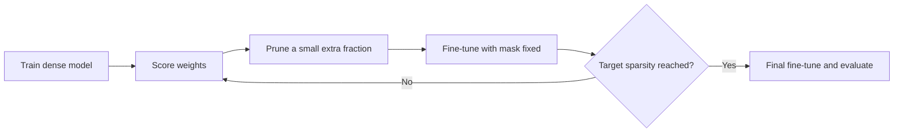
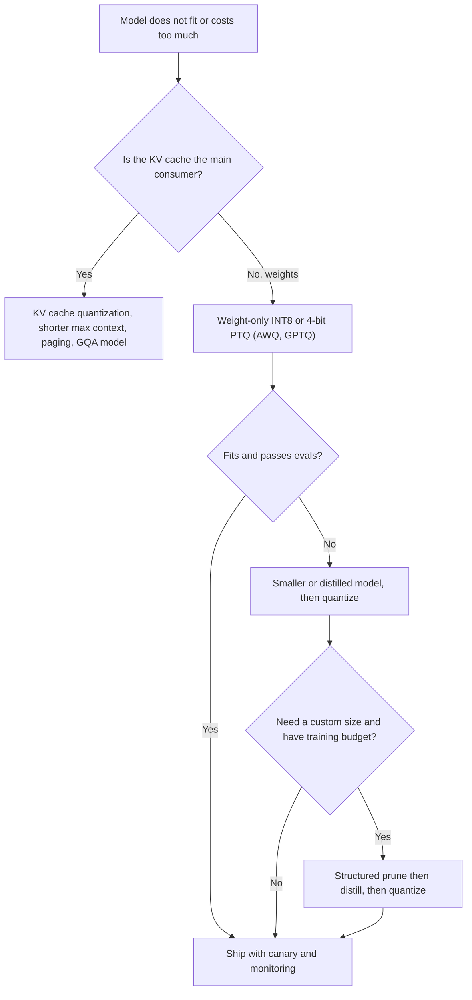

# Pruning, Low-Rank Factorization and Choosing a Compression Strategy

> **Level:** Beginner to Advanced · **Study time:** ~120 min · **Prerequisites:** [Number Formats and Model Memory](01-number-formats-and-model-memory.md), [Quantization Fundamentals](02-quantization-fundamentals-scale-and-zero-point.md), [Knowledge Distillation Fundamentals](05-knowledge-distillation-fundamentals.md), helpful: [Linear Algebra for Machine Learning](../00-foundations/02-linear-algebra-for-ml.md), [GPU Fundamentals for LLMs: Compute-Bound vs Memory-Bound](../06-llm-inference/03-gpu-fundamentals-compute-bound-vs-memory-bound.md)

## Table of contents

- [Why this matters](#why-this-matters)
- [Running examples and a quick recap](#running-examples-and-a-quick-recap)
- [What pruning is](#what-pruning-is)
- [Magnitude pruning](#magnitude-pruning)
- [Unstructured vs structured pruning](#unstructured-vs-structured-pruning)
- [Iterative prune-and-finetune](#iterative-prune-and-finetune)
- [Pruning LLMs: SparseGPT, Wanda and structured LLM pruning](#pruning-llms-sparsegpt-wanda-and-structured-llm-pruning)
- [Why unstructured sparsity often does not make models faster](#why-unstructured-sparsity-often-does-not-make-models-faster)
- [2:4 semi-structured sparsity](#24-semi-structured-sparsity)
- [Low-rank factorization with SVD](#low-rank-factorization-with-svd)
- [Comparing quantization, pruning, distillation and low-rank factorization](#comparing-quantization-pruning-distillation-and-low-rank-factorization)
- [Choosing a strategy for a memory-constrained deployment](#choosing-a-strategy-for-a-memory-constrained-deployment)
- [Combining methods](#combining-methods)
- [Going deeper: designing a fair compression benchmark](#going-deeper-designing-a-fair-compression-benchmark)
- [Going deeper: production failure modes and debugging](#going-deeper-production-failure-modes-and-debugging)
- [Common mistakes and misconceptions](#common-mistakes-and-misconceptions)
- [Interview questions and model answers](#interview-questions-and-model-answers)
- [Key takeaways](#key-takeaways)
- [Further reading](#further-reading)
- [Next](#next)

## Why this matters

Quantization and distillation get most of the attention, but a senior engineer is expected to know the whole compression toolbox and, more importantly, to pick the right tool for a given deployment. Pruning and low-rank factorization show up in interviews mostly as traps: "we pruned 50% of the weights, why is it not faster?" is a classic, and so is "why did our SVD-compressed model get worse but not smaller?". Real teams also combine methods (NVIDIA's Minitron models were built by pruning and then distilling, and QLoRA fine-tunes a 4-bit quantized model with low-rank adapters), so you need to understand how they interact. Finally, every compression claim is only as good as the benchmark behind it, and designing a fair benchmark is a skill interviewers test directly. By the end of this chapter you can compare all four method families with numbers, choose one for a memory-constrained deployment, and defend the measurement.

## Running examples and a quick recap

We reuse three running examples:

1. **A tiny weight vector** of 8 numbers, for hand calculations: $w = [0.9, -0.05, 0.3, -0.7, 0.02, 0.1, -0.4, 0.01]$.
2. **One linear layer** of size $4096 \times 4096$, the shape of an attention projection in a 7B model.
3. **A 7B model** shaped like Llama 2 7B: 32 layers, hidden size 4096, MLP size 11008, 32 attention heads of size 128.

A quick recap from earlier chapters (see [Number Formats and Model Memory](01-number-formats-and-model-memory.md)):

- $\text{weight memory} = \text{number of parameters} \times \text{bytes per parameter}$.
- 7B parameters in FP16 (2 bytes each): $7 \times 10^9 \times 2 = 14 \times 10^9$ bytes, about **14 GB**.
- In INT8: about 7 GB. In INT4: about 3.5 GB plus a little for scales.
- During text generation (the **decode** phase), each new token requires reading every weight from GPU memory, so decode is usually **memory-bandwidth bound**: speed is limited by how many bytes you move, not how much math you do. See [GPU Fundamentals for LLMs](../06-llm-inference/03-gpu-fundamentals-compute-bound-vs-memory-bound.md).
- Processing the prompt (the **prefill** phase) pushes many tokens through each weight at once, so it does far more math per byte read and is usually **compute bound**. Large batches behave the same way.

Keep that last point in mind. It is the key to understanding why some compression methods make models faster and others only make them smaller (or neither).

## What pruning is

> **Analogy:** Editing an essay. Many words add little meaning. You cross out the weakest ones and the essay still says the same thing. If you cross out individual letters scattered across the page, the essay is not any shorter to print (the page layout is the same). If you delete whole sentences or paragraphs, it really gets shorter.

That analogy already contains the whole chapter's tension: removing scattered pieces vs removing whole blocks.

**Pruning** is removing parts of a trained neural network (individual weights, neurons, channels, attention heads or whole layers) that contribute little to its output, then usually fine-tuning to recover any lost quality.

A **weight** is one number in a layer's weight matrix. Pruning a weight means setting it to exactly zero and keeping it zero. A **mask** is a matrix of 0s and 1s the same shape as the weights: 1 means keep, 0 means pruned. The pruned weights are $W \odot M$, where $\odot$ means element-wise multiplication.

**Sparsity** is the fraction of weights that are zero:

$$s = \frac{\text{number of zero weights}}{\text{total number of weights}}$$

- $s$: sparsity, between 0 (dense, nothing pruned) and 1 (everything pruned).
- **Density** is $1 - s$, the fraction kept.

Worked example: if we zero 4 of the 8 numbers in our tiny vector, $s = 4/8 = 0.5$, which we call "50% sparsity".

Why should pruning work at all? Trained networks are heavily **over-parameterized**: they have more parameters than they strictly need, which helps optimization during training but leaves redundancy afterwards. Many weights end up close to zero, and many neurons or heads end up doing nearly the same job as others. Early work showed this decades ago ("Optimal Brain Damage", LeCun, Denker and Solla, 1990; "Optimal Brain Surgeon", Hassibi and Stork, 1993), and it became practical for deep networks with "Learning both Weights and Connections for Efficient Neural Networks" (Han et al., 2015).

## Magnitude pruning

### Intuition

The simplest guess about which weight matters least: the one closest to zero. A weight of 0.01 multiplies its input by almost nothing, so removing it should change the output very little.

### Definition

**Magnitude pruning** scores each weight by its absolute value $|w|$ and zeros the weights with the smallest scores until the target sparsity is reached.

Two variants:

| Variant | How the threshold is chosen | Pros | Cons |
|---|---|---|---|
| **Local (layer-wise)** | Prune the same fraction (say 50%) in every layer | Simple, predictable per-layer cost | Treats sensitive and robust layers the same |
| **Global** | One threshold across all layers | Lets robust layers lose more, sensitive layers less | Layers with small-scale weights can be wiped out entirely |

### Worked example by hand

Prune our tiny vector $w = [0.9, -0.05, 0.3, -0.7, 0.02, 0.1, -0.4, 0.01]$ to 50% sparsity.

1. Absolute values: $[0.9, 0.05, 0.3, 0.7, 0.02, 0.1, 0.4, 0.01]$.
2. Sort ascending: $0.01, 0.02, 0.05, 0.1, 0.3, 0.4, 0.7, 0.9$.
3. 50% of 8 is 4, so remove the 4 smallest: $0.01, 0.02, 0.05, 0.1$ (positions 8, 5, 2, 6).
4. Result: $[0.9, 0, 0.3, -0.7, 0, 0, -0.4, 0]$, mask $[1, 0, 1, 1, 0, 0, 1, 0]$.

How much did we lose? A crude measure is the fraction of squared magnitude (the "energy") we removed:

- Removed: $0.05^2 + 0.02^2 + 0.1^2 + 0.01^2 = 0.0025 + 0.0004 + 0.01 + 0.0001 = 0.013$.
- Total: $0.81 + 0.0025 + 0.09 + 0.49 + 0.0004 + 0.01 + 0.16 + 0.0001 = 1.563$.
- Fraction removed: $0.013 / 1.563 \approx 0.0083$, under 1%.

Half the weights, under 1% of the energy. That is the optimistic picture behind pruning.

### Code: from scratch in NumPy

```python
# pip install numpy
import numpy as np

def magnitude_prune(w: np.ndarray, sparsity: float):
    """Zero the `sparsity` fraction of entries with smallest |w|. Returns (pruned, mask)."""
    k = int(round(sparsity * w.size))           # how many weights to remove
    flat_idx = np.argsort(np.abs(w).ravel())[:k]  # indices of the k smallest magnitudes
    mask = np.ones(w.size, dtype=bool)
    mask[flat_idx] = False
    mask = mask.reshape(w.shape)
    return np.where(mask, w, 0.0), mask

w = np.array([0.9, -0.05, 0.3, -0.7, 0.02, 0.1, -0.4, 0.01])
pruned, mask = magnitude_prune(w, 0.5)
print(pruned.tolist())        # [0.9, 0.0, 0.3, -0.7, 0.0, 0.0, -0.4, 0.0]
print(1 - mask.mean())        # 0.5  (the sparsity)
```

### Beyond magnitude: other importance scores

Magnitude ignores how big the *input* to a weight is and how sensitive the loss is to it. Scores that look at inputs need **calibration data**: a small set of representative examples (often a few hundred sequences) run through the model to record typical activations. Other scores you should recognize:

| Score | Idea | Where it shows up |
|---|---|---|
| Magnitude $\lvert w \rvert$ | Small weights matter little | Classic CNN pruning, baseline everywhere |
| Second-order (OBD / OBS) | Use the curvature of the loss (the Hessian, the matrix of second derivatives) to estimate how much loss increases if a weight is removed | Optimal Brain Damage/Surgeon, and SparseGPT for LLMs |
| Movement | Prune weights moving toward zero during fine-tuning | "Movement Pruning" (Sanh, Wolf and Rush, 2020) for fine-tuning BERT |
| Weight × activation | $\lvert w \rvert$ times the typical size of its input | Wanda for LLMs (below) |
| Gradient-based (Taylor) | First-order estimate of loss change: $\lvert w \cdot \partial L / \partial w \rvert$ | Structured pruning of channels and heads |

## Unstructured vs structured pruning

### Intuition

Back to the essay: crossing out scattered letters vs deleting whole sentences. Both remove content, but only one changes the shape of the page.

### Definitions

- **Unstructured pruning** zeros individual weights anywhere in a matrix. The matrix keeps its shape; it just contains many zeros. Highest flexibility, so lowest quality loss for a given sparsity.
- **Structured pruning** removes whole groups that correspond to a dimension of the computation: rows or columns of a matrix (neurons), convolution **channels** (filters), attention heads, or entire layers. The matrices actually become smaller and stay dense.
- **Semi-structured pruning** is in between: a fixed fine-grained pattern such as "2 of every 4 consecutive weights are zero" (covered in its own section).

```text
Unstructured (any weight)   2:4 semi-structured       Structured (whole rows)
[ x . x x ]                 [ x . x . ]               [ x x x x ]
[ . x . x ]                 [ . x x . ]               [ . . . . ]  <- row removed
[ x x . . ]                 [ x . . x ]               [ x x x x ]
[ . . x x ]                 [ . x . x ]               [ . . . . ]  <- row removed
 irregular zeros             exactly 2 per group of 4   matrix really shrinks to 2x4
 x = kept weight, . = zero
```

### The structured pruning menu for Transformers and CNNs

| What you remove | What gets smaller | Typical importance signal | Notes |
|---|---|---|---|
| **CNN channels / filters** | Output channels of a conv, and the matching input channels of the next conv | L1 norm of the filter, BatchNorm scale factor, Taylor score | "Pruning Filters for Efficient ConvNets" (Li et al., 2017). Real speedups on any hardware |
| **MLP neurons (width)** | Rows of the up/gate projections and the matching columns of the down projection | Activation magnitude on calibration data | The MLP is about two thirds of a Llama-style layer, so this is a big lever |
| **Attention heads** | Q, K, V rows and O columns for that head | Head importance from loss or activations | "Are Sixteen Heads Really Better than One?" (Michel, Levy and Neubig, 2019) found many heads can be removed at test time with small loss |
| **Hidden size / embedding dims** | Every matrix that touches the residual stream (the hidden vector passed from layer to layer) | Activation statistics of each dimension | Touches the whole model, usually needs serious retraining |
| **Layers (depth)** | Whole Transformer blocks | Similarity between a layer's input and output; drop the layers that change the representation least | "The Unreasonable Ineffectiveness of the Deeper Layers" (Gromov et al., 2024) and ShortGPT (Men et al., 2024) explored this |

**Width pruning** shrinks layers (fewer neurons, heads or hidden dimensions). **Depth pruning** removes whole layers.

### Worked example: what does removing heads and layers save in a 7B model?

Per Llama-2-7B-style layer (ignoring the tiny normalization weights):

- Attention: 4 projections (Q, K, V, O), each $4096 \times 4096 = 16{,}777{,}216$ parameters, so $4 \times 16{,}777{,}216 = 67{,}108{,}864$.
- MLP (SwiGLU, the gated MLP used in Llama, has 3 matrices: gate, up, down), each $4096 \times 11008 = 45{,}088{,}768$, so $3 \times 45{,}088{,}768 = 135{,}266{,}304$.
- Layer total: $67{,}108{,}864 + 135{,}266{,}304 = 202{,}375{,}168 \approx 202$M.

**One attention head** in one layer uses 128 rows of each of Q, K, V and 128 columns of O: $4 \times 128 \times 4096 = 2{,}097{,}152 \approx 2.1$M parameters. Pruning 8 of 32 heads in every layer removes $8 \times 2.1\text{M} \times 32 \approx 537$M parameters.

**Depth pruning 8 of 32 layers**: $8 \times 202{,}375{,}168 = 1{,}619{,}001{,}344 \approx 1.62$B parameters. The full model has $32 \times 202.4\text{M} \approx 6.48$B in layers plus about 0.26B in the embedding and output matrices, about 6.74B total. After removing 8 layers: $6.74 - 1.62 = 5.12$B, about 24% smaller. In FP16, weights shrink from about 13.5 GB to about 10.2 GB, and per-token compute and KV cache (the stored attention keys and values of earlier tokens, kept per layer) shrink by about a quarter too because there are fewer layers.

> **Senior insight:** Structured pruning is the only kind of pruning that gives you speedups "for free" on any hardware, because the result is just a smaller dense model. The price is quality: removing whole units is much cruder than removing individual weights, so structured pruning almost always needs recovery training, often with distillation from the original model.

### Code: physically removing MLP neurons

Masking does not make anything smaller. To get a real speedup you must build new, smaller layers. Here is a simple 2-layer MLP neuron pruning:

```python
# pip install torch
import torch
import torch.nn as nn

@torch.no_grad()
def prune_mlp_neurons(fc1: nn.Linear, fc2: nn.Linear, keep: int, calib_x: torch.Tensor):
    """fc1: d -> h, fc2: h -> d. Keep the `keep` hidden neurons with largest mean |activation|."""
    acts = torch.relu(fc1(calib_x))             # (num_tokens, h) hidden activations
    importance = acts.abs().mean(dim=0)          # (h,) one score per neuron
    idx = importance.topk(keep).indices.sort().values

    new_fc1 = nn.Linear(fc1.in_features, keep)
    new_fc1.weight.copy_(fc1.weight[idx])        # keep selected ROWS of fc1
    new_fc1.bias.copy_(fc1.bias[idx])

    new_fc2 = nn.Linear(keep, fc2.out_features)
    new_fc2.weight.copy_(fc2.weight[:, idx])     # keep matching COLUMNS of fc2
    new_fc2.bias.copy_(fc2.bias)
    return new_fc1, new_fc2

fc1, fc2 = nn.Linear(512, 2048), nn.Linear(2048, 512)
calib = torch.randn(1024, 512)                   # stand-in for real calibration activations
small1, small2 = prune_mlp_neurons(fc1, fc2, keep=1024, calib_x=calib)
print(small1.weight.shape, small2.weight.shape)  # torch.Size([1024, 512]) torch.Size([512, 1024])
```

For a SwiGLU MLP you must select the same indices in the gate and up projections (rows) and the down projection (columns), otherwise the model is silently broken.

## Iterative prune-and-finetune

### Intuition

If you cut a big branch off a tree all at once, the tree may go into shock. Gardeners prune a little each season and let the tree recover. Networks behave the same way: removing 90% of weights in one shot usually wrecks accuracy, while removing them gradually with training in between often keeps it.

### The loop



**One-shot pruning** prunes to the target in a single step (optionally followed by a short fine-tune). **Iterative pruning** alternates small pruning steps with fine-tuning. **Gradual pruning** is iterative pruning on a smooth schedule during training.

### The cubic sparsity schedule

A common schedule comes from "To prune, or not to prune" (Zhu and Gupta, 2017). Simplified:

$$s(t) = s_f + (s_i - s_f)\left(1 - \frac{t}{T}\right)^3, \quad 0 \le t \le T$$

- $s(t)$: target sparsity at training step $t$.
- $s_i$: initial sparsity (usually 0).
- $s_f$: final sparsity (for example 0.8).
- $T$: number of steps over which pruning ramps up.
- The cube makes pruning fast at the start (when there is a lot of redundancy) and slow at the end (when every weight is more precious).

Worked example with $s_i = 0$, $s_f = 0.8$, $T = 1000$:

- At $t = 250$: $1 - 250/1000 = 0.75$, $0.75^3 = 0.421875$, so $s = 0.8 + (0 - 0.8)(0.421875) = 0.8 - 0.3375 = 0.4625$.
- At $t = 500$: $1 - 0.5 = 0.5$, $0.5^3 = 0.125$, so $s = 0.8 - 0.8 \times 0.125 = 0.8 - 0.1 = 0.7$.
- At $t = 1000$: $(1 - 1)^3 = 0$, so $s = 0.8$.

Already 70% sparse at the halfway point; the last 10 percentage points take the second half.

### The lottery ticket hypothesis (brief)

"The Lottery Ticket Hypothesis" (Frankle and Carbin, 2019) found that inside a dense network there are sparse subnetworks that, if reset to their *original initialization* and trained alone, can match the dense network's accuracy. Follow-up work (Frankle et al., "Linear Mode Connectivity and the Lottery Ticket Hypothesis", 2020) found that for larger networks this only works reliably if you rewind to weights from early in training rather than to the exact initialization. It is mainly a scientific insight about why over-parameterization helps training; it is not a practical recipe for compressing LLMs, but interviewers sometimes ask about it.

### Code: PyTorch's built-in pruning utilities

```python
import torch
import torch.nn as nn
import torch.nn.utils.prune as prune

layer = nn.Linear(4096, 4096)

# Unstructured: zero the 50% smallest-|w| weights (L1 = absolute value)
prune.l1_unstructured(layer, name="weight", amount=0.5)
print(sorted(n for n, _ in layer.named_parameters()))  # ['bias', 'weight_orig']
print(sorted(n for n, _ in layer.named_buffers()))     # ['weight_mask']
print((layer.weight == 0).float().mean().item())       # about 0.5

# Make it permanent: drops weight_orig and the mask, leaves a dense tensor full of zeros
prune.remove(layer, "weight")

# Structured: zero 25% of output rows (dim=0) with the smallest L2 norm
layer2 = nn.Linear(4096, 4096)
prune.ln_structured(layer2, name="weight", amount=0.25, n=2, dim=0)
```

> **Common mistake:** Expecting `torch.nn.utils.prune` to make a model smaller or faster. During pruning it stores the original weights *and* a mask, so memory goes **up**. After `prune.remove` you have a dense tensor that happens to contain zeros: same size, same speed. These utilities are for research and for producing a mask; real gains need either physically smaller layers (structured) or a sparse format plus sparse kernels (a **kernel** is the GPU routine that implements one operation; a sparse kernel computes only on the nonzeros).

## Pruning LLMs: SparseGPT, Wanda and structured LLM pruning

### Why the classic recipe breaks for LLMs

Iterative prune-and-finetune means many rounds of training. For a 70B model, even one round of full fine-tuning is expensive, and you may not have the original pretraining data. LLM pruning methods therefore aim for **one-shot, post-training pruning**: prune using a small **calibration set** (a few hundred example sequences fed through the model to record typical activations), with no or very little retraining. This mirrors post-training quantization (see [PTQ vs QAT and Calibration](03-ptq-vs-qat-and-calibration.md)).

Both methods below work **layer by layer**. For one linear layer with weights $W$ and calibration inputs $X$, the goal is:

$$\min_{M,\ \widehat{W}} \ \big\lVert W X - (M \odot \widehat{W}) X \big\rVert_F^2$$

- $W$: the original weight matrix of the layer.
- $X$: the matrix of calibration inputs to that layer (one column per token).
- $M$: the 0/1 mask (which weights survive).
- $\widehat{W}$: possibly updated values for the surviving weights.
- $\lVert \cdot \rVert_F$: the **Frobenius norm**, the square root of the sum of squares of all entries; squared, it is just "total squared error".

In words: choose which weights to drop, and optionally adjust the rest, so that the layer's *outputs* on real data change as little as possible. This is a smarter goal than "keep large weights", because it accounts for the actual inputs.

### SparseGPT (conceptually)

"SparseGPT: Massive Language Models Can Be Accurately Pruned in One-Shot" (Frantar and Alistarh, 2023) solves the objective above approximately:

- It uses second-order information, the matrix $H = X X^\top$ (the Hessian of this layer's squared-error objective, up to a constant factor of 2), in the spirit of Optimal Brain Surgeon. In practice it works with the inverse $H^{-1}$ (plus a small dampening term on the diagonal for numerical stability).
- It walks through the weight columns, decides which weights to prune, and **updates the remaining unpruned weights** to compensate for the error the pruned ones introduce.
- It reuses the same efficient column-by-column machinery as GPTQ (overlapping authors from the same group; see [Practical LLM Quantization](04-llm-quantization-gptq-awq-and-outliers.md)), which makes it feasible for 100B+ parameter models; the authors report pruning 175B-scale models in a few hours on one GPU.
- The paper reports that the largest models could reach around 50% unstructured sparsity with only a small increase in **perplexity** (the exponential of the average next-token cross-entropy on held-out text; lower is better), and that larger models are easier to prune than smaller ones. It supports 2:4 patterns and can be combined with quantization.

### Wanda (conceptually and by hand)

"A Simple and Effective Pruning Approach for Large Language Models" (Sun, Liu, Bair and Kolter, 2023) introduced **Wanda** (Pruning by **W**eights **and** **a**ctivations). It observes that LLMs have a few input features with very large activations (the same outlier features that make quantization hard), so a small weight on a huge input can matter more than a large weight on a tiny input.

The Wanda score for the weight connecting input feature $j$ to output $i$:

$$S_{ij} = \lvert W_{ij} \rvert \cdot \lVert X_j \rVert_2$$

- $W_{ij}$: weight from input feature $j$ to output neuron $i$ (PyTorch stores `weight` as `(out, in)`).
- $X_j$: all calibration values of input feature $j$ across tokens.
- $\lVert X_j \rVert_2$: its L2 norm, $\sqrt{\sum_t x_{t,j}^2}$, a measure of how large that input typically is.

Two more details: Wanda compares scores **within each output row** (each output neuron loses the same fraction of its inputs), and it does **no weight update**. It is just a better score, which makes it very fast and simple.

Worked example. One output row $W_{i,:} = [0.5, 0.2, -0.1, 0.4]$ and input norms $\lVert X_j \rVert_2 = [0.1, 4.0, 2.0, 1.0]$. Prune 50% (2 of 4).

| $j$ | $\lvert W_{ij}\rvert$ | $\lVert X_j\rVert_2$ | Wanda score | Magnitude rank |
|---|---|---|---|---|
| 1 | 0.5 | 0.1 | $0.5 \times 0.1 = 0.05$ | largest |
| 2 | 0.2 | 4.0 | $0.2 \times 4.0 = 0.8$ | 3rd |
| 3 | 0.1 | 2.0 | $0.1 \times 2.0 = 0.2$ | smallest |
| 4 | 0.4 | 1.0 | $0.4 \times 1.0 = 0.4$ | 2nd |

- Magnitude pruning removes the two smallest $|w|$: positions 3 (0.1) and 2 (0.2). Result $[0.5, 0, 0, 0.4]$.
- Wanda removes the two smallest scores: positions 1 (0.05) and 3 (0.2). Result $[0, 0.2, 0, 0.4]$.

They disagree on positions 1 and 2. Magnitude kept the 0.5 weight whose input is almost always tiny, and threw away the 0.2 weight that sits on a large input. Wanda gets this right.

### Code: Wanda for one linear layer

```python
import torch
import torch.nn as nn

@torch.no_grad()
def wanda_prune_linear(layer: nn.Linear, X: torch.Tensor, sparsity: float = 0.5):
    """X: (num_tokens, in_features) calibration inputs that flow INTO this layer."""
    act_norm = X.float().norm(p=2, dim=0)                # (in_features,)  ||X_j||_2
    W = layer.weight.data                                 # (out, in)
    score = W.abs().float() * act_norm.unsqueeze(0)       # broadcast norms across rows
    k = int(W.shape[1] * sparsity)                        # weights to remove PER ROW
    prune_idx = torch.topk(score, k, dim=1, largest=False).indices
    mask = torch.ones_like(W, dtype=torch.bool)
    mask.scatter_(1, prune_idx, False)
    W.masked_fill_(~mask, 0.0)
    return mask

# Reproduce the hand example: a single input token whose values are exactly the norms
layer = nn.Linear(4, 1, bias=False)
layer.weight.data = torch.tensor([[0.5, 0.2, -0.1, 0.4]])
X = torch.tensor([[0.1, 4.0, 2.0, 1.0]])
wanda_prune_linear(layer, X, sparsity=0.5)
print(layer.weight.data.tolist())  # [[0.0, 0.20000000298023224, 0.0, 0.4000000059604645]] (float32 0.2 and 0.4)
```

In a real model you run calibration data through the network, capture each linear layer's input with forward hooks, prune that layer, and typically feed the *pruned* layer's outputs forward so later layers are calibrated on what they will actually receive. Reference implementations from the authors exist on GitHub; library support (for example in LLM compression toolkits) changes quickly, so check current docs.

### Structured pruning for LLMs: prune, then heal

One-shot unstructured methods keep quality well at moderate sparsity on large models, but, as the next section shows, they rarely deliver speed. Structured LLM pruning goes after real speed and memory, and accepts that it needs **healing** (recovery training):

- **LLM-Pruner** (Ma, Fang and Wang, 2023): finds groups of coupled structures (heads, MLP channels), removes the least important ones, then recovers with brief LoRA fine-tuning (training small low-rank adapter matrices instead of all weights; see the low-rank section below).
- **Sheared LLaMA** (Xia et al., 2023): learns which heads, MLP dimensions, hidden dimensions and layers to remove to hit a target architecture, then continues pretraining on a modest token budget.
- **Minitron** ("Compact Language Models via Pruning and Knowledge Distillation", Muralidharan et al., 2024, NVIDIA): estimates importance of depth and width components from activations, prunes, then retrains the smaller model with **knowledge distillation** from the original. The authors report that this costs far fewer training tokens than training the small model from scratch.

The pattern is the important part: **structured pruning chooses a good initialization for a smaller model; distillation trains it back to quality.** See [Distilling Large Language Models](06-distilling-large-language-models.md).

## Why unstructured sparsity often does not make models faster

This is one of the most common interview questions in this area. Let us build the answer from the hardware up.

### Reason 1: dense hardware does not skip zeros

GPUs do matrix multiplication with **tensor cores**: hardware units that multiply small dense tiles (for example 16×16 blocks) in one shot. A zero inside a tile is multiplied like any other number. A dense matrix with 50% zeros takes essentially the same time as one with no zeros (at most tiny power-related differences), and occupies the same memory, because it is still stored densely.

> **Analogy:** A bus with half its seats empty still costs the same fuel to drive the route. To save fuel you need a smaller bus (structured pruning) or a different kind of vehicle (sparse hardware), not empty seats.

### Reason 2: sparse formats add index overhead

To skip zeros you must store the matrix in a **sparse format** that keeps only nonzero values plus their positions. The common **CSR** (compressed sparse row) format stores each nonzero's value, its column index, and one pointer per row.

Worked example, our $4096 \times 4096$ layer in FP16:

- Dense: $16{,}777{,}216 \times 2$ bytes $= 33{,}554{,}432$ bytes $= 32$ MiB.
- CSR at 50% sparsity with 16-bit column indices (4096 columns fit in 16 bits): nonzeros $= 8{,}388{,}608$, each costing $2$ bytes (value) $+ 2$ bytes (index) $= 4$ bytes, total $33{,}554{,}432$ bytes, plus $4097 \times 4 = 16{,}388$ bytes of 32-bit row pointers. **Slightly larger than dense.**
- CSR at 90% sparsity: nonzeros $= 0.1 \times 16{,}777{,}216 \approx 1{,}677{,}722$, times 4 bytes $\approx 6{,}710{,}888$ bytes $\approx 6.4$ MiB, about 5x smaller.
- With 32-bit indices (6 bytes per nonzero), break-even is when $(1 - s) \times 6 = 2$, so $s = 2/3 \approx 67\%$.

So with 16-bit values, you need well above 50% sparsity just to *save memory*, before speed is even considered.

### Reason 3: irregular memory access

GPUs are fast when neighboring threads read neighboring memory addresses (**coalesced access**) and when work is evenly balanced. With unstructured sparsity, each row has a different number of nonzeros at random positions. Reading the matching input values becomes a scattered "gather", some threads do more work than others, and tensor cores cannot be used at all for truly irregular patterns. A dense kernel running near peak can easily beat a sparse kernel that does far fewer multiplications.

### Reason 4: kernels and serving stacks

Even when a fast sparse kernel exists for one operation, your serving framework must use it end-to-end, fused with everything else (quantization, attention, batching). Mainstream LLM serving stacks are built around dense (and quantized dense) kernels. If the sparse path is missing, the framework silently uses dense math on a tensor full of zeros.

### Reason 5: you need very high sparsity, which hurts quality

General sparse matrix multiplication on GPUs typically only beats dense at high sparsity (often quoted as roughly 90%+, but the crossover depends heavily on matrix shape, batch size and hardware; measure it). For LLMs, quality usually degrades well before that level with one-shot methods.

### Putting it together: decode vs prefill

```text
                        Unstructured 50%, dense storage   Unstructured 90%, sparse format + good kernel
Weight memory           unchanged                          smaller (about 5x at FP16 with 16-bit indices)
Decode (memory-bound)   unchanged                          can speed up: fewer bytes to read
Prefill (compute-bound) unchanged                          usually little gain: tensor cores unused
Quality                 usually fine for large LLMs        often significant loss
```

> **Interview tip:** A complete answer names three things: (1) dense hardware and tensor cores do not skip zeros, (2) sparse formats need index metadata, so memory only shrinks at high sparsity, and (3) irregular access and missing kernels mean the fast sparse path rarely exists in your serving stack. Then offer the alternatives: structured pruning (genuinely smaller dense model) or 2:4 semi-structured sparsity (hardware-supported).

There are exceptions worth mentioning: some CPU inference runtimes have been engineered specifically to exploit unstructured sparsity, and research kernels exist for GPUs. The durable lesson is that speedups depend on hardware and kernels, not on the zero count.

## 2:4 semi-structured sparsity

### Intuition

Unstructured is too irregular for hardware; structured is too crude for quality. **N:M sparsity** is the compromise: in every group of M consecutive weights, at most N are nonzero. The most important case is **2:4**: in every group of 4 consecutive weights (along the input dimension), exactly 2 are zero. That is always exactly 50% sparsity, in a pattern so regular that hardware can handle it.

### Hardware support

NVIDIA introduced **sparse tensor cores** supporting 2:4 sparsity with the Ampere architecture (A100, 2020), and later data-center generations keep the feature. The hardware stores only the 2 kept values per group plus tiny 2-bit indices saying which positions they came from, and its tensor cores skip the zeros. NVIDIA quotes up to 2x math throughput for the sparse matrix multiply itself ("Accelerating Sparse Deep Neural Networks", Mishra et al., 2021, describes the approach and the recipe). End-to-end model speedups are smaller, because attention, normalization, memory traffic for activations and other operations are not accelerated. Support for 2:4 in LLM serving frameworks exists in some stacks and versions, so check yours.

### Worked example: making a group 2:4

Group $[0.3, -0.8, 0.1, 0.5]$: magnitudes $0.3, 0.8, 0.1, 0.5$. Keep the two largest (0.8 and 0.5), zero the others: $[0, -0.8, 0, 0.5]$. Stored as values $[-0.8, 0.5]$ and indices $[1, 3]$ (0-based positions within the group).

### Worked example: storage

Per group of 4 FP16 weights:

- Dense: $4 \times 16 = 64$ bits.
- 2:4: 2 values of 16 bits plus 2 indices of 2 bits, $2 \times 16 + 2 \times 2 = 32 + 4 = 36$ bits.
- Ratio: $36 / 64 = 0.5625$, so 2:4 storage is about **56%** of dense.

For our $4096 \times 4096$ layer: $32 \text{ MiB} \times 0.5625 = 18$ MiB. For a 7B model if every weight were 2:4 sparse: $14 \text{ GB} \times 0.5625 \approx 7.9$ GB. That is an upper bound; embeddings and some sensitive layers usually stay dense. Compare: INT8 quantization gets to about 7 GB and INT4 to about 3.5-4 GB with much less quality risk.

### Quality and recovery

The 2:4 constraint is stricter than 50% unstructured (you cannot keep 3 large weights from one group), so quality loss is larger at the same sparsity. NVIDIA's recommended recipe for vision and NLP models was: train dense, prune to 2:4, then fine-tune with the mask fixed to recover accuracy. For LLMs, one-shot 2:4 with SparseGPT or Wanda typically loses noticeably more quality than 50% unstructured, and recovery fine-tuning or distillation is commonly used to close the gap.

### Code: a 2:4 mask and the PyTorch path

```python
import torch

@torch.no_grad()
def two_four_mask(W: torch.Tensor) -> torch.Tensor:
    """Keep the 2 largest-|w| entries in every group of 4 along the input dim."""
    out_f, in_f = W.shape
    assert in_f % 4 == 0
    groups = W.abs().reshape(out_f, in_f // 4, 4)
    top2 = groups.topk(2, dim=-1).indices
    mask = torch.zeros_like(groups, dtype=torch.bool).scatter_(-1, top2, True)
    return mask.reshape(out_f, in_f)

W = torch.tensor([[0.3, -0.8, 0.1, 0.5]])
print(W.masked_fill(~two_four_mask(W), 0.0).tolist())  # [[0.0, -0.800000011920929, 0.0, 0.5]] (float32 -0.8)
```

To actually run on sparse tensor cores, PyTorch (2.1 and later) offers a semi-structured sparse tensor type. This API has been labeled prototype or beta and has dtype and shape restrictions, so treat the snippet as conceptual and check the current docs:

```python
# Requires an NVIDIA GPU with sparse tensor cores (Ampere or newer) and a recent PyTorch.
import torch.nn as nn
from torch.sparse import to_sparse_semi_structured

linear = nn.Linear(4096, 4096).half().cuda()
mask = two_four_mask(linear.weight.data)
linear.weight.data.masked_fill_(~mask, 0)
linear.weight = nn.Parameter(to_sparse_semi_structured(linear.weight))  # compressed values + metadata
# Forward passes now dispatch to sparse kernels where supported. Benchmark against the dense layer.
```

## Low-rank factorization with SVD

### Intuition

> **Analogy:** A spreadsheet of 1,000 customers × 1,000 products holding how much each customer likes each product. If tastes are mostly explained by a few factors ("likes cheap things", "likes tech"), you do not need a million numbers. You need each customer's score on a few factors and each product's score on the same factors. The spreadsheet is "approximately low rank".

**Low-rank factorization** replaces one big weight matrix with the product of two thin matrices. It is pure linear algebra, and the result is still dense, so it runs on any hardware.

### Rank and SVD in plain words

The **rank** of a matrix is the number of truly independent directions in it, the number of "factors" needed to rebuild it exactly. A $4096 \times 4096$ matrix can have rank up to 4096.

The **singular value decomposition (SVD)** writes any $m \times n$ matrix as:

$$W = U \Sigma V^\top$$

- $U$: an $m \times m$ matrix whose columns (the left singular vectors) are orthonormal directions in the output space.
- $\Sigma$: a diagonal matrix of **singular values** $\sigma_1 \ge \sigma_2 \ge \dots \ge 0$, telling how much each direction matters.
- $V^\top$: the transpose of an $n \times n$ matrix whose columns (right singular vectors) are orthonormal directions in the input space.

**Truncated SVD** keeps only the top $r$ singular values and their vectors:

$$W \approx W_r = U_r \Sigma_r V_r^\top$$

The **Eckart-Young theorem** says this is the best possible rank-$r$ approximation in Frobenius norm, with error:

$$\lVert W - W_r \rVert_F = \sqrt{\sigma_{r+1}^2 + \sigma_{r+2}^2 + \dots}$$

- $r$: the rank you keep.
- $\sigma_{r+1}, \sigma_{r+2}, \dots$: the singular values you throw away. If they are small, the approximation is good.

For a refresher on matrices, transposes and orthonormal vectors, see [Linear Algebra for Machine Learning](../00-foundations/02-linear-algebra-for-ml.md).

### Tiny worked examples

**A matrix that is exactly rank 1.** Take $u = v = [1, 2, 3]^\top$ and $W = u v^\top$:

$$W = \begin{bmatrix} 1 & 2 & 3 \\ 2 & 4 & 6 \\ 3 & 6 & 9 \end{bmatrix}$$

Each row is a multiple of $[1, 2, 3]$ (times 1, 2 and 3), so rank is 1. Storing $u$ and $v$ takes $3 + 3 = 6$ numbers instead of 9, with zero error. Its only nonzero singular value is $\lVert u \rVert \cdot \lVert v \rVert = \sqrt{14} \cdot \sqrt{14} = 14$.

**Truncation error.** Take $W = \begin{bmatrix} 3 & 0 \\ 0 & 1 \end{bmatrix}$, singular values 3 and 1. The best rank-1 approximation is $\begin{bmatrix} 3 & 0 \\ 0 & 0 \end{bmatrix}$:

- Error: $\sqrt{1^2} = 1$.
- Total "energy" $\sum \sigma^2 = 9 + 1 = 10$; kept $9/10 = 90\%$.
- Relative error: $1 / \sqrt{10} \approx 0.316$.

### Parameter count and the break-even rank

Replace $W$ ($m \times n$) with $B$ ($m \times r$) times $A$ ($r \times n$). The layer $y = W x$ becomes $y = B(A x)$: two smaller linear layers in a row.

$$\text{params}_{\text{dense}} = m n, \qquad \text{params}_{\text{low-rank}} = r(m + n)$$

- $m$, $n$: output and input sizes.
- $r$: the chosen rank.
- Break-even: $r(m+n) < mn \iff r < \dfrac{mn}{m+n}$.

The multiply-add count for one input vector follows the same formula ($mn$ vs $r(m+n)$), so compute shrinks by the same ratio.

Worked example, our $4096 \times 4096$ layer ($mn = 16{,}777{,}216$, $m + n = 8192$):

| Rank $r$ | Low-rank params $r \times 8192$ | Fraction of dense |
|---|---|---|
| 256 | 2,097,152 | 12.5% |
| 512 | 4,194,304 | 25% |
| 1024 | 8,388,608 | 50% |
| 2048 | 16,777,216 | 100% (break-even: $16{,}777{,}216 / 8192 = 2048$) |

For a Llama-style MLP matrix $4096 \times 11008$: dense is $45{,}088{,}768$; break-even rank is $45{,}088{,}768 / 15{,}104 \approx 2985$; rank 1024 gives $1024 \times 15{,}104 = 15{,}466{,}496$, about 34% of dense.

> **Common mistake:** Choosing a rank like $r = 3000$ for a $4096 \times 4096$ matrix "to keep 73% of the rank". That is above break-even (2048), so the model gets bigger, slower *and* slightly worse. For real speedups pick $r$ well below break-even, because two small matmuls have overhead (two kernel launches, an intermediate activation) and small matrices use the GPU less efficiently.

### When low-rank factorization works and when it does not

**Works well when:**

- The matrix genuinely has a fast-decaying singular value spectrum (a few big $\sigma$s, many tiny ones). Many fully connected and embedding layers in older over-parameterized models had this property ("Exploiting Linear Structure Within Convolutional Networks for Efficient Evaluation", Denton et al., 2014, applied it to CNNs).
- You **design it in from the start**: ALBERT (Lan et al., 2019) factorizes its embedding matrix; DeepSeek-V2's multi-head latent attention compresses keys and values through a low-rank latent to shrink the KV cache (see [The KV Cache](../06-llm-inference/02-kv-cache-explained.md)).
- The thing you factorize is a *change* to weights rather than the weights themselves: **LoRA** assumes the fine-tuning update $\Delta W$ is low rank, which works very well (see [Fine-Tuning LLMs: Full Fine-Tuning, LoRA and QLoRA](../05-llms/07-fine-tuning-full-lora-and-qlora.md)).
- You fine-tune or distill after factorizing to recover quality.

**Works poorly when:**

- You apply plain SVD to pretrained LLM weight matrices. These tend to have fairly spread-out spectra, so truncating to a rank that actually saves memory throws away a lot of energy and quality drops quickly. Research methods improve this by weighting the approximation by importance or activations (for example "Language Model Compression with Weighted Low-Rank Factorization", Hsu et al., 2022, and later activation-aware SVD methods), but plain SVD of LLM weights is rarely competitive with 4-bit quantization at the same memory.
- The rank needed for acceptable quality is near break-even: no savings.

### Code: factorizing a linear layer with SVD

```python
import torch
import torch.nn as nn

@torch.no_grad()
def factorize_linear(layer: nn.Linear, rank: int) -> nn.Sequential:
    """Replace y = W x + b with y = B (A x) + b, where W ~= B @ A has the given rank."""
    W = layer.weight.data.float()                          # (out, in)
    U, S, Vh = torch.linalg.svd(W, full_matrices=False)    # W = U diag(S) Vh
    sqrt_s = S[:rank].sqrt()
    A = Vh[:rank] * sqrt_s[:, None]                        # (rank, in): split sqrt(S) evenly
    B = U[:, :rank] * sqrt_s[None, :]                      # (out, rank)
    first = nn.Linear(layer.in_features, rank, bias=False)
    second = nn.Linear(rank, layer.out_features, bias=layer.bias is not None)
    first.weight.copy_(A)
    second.weight.copy_(B)
    if layer.bias is not None:
        second.bias.copy_(layer.bias)
    return nn.Sequential(first, second)

def rel_error(W, rank):
    S = torch.linalg.svdvals(W)
    return (S[rank:].pow(2).sum() / S.pow(2).sum()).sqrt().item()   # Eckart-Young

torch.manual_seed(0)
n, rank = 1024, 128
random_W = torch.randn(n, n)                                        # flat spectrum
structured_W = torch.randn(n, 32) @ torch.randn(32, n) + 0.01 * torch.randn(n, n)  # ~rank 32 + noise
print("random    :", rel_error(random_W, rank))      # about 0.79: most energy is in the discarded tail
print("structured:", rel_error(structured_W, rank))  # about 0.0014: the matrix really is low rank

layer = nn.Linear(n, n)
small = factorize_linear(layer, rank)
dense_params = sum(p.numel() for p in layer.parameters())
lr_params = sum(p.numel() for p in small.parameters())
print(dense_params, lr_params)  # 1049600 263168  (1024*1024+1024 vs 128*2048+1024)
```

Check the last line by hand: dense $= 1024 \times 1024 + 1024 = 1{,}048{,}576 + 1{,}024 = 1{,}049{,}600$. Low-rank $= 128 \times 1024 + 1024 \times 128 + 1024 = 131{,}072 + 131{,}072 + 1{,}024 = 263{,}168$. About 25%.

The experiment shows the core lesson: SVD compression is only as good as the matrix's spectrum. Always plot the singular values of the real layers before committing.

## Comparing quantization, pruning, distillation and low-rank factorization

A one-line recap of the two methods taught in earlier chapters:

- **Quantization** stores weights (and optionally activations and KV cache) in fewer bits, for example INT8 or INT4 instead of FP16. Done after training with only a calibration set it is **post-training quantization (PTQ)**; simulated during training it is **quantization-aware training (QAT)**. See [Quantization Fundamentals](02-quantization-fundamentals-scale-and-zero-point.md) and [Practical LLM Quantization](04-llm-quantization-gptq-awq-and-outliers.md).
- **Knowledge distillation** trains a smaller **student** model to imitate a larger **teacher**. See [Knowledge Distillation Fundamentals](05-knowledge-distillation-fundamentals.md).

### The big comparison table

The cells describe typical behavior for LLMs on modern GPUs; specific numbers vary by model, method and hardware.

| | Weight-only quantization (INT8/INT4) | Weight + activation quantization (INT8/FP8) | Unstructured pruning | 2:4 semi-structured pruning | Structured pruning (heads, width, depth) | Distillation (to a smaller student) | Low-rank factorization |
|---|---|---|---|---|---|---|---|
| **What changes** | Bits per weight | Bits per weight and activation | Individual weights zeroed | 2 of every 4 weights zeroed | Whole units removed, smaller dense model | A new, smaller model | Matrices replaced by thin pairs |
| **Memory** | 2x (INT8) to about 4x (INT4) smaller weights | About 2x smaller weights | None unless sparse format at high sparsity | About 0.56x weights (FP16) | Proportional to what you remove | Whatever size you choose | Depends on rank; none above break-even |
| **Latency** | Usually faster decode at small batch (fewer bytes); can be neutral at large batch | Faster compute-bound prefill and large batches where hardware supports it | Usually none on GPUs | Up to 2x on matmuls in theory, less end-to-end | Real speedup on any hardware | Real speedup on any hardware | Real if rank well below break-even |
| **Quality risk** | Low at INT8; low to moderate at 4-bit; high at 2-3 bits | Moderate; needs outlier handling | Low at moderate sparsity on big models; rises steeply | Moderate; more than 50% unstructured | High without healing | Depends on student size and data; capability gap on hard tasks | Moderate to high for pretrained LLM weights |
| **Engineering effort** | Low: PTQ tools, hours | Low to moderate | Low to moderate | Moderate | High | Highest: data, training pipeline, evals | Moderate |
| **Hardware dependence** | Needs efficient kernels, now widely available | Needs INT8/FP8 tensor cores (FP8 on recent NVIDIA generations) | Very high: needs sparse kernels | High: sparse tensor cores (NVIDIA Ampere and newer) | None | None | None |
| **Retraining needed** | No (PTQ); QAT optional | Usually no | Optional | Recommended | Yes (fine-tune or distill) | Yes, full student training | Usually yes |

### Illustrative numbers for the 7B running example

Weight memory only; KV cache and runtime overhead come on top. These are arithmetic, not benchmark results.

| Variant | Weight memory | How computed |
|---|---|---|
| FP16 baseline | 14 GB | $7 \times 10^9 \times 2$ bytes |
| INT8 weight-only | about 7 GB | $7 \times 10^9 \times 1$ byte |
| INT4 weight-only (group-wise scales) | about 3.6-3.7 GB | $7 \times 10^9 \times 4.125$-$4.25$ bits / 8; extra bits from scales and zero points |
| 50% unstructured, stored dense | 14 GB | Zeros still stored |
| 2:4 sparse FP16 (upper bound) | about 7.9 GB | $14 \times 0.5625$ |
| Depth-pruned 32 to 24 layers, FP16 | about 10.2 GB | From the earlier layer arithmetic (5.12B params); note the real Llama 2 7B baseline is 6.74B params, about 13.5 GB, so this is a 24% cut |
| Distilled 3B student, FP16 | 6 GB | $3 \times 10^9 \times 2$ |
| Distilled 3B student, INT4 | about 1.6 GB | $3 \times 10^9 \times 4.25 / 8 \approx 1.59$ GB |

## Choosing a strategy for a memory-constrained deployment

### The usual answer: weight-only quantization first

For a memory-constrained deployment (the model does not fit, or you want to fit on a cheaper GPU or more replicas per GPU), the default first move is **weight-only post-training quantization**, INT8 or 4-bit with a method like AWQ or GPTQ. Why:

1. **Biggest memory win for the least effort.** FP16 to INT4 is roughly a 4x reduction in weight memory, achieved in minutes to hours with a calibration set, no training.
2. **Low, measurable quality risk.** INT8 weight-only is usually close to lossless; 4-bit with good methods is usually a small loss on large models, which you verify with evals.
3. **It is also a latency win in the common case.** Decode is memory-bandwidth bound, so reading 4x fewer bytes per token often speeds up single-stream generation (when fused dequantization kernels are used).
4. **Ecosystem support.** Mainstream serving stacks (vLLM, TensorRT-LLM, llama.cpp and others; see [LLM Serving Frameworks](../06-llm-inference/06-serving-frameworks-vllm-sglang-tgi-tensorrt-llm-and-ollama.md)) ship optimized kernels and accept pre-quantized checkpoints.
5. **No hardware lottery.** Unlike sparsity, it does not depend on a specific sparse tensor core path.

### Then: a smaller or distilled model

If quantization is not enough (or 4-bit quality is not acceptable), the next step is a **smaller model**: a smaller member of the same family, or an existing distilled model, quantized as well. If you own the training budget and need a specific size, **prune then distill** (Minitron-style) produces a custom small model more cheaply than training from scratch.

### Later, or for specific situations: sparsity and low rank

Use 2:4 sparsity when you have verified that your hardware and serving stack accelerate it and you can afford recovery training. Use low-rank mostly where it is designed in (adapters, factorized embeddings, latent attention) rather than as a post-hoc SVD on pretrained weights.

### Do not forget the non-weight memory

A "memory-constrained" LLM deployment is often limited by the **KV cache**, not the weights, especially with long contexts and many concurrent users. Before reaching for heavier compression, check KV-cache quantization, a shorter maximum context, paged KV allocation, and models with grouped-query attention. See [The KV Cache](../06-llm-inference/02-kv-cache-explained.md) and [Batching, Continuous Batching and PagedAttention](../06-llm-inference/04-batching-continuous-batching-and-paged-attention.md).



> **Interview tip:** Say *why* in terms of the constraint. "Memory-constrained" points to the method with the best bytes-saved per unit of quality risk and effort, which is weight-only quantization. "Latency-constrained at large batch" might point elsewhere (FP8 weight and activation quantization, a smaller model, speculative decoding). Matching method to bottleneck is what interviewers listen for.

## Combining methods

Yes, these methods combine, and the strongest production results usually come from combinations. The general principle: **do the structural changes first, recover quality with training, and quantize last.**

| Combination | How it works | Why the order |
|---|---|---|
| **Distill, then quantize** | Train a small student, then apply PTQ (for example DistilBERT-style student exported to INT8, or a small LLM quantized to 4-bit) | Quantization is cheap and applied to the final weights; quantizing before distillation would just be undone by training |
| **Prune, then distill** | Structurally prune a teacher copy to get the student's starting point, then distill from the unpruned teacher (Minitron style; Sheared LLaMA also prunes first but recovers with continued pretraining instead of distillation) | The pruned model is a far better initialization than random; distillation heals the damage |
| **Prune, then quantize** | "Deep Compression" (Han, Mao and Dally, 2016) chained pruning, quantization and Huffman coding for CNNs; SparseGPT can produce sparse plus quantized LLM weights | Calibrate quantization on the pruned weights, since pruning changes the weight distribution |
| **2:4 sparsity + INT8/FP8** | Hardware sparse tensor cores support some low-precision types with sparsity | Gains multiply only if a fused sparse plus quantized kernel exists |
| **QLoRA-style** | Freeze a 4-bit quantized base model (NF4) and train low-rank LoRA adapters in higher precision ("QLoRA", Dettmers et al., 2023) | Quantization cuts memory for the frozen base, low rank cuts trainable parameters and optimizer state |
| **Quantization-aware distillation** | Distill into a student while simulating quantization during training | Lets the student learn to be robust to its final precision |

Interactions and pitfalls:

- **Errors compound.** Each method alone may cost a small amount of quality; together the losses can add up or interact badly. Evaluate after every step, not just at the end.
- **Recalibrate after every structural change.** Quantization scales computed before pruning or fine-tuning are stale.
- **Merging LoRA into a quantized base is lossy.** To merge, you must dequantize, add the scaled update $\frac{\alpha}{r}BA$, and requantize; the merged weights round differently from what the adapter was trained against. Many teams serve the adapter unmerged, or merge into the higher-precision base and quantize afterwards, then re-evaluate.
- **Kernels must support the combination.** Sparse plus 4-bit is a different kernel from sparse alone or 4-bit alone.

## Going deeper: designing a fair compression benchmark

A compression result is a claim like "4-bit model X is 1.8x faster with 1% quality loss". Most such claims in the wild are not reproducible because the benchmark was unfair. Here is how to design one that would survive a senior review.

### Principle 1: change exactly one thing

- **Same hardware**: same GPU model, same count, same interconnect, same driver and CUDA versions, same power and clock settings, no other jobs on the box.
- **Same serving stack and version**, same compile and graph-capture settings, same attention kernel. A common unfair comparison is "FP16 in eager PyTorch vs INT4 in an optimized engine": you are measuring the engine, not the compression.
- **Same decoding settings**: same max new tokens, same stop conditions, same sampling parameters. For latency tests, fix output lengths (or use the same request trace) so a model that rambles less does not look faster.
- **Strong baseline**: the uncompressed model must be served as well as you can serve it (optimized kernels, best batch configuration).

### Principle 2: measure under production-shaped load

- **Batch sizes / concurrency that match production.** Quantization often helps most at batch 1 (memory-bound) and least at large batch (compute-bound); sparsity can behave differently again. Report a sweep: for example concurrency 1, 8, 32, 128.
- **Sequence lengths that match production.** Use the real distribution of prompt and output lengths (or a replayed trace). Long prompts stress prefill; long outputs stress decode and KV cache.
- **Warmup.** Discard the first runs: they include kernel compilation, autotuning, memory allocation and cache warming.
- **Repeats.** Run enough iterations and several independent runs (fresh processes) to estimate variance.

### Principle 3: measure the right metrics

| Category | Metrics | Notes |
|---|---|---|
| Latency | **TTFT** (time to first token) and **TPOT** (time per output token, closely related to inter-token latency, ITL; some tools report both, averaged differently), at p50, p95 and p99 | Defined in [LLM Inference Fundamentals](../06-llm-inference/01-inference-fundamentals-prefill-decode-and-latency-metrics.md). Tail percentiles matter for user experience |
| Throughput | Output tokens per second, requests per second, ideally **at a latency SLO** (service-level objective, a latency target such as "max throughput with p95 TPOT under 50 ms") | Throughput without a latency bound is easy to inflate with huge batches |
| Memory | **Peak** GPU memory (weights + KV cache + activations + workspace), and max concurrent sequences that fit | Measure peak, not steady state; note allocator vs `nvidia-smi` differences |
| Quality: task | Your own task evals, golden sets, regression tests | See [Building an LLM Evaluation Framework](../05-llms/11-building-an-llm-evaluation-framework-and-regression-tests.md) |
| Quality: general | Perplexity on held-out text, a few standard benchmarks (knowledge, reasoning, code, long context, multilingual if relevant) | Compression damage is often uneven: small average change, big drop on one capability |
| Quality: behavior | Format/JSON compliance, tool-call validity, refusal and safety behavior | Compressed models can lose instruction following or safety alignment before they lose perplexity |
| Cost | Cost per million tokens at the target SLO, GPUs needed for the target traffic | This is the number the business cares about |

### Principle 4: report variance and the trade-off curve

- Report mean and spread (standard deviation or a confidence interval) across runs, not one number.
- For quality, report confidence intervals or a paired test on the same examples; a 0.5-point difference on a 200-question eval is likely noise (see [Probability and Statistics](../00-foundations/04-probability-and-statistics.md)).
- Plot the **Pareto frontier**: quality vs latency (or cost) for every variant. The frontier is the set of variants that no other variant beats on both axes at once. A method is only interesting if it moves the frontier.
- Run the baseline against itself (an **A/A test**) to measure the noise floor; any difference smaller than that is not a result.

### Code: a minimal, honest micro-benchmark harness

This times a single layer or model forward pass. For full LLM serving benchmarks, use your serving framework's load-testing tool against a running server with a production-shaped request trace (those tools and their flags are version-specific).

```python
import math
import statistics
import time
import torch

def benchmark(fn, warmup: int = 10, iters: int = 100) -> dict:
    """Time a GPU callable with warmup, synchronization and percentiles (milliseconds)."""
    for _ in range(warmup):                 # compile, autotune, allocate, warm caches
        fn()
    torch.cuda.synchronize()
    torch.cuda.reset_peak_memory_stats()

    times = []
    for _ in range(iters):
        torch.cuda.synchronize()            # GPU work is async: sync before and after
        t0 = time.perf_counter()
        fn()
        torch.cuda.synchronize()
        times.append((time.perf_counter() - t0) * 1000)

    times.sort()
    pct = lambda p: times[max(0, math.ceil(p / 100 * len(times)) - 1)]   # nearest-rank percentile
    return {
        "p50_ms": pct(50), "p95_ms": pct(95), "p99_ms": pct(99),
        "mean_ms": statistics.mean(times), "stdev_ms": statistics.stdev(times),
        "peak_mem_mb": torch.cuda.max_memory_allocated() / 2**20,
    }

if torch.cuda.is_available():
    x = torch.randn(32, 4096, device="cuda", dtype=torch.float16)   # batch 32: pick production-like!
    dense = torch.nn.Linear(4096, 4096).half().cuda()
    with torch.inference_mode():
        print("dense:", benchmark(lambda: dense(x)))
        # Compare against your pruned / factorized / quantized layer on the SAME x, device, dtype.
```

### A report template

| Variant | Weight GB | Peak GB | Max concurrency | TTFT p50/p95 (ms) | TPOT p50/p95 (ms) | Tokens/s at SLO | Task eval (95% CI) | General evals | Format compliance |
|---|---|---|---|---|---|---|---|---|---|
| FP16 baseline | | | | | | | | | |
| INT4 AWQ | | | | | | | | | |
| 2:4 + INT8 | | | | | | | | | |
| Distilled 3B INT4 | | | | | | | | | |

> **Senior insight:** Write down the benchmark protocol *before* running it (hardware, stack versions, traffic shape, metrics, eval sets, number of runs). It prevents unconscious cherry-picking and makes results comparable months later when someone re-runs it on a new model.

## Going deeper: production failure modes and debugging

| Symptom | Likely cause | How to check and fix |
|---|---|---|
| Pruned model is the same size and speed | Mask applied to a dense tensor; no sparse format or kernel | Inspect the saved checkpoint size and kernel traces (a profiler shows which GEMM, general matrix multiply, kernels run). Use structured pruning or 2:4 with a supported stack |
| 2:4 model not faster | Sparse path not used for these shapes/dtypes, or the matmuls are a small part of runtime | Profile per-op time; check that sparse kernels are dispatched; measure end-to-end, not just matmul |
| Perplexity fine, task quality dropped | Compression damaged specific capabilities (math, code, long context, rare languages) | Evaluate on task-specific and capability-sliced sets, not just perplexity |
| Model became less safe or less obedient | Alignment behavior is fragile under compression | Include safety, refusal and instruction-following evals in the gate |
| Good offline, bad on real traffic | Calibration data mismatch (calibrated on English web text, serving code or another language) | Calibrate on data resembling production inputs; re-run evals on production samples |
| Depth-pruned model outputs garbage | Removed early or final layers that are critical, or broke residual structure | Prune middle layers first, measure per-layer importance, heal with distillation |
| Low-rank model slower than dense | Rank too close to break-even, small matrices underutilize GPU | Lower the rank or abandon; compare FLOPs and measured time |
| Quantized-after-pruning model collapses | Stale quantization scales, or pruned distribution has new outliers | Recalibrate after pruning; evaluate each stage separately |

For a full worked debugging story about compression that saved memory but not latency, see [Debugging Case: A Quantized LLM Uses Less Memory but Latency Is Unchanged](../11-system-design/06-debugging-case-quantized-llm-not-faster.md).

## Common mistakes and misconceptions

- **"50% sparse means 2x faster."** On dense hardware it usually means 1x faster and 1x smaller. Only structured pruning, hardware-supported patterns (2:4) or high sparsity with good sparse kernels change speed.
- **"Pruning with `torch.nn.utils.prune` shrinks my model."** It adds a mask and keeps the original; memory goes up until you remove the reparameterization, and even then the tensor is dense.
- **"Magnitude is the right importance score for LLMs."** Activation outliers make weight-only magnitude misleading; activation-aware scores (Wanda) or second-order methods (SparseGPT) do much better.
- **"Structured pruning is free."** It gives real speedups but costs the most quality; plan for recovery training or distillation.
- **"Any rank reduction saves memory."** Only below $r = mn/(m+n)$, and real speedups need rank well below that.
- **"SVD of pretrained LLM weights is a good compression method."** Their spectra are usually not low rank enough; 4-bit quantization typically wins at equal memory.
- **"Compression methods are interchangeable."** They attack different bottlenecks: bytes (quantization), FLOPs and bytes (structured pruning, distillation), hardware patterns (2:4).
- **"Perplexity barely changed, so we are done."** Perplexity can hide large drops on specific tasks, formats and safety behavior.
- **Benchmarking compressed vs baseline on different stacks, batch sizes or output lengths.** You are then measuring the setup, not the compression.
- **Ignoring the KV cache.** Weights may not be the binding memory constraint at long context and high concurrency.

## Interview questions and model answers

<details>
<summary><b>Q1. Compare quantization, pruning, distillation, and low-rank factorization.</b></summary>

**Short answer:** Quantization stores the same weights in fewer bits: 2-4x smaller, often faster decode, low effort, low risk at 8-bit and moderate at 4-bit, no retraining. Pruning removes weights or structures: unstructured pruning keeps quality but rarely gives speed on GPUs; structured pruning gives real speed on any hardware but needs recovery training. Distillation trains a smaller student to mimic a teacher: you choose the size, gains are real everywhere, but it costs the most data and compute. Low-rank factorization replaces a matrix with two thin ones: dense and hardware-friendly, but only helps when the weights really are low rank and the rank is well below break-even.

**Deeper answer and follow-ups:**

- **Memory:** INT8 2x, INT4 about 4x; unstructured none unless high sparsity with a sparse format; 2:4 about 0.56x of FP16 weights; structured and distillation proportional to what is removed; low-rank $r(m+n)/(mn)$.
- **Latency:** quantization helps memory-bound decode; weight + activation quantization (W8A8, meaning 8-bit weights and 8-bit activations, or FP8) helps compute-bound prefill and large batches; structured pruning and distillation reduce both FLOPs and bytes; 2:4 up to 2x on matmuls theoretically; unstructured usually nothing.
- **Hardware dependence:** sparsity is the most hardware-dependent (sparse tensor cores, kernels); quantization needs kernels but they are now common; distillation, structured pruning and low rank produce ordinary dense models.
- **Retraining:** PTQ none; one-shot pruning (SparseGPT, Wanda) none; 2:4 and structured pruning usually need fine-tuning; distillation is training.
- **Pitfall to mention:** they target different bottlenecks, so the choice depends on whether you are limited by memory, latency at small batch, throughput at large batch, or hardware. Rule of thumb: weight memory or small-batch decode points to weight-only quantization; large-batch throughput points to W8A8/FP8 or a smaller model; a device with only plain dense kernels (many CPUs and edge chips) points to a distilled or structurally pruned dense model, then quantized; low rank mainly for adapters and designed-in factorizations.

</details>

<details>
<summary><b>Q2. Which would you try first for a memory-constrained deployment, and why?</b></summary>

**Short answer:** Weight-only post-training quantization, INT8 or 4-bit with AWQ or GPTQ. It gives the largest memory reduction (about 4x at 4-bit) for the least effort and risk, needs no training, is supported by mainstream serving stacks, and often speeds up decode because decode is memory-bound. If that is not enough or quality drops too much, move to a smaller or distilled model (also quantized).

**Deeper answer and follow-ups:**

- Example: a 7B model is 14 GB in FP16 and about 3.6-3.7 GB in 4-bit with group-wise scales, so it fits on a much smaller GPU.
- First confirm *what* is using memory: at long contexts and high concurrency the KV cache may dominate, in which case KV-cache quantization, a shorter max context, paging or a GQA model come first.
- Validate with task evals, not just perplexity; 8-bit is usually near-lossless, 4-bit needs checking, below 4-bit is risky.
- Why not pruning first: unstructured gives no memory saving at 50% in dense storage, 2:4 saves less than INT8 with more quality risk and hardware dependence, structured needs retraining.
- Why not distillation first: it is a training project (data, compute, eval cycles), so it is the second step, unless a good distilled model already exists, in which case "use a smaller model" is a very cheap option too.
- How to measure and ship: check *peak* GPU memory at the target context length and concurrency (not just checkpoint size), leave headroom for the KV cache, and roll out behind a canary with quality monitoring. Failure mode: at large batch, dequantization overhead can make 4-bit weight-only no faster, sometimes slower, than FP16, so benchmark at production batch sizes too.

</details>

<details>
<summary><b>Q3. Why does unstructured sparsity not necessarily improve latency?</b></summary>

**Short answer:** GPUs and their tensor cores multiply dense tiles and do not skip zeros, so a dense tensor with 50% zeros runs at the same speed and uses the same memory. To skip zeros you need a sparse format, which adds index overhead, and sparse kernels, which suffer from irregular memory access and load imbalance and cannot use tensor cores well. These only beat dense kernels at very high sparsity, where quality usually suffers, and your serving stack must actually use them.

**Deeper answer and follow-ups:**

- Index overhead: CSR with FP16 values and 16-bit indices costs 4 bytes per nonzero, so at 50% sparsity it is the same size as dense; at 90% it is about 5x smaller.
- Irregular access: scattered gathers break memory coalescing and caching; rows with different nonzero counts cause load imbalance.
- Decode vs prefill: sparse formats can help memory-bound decode (fewer bytes) if the kernel is efficient; compute-bound prefill gains little without tensor-core support.
- Fixes: structured pruning (smaller dense matrices), 2:4 semi-structured sparsity on supporting hardware, or specialized sparse runtimes.
- How to measure: compare checkpoint size and GPU memory, read kernel names in a profiler (dense GEMM vs sparse kernel), and time batch-1 decode and large-batch prefill separately, since sparsity can help one and not the other.

</details>

<details>
<summary><b>Q4. Can these methods be combined? How, and in what order?</b></summary>

**Short answer:** Yes, and the best results usually come from combinations. Typical order: structural changes first (prune or choose a smaller architecture), recover with training (fine-tuning or distillation from the original), and quantize last. Examples: prune then distill (Minitron), prune then continue pretraining (Sheared LLaMA), distill then quantize, prune then quantize (Deep Compression, SparseGPT with quantization), 2:4 plus INT8, and QLoRA, which combines a 4-bit quantized frozen base with low-rank adapters for fine-tuning.

**Deeper answer and follow-ups:**

- Quantize last because training after quantization either undoes it or requires QAT, and quantization calibration must see final weights.
- Recalibrate after any structural change; pruning changes weight and activation distributions.
- Errors compound, so evaluate after every stage and keep each stage's artifact for rollback.
- Kernel support must cover the combination (sparse plus low-bit kernels are separate code paths).
- QLoRA nuance: merging LoRA into a quantized base requires dequantize, merge and requantize, which is lossy; re-evaluate or serve the adapter unmerged.

</details>

<details>
<summary><b>Q5. How would you design a fair compression benchmark?</b></summary>

**Short answer:** Change only the model variant: same hardware, drivers, serving stack and version, kernels and decoding settings. Drive it with production-shaped load (realistic batch sizes or concurrency and prompt/output length distributions), warm up, and repeat runs. Measure TTFT and per-token latency at p50/p95/p99, throughput at a latency SLO, and peak memory. Measure quality on task evals plus general benchmarks, perplexity and behavior checks such as format compliance and safety. Report variance and confidence intervals and plot quality against cost.

**Deeper answer and follow-ups:**

- The most common unfairness: comparing an optimized compressed engine to an unoptimized baseline, or letting output lengths differ.
- Sweep batch sizes: quantization's benefit often shrinks at large batch where compute dominates.
- Memory: peak (weights + KV cache + activations + workspace) and maximum concurrent sequences, since that determines GPUs needed.
- Quality: compression damage is uneven, so slice by capability (code, math, long context, languages); use paired comparisons on the same examples.
- Report cost per million tokens at the SLO; write the protocol down before running; keep raw results for reproducibility.
- Run an A/A test (baseline vs itself) to measure the noise floor, so you do not report run-to-run variance as a compression effect.

</details>

<details>
<summary><b>Q6. How does Wanda differ from magnitude pruning, and why does it work better for LLMs?</b></summary>

**Short answer:** Magnitude scores a weight by $|w|$ alone. Wanda scores it by $|W_{ij}| \cdot \lVert X_j \rVert_2$, the weight times the typical size of its input on calibration data, and compares scores within each output row. LLMs have a few input features with very large activations, so a small weight on a huge input can matter more than a big weight on a tiny input. Wanda needs no retraining and no weight updates, just one calibration pass.

**Deeper answer and follow-ups:**

- Example: weights $[0.5, 0.2, -0.1, 0.4]$ with input norms $[0.1, 4, 2, 1]$ give Wanda scores $[0.05, 0.8, 0.2, 0.4]$; magnitude would prune the 0.2 weight that actually matters most.
- Connection to second-order pruning: the OBS saliency is $w_{ij}^2 / [H^{-1}]_{jj}$ with $H = XX^\top$. If you keep only the diagonal of $H$, this becomes $w_{ij}^2 \lVert X_j \rVert_2^2 = S_{ij}^2$, so Wanda's ranking is OBS with a diagonal Hessian approximation and no weight update.
- Compared with SparseGPT: SparseGPT also updates remaining weights using second-order information (more compute, can be more accurate, especially at higher sparsity or with 2:4); Wanda is a scoring rule only.
- Both are one-shot and layer-wise; neither fixes the speed problem of unstructured sparsity by itself.

</details>

<details>
<summary><b>Q7. Explain 2:4 sparsity. What does it save and what does it cost?</b></summary>

**Short answer:** In every group of 4 consecutive weights, 2 are zero. The pattern is regular enough that NVIDIA sparse tensor cores (Ampere and newer) store only the 2 values plus 2-bit indices and skip the zeros, giving up to 2x matmul throughput in theory. Weight storage in FP16 drops to $36/64 = 56.25\%$. It costs more quality than 50% unstructured sparsity, usually needs recovery fine-tuning, and only helps if your stack uses sparse kernels.

**Deeper answer and follow-ups:**

- Storage arithmetic: dense $4 \times 16 = 64$ bits; 2:4 is $2 \times 16 + 2 \times 2 = 36$ bits.
- End-to-end speedup is less than 2x because attention, norms, activation memory traffic and other ops are unchanged.
- Can combine with INT8/FP8 where the hardware and kernels support it.
- Compared with INT8 quantization, 2:4 saves less memory (0.56x vs 0.5x) with more quality risk, which is why quantization comes first for memory constraints.

</details>

<details>
<summary><b>Q8. When does low-rank factorization actually save memory and compute? How does it relate to LoRA?</b></summary>

**Short answer:** Replacing an $m \times n$ matrix with $m \times r$ and $r \times n$ factors costs $r(m+n)$ parameters and multiply-adds instead of $mn$, so it only saves if $r < mn/(m+n)$, which is 2048 for a $4096 \times 4096$ layer. Real speedups need $r$ well below that. Quality depends on the singular value spectrum; pretrained LLM weights are usually not low rank enough for plain SVD. LoRA applies the same factorization to the fine-tuning *update* $\Delta W$, which empirically is low rank, so it works well.

**Deeper answer and follow-ups:**

- Rank 512 on $4096 \times 4096$: $512 \times 8192 = 4{,}194{,}304$ parameters, 25% of dense.
- Eckart-Young: truncated SVD is the optimal rank-$r$ approximation; error is the root of the sum of discarded squared singular values. Plot the spectrum first.
- Better variants weight the approximation by activations or importance; fine-tuning after factorization recovers quality.
- Low rank designed in from the start works well: ALBERT's factorized embeddings, DeepSeek's latent attention for KV-cache compression.

</details>

<details>
<summary><b>Q9. You must shrink a 7B model to about 4B parameters for a device. Walk me through your plan.</b></summary>

**Short answer:** First check whether quantizing the 7B (about 3.6-3.7 GB at 4-bit) or picking an existing ~3-4B model meets the constraint, since that is cheapest. If we need a custom 4B model, I would do structured pruning plus distillation: estimate the importance of layers, heads and MLP neurons on calibration data, prune depth and/or width to the target shape, heal by distilling from the original 7B on a curated dataset, then quantize and evaluate.

**Deeper answer and follow-ups:**

- Arithmetic: Llama-2-7B-style layers are about 202M parameters each; dropping 8 of 32 layers removes about 1.62B; reaching 4B needs width pruning too (MLP neurons, heads).
- Depth pruning gives larger latency gains per parameter removed; width pruning tends to preserve quality better at the same size in some studies, so try both on a small budget.
- Distill with logits (KL divergence) plus possibly intermediate states; this is how Minitron-style pipelines get good small models at a fraction of training from scratch.
- Evaluate per capability, including instruction following and safety, then quantize (recalibrated) and re-evaluate.

</details>

<details>
<summary><b>Q10. We pruned 50% of weights in PyTorch. The checkpoint got bigger and inference is not faster. What happened?</b></summary>

**Short answer:** `torch.nn.utils.prune` reparameterizes the layer as `weight_orig` plus a `weight_mask` buffer, so the checkpoint stores both. The mask has the same dtype as the weight, so each pruned weight tensor roughly doubles in the `state_dict`. Even after `prune.remove`, the weight is a dense tensor full of zeros: same size, same dense matmul. To get gains you need structured pruning that builds smaller layers, a 2:4 pattern with sparse kernels, or high sparsity in a sparse format with an efficient kernel.

**Deeper answer and follow-ups:**

- Check with a profiler: the same dense GEMM kernels run.
- A compressor like zip will shrink a file full of zeros on disk, but that does not change GPU memory or speed at runtime.
- Decide which goal matters: memory (quantize), latency (structured pruning, distillation), or both.

</details>

<details>
<summary><b>Q11. How do SparseGPT and other one-shot LLM pruning methods avoid retraining?</b></summary>

**Short answer:** They prune layer by layer, minimizing the change in each layer's output on a small calibration set: $\lVert WX - (M \odot \widehat{W})X \rVert_F^2$. SparseGPT uses the layer Hessian $XX^\top$ (through its inverse, with OBS-style saliency $w^2 / [H^{-1}]_{jj}$) to choose weights to drop and updates the remaining weights to compensate, using GPTQ-style efficient column updates. Because each layer is solved locally with real activations, the model stays close to the original without gradient-based training.

**Deeper answer and follow-ups:**

- Larger models tolerate one-shot pruning better than smaller ones (more redundancy), as reported in the SparseGPT paper.
- Calibration data matters: it should resemble the serving distribution.
- Errors accumulate through depth; implementations feed pruned outputs forward so later layers are calibrated on what they will actually see.
- At high sparsity or with 2:4 constraints, a short recovery fine-tune or distillation is still often used.

</details>

## Key takeaways

- **Pruning** removes weights or structures; sparsity $s$ is the fraction of zeros.
- **Magnitude pruning** drops the smallest $|w|$; global vs local thresholds trade flexibility for safety. For LLMs, activation-aware (**Wanda**: $|W_{ij}| \cdot \lVert X_j \rVert_2$) or second-order (**SparseGPT**) scores are much better.
- **Unstructured** pruning keeps quality best but rarely helps latency on GPUs: dense tensor cores do not skip zeros, sparse formats need indices (CSR FP16 breaks even at 50% with 16-bit indices), irregular access is slow, and kernels are often missing.
- **Structured** pruning (channels, heads, MLP width, layers) gives a smaller dense model with real speedups anywhere, but needs healing, often by distillation.
- **Iterative prune-and-finetune** with a gradual (for example cubic) schedule usually beats one-shot at high sparsity, at the cost of much more training.
- **2:4 sparsity**: 2 of every 4 weights zero, about 56% storage in FP16, up to 2x matmul throughput on NVIDIA Ampere-and-newer sparse tensor cores, smaller end-to-end gains, more quality loss than 50% unstructured.
- **Low-rank factorization** costs $r(m+n)$ vs $mn$; break-even rank is $mn/(m+n)$ (2048 for $4096 \times 4096$). Truncated SVD is optimal (Eckart-Young) but only good when the spectrum decays fast. Works great for updates (LoRA) and designed-in factorizations.
- For a **memory-constrained deployment**, try **weight-only quantization first** (best bytes saved per effort and risk, helps memory-bound decode), then a **smaller or distilled model**; check the KV cache too.
- **Combine** methods: structural change first, heal with training, quantize last; recalibrate and evaluate after every stage.
- A **fair benchmark** changes one thing: same hardware and stack, production-shaped batch and sequence lengths, warmup and repeats, latency percentiles, throughput at an SLO, peak memory, task and general quality, variance and cost.

## Further reading

- LeCun, Denker and Solla, "Optimal Brain Damage" (1990); Hassibi and Stork, "Second Order Derivatives for Network Pruning: Optimal Brain Surgeon" (1993).
- Han, Pool, Tran and Dally, "Learning both Weights and Connections for Efficient Neural Networks" (2015).
- Han, Mao and Dally, "Deep Compression: Compressing Deep Neural Networks with Pruning, Trained Quantization and Huffman Coding" (2016).
- Li, Kadav, Durdanovic, Samet and Graf, "Pruning Filters for Efficient ConvNets" (2017).
- Zhu and Gupta, "To prune, or not to prune: exploring the efficacy of pruning for model compression" (2017).
- Frankle and Carbin, "The Lottery Ticket Hypothesis: Finding Sparse, Trainable Neural Networks" (2019); Frankle, Dziugaite, Roy and Carbin, "Linear Mode Connectivity and the Lottery Ticket Hypothesis" (2020).
- Michel, Levy and Neubig, "Are Sixteen Heads Really Better than One?" (2019).
- Sanh, Wolf and Rush, "Movement Pruning: Adaptive Sparsity by Fine-Tuning" (2020).
- Mishra et al., "Accelerating Sparse Deep Neural Networks" (2021), NVIDIA's 2:4 sparsity paper.
- Frantar and Alistarh, "SparseGPT: Massive Language Models Can Be Accurately Pruned in One-Shot" (2023).
- Sun, Liu, Bair and Kolter, "A Simple and Effective Pruning Approach for Large Language Models" (Wanda, 2023).
- Ma, Fang and Wang, "LLM-Pruner: On the Structural Pruning of Large Language Models" (2023).
- Xia, Gao, Zeng and Chen, "Sheared LLaMA: Accelerating Language Model Pre-training via Structured Pruning" (2023).
- Muralidharan et al., "Compact Language Models via Pruning and Knowledge Distillation" (Minitron, 2024).
- Gromov et al., "The Unreasonable Ineffectiveness of the Deeper Layers" (2024).
- Denton et al., "Exploiting Linear Structure Within Convolutional Networks for Efficient Evaluation" (2014).
- Lan et al., "ALBERT: A Lite BERT for Self-supervised Learning of Language Representations" (2019).
- Hu et al., "LoRA: Low-Rank Adaptation of Large Language Models" (2021); Dettmers et al., "QLoRA: Efficient Finetuning of Quantized LLMs" (2023).
- PyTorch documentation: `torch.nn.utils.prune` and the semi-structured (2:4) sparsity tutorial.

## Next

You have finished the model compression module. Next, start retrieval-augmented generation: [What Is RAG and Why It Matters](../08-rag/01-what-is-rag-and-why-it-matters.md).

Related chapters:

- [Practical LLM Quantization: Outliers, LLM.int8(), SmoothQuant, GPTQ, AWQ, GGUF and FP8](04-llm-quantization-gptq-awq-and-outliers.md), for the method you will usually try first.
- [Distilling Large Language Models into Smaller Ones](06-distilling-large-language-models.md), for the healing step after structured pruning.
- [Fine-Tuning LLMs: Full Fine-Tuning, LoRA and QLoRA](../05-llms/07-fine-tuning-full-lora-and-qlora.md), for low rank applied to weight updates.
- [Optimizing and Benchmarking LLM Latency and Cost](../06-llm-inference/07-optimizing-and-benchmarking-llm-latency-and-cost.md), for end-to-end benchmarking of serving systems.
- [Debugging Case: A Quantized LLM Uses Less Memory but Latency Is Unchanged](../11-system-design/06-debugging-case-quantized-llm-not-faster.md), for applying this chapter in a debugging interview.
- [System Design: A Multi-Tenant LLM Inference Platform](../11-system-design/03-design-a-multi-tenant-llm-inference-platform.md), where compression choices drive GPU cost.
