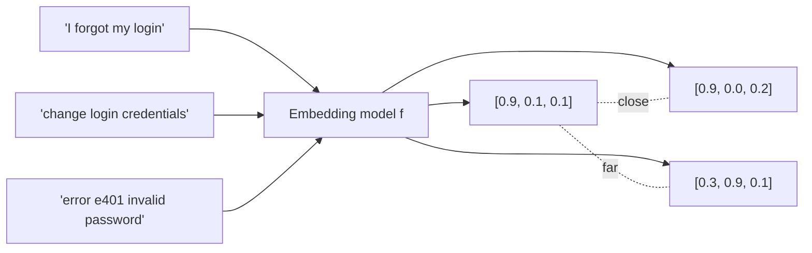
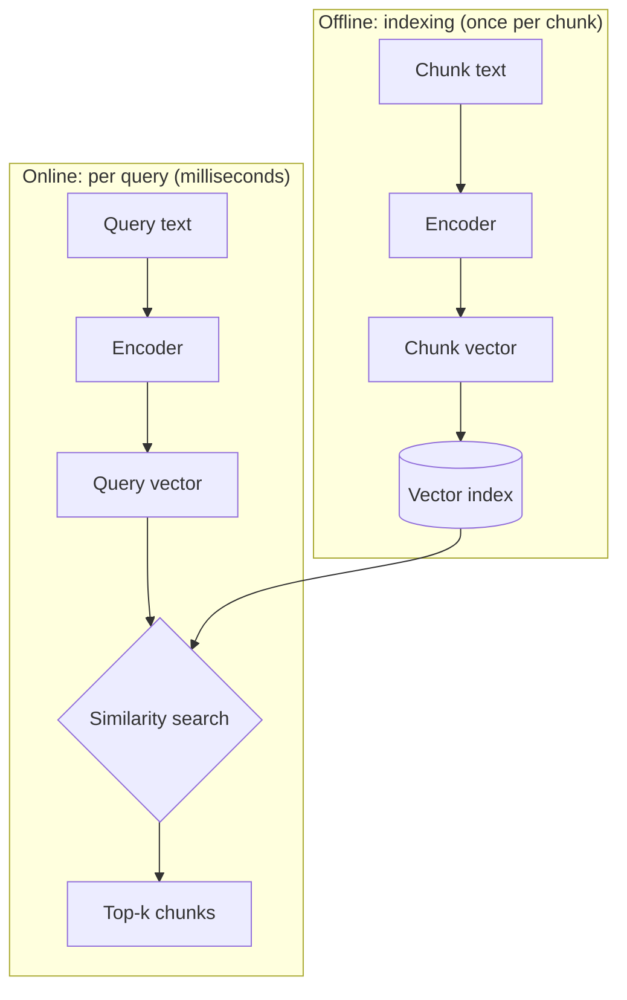
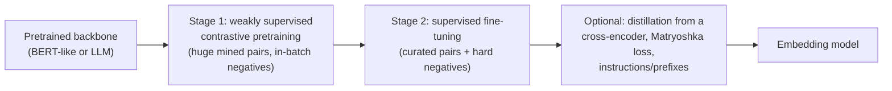
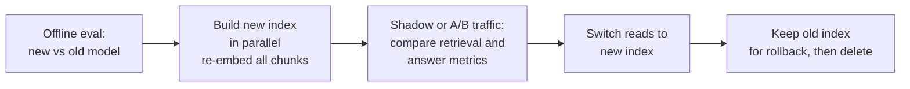

# Text Embeddings and Similarity Search

> **Level:** Beginner to Advanced · **Study time:** ~120 min · **Prerequisites:** [What Is RAG and Why It Matters](01-what-is-rag-and-why-it-matters.md), [Embeddings: From One-Hot Vectors to Word2Vec to Contextual Embeddings](../04-transformers/02-embeddings-from-one-hot-to-contextual.md), [Linear Algebra for Machine Learning](../00-foundations/02-linear-algebra-for-ml.md), [Softmax, Entropy, Cross-Entropy and KL Divergence](../00-foundations/05-softmax-entropy-cross-entropy-and-kl-divergence.md)

## Table of contents

- [Why this matters](#why-this-matters)
- [The running example](#the-running-example)
- [What an embedding model does](#what-an-embedding-model-does)
- [From token embeddings to sentence embeddings: pooling](#from-token-embeddings-to-sentence-embeddings-pooling)
- [The bi-encoder architecture](#the-bi-encoder-architecture)
- [How contrastive embedding models are trained](#how-contrastive-embedding-models-are-trained)
- [Why the same text gets different embeddings in different models](#why-the-same-text-gets-different-embeddings-in-different-models)
- [Query and document compatibility](#query-and-document-compatibility)
- [Normalization: what it is and when to do it](#normalization-what-it-is-and-when-to-do-it)
- [Cosine similarity vs dot product vs Euclidean distance](#cosine-similarity-vs-dot-product-vs-euclidean-distance)
- [Similarity search in code](#similarity-search-in-code)
- [Embedding dimensions, storage cost and Matryoshka embeddings](#embedding-dimensions-storage-cost-and-matryoshka-embeddings)
- [Choosing an embedding model](#choosing-an-embedding-model)
- [Fine-tuning an embedding model on domain data](#fine-tuning-an-embedding-model-on-domain-data)
- [Going deeper: embeddings in production](#going-deeper-embeddings-in-production)
- [Common mistakes and misconceptions](#common-mistakes-and-misconceptions)
- [Interview questions and model answers](#interview-questions-and-model-answers)
- [Key takeaways](#key-takeaways)
- [Further reading](#further-reading)
- [Next](#next)

## Why this matters

Every RAG system, semantic search box, duplicate-ticket detector and recommendation feed built on text rests on one component: the embedding model that turns text into vectors, plus the similarity function that compares them. If the embeddings are wrong for your data, retrieval misses the right chunk and the LLM answers from the wrong context, no matter how good the LLM is. Embedding choices are also expensive to undo: switching models means re-embedding your entire corpus, and a wrong normalization or a missing query prefix silently costs recall (the share of relevant chunks that retrieval actually finds) without ever raising an error. Interviewers probe this area because it separates people who have called `model.encode()` from people who understand what the vectors mean, how they were trained, and what breaks in production.

## The running example

We reuse the tiny IT-support knowledge base that appears throughout the RAG chapters. Each line is one chunk.

```text
D1: "reset password steps"
D2: "error e401 invalid password"
D3: "password policy password length password expiry"
D4: "change login credentials"
```

Our main query is:

```text
Q: "I forgot my login"
```

A keyword search does poorly on Q: it can reach D4 only through the single shared word "login", and it cannot find D1 at all, because D1 shares no words with the query. A human instantly knows D4 and D1 are the answers. Embeddings are how we teach a machine that human sense of "means roughly the same thing".

## What an embedding model does

### Intuition

Imagine a huge library with no catalog. A clever librarian decides to shelve books by meaning: cookbooks in one corner, Italian cookbooks near the pasta section of that corner, travel guides to Italy not far away. Now, to find books about a topic, you walk to the right spot and look at the neighbors.

An embedding model is that librarian, but for any piece of text, and the "library" has hundreds of dimensions instead of three.

> **Analogy:** An embedding is a GPS coordinate for meaning. Two texts that mean similar things get coordinates that are close together, even if they share no words.

### Precise definition

An **embedding model** (also called a **text encoder**) is a function

$$f: \text{text} \rightarrow \mathbb{R}^d$$

- $f$ is a neural network, usually a transformer encoder (see [Encoder-Only, Encoder-Decoder and Decoder-Only Models](../04-transformers/07-encoder-only-encoder-decoder-and-decoder-only-models.md)).
- "text" can be a word, a query, a sentence or a whole passage.
- $\mathbb{R}^d$ means "a list of $d$ real numbers". $d$ is the **embedding dimension**, fixed by the model (for example 384, 768 or 1024).

The output $f(\text{text})$ is called an **embedding** (or **embedding vector**, or **dense vector**). Three properties matter:

1. **Fixed length.** A 3-word query and a 300-word passage both become exactly $d$ numbers. That is what makes them comparable.
2. **Dense.** Almost every number is non-zero, unlike a bag-of-words vector (one entry per vocabulary word, counting how often that word appears), where most entries are zero. "Dense retrieval" means search using these vectors.
3. **Geometry encodes meaning.** The model is trained so that texts that should match (a question and its answer, two paraphrases) end up close together, and unrelated texts end up far apart. No single dimension has a human-readable meaning; meaning lives in directions and distances.

### A toy picture

Real embeddings have hundreds of dimensions. To build intuition, pretend a model outputs 3 numbers, and that the axes loosely mean "account access", "errors" and "policy". These numbers are **illustrative**, not from a real model:

```text
                  access  errors  policy
Q  (forgot login)  0.9     0.1     0.1
D1 (reset pwd)     0.7     0.3     0.2
D2 (error e401)    0.3     0.9     0.1
D3 (pwd policy)    0.3     0.1     0.9
D4 (change login)  0.9     0.0     0.2
```

Q points almost the same direction as D4 and D1, and a quite different direction from D2 and D3. Searching is then just "find the vectors closest to Q". We will make "closest" precise with cosine similarity later and compute these exact numbers by hand.



### What "similar" means is decided by training

This is subtle and important. "Similar" is not a law of nature; it is whatever the training data rewarded:

- A model trained on paraphrase pairs puts "How do I reset my password?" next to "How can I change my password?" (a **symmetric** task: both sides are the same kind of text).
- A model trained on question-answer pairs puts "How do I reset my password?" next to "Go to Settings, then Security, then Reset" (an **asymmetric** task: a short query and a longer passage).
- A model trained for topic clustering might put "I love this phone" next to "I hate this phone" because both are about phones, even though their sentiment is opposite.

> **Senior insight:** When someone says "these two texts have high similarity", always ask "according to a model trained for what?". Many retrieval surprises come from using a model whose notion of similarity differs from the task.

## From token embeddings to sentence embeddings: pooling

This section is a short recap with a retrieval focus; the full treatment of contextual embeddings and pooling lives in [Embeddings: From One-Hot Vectors to Word2Vec to Contextual Embeddings](../04-transformers/02-embeddings-from-one-hot-to-contextual.md).

### Two kinds of "embedding"

- A **token** is a piece of text the model processes, often a word or part of a word (see [Tokenization](../04-transformers/01-tokenization.md)).
- A **token embedding**, in the strict sense, is the row of the model's input lookup table for a token. In everyday speech people also use it for the **contextual token representation**: the vector the transformer outputs for each token after its layers have mixed in context. Either way, you get **one vector per token**. For a 3-token text and $d = 768$ you get a $3 \times 768$ matrix.
- A **sentence embedding** (also **text embedding** or **document embedding**) is **one vector for the whole text**, shape $768$, built so that whole texts can be compared.

| | Token embeddings | Sentence embedding |
|---|---|---|
| How many vectors | One per token | One per text |
| Shape for $T$ tokens | $T \times d$ | $d$ |
| Trained to be compared across texts? | Not directly | Yes (contrastive training, below) |
| Used for | Inside the transformer; late-interaction retrieval; token tasks such as tagging | Search indexes, clustering, deduplication |

A transformer naturally produces token vectors. A search index needs one vector per chunk. **Pooling** is the step that squashes the per-token matrix into one vector.

> **Analogy:** Token vectors are the individual votes in a meeting. The sentence embedding is the meeting's decision. Pooling is the rule for turning votes into a decision: let the chairperson speak for everyone (CLS), average everyone's view (mean), or listen to whoever spoke last after hearing everyone (last token).

### Pooling strategies

Names you will meet from here on: **sentence-transformers** is the standard open-source Python library for loading, running and training embedding models. **BGE** (from BAAI), **E5** (from Microsoft), **GTE** (from Alibaba) and **all-MiniLM-L6-v2** are popular open embedding model families or models; you do not need to memorize them, only to know that each comes with its own conventions.

| Strategy | What it does | Typical models | Pros | Cons |
|---|---|---|---|---|
| **CLS pooling** | Take the output vector of the special `[CLS]` token placed at the start of the input | BERT-style encoders fine-tuned to use it (several BGE models use CLS) | Simple; works well when training optimized that vector | Raw pretrained BERT `[CLS]` is a poor sentence embedding without contrastive fine-tuning |
| **Mean pooling** | Average the output vectors of all real (non-padding) tokens | Many sentence-transformers models (for example all-MiniLM-L6-v2), E5 family | Robust, uses every token | Must mask padding; long texts get "averaged out" |
| **Max pooling** | Take the element-wise maximum across tokens | Rare today | Captures strong local signals | Noisy; rarely best for retrieval |
| **Last-token (EOS) pooling** | Take the output vector of the final token | Decoder-only (LLM-based) embedders such as E5-Mistral style models | With causal attention (each token can attend only to tokens before it), only the last token has seen the whole text | Sensitive to the exact end token and padding side |

The most important rule: **use the pooling the model was trained with.** The pooling method is part of the model, not a free choice at inference time. sentence-transformers stores it in the model's configuration, which is one reason to load models through it instead of hand-wiring Hugging Face outputs.

### Mean pooling with a padding mask: worked example

When you embed a batch, shorter texts are padded with a special `[PAD]` token so all rows have the same length. The **attention mask** marks real tokens with 1 and padding with 0. Padding vectors must not be averaged in.

Suppose the text "reset password" was padded to 3 tokens, and the model output these 2-dimensional vectors (illustrative):

```text
token      vector    mask
reset      (1, 3)    1
password   (3, 1)    1
[PAD]      (9, 9)    0
```

Masked mean pooling:

$$\text{pooled} = \frac{\sum_{i} m_i \, h_i}{\sum_i m_i}$$

- $h_i$: the output vector for token $i$.
- $m_i$: the mask value for token $i$ (1 for real, 0 for padding).
- The numerator adds up only the real token vectors; the denominator counts the real tokens.

By hand:

- Numerator: $1 \cdot (1, 3) + 1 \cdot (3, 1) + 0 \cdot (9, 9) = (4, 4)$
- Denominator: $1 + 1 + 0 = 2$
- Pooled: $(4/2, 4/2) = (2, 2)$

A buggy unmasked mean would give $(13/3, 13/3) \approx (4.33, 4.33)$: the same sentence would get a different embedding depending on what else was in its batch. That is a real bug people ship.

```python
# pip install numpy
import numpy as np

def masked_mean_pool(token_vecs: np.ndarray, mask: np.ndarray) -> np.ndarray:
    """token_vecs: (batch, seq_len, d); mask: (batch, seq_len) of 0/1."""
    m = mask[..., None].astype(token_vecs.dtype)      # (batch, seq_len, 1)
    summed = (token_vecs * m).sum(axis=1)             # (batch, d)
    counts = np.clip(m.sum(axis=1), 1e-9, None)       # avoid divide by zero
    return summed / counts

h = np.array([[[1, 3], [3, 1], [9, 9]]], dtype=float)
mask = np.array([[1, 1, 0]])
print(masked_mean_pool(h, mask))  # [[2. 2.]]
```

### Why raw BERT is not a good sentence encoder

A natural first idea is: take a pretrained BERT, mean-pool or CLS-pool, done. Reimers and Gurevych ("Sentence-BERT", 2019) showed that this gives poor sentence similarity, in their experiments worse than simply averaging older GloVe word vectors. Two reasons:

- BERT's pretraining objective (predicting masked words) never asked whole-sentence vectors to be comparable.
- Contextual representations from pretrained transformers are **anisotropic**: they crowd into a narrow cone of the vector space, so almost every pair has high cosine similarity (Ethayarajh, "How Contextual are Contextualized Word Representations?", 2019).

The fix is the subject of the next two sections: a bi-encoder trained with a contrastive objective.

## The bi-encoder architecture

### Intuition

You want to search 10 million chunks in under 100 milliseconds. You cannot run a big neural network on (query, chunk) pairs 10 million times per query. But you can run the network on each chunk **once, ahead of time**, store the vectors, and at query time run the network only on the query.

### Definition

A **bi-encoder** (also **dual encoder** or **two-tower model**) encodes the query and the document **independently**, each into its own vector, and scores the pair with a cheap similarity function such as cosine similarity.



- Usually the query encoder and document encoder are the **same network with shared weights** (as in Sentence-BERT). Some systems use two separate networks trained jointly, for example DPR ("Dense Passage Retrieval for Open-Domain Question Answering", Karpukhin et al., 2020). Either way, the two towers were trained **together** into one shared space.
- Score: $s(q, d) = \text{sim}(f(q), f(d))$. Search returns the **top-k**: the $k$ chunks with the highest scores (for example $k = 5$).

### Bi-encoder vs cross-encoder vs late interaction

A **cross-encoder** feeds the query and document **together** into one transformer, so every query token can attend to every document token, and outputs a single relevance score. It is more accurate but cannot precompute anything. A **late-interaction** model such as ColBERT (Khattab and Zaharia, 2020) keeps one vector per token and compares them at query time, a middle ground.

| | Bi-encoder | Cross-encoder | Late interaction (ColBERT) |
|---|---|---|---|
| What | Separate vectors, compare with cosine/dot | Joint encoding of the pair, outputs a score | Per-token vectors, sum of max token similarities |
| Precompute docs? | Yes, one vector per chunk | No | Yes, many vectors per chunk |
| Query-time cost | One encoder pass plus vector search | One full pass per (query, doc) pair | One encoder pass plus heavier scoring |
| Accuracy | Good | Best | Between the two |
| Storage | Smallest | None (no index) | Large (one vector per token) |
| Typical use | First-stage retrieval over millions | Reranking the top 20 to 100 | Retrieval when quality matters and storage is affordable |

The standard production pattern is **retrieve with a bi-encoder, rerank with a cross-encoder**. Reranking is covered in [Reranking and Query Transformation](08-reranking-and-query-transformation.md).

> **Interview tip:** If asked "why not just use a cross-encoder for everything?", answer with arithmetic: 10 million chunks times one transformer pass each per query is impossible at interactive latency. The bi-encoder's whole value is that document vectors are computed once.

## How contrastive embedding models are trained

### Intuition: pull together, push apart

Picture a room full of people where pairs of friends are wearing matching badges. Your job is to arrange everyone so that each person stands right next to their friend and away from strangers. You do not need to know why they are friends; you just keep moving friends closer and strangers apart. After enough rounds, the room is organized so that "standing near" means "related".

**Contrastive learning** does exactly this with vectors: given pairs that should match, it pulls their embeddings together and pushes non-matching texts apart.

### The ingredients

- **Anchor:** the text we are embedding, usually the query. Example: "I forgot my login".
- **Positive:** a text that should match the anchor. Example: "change login credentials". An (anchor, positive) tuple is a **positive pair**.
- **Negative:** a text that should not match the anchor. Example: "password policy password length password expiry".

Where positive pairs come from:

| Source | Example pair |
|---|---|
| Search logs and clicks | (query, clicked passage) |
| QA datasets such as MS MARCO, Natural Questions | (question, answer passage) |
| Web structure | (page title, page body), (post title, top answer) |
| NLI (natural language inference) data | (premise, entailed hypothesis) |
| Paraphrase data | (sentence, paraphrase) |
| Synthetic data | (LLM-generated question about a chunk, that chunk) |

### In-batch negatives: free negatives

Labeling negatives by hand would be expensive. The trick: train on a **batch** of $B$ positive pairs at once, and for each anchor treat **the other $B - 1$ positives in the batch** as negatives. These are **in-batch negatives**. They are almost always unrelated (random other examples), and they cost nothing extra because those embeddings were computed anyway.

For a batch of 3 pairs from our IT corpus:

```text
q1 = "I forgot my login"            p1 = "change login credentials"
q2 = "error e401"                   p2 = "error e401 invalid password"
q3 = "how long must passwords be"   p3 = "password policy password length password expiry"
```

Compute the similarity of every query with every positive. This gives a $B \times B$ matrix $S$ where the diagonal holds the true pairs. Illustrative cosine similarities:

```text
            p1     p2     p3
   q1  [  0.80   0.30   0.10 ]   <- want row max on the diagonal
   q2  [  0.20   0.90   0.40 ]
   q3  [  0.10   0.35   0.70 ]
```

Each row is now a little classification problem: "which of these $B$ passages is my positive?". The correct answer is always the diagonal. This is why the loss below is just cross-entropy with the labels $[0, 1, 2, \ldots]$.

### The InfoNCE loss

The standard loss is **InfoNCE** (introduced in "Representation Learning with Contrastive Predictive Coding", van den Oord, Li and Vinyals, 2018). In sentence-transformers it is called `MultipleNegativesRankingLoss`. For one anchor $q_i$:

$$\mathcal{L}_i = -\log \frac{\exp\left(s(q_i, p_i)/\tau\right)}{\sum_{j=1}^{B} \exp\left(s(q_i, p_j)/\tau\right)}$$

- $q_i$: the $i$-th anchor (query) in the batch.
- $p_i$: its positive passage. $p_j$ for $j \neq i$ are the in-batch negatives (plus any hard negatives you add).
- $s(q, p)$: the similarity score, usually cosine similarity between the two embeddings, between -1 and 1.
- $\tau$ (tau): the **temperature**, a small positive number such as 0.05 that scales the scores before the softmax.
- $\exp$: the exponential function $e^x$.
- $B$: batch size, so there are $B$ candidates in the denominator.
- The fraction is a **softmax**: the probability the model assigns to the correct passage among all candidates. Taking $-\log$ makes it a cross-entropy loss (see [Softmax, Entropy, Cross-Entropy and KL Divergence](../00-foundations/05-softmax-entropy-cross-entropy-and-kl-divergence.md)).

The batch loss is the average: $\mathcal{L} = \frac{1}{B}\sum_{i=1}^{B} \mathcal{L}_i$.

Minimizing it raises $s(q_i, p_i)$ and lowers $s(q_i, p_j)$ for the negatives. That is "pull together, push apart" in one formula.

### Worked example by hand

Row 1 of our matrix: scores $[0.80, 0.30, 0.10]$, correct answer at position 1, temperature $\tau = 0.1$.

**Step 1: divide by temperature.** $0.80 / 0.1 = 8$, $0.30 / 0.1 = 3$, $0.10 / 0.1 = 1$. The **logits** (the raw scores fed into the softmax) are $[8, 3, 1]$.

**Step 2: exponentiate.**

- $e^{8} \approx 2980.96$
- $e^{3} \approx 20.09$
- $e^{1} \approx 2.72$

**Step 3: sum.** $2980.96 + 20.09 + 2.72 = 3003.77$ (more precisely 3003.76).

**Step 4: probability of the correct passage.** $2980.96 / 3003.76 \approx 0.9924$.

**Step 5: loss.** $-\ln(0.9924) \approx 0.0076$.

The model is already confident, so the loss is tiny. Doing the same for rows 2 and 3 (row 2 has the same gaps as row 1, so it also gives 0.0076; row 3 gives about 0.0322) and averaging gives a batch loss of about 0.0158.

### What temperature does

Now repeat row 1 with $\tau = 1$ (no sharpening). Logits are $[0.8, 0.3, 0.1]$:

- $e^{0.8} \approx 2.2255$, $e^{0.3} \approx 1.3499$, $e^{0.1} \approx 1.1052$
- Sum $\approx 4.6806$
- Probability $\approx 2.2255 / 4.6806 \approx 0.4755$
- Loss $\approx -\ln(0.4755) \approx 0.743$

Same similarities, but now the model is "only 48% sure", so it gets a large loss and keeps pushing. Cosine similarity lives in $[-1, 1]$, which is a narrow range for a softmax; dividing by a small $\tau$ stretches the gaps so a difference of 0.5 in cosine becomes a difference of 5 in logits.

| Temperature | Effect on softmax | Training behavior |
|---|---|---|
| Small (for example 0.01 to 0.05) | Very sharp; the hardest negatives dominate the loss | Strong separation, but can be unstable and punishes false negatives harshly |
| Medium (for example 0.05 to 0.1) | Sharp but smooth | Common default range for text embedders |
| Large (for example 1.0) | Flat; all candidates look similar | Weak gradients for separating close candidates |

`MultipleNegativesRankingLoss` exposes this as `scale`, which equals $1/\tau$; its default `scale=20.0` corresponds to $\tau = 0.05$. CLIP-style models learn $\tau$ as a parameter (see [Vision Transformers, CLIP and Multimodal LLMs](../03-computer-vision/05-vision-transformers-clip-and-multimodal-models.md), which uses the same loss for image-text pairs).

### Hard negatives

Random in-batch negatives are usually **easy**: "error e401" vs "password policy" is not a hard distinction. After a while the model aces them and stops learning. A **hard negative** is a text that looks relevant but is not, for example for "I forgot my login":

```text
hard negative: "login page loads slowly"   (shares "login", different problem)
```

Let us see why hard negatives matter. Replace row 1's middle score with a hard negative scoring 0.75 (illustrative), keeping $\tau = 0.1$: logits $[8, 7.5, 1]$.

- $e^{8} \approx 2980.96$, $e^{7.5} \approx 1808.04$, $e^{1} \approx 2.72$
- Sum $\approx 4791.72$
- Probability $\approx 2980.96 / 4791.72 \approx 0.6221$
- Loss $\approx -\ln(0.6221) \approx 0.475$

The loss jumped from 0.0076 to 0.475. Hard negatives produce large gradients exactly where the model is confused, which is where retrieval quality is won.

How to mine hard negatives:

- **BM25 negatives:** top keyword-search results that are not labeled positive (used in DPR). BM25 is the standard keyword-ranking function, covered in [Retrieval Methods](05-retrieval-bm25-dense-and-hybrid-search.md).
- **Model-mined negatives:** top results from the current or a previous embedding model (the idea behind ANCE, "Approximate Nearest Neighbor Negative Contrastive Learning for Dense Text Retrieval", Xiong et al., 2020).
- **Filtering false negatives:** a "negative" that is actually relevant but unlabeled is a **false negative**, and training on it teaches the model the wrong thing. Common fixes: skip the top few mined results, or drop candidates that a cross-encoder scores as relevant.

> **Common mistake:** Mining the very top results as negatives without filtering. In sparsely labeled datasets, a noticeable share of those can be unlabeled positives, and the model learns to push relevant passages away.

### Why batch size matters

More in-batch negatives make the classification task harder and the gradient more informative, so contrastive training usually benefits from large batches (hundreds to tens of thousands of pairs). Engineering tricks to get there:

- **Cross-device negatives:** share embeddings across GPUs so each anchor sees negatives from all devices.
- **Gradient caching** ("Scaling Deep Contrastive Learning Batch Size under Memory Limited Setup", Gao et al., 2021): compute the loss over a huge batch while back-propagating in small chunks. sentence-transformers offers `CachedMultipleNegativesRankingLoss` for this.
- **No duplicates in a batch:** if the same passage appears twice, one copy becomes a false negative for the other's anchor.

### The typical training recipe

Modern general-purpose embedders (for example E5, "Text Embeddings by Weakly-Supervised Contrastive Pre-training", Wang et al., 2022; GTE, "Towards General Text Embeddings with Multi-stage Contrastive Learning", Li et al., 2023) follow a multi-stage recipe:



Since around 2023, several top models start from decoder-only LLMs instead of BERT-style encoders (for example "Improving Text Embeddings with Large Language Models", Wang et al., 2023, which also used LLM-generated synthetic training data). They are often more accurate but larger and slower to run, which matters when you must embed millions of chunks.

### InfoNCE from scratch in PyTorch

```python
# pip install torch
import torch
import torch.nn.functional as F

def info_nce(q: torch.Tensor, p: torch.Tensor, tau: float = 0.05) -> torch.Tensor:
    """q, p: (B, d) embeddings of anchors and their positives.
    Row i of p is the positive for row i of q; all other rows are in-batch negatives."""
    q = F.normalize(q, dim=-1)                 # unit length, so q @ p.T is cosine
    p = F.normalize(p, dim=-1)
    logits = (q @ p.T) / tau                   # (B, B) similarity matrix, sharpened
    labels = torch.arange(q.size(0))           # correct "class" for row i is column i
    return F.cross_entropy(logits, labels)     # softmax + negative log likelihood, averaged

# Check against the hand calculation using the similarity matrix directly
S = torch.tensor([[0.80, 0.30, 0.10],
                  [0.20, 0.90, 0.40],
                  [0.10, 0.35, 0.70]])
loss = F.cross_entropy(S / 0.1, torch.arange(3))
print(round(loss.item(), 4))  # about 0.0158, matching the hand calculation
```

Many implementations add a **symmetric** term (also classify the correct query for each passage, using the columns), as CLIP does, and append hard negatives as extra columns of `p`.

## Why the same text gets different embeddings in different models

### Intuition

Two cartographers each draw a map of the same city. One puts north at the top and uses kilometers; the other rotates the map, uses miles and starts from a different origin. Within each map, nearby places are nearby. But the coordinate "(3, 4)" on one map has nothing to do with "(3, 4)" on the other.

Embedding models are cartographers of meaning. Each draws its own map.

### Why the vectors differ

1. **Different architectures and sizes.** One model outputs 384 numbers, another 1024. They are not even the same shape.
2. **Different tokenizers.** The same string is split into different tokens with different vocabularies.
3. **Different pooling.** CLS vs mean vs last-token gives different vectors even from the same backbone.
4. **Different training data and objectives.** A paraphrase-trained model and a QA-trained model disagree about what should be near what.
5. **Arbitrary coordinates, even with identical training.** The contrastive loss only cares about similarities between vectors. If you rotate every embedding by the same rotation, all cosine similarities stay identical, so the loss is identical. Training with a different random seed lands on an essentially arbitrary orientation. Individual coordinates therefore have no shared meaning across models. Quick check: rotate $a = (3, 4)$ and $b = (4, 3)$ by 90 degrees, which maps $(x, y)$ to $(-y, x)$. You get $(-4, 3)$ and $(-3, 4)$. Every coordinate changed, yet the dot product ($\sum_k a_k b_k$) is still $(-4)(-3) + 3 \cdot 4 = 24$, the same as $3 \cdot 4 + 4 \cdot 3$, and both lengths are still 5, so every similarity built from them is unchanged.
6. **Versions.** "v1" and "v2" of the same model family are different maps. So is the same model after fine-tuning.

### Consequences

- **Never mix models in one index.** A query embedded with model B compared against documents embedded with model A gives meaningless scores. Nothing errors out: the vector database happily returns nearest neighbors, which are effectively random.
- **Scores are not comparable across models.** One model's "0.8" may be another's "0.5". Any similarity threshold (for example "only use chunks with cosine above 0.75") must be recalibrated when the model changes.
- **Changing the model means re-embedding the whole corpus.** This is the main operational cost of upgrading, covered in [Production Ingestion Pipelines](12-production-ingestion-pipelines-at-scale.md).

> **Senior insight:** Store the embedding model name, version, dimension, normalization setting and query/document prefixes as metadata on every index (and ideally on every vector). Then a mismatch becomes a check that fails loudly instead of a silent quality drop.

(Advanced aside: researchers have shown that two embedding spaces can sometimes be roughly aligned with a learned mapping. That is a research technique, not a substitute for re-embedding in production.)

## Query and document compatibility

### The rule

Queries and documents must be embedded **into the same space**: the same model (or two towers trained together), the same version, the same pooling and normalization, and the same conventions for prefixes. Retrieval works only because training placed a query and its relevant passage near each other **in that model's space**.

### Symmetric vs asymmetric search

| | Symmetric search | Asymmetric search |
|---|---|---|
| What | Both sides are the same kind of text | Short query vs longer document |
| Examples | Duplicate question detection, paraphrase mining, clustering | RAG, web search, FAQ retrieval |
| Model behavior | Query and document handled identically | Model may need to know which side is which |

A question ("I forgot my login") and its answer ("change login credentials via Settings, then Security") are not paraphrases. They differ in length, form and vocabulary. Some model families handle this by asking you to mark which side is which.

### Query and passage prefixes (instructions)

Some models were trained with a text **prefix** or **instruction** prepended to each input, and expect the same at inference time. Examples (exact strings are version-specific; always check the model card):

| Model family (examples) | Query side | Document side |
|---|---|---|
| E5 (for example `intfloat/e5-base-v2`) | `"query: ..."` | `"passage: ..."` |
| BGE English v1.5 (for example `BAAI/bge-small-en-v1.5`) | Optional instruction such as `"Represent this sentence for searching relevant passages: ..."` | No prefix |
| Nomic embed text | `"search_query: ..."` | `"search_document: ..."` |
| Instruction-tuned embedders (Instructor; E5-Mistral style) | A task description plus the query | E5-Mistral style: no instruction; Instructor: its own document-side instruction (for example "Represent the document for retrieval: ") |
| Hosted APIs (for example Cohere's `input_type`, Google's `task_type`) | A parameter such as "search query" | A parameter such as "search document" |

Why prefixes help: the same encoder can produce a "query-shaped" vector and a "passage-shaped" vector, which makes asymmetric matching easier to learn. Instructions also let one model serve different tasks (retrieval vs clustering vs classification).

> **Common mistake:** Forgetting the prefix, or using `"query: "` for both sides, or adding prefixes to a model that never saw them. None of these raise errors. They quietly lower recall, sometimes by a lot. Make prefixes part of a single `embed_query()` / `embed_document()` function so nobody can call the model inconsistently.

```python
# pip install sentence-transformers
from sentence_transformers import SentenceTransformer

# E5 expects explicit "query: " and "passage: " prefixes (check the model card).
model = SentenceTransformer("intfloat/e5-base-v2")

def embed_query(texts: list[str]):
    return model.encode([f"query: {t}" for t in texts], normalize_embeddings=True)

def embed_documents(texts: list[str]):
    return model.encode([f"passage: {t}" for t in texts], normalize_embeddings=True)
```

Recent sentence-transformers releases also let a model define named prompts and offer helper methods for queries and documents (for example `encode_query` and `encode_document` in v5). These APIs change between versions, so the explicit wrapper above is the most portable pattern.

## Normalization: what it is and when to do it

### Intuition

Two arrows can point in the same direction but have different lengths. If we only care about direction ("what is this text about?"), length is noise, so we shrink or stretch every arrow to length 1. That is normalization.

### Definition

The **L2 norm** (length) of a vector $v = (v_1, \ldots, v_d)$ is

$$\|v\| = \sqrt{v_1^2 + v_2^2 + \cdots + v_d^2}$$

**L2 normalization** divides the vector by its norm:

$$\hat{v} = \frac{v}{\|v\|}$$

- $v_k$: the $k$-th number in the vector.
- $\|v\|$: its length.
- $\hat{v}$ ("v hat"): the **unit vector**, same direction, length exactly 1.

Worked example: $v = (3, 4)$.

- $\|v\| = \sqrt{3^2 + 4^2} = \sqrt{9 + 16} = \sqrt{25} = 5$
- $\hat{v} = (3/5, 4/5) = (0.6, 0.8)$
- Check: $\sqrt{0.6^2 + 0.8^2} = \sqrt{0.36 + 0.64} = \sqrt{1} = 1$

### When to normalize

| Situation | Normalize? | Why |
|---|---|---|
| Model trained with cosine similarity (most sentence-transformers and general-purpose embedders) | Yes | Length carries no trained meaning; unit vectors let you use fast dot-product search and make cosine, dot and Euclidean agree |
| Your vector database or ANN (approximate nearest neighbor) index only supports inner product or L2, but you want cosine | Yes | After normalizing, inner product equals cosine (shown below) |
| You truncated a Matryoshka embedding to fewer dimensions | Yes, re-normalize after truncating | Truncation changes the length |
| Model trained with raw dot product (its card says "use dot product", for example some MS MARCO models such as `msmarco-distilbert-base-tas-b`) | No | The length may encode useful signal (for example how specific or "important" a passage is); normalizing throws it away |
| Some hosted APIs already return unit-length vectors | Already done | Check the docs; re-normalizing a unit vector is harmless |

The rule of thumb: **use the similarity function the model was trained with, and normalize when that function is cosine.** Whatever you choose, apply it **identically** at indexing time and query time.

> **Senior insight:** Normalizing at write time is cheaper than computing cosine at query time. Computed naively, cosine needs two norms per comparison; a pre-normalized index needs only a dot product. Over billions of comparisons, that matters, and inner-product search is what ANN libraries optimize hardest.

In sentence-transformers, `model.encode(..., normalize_embeddings=True)` normalizes. Some models (all-MiniLM-L6-v2, for example) already include a `Normalize` layer in their pipeline, so their outputs are unit length regardless.

## Cosine similarity vs dot product vs Euclidean distance

### Intuition

You and a friend are standing in a field. Three questions:

- **Cosine similarity:** "Are we facing the same direction?" (ignores how far you have walked)
- **Dot product:** "How far have we both walked in the same direction?" (direction times length)
- **Euclidean distance:** "How far apart are we standing?" (straight-line gap)

### Definitions

**Dot product:**

$$a \cdot b = \sum_{k=1}^{d} a_k b_k$$

**Cosine similarity:**

$$\cos(a, b) = \frac{a \cdot b}{\|a\| \, \|b\|}$$

**Euclidean (L2) distance:**

$$\|a - b\| = \sqrt{\sum_{k=1}^{d} (a_k - b_k)^2}$$

- $a, b$: two embedding vectors of the same dimension $d$.
- $a_k, b_k$: their $k$-th entries.
- $\|a\|, \|b\|$: their lengths (L2 norms).
- Cosine ranges from -1 (opposite) through 0 (unrelated, perpendicular) to 1 (same direction). Dot product is unbounded. Euclidean distance is 0 for identical vectors and grows as they separate. Cosine and dot are **similarities** (higher is better); Euclidean is a **distance** (lower is better).

### Worked example 1: three vectors, three opinions

Let $a = (3, 4)$, $b = (4, 3)$, $c = (6, 8)$. Note $c$ is just $a$ doubled.

**$a$ vs $b$:**

- Dot: $3 \cdot 4 + 4 \cdot 3 = 12 + 12 = 24$
- Norms: $\|a\| = 5$, $\|b\| = \sqrt{16 + 9} = 5$
- Cosine: $24 / (5 \cdot 5) = 24/25 = 0.96$
- Euclidean: $a - b = (-1, 1)$, distance $\sqrt{1 + 1} = \sqrt{2} \approx 1.414$

**$a$ vs $c$:**

- Dot: $3 \cdot 6 + 4 \cdot 8 = 18 + 32 = 50$
- Norms: $\|a\| = 5$, $\|c\| = \sqrt{36 + 64} = 10$
- Cosine: $50 / (5 \cdot 10) = 1.0$
- Euclidean: $a - c = (-3, -4)$, distance $\sqrt{9 + 16} = 5$

Cosine says $c$ is a **perfect** match for $a$ (same direction). Euclidean says $c$ is **farther** from $a$ than $b$ is (5 vs 1.414). Dot product says $c$ is a much stronger match (50 vs 24). Same vectors, three different stories, because only cosine ignores length.

### Worked example 2: rankings can flip

Query $q = (1, 0)$ and two documents $d_A = (0.9, 0.1)$, $d_B = (2, 2)$.

| | Dot product | Cosine | Euclidean distance |
|---|---|---|---|
| $d_A$ | $0.9 \cdot 1 + 0.1 \cdot 0 = 0.9$ | $0.9 / (1 \cdot \sqrt{0.82}) = 0.9 / 0.9055 \approx 0.994$ | $\sqrt{0.1^2 + 0.1^2} = \sqrt{0.02} \approx 0.141$ |
| $d_B$ | $2 \cdot 1 + 2 \cdot 0 = 2$ | $2 / (1 \cdot \sqrt{8}) = 2 / 2.828 \approx 0.707$ | $\sqrt{1^2 + 2^2} = \sqrt{5} \approx 2.236$ |
| Winner | $d_B$ | $d_A$ | $d_A$ (smaller is better) |

Dot product prefers the long vector $d_B$ even though it points 45 degrees away from the query. If $d_B$'s length is meaningless (a cosine-trained model), dot product just ranked the wrong document first.

### The key identity for unit vectors

Expand the squared Euclidean distance:

$$\|a - b\|^2 = \sum_k (a_k - b_k)^2 = \sum_k a_k^2 - 2\sum_k a_k b_k + \sum_k b_k^2 = \|a\|^2 - 2\, a \cdot b + \|b\|^2$$

If both vectors are unit length, $\|a\|^2 = \|b\|^2 = 1$ and $a \cdot b = \cos(a, b)$, so:

$$\|a - b\|^2 = 2 - 2\cos(a, b)$$

- Left side: squared straight-line distance.
- Right side: a decreasing function of cosine. Higher cosine means smaller distance.

Worked check with unit vectors $\hat{a} = (0.6, 0.8)$ and $\hat{b} = (0.8, 0.6)$ (these are $a$ and $b$ from example 1, normalized):

- Cosine (= dot, since unit length): $0.6 \cdot 0.8 + 0.8 \cdot 0.6 = 0.48 + 0.48 = 0.96$. Same as before: normalization does not change cosine.
- Squared distance directly: $\hat{a} - \hat{b} = (-0.2, 0.2)$, so $0.04 + 0.04 = 0.08$
- Via the identity: $2 - 2 \cdot 0.96 = 2 - 1.92 = 0.08$. They match.

**Consequence:** for unit vectors, ranking by highest cosine, highest dot product, or lowest Euclidean distance gives **exactly the same order**. So once you normalize, the choice is about speed and what your index supports, not about quality. This is why "normalize, then use inner product" is the default recipe.

### Comparison table

| | Cosine similarity | Dot product (inner product) | Euclidean (L2) distance |
|---|---|---|---|
| Measures | Angle only | Angle and both lengths | Straight-line gap |
| Range | -1 to 1 | Unbounded | 0 to infinity |
| Better is | Higher | Higher | Lower |
| Uses magnitude? | No | Yes | Yes |
| Use when | Model trained with cosine (most text embedders) | Model trained with dot product, or vectors already normalized (then equals cosine) | Index only supports L2, with normalized vectors (equivalent ranking); some vision and clustering uses |
| Cost | Dot plus two norms (or just dot if pre-normalized) | Cheapest | Similar to dot |
| Names in tools | `cosine` | `ip`, `dot`, `inner_product`, FAISS `IndexFlatIP` | `l2`, `euclidean`, FAISS `IndexFlatL2` (which returns **squared** L2) |

> **Common mistake:** Confusing a similarity with a distance. Many vector databases return **cosine distance** $= 1 - \cos$ (lower is better), and FAISS `IndexFlatL2` returns squared distances. Sorting the wrong way, or applying a "similarity > 0.8" threshold to a distance, inverts your results.

### Our running example by hand

Back to the toy 3-D vectors. Compute cosine between Q $= (0.9, 0.1, 0.1)$ and D4 $= (0.9, 0.0, 0.2)$:

- Dot: $0.9 \cdot 0.9 + 0.1 \cdot 0.0 + 0.1 \cdot 0.2 = 0.81 + 0 + 0.02 = 0.83$
- $\|Q\| = \sqrt{0.81 + 0.01 + 0.01} = \sqrt{0.83} \approx 0.9110$
- $\|D4\| = \sqrt{0.81 + 0 + 0.04} = \sqrt{0.85} \approx 0.9220$
- Cosine: $0.83 / (0.9110 \cdot 0.9220) = 0.83 / 0.8399 \approx 0.988$

The same procedure for the others gives:

| Doc | Dot with Q | Norm | Cosine with Q | Rank |
|---|---|---|---|---|
| D4 change login credentials | 0.83 | 0.9220 | 0.988 | 1 |
| D1 reset password steps | 0.68 | 0.7874 | 0.948 | 2 |
| D2 error e401 invalid password | 0.37 | 0.9539 | 0.426 | 3 (tie) |
| D3 password policy | 0.37 | 0.9539 | 0.426 | 3 (tie) |

D4 wins even though it shares only one word with the query, and D1 (no shared words at all) comes second. That is semantic search.

## Similarity search in code

### From scratch with NumPy

```python
# pip install numpy
import numpy as np

docs = ["reset password steps", "error e401 invalid password",
        "password policy password length password expiry", "change login credentials"]
D = np.array([[0.7, 0.3, 0.2],    # toy embeddings (illustrative)
              [0.3, 0.9, 0.1],
              [0.3, 0.1, 0.9],
              [0.9, 0.0, 0.2]])
q = np.array([0.9, 0.1, 0.1])

def l2_normalize(x: np.ndarray) -> np.ndarray:
    return x / np.linalg.norm(x, axis=-1, keepdims=True)

Dn, qn = l2_normalize(D), l2_normalize(q)

cos = Dn @ qn                                # one matrix-vector product scores every doc
dot = D @ q
l2 = np.linalg.norm(Dn - qn, axis=1)         # distance between unit vectors

print(np.round(cos, 3))                      # [0.948 0.426 0.426 0.988]
print(np.allclose(l2**2, 2 - 2 * cos))       # True: the identity holds

k = 2
top = np.argsort(-cos)[:k]                   # for huge N use np.argpartition, then sort the k
for i in top:
    print(f"{cos[i]:.3f}  {docs[i]}")
# 0.988  change login credentials
# 0.948  reset password steps
```

This **exact** (brute-force) search compares the query with every vector. It is perfectly fine up to roughly hundreds of thousands of vectors on a CPU (illustrative; it depends on dimension and hardware). Beyond that you use approximate nearest neighbor indexes such as HNSW and IVF, covered in [Vector Search Algorithms](06-vector-search-ann-hnsw-ivf-and-product-quantization.md).

### With a real model: sentence-transformers

```python
# pip install sentence-transformers
from sentence_transformers import SentenceTransformer, util

model = SentenceTransformer("sentence-transformers/all-MiniLM-L6-v2")  # small, 384-dim, symmetric-ish
print(model.get_sentence_embedding_dimension())  # 384 (renamed get_embedding_dimension() in v6; old name still works with a warning)
print(model.max_seq_length)                      # longer inputs are truncated, check this!

docs = ["reset password steps", "error e401 invalid password",
        "password policy password length password expiry", "change login credentials"]
doc_emb = model.encode(docs, normalize_embeddings=True, batch_size=32)   # shape (4, 384)
q_emb = model.encode(["I forgot my login"], normalize_embeddings=True)  # shape (1, 384)

hits = util.semantic_search(q_emb, doc_emb, top_k=2)[0]   # uses cosine similarity
for h in hits:
    print(f"{h['score']:.3f}  {docs[h['corpus_id']]}")
```

The exact scores depend on the model version, so they are not shown. For this login question, you should see the login and password-reset chunks ranked above the policy chunk.

### With FAISS (exact inner-product index)

```python
# pip install faiss-cpu sentence-transformers
import faiss
import numpy as np

emb = doc_emb.astype("float32")          # FAISS wants float32, C-contiguous
index = faiss.IndexFlatIP(emb.shape[1])  # exact search by inner product
index.add(emb)                           # vectors were normalized, so IP == cosine

scores, ids = index.search(q_emb.astype("float32"), 2)
print(ids[0], scores[0])                 # row indices of the top-2 docs and their cosines
```

If your vectors were not normalized yet, call `faiss.normalize_L2(emb)` (it works in place) on both the index vectors and the queries before using `IndexFlatIP`.

## Embedding dimensions, storage cost and Matryoshka embeddings

### What the dimension buys you

More dimensions give the model more room to separate fine distinctions, which usually helps quality up to a point. They also cost memory, disk, network transfer and compute, and every one of those scales **linearly** with $d$.

### Storage formula

$$\text{bytes} = N \times d \times b$$

- $N$: number of vectors (chunks).
- $d$: dimensions per vector.
- $b$: bytes per number (4 for float32, 2 for float16, 1 for int8, 1/8 for binary).

Worked example: $N = 10{,}000{,}000$ chunks, $d = 1024$, float32.

- $10{,}000{,}000 \times 1024 = 10{,}240{,}000{,}000$ numbers
- $\times 4$ bytes $= 40{,}960{,}000{,}000$ bytes $\approx 41$ GB (about 38 GiB)

The same corpus in other settings:

| Setting | Bytes per vector | Total for 10M vectors |
|---|---|---|
| 1024 dims, float32 | 4096 | about 41 GB |
| 1024 dims, float16 | 2048 | about 20.5 GB |
| 1024 dims, int8 | 1024 | about 10.2 GB |
| 1024 dims, binary (1 bit each) | 128 | about 1.3 GB |
| 256 dims (Matryoshka), float32 | 1024 | about 10.2 GB |

This is raw vector storage only. ANN indexes add overhead (for example HNSW stores graph links), and you usually want the index in RAM for low latency. Compression with product quantization and scalar/binary quantization is covered in [Vector Search Algorithms](06-vector-search-ann-hnsw-ivf-and-product-quantization.md). Search compute also scales with $d$: each comparison is $d$ multiply-adds.

### Matryoshka embeddings

**Intuition.** Russian Matryoshka dolls nest inside each other: open the big doll and a complete smaller doll is inside. A **Matryoshka embedding** is trained so that its **first** 64, 128, 256 or 512 numbers are each a usable embedding on their own, with the full vector being the most accurate.

**How it is trained** ("Matryoshka Representation Learning", Kusupati et al., 2022). Instead of applying the contrastive loss once to the full vector, apply it to several prefixes and add the losses:

$$\mathcal{L}_{\text{MRL}} = \sum_{m \in \mathcal{M}} w_m \, \mathcal{L}\big(v_{1:m}\big)$$

- $\mathcal{M}$: the set of prefix sizes, for example $\{64, 128, 256, 512, 1024\}$.
- $v_{1:m}$: the first $m$ numbers of the embedding (re-normalized when the loss uses cosine).
- $\mathcal{L}$: the usual loss, for example InfoNCE.
- $w_m$: an optional weight per size (often all 1).

This forces the model to pack the most important information into the earliest dimensions.

**How it is used.**

- Truncate to the first $m$ numbers, then **re-normalize**.
- Choose $m$ by measuring the recall vs storage trade-off on your own eval set.
- **Funnel (two-stage) search:** retrieve candidates fast with a short prefix (for example 256 dims), then rescore the top few hundred with the full vector.

```python
import numpy as np

def truncate_and_renorm(emb: np.ndarray, m: int) -> np.ndarray:
    small = emb[:, :m]                                  # keep the first m dimensions
    return small / np.linalg.norm(small, axis=1, keepdims=True)
```

Truncation only works well for models **trained** with a Matryoshka objective. Chopping a normal embedding usually degrades quality much more. Support is a property of the model: some hosted APIs expose it as a parameter (for example a `dimensions` argument on OpenAI's text-embedding-3 models), and sentence-transformers can load a model with a `truncate_dim` setting in recent versions. Check the model card and your library version.

> **Interview tip:** When asked how to cut vector storage by 4x, give the menu: Matryoshka truncation (fewer dims), scalar quantization to int8 (fewer bytes per dim), binary quantization with rescoring, or product quantization. Then say you would pick based on measured recall@k on your own eval set, not on intuition.

## Choosing an embedding model

### Start with MTEB, do not end with it

**MTEB**, the Massive Text Embedding Benchmark ("MTEB: Massive Text Embedding Benchmark", Muennighoff et al., 2023), evaluates embedding models across task types: retrieval, reranking, semantic textual similarity (STS), classification, clustering, pair classification, bitext mining and summarization, with a public leaderboard hosted on Hugging Face. Multilingual and domain-specific extensions exist.

How to read it like a senior engineer:

- **Look at the column for your task.** For RAG, the **retrieval** score matters most, not the overall average, which mixes in clustering and classification.
- **Look at languages and domains close to yours.**
- **Be skeptical of small gaps.** A difference of a point or two may not survive your data.
- **Watch for benchmark overfitting.** Some models are trained on data overlapping with benchmark sets, and many results are self-reported. The leaderboard also changes constantly, so any "best model" claim is tied to a date.
- **Check model size and dimension** next to the score; the top of the leaderboard is often large models that are expensive to run on millions of chunks.

### Then evaluate on your own data

The only score that matters is retrieval quality on **your** queries and **your** documents.

1. **Build an eval set:** 100 to a few hundred real or realistic queries, each labeled with the IDs of the chunks that answer it. Sources: search logs, support tickets, FAQs, subject-matter experts, or LLM-generated questions reviewed by a human.
2. **Embed the corpus** with each candidate model (respecting each model's prefixes, pooling and normalization).
3. **Measure** **recall@k** (fraction of queries whose relevant chunk appears in the top $k$), **MRR** (mean reciprocal rank of the first relevant hit) and **nDCG@k** (rank-aware graded relevance). These metrics are taught in [Evaluating RAG](10-rag-evaluation-metrics-and-ragas.md).
4. **Measure the full pipeline** too (with your chunking, hybrid search and reranker), since a better embedder may matter less once a reranker is added.
5. **Slice the results:** short vs long queries, queries with identifiers, each language, each document type.

```python
# pip install sentence-transformers numpy
import numpy as np
from sentence_transformers import SentenceTransformer

def recall_at_k(model_name, queries, relevant_ids, corpus, k=5, q_prefix="", d_prefix=""):
    """queries: list[str]; relevant_ids: list[set[int]] (indices into corpus)."""
    m = SentenceTransformer(model_name)
    D = m.encode([d_prefix + c for c in corpus], normalize_embeddings=True, batch_size=64)
    Q = m.encode([q_prefix + q for q in queries], normalize_embeddings=True, batch_size=64)
    top = np.argsort(-(Q @ D.T), axis=1)[:, :k]          # exact search, fine for an eval set
    hits = [len(set(row) & rel) > 0 for row, rel in zip(top, relevant_ids)]
    return float(np.mean(hits))

# Example comparison (fill in your own labeled data):
# recall_at_k("sentence-transformers/all-MiniLM-L6-v2", qs, rels, corpus)
# recall_at_k("intfloat/e5-base-v2", qs, rels, corpus, q_prefix="query: ", d_prefix="passage: ")
```

### The decision criteria

| Criterion | What to check | Why it matters |
|---|---|---|
| Retrieval quality | recall@k, nDCG@k on your eval set | The point of the exercise |
| Languages | Which languages and scripts it was trained on; cross-lingual retrieval (query in one language, docs in another) | English-only models degrade badly on other languages |
| Max input length | `max_seq_length` (many BERT-based models: 512 tokens; some newer ones: 8192) | Text beyond the limit is **silently truncated**, so the end of a long chunk is never embedded; interacts with [Chunking Strategies](04-chunking-strategies.md) |
| Dimension and Matryoshka/quantization support | 384 vs 768 vs 1024+; truncation support | Storage, RAM, search latency |
| Latency and throughput | Query embedding p95 latency; documents per second for bulk indexing | Query latency is user-facing; throughput sets re-index time |
| Cost | API price per token vs GPU hours for self-hosting | Re-embedding a large corpus is a real line item |
| Hosting and data governance | Can data leave your network? Data residency? | Many enterprises require self-hosting for sensitive data |
| License | Commercial use allowed? | Some open models have restrictive licenses |
| Stability | Will the vendor deprecate this version? Can you pin weights? | A deprecated API model forces a full re-embed on their schedule |
| Domain fit | Legal, medical, code, scientific text | General models can miss domain vocabulary |

> **Senior insight:** For self-hosted models, model size drives two different costs. Query-time latency needs only one short text per request, so even a mid-sized model is usually fine. Bulk indexing embeds every chunk and every re-index embeds them all again, so a model 10x larger can turn a one-hour backfill into a ten-hour one (illustrative). Budget for both.

## Fine-tuning an embedding model on domain data

### When it is worth it

Fine-tuning is the right tool when your eval set shows that a strong general model systematically misses domain meaning: internal product names, acronyms ("TPS report", "SKU-88213"), specialized jargon, or a notion of relevance specific to your users. Try the cheaper levers first:

1. Fix chunking and parsing (most "bad embedding" complaints are really bad chunks).
2. Add hybrid search with BM25 for identifiers and exact terms ([Retrieval Methods](05-retrieval-bm25-dense-and-hybrid-search.md)).
3. Add a cross-encoder reranker ([Reranking and Query Transformation](08-reranking-and-query-transformation.md)).
4. Try a different off-the-shelf model.

If a gap remains and you have (or can create) a few thousand good training pairs, fine-tune. The general trade-offs of adapting models to a domain are discussed in [Prompting vs RAG vs Fine-Tuning](../05-llms/08-prompting-vs-rag-vs-fine-tuning-decision-guide.md).

### Getting training data

- **Real pairs:** (search query, clicked or accepted document), (support ticket, resolving knowledge base article), (FAQ question, answer).
- **Synthetic pairs:** ask an LLM to write 2 to 5 realistic questions that each chunk answers. Cheap and effective, but review a sample: synthetic questions tend to copy the chunk's wording, which teaches lexical matching instead of semantic matching.
- **Hard negatives:** retrieve top results for each query with the base model, drop the labeled positive and anything a cross-encoder rates as relevant, keep a few of the rest.
- **Split by document, not by pair,** so test queries ask about documents never seen in training. Otherwise you measure memorization.

### Code with sentence-transformers

This uses the trainer API introduced in sentence-transformers v3. It is stable in shape, but argument names and import paths change between versions, so check the docs for your installed version. For example, v6 still accepts the imports below but warns that `losses` and `training_args` have moved under `sentence_transformers.sentence_transformer`, and with Transformers v5+ `warmup_ratio` is deprecated in favor of passing the ratio as a float to `warmup_steps`.

```python
# pip install "sentence-transformers>=3" datasets accelerate
from datasets import Dataset
from sentence_transformers import (SentenceTransformer, SentenceTransformerTrainer,
                                   SentenceTransformerTrainingArguments, losses)
from sentence_transformers.training_args import BatchSamplers

model = SentenceTransformer("BAAI/bge-small-en-v1.5")   # start from a strong base model

# (anchor, positive) pairs; optionally add a "negative" column with mined hard negatives.
# Keep the same query instruction/prefix convention the base model expects.
QP = "Represent this sentence for searching relevant passages: "
train = Dataset.from_dict({
    "anchor":   [QP + "I forgot my login", QP + "what does error e401 mean"],
    "positive": ["change login credentials", "error e401 invalid password"],
})  # in practice: thousands of pairs

# InfoNCE with in-batch negatives (scale = 1/temperature, default 20).
base_loss = losses.MultipleNegativesRankingLoss(model)
# Optional: also train shorter prefixes to stay usable when truncated.
loss = losses.MatryoshkaLoss(model, base_loss, matryoshka_dims=[384, 256, 128])

args = SentenceTransformerTrainingArguments(
    output_dir="bge-small-it-support",
    num_train_epochs=1,
    per_device_train_batch_size=64,      # bigger batch = more in-batch negatives
    learning_rate=2e-5,
    warmup_ratio=0.1,
    batch_sampler=BatchSamplers.NO_DUPLICATES,  # avoid false in-batch negatives
)

trainer = SentenceTransformerTrainer(model=model, args=args, train_dataset=train, loss=loss)
trainer.train()
model.save_pretrained("bge-small-it-support/final")
```

### Pitfalls

- **You created a new embedding space.** After fine-tuning, the whole corpus must be re-embedded with the new model. Old vectors are incompatible.
- **Forgetting.** Aggressive fine-tuning on a narrow dataset can hurt general queries (see [Catastrophic Forgetting, Data Contamination and Memorization](../05-llms/09-catastrophic-forgetting-contamination-and-memorization.md)). Keep a general eval slice and compare. Low learning rates, one or two epochs, and mixing in some general data help.
- **Evaluate before and after on the same held-out set,** including the full pipeline with reranking. A gain at the embedder can shrink after reranking.
- **Version the model and data** like any other model ([Data Versioning, Model Versioning and the Model Registry](../10-mlops/02-data-and-model-versioning-and-model-registry.md)).

## Going deeper: embeddings in production

### When to change the embedding model

Changing models is expensive (full re-embed, re-index, re-tune thresholds, re-run evals), so do it for a measured reason:

| Trigger | Example |
|---|---|
| Quality gap on your eval set | A candidate model improves recall@10 meaningfully on your queries, and the gain survives reranking |
| New languages or modalities | Expanding to Spanish and Japanese customers; English-only model fails |
| Domain shift | The corpus moved from HR policies to engineering runbooks with code and identifiers |
| Input length needs | Your chunks or documents exceed the model's max length and truncation hurts |
| Cost or latency | A smaller or Matryoshka-capable model gives similar recall at a fraction of storage or GPU cost |
| Hosting, compliance, licensing | Data can no longer be sent to an external API; license changed |
| Vendor deprecation | Hosted model version is being retired |
| Fine-tuned replacement | Your domain-tuned model beats the general one |

When **not** to change: because a new model topped a leaderboard by a point, or because users complained about answers before you have checked whether retrieval (rather than chunking, parsing, prompting or generation) is the failing stage. See [Debugging RAG Systems](11-debugging-rag-systems.md).

### Migrating safely



- Run a **blue-green** migration: build the new index alongside the old one, never mix vectors from both models in one index.
- During the backfill, new and updated documents must be written to **both** indexes.
- Re-calibrate any score thresholds and hybrid-search weights for the new model.
- Details of idempotent re-embedding at scale live in [Production Ingestion Pipelines](12-production-ingestion-pipelines-at-scale.md); rollout patterns in [Model Deployment Patterns](../10-mlops/04-model-deployment-patterns.md).

### Throughput and latency engineering

- **Batch documents** during indexing; GPUs are far more efficient on batches than on single texts.
- **Sort by length before batching** so each batch has similar lengths and less padding (wasted compute).
- **Separate the two workloads:** bulk indexing (throughput-oriented, offline) and query embedding (latency-oriented, online) often deserve different deployments.
- **Speed up the encoder:** FP16/BF16 inference, ONNX or TensorRT export, int8 quantization of the encoder itself (see [Quantization Fundamentals](../07-model-compression/02-quantization-fundamentals-scale-and-zero-point.md)), or a distilled smaller model ([Knowledge Distillation Fundamentals](../07-model-compression/05-knowledge-distillation-fundamentals.md)). Each change creates slightly different vectors, so re-evaluate, and for anything beyond tiny numeric differences, re-embed.
- **Cache query embeddings** for frequent queries.
- **Hosted APIs:** handle rate limits with batching, retries and backoff; record the exact model version string.
- **Determinism:** the same text can produce embeddings that differ in the last decimal places across hardware, batch sizes or library versions. This rarely changes rankings, but do not use exact float equality in tests; use a tolerance.

### Scores are not probabilities

A cosine of 0.82 does not mean "82% relevant". Score distributions are model-specific: some models spread scores widely, others (especially anisotropic ones) squeeze almost everything into a narrow high band, for example most pairs between 0.7 and 0.9 (illustrative). Consequences:

- A fixed threshold copied from a blog post is meaningless for your model.
- If you need a threshold (for example "say I don't know if nothing scores above X"), pick it from the score distributions of relevant vs irrelevant pairs on your eval set, and re-pick it when the model changes. A cross-encoder reranker's scores are often a better basis for such cutoffs.

### What single-vector embeddings are bad at

Compressing a whole passage into one vector loses information. Known weak spots:

- **Exact identifiers and rare tokens:** "error E401" vs "error E402" may embed almost identically. Use hybrid search.
- **Negation and fine logic:** "supports SSO" vs "does not support SSO" can be close.
- **Numbers, dates and units.**
- **Long, multi-topic chunks:** the vector becomes an average of several topics and matches none of them well. Better chunking fixes this.
- **Out-of-domain jargon** never seen in training.

Mitigations are hybrid search, rerankers, better chunking, query transformation, metadata filters and fine-tuning.

### Monitoring

- Track the **distribution of top-1 similarity scores** for live queries; a shift can signal new query types or broken ingestion (this is embedding-space drift, related to [Data Drift, Concept Drift and When to Retrain](../01-classical-ml/08-data-drift-concept-drift-and-retraining.md)).
- Track the rate of queries where the top score is below your calibrated threshold.
- Sample queries and their retrieved chunks for periodic human or LLM-judge review.
- Alert on dimension or model-version mismatches at write time.

### A debugging checklist for "semantic search returns junk"

1. Are queries and documents embedded with the **same model and version**? Check index metadata.
2. Are the **prefixes/instructions** applied correctly on each side?
3. Is **normalization** consistent, and does the index metric match (cosine vs IP vs L2)? Is the result sorted in the right direction (similarity vs distance)?
4. Are long chunks being **truncated** at `max_seq_length`?
5. Is **pooling** correct (if you wired the model by hand, are padding tokens masked)?
6. Look at the **nearest neighbors** of a few known queries by hand. Is the right chunk even in the index (ingestion bug)?
7. Compare against **exact search**; if exact search finds it and the ANN index does not, it is an index-recall problem, not an embedding problem ([Vector Search Algorithms](06-vector-search-ann-hnsw-ivf-and-product-quantization.md)).

## Common mistakes and misconceptions

- **"Embeddings understand meaning like humans."** They encode whatever notion of similarity training rewarded. Topic similarity is not answer relevance, and neither guarantees factual agreement.
- **Mixing embedding models (or versions) in one index.** Scores become meaningless and nothing errors out.
- **Forgetting query/passage prefixes** for models that require them, or adding them to models that do not.
- **Normalizing inconsistently,** for example normalizing documents but not queries while using an inner-product index.
- **Using dot product with a cosine-trained model on unnormalized vectors,** which lets vector length (which can vary with text length or token frequency rather than relevance) distort rankings.
- **Treating similarity scores as probabilities** or reusing thresholds across models.
- **Sorting distances as if they were similarities** (cosine distance, squared L2).
- **Ignoring `max_seq_length`,** so the second half of long chunks is silently never embedded.
- **Unmasked mean pooling** in hand-written code, so padding changes embeddings.
- **Picking a model by MTEB average score alone,** without evaluating retrieval on your own data.
- **Truncating dimensions of a non-Matryoshka model** and expecting little loss, or truncating a Matryoshka model without re-normalizing.
- **Fine-tuning and then forgetting to re-embed the corpus** with the fine-tuned model.
- **Using raw pretrained BERT outputs** as sentence embeddings.

## Interview questions and model answers

<details>
<summary><b>Q1. Explain how an embedding model represents text.</b></summary>

**Short answer:** An embedding model maps a piece of text to a fixed-length vector of real numbers, for example 768 floats, such that texts the model was trained to treat as related end up close together in that vector space. A transformer produces contextual vectors for every token, a pooling step (mean, CLS or last-token) combines them into one vector, and contrastive training shapes the space so that distance or angle reflects relevance. Search then becomes nearest-neighbor lookup.

**Deeper answer and follow-ups:**

- Fixed length regardless of input length is what makes a 5-word query comparable to a 300-word passage.
- No single dimension is interpretable; meaning is in relative directions. Rotating the whole space would leave all similarities unchanged.
- "Similar" is defined by the training data: paraphrase pairs, question-answer pairs and topic data produce different notions of similarity.
- Limits: one vector compresses the whole text, so exact identifiers, negation, numbers and multi-topic chunks are weak spots. Mitigate with hybrid search, rerankers and good chunking.
- Pitfall: inputs beyond `max_seq_length` are truncated silently.
- How to check a model's notion of similarity: inspect the nearest neighbors of a few known queries by hand, then measure recall@k on a labeled set of your own queries.

</details>

<details>
<summary><b>Q2. What is the difference between token embeddings and sentence embeddings?</b></summary>

**Short answer:** Token embeddings are one vector per token: either the static lookup-table vector or, more often in this context, the contextual vector the transformer outputs for each token. A sentence embedding is a single vector for the whole text, produced by pooling the token vectors (CLS, mean or last-token) and trained so whole texts can be compared. Retrieval indexes store sentence embeddings, one per chunk.

**Deeper answer and follow-ups:**

- Shapes: token level is $T \times d$ for $T$ tokens; sentence level is $d$.
- Pooling must match training. CLS for models trained that way (several BGE models), mean pooling for many sentence-transformers and E5 models, last-token for decoder-based embedders where only the final token has attended to the whole input.
- Mean pooling must mask padding tokens; otherwise the same text gets different vectors depending on batch composition.
- Raw pretrained BERT pooled outputs are poor sentence embeddings (Sentence-BERT, 2019) because masked-language-model pretraining never optimized whole-text comparability, and the representations are anisotropic.
- Late-interaction models (ColBERT) keep token-level vectors for retrieval, trading storage for accuracy.

</details>

<details>
<summary><b>Q3. How are contrastive embedding models trained?</b></summary>

**Short answer:** You collect positive pairs, such as a query and the passage that answers it, and train a bi-encoder to give each pair a higher similarity than the anchor has with negatives. In a batch of $B$ pairs, each anchor's other $B - 1$ positives serve as free in-batch negatives, often augmented with mined hard negatives. The loss is InfoNCE: a softmax cross-entropy over similarities divided by a temperature, where the correct class is the true positive.

**Deeper answer and follow-ups:**

- Formula: $\mathcal{L}_i = -\log \frac{\exp(s(q_i, p_i)/\tau)}{\sum_j \exp(s(q_i, p_j)/\tau)}$, averaged over the batch.
- Worked example: cosines $[0.8, 0.3, 0.1]$, $\tau = 0.1$ gives logits $[8, 3, 1]$, probability of the positive about 0.992, loss about 0.0076. With a hard negative at 0.75 the loss jumps to about 0.475, which is why hard negatives drive learning.
- Temperature: small $\tau$ sharpens the softmax and focuses on hard negatives; too small is unstable and amplifies false negatives. Values around 0.01 to 0.1 are common; sentence-transformers' default scale 20 means $\tau = 0.05$.
- Larger batches give more negatives; use cross-device negatives or gradient caching to scale.
- Hard negatives come from BM25 or the model's own top results; filter false negatives (unlabeled relevant passages), for example with a cross-encoder.
- Typical recipe: weakly supervised contrastive pretraining on huge mined pairs, then supervised fine-tuning with hard negatives, sometimes distillation from a cross-encoder and a Matryoshka loss.

</details>

<details>
<summary><b>Q4. Why might the same text produce different embeddings with different models?</b></summary>

**Short answer:** Each model learns its own coordinate system. Different architectures, dimensions, tokenizers, pooling, training data and objectives all change the vector, and even two identically trained models can differ by an arbitrary rotation, because the contrastive loss only constrains similarities between vectors, not absolute coordinates. So vectors from different models, or different versions of one model, are not comparable.

**Deeper answer and follow-ups:**

- Analogy: two maps of the same city with different orientations and units. Distances within a map are meaningful; coordinates across maps are not.
- Consequences: never mix models in one index; never compare a query from model B with documents from model A; re-calibrate thresholds when changing models, since score distributions differ.
- Fine-tuning creates a new space too, so the corpus must be re-embedded.
- Operational guard: store model name, version, dims, normalization and prefixes as index metadata and validate on every write and query.
- Small numeric differences can also come from hardware, precision (FP16 vs FP32) or batch composition; these rarely change rankings but break exact-equality tests.
- To compare two models, compare what they do with the same texts (neighbor lists, rankings and ultimately recall@k on your eval set), never their raw coordinates.

</details>

<details>
<summary><b>Q5. Why should query and document embeddings be compatible?</b></summary>

**Short answer:** Retrieval works only because training placed a query and its relevant passage near each other in one specific space. If the query and documents are embedded with different models, versions, prefixes, pooling or normalization, their similarity scores no longer reflect relevance, and the system returns plausible-looking but wrong results without any error.

**Deeper answer and follow-ups:**

- Same model (or two towers trained jointly, as in DPR), same version, same preprocessing.
- Asymmetric models need side-specific inputs: E5 uses `"query: "` and `"passage: "`, some BGE versions use a query instruction, Nomic uses `"search_query: "` and `"search_document: "`, and hosted APIs expose an input or task type parameter. Exact strings are version-specific; check the model card.
- Symmetric tasks (duplicate detection) treat both sides identically; asymmetric tasks (RAG) often benefit from prefixes.
- Engineering fix: a single `embed_query()` and `embed_document()` wrapper so nobody calls the raw model inconsistently, plus metadata checks.
- Debugging symptom: recall drops sharply after a "harmless" refactor; first check prefixes and model versions.
- Production guard: a canary test that embeds a fixed set of known (query, relevant chunk) pairs on every deploy and fails if their ranks drop below a baseline.

</details>

<details>
<summary><b>Q6. When should you normalize embeddings?</b></summary>

**Short answer:** Normalize (scale to unit L2 length) when the model was trained with cosine similarity, which covers most general-purpose text embedders. After normalizing, dot product equals cosine and Euclidean distance gives the same ranking, so you can use fast inner-product indexes. Do not normalize when the model was trained for raw dot product and its vector length carries signal. Always apply the same choice to both queries and documents, and re-normalize after truncating Matryoshka embeddings.

**Deeper answer and follow-ups:**

- Formula: $\hat{v} = v / \|v\|$. Example: $(3, 4)$ has norm 5 and becomes $(0.6, 0.8)$.
- Normalizing at write time saves computing norms at query time and lets you use `IndexFlatIP` or an `ip` metric.
- Dot-product-trained models (for example some MS MARCO models whose cards say "use dot product") may encode passage specificity or quality in length; normalizing removes it.
- Some models include a Normalize layer and hosted APIs often return unit vectors; re-normalizing is harmless.
- Quantized and truncated vectors need care: re-normalize after truncation; measure recall after quantization.
- Quick check: compute the norms of a sample of stored vectors and of live query vectors. All close to 1 means normalized; a mix means one side was skipped.

</details>

<details>
<summary><b>Q7. What is the difference between cosine similarity, dot product, and Euclidean distance?</b></summary>

**Short answer:** Dot product sums element-wise products and depends on both angle and lengths. Cosine similarity is the dot product divided by both lengths, so it measures only the angle, from -1 to 1. Euclidean distance is the straight-line gap, lower is better. For unit vectors they are equivalent for ranking because $\|a - b\|^2 = 2 - 2\cos(a, b)$ and the dot product equals cosine.

**Deeper answer and follow-ups:**

- Derivation: $\|a - b\|^2 = \|a\|^2 + \|b\|^2 - 2a \cdot b$; with unit lengths that is $2 - 2\cos$. Check: $(0.6, 0.8)$ and $(0.8, 0.6)$ have cosine 0.96 and squared distance 0.08 $= 2 - 1.92$.
- Without normalization they can disagree: for $q = (1, 0)$, $d_A = (0.9, 0.1)$ and $d_B = (2, 2)$, dot product ranks $d_B$ first (2 vs 0.9) while cosine (0.707 vs 0.994) and Euclidean (2.236 vs 0.141) rank $d_A$ first.
- Choose the metric the model was trained with. For cosine-trained models, normalize and use inner product.
- Pitfalls: databases often return cosine distance $1 - \cos$; FAISS `IndexFlatL2` returns squared L2. Sort and threshold accordingly.
- Cost: all are $O(d)$ per comparison; pre-normalized dot product is the cheapest and the most optimized in ANN libraries.

</details>

<details>
<summary><b>Q8. When would you change the embedding model?</b></summary>

**Short answer:** When an offline evaluation on my own labeled queries shows a meaningful gain that survives the full pipeline (including reranking), or when a hard requirement changes: new languages, domain shift, longer inputs, cost or latency targets, hosting or compliance constraints, licensing, or vendor deprecation. Because a model change forces a full re-embed and re-index, I would not switch for a small leaderboard improvement.

**Deeper answer and follow-ups:**

- First confirm retrieval is the failing stage (versus chunking, parsing or generation) by checking recall@k on an eval set.
- Evaluate candidates on my data with their correct prefixes and normalization; slice by query type and language.
- Migration: build a new index in parallel (blue-green), dual-write new documents during backfill, shadow or A/B test, switch reads, keep the old index for rollback.
- Re-tune similarity thresholds and hybrid weights; they do not transfer.
- Cost estimate: number of chunks times tokens per chunk times price per token (API) or GPU hours (self-hosted), plus storage if the dimension changes.
- Consider cheaper alternatives first: hybrid search, a reranker, fine-tuning the current model, or better chunking.
- Decide the bar in advance: the minimum recall@k gain (checked across query slices, not just on average) that justifies the migration cost, so the decision is not made after seeing the numbers.

</details>

<details>
<summary><b>Q9. What is the difference between a bi-encoder and a cross-encoder, and how do they work together?</b></summary>

**Short answer:** A bi-encoder embeds query and document separately and compares vectors, so document vectors can be precomputed and searched over millions of items in milliseconds. A cross-encoder reads the query and document together and outputs a relevance score; it is more accurate because tokens interact through attention, but it must run once per pair. A common production pattern retrieves a shortlist (typically a few dozen to a couple of hundred candidates) with a bi-encoder, often combined with BM25, and reranks it with a cross-encoder; the shortlist size is a recall vs latency trade-off you tune on your eval set.

**Deeper answer and follow-ups:**

- Cost argument: a cross-encoder over 10 million chunks per query is infeasible; over 100 candidates it is affordable.
- Cross-encoders can also be used to label or filter hard negatives and to distill knowledge into bi-encoders.
- Late interaction (ColBERT) sits between them: per-token vectors precomputed, richer matching, more storage.
- Rerank score thresholds are often better for "no good answer" decisions than raw bi-encoder cosines.

</details>

<details>
<summary><b>Q10. How would you estimate and reduce the storage cost of a vector index?</b></summary>

**Short answer:** Raw storage is vectors times dimensions times bytes per number. For 10 million chunks at 1024 float32 dimensions that is about 41 GB before index overhead. To reduce it: use a Matryoshka model and truncate dimensions, quantize to float16, int8 or binary (with rescoring), or use product quantization, and verify recall@k on your own eval set after each step.

**Deeper answer and follow-ups:**

- Same corpus: float16 about 20.5 GB, int8 about 10.2 GB, binary about 1.3 GB, 256-dim Matryoshka float32 about 10.2 GB.
- ANN graphs (HNSW) add per-vector link overhead; RAM, not disk, is often the binding constraint for low latency.
- Funnel search: coarse search with small or quantized vectors, rescore the shortlist with full-precision vectors.
- Matryoshka truncation works only for models trained with that objective; re-normalize after truncating.
- Smaller dimensions also speed up every comparison, since cost is linear in $d$.

</details>

<details>
<summary><b>Q11. How would you evaluate whether an embedding model is good for your use case?</b></summary>

**Short answer:** Use MTEB's retrieval scores to shortlist, then build a labeled eval set of real queries with the chunk IDs that answer them, embed the corpus with each candidate using its correct prefixes and normalization, and compare recall@k, MRR and nDCG@k, both for the embedder alone and for the full pipeline including hybrid search and reranking. Also measure latency, throughput, cost and storage.

**Deeper answer and follow-ups:**

- Use the retrieval column, not the MTEB average; check languages and domains; be wary of small gaps and benchmark overlap.
- Eval set sources: logs, tickets, FAQs, experts, or LLM-generated questions with human review. Split by document to avoid leakage.
- Slice results: identifiers, long queries, each language, each document type.
- Check `max_seq_length` against your chunk sizes.
- Keep the eval set as a regression test for future model or chunking changes ([Building an LLM Evaluation Framework and Regression Tests](../05-llms/11-building-an-llm-evaluation-framework-and-regression-tests.md)).

</details>

<details>
<summary><b>Q12. How would you fine-tune an embedding model for a specialized domain, and what can go wrong?</b></summary>

**Short answer:** Build (query, relevant passage) pairs from logs, FAQs or LLM-generated questions per chunk, mine hard negatives with the base model and filter false negatives with a cross-encoder, then train with an in-batch-negatives contrastive loss such as `MultipleNegativesRankingLoss`, large batches and no duplicates, for about one epoch at a low learning rate. Evaluate on held-out documents before and after, then re-embed the whole corpus with the new model.

**Deeper answer and follow-ups:**

- Try cheaper levers first: chunking, hybrid search, reranking, a different base model.
- Synthetic queries often copy chunk wording; review samples and encourage paraphrased questions.
- Risks: forgetting general ability, overfitting to synthetic style, false negatives, evaluation leakage when the same document appears in train and test.
- Preserve the base model's prefix conventions in training data.
- Optionally wrap the loss with a Matryoshka loss to keep truncation working.
- Version the model, data and eval results in a registry; the fine-tuned model defines a new index.

</details>

<details>
<summary><b>Q13. All your cosine similarities fall between 0.7 and 0.9, even for unrelated pairs. Is the model broken?</b></summary>

**Short answer:** Not necessarily. Many models produce anisotropic embeddings that occupy a narrow cone, so absolute scores are compressed and only relative ranking is meaningful. Check whether relevant documents still rank above irrelevant ones on an eval set. If rankings are good, the model is fine, and any threshold must be calibrated to this model's distribution.

**Deeper answer and follow-ups:**

- A very low training temperature also compresses scores: the E5 model card, for example, notes that its cosine scores cluster around 0.7 to 1.0 because it was trained with $\tau = 0.01$.
- Plot score histograms for known relevant vs irrelevant pairs and choose thresholds from the overlap.
- If rankings are also bad, check the usual bugs: wrong pooling, unmasked padding, missing prefixes, using a raw pretrained model, or mixing models.
- Cosine scores are not probabilities; a reranker's scores are often better for cutoffs.
- Thresholds must be re-calibrated whenever the model changes.

</details>

<details>
<summary><b>Q14. Why does batch size matter so much in contrastive training, and what are false negatives?</b></summary>

**Short answer:** With in-batch negatives, each anchor competes against the other $B - 1$ positives in the batch, so a larger batch means more and more varied negatives and a more informative gradient. A false negative is a passage treated as a negative that is actually relevant, such as a duplicate in the batch or an unlabeled relevant result mined as a hard negative; it trains the model to push relevant texts apart.

**Deeper answer and follow-ups:**

- Scale batches with cross-device negatives and gradient caching (`CachedMultipleNegativesRankingLoss`).
- Avoid duplicates with a no-duplicates batch sampler.
- Filter mined hard negatives with a cross-encoder or skip the top few ranks.
- Very low temperature amplifies the damage from false negatives, because the softmax focuses on the hardest (possibly mislabeled) candidates.

</details>

## Key takeaways

- An embedding model maps text to a fixed-length dense vector; nearness in the space means "related" according to what training rewarded.
- Transformers produce token-level vectors; pooling (CLS, masked mean, last-token) turns them into one sentence embedding. Use the pooling the model was trained with.
- Bi-encoders embed queries and documents independently so documents can be precomputed; cross-encoders are more accurate but only affordable for reranking.
- Contrastive training pulls positive pairs together and pushes negatives apart with InfoNCE: softmax cross-entropy over similarities divided by temperature $\tau$, using in-batch and hard negatives.
- Small $\tau$ sharpens the softmax and focuses on hard negatives; large batches and filtered hard negatives make training effective.
- Every model (and version, and fine-tune) defines its own coordinate system. Never mix models in an index; changing models means re-embedding everything and re-calibrating thresholds.
- Queries and documents must be embedded compatibly: same model, same version, correct query/passage prefixes for asymmetric models.
- Normalize when the model was trained with cosine; then dot product equals cosine and $\|a - b\|^2 = 2 - 2\cos(a, b)$, so all three metrics rank identically.
- Without normalization, dot product rewards long vectors and can flip rankings.
- Storage is $N \times d \times$ bytes: 10M vectors at 1024 float32 dims is about 41 GB before index overhead. Matryoshka truncation and quantization cut it, at a recall cost you must measure.
- Choose models with MTEB's retrieval scores as a shortlist, then evaluate recall@k and nDCG on your own data, considering languages, max input length, latency, cost, hosting and license.
- Fine-tune with domain pairs and hard negatives only after cheaper fixes; re-embed the corpus afterwards.
- Similarity scores are not probabilities; thresholds are model-specific.
- Single-vector embeddings struggle with identifiers, negation and numbers; combine with hybrid search and reranking.

## Further reading

- Reimers and Gurevych, "Sentence-BERT: Sentence Embeddings using Siamese BERT-Networks" (2019).
- van den Oord, Li and Vinyals, "Representation Learning with Contrastive Predictive Coding" (2018), the origin of the InfoNCE loss.
- Karpukhin et al., "Dense Passage Retrieval for Open-Domain Question Answering" (2020).
- Gao, Yao and Chen, "SimCSE: Simple Contrastive Learning of Sentence Embeddings" (2021).
- Xiong et al., "Approximate Nearest Neighbor Negative Contrastive Learning for Dense Text Retrieval" (ANCE, 2020).
- Wang et al., "Text Embeddings by Weakly-Supervised Contrastive Pre-training" (E5, 2022).
- Li et al., "Towards General Text Embeddings with Multi-stage Contrastive Learning" (GTE, 2023).
- Wang et al., "Improving Text Embeddings with Large Language Models" (2023).
- Kusupati et al., "Matryoshka Representation Learning" (2022).
- Muennighoff et al., "MTEB: Massive Text Embedding Benchmark" (2023).
- Thakur et al., "BEIR: A Heterogeneous Benchmark for Zero-shot Evaluation of Information Retrieval Models" (2021).
- Khattab and Zaharia, "ColBERT: Efficient and Effective Passage Search via Contextualized Late Interaction over BERT" (2020).
- Ethayarajh, "How Contextual are Contextualized Word Representations?" (2019).
- Sentence Transformers documentation: https://www.sbert.net
- FAISS documentation and wiki (GitHub: facebookresearch/faiss).

## Next

Next chapter: [Document Ingestion and Parsing: PDFs, Tables and Structured Data](03-document-ingestion-and-parsing.md).

Related chapters:

- [Embeddings: From One-Hot Vectors to Word2Vec to Contextual Embeddings](../04-transformers/02-embeddings-from-one-hot-to-contextual.md) for the foundations of token and contextual embeddings.
- [Chunking Strategies](04-chunking-strategies.md) for what text actually gets embedded.
- [Retrieval Methods: BM25, Dense Retrieval and Hybrid Search](05-retrieval-bm25-dense-and-hybrid-search.md) for combining embeddings with keyword search.
- [Vector Search Algorithms: Exact kNN, HNSW, IVF and Product Quantization](06-vector-search-ann-hnsw-ivf-and-product-quantization.md) for searching millions of vectors fast.
- [Vector Databases in Practice](07-vector-databases-in-practice.md) for storing and filtering embeddings.
- [Reranking and Query Transformation](08-reranking-and-query-transformation.md) for cross-encoders.
- [Evaluating RAG](10-rag-evaluation-metrics-and-ragas.md) for recall@k, MRR and nDCG.
- [Vision Transformers, CLIP and Multimodal Models](../03-computer-vision/05-vision-transformers-clip-and-multimodal-models.md) for the same contrastive idea applied to images and text.
