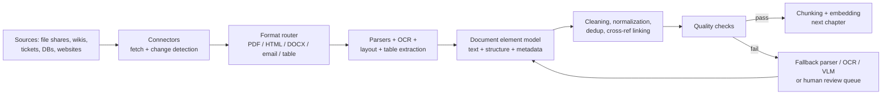
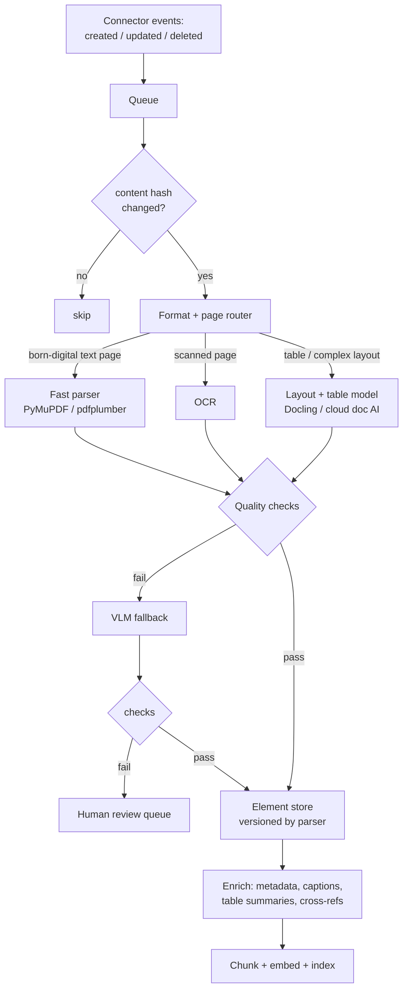

# Document Ingestion and Parsing: PDFs, Tables and Structured Data

> **Level:** Beginner to Advanced · **Study time:** ~120 min · **Prerequisites:** [What Is RAG and Why It Matters](01-what-is-rag-and-why-it-matters.md), [Text Embeddings and Similarity Search](02-text-embeddings-and-similarity-search.md)

## Table of contents

- [Why this matters](#why-this-matters)
- [The ingestion pipeline at a glance](#the-ingestion-pipeline-at-a-glance)
- [The running example: Acme's four documents](#the-running-example-acmes-four-documents)
- [Sources and connectors](#sources-and-connectors)
- [Why parsing quality caps RAG quality](#why-parsing-quality-caps-rag-quality)
- [A common target: the document element model](#a-common-target-the-document-element-model)
- [PDFs: what a PDF really is](#pdfs-what-a-pdf-really-is)
- [Text-based vs scanned PDFs and OCR](#text-based-vs-scanned-pdfs-and-ocr)
- [Layout analysis and reading order](#layout-analysis-and-reading-order)
- [Headers, footers, hyphenation and other PDF artifacts](#headers-footers-hyphenation-and-other-pdf-artifacts)
- [Tables](#tables)
- [Images and figures](#images-and-figures)
- [HTML, Markdown, DOCX, slides and email](#html-markdown-docx-slides-and-email)
- [Structured data: SQL tables and spreadsheets](#structured-data-sql-tables-and-spreadsheets)
- [Metadata extraction](#metadata-extraction)
- [Cleaning, normalization and deduplication](#cleaning-normalization-and-deduplication)
- [Handling cross-references, footnotes and appendices](#handling-cross-references-footnotes-and-appendices)
- [Parsing quality checks and evaluation](#parsing-quality-checks-and-evaluation)
- [Tools: the landscape in 2026](#tools-the-landscape-in-2026)
- [Going deeper: a production ingestion design](#going-deeper-a-production-ingestion-design)
- [Common mistakes and misconceptions](#common-mistakes-and-misconceptions)
- [Interview questions and model answers](#interview-questions-and-model-answers)
- [Key takeaways](#key-takeaways)
- [Further reading](#further-reading)
- [Next](#next)

## Why this matters

Every RAG demo starts with a clean text file. Every real RAG project starts with a shared drive full of scanned contracts, two-column PDFs, 3,000-row spreadsheets, wiki pages wrapped in navigation menus and email threads that quote each other five levels deep. If the text you extract is scrambled, missing its tables, or stripped of the information about where it came from, nothing downstream (chunking, embeddings, reranking, a bigger LLM) can recover what was lost. Teams that debug "bad answers" very often discover the root cause is in parsing, not in the model. Interviewers know this, so "how do you ingest documents?" and "how would you handle tables?" are standard questions for senior AI roles: they separate people who have shipped RAG from people who have only run a notebook.

## The ingestion pipeline at a glance

> **Analogy:** Think of a library receiving donated boxes of books. Someone has to collect the boxes (connectors), open each book and transcribe it correctly even if pages are smudged (parsing and OCR), write a catalog card with title, author, shelf and who may borrow it (metadata), throw away duplicates and torn wrappers (cleaning), and only then shelve it so it can be found (chunking and indexing). If the transcription is wrong, the best librarian in the world will hand you the wrong page.

Some definitions first:

- **Ingestion**: the whole process of getting content from where it lives into your search index, ready for retrieval.
- **Connector**: code that talks to one source system (SharePoint, Confluence, a database) and pulls out raw files or records plus their properties.
- **Parsing**: turning a raw file (bytes in PDF, DOCX, HTML format) into structured text: headings, paragraphs, tables, lists, captions, in the right order.
- **OCR (Optical Character Recognition)**: recognizing text in an image of a page, for example a scanned document.
- **Metadata**: data about the content (title, page number, author, permissions, URL) rather than the content itself.
- **Chunk**: a small piece of a document (often a few hundred tokens) that gets embedded and retrieved. Chunking is covered in [Chunking Strategies](04-chunking-strategies.md).



This chapter covers everything up to the arrow into chunking. Operating this pipeline continuously (incremental updates, deletions, re-embedding, and **idempotency**, meaning a step can be re-run safely without creating duplicates) is covered in [Production Ingestion Pipelines](12-production-ingestion-pipelines-at-scale.md).

## The running example: Acme's four documents

We will reuse a small, realistic corpus throughout. Acme Corp wants an internal assistant that answers employee questions. The corpus has four documents:

| ID | Document | Source | Why it is hard |
|---|---|---|---|
| D1 | Employee Handbook, 40-page PDF | SharePoint | Two-column layout, repeated header "Acme Corp - Confidential", footer "Page N of 40", footnotes, "see section 4.2" references, Appendix B leave table |
| D2 | Price list, Excel workbook, 1,200 rows | File share | Structured data: questions like "average price of EU products" need computation, not retrieval |
| D3 | "VPN setup" wiki page | Confluence | HTML with navigation menus, code blocks and screenshots of dialog boxes |
| D4 | Signed supplier contract, 12-page PDF | Email attachment | Scanned: image only, no text layer, a stamp and handwritten signature |

A typical question: *"How many weeks of parental leave do I get in Germany?"* The answer lives in a table in Appendix B of D1, referenced from section 4.2, with a footnote saying the numbers are in calendar weeks. Keep that question in mind; we will make sure our pipeline can answer it.

## Sources and connectors

> **Analogy:** Connectors are the delivery trucks. Each source has its own loading dock (API), its own opening hours (rate limits) and its own rules on who may take what (permissions).

Enterprise content lives in many systems, each with a different shape:

| Source type | Examples | What you get | Special concerns |
|---|---|---|---|
| File shares and cloud drives | SMB/NFS shares, SharePoint, Google Drive, S3 | Files (PDF, DOCX, XLSX, PPTX) | Folder-level permissions, huge volumes, many duplicates and old versions |
| Wikis | Confluence, Notion, MediaWiki | HTML or rich JSON pages, page hierarchy | Page tree gives free section context, attachments, macros |
| Ticketing systems | Jira, ServiceNow, Zendesk | Records with fields plus comment threads | Short noisy text, status fields matter, PII (personally identifiable information) in customer tickets |
| Databases | Postgres, MySQL, data warehouses | Rows and columns | Often better queried than embedded (see structured data section) |
| Websites | Public docs, help centers | HTML pages | Boilerplate, robots.txt and terms of use, JavaScript-rendered pages |
| Email and chat | Exchange, Gmail, Slack | Messages, threads, attachments | Quoted replies, signatures, strict privacy expectations |

A good connector does more than download:

1. **Authenticates** with a service account that has the minimum read permissions needed.
2. **Enumerates** content, paging through APIs and respecting **rate limits** (the maximum number of requests a service allows per time window). Use backoff and retries.
3. **Detects changes** so you do not re-download everything nightly. Options, from best to worst: change feeds or webhooks pushed by the source ("push"), delta APIs with a cursor token, and comparing last-modified timestamps or content hashes ("pull").
4. **Captures source metadata**: the URL, the author, timestamps and, crucially, the **ACL (Access Control List)**, meaning the list of users or groups allowed to read the item. Retrofitting permissions later means re-crawling every source; capture them now. Enforcement is covered in [Secure Multi-Tenant RAG](13-secure-multi-tenant-rag.md).
5. **Emits deletions**: if a page is deleted at the source, the index must forget it too.

> **Senior insight:** Before writing any connector, check whether the source already exposes good text. Confluence and Notion export structured content via API; parsing their rendered HTML or PDF exports throws away structure you could have had for free. Always prefer the most structured representation a source offers.

> **Common mistake:** Ingesting a website by crawling it like a search engine without checking robots.txt, terms of service and rate limits. For internal sources the equivalent mistake is using an admin account that can read everything, which silently breaks permission filtering later.

## Why parsing quality caps RAG quality

The core idea is simple: **the LLM can only answer from text the retriever returns, and the retriever can only return text the parser produced.** Errors at the start propagate.

Here is a simplified model. Suppose a question is answered correctly only if all three stages succeed: the relevant passage was parsed correctly, then retrieved, then used correctly by the LLM. Then:

$$P(\text{correct}) \approx P_{\text{parse}} \times P_{\text{retrieve} \mid \text{parse}} \times P_{\text{generate} \mid \text{retrieve}}$$

- $P(\text{correct})$: the fraction of questions answered correctly end to end.
- $P_{\text{parse}}$: the fraction of needed passages that the parser extracted faithfully (right text, right order, table intact).
- $P_{\text{retrieve} \mid \text{parse}}$: given the passage was parsed correctly, the fraction of times it is retrieved in the top-k results (the $k$ highest-scoring chunks the retriever returns).
- $P_{\text{generate} \mid \text{retrieve}}$: given the passage was retrieved, the fraction of times the LLM produces a correct, grounded answer.
- The "$\mid$" symbol reads "given". The approximation ignores lucky guesses and partial credit.

**Worked example (illustrative numbers).** Suppose $P_{\text{parse}} = 0.90$, $P_{\text{retrieve} \mid \text{parse}} = 0.85$ and $P_{\text{generate} \mid \text{retrieve}} = 0.90$.

- Step 1: $0.90 \times 0.85 = 0.765$
- Step 2: $0.765 \times 0.90 = 0.6885$

So about 69% end to end. Now fix parsing so $P_{\text{parse}} = 0.98$:

- Step 1: $0.98 \times 0.85 = 0.833$
- Step 2: $0.833 \times 0.90 = 0.7497$

About 75%, a 6-point gain without touching the model. More importantly, notice the ceiling: even with a perfect retriever and a perfect LLM, the system can never exceed $P_{\text{parse}}$. If 10% of your tables come out scrambled, the questions that depend on those tables cannot be answered from the index no matter what you buy downstream.

> **Interview tip:** When asked how you would improve a RAG system, mention that you would first sample failed questions and check whether the right text even exists, correctly parsed, in the index. It is the cheapest diagnosis and often the answer. The full playbook is in [Debugging RAG Systems](11-debugging-rag-systems.md).

## A common target: the document element model

Every format is different, so good pipelines convert everything into one shared intermediate representation. A popular design is a list of typed **elements**, each with text and metadata. This idea is used by libraries like unstructured and Docling (each with its own schema).

```json
[
  {"type": "Title", "text": "4.2 Parental leave",
   "metadata": {"doc_id": "D1", "page": 14, "section_path": ["4 Leave", "4.2 Parental leave"]}},
  {"type": "NarrativeText", "text": "Employees are entitled to parental leave as listed in Appendix B.[1]",
   "metadata": {"doc_id": "D1", "page": 14, "section_path": ["4 Leave", "4.2 Parental leave"],
                "refs": ["appendix:B", "footnote:1"]}},
  {"type": "Table", "text": "| Country | Weeks |\n|---|---|\n| Germany | 14 |",
   "metadata": {"doc_id": "D1", "page": 38, "section_path": ["Appendix B Leave by country"]}},
  {"type": "Footnote", "text": "[1] All durations are in calendar weeks.",
   "metadata": {"doc_id": "D1", "page": 14}}
]
```

(The Germany value here is illustrative content of our fictional handbook, not a statement about German law.)

Why bother with this layer?

- **Format independence**: chunkers, embedders and quality checks only need to understand one schema.
- **Structure survives**: element types (Title, Table, ListItem) let the chunker split at headings and never cut a table in half.
- **Parse once, chunk many**: store the element list. When you change chunk size or embedding model later, you re-chunk from stored elements instead of re-parsing (and re-paying for OCR) millions of pages.

> **Senior insight:** Version the parsed output with the parser name and version (for example `parser=docling-2.x, ocr=tesseract-5`). When you upgrade a parser you can then re-parse selectively and compare old and new outputs on a test set before swapping.

## PDFs: what a PDF really is

Most of the pain in ingestion comes from PDFs, so it is worth knowing what is inside one.

> **Analogy:** A Word document is like a recipe written as a list of steps. A PDF is like a photograph of the finished dish with instructions on where each crumb sits. It describes *what to draw where*, not *what the content means*.

A **PDF** (Portable Document Format) page is mostly a sequence of drawing instructions: "use font F1 at size 10, draw the glyphs 'Empl' at position (72, 700)", "draw a line from here to there", "paint this image here". Consequences:

- **There are no paragraphs, words or tables in the file**, only positioned glyphs (a **glyph** is the drawn shape of a character) and lines. Words, lines, paragraphs and table cells must be *reconstructed* from coordinates.
- **The order in the file need not be the reading order.** A two-column page can store text column by column, line by line across both columns, or in the order the authoring tool happened to emit it.
- **Spaces may not exist.** Some generators position each word separately without emitting a space character; the extractor guesses word breaks from gaps.
- **Text can be invisible.** White text on white background, text hidden under images, or text with a "render mode" of invisible (which is exactly how OCR text layers are added to scanned PDFs).
- **Character mapping can be broken.** Fonts map internal codes to Unicode; if that map is missing or wrong, extraction returns gibberish even though the page looks perfect on screen.

Some PDFs are **tagged PDFs**: they carry an optional structure tree (headings, paragraphs, tables, reading order) for accessibility. When present and correct, this is gold. In practice, many PDFs are untagged or tagged poorly, so you cannot rely on it.

## Text-based vs scanned PDFs and OCR

There are two fundamentally different kinds of PDF pages:

| | Text-based (born-digital) | Scanned (image-only) |
|---|---|---|
| How it was made | Exported from Word, LaTeX, a browser | A scanner or phone camera photographed paper |
| What is inside | Glyphs with Unicode mapping | One big image per page |
| Extraction | Read the text layer directly: fast, exact characters | Needs OCR: slower, can misread characters |
| Example in our corpus | D1 handbook | D4 signed contract |

A third kind is common too: **scanned PDFs that already have an OCR text layer** (added by the scanner software). That layer may be good or terrible; check its quality rather than trusting it.

**Detecting scanned pages.** A simple and robust heuristic: count extractable characters per page. A text page of a handbook has hundreds to thousands of characters; a scanned page has nearly zero (or only a few from a stamp). Also check how much of the page area is covered by images.

**How OCR works (briefly).** Classic OCR engines such as **Tesseract** (open source) first find text regions and lines, then recognize the characters in each line with a neural sequence model (modern Tesseract versions use an LSTM; see [RNNs and LSTMs](../02-deep-learning/08-rnns-lstms-and-the-road-to-transformers.md)). Newer engines (PaddleOCR, cloud services) use deep detection plus recognition models. Each recognized word usually comes with a **confidence score** (0 to 100 or 0 to 1), which is very useful for quality checks.

OCR quality depends heavily on preprocessing:

- **Resolution**: render or scan at about 300 DPI (dots per inch). Lower loses small fonts; much higher wastes memory and time.
- **Deskewing**: rotate crooked scans so lines are horizontal.
- **Orientation detection**: pages scanned upside down or sideways.
- **Binarization and denoising**: convert to pure black and white and clean up shadows, stamps and speckles.
- **Language packs**: tell the engine which languages to expect.

**Memory worked example.** A US Letter page is 8.5 by 11 inches. At 300 DPI:

- Width: $8.5 \times 300 = 2{,}550$ pixels
- Height: $11 \times 300 = 3{,}300$ pixels
- Pixels: $2{,}550 \times 3{,}300 = 8{,}415{,}000$ (about 8.4 megapixels)
- RGB at 3 bytes per pixel: $8{,}415{,}000 \times 3 = 25{,}245{,}000$ bytes, about 25 MB per page

A 100-page scanned document rendered all at once would need about 2.5 GB. That is why you process pages one at a time (streaming) and render in grayscale when color does not matter (one byte per pixel, about 8.4 MB per page).

Here is a page-level router that uses the text layer when it exists and falls back to OCR otherwise.

```python
# pip install pymupdf pytesseract pillow
# Tesseract itself must be installed separately (system package).
# Note: older PyMuPDF versions use "import fitz" instead of "import pymupdf".
import pymupdf
import pytesseract
from PIL import Image

MIN_CHARS = 50  # below this, treat the page as scanned (tune on your data)

def extract_pdf(path: str) -> list[dict]:
    pages = []
    with pymupdf.open(path) as doc:
        for i, page in enumerate(doc):
            text = page.get_text()  # text layer, empty for image-only pages
            if len(text.strip()) >= MIN_CHARS:
                pages.append({"page": i + 1, "text": text, "method": "text_layer"})
                continue
            # Scanned page: render to an image at 300 DPI, grayscale, then OCR.
            pix = page.get_pixmap(dpi=300, colorspace=pymupdf.csGRAY)
            img = Image.frombytes("L", (pix.width, pix.height), pix.samples)
            data = pytesseract.image_to_data(img, output_type=pytesseract.Output.DICT)
            words = [w for w, c in zip(data["text"], data["conf"]) if w.strip()]
            confs = [float(c) for w, c in zip(data["text"], data["conf"])
                     if w.strip() and float(c) >= 0]
            mean_conf = sum(confs) / len(confs) if confs else 0.0
            pages.append({"page": i + 1, "text": " ".join(words),
                          "method": "ocr", "ocr_conf": mean_conf})
    return pages
```

Joining words with spaces throws away line and paragraph structure; a real pipeline uses the block and line numbers in `image_to_data`, or a layout-aware tool. The point here is the routing logic and keeping the confidence score as metadata.

**Vision-language models as OCR.** Since roughly 2023, a different approach has become common: send the page image to a **vision-language model (VLM)**, a model that takes images and text as input and produces text (see [Vision Transformers, CLIP and Multimodal LLMs](../03-computer-vision/05-vision-transformers-clip-and-multimodal-models.md)), and ask it to transcribe the page as Markdown. Research models like Nougat (Blecher et al., 2023) and Donut (Kim et al., 2022) showed "OCR-free" document understanding, and general multimodal LLMs now do this well on many documents.

| | Classic OCR (+ layout model) | VLM page-to-Markdown |
|---|---|---|
| Strengths | Cheap, fast, deterministic, word-level boxes and confidences | Handles complex layouts, tables, handwriting and charts holistically |
| Weaknesses | Struggles with complex tables and odd layouts | Slower and costlier per page, **can hallucinate** plausible text, may silently skip content, no reliable confidence |
| Best for | High-volume, simple pages | Hard pages flagged by quality checks, high-value documents |

> **Senior insight:** A VLM that misreads a number does not produce garbled characters you can detect; it produces a *clean, plausible, wrong* number. For contracts, prices and medical data, cross-check VLM output against classic OCR (for example, flag pages where the sets of numbers differ) or keep a human in the loop.

## Layout analysis and reading order

**Layout analysis** means finding the regions on a page and labeling them: title, paragraph, list, table, figure, caption, header, footer, footnote. **Reading order** means arranging those regions in the order a human would read them.

> **Analogy:** Reading a newspaper page. You do not read straight across from the left column into the right column; you read down the first column, then jump to the top of the second, skipping the ad box and the page number.

Our handbook D1 has a two-column layout. Naive extraction that sorts text purely top to bottom interleaves the columns:

```text
 Page 14 of D1                         Naive top-to-bottom extraction:
+----------------------------------+
| 4.2 Parental leave | Employees    |   "4.2 Parental leave Employees
| Employees are      | must notify  |    Employees are must notify
| entitled to leave  | HR at least  |    entitled to leave HR at least
| as listed in       | 8 weeks      |    as listed in 8 weeks
| Appendix B.        | before...    |    Appendix B. before..."
+----------------------------------+    (sentences from both columns mixed)
```

Every chunk built from that text is semantically broken, and its embedding is a blend of two topics. The fix is column-aware ordering.

**Approaches, from simple to strong:**

1. **Geometric heuristics.** Group text blocks by x-position into columns, then read each column top to bottom. A classic algorithm is **recursive XY-cut** (described by Nagy and Seth in the 1980s): find a wide vertical or horizontal whitespace gap that splits the page, cut there, and recurse on each part. The order of cuts gives the reading order.
2. **Learned layout models.** Object-detection models (see [Object Detection in Depth](../03-computer-vision/02-object-detection-yolo-faster-rcnn-and-map.md)) trained on labeled page datasets such as DocLayNet (Pfitzmann et al., 2022) or PubLayNet detect regions with labels. Models like LayoutLM (Xu et al., 2020) combine text, position and image features. Tools like Docling and unstructured's high-resolution mode use such models.
3. **VLMs** that read the whole page image and output text in reading order.

```text
Recursive XY-cut on a two-column page with a full-width title:

+------------------------------+
|        TITLE (full width)    |   1. Horizontal whitespace gap -> cut A
+--------------+---------------+
|  column 1    |   column 2    |   2. Vertical whitespace gap -> cut B
|              |               |
+--------------+---------------+
|   footer: Page 14 of 40      |   3. Horizontal gap -> cut C
+------------------------------+
Reading order: TITLE, column 1, column 2, footer (footer later removed)
```

A minimal column-aware sort using PyMuPDF blocks:

```python
import pymupdf

def blocks_in_reading_order(page: "pymupdf.Page") -> list[str]:
    # Each block: (x0, y0, x1, y1, text, block_no, block_type); type 0 = text.
    blocks = [b for b in page.get_text("blocks") if b[6] == 0 and b[4].strip()]
    mid = page.rect.width / 2
    full_width, left, right = [], [], []
    for b in blocks:
        x0, y0, x1, y1, text = b[:5]
        if x0 < mid and x1 > mid:      # spans the middle: title or full-width paragraph
            full_width.append(b)
        elif x1 <= mid:
            left.append(b)
        else:
            right.append(b)
    by_y = lambda b: b[1]
    # Simplification: full-width blocks first, then left column, then right column.
    # Real pages interleave full-width blocks between column sections (use XY-cut).
    ordered = sorted(full_width, key=by_y) + sorted(left, key=by_y) + sorted(right, key=by_y)
    return [b[4] for b in ordered]
```

This is deliberately simple: it assumes at most two columns split at the page middle. It shows the mechanism; in production you would use a layout model or a library that does this.

> **Common mistake:** Checking parsing quality by looking at the PDF on screen. The screen almost always looks fine. Look at the *extracted text* for a sample of pages, side by side with the rendered page.

## Headers, footers, hyphenation and other PDF artifacts

Even with correct reading order, PDF text carries artifacts that pollute chunks and embeddings.

**Headers and footers.** "Acme Corp - Confidential" and "Page 14 of 40" appear on every page of D1. Left in, they get inserted into the middle of sentences that cross page boundaries, add noise tokens to every chunk, and make all chunks look similar to each other.

The standard detection trick: **text that repeats at the same position on many pages is page furniture, not content.** Normalize digits first so "Page 3 of 40" and "Page 4 of 40" count as the same line.

**Worked example.** D1 has 40 pages. We check the first two and last two lines of each page:

- "Acme Corp - Confidential" appears on 40 of 40 pages: $40 / 40 = 1.00$
- "Page # of 40" (after digit normalization) appears on 40 of 40 pages: $1.00$
- "4 Leave policies" (a running section header) appears on 6 of 40 pages: $6 / 40 = 0.15$

With a threshold of 0.5, the first two are removed. The running section header is kept in this pass, which is fine: it is actually useful context, and it is better captured as the section path metadata anyway.

**Hyphenation.** Justified text breaks words at line ends: "infor-" at the end of one line and "mation" at the start of the next. Extracted naively you get "infor- mation", which breaks keyword search (BM25, the classic keyword-ranking function covered in [Retrieval Methods](05-retrieval-bm25-dense-and-hybrid-search.md), will not match "information") and slightly distorts embeddings. Also watch for the invisible **soft hyphen** character (Unicode U+00AD) that some tools leave in text.

The catch: some hyphens are real. "state-of-the-" at a line end followed by "art" should become "state-of-the-art", not "state-of-theart". A practical rule: join the pieces, and if the joined word is in a vocabulary (built from the rest of the corpus), keep it joined; otherwise keep the hyphen.

**Other artifacts:**

- **Ligatures**: "fi" and "fl" stored as single characters, so "file" does not match "file". Unicode normalization fixes this (see the cleaning section).
- **Broken line breaks**: every visual line ends with a newline. Merge lines into paragraphs; keep real paragraph breaks (detected by vertical gaps or a line ending with sentence punctuation).
- **Page numbers and line numbers** in legal documents.
- **Watermarks** like "DRAFT" extracted as text in the middle of paragraphs.

```python
import re
from collections import Counter

def normalize_line(line: str) -> str:
    return re.sub(r"\d+", "#", line.strip().lower())

def remove_headers_footers(pages: list[list[str]], k: int = 2, threshold: float = 0.5):
    """pages: list of pages, each a list of lines. Removes lines that repeat in the
    first/last k lines of at least `threshold` of the pages."""
    counts = Counter()
    for lines in pages:
        edge = {normalize_line(l) for l in lines[:k] + lines[-k:] if l.strip()}
        counts.update(edge)  # count each candidate once per page
    n = len(pages)
    furniture = {line for line, c in counts.items() if c / n >= threshold}
    return [[l for l in lines if normalize_line(l) not in furniture] for lines in pages]

def dehyphenate(text: str, vocab: set[str]) -> str:
    def fix(m: re.Match) -> str:
        left, right = m.group(1), m.group(2)
        joined = left + right
        return joined if joined.lower() in vocab else f"{left}-{right}"
    text = text.replace("\u00ad", "")         # drop invisible soft hyphens
    return re.sub(r"(\w+)-\n(\w+)", fix, text)

bodies = ["Leave starts on", "the first day of", "the month."]
pages = [["Acme Corp - Confidential", body, f"Page {i} of 3"]
         for i, body in enumerate(bodies, start=1)]
print(remove_headers_footers(pages))
# [['Leave starts on'], ['the first day of'], ['the month.']]
print(dehyphenate("the infor-\nmation desk, state-of-the-\nart", {"information"}))
# the information desk, state-of-the-art
```

## Tables

Tables are where most RAG systems quietly fail, and where interviewers like to probe.

> **Analogy:** A table is a grid of facts where every cell only makes sense with its row label and its column label. "14" means nothing. "Germany, parental leave, 14 weeks" means everything. Any processing that separates a cell from its labels destroys the fact.

### Why tables are hard

- In a PDF there is no "table" object: just text at positions and maybe some lines. Cell boundaries must be inferred.
- **Borderless tables** have no lines at all; columns are implied by alignment.
- **Merged cells** (a header spanning three columns), **multi-level headers**, and **multi-line cells** confuse simple extractors.
- **Multi-page tables** continue across pages, often repeating the header row (or not).
- Naive text extraction reads tables row by row with cells jammed together ("Germany 14 France 16"), or worse, column by column.

### Extraction approaches

| Approach | How it works | Good at | Weak at |
|---|---|---|---|
| Rule-based, ruling lines ("lattice") | Use drawn lines to find cell grid (pdfplumber, Camelot lattice mode) | Bordered tables in born-digital PDFs | Borderless tables, scans |
| Rule-based, whitespace ("stream") | Infer columns from text alignment gaps | Simple borderless tables | Merged cells, ragged layouts |
| Table structure recognition model | Detect table, rows, columns and spanning cells from the image (for example Table Transformer trained on PubTables-1M, Smock et al., 2022) | Scans, complex structures | Needs GPU for speed, still errs on dense tables |
| VLM | Ask a multimodal LLM to output the table as HTML/Markdown | Very messy tables, mixed content | Cost, hallucinated or dropped cells |
| Cloud document AI | Managed OCR plus table extraction APIs | Scans, forms, little engineering | Per-page cost, data leaves your environment |

A simple born-digital example with pdfplumber:

```python
# pip install pdfplumber
import pdfplumber

with pdfplumber.open("handbook.pdf") as pdf:
    page = pdf.pages[37]                      # page 38, Appendix B (0-indexed)
    for table in page.extract_tables():       # each table: list of rows, row: list of cells
        header, *rows = table
        print(header)   # e.g. ['Country', 'Parental leave (weeks)', 'Notice (weeks)']
        print(rows[:2])
```

Cells can come back as `None` for empty or merged cells; handle that explicitly.

### Repairing merged cells and multi-page tables

Extractors usually return a merged cell's text once and `None` for the other positions it covers. Repair this before chunking so every cell keeps its full row and column labels:

```text
Raw extraction ("Leave (weeks)" spans two columns, "Country" spans two header rows):
| Country | Leave (weeks) | None   |
| None    | Parental      | Notice |
| Germany | 14            | 8      |

1. Forward-fill spans: row 1 becomes Country, Leave (weeks), Leave (weeks);
   row 2 becomes Country, Parental, Notice.
2. Join header levels per column, dropping repeats.

Result:
| Country | Leave (weeks): Parental | Leave (weeks): Notice |
| Germany | 14                      | 8                     |
```

Do the same for label columns in the body (a region name spanning five rows) so each row stays self-contained after splitting, but only where you have evidence of a span (the extractor reports it, or ruling lines show it): some empty cells are genuinely empty. For **multi-page tables**, treat a table at the top of a page as a continuation when the previous page's table ran to the bottom and the column counts match; append its rows, drop the repeated header row and keep the original title.

### Representing tables: Markdown vs HTML vs serialized rows

Once extracted, you must turn the table into text for the LLM and the embedder.

| Format | Example | Pros | Cons | Use when |
|---|---|---|---|---|
| Markdown | `\| Country \| Weeks \|` | Compact, LLMs read it well, human readable | Cannot express merged cells or nested headers | Simple rectangular tables (most cases) |
| HTML | `<td colspan="2">` | Expresses merged cells, multi-row headers | More tokens, noisier for embeddings | Complex tables where structure matters |
| JSON (list of records) | `{"Country": "Germany", "Weeks": 14}` | Each value carries its column name | Repeats keys, verbose | Feeding tools or SQL, small tables |
| Serialized row sentences | "Germany: parental leave 14 weeks, notice 8 weeks." | Each chunk is self-contained, embeds well | Loses the grid view, verbose | Retrieval over large tables, row-level questions |

LLMs generally read Markdown and HTML tables well; embedding models are weaker with grids of numbers, which is one reason for the summary technique below.

### Keep the header row with every chunk

If a table is too big for one chunk, you must split it. The cardinal rule: **repeat the header row (and the table title) in every piece.** A chunk containing "| Germany | 14 | 8 |" without headers is meaningless to the LLM and to the embedder.

**Worked example: how many rows fit per chunk?** Suppose (illustrative numbers):

- Chunk budget: 400 tokens
- Table title plus header row: 20 tokens
- Each data row: about 15 tokens
- The table has 1,000 rows

Rows per chunk $= \lfloor (400 - 20) / 15 \rfloor = \lfloor 380 / 15 \rfloor = \lfloor 25.33 \rfloor = 25$ rows. ($\lfloor x \rfloor$ means round down.)

Check: $20 + 25 \times 15 = 20 + 375 = 395 \le 400$. Good.

Number of chunks $= \lceil 1000 / 25 \rceil = 40$. ($\lceil x \rceil$ means round up.)

```python
def table_to_markdown_chunks(title: str, header: list[str], rows: list[list[str]],
                             rows_per_chunk: int = 25) -> list[str]:
    """Split a table into Markdown chunks, repeating title and header in each."""
    def md_row(cells):  # None -> empty string; escape pipes inside cells
        return "| " + " | ".join(("" if c is None else str(c)).replace("|", "\\|")
                                 for c in cells) + " |"
    head = md_row(header) + "\n" + "|" + "---|" * len(header)
    chunks = []
    for start in range(0, len(rows), rows_per_chunk):
        part = rows[start:start + rows_per_chunk]
        end = start + len(part)
        body = "\n".join(md_row(r) for r in part)
        chunks.append(f"Table: {title} (rows {start + 1}-{end} of {len(rows)})\n{head}\n{body}")
    return chunks

rows = [["Germany", "14", "8"], ["France", "16", "8"], ["Spain", "16", "6"]]
for c in table_to_markdown_chunks("Appendix B: Leave by country",
                                  ["Country", "Parental leave (weeks)", "Notice (weeks)"],
                                  rows, rows_per_chunk=2):
    print(c, end="\n\n")
# Table: Appendix B: Leave by country (rows 1-2 of 3)
# | Country | Parental leave (weeks) | Notice (weeks) |
# |---|---|---|
# | Germany | 14 | 8 |
# | France | 16 | 8 |
#
# Table: Appendix B: Leave by country (rows 3-3 of 3)
# | Country | Parental leave (weeks) | Notice (weeks) |
# |---|---|---|
# | Spain | 16 | 6 |
```

(The leave numbers are fictional handbook content for the example.)

### Table summaries

Embedding models are trained mostly on prose, so a grid of numbers often embeds poorly: the query "how long is parental leave in Germany?" may not land near a chunk that is 90% digits and pipes. A widely used fix:

1. Generate a short natural-language **summary** of the table (with an LLM, or from the title, caption and column names): *"Appendix B lists parental leave and notice periods in weeks for each country where Acme operates, including Germany, France and Spain."*
2. **Index the summary** (embed it) but **return the full table** (or the relevant row chunk) to the LLM when the summary matches.

This is a form of the multi-vector or parent-child pattern covered in [Advanced RAG Patterns](09-advanced-rag-patterns.md). Also include the surrounding context: the caption, the heading the table sits under, and the paragraph that introduces it.

### Very large tables

A 50,000-row table is not really a "document"; it is a database that happens to be stored in a PDF or a spreadsheet. Options:

- **Extract it into a real table** (SQLite, Postgres, a DataFrame) and answer with a query tool (next sections).
- **Row-level serialization** for lookup questions ("what is the notice period in Spain?"), with header and table title repeated.
- **Avoid** feeding the whole table into the context window "because it fits": long contexts dilute attention and cost money on every query (see [Hallucinations and Grounding](../05-llms/06-hallucinations-and-grounding.md) for why more context is not always better).

> **Interview tip:** When asked about tables, structure your answer as: extract (tool depends on born-digital vs scanned), represent (Markdown or HTML, headers repeated per chunk), retrieve (summary or row-level embeddings, plus metadata), and compute (send aggregation questions to SQL, not to the embedder).

## Images and figures

Figures carry real information: an architecture diagram in D3, a chart of sales by quarter, a screenshot of the VPN dialog with the server address. Plain text extraction ignores them entirely.

Strategies, from cheapest to richest:

1. **Use the existing text around the figure**: the caption ("Figure 3: VPN client settings"), alt text in HTML, and the paragraph that references it. Free, and often enough.
2. **OCR the image** to get text inside screenshots and diagrams (labels, server names, error messages).
3. **Caption with a vision-language model**: ask a VLM to describe the figure in detail and extract any numbers or text. Index that description as a chunk whose metadata points to the image.
4. **Multimodal embeddings**: embed the image itself with a model like CLIP (Radford et al., 2021) so that text queries can retrieve images directly. A related approach, ColPali (Faysse et al., 2024), embeds whole page images with a VLM and retrieves pages without parsing at all.

Prompting matters for captions. "Describe this image" gives vague prose. Better:

```python
# Conceptual: VLM SDKs change often, so call_vlm stands for your provider's
# multimodal chat API (an image plus a text prompt in, text out).
CAPTION_PROMPT = """You are indexing figures from internal documentation for search.
Context: this figure appears in section "{section_path}" of "{doc_title}".
Its original caption is: "{caption}".
1. State what kind of figure it is (chart, diagram, screenshot, photo, table image).
2. Transcribe all visible text, labels and numbers exactly.
3. For charts: list axes, units, series and the key values or trends.
4. Describe the main point in 2-3 sentences.
Do not guess values you cannot read; write [unreadable] instead."""

def caption_figure(image_bytes: bytes, meta: dict, call_vlm) -> dict:
    text = call_vlm(image=image_bytes, prompt=CAPTION_PROMPT.format(**meta))
    return {"type": "FigureDescription", "text": text,
            "metadata": {**meta, "generated_by": "vlm", "image_ref": meta["image_uri"]}}
```

> **Senior insight:** Mark generated text as generated (`generated_by: vlm`) in metadata. When the LLM later cites it, you can tell users "from a figure description" and you can audit or regenerate those descriptions when a better model arrives. Also skip decorative images (logos, icons, dividers) with simple filters (tiny size, repeated on every page) before paying for VLM calls.

## HTML, Markdown, DOCX, slides and email

Non-PDF formats are usually easier because they carry real structure. The work is in using that structure and stripping the junk.

| Format | Structure available | Main pitfalls | Typical tools (Python) |
|---|---|---|---|
| HTML | DOM (Document Object Model) tree: `<h1>` to `<h6>`, `<p>`, `<table>`, `<li>`, `<code>` | Boilerplate (menus, footers, cookie banners), JavaScript-rendered content, tables used for layout | BeautifulSoup, lxml, trafilatura, a headless browser for JS pages |
| Markdown | Headings (`#`), lists, fenced code, tables | Front matter (YAML block at top), embedded HTML, links relative to repo | Direct parsing, markdown-it-py |
| DOCX | Paragraph styles (Heading 1, 2), real tables, lists, comments | Headings faked with bold text, tracked changes, text boxes, body order of paragraphs vs tables | python-docx, unstructured, Docling |
| Slides (PPTX) | Slide titles, text frames, speaker notes, tables | Very little text per slide, meaning is visual, text box order not reading order | python-pptx, unstructured, Docling |
| Email (EML/MSG) | Headers (From, To, Date, Subject), MIME parts, attachments | Quoted replies repeated in every message, signatures, disclaimers, HTML-only bodies | Python `email` package, MSG-specific libraries |

**HTML.** For D3 (the wiki page), keep the heading hierarchy as section paths, keep `<pre>`/`<code>` blocks intact (a VPN config split across chunks is useless), convert `<table>` to Markdown, and drop navigation, sidebars and footers. Boilerplate removal tools such as trafilatura use heuristics on text density and tags to find the main content.

```python
# pip install beautifulsoup4
from bs4 import BeautifulSoup

def html_sections(html: str) -> list[dict]:
    soup = BeautifulSoup(html, "html.parser")
    for tag in soup(["nav", "header", "footer", "aside", "script", "style"]):
        tag.decompose()                                 # drop boilerplate containers
    path, out = [], []
    for el in soup.find_all(["h1", "h2", "h3", "p", "li", "pre", "table"]):
        if el.name in ("h1", "h2", "h3"):
            level = int(el.name[1])
            path = path[: level - 1] + [el.get_text(strip=True)]  # maintain section path
        else:
            # Note: nested matches (a <p> inside an <li>) would be emitted twice; a real
            # parser walks the tree once instead of using find_all.
            out.append({"type": el.name, "text": el.get_text(" ", strip=True),
                        "section_path": list(path)})
    return out

html = "<nav>Home | Spaces</nav><h1>VPN setup</h1><h2>Windows</h2><p>Install the client.</p>"
print(html_sections(html))
# [{'type': 'p', 'text': 'Install the client.', 'section_path': ['VPN setup', 'Windows']}]
```

**DOCX.** Use paragraph style names ("Heading 1") to recover the outline. A known gotcha with python-docx: `doc.paragraphs` and `doc.tables` are separate lists, so iterating them separately loses where each table sat in the document. Walk the document body's child elements in order instead, or use a library that does.

**Slides.** A slide titled "Q3 results" with three bullet fragments and a chart is nearly meaningless as text. Combine slide title, all text frames, table contents, **speaker notes** (often the richest text) and a VLM caption of the slide image. Treat each slide as a natural chunk, with the deck title and slide number in metadata.

**Email.** Parse MIME parts properly (MIME is the standard that splits an email into parts such as a plain-text body, an HTML body and attachments, each labeled with a content type like `application/pdf`), prefer the plain-text body, and remove quoted replies (lines starting with `>` or blocks after "On <date>, <name> wrote:") so each message contributes only its new content. Thread messages together using the `Message-ID`, `In-Reply-To` and `References` headers. Recurse into attachments with the right parser for each, and inherit the email's ACL.

```python
from email import policy
from email.parser import BytesParser

def parse_eml(raw: bytes) -> dict:
    msg = BytesParser(policy=policy.default).parsebytes(raw)
    body = msg.get_body(preferencelist=("plain", "html"))
    attachments = [(a.get_filename(), a.get_content_type()) for a in msg.iter_attachments()]
    return {"subject": msg["subject"], "from": msg["from"], "date": msg["date"],
            "message_id": msg["message-id"], "in_reply_to": msg["in-reply-to"],
            "body": body.get_content() if body else "", "attachments": attachments}
```

If the chosen body is HTML, run it through the HTML pipeline before use.

## Structured data: SQL tables and spreadsheets

D2, the 1,200-row price list, is a different kind of beast. Two very different questions could hit it:

- *Lookup*: "What does SKU A-100 cost?"
- *Aggregation*: "What is the average price of our EU products?"

Retrieval can answer the first. It **cannot** answer the second: no top-5 set of chunks contains "the average of 400 rows". The LLM would either refuse or, worse, average whatever five rows it was shown.

**Worked example.** Suppose only 4 EU products exist with prices 49, 30, 80 and 41.

- Sum: $49 + 30 = 79$, $79 + 80 = 159$, $159 + 41 = 200$
- Average: $200 / 4 = 50$

If retrieval returned only the first two rows, the LLM might answer $(49 + 30) / 2 = 39.5$, a confident and wrong number. With 400 rows the chance of retrieval returning all of them is essentially zero.

There are two main approaches, and production systems often use both.

### Option 1: serialize rows into text

Turn each row (or small group of rows) into a self-describing sentence or a key-value block, then embed it like any chunk.

```python
# pip install pandas openpyxl
import pandas as pd

df = pd.DataFrame({
    "sku": ["A-100", "A-101"], "name": ["Laptop stand", "USB-C hub"],
    "price_usd": [49.00, 30.00], "region": ["EU", "EU"],
})

def serialize_row(r: pd.Series) -> str:
    return (f"Product {r.sku} ({r['name']}) costs {r.price_usd:.2f} USD "
            f"in region {r.region}. Source: price list 2026.")

docs = [{"text": serialize_row(r), "metadata": {"sku": r.sku, "region": r.region}}
        for _, r in df.iterrows()]
print(docs[0]["text"])
# Product A-100 (Laptop stand) costs 49.00 USD in region EU. Source: price list 2026.
```

(`r['name']` uses brackets because `r.name` on a pandas row returns the row's index label, not the column.)

### Option 2: text-to-SQL as a tool

Keep the data in a database. Give the LLM the **schema** (table and column names, types, a few example values, column descriptions) and let it write a SQL query, executed by a tool. The pattern is called **text-to-SQL**; the tool-calling mechanics are in [Tool Calling in Depth](../09-agents/02-tool-calling-in-depth.md) and [Structured Outputs and Function Calling](../05-llms/05-structured-outputs-and-function-calling.md).

```python
import sqlite3
from contextlib import closing

def run_readonly_sql(db_path: str, sql: str, max_rows: int = 200) -> list[tuple]:
    if not sql.lstrip().lower().startswith("select"):
        raise ValueError("Only SELECT statements are allowed")
    # mode=ro opens the database read-only, so even a malicious query cannot write.
    # closing() is needed: sqlite3's own "with conn" only commits/rolls back, it does not close.
    with closing(sqlite3.connect(f"file:{db_path}?mode=ro", uri=True)) as conn:
        return conn.execute(sql).fetchmany(max_rows)

# The LLM, given the schema "products(sku TEXT, name TEXT, price_usd REAL, region TEXT)",
# might generate:
#   SELECT AVG(price_usd) FROM products WHERE region = 'EU';
```

| | Row serialization + retrieval | Text-to-SQL tool |
|---|---|---|
| Answers lookups | Yes | Yes |
| Answers aggregations, filters, rankings | No | Yes |
| Exact numbers | Only what is retrieved | Computed exactly by the database |
| Fuzzy matching ("that cheap hub thing") | Good | Weak unless combined with search |
| Risks | Stale copies of data, partial views | Wrong SQL (silent wrong answers), security, schema too big for prompt |
| Best for | Small tables, descriptive text columns, row lookups | Large or frequently changing numeric data, analytics |

> **Senior insight:** For text-to-SQL, security is not optional: use a read-only database user, a restricted view that exposes only allowed columns and rows for this user, query timeouts and row limits. The SELECT check above is a convenience, not a security boundary: the real boundary is database permissions. Also log every generated query; wrong-but-valid SQL is the dominant failure mode, and you can only catch it with evaluation sets of question-to-expected-result pairs.

A practical hybrid: **route** by question type. Retrieval for policy text and lookups; SQL tool for aggregations; and index short descriptions of each table ("price list: one row per SKU with price and region") so the router or agent can discover which table to query.

**Spreadsheets** are messy: multiple tables per sheet, merged header cells, notes in random cells, formulas whose cached values may be missing. Detect table regions, take the header row(s) explicitly, and read computed values (for openpyxl, `data_only=True` returns the cached value saved by Excel, which may be missing if the file was produced by a tool that never calculated it).

## Metadata extraction

Metadata is the part of ingestion that beginners skip and seniors obsess over. You cannot add it later without re-ingesting, and nearly every advanced feature depends on it.

| Field | Example (D1) | Where it comes from | Why it matters later |
|---|---|---|---|
| `doc_id`, `chunk_id` | `D1`, `D1#p14#c3` | Generated (stable, deterministic) | Updates and deletes, dedup, tracing a bad answer to its source |
| `source_url` | SharePoint link | Connector | Citations users can click to verify |
| `title` | Employee Handbook | File properties, first heading, HTML `<title>` | Display, boosting, contextual headers |
| `section_path` | Handbook > 4 Leave > 4.2 Parental leave | Heading hierarchy during parsing | Context for chunks, better embeddings, precise citations |
| `page_number` | 14 | Parser | Citations ("page 14"), debugging |
| `author`, `owner` | HR team | Source system, file properties | Trust, routing questions about stale content |
| `created_at`, `modified_at`, `effective_date` | 2026-03-01 | Source system, or extracted from text | Freshness ranking, "latest policy wins", time filters |
| `doc_type` | policy, contract, ticket, FAQ | Source, folder, classifier or LLM | Filters ("only policies"), type-specific prompts |
| `language` | en | Language detection | Routing to the right embedding model or translation |
| `acl` | groups: all-employees | Connector (from source permissions) | Permission filtering: users must never retrieve what they cannot open |
| `parser`, `parse_version`, `ocr_conf` | docling-2.x, 0.0 | Pipeline | Quality filtering, targeted re-processing |
| `content_hash` | sha256:... | Computed on normalized text | Change detection, dedup, idempotent updates |

Two ideas deserve emphasis:

**1. Section path makes chunks self-explanatory.** A chunk reading "Employees must notify HR at least 8 weeks before" does not say *what* requires notice. Prepending "Employee Handbook > 4 Leave > 4.2 Parental leave" to the chunk text before embedding (a **contextual chunk header**) fixes this cheaply. More elaborate variants that write LLM-generated context per chunk are in [Advanced RAG Patterns](09-advanced-rag-patterns.md).

**2. Metadata enables filtering before similarity.** "What is the current travel policy for contractors?" becomes a filtered search: `doc_type = policy AND audience contains contractors AND acl matches user`, ranked by similarity and recency. Filtering by metadata is covered in [Vector Databases in Practice](07-vector-databases-in-practice.md).

Extract metadata from the cheapest reliable source first: the connector and file properties, then document structure, then rules (regex for dates, contract numbers), and only then an LLM with a structured output schema for fields like `doc_type` or `effective_date`. Validate LLM-extracted metadata (dates must parse, types must be from an allowed list).

```python
from dataclasses import dataclass, field
from datetime import date

@dataclass
class ElementMeta:
    doc_id: str
    source_url: str
    title: str
    doc_type: str                     # from an allowed list: policy, contract, ticket, ...
    acl_groups: list[str]             # captured from the source system, never guessed
    page_number: int | None = None
    section_path: list[str] = field(default_factory=list)
    modified_at: date | None = None
    parser: str = "unknown"

def contextual_text(text: str, meta: ElementMeta) -> str:
    """Text actually embedded: a short header with title and section path, then content."""
    header = " > ".join([meta.title, *meta.section_path])
    return f"[{header}]\n{text}"

m = ElementMeta("D1", "https://intranet.example.com/handbook", "Employee Handbook", "policy",
                ["all-employees"], 14, ["4 Leave", "4.2 Parental leave"])
print(contextual_text("Employees must notify HR at least 8 weeks before.", m))
# [Employee Handbook > 4 Leave > 4.2 Parental leave]
# Employees must notify HR at least 8 weeks before.
```

> **Common mistake:** Storing ACLs as a snapshot at ingestion and never refreshing them. When someone leaves a team, they keep "access" through your RAG index. Permission changes must flow through the same change-detection path as content changes.

## Cleaning, normalization and deduplication

### Boilerplate removal

**Boilerplate** is text that repeats across many documents but carries no answer-relevant content: navigation menus, cookie banners, legal disclaimers, email signatures, "Was this page helpful?" widgets. It wastes tokens and, worse, makes unrelated chunks look similar in embedding space. Remove it with format-specific rules (HTML tags, email signature patterns) and with corpus-level frequency: a paragraph that appears verbatim in 30% of all documents is almost certainly boilerplate.

### Unicode normalization

The same visible text can be encoded in different ways. "é" can be one character or "e" plus a combining accent; "fi" can be a ligature character; spaces can be ordinary, non-breaking (U+00A0) or zero-width (U+200B). To a keyword index or exact-match dedup, these are different strings.

**Unicode normalization** converts text to a canonical form. The two forms you will meet:

- **NFC**: composes characters into their canonical single form where possible. Safe, changes no visible meaning.
- **NFKC**: additionally applies "compatibility" mappings: "fi" becomes "fi", full-width "Ａ" becomes "A", non-breaking space becomes a normal space. Great for search, but it can change meaning: superscript "²" becomes "2", so "m²" turns into "m2", and "x²" into "x2".

A common compromise: store NFC text for display and use NFKC (plus lowercasing) for the keyword index and for dedup hashing. Also strip control characters and zero-width characters, collapse runs of whitespace, and fix **mojibake** (text decoded with the wrong encoding, like "café" for "café"; the `ftfy` library repairs many cases).

```python
import unicodedata, re, hashlib

# Zero-width space, non-joiner, joiner and byte-order mark: invisible but break matching.
# (Fine for an index key; keep them in display text, since ZWJ/ZWNJ matter in some scripts and emoji.)
ZERO_WIDTH = dict.fromkeys(map(ord, "\u200b\u200c\u200d\ufeff"), None)

def normalize_for_index(text: str) -> str:
    text = unicodedata.normalize("NFKC", text).translate(ZERO_WIDTH)
    text = "".join(ch for ch in text if ch in "\n\t" or unicodedata.category(ch)[0] != "C")
    return re.sub(r"[ \t]+", " ", text).strip()

def content_hash(text: str) -> str:
    return hashlib.sha256(normalize_for_index(text).lower().encode("utf-8")).hexdigest()

a = "The \ufb01le policy"      # contains the "fi" ligature character
b = "The file\u00a0policy"     # contains a non-breaking space
print(normalize_for_index(a) == normalize_for_index(b))   # True
print(content_hash(a) == content_hash(b))                 # True
```

### Deduplication

Enterprise corpora are full of duplicates: the same PDF in five folders, "Handbook_final.pdf" and "Handbook_final_v2.pdf", the same FAQ copied into three wiki spaces. Duplicates waste storage, and worse, they crowd the top-k results with copies of one passage, pushing out other relevant passages.

- **Exact dedup**: hash the normalized text (as above). Same hash means same content. Cheap and certain.
- **Near-duplicate dedup**: measure overlap between documents. The standard measure is **Jaccard similarity** between sets of **shingles** (overlapping word or character n-grams):

$$J(A, B) = \frac{|A \cap B|}{|A \cup B|}$$

- $A$, $B$: the sets of shingles of two documents.
- $|A \cap B|$: number of shingles that appear in both.
- $|A \cup B|$: number of distinct shingles appearing in either.
- $J$ ranges from 0 (nothing in common) to 1 (identical sets).

**Worked example.** Using single words as shingles:

- $A$ = "employees get 20 days leave" gives {employees, get, 20, days, leave}
- $B$ = "employees get 25 days leave" gives {employees, get, 25, days, leave}
- Intersection: {employees, get, days, leave}, so $|A \cap B| = 4$
- Union: {employees, get, 20, 25, days, leave}, so $|A \cup B| = 6$
- $J = 4 / 6 \approx 0.667$

Now imagine the same one-word change inside a 2,000-word policy. The Jaccard similarity would be close to 1, and a near-dup filter with threshold 0.9 would merge the two documents. But they state **different facts** (20 vs 25 days). This is the critical subtlety:

> **Senior insight:** Near-duplicates in enterprise data are often *versions*, and versions differ exactly in the facts users ask about. Do not blindly drop one. Group near-duplicates, then pick a winner using metadata (latest `effective_date`, authoritative source, "approved" status), and keep the others out of the default index or marked as superseded. Near-dup dedup without version awareness can delete the current policy and keep the old one.

Computing Jaccard for every pair of $N$ documents costs on the order of $N^2$ comparisons, infeasible for millions of documents. **MinHash** (Broder, 1997) compresses each shingle set into a short signature such that the probability two signatures agree in a position equals their Jaccard similarity; **locality-sensitive hashing (LSH)** then buckets signatures so only likely duplicates are compared. Intuition: under a random hash ordering, two documents share the same minimum shingle exactly when the minimum of $A \cup B$ lies in $A \cap B$, which has probability $J(A, B)$; a signature of, say, 128 such minimums estimates $J$ by its fraction of matching positions. The `datasketch` library implements both.

```python
def shingles(text: str, n: int = 3) -> set[tuple[str, ...]]:
    words = normalize_for_index(text).lower().split()
    return {tuple(words[i:i + n]) for i in range(max(1, len(words) - n + 1))}

def jaccard(a: set, b: set) -> float:
    return len(a & b) / len(a | b) if a | b else 1.0

print(round(jaccard(set("employees get 20 days leave".split()),
                    set("employees get 25 days leave".split())), 3))  # 0.667
```

## Handling cross-references, footnotes and appendices

Our question "How many weeks of parental leave do I get in Germany?" exposes a classic problem. Section 4.2 says "as listed in Appendix B", Appendix B has the table, and footnote 1 says the units are calendar weeks. These three pieces are pages apart, so they land in different chunks. Retrieval for the question might find section 4.2 (it mentions "parental leave") but not the table (which mostly contains country names and numbers), and the LLM answers "see Appendix B", which is useless to the user.

> **Analogy:** Cross-references are hyperlinks printed on paper. Chunking cuts the paper into slips; unless you write down where each link pointed, the slips lose their connections.

Types of references and how to handle each:

| Reference type | Example | Ingestion-time strategy | Retrieval-time strategy |
|---|---|---|---|
| Internal section reference | "see section 4.2" | Detect with patterns, resolve to the target section's ID, store as `refs` metadata | When a chunk with refs is retrieved, also fetch the referenced chunks (one hop) |
| Appendix / table reference | "listed in Appendix B", "Table 3" | Resolve to the appendix or table ID; add the table summary into the referencing chunk's context | Fetch the table when its referencing chunk scores high |
| Footnotes and endnotes | "calendar weeks.[1]" | Attach footnote text to the chunk containing the marker (inline or as metadata), not to the page bottom | Usually unnecessary if attached at ingestion |
| Defined terms | "'Eligible Employee' has the meaning in section 1.3" | Build a glossary; attach definitions of terms used in the chunk | Add glossary entries for terms in retrieved chunks |
| Cross-document links | "per the Travel Policy (link)" | Store target URL or doc ID as a link | Follow links if the agent decides it needs them |

**Resolving references at ingestion time** works well for footnotes and definitions: they are short, so inlining them costs few tokens. **Following references at retrieval time** works better for long targets (a big appendix table): store the link and expand only when needed. This "retrieve, then expand along links" idea generalizes into graph-based and multi-hop retrieval, covered in [Advanced RAG Patterns](09-advanced-rag-patterns.md).

```python
import re

REF_PATTERNS = {
    "section":  re.compile(r"\b(?:see\s+)?section\s+(\d+(?:\.\d+)*)", re.I),
    "appendix": re.compile(r"\bappendix\s+([A-Z])\b", re.I),
    "footnote": re.compile(r"\[(\d+)\]"),
}

def find_refs(text: str) -> list[str]:
    refs = []
    for kind, pat in REF_PATTERNS.items():
        refs += [f"{kind}:{m.group(1).upper()}" for m in pat.finditer(text)]
    return refs

# section_index maps reference keys to element IDs, built while parsing headings.
section_index = {"section:4.2": "D1#sec-4.2", "appendix:B": "D1#app-B", "footnote:1": "D1#fn-1"}

text = "Employees are entitled to parental leave as listed in Appendix B.[1] See section 3.1 for eligibility."
refs = find_refs(text)
print(refs)                                                   # ['section:3.1', 'appendix:B', 'footnote:1']
print([section_index.get(r, "UNRESOLVED") for r in refs])     # ['UNRESOLVED', 'D1#app-B', 'D1#fn-1']
```

Unresolved references are a useful quality signal: many unresolved refs suggest the heading detection failed.

> **Common mistake:** Leaving footnotes where the PDF parser puts them: at the bottom of the page, in the middle of whatever paragraph spans the page break. That both corrupts the paragraph and detaches the footnote from the sentence it qualifies, which is often an important exception ("does not apply to contractors").

## Parsing quality checks and evaluation

You cannot inspect a million pages by eye, so you need automated checks on every document plus periodic deep evaluation on a labeled sample.

### Automated checks on every document (cheap, always on)

| Check | What it catches | Example rule (illustrative thresholds) |
|---|---|---|
| Characters per page | Scanned pages without OCR, failed extraction | Fewer than 50 characters on a page with images: route to OCR |
| Garbage ratio | Broken font mapping, bad OCR | More than 30% of characters are non-alphanumeric or unknown symbols |
| Dictionary word ratio | Mojibake, OCR noise, missing spaces | Fewer than 60% of tokens are real words in the detected language |
| OCR confidence | Poor scans | Mean word confidence below a threshold: flag for VLM or human review |
| Average word length | Missing spaces ("Employeesareentitled") | Mean word length above about 12 characters |
| Table consistency | Broken table extraction | Rows with different numbers of cells than the header |
| Empty or tiny documents | Failed downloads, password-protected files | Zero elements after parsing |
| Duplicate ratio | Connector bugs, repeated ingestion | Sudden jump in exact duplicates |
| Unresolved references | Failed heading detection | Many "section X" refs without a target |

Failing documents go to a **fallback chain** (try a heavier parser, OCR, or a VLM) and, if still failing, to a review queue. Track the pass rate per source and per parser as a dashboard metric; a sudden drop usually means a source changed its format.

### Deep evaluation on a golden set (expensive, periodic)

Build a **golden set**: a few dozen to a few hundred representative pages (include your ugliest documents: scans, multi-column, complex tables), with hand-corrected expected output. Then measure:

- **Text accuracy** with **Character Error Rate (CER)** or **Word Error Rate (WER)**, based on edit distance.
- **Reading order**: is the sequence of blocks correct? (Edit distance on block order works.)
- **Table structure**: cell-level precision and recall, or **TEDS** (Tree-Edit-Distance-based Similarity), introduced with the PubTabNet dataset (Zhong et al., 2020), which compares tables as HTML trees.
- **Element classification**: precision and recall for titles, tables, footnotes (see [Classification Metrics](../01-classical-ml/04-classification-metrics-and-imbalanced-data.md)).
- **End-to-end impact**: retrieval recall and answer correctness on questions whose answers live in tables, figures and scanned pages. This is what ultimately matters; see [Evaluating RAG](10-rag-evaluation-metrics-and-ragas.md).

**Character Error Rate:**

$$\text{CER} = \frac{S + D + I}{N}$$

- $S$: number of substituted characters (wrong character in place of the right one).
- $D$: number of deleted characters (present in the reference, missing in the output).
- $I$: number of inserted characters (present in the output, not in the reference).
- $N$: number of characters in the reference (correct) text.
- $S + D + I$ is the minimum number of edits to turn the output into the reference: the **Levenshtein edit distance**.

**Worked example.** Reference "parental leave", OCR output "parenta1 leave" (the letter l misread as the digit 1).

- Count $N$: "parental" has 8 characters, the space is 1, "leave" has 5: $N = 8 + 1 + 5 = 14$.
- Edits: one substitution (l to 1), so $S = 1$, $D = 0$, $I = 0$.
- $\text{CER} = (1 + 0 + 0) / 14 = 1/14 \approx 0.071$, about 7.1%.

A 7% CER sounds small, but note *which* character broke: "parenta1" no longer matches the keyword "parental" in BM25. Errors in digits and identifiers hurt far more than errors in filler words, so also measure accuracy on numbers and key terms specifically.

```python
def levenshtein(ref: str, hyp: str) -> int:
    """Minimum substitutions + deletions + insertions to turn hyp into ref."""
    prev = list(range(len(hyp) + 1))
    for i, rc in enumerate(ref, start=1):
        cur = [i]
        for j, hc in enumerate(hyp, start=1):
            cur.append(min(prev[j] + 1,                 # deletion
                           cur[j - 1] + 1,              # insertion
                           prev[j - 1] + (rc != hc)))   # substitution (or match)
        prev = cur
    return prev[-1]

def cer(ref: str, hyp: str) -> float:
    return levenshtein(ref, hyp) / max(1, len(ref))

print(round(cer("parental leave", "parenta1 leave"), 3))  # 0.071
```

(For WER, run the same algorithm over lists of words instead of characters. Libraries such as `jiwer` compute both.)

> **Interview tip:** When asked "how do you know your parser is good enough?", answer at two levels: component metrics on a golden set (CER, table TEDS or cell accuracy, reading order) and end-to-end metrics (retrieval recall on table and scan questions). Then say you compare parsers on *your* documents, because public benchmark rankings rarely transfer to a specific corpus.

## Tools: the landscape in 2026

Document-parsing tools change fast: new open-source projects appear every few months and cloud services keep adding features. Learn the categories and the evaluation method; treat any specific ranking as temporary.

| Tool | Category | Strengths | Watch out for |
|---|---|---|---|
| **pypdf** | Pure-Python PDF library | Simple, permissive license, no native dependencies | Basic text extraction, little layout awareness |
| **PyMuPDF** (`pymupdf`, formerly imported as `fitz`) | Fast PDF engine bindings (MuPDF) | Very fast text, blocks with coordinates, rendering pages to images, image extraction, built-in table finding in recent versions | **AGPL or commercial license** (AGPL is a strong copyleft license whose source-release obligations can extend to software offered over a network): check with your legal team before using in a closed-source product |
| **pdfplumber** | PDF text, lines and tables (built on pdfminer.six) | Character-level coordinates, good table extraction for born-digital PDFs, visual debugging | Slower than PyMuPDF, no OCR |
| **Camelot** | PDF table extraction | Lattice and stream modes | Born-digital only |
| **Tesseract**, **PaddleOCR** | Open-source OCR | Free, local, text boxes (word level in Tesseract, mostly line level in PaddleOCR) and confidences | Need preprocessing; complex layouts and tables are weak |
| **unstructured** | Multi-format partitioning library (open source plus hosted API) | One API for PDF, DOCX, PPTX, HTML, email and more; outputs typed elements with metadata; fast and hi-res strategies | Hi-res mode needs heavier dependencies; API details change between versions |
| **Docling** (from IBM Research, open source) | Layout- and table-aware document converter | Layout model plus table structure model, exports Markdown/JSON preserving structure, handles PDF, DOCX, PPTX, HTML | Slower than pure text extraction; GPU helps for volume |
| **Marker** and similar | PDF to Markdown with deep models | Good Markdown output for books and papers | Check license and throughput |
| **Cloud document AI**: AWS Textract, Azure AI Document Intelligence, Google Document AI | Managed OCR, layout, tables, forms | Strong on scans, forms and tables, no model ops | Per-page cost, data residency and privacy review, vendor lock-in |
| **VLM-based parsing** (general multimodal LLMs or hosted parsing services built on them) | Page image to Markdown | Handles the hardest layouts | Cost, latency, hallucination risk, rate limits |

Two short usage sketches (APIs shown match recent versions; check the docs of the version you install):

```python
# pip install "unstructured[pdf]"
from unstructured.partition.auto import partition

elements = partition(filename="handbook.pdf", strategy="hi_res")  # "fast" skips layout models
for el in elements[:5]:
    print(el.category, el.metadata.page_number, el.text[:60])
```

```python
# pip install docling
from docling.document_converter import DocumentConverter

result = DocumentConverter().convert("handbook.pdf")
markdown = result.document.export_to_markdown()   # headings, lists and tables preserved
```

**How to choose:**

1. Classify your corpus: what fraction is born-digital vs scanned, how many tables, which formats, which languages.
2. Build a golden set of 50 to 200 pages from *your* data.
3. Run 2 to 4 candidates; measure CER, table accuracy and end-to-end retrieval recall; measure pages per second and cost per page.
4. Check constraints: license, data residency (can documents leave your network?), GPU availability.
5. Often the answer is a **router**: a fast parser by default, a layout-aware or cloud parser for pages that fail checks or contain tables, and a VLM for the hardest residue.

## Going deeper: a production ingestion design

Here is how the pieces fit for a real system with millions of documents. The operational details (idempotency, incremental updates, deletions, re-embedding) are in [Production Ingestion Pipelines](12-production-ingestion-pipelines-at-scale.md); here we focus on the parsing-specific design.



**Key design decisions:**

- **Route per page, not per document.** A 200-page born-digital report with three scanned signature pages should not be OCR'd entirely.
- **Cache by content hash and parser version.** Re-ingesting an unchanged file should cost nothing; upgrading a parser should re-run only what you choose.
- **Store intermediate outputs** (raw file reference, element list, enrichment results) so you can re-chunk and re-embed without re-parsing, and debug any chunk back to its page.
- **Make every step idempotent** and every document independently retryable; one corrupt PDF must not stall the queue.
- **Sandbox parsers.** PDFs and Office files are a classic attack vector (malformed files crashing parsers, decompression bombs, embedded scripts). Run parsers in isolated workers with memory and time limits.
- **Watch for hidden text.** Invisible text in documents (white-on-white, tiny fonts, off-page text) is extracted by parsers even though humans never see it, and it is a known vector for **indirect prompt injection**: instructions planted in documents that the LLM later reads as context. Detect suspicious hidden text using font color, size and render mode, and see [Making Agents Reliable and Secure](../09-agents/08-agent-reliability-security-and-prompt-injection.md).
- **Handle PII at ingestion** if policy requires: detect and redact or tag personal data before it is embedded, since removing it later from every index and cache is far harder.

**Cost and latency worked example (all prices and speeds illustrative; real numbers depend on vendor, hardware and year).** Suppose 100,000 pages to ingest:

- Fast text extraction at about 0.05 seconds of CPU per page: $100{,}000 \times 0.05 = 5{,}000$ CPU-seconds, about $5{,}000 / 3{,}600 \approx 1.4$ CPU-hours. Spread over 16 workers, about 5 minutes.
- Sending every page to a VLM at an assumed \$0.01 per page: $100{,}000 \times 0.01 = \$1{,}000$.
- Routing only the 15% of pages that fail checks or contain complex tables to the VLM: $100{,}000 \times 0.15 = 15{,}000$ pages, and $15{,}000 \times 0.01 = \$150$.

The router cuts the VLM bill by 85% while spending the expensive model where it matters. The same logic applies to latency: for a user who uploads a file and wants to chat with it immediately, return a fast-parsed version within seconds and upgrade it in the background.

**Observability.** Log per document: source, format, router decision, parser and version, pages, duration, quality scores, fallbacks taken, cost. Sample parsed outputs into a review dashboard weekly. Connect answer-quality complaints back to the parse records of the cited chunks; see [Monitoring ML and LLM Systems](../10-mlops/06-monitoring-ml-and-llm-systems-in-production.md).

## Common mistakes and misconceptions

- **"Parsing is a solved preprocessing step."** It is often one of the biggest sources of RAG errors in document-heavy domains, and it caps everything downstream.
- **Trusting the screen.** A PDF that renders perfectly can extract as scrambled, ligature-ridden or empty text. Always inspect extracted text.
- **Flattening tables into a line of text.** "Germany 14 8 France 16 8" loses which number means what. Keep the grid, repeat headers in every chunk.
- **Answering aggregation questions with retrieval.** Averages, totals and rankings over many rows need SQL or code, not top-k chunks.
- **Ignoring figures.** Screenshots and diagrams often hold the exact detail users ask about (a server name, a setting).
- **Dropping metadata.** No page numbers means no citations; no ACLs means a security incident; no dates means stale answers.
- **OCR-ing everything.** Wastes compute and can be *worse* than the existing text layer of born-digital pages.
- **Treating VLM output as ground truth.** It can produce clean, confident, wrong text. Cross-check numbers on high-stakes documents.
- **Aggressive normalization.** NFKC and lowercasing everywhere can change meaning (m² to m2, case-sensitive codes). Keep the original text for display and generation.
- **Near-duplicate removal without version awareness.** May keep the outdated policy and delete the current one.
- **Picking a parser from a leaderboard.** Evaluate on your own documents; layouts vary enormously by domain.
- **Re-parsing on every pipeline change.** Store the parsed element list and re-chunk from it.

## Interview questions and model answers

<details>
<summary><b>Q1. How do you ingest documents?</b></summary>

**Short answer:** I treat ingestion as a pipeline: connectors pull content and its permissions and change events from each source; a router sends each file (or page) to the right parser; parsing produces a common element model with structure (headings, tables, lists, figures) and rich metadata; then cleaning, normalization, dedup and cross-reference linking; then automated quality checks with fallbacks; and only then chunking, embedding and indexing. I store intermediate outputs so I can re-chunk without re-parsing, and I make everything incremental and idempotent.

**Deeper answer and follow-ups:**
- **Connectors:** service account with least privilege, pagination and rate-limit backoff, change detection (webhooks or delta APIs first, timestamps or hashes as fallback), deletion events, and ACL capture at ingestion time.
- **Routing:** by MIME type (sniffed from file content, not just the extension) and per PDF page (text layer present or scanned, contains tables or not).
- **Metadata:** doc ID, source URL, title, section path, page, dates, doc type, ACL, parser version, content hash. It drives filtering, citations, freshness and security later.
- **Quality:** characters per page, garbage ratio, OCR confidence, table consistency; failures go to heavier parsers or a VLM, then human review.
- **Scale:** queue-based workers, sandboxed parsers, caching by content hash and parser version, per-document retries, dashboards of pass rates per source.
- **Trade-offs:** push (webhooks) gives freshness but needs replay for missed events; pull (polling) is simpler but adds lag and source load. Parsing quality vs cost is handled by routing per page, so the expensive parser runs only where cheap ones fail.
- **How I measure it:** parse pass rate per source and parser, ingestion lag (source change to searchable), coverage (items in source vs items in index, including deletions), cost per page, and end-to-end retrieval recall on a golden question set.
- **Pitfall to mention:** the most common real failure is not the model but a parser that silently scrambles multi-column text or tables, so I sample and inspect extracted text early.

</details>

<details>
<summary><b>Q2. How do you parse PDFs, tables, and structured data?</b></summary>

**Short answer:** For PDFs, I first detect whether each page has a usable text layer; born-digital pages go to a fast extractor with layout-aware reading order, scanned pages go to OCR, and complex pages go to a layout or table-structure model or a VLM. Tables are extracted into a grid and represented as Markdown or HTML with headers repeated in every chunk, plus a natural-language summary for retrieval. Truly structured data (SQL tables, big spreadsheets) stays in a database and is answered via a text-to-SQL tool, optionally with row serialization for lookups.

**Deeper answer and follow-ups:**
- **PDF internals:** a PDF is positioned glyphs, not paragraphs; reading order must be reconstructed (XY-cut, layout models like those trained on DocLayNet, or VLMs). Remove headers and footers by repetition across pages, fix hyphenation with a vocabulary check, normalize ligatures.
- **OCR:** render at about 300 DPI, deskew, detect orientation, keep word confidences as metadata; stream pages because a page at 300 DPI is about 25 MB as RGB.
- **Tables:** lattice or stream extraction for born-digital, table-structure models (Table Transformer) or cloud document AI for scans; HTML when merged cells matter, Markdown otherwise.
- **Structured data:** retrieval cannot compute averages over 400 rows; text-to-SQL with a read-only user, restricted views, timeouts and logged queries. Route by question type.
- **Evaluation:** CER on text, cell accuracy or TEDS on tables, and end-to-end retrieval recall on table questions.
- **Trade-off:** text-layer extraction is exact and cheap but layout-blind; layout and table models cost GPU time; VLMs handle almost anything but can hallucinate. Routing per page buys most of the accuracy at a fraction of the cost (in the 100,000-page example, \$150 of VLM calls instead of \$1,000).
- **Silent failure modes I check for:** interleaved columns, broken character maps that yield gibberish, old OCR layers of unknown quality, merged cells returned as `None`, tables split across pages, and spreadsheet formulas with no cached values. Most map to an automated check from the quality table.

</details>

<details>
<summary><b>Q3. How would you handle tables and cross-references?</b></summary>

**Short answer:** For tables: extract them as real grids, never flatten them into a line of text; keep tables whole when small, split large ones by row groups with the title and header row repeated in every chunk; index a summary that includes the caption and section context while returning the actual table; and send aggregation questions to SQL. For cross-references: detect them ("see section 4.2", "Appendix B", footnote markers), resolve them to element IDs at ingestion, inline short targets like footnotes and definitions, and for long targets store links and expand them at retrieval time.

**Deeper answer and follow-ups:**
- **Example:** "parental leave in Germany" lives in a table in Appendix B, referenced from section 4.2, with a footnote on units. Without linking, retrieval finds section 4.2 and the LLM answers "see Appendix B".
- **Row budgets:** with a 400-token chunk, 20-token header and 15-token rows, $\lfloor 380/15 \rfloor = 25$ rows per chunk (illustrative).
- **Very large tables:** move to a database; row-level serialization for lookups.
- **Footnotes:** attach to the sentence with the marker, not to the page bottom; they often contain exceptions.
- **Retrieval-time expansion:** one-hop link following from retrieved chunks; generalizes to graph-based and multi-hop RAG.
- **Quality signal:** count unresolved references; many unresolved refs indicate broken heading detection.
- **Messy tables:** forward-fill merged cells so each value keeps its full labels (a two-level header becomes "Leave (weeks): Parental"), and stitch tables that continue across pages by matching column counts and dropping repeated header rows.
- **Trade-off:** inlining a target adds tokens to every referencing chunk and dilutes its embedding; link expansion keeps chunks focused but adds a retrieval hop and latency. Inline short targets, link long ones.
- **How to measure:** a question set whose answers need a table cell or a referenced target; check that both the referencing chunk and the target reach the LLM context, and track accuracy on numbers specifically.

</details>

<details>
<summary><b>Q4. Your RAG system answers badly on a corpus of scanned contracts. How do you investigate and fix it?</b></summary>

**Short answer:** First confirm it is a parsing problem: take failed questions, find the contract pages that contain the answers, and compare the extracted text to the page images. Then measure OCR quality (CER on a small hand-labeled sample, mean word confidence per page) and fix the biggest causes: preprocessing, the OCR engine, layout handling, or tables.

**Deeper answer and follow-ups:**
- Check whether the router even ran OCR: scans often carry an old OCR text layer from the scanner software, which passes a characters-per-page check but may be poor. Measure that layer's quality and re-OCR if needed.
- Common causes: low scan resolution, skewed or rotated pages, stamps and signatures overlapping text, two-column clauses, tables of payment terms, wrong language pack.
- Fixes, cheapest first: render at about 300 DPI, deskew and orientation detection, a stronger OCR engine or cloud document AI, a layout model for reading order, VLM fallback for low-confidence pages.
- Protect numbers: amounts, dates and clause numbers matter most; measure accuracy on them specifically, and cross-check VLM output against OCR output for numeric disagreements.
- Add OCR confidence to metadata so low-confidence chunks can be flagged in answers ("source text may be unreliable").
- Re-run end-to-end evaluation after each fix to prove the improvement.

</details>

<details>
<summary><b>Q5. How do you evaluate parsing quality, and how do you pick a parser?</b></summary>

**Short answer:** Two layers: always-on automated checks per document (characters per page, garbage ratio, OCR confidence, table consistency) to route failures, and periodic evaluation on a golden set of hand-corrected pages from our own corpus using CER or WER, reading-order accuracy, table structure metrics, and end-to-end retrieval recall. I choose parsers by running candidates on that golden set and weighing accuracy against speed, cost, license and data-residency constraints.

**Deeper answer and follow-ups:**
- $\text{CER} = (S + D + I)/N$. Example: "parenta1 leave" vs "parental leave": $1/14 \approx 7.1\%$, yet it breaks the keyword match, so also track accuracy on key terms and numbers.
- Tables: cell-level precision and recall, or TEDS (Zhong et al., 2020), which compares tables as HTML trees.
- Golden sets should over-represent the ugly cases: scans, multi-column, complex tables, slides.
- Licenses matter: PyMuPDF is AGPL or commercial, which can rule it out for some closed-source products.
- Public benchmark rankings often do not transfer to a specific domain, and tools change quickly, so re-run the bake-off when upgrading.

</details>

<details>
<summary><b>Q6. Users ask "what was our total revenue by region last quarter?" over a folder of spreadsheets. Would you use RAG?</b></summary>

**Short answer:** Not plain vector retrieval. The question needs exact aggregation over many rows, which top-k chunk retrieval cannot do. I would load the spreadsheets into a database (or DataFrames), describe the schema to the LLM, and use a text-to-SQL (or code execution) tool, with retrieval used only to find which table is relevant.

**Deeper answer and follow-ups:**
- Retrieval sees maybe 5 of 400 rows; an LLM averaging those gives a confident wrong answer (in the 4-row example, 39.5 instead of the true 50).
- Spreadsheet ingestion: detect table regions, explicit header rows, merged headers, cached formula values, units and currency columns.
- A folder of spreadsheets rarely shares one schema: harmonize column names, currencies and region labels into one table, and dedupe copies and versions of the same file, or the SQL sums the same revenue twice. Resolve "last quarter" to explicit dates (fiscal vs calendar).
- Text-to-SQL safety: read-only user, row-level and column-level restrictions per user, timeouts, row limits, query logging.
- Accuracy: provide column descriptions and example values; evaluate with question-to-expected-result pairs; show the SQL or the computed table to the user for transparency.
- Keep row serialization for fuzzy lookups ("that cheap USB hub").

</details>

<details>
<summary><b>Q7. Which metadata do you extract at ingestion time, and why does it matter later?</b></summary>

**Short answer:** At minimum: stable doc and chunk IDs, source URL, title, section path, page number, author or owner, created, modified and effective dates, document type, language, ACLs, parser version, OCR confidence and content hash. Each one powers something downstream: citations, filtering, freshness, security, dedup, updates and debugging.

**Deeper answer and follow-ups:**
- ACLs enable permission filtering at query time; they must be captured from the source and refreshed when permissions change.
- Section path doubles as a contextual header prepended to chunk text before embedding, so a chunk that says "must notify HR 8 weeks before" is clearly about parental leave.
- Dates resolve conflicts between versions ("latest effective policy wins") and enable recency boosts.
- Content hash plus stable IDs make re-ingestion idempotent and deletions possible.
- Extraction order: connector and file properties, then structure, then rules, then an LLM with a validated structured-output schema.
- You cannot add metadata later without re-ingesting, so getting it right first is cheap insurance.

</details>

<details>
<summary><b>Q8. Why not just send every page to a vision-language model and get Markdown back?</b></summary>

**Short answer:** It can produce excellent results on hard layouts, but at scale it is slower and more expensive than classic extraction, has rate limits, and can hallucinate or silently skip content without a reliable confidence score. I use it as a targeted fallback for pages that fail cheaper parsers or contain complex tables and figures.

**Deeper answer and follow-ups:**
- Illustrative cost: 100,000 pages at an assumed \$0.01 per page is \$1,000; routing only 15% of pages costs \$150.
- Failure mode: clean, plausible, wrong numbers, which automated garbage checks cannot catch. Cross-check numbers against OCR on high-stakes documents.
- A clean born-digital text layer gives exact characters; replacing it with a model's transcription can only add character errors. (Text layers can still be broken, for example missing Unicode maps, and they carry no structure, so a VLM can still help recover tables and reading order on top of text-layer characters.)
- Privacy: sending documents to an external API may need legal review; self-hosted VLMs need GPUs.
- Alternative: page-image retrieval approaches like ColPali skip parsing for retrieval, though you still need text (or the image itself) for the generator.

</details>

<details>
<summary><b>Q9. How do you deduplicate a corpus that contains many versions of the same documents?</b></summary>

**Short answer:** Exact dedup by hashing normalized text, then near-duplicate detection with shingling plus MinHash and LSH to group similar documents. The important part is what happens next: near-duplicates are often versions with different facts, so I pick a canonical version per group using metadata (latest effective date, authoritative source, approval status) and mark the others as superseded instead of blindly deleting.

**Deeper answer and follow-ups:**
- Jaccard $J = |A \cap B| / |A \cup B|$; "20 days" vs "25 days" in a five-word sentence gives $4/6 \approx 0.667$, but inside a 2,000-word document the same change gives $J$ near 1.
- Pairwise comparison is $O(N^2)$; MinHash signatures plus LSH buckets make it near-linear in practice.
- Normalize before hashing (Unicode NFKC, whitespace, zero-width characters) or trivially different encodings defeat exact dedup.
- Chunk-level dedup matters too: repeated boilerplate paragraphs crowd top-k results.
- Some "duplicates" must stay separate because they have different ACLs (the same file in an HR-only and a public folder).

</details>

<details>
<summary><b>Q10. Answers about a two-column policy document are garbled even though retrieval "finds" the right page. What is happening?</b></summary>

**Short answer:** Most likely the parser interleaved the two columns, so chunks contain alternating half-sentences from both. Retrieval matches on keywords from the page, but the text the LLM sees is incoherent, so answers are vague or mix up facts. Fix reading order with column-aware extraction (XY-cut or a layout model) and re-ingest.

**Deeper answer and follow-ups:**
- Diagnose by printing the chunk text next to the rendered page image; the interleaving is obvious immediately.
- Also check for headers and footers inserted mid-sentence at page breaks and for footnotes merged into body text.
- Add a regression test: a few multi-column pages with expected text in the golden set, checked on every parser upgrade.
- Use a quality signal at scale: sentence coherence or language-model **perplexity** (how surprised a language model is by the text; interleaved half-sentences score high) can flag scrambled pages automatically.

</details>

## Key takeaways

- Parsing quality is a hard ceiling on RAG quality: the system cannot answer from text it never extracted correctly.
- Connectors must capture content, change events, deletions and ACLs; prefer the most structured representation a source offers.
- Convert every format into one element model (typed elements plus metadata) and store it, so you can re-chunk without re-parsing.
- A PDF is positioned glyphs: words, paragraphs, tables and reading order are reconstructed, and they often go wrong on multi-column pages.
- Route per page: text layer when it is good, OCR at about 300 DPI for scans, layout or table models or a VLM for the hard residue.
- Strip headers and footers by cross-page repetition, fix hyphenation carefully, normalize ligatures and odd whitespace.
- Tables: keep them as grids (Markdown, or HTML for merged cells), repeat headers in every chunk, index summaries, return full tables.
- Aggregations over structured data belong to SQL or code tools, not to top-k retrieval.
- Figures need captions, OCR or VLM descriptions (marked as generated), or multimodal embeddings.
- Metadata (section path, page, dates, doc type, ACL, source URL, hashes) powers filtering, citations, freshness, security and updates.
- Normalize Unicode for indexing but keep the original for display; NFKC can change meaning.
- Near-duplicates are often versions with different facts: group them and choose a canonical version by metadata.
- Resolve cross-references and footnotes at ingestion; expand long targets like appendices at retrieval time.
- Measure parsing with automated checks on every document plus a golden set (CER, table metrics, end-to-end recall).
- Tools churn quickly: evaluate candidates on your own documents and check licenses, cost and data residency.

## Further reading

- Xu et al., 2020, "LayoutLM: Pre-training of Text and Layout for Document Image Understanding".
- Pfitzmann et al., 2022, "DocLayNet: A Large Human-Annotated Dataset for Document-Layout Analysis".
- Smock, Pesala and Abraham, 2022, "PubTables-1M: Towards Comprehensive Table Extraction from Unstructured Documents" (introduces Table Transformer).
- Zhong, ShafieiBavani and Jimeno Yepes, 2020, "Image-based Table Recognition: Data, Model, and Evaluation" (PubTabNet and the TEDS metric).
- Kim et al., 2022, "OCR-free Document Understanding Transformer" (Donut).
- Blecher et al., 2023, "Nougat: Neural Optical Understanding for Academic Documents".
- Faysse et al., 2024, "ColPali: Efficient Document Retrieval with Vision Language Models".
- Auer et al., 2024, "Docling Technical Report".
- Smith, 2007, "An Overview of the Tesseract OCR Engine".
- Broder, 1997, "On the Resemblance and Containment of Documents" (MinHash).
- PyMuPDF documentation: https://pymupdf.readthedocs.io/
- pdfplumber repository and documentation: https://github.com/jsvine/pdfplumber
- The official documentation for unstructured, Docling and your cloud provider's document AI service (check the version you use; these move quickly).

## Next

Continue with [Chunking Strategies: Size, Overlap and Structure](04-chunking-strategies.md), which turns the parsed elements from this chapter into retrievable chunks.

Related chapters:

- [Advanced RAG Patterns](09-advanced-rag-patterns.md): parent-child retrieval, contextual retrieval, multi-hop and graph-based retrieval that build on the links and summaries created here.
- [Production Ingestion Pipelines](12-production-ingestion-pipelines-at-scale.md): idempotency, incremental updates, deletions and re-embedding.
- [Secure Multi-Tenant RAG](13-secure-multi-tenant-rag.md): enforcing the ACLs captured at ingestion.
- [Evaluating RAG](10-rag-evaluation-metrics-and-ragas.md): end-to-end metrics to prove parsing improvements matter.
- [Vision Transformers, CLIP and Multimodal LLMs](../03-computer-vision/05-vision-transformers-clip-and-multimodal-models.md): the models behind figure captioning and VLM parsing.
