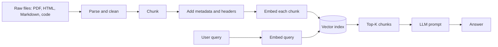
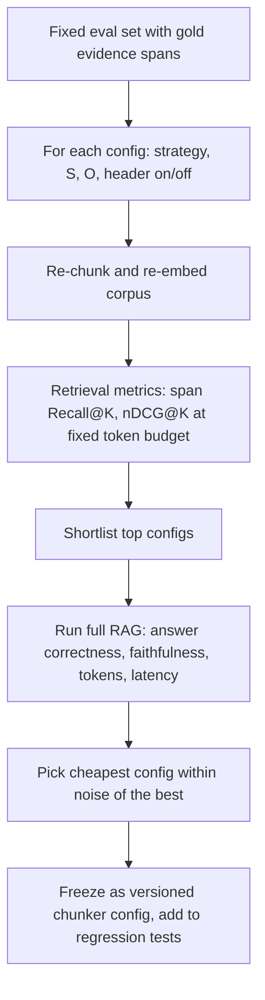

# Chunking Strategies: Size, Overlap and Structure

> **Level:** Beginner to Advanced · **Study time:** ~110 min · **Prerequisites:** [What Is RAG and Why It Matters](01-what-is-rag-and-why-it-matters.md), [Text Embeddings and Similarity Search](02-text-embeddings-and-similarity-search.md), [Document Ingestion and Parsing](03-document-ingestion-and-parsing.md), [Tokenization](../04-transformers/01-tokenization.md)

## Table of contents

- [Why this matters](#why-this-matters)
- [What a chunk is and why we chunk at all](#what-a-chunk-is-and-why-we-chunk-at-all)
- [The Goldilocks problem: too small vs too large](#the-goldilocks-problem-too-small-vs-too-large)
- [Fixed-size token chunking with overlap](#fixed-size-token-chunking-with-overlap)
- [A token-based chunker in code](#a-token-based-chunker-in-code)
- [Recursive character and structure splitting](#recursive-character-and-structure-splitting)
- [Sentence- and paragraph-based chunking](#sentence--and-paragraph-based-chunking)
- [Structure-aware chunking: Markdown, HTML, code and tables](#structure-aware-chunking-markdown-html-code-and-tables)
- [Preserving tables, headings and hierarchy](#preserving-tables-headings-and-hierarchy)
- [Semantic chunking vs fixed-size chunking](#semantic-chunking-vs-fixed-size-chunking)
- [Late chunking (briefly)](#late-chunking-briefly)
- [Parent-child chunking (preview)](#parent-child-chunking-preview)
- [How token limits shape chunk size](#how-token-limits-shape-chunk-size)
- [Typical starting ranges](#typical-starting-ranges)
- [Tuning chunking systematically with metrics](#tuning-chunking-systematically-with-metrics)
- [Chunking in production: versioning, debugging and scale](#chunking-in-production-versioning-debugging-and-scale)
- [Common mistakes and misconceptions](#common-mistakes-and-misconceptions)
- [Interview questions and model answers](#interview-questions-and-model-answers)
- [Key takeaways](#key-takeaways)
- [Further reading](#further-reading)
- [Next](#next)

## Why this matters

In a RAG (retrieval-augmented generation) system, the unit you retrieve is the chunk, not the document. If the fact a user needs is split across two chunks, or buried in a giant chunk about five other topics, retrieval misses it and the LLM either refuses or invents an answer. Chunking is also one of the cheapest knobs to change and one of the most expensive to get wrong at scale, because every change means re-embedding the whole corpus. Fixing chunking (for example, keeping tables whole or adding section titles) is often one of the highest-leverage changes in a struggling RAG system, frequently more useful than swapping the LLM. Interviewers ask about it because it reveals whether you have actually shipped RAG: anyone can call a splitter, but a senior engineer can explain why a chunk size was chosen and prove it with metrics.

## What a chunk is and why we chunk at all

> **Analogy:** Imagine preparing a 300-page product manual for a study group that can only look at index cards. You cannot hand them the whole manual, and a card with a single word is useless. You cut the manual into cards that each hold one complete idea, and you write the chapter name at the top of each card so nobody gets lost. That is chunking.

A **chunk** is a contiguous piece of a document that is embedded, indexed and retrieved as one unit. **Chunking** (also called **splitting**) is the process of cutting documents into chunks. Each chunk is turned into an **embedding** (a vector of numbers that captures meaning; see [Text Embeddings and Similarity Search](02-text-embeddings-and-similarity-search.md)), stored in an index, and at query time the $K$ chunks whose embeddings are closest to the query embedding (the **top-K**) are handed to the LLM.

Sizes are measured in **tokens**: the sub-word pieces a model actually reads (see [Tokenization](../04-transformers/01-tokenization.md)). A rough rule of thumb for English with GPT-style tokenizers is about 4 characters or 0.75 words per token, but different tokenizers disagree, so always count with the tokenizer of the model you care about.

Here is where chunking sits in the pipeline:



### Four reasons we chunk

1. **Embedding model input limits.** Every embedding model has a **maximum sequence length** (the most tokens it reads in one pass). Many BERT-style embedding models stop at 512 tokens, some at 256, and newer long-context models accept several thousand. Text beyond the limit is usually **silently truncated**: it is simply cut off and never influences the vector.
2. **Retrieval precision.** An embedding is one point summarizing the whole chunk. A chunk about one topic gives a sharp point; a chunk about ten topics gives a blurry average that matches nothing well. Smaller, focused chunks let the retriever point at exactly the right passage.
3. **LLM context budget.** The **context window** is the maximum number of tokens the LLM can process at once (prompt plus answer). Retrieved chunks compete for that space with the system prompt, conversation history and the answer itself. Even with very large windows, irrelevant text dilutes the model's attention and raises the risk of answering from the wrong passage.
4. **Cost and latency.** You pay (in money or GPU time) per token embedded at indexing time and per token sent to the LLM at query time. Prefill time (the time the LLM spends reading the prompt, see [Inference Fundamentals](../06-llm-inference/01-inference-fundamentals-prefill-decode-and-latency-metrics.md)) grows with prompt length, so sending five 2,000-token chunks when two 300-token chunks would do costs real time to first token.

### The running example

We will reuse one small corpus throughout. The **Acme Store Help Center** has four documents:

| Doc | Title | Content |
|---|---|---|
| D1 | Returns and Refunds | Return window (30 days), condition rules, refund timing (14 days), refund method |
| D2 | Shipping | Delivery times (3-5 business days), international shipping, tracking |
| D3 | Warranty | A table: product, warranty length, extended option |
| D4 | API Guide | Python code examples for the order-status API |

A typical question: *"How long do refunds take?"* The answer lives in one sentence of D1: "Refunds are issued within 14 days of receiving the item."

## The Goldilocks problem: too small vs too large

Chunk size is a trade-off between **context** (does the chunk carry enough surrounding information to be understood and to answer?) and **focus** (is the chunk about one thing, so its embedding is sharp?).

```text
 too small                       just right                         too large
 |----|                          |--------------|                   |--------------------------------|
 "within 14 days."               "Refunds are issued within         "Returns... Refunds... Shipping...
                                  14 days of receiving the item.     International... Tracking..."
 What is within 14 days?          Refunds go to the original         The refund sentence is 1 of 25.
 Lost context.                    payment method."                   Diluted embedding.
```

### What goes wrong when chunks are too small

- **Lost context.** "It must be unused and in original packaging." What is "it"? The chunk that says "items" is a different chunk. The retriever cannot match a question about "returning headphones" to a chunk that never mentions returns.
- **Fragmented answers.** The answer to "What is the return policy?" spans four sentences. With one-sentence chunks you need all four in the top-K. Retrieve only two and the LLM gives a half answer that sounds complete.
- **Broken facts.** A cut in the middle of "Refunds are issued within 14 | days" separates the number from its unit.
- **Index bloat.** Four times smaller chunks means about four times more vectors to store and search, and more near-duplicate results crowding the top-K.
- **Over-literal matching.** Tiny chunks match surface words. A chunk that is just a heading "Refunds" can rank highly for "refund" queries while containing no answer at all.

### What goes wrong when chunks are too large

- **Diluted embeddings.** The vector has to summarize everything in the chunk. A small relevant sentence inside a big chunk barely moves it.
- **Wasted context.** If you retrieve a 2,000-token chunk to use one sentence, the other 1,950-odd tokens cost money and latency and distract the LLM. Liu et al. (2023, "Lost in the Middle: How Language Models Use Long Contexts") showed that models use information at the start and end of long contexts more reliably than information in the middle.
- **Lower precision.** With a fixed context budget, larger chunks mean fewer chunks (smaller K), so a query that needs evidence from three places may only get one.
- **Silent truncation.** If the chunk exceeds the embedding model's limit, the tail is never embedded. The answer may be in that tail and the chunk will never be retrieved for it.

### A tiny numeric example of dilution

Let us see dilution with numbers. Many embedding models produce a chunk vector by **mean pooling**: averaging the vectors of the tokens (or, loosely, of the ideas) in the chunk. Pretend, for illustration only, that meaning lives in two dimensions: refunds $=(1, 0)$ and shipping $=(0, 1)$. Real models use hundreds of dimensions and are not pure averages of topic vectors, but the effect is the same in spirit.

We compare chunks with the query using **cosine similarity** (recap from [Text Embeddings and Similarity Search](02-text-embeddings-and-similarity-search.md)):

$$\cos(\mathbf{a}, \mathbf{b}) = \frac{\mathbf{a} \cdot \mathbf{b}}{\lVert \mathbf{a} \rVert \, \lVert \mathbf{b} \rVert}$$

- $\mathbf{a}, \mathbf{b}$: the two vectors (query and chunk).
- $\mathbf{a} \cdot \mathbf{b}$: the dot product, the sum of element-wise products.
- $\lVert \mathbf{a} \rVert$: the length of $\mathbf{a}$, the square root of the sum of squared elements.
- Result: 1 means same direction (same meaning), 0 means unrelated.

The query "How long do refunds take?" sits at $\mathbf{q} = (1, 0)$.

**Small chunk** (just the refund sentence): $\mathbf{c}_s = (1, 0)$.
- Dot product: $1 \cdot 1 + 0 \cdot 0 = 1$.
- Lengths: $\lVert \mathbf{q} \rVert = 1$, $\lVert \mathbf{c}_s \rVert = 1$.
- Cosine: $1 / (1 \cdot 1) = 1.0$.

**Large chunk** (one refund sentence plus three shipping sentences, mean pooled): $\mathbf{c}_\ell = \frac{(1,0) + (0,1) + (0,1) + (0,1)}{4} = (0.25, 0.75)$.
- Dot product: $1 \cdot 0.25 + 0 \cdot 0.75 = 0.25$.
- Length: $\sqrt{0.25^2 + 0.75^2} = \sqrt{0.0625 + 0.5625} = \sqrt{0.625} \approx 0.7906$.
- Cosine: $0.25 / (1 \cdot 0.7906) \approx 0.316$.

Same answer text, similarity drops from 1.0 to about 0.32 (illustrative). Any other focused chunk that mentions refunds, even a less useful one (say, "Refunds for gift cards are not available"), would now outrank it. That is dilution.

> **Senior insight:** "Too small" and "too large" are relative to the *question distribution*, not to the documents. Fact lookup ("What is the refund window?") favors small chunks. Synthesis questions ("Summarize our return policy and its exceptions") favor large chunks or retrieving several adjacent ones. If your users ask both, consider parent-child retrieval (search small chunks, return their larger parent section; previewed below) or multi-granularity indexing (index the same text at several chunk sizes) instead of one compromise size.

## Fixed-size token chunking with overlap

The simplest strategy: cut the token sequence into windows of a fixed size, and let consecutive windows share some tokens.

- **Chunk size** $S$: the number of tokens per chunk.
- **Overlap** $O$: how many tokens consecutive chunks share.
- **Stride** $S - O$: how far the window moves each step.

> **Analogy:** Overlap is like the "previously on..." recap at the start of a TV episode. If a sentence gets cut at the end of chunk 1, its beginning reappears at the start of chunk 2, so a short enough idea survives intact in at least one chunk (how short is made precise below).

### Worked example: boundaries with and without overlap

Use D1's sentence pair and pretend each word is one token (real tokenizers differ, but the arithmetic is identical):

```text
index:  0        1    2      3      4   5      6         7     8    9         10
token:  Refunds  are  issued within 14  days.  Shipping  takes 3-5  business  days.
```

That is $T = 11$ tokens. Take $S = 5$.

**Without overlap** ($O = 0$, stride $= 5$):

```text
chunk 1  [0, 5)   Refunds are issued within 14
chunk 2  [5, 10)  days. Shipping takes 3-5 business
chunk 3  [10, 11) days.
```

The fact "within 14 days" is broken: chunk 1 has "14" with no unit and chunk 2 starts with an orphaned "days." Chunk 3 is a useless one-token fragment.

**With overlap** ($O = 2$, stride $= 5 - 2 = 3$):

```text
chunk 1  [0, 5)   Refunds are issued within 14
chunk 2  [3, 8)   within 14 days. Shipping takes
chunk 3  [6, 11)  Shipping takes 3-5 business days.

tokens:  0 1 2 3 4 5 6 7 8 9 10
chunk 1  ##########
chunk 2        ##########
chunk 3              ##########
```

Now "within 14 days." appears whole in chunk 2, and "Shipping takes 3-5 business days." is whole in chunk 3. Overlap did not make boundaries smart, it just gave each boundary a second chance.

More precisely: with overlap $O$, any run of at most $O + 1$ consecutive tokens is **guaranteed** to appear whole in at least one chunk; longer runs may still be cut. Here $O = 2$ guarantees that 3-token facts such as "within 14 days." survive, while the 5-token "Shipping takes 3-5 business days." survived only by luck. This gives a principled way to pick overlap: make it about as long as the typical fact or sentence you cannot afford to split.

### How many chunks? The formula

$$N = \left\lceil \frac{T - O}{S - O} \right\rceil \quad \text{for } T > S, \qquad N = 1 \text{ for } T \le S$$

- $N$: number of chunks produced.
- $T$: total tokens in the document.
- $S$: chunk size in tokens.
- $O$: overlap in tokens, with $0 \le O < S$.
- $\lceil x \rceil$: round up to the next whole number.

Why this formula: the first chunk covers $S$ tokens and every later chunk adds only $S - O$ new ones, so you need $1 + \lceil (T - S)/(S - O) \rceil$ chunks, which simplifies to the expression above.

Check with the example: $T = 11$, $S = 5$, $O = 2$: $N = \lceil (11 - 2) / (5 - 2) \rceil = \lceil 9 / 3 \rceil = 3$. Three chunks, as drawn.

A more realistic document: $T = 500$, $S = 200$, $O = 50$, stride $= 150$.
- $N = \lceil (500 - 50) / 150 \rceil = \lceil 450 / 150 \rceil = 3$.
- Chunks: $[0, 200)$, $[150, 350)$, $[300, 500)$.
- Tokens embedded: $3 \times 200 = 600$, which is $600 / 500 = 1.2$ times the document.

### The cost of overlap

For long documents, every token after the first window is embedded about $S/(S-O)$ times on average, because each chunk embeds $S$ tokens but advances by only $S - O$ new ones:

$$\text{overhead} \approx \frac{S}{S - O}$$

- With $S = 512$, $O = 64$: $512 / 448 \approx 1.143$, so about 14% more tokens to embed and store.
- With $S = 200$, $O = 100$ (50% overlap): $200 / 100 = 2$, double the cost, and neighbouring chunks are so similar that they crowd each other out of the top-K.

That is why overlap is usually modest (often 10-20% of the chunk size as a starting point) and why structure-aware splitting, which puts boundaries in sensible places, reduces the need for overlap.

> **Common mistake:** Measuring chunk size in characters while the embedding model limit is in tokens. A 2,000-character chunk is about 500 tokens of English prose but can be far more tokens of code, URLs, numbers or non-Latin scripts, and quietly overflow the model limit.

## A token-based chunker in code

First the core mechanism with no dependencies: compute window spans over a list of $T$ tokens.

```python
# Pure Python, no dependencies.
def window_spans(n_tokens: int, size: int, overlap: int) -> list[tuple[int, int]]:
    """Return [start, end) token spans for fixed-size windows with overlap."""
    if size <= 0 or not 0 <= overlap < size:
        raise ValueError("need size > 0 and 0 <= overlap < size")
    if n_tokens == 0:
        return []
    stride = size - overlap
    spans, start = [], 0
    while True:
        end = min(start + size, n_tokens)
        spans.append((start, end))
        if end == n_tokens:          # stop once the last token is covered,
            break                    # so we never emit a chunk fully inside the previous one
        start += stride
    return spans

words = "Refunds are issued within 14 days. Shipping takes 3-5 business days.".split()
for s, e in window_spans(len(words), size=5, overlap=2):
    print((s, e), " ".join(words[s:e]))
# (0, 5) Refunds are issued within 14
# (3, 8) within 14 days. Shipping takes
# (6, 11) Shipping takes 3-5 business days.

print(window_spans(500, 200, 50))
# [(0, 200), (150, 350), (300, 500)]
```

Notice the stopping rule. A naive `for start in range(0, n, stride)` loop emits extra tail chunks that are entirely contained in the previous chunk, which wastes vectors and creates duplicates.

Now the production version. Two details matter:

1. **Count with the embedding model's own tokenizer**, so chunk size matches the model limit exactly.
2. **Slice the original text using character offsets** instead of decoding token IDs back to text. Decoding can alter whitespace, casing or special characters; offsets give you an exact substring and let you store `char_start`/`char_end` for citations and evaluation.

```python
# pip install transformers
from transformers import AutoTokenizer

MODEL = "sentence-transformers/all-MiniLM-L6-v2"
tokenizer = AutoTokenizer.from_pretrained(MODEL)   # a "fast" tokenizer, needed for offsets

def chunk_by_tokens(text: str, chunk_size: int = 200, overlap: int = 30) -> list[dict]:
    """Fixed-size token chunks with overlap, returned as exact substrings of `text`.

    chunk_size counts content tokens only. The model adds special tokens
    ([CLS] and [SEP] for BERT-style models), so keep chunk_size + 2 <= model limit.
    """
    enc = tokenizer(text, add_special_tokens=False, return_offsets_mapping=True)
    offsets = enc["offset_mapping"]            # list of (char_start, char_end) per token
    chunks = []
    for i, (t0, t1) in enumerate(window_spans(len(offsets), chunk_size, overlap)):
        c0, c1 = offsets[t0][0], offsets[t1 - 1][1]
        chunks.append({
            "chunk_index": i,
            "token_start": t0, "token_end": t1,
            "char_start": c0, "char_end": c1,
            "text": text[c0:c1],
        })
    return chunks

doc = open("returns_and_refunds.txt", encoding="utf-8").read()
for c in chunk_by_tokens(doc, chunk_size=200, overlap=30):
    print(c["chunk_index"], c["token_end"] - c["token_start"], repr(c["text"][:60]))
```

Notes:

- Tokenizing a long document may print a warning that the sequence is longer than the model maximum. It is harmless here, because we are only counting tokens, not running the model.
- For OpenAI-style embedding models, count with `tiktoken` (for example the `cl100k_base` encoding used by the text-embedding-3 family at the time of writing) instead of a Hugging Face tokenizer. The windowing logic is identical.
- Pure token windows ignore sentences and headings. They are a solid, predictable **baseline**, and every fancier strategy should be compared against them.

## Recursive character and structure splitting

Fixed windows cut wherever the count runs out, often mid-sentence. **Recursive splitting** tries to cut at the most natural boundary that still keeps chunks under the size limit.

> **Analogy:** Packing a suitcase with a weight limit. First try to pack whole outfits. If an outfit is too heavy, split it into individual garments. Only if a single garment is too heavy do you take scissors to it.

The algorithm uses an ordered list of **separators**, from coarsest to finest, typically paragraph break `"\n\n"`, line break `"\n"`, sentence end `". "` (LangChain's default list, `["\n\n", "\n", " ", ""]`, omits this one; you can pass your own), space `" "`, and finally the empty string (cut anywhere):

1. If the text fits the limit, return it as one chunk.
2. Otherwise split on the coarsest separator and greedily merge neighbouring pieces while they fit.
3. Any single piece that is still too big is split recursively with the next finer separator.

```python
# Pure Python. Length is measured in characters here for readability;
# in production pass a token-counting function instead.
def recursive_split(text: str, max_len: int,
                    separators=("\n\n", "\n", ". ", " ", "")) -> list[str]:
    if len(text) <= max_len:
        return [text]
    sep, *rest = separators
    if sep == "":                                   # last resort: hard cut
        return [text[i:i + max_len] for i in range(0, len(text), max_len)]
    chunks, current = [], ""
    for part in text.split(sep):
        candidate = part if not current else current + sep + part
        if len(candidate) <= max_len:               # keep merging while it fits
            current = candidate
            continue
        if current:
            chunks.append(current)
        if len(part) <= max_len:
            current = part
        else:                                       # piece too big: go finer
            chunks.extend(recursive_split(part, max_len, rest))
            current = ""
    if current:
        chunks.append(current)
    return chunks

doc = ("Returns\n\nYou can return most items within 30 days. "
       "Items must be unused and in original packaging.\n\n"
       "Refunds\n\nRefunds are issued within 14 days of receiving the item. "
       "Refunds go to the original payment method.")
for c in recursive_split(doc, max_len=80):
    print(repr(c))
# 'Returns'
# 'You can return most items within 30 days'
# 'Items must be unused and in original packaging.'
# 'Refunds'
# 'Refunds are issued within 14 days of receiving the item'
# 'Refunds go to the original payment method.'
```

Look closely at that output, because it teaches two lessons:

- Every cut is at a paragraph or sentence boundary. Much better than raw token windows.
- The headings "Returns" and "Refunds" became **orphan chunks**: chunks that contain only a heading and no content. And the content chunks lost their heading. The recursive splitter knows about whitespace, not about document structure. This is exactly the problem structure-aware chunking and heading prepending solve below.

(This toy version also drops the `". "` separator from the end of split sentences. Library implementations can keep separators.)

The standard library version, popularized by LangChain (the package layout has changed across versions, so check current docs):

```python
# pip install langchain-text-splitters tiktoken
from langchain_text_splitters import RecursiveCharacterTextSplitter

splitter = RecursiveCharacterTextSplitter.from_tiktoken_encoder(
    encoding_name="cl100k_base",
    chunk_size=256,        # measured in tokens because we used a tiktoken length function
    chunk_overlap=32,
)
chunks = splitter.split_text(doc)
```

LlamaIndex offers similar node parsers (for example a sentence-aware splitter). The concept matters more than the library: ordered separators, greedy merging, recursion for oversize pieces, and a length function in the right unit.

## Sentence- and paragraph-based chunking

**Sentence-based chunking** first splits text into sentences, then packs whole sentences into chunks up to a token budget. **Paragraph-based chunking** does the same with paragraphs. The guarantee: no sentence is ever cut in half (unless a single sentence exceeds the budget).

Overlap is expressed in **whole sentences** rather than tokens, so the overlapping region is always readable.

```python
import re

def split_sentences(text: str) -> list[str]:
    # Naive: split after . ! ? followed by whitespace. Breaks on "Dr. Smith", "e.g. this", "3.5 GB".
    return [s for s in re.split(r"(?<=[.!?])\s+", text.strip()) if s]

def pack_sentences(sentences: list[str], max_tokens: int, overlap_sents: int = 1,
                   count=lambda s: len(s.split())) -> list[str]:
    """Greedily pack whole sentences; repeat the last `overlap_sents` sentences in the next chunk."""
    chunks, cur = [], []
    for s in sentences:
        if cur and sum(count(x) for x in cur) + count(s) > max_tokens:
            chunks.append(" ".join(cur))
            cur = cur[-overlap_sents:] if overlap_sents else []
            while cur and sum(count(x) for x in cur) + count(s) > max_tokens:
                cur.pop(0)               # drop overlap that would push this chunk over budget
        cur.append(s)
    if cur:
        chunks.append(" ".join(cur))
    return chunks

text = ("You can return most items within 30 days. Items must be unused. "
        "Refunds are issued within 14 days. Refunds go to the original payment method. "
        "Shipping takes 3-5 business days.")
for c in pack_sentences(split_sentences(text), max_tokens=16):
    print(repr(c))
# 'You can return most items within 30 days. Items must be unused.'
# 'Items must be unused. Refunds are issued within 14 days.'
# 'Refunds are issued within 14 days. Refunds go to the original payment method.'
# 'Refunds go to the original payment method. Shipping takes 3-5 business days.'
```

Here `count` uses words to keep the demo dependency-free; in production pass a real token counter. The `while` loop matters: without it, carrying the overlap sentence into a chunk whose next sentence is long can push that chunk over the budget (for example a 10-word overlap plus a 10-word sentence against a 16-word budget).

Practical points:

- **Sentence splitting is harder than it looks.** Abbreviations, decimals, URLs, bullet lists without periods, and languages without spaces (Chinese, Japanese) all break regex splitters. Use a proper segmenter (spaCy, NLTK Punkt, or a multilingual model) when quality matters.
- **Chunk sizes vary.** A chunk ends when the next sentence would overflow, so a chunk can be far below the budget (a short sentence followed by a long one closes a tiny chunk) or right at it; add a minimum-size merge step if tiny chunks are a problem. A single 400-token sentence (common in legal text) must still be split by tokens as a fallback.
- **Paragraphs are often better units than sentences** for prose, because authors put one idea per paragraph. Pack paragraphs first, and fall back to sentences only for oversized paragraphs. That is essentially the recursive splitter with a good separator list.

## Structure-aware chunking: Markdown, HTML, code and tables

Most real documents already have structure: headings, sections, list items, tables, functions. **Structure-aware chunking** uses that structure to choose boundaries, and only falls back to size-based splitting inside a structural unit that is too large. It depends on good parsing upstream (see [Document Ingestion and Parsing](03-document-ingestion-and-parsing.md)): you cannot respect a table you have already flattened into a stream of words.

### Markdown: split at headings and remember the path

```python
import re

def split_markdown(md: str, doc_title: str) -> list[dict]:
    """Split Markdown at headings and record each section's heading path."""
    chunks, path, buf = [], [], []

    def flush():
        body = "\n".join(buf).strip()
        if body:
            section = " > ".join(path) if path else "(intro)"
            chunks.append({
                "section_path": section,
                "text": body,                                   # body; prompt assembly adds the section path
                "embed_text": f"Document: {doc_title}\nSection: {section}\n\n{body}",
            })
        buf.clear()

    in_code = False
    for line in md.splitlines():
        if line.startswith("```"):              # a '#' inside a code block is not a heading
            in_code = not in_code
        m = None if in_code else re.match(r"^(#{1,6})\s+(.*)", line)
        if m:
            flush()
            level, title = len(m.group(1)), m.group(2).strip()
            path[:] = path[:level - 1] + [title]     # pop deeper levels, push this heading
        else:
            buf.append(line)
    flush()
    return chunks

md = """# Help Center
## Returns
You can return most items within 30 days.
### Refunds
Refunds are issued within 14 days.
## Warranty
| Product | Warranty |
|---|---|
| Laptop | 2 years |
| Phone | 1 year |
"""
for c in split_markdown(md, "Acme Store Help Center"):
    print(c["section_path"], "|", c["text"].replace("\n", " / "))
# Help Center > Returns | You can return most items within 30 days.
# Help Center > Returns > Refunds | Refunds are issued within 14 days.
# Help Center > Warranty | | Product | Warranty | / |---|---| / | Laptop | 2 years | / | Phone | 1 year |
```

Each chunk now knows where it lives. The heading stack (`path[:level - 1] + [title]`) correctly handles going deeper (`###` under `##`) and coming back up (a new `##` pops the `###`). The table stayed whole because it sits inside one section. In production you would then size-split any section that exceeds the token budget, carrying the same `section_path` into every piece. LangChain's `MarkdownHeaderTextSplitter` implements the same idea.

### HTML

HTML has explicit structure: `<h1>` to `<h6>`, `<section>`, `<article>`, `<p>`, `<li>`, `<table>`, `<pre>`. A good HTML chunker:

- strips boilerplate (navigation, footers, cookie banners, repeated sidebars), which otherwise ends up duplicated in every chunk and pollutes embeddings;
- uses heading elements to build the section path;
- treats `<table>`, `<pre>` and lists as atomic blocks where possible;
- keeps link text but usually drops URLs from the embedded text (store them as metadata).

### Source code: split by function or class

Code has a syntax tree, and the natural retrieval unit is a function, method or class. Splitting a function in the middle produces chunks that neither compile nor make sense.

```python
import ast

def split_python_by_function(source: str) -> list[dict]:
    """One chunk per top-level function or class, with line numbers for citations."""
    tree = ast.parse(source)
    out = []
    for node in tree.body:
        if isinstance(node, (ast.FunctionDef, ast.AsyncFunctionDef, ast.ClassDef)):
            out.append({
                "name": node.name,
                "kind": type(node).__name__,
                "start_line": node.lineno,
                "end_line": node.end_lineno,
                "text": ast.get_source_segment(source, node),
            })
    return out

src = '''import math

def area(r):
    """Area of a circle."""
    return math.pi * r * r

class Cart:
    def __init__(self):
        self.items = []

    def total(self):
        return sum(p for _, p in self.items)
'''
for c in split_python_by_function(src):
    print(c["kind"], c["name"], c["start_line"], c["end_line"])
# FunctionDef area 3 5
# ClassDef Cart 7 12
```

Production refinements:

- Prepend the **file path, class name and imports** to each function chunk (`orders/api.py > class OrderClient > def get_status`), because a function body alone often lacks the context ("what is `self.session`?").
- Split very large classes into methods, keeping the class signature and docstring as a header.
- Do not forget module-level code (imports, constants, configuration) that this simple version skips: keep it as its own chunk.
- For many languages at once, parsers such as **tree-sitter** provide syntax trees; LangChain and LlamaIndex ship language-aware code splitters built on this idea.

### Tables: keep them whole, or split by rows with the header repeated

Tables are where naive chunking does the most damage. Cut D3's warranty table after row 1, and the second chunk contains "| Phone | 1 year | Yes |" with no column names: the retriever and the LLM cannot tell what "1 year" or "Yes" means.

Rules of thumb:

1. If the table fits the chunk budget, keep it as **one chunk**.
2. If it does not, split it into **row groups and repeat the header row in every chunk**, plus the table caption and section path.
3. Never let a chunk boundary fall inside a row.

```python
def split_table(header: list[str], rows: list[list[str]], rows_per_chunk: int,
                caption: str) -> list[str]:
    head = "| " + " | ".join(header) + " |\n|" + "---|" * len(header)
    chunks = []
    for i in range(0, len(rows), rows_per_chunk):
        body = "\n".join("| " + " | ".join(r) + " |" for r in rows[i:i + rows_per_chunk])
        chunks.append(f"{caption}\n{head}\n{body}")     # caption + header in every chunk
    return chunks

hdr = ["Product", "Warranty", "Extended option"]
rows = [["Laptop", "2 years", "Yes"], ["Phone", "1 year", "Yes"], ["Cable", "90 days", "No"]]
for c in split_table(hdr, rows, rows_per_chunk=2,
                     caption="Table: Warranty by product (Help Center > Warranty)"):
    print(c, "\n---")
# Table: Warranty by product (Help Center > Warranty)
# | Product | Warranty | Extended option |
# |---|---|---|
# | Laptop | 2 years | Yes |
# | Phone | 1 year | Yes |
# ---
# Table: Warranty by product (Help Center > Warranty)
# | Product | Warranty | Extended option |
# |---|---|---|
# | Cable | 90 days | No |
# ---
```

### Strategy comparison

| Strategy | What it does | When to use | Pros | Cons |
|---|---|---|---|---|
| Fixed-size tokens + overlap | Windows of $S$ tokens, stride $S - O$ | Baseline; unstructured plain text; transcripts | Simple, fast, predictable sizes, never exceeds model limit | Cuts mid-sentence, ignores structure, overlap costs storage |
| Recursive character/separator | Splits at the coarsest separator that fits | General prose and mixed docs | Good boundaries with little effort, widely available | Orphan headings, no notion of hierarchy, sizes vary |
| Sentence/paragraph packing | Packs whole sentences/paragraphs up to a budget | Prose, articles, support content | Readable chunks, overlap in whole sentences | Sentence segmentation errors, long sentences need fallback |
| Structure-aware (Markdown, HTML, code, tables) | Uses headings, elements, syntax trees, table boundaries | Docs with real structure: manuals, wikis, code, reports | Coherent units, natural metadata (section path), tables intact | Needs good parsing; section sizes vary wildly, needs a size fallback |
| Semantic (embedding breakpoints) | Cuts where adjacent sentences' meaning shifts | Long unstructured text with topic shifts | Topic-coherent chunks without markup | Extra embedding cost, threshold tuning, uneven sizes, gains not guaranteed |
| Late chunking | Embeds the whole document, then pools per chunk | Chunks full of references ("it", "this") to earlier text | Chunk vectors carry document context | Needs a long-context embedding model and token-level outputs |
| Parent-child | Retrieve small children, return larger parents | Need both precise matching and rich context | Best of both sizes | More storage and complexity |

## Preserving tables, headings and hierarchy

Structure-aware splitting gives good boundaries. The next step is making sure every chunk **carries its context with it**, because once a chunk is in the index it is retrieved alone, far from its neighbours.

### Prepend the document title and section path

Compare what the embedding model sees:

```text
Without context header:
  "Refunds are issued within 14 days of receiving the item."

With context header:
  "Document: Acme Store Help Center - Returns and Refunds
   Section: Returns > Refunds
   Refunds are issued within 14 days of receiving the item."
```

The headed version matches queries that mention "return policy" or "Acme refunds" even though the body never says "return" or "Acme". The header disambiguates chunks that would otherwise be identical: "Coverage lasts 2 years" means something different under "Laptops > Warranty" than under "Insurance > Travel plan".

Implementation choices:

- **Embed the header plus body; show the LLM the header plus body too.** The LLM benefits from knowing the source and section, and can cite it.
- **Store structured metadata separately**: `doc_id`, `doc_title`, `section_path`, `page`, `chunk_index`, `char_start`, `char_end`, `source_url`, `updated_at`, access-control fields. Metadata is used for filtering, citations, deduplication and evaluation. It is not a substitute for putting the key context into the embedded text, because metadata fields are not embedded unless you put them there.
- **Count header tokens against the budget.** A 40-token header on a 256-token chunk is significant. If $h$ is the header size, the body budget is $L_{\text{embed}} - h - s_{\text{special}}$ (defined in [How token limits shape chunk size](#how-token-limits-shape-chunk-size)).
- **Keep headers short.** Long breadcrumb trails repeated in every chunk make all chunks of a document look alike to the embedding model, which can hurt precision within that document.

A more powerful (and more expensive) variant asks an LLM to write a one or two sentence summary situating each chunk in its document, then prepends that summary before embedding. This is often called **contextual retrieval** and is covered in [Advanced RAG Patterns](09-advanced-rag-patterns.md).

### Keep table headers and captions

From the previous section:

- Keep small tables whole.
- Split large tables by row groups, repeating the header row, caption and section path in each chunk.
- For very wide or numeric tables, consider **linearizing rows into sentences** for the embedded text ("Product: Phone. Warranty: 1 year. Extended option: Yes."), which embedding models handle better than pipe-delimited grids, while giving the LLM the original Markdown or HTML table for generation.
- Another pattern: embed an LLM-written **table summary** ("Warranty lengths and extended-coverage availability for Acme products") for retrieval, and return the full table to the LLM. This is a form of multi-representation indexing.

### Preserve hierarchy

Hierarchy (document > chapter > section > subsection > paragraph) matters in three ways:

1. **Boundaries:** never merge the end of one section with the start of the next if you can avoid it; a chunk spanning two sections has a diluted embedding and a misleading header.
2. **Context:** the section path in every chunk (above).
3. **Navigation:** store parent pointers (`parent_id`, `section_id`) so you can later expand a retrieved chunk to its full section or its neighbours. That is the basis of parent-child retrieval.

```text
Acme Store Help Center (doc)
 |
 +-- Returns (section)                      section_id = s1
 |     +-- chunk c1  "You can return most items within 30 days..."
 |     +-- Refunds (subsection)              section_id = s1.1
 |            +-- chunk c2  "Refunds are issued within 14 days..."
 |            +-- chunk c3  "Refunds go to the original payment method..."
 +-- Warranty (section)                     section_id = s2
       +-- chunk c4  [whole warranty table with header and caption]
```

> **Interview tip:** When asked "how do you preserve tables and headings?", answer with three layers: (1) parse structure correctly at ingestion, (2) choose boundaries that respect it (sections, whole tables, header repeated on row splits), and (3) make each chunk self-describing (title and section path in the embedded text, metadata for filtering and citations, parent pointers for expansion).

## Semantic chunking vs fixed-size chunking

**Semantic chunking** places boundaries where the *meaning* changes, detected with embeddings, instead of where a size limit or a separator happens to fall.

> **Analogy:** Fixed-size chunking is cutting a film every 10 minutes. Semantic chunking is cutting at scene changes.

### The algorithm

1. Split the document into sentences (or small groups of sentences).
2. Embed each sentence.
3. Compute the **cosine distance** between each pair of neighbouring sentences.
4. Place a boundary wherever the distance exceeds a threshold, usually chosen as a high percentile of all distances in that document.
5. Optionally enforce minimum and maximum chunk sizes.

$$d_i = 1 - \cos(\mathbf{e}_i, \mathbf{e}_{i+1})$$

- $\mathbf{e}_i$: embedding of sentence $i$.
- $\cos(\cdot,\cdot)$: cosine similarity, as defined earlier.
- $d_i$: cosine distance between sentence $i$ and sentence $i+1$; 0 means same meaning, larger means a bigger topic shift.
- Rule: start a new chunk after sentence $i$ if $d_i > \tau$, where $\tau$ is the threshold (for example the 90th or 95th percentile of all $d_i$ in the document).

### Worked example

Four sentences from D1 and D2 with toy 2D unit-length embeddings (illustrative):

| # | Sentence | Embedding |
|---|---|---|
| s1 | Refunds are issued within 14 days. | $(1, 0)$ |
| s2 | Refunds go to the original payment method. | $(0.96, 0.28)$ |
| s3 | Shipping takes 3-5 business days. | $(0.28, 0.96)$ |
| s4 | International orders ship by courier. | $(0, 1)$ |

All vectors have length 1 (for example $0.96^2 + 0.28^2 = 0.9216 + 0.0784 = 1$), so cosine is just the dot product.

- $d_1$ (s1 to s2): $\cos = 1 \cdot 0.96 + 0 \cdot 0.28 = 0.96$, so $d_1 = 1 - 0.96 = 0.04$.
- $d_2$ (s2 to s3): $\cos = 0.96 \cdot 0.28 + 0.28 \cdot 0.96 = 0.2688 + 0.2688 = 0.5376$, so $d_2 = 1 - 0.5376 = 0.4624$.
- $d_3$ (s3 to s4): $\cos = 0.28 \cdot 0 + 0.96 \cdot 1 = 0.96$, so $d_3 = 0.04$.

With an illustrative threshold $\tau = 0.3$, only $d_2 = 0.4624$ exceeds it. One boundary between s2 and s3:

```text
chunk A: [s1, s2]   refunds
chunk B: [s3, s4]   shipping
```

A fixed-size chunker with a budget of three sentences would have produced [s1, s2, s3] and [s4], mixing refunds with shipping in chunk 1 and leaving a lonely chunk 2.

### Code

```python
# pip install sentence-transformers numpy
import re
import numpy as np
from sentence_transformers import SentenceTransformer

model = SentenceTransformer("sentence-transformers/all-MiniLM-L6-v2")

def semantic_chunks(text: str, percentile: float = 90, max_sentences: int = 12) -> list[str]:
    sents = [s for s in re.split(r"(?<=[.!?])\s+", text.strip()) if s]
    if len(sents) < 2:
        return sents
    emb = model.encode(sents, normalize_embeddings=True)       # unit vectors, shape (n, dim)
    dist = 1 - np.sum(emb[:-1] * emb[1:], axis=1)             # d_i between sentence i and i+1
    threshold = np.percentile(dist, percentile)
    chunks, cur = [], [sents[0]]
    for i, d in enumerate(dist):                               # gap between sents[i] and sents[i+1]
        if d > threshold or len(cur) >= max_sentences:         # topic shift or size cap
            chunks.append(" ".join(cur))
            cur = []
        cur.append(sents[i + 1])
    chunks.append(" ".join(cur))
    return chunks
```

Library versions exist (for example LangChain's experimental `SemanticChunker` and LlamaIndex's semantic splitter node parser); their names and parameters change between versions, so treat them as implementations of the algorithm above.

### Semantic vs fixed-size: the honest comparison

| Aspect | Fixed-size (with overlap) | Semantic |
|---|---|---|
| Boundary rule | Every $S - O$ tokens | Where adjacent-sentence distance exceeds a threshold |
| Indexing cost | Tokenize only | Embed every sentence once extra (plus the chunks) |
| Chunk sizes | Uniform, guaranteed under the limit | Variable; needs min/max guards |
| Topic coherence | Accidental | Designed for it |
| Predictability and debuggability | High | Lower; depends on embedding model and threshold |
| Sensitivity | Size and overlap | Threshold, sentence splitter, embedding model, window size |
| Best for | Baseline, uniform text, transcripts | Long unstructured text with clear topic shifts |

Senior-level caveats:

- **Gains are not guaranteed.** A 2024 study, "Is Semantic Chunking Worth the Computational Cost?" (Qu, Tu and Bao), compared semantic and fixed-size chunking on retrieval and generation tasks and found that the benefits of semantic chunking were inconsistent and often did not justify the extra cost. Treat semantic chunking as a hypothesis to test on your data, not an upgrade.
- **A percentile threshold always fires.** With the 90th percentile, roughly 10% of gaps become boundaries even in a document that never changes topic. Absolute thresholds or a combination with size guards help.
- **Single-sentence embeddings are noisy.** Comparing small windows (for example, the average of sentences $i-1, i, i+1$ against $i+1, i+2, i+3$) smooths out spurious breaks.
- **If the document has headings, use them first.** Structure is a stronger, free signal of topic boundaries. Semantic chunking is most useful *inside* long unstructured sections.

A related idea is **proposition-based chunking**: use an LLM to rewrite text into atomic, self-contained factual statements ("propositions") and index those. Chen et al. (2023, "Dense X Retrieval: What Retrieval Granularity Should We Use?") reported that proposition-level indexing can improve retrieval over passage- or sentence-level units in their experiments. It costs an LLM call per passage at ingestion.

## Late chunking (briefly)

Standard ("early") chunking cuts the text first and embeds each chunk independently, so a chunk saying "It must be returned within 30 days" never sees that "it" was "the laptop". **Late chunking** (Günther et al., 2024, "Late Chunking: Contextual Chunk Embeddings Using Long-Context Embedding Models") reverses the order:

```text
Early chunking:                       Late chunking:
  text -> split -> [c1] [c2] [c3]       text --> long-context embedding model
            |       |    |    |                     |
          embed   embed embed embed        token vectors t1 t2 t3 ... tn
            v       v    v    v            (each token has seen the whole document)
          v1      v2   v3                       |
                                            mean-pool per chunk span
                                            v1 = mean(t1..t40), v2 = mean(t41..t80), ...
```

Because every token vector was computed with attention over the whole document (up to the model's limit), each chunk vector carries document context. This assumes a bidirectional encoder, as in the paper's experiments; in a decoder-based embedding model with causal attention, each token sees only the text before it, so later chunks gain context but earlier ones do not. You still get one vector per chunk, so the index and query side do not change.

```python
# Conceptual sketch with a Hugging Face long-context embedding model.
# outputs = model(**inputs)                          # inputs = tokenized whole document
# token_vecs = outputs.last_hidden_state[0]          # shape (n_tokens, dim)
# chunk_vecs = [token_vecs[s:e].mean(dim=0) for s, e in token_spans]
```

Requirements and limits: an embedding model with a long context window and access to its token-level outputs (many hosted embedding APIs return only one pooled vector); documents longer than the model's window still need to be processed in large segments. It is a good fit for text heavy with pronouns and cross-references.

## Parent-child chunking (preview)

The Goldilocks problem says small chunks retrieve precisely while large chunks answer well. **Parent-child chunking** (also called small-to-big retrieval) stops choosing:

```text
Parent (section, ~1,000-2,000 tokens, NOT embedded or embedded separately)
+-----------------------------------------------------------------+
| child 1 (~150 tok) | child 2 (~150 tok) | child 3 | child 4 ... |
+-----------------------------------------------------------------+
     embedded and searched            ^
                                      | query matches child 2
                                      v
                     return the whole PARENT to the LLM
```

- **Children** are small chunks that are embedded and searched, so matching is sharp.
- Each child stores a `parent_id`. At query time you retrieve the best children, deduplicate their parents, and send the **parents** to the LLM, so generation has full context.
- Variants: return the child plus a window of neighbouring chunks ("sentence window retrieval"), or use the section from the structure-aware splitter as the parent.

This chapter only previews it; the full pattern, its trade-offs and its pitfalls (parents blowing the context budget, duplicated parents) are in [Advanced RAG Patterns](09-advanced-rag-patterns.md).

## How token limits shape chunk size

Two different limits act on a chunk, and they push in different directions.

### Limit 1: the embedding model's maximum sequence length (hard ceiling)

Every chunk, *including its prepended header and the model's special tokens*, must fit within the embedding model's maximum sequence length:

$$h + S + s_{\text{special}} \le L_{\text{embed}}$$

- $h$: header tokens (title and section path).
- $S$: body tokens of the chunk.
- $s_{\text{special}}$: special tokens the model adds (2 for BERT-style `[CLS]` and `[SEP]`).
- $L_{\text{embed}}$: the model's maximum sequence length.

Example: a model with $L_{\text{embed}} = 512$ and a 40-token header leaves at most $512 - 40 - 2 = 470$ body tokens.

Important facts:

- Limits vary by model and change over time. Many classic BERT-based sentence encoders handle 512 positions or fewer (the popular `all-MiniLM-L6-v2` is configured to truncate at 256 word pieces in sentence-transformers); newer embedding models and hosted APIs accept thousands of tokens (OpenAI's text-embedding-3 models, for example, accept up to 8,191 tokens at the time of writing). Always check the model card.
- **Truncation is usually silent.** sentence-transformers truncates to `model.max_seq_length` without raising an error. The chunk is stored with its full text, the LLM would see the full text, but the vector only represents the first part. Facts in the tail become unretrievable. Measure the **truncation rate** (share of chunks over the limit) in your ingestion pipeline.
- **"Can accept 8K tokens" does not mean "should embed 8K tokens".** A single vector for 8,000 tokens is the dilution problem at full strength. Long-context embedding models are useful for late chunking and for document-level retrieval, but chunk-level retrieval quality usually peaks well below the maximum. Embedding models are also often trained mostly on shorter passages, so very long inputs can be out of their comfort zone.

### Limit 2: the LLM's context window (a budget, not just a ceiling)

The retrieved chunks have to share the LLM's context window with everything else:

$$K \le \left\lfloor \frac{C - P - Q - A}{S + h} \right\rfloor$$

- $K$: how many chunks you can include.
- $C$: the LLM's context window in tokens.
- $P$: system prompt and instructions.
- $Q$: user question plus conversation history.
- $A$: tokens reserved for the answer.
- $S + h$: tokens per chunk (body plus header).
- $\lfloor x \rfloor$: round down.

Worked example: a 7B model served with an 8,192-token context window (illustrative), $P = 500$, $Q = 200$, $A = 1{,}000$, chunks of $S = 512$ with $h = 40$.

- Available: $8{,}192 - 500 - 200 - 1{,}000 = 6{,}492$ tokens.
- Per chunk: $512 + 40 = 552$ tokens.
- $K = \lfloor 6{,}492 / 552 \rfloor = \lfloor 11.76 \rfloor = 11$ (check: $11 \times 552 = 6{,}072 \le 6{,}492$, while $12 \times 552 = 6{,}624 > 6{,}492$).

Halve the chunk size to 256 (per chunk $296$ tokens) and $K = \lfloor 6{,}492 / 296 \rfloor = 21$ (check: $21 \times 296 = 6{,}216$; $22 \times 296 = 6{,}512 > 6{,}492$). Smaller chunks let you include more distinct passages; larger chunks give each passage more context. That trade-off is the whole game.

Even when the window is huge (hundreds of thousands to over a million tokens on some current models), the practical budget is smaller than the hard limit because:

- prefill latency and cost grow with prompt length;
- the KV cache memory grows with prompt length, reducing how many requests a GPU can serve at once (see [The KV Cache](../06-llm-inference/02-kv-cache-explained.md));
- models use long contexts unevenly ("lost in the middle"), and irrelevant chunks increase the chance of distraction and unsupported answers (see [Hallucinations](../05-llms/06-hallucinations-and-grounding.md)).

### Different tokenizers, different counts

The embedding model and the LLM often use different tokenizers. A chunk of 512 embedding-model tokens may be 450 or 600 LLM tokens. Count with the embedding tokenizer when chunking (hard limit), and with the LLM tokenizer when assembling the prompt (budget).

### Cost and storage at scale

Chunk size also sets the size of your index. Take an illustrative 10 million-token corpus and 768-dimensional float32 vectors (4 bytes per number):

| Config | Stride $S - O$ | Approx. chunks $\approx T / (S - O)$ | Vector storage $\approx N \times 768 \times 4$ bytes |
|---|---|---|---|
| $S = 512$, $O = 64$ | 448 | $10{,}000{,}000 / 448 \approx 22{,}322$ | $22{,}322 \times 3{,}072 = 68{,}573{,}184$ bytes $\approx 68.6$ MB |
| $S = 128$, $O = 16$ | 112 | $10{,}000{,}000 / 112 \approx 89{,}286$ | $89{,}286 \times 3{,}072 = 274{,}286{,}592$ bytes $\approx 274.3$ MB |

(Real counts are a bit higher because each document rounds up its last chunk.) Four times smaller chunks mean four times more vectors, a larger and slower ANN (approximate nearest neighbour) index (see [Vector Search Algorithms](06-vector-search-ann-hnsw-ivf-and-product-quantization.md)), and more metadata rows. Embedding cost in tokens barely changes with chunk size for the body text (it is about $T \times S/(S-O)$), but it rises with overlap, and a prepended $h$-token header is paid once per chunk, so with headers the total is roughly $T \times (S + h)/(S - O)$ and smaller chunks do cost more to embed.

## Typical starting ranges

These are **starting points to tune, not rules**. They reflect common practice for English text with typical 2024-2026 embedding models; your own evaluation set is what decides.

| Content type | Suggested strategy | Starting chunk size | Starting overlap |
|---|---|---|---|
| FAQs, short support articles | One Q&A pair or one short section per chunk | Natural unit, often 100-300 tokens | None needed at natural boundaries |
| General prose, documentation, wikis | Structure-aware (headings) with recursive or sentence packing inside sections | 256-512 tokens | About 10-20% (or 1-2 sentences) |
| Long technical, legal or policy documents | Section-based, plus parent-child | Children 128-256, parents 1,000-2,000 tokens | About 10-15% for children |
| Source code | Function or class; split big classes by method | Whole unit; split units over the model limit | None; prepend file path and signature |
| Tables | Whole table, or row groups with header repeated | Whatever fits the embedding limit | Repeat header, never overlap rows |
| Chat logs, tickets, transcripts | By message or turn windows | A few turns, or 200-400 tokens | 1-2 turns |

A short recipe for choosing size and overlap:

1. **Ceiling:** $S_{\max} = L_{\text{embed}} - h - s_{\text{special}}$, in embedding-model tokens.
2. **Natural unit first** (section, paragraph, Q&A pair, function, table) when it fits; size-split only oversized units.
3. **Question mix:** smaller for fact lookups, larger or parent-child for synthesis.
4. **Overlap:** about one typical sentence for token windows, little or none at structural boundaries.
5. **Sweep** a few neighbours on an evaluation set (next section).

How to read this table in an interview: "I would start around 256-512 tokens with modest overlap for prose, respect structure first, then sweep a few sizes and overlaps on an evaluation set and pick the cheapest configuration within noise of the best."

## Tuning chunking systematically with metrics

Chunking choices should be made like any other model choice: on a fixed evaluation set, with metrics, comparing against a baseline (see [The ML Workflow](../01-classical-ml/01-ml-workflow-data-splits-and-cross-validation.md) for the general discipline and [Evaluating RAG](10-rag-evaluation-metrics-and-ragas.md) for RAG metrics in depth).

### Step 1: build a chunking-independent evaluation set

You need questions paired with ground-truth evidence. The trap: if you label "chunk 17 is relevant", the labels are tied to one chunking and become meaningless when you re-chunk.

Instead, label **evidence spans** in the original documents: `(doc_id, char_start, char_end)` for the text that answers the question. Then, for any chunking configuration, a retrieved chunk counts as a hit if it covers enough of a gold span.

```json
{"question": "How long do refunds take?",
 "answer": "Refunds are issued within 14 days of receiving the item.",
 "gold": [["D1", 412, 470]]}
```

A useful set has, as a starting point, around 50-200 questions covering your real query mix (fact lookups, multi-part questions, table questions, code questions, questions with no answer in the corpus). Sources: real user logs (best), subject-matter experts, and LLM-generated questions reviewed by humans.

### Step 2: retrieval metrics

**Recall@K**: of the gold evidence spans, what fraction appear in the top-K results?

$$\text{Recall@}K = \frac{\left|\{\text{gold spans covered by the top } K\}\right|}{\left|\{\text{gold spans}\}\right|}$$

**nDCG@K** (normalized Discounted Cumulative Gain, Järvelin and Kekäläinen, 2002): rewards putting relevant results near the top.

$$\text{DCG@}K = \sum_{i=1}^{K} \frac{rel_i}{\log_2(i + 1)}, \qquad \text{nDCG@}K = \frac{\text{DCG@}K}{\text{IDCG@}K}$$

- $i$: rank position (1 is the top result).
- $rel_i$: relevance of the result at rank $i$ (here 1 if it covers a not-yet-found gold span, else 0).
- $\log_2(i + 1)$: the discount; lower ranks count less.
- $\text{IDCG@}K$: the DCG of an ideal ranking (all gold spans at the top), so nDCG lies between 0 and 1.

**Worked example.** A question has 2 gold spans. Compare two chunking configs at $K = 3$:

Config A returns [hit, miss, hit]:
- Recall@3 $= 2 / 2 = 1.0$.
- DCG $= \frac{1}{\log_2 2} + 0 + \frac{1}{\log_2 4} = \frac{1}{1} + 0 + \frac{1}{2} = 1.5$.
- IDCG (ideal [hit, hit, miss]) $= \frac{1}{\log_2 2} + \frac{1}{\log_2 3} = 1 + \frac{1}{1.585} = 1 + 0.6309 = 1.6309$.
- nDCG@3 $= 1.5 / 1.6309 \approx 0.920$.

Config B returns [miss, hit, miss]:
- Recall@3 $= 1 / 2 = 0.5$.
- DCG $= 0 + \frac{1}{\log_2 3} + 0 = 0.6309$.
- nDCG@3 $= 0.6309 / 1.6309 \approx 0.387$.

Average these over all questions to score a configuration.

Two chunking-specific subtleties:

- **Overlap creates duplicate hits.** With overlap, two retrieved chunks can cover the same gold span. Count each gold span once (credit only the first chunk that covers it), otherwise overlap inflates scores.
- **Compare at an equal token budget, not an equal K.** Bigger chunks tend to inflate Recall@K because each one covers more text. A fair comparison fixes the number of context tokens: with a 2,048-token budget, $K = 16$ for 128-token chunks but $K = 4$ for 512-token chunks. Report both, but decide on the budget-matched view, because that is what the LLM will actually receive.

### Step 3: answer-quality metrics

Retrieval metrics do not tell the whole story: a chunk can be "retrieved" yet too fragmentary for the LLM to answer from. So also run the full pipeline and score answers:

- **Answer correctness** against reference answers (exact match for short facts, or an LLM judge for free text; see [LLM-as-a-Judge](../05-llms/10-llm-evaluation-metrics-and-llm-as-a-judge.md)).
- **Faithfulness / groundedness**: is every claim supported by the retrieved chunks?
- **Context precision**: how much of the supplied context was actually relevant? Large chunks often score poorly here.
- **Cost and latency**: average prompt tokens and time to first token per configuration.

Frameworks such as RAGAS implement several of these metrics (APIs change between versions; see [Evaluating RAG](10-rag-evaluation-metrics-and-ragas.md)).

### Step 4: sweep, compare, decide



A harness sketch (realistic but simplified; reuses `chunk_by_tokens` from earlier):

```python
# pip install sentence-transformers numpy transformers
import numpy as np
from sentence_transformers import SentenceTransformer

model = SentenceTransformer("sentence-transformers/all-MiniLM-L6-v2")

def build_index(docs: dict[str, str], chunker):
    """docs: {doc_id: text}; chunker(text) -> list of (char_start, char_end)."""
    meta, texts = [], []
    for doc_id, text in docs.items():
        for s, e in chunker(text):
            meta.append((doc_id, s, e))
            texts.append(text[s:e])
    vecs = model.encode(texts, normalize_embeddings=True)       # (n_chunks, dim)
    return meta, vecs

def coverage(chunk, gold) -> float:
    """Fraction of the gold span's characters that the chunk contains."""
    (dc, cs, ce), (dg, gs, ge) = chunk, gold
    if dc != dg:
        return 0.0
    return max(0, min(ce, ge) - max(cs, gs)) / (ge - gs)

def evaluate(meta, vecs, eval_set, k: int, min_cov: float = 0.8):
    recalls, ndcgs = [], []
    for item in eval_set:            # {"question": str, "gold": [(doc_id, start, end), ...]}
        if not item["gold"]:         # no-answer questions: score them with answer metrics instead
            continue
        q = model.encode([item["question"]], normalize_embeddings=True)[0]
        top = np.argsort(-(vecs @ q))[:k]                        # exact search, fine for evals
        found, gains = set(), []
        for idx in top:
            hits = {g for g, span in enumerate(item["gold"])
                    if coverage(meta[idx], span) >= min_cov} - found
            gains.append(1.0 if hits else 0.0)                   # credit only new gold spans
            found |= hits
        recalls.append(len(found) / len(item["gold"]))
        dcg = sum(g / np.log2(i + 2) for i, g in enumerate(gains))
        idcg = sum(1 / np.log2(i + 2) for i in range(min(k, len(item["gold"]))))
        ndcgs.append(dcg / idcg)
    return float(np.mean(recalls)), float(np.mean(ndcgs))

TOKEN_BUDGET = 2048
for size in (128, 256, 512):
    for frac in (0.0, 0.15):
        overlap = int(size * frac)
        chunker = lambda t, s=size, o=overlap: [
            (c["char_start"], c["char_end"]) for c in chunk_by_tokens(t, s, o)]
        meta, vecs = build_index(docs, chunker)       # docs and eval_set loaded elsewhere
        k = max(1, TOKEN_BUDGET // size)               # equal context budget per config
        r, n = evaluate(meta, vecs, eval_set, k=k)
        print(f"S={size:4d} O={overlap:3d} K={k:2d} recall={r:.3f} ndcg={n:.3f} chunks={len(meta)}")
```

(Careful: `all-MiniLM-L6-v2` truncates at 256 tokens including its 2 special tokens, so the 512 runs, and even the 256 runs by 2 tokens, would be silently truncated. In a real sweep, cap sizes at your embedding model's limit or switch to a longer-context model for those runs. That is exactly the kind of bug this harness helps you catch.)

### Reading the results

Illustrative results (made-up numbers to show how to reason, not a benchmark):

| Config | K at 2,048 tokens | Span Recall | nDCG | Answer correctness | Avg prompt tokens |
|---|---|---|---|---|---|
| Fixed 128, O=0 | 16 | 0.78 | 0.61 | 0.70 | 2,050 |
| Fixed 256, O=38 | 8 | 0.86 | 0.69 | 0.79 | 2,060 |
| Structure-aware 256 + header | 8 | 0.91 | 0.74 | 0.84 | 2,180 |
| Fixed 512, O=76 | 4 | 0.84 | 0.66 | 0.80 | 2,070 |

How a senior engineer would read this:

- Structure-aware with headers wins on every quality metric at a small token cost, so it is the candidate.
- Check whether differences exceed noise: with 100 questions, a 0.02 difference may be luck. Use a **paired bootstrap** over questions (resample questions with replacement many times and see how often config A beats config B).
- **Slice by segment**: table questions, code questions, multi-hop questions. A config that wins on average can lose badly on tables.
- Watch for **disagreement between retrieval and answer metrics**. If recall rises but answer correctness falls, chunks are probably too fragmentary to answer from (recall counts them as hits, the LLM cannot use them), or larger chunks are adding distracting text.
- Tune in a sensible order: **strategy and structure first, then size, then overlap**, and only then retrieval-side knobs like K, hybrid search and reranking (see [Retrieval Methods](05-retrieval-bm25-dense-and-hybrid-search.md) and [Reranking](08-reranking-and-query-transformation.md)). A reranker (a slower, more accurate model that re-scores the top candidates) can change the optimal chunk size, so re-check after adding one.

## Chunking in production: versioning, debugging and scale

### Chunking is a versioned artifact

Changing the chunker changes every chunk ID and every vector, so a chunking change is a **full re-index**. Treat chunking like a model:

- Store a `chunker_version` and its full config (strategy, size, overlap, tokenizer, header template) with every chunk, and in your experiment tracker (see [Experiment Tracking](../10-mlops/01-ml-lifecycle-and-experiment-tracking.md)).
- Make chunk IDs **deterministic**, for example a hash of `(doc_id, doc_version, chunker_version, char_start, char_end)`, so re-running ingestion is idempotent (running it twice leaves the same index as running it once) and updates replace rather than duplicate chunks (see [Production Ingestion Pipelines](12-production-ingestion-pipelines-at-scale.md)).
- Roll out a new chunker like a model: build a new index side by side, evaluate offline, shadow or A/B test, then switch with a rollback path (see [Model Deployment Patterns](../10-mlops/04-model-deployment-patterns.md)).
- Add a few chunking tests to CI: a table never loses its header, no chunk exceeds the embedding limit, no empty or heading-only chunks, round-trip offsets reproduce the text.

### Route by document type

A real corpus mixes PDFs, HTML, Markdown, spreadsheets, slide decks and code. One splitter for everything is a common source of quality problems. Use a **router**: detect the document type at ingestion and dispatch to the right chunker (Markdown heading splitter, HTML element splitter, AST code splitter, table handler, token-window fallback), all producing the same chunk schema.

### Debugging chunking

When answers are wrong, look at the chunks before blaming the LLM. A short checklist:

1. **Find the gold evidence and check which chunk contains it.** Is the fact split across two chunks? Is it in a chunk at all (parsing may have dropped it)?
2. **Plot the chunk length distribution** (in embedding-model tokens). Look for a spike at the maximum (likely truncation or hard cuts), and a long tail of tiny chunks (orphan headings, page footers, "Continued on next page").
3. **Measure the truncation rate**: chunks longer than the embedding limit.
4. **Check for near-duplicates**: boilerplate repeated across pages, or excessive overlap, crowding the top-K with copies of the same text.
5. **Read 20 random chunks out loud.** If you cannot tell what a chunk is about without its neighbours, neither can the retriever. Add headers or enlarge.
6. **Compare retrieval with the correct chunk forced in.** If the answer becomes right when you manually insert the right chunk, the problem is retrieval or chunking; if it stays wrong, it is generation or prompting. The full playbook is in [Debugging RAG Systems](11-debugging-rag-systems.md).

### What changes at scale

- **Re-embedding cost** dominates chunking decisions for large corpora. Changing chunking on 1 billion tokens means re-embedding about $1 \text{B} \times S/(S-O)$ tokens. Run sweeps on a representative sample, not the whole corpus.
- **Vector count drives index memory and latency.** Halving the chunk size roughly doubles the vector count. Index compression (see [Vector Search Algorithms](06-vector-search-ann-hnsw-ivf-and-product-quantization.md)) and multi-tenant isolation (see [Secure Multi-Tenant RAG](13-secure-multi-tenant-rag.md)) both get harder as vector counts grow.
- **Incremental updates**: when a document changes, structure-aware chunking localizes the damage (only the edited section's chunks change), while fixed windows shift every boundary after an edit that changes the token count and force re-embedding of the whole rest of the document.
- **Permissions travel with chunks.** Each chunk must inherit the access-control metadata of its source document (and of its section, if permissions are finer-grained), or retrieval can leak content.

## Common mistakes and misconceptions

- **"There is one best chunk size."** The best size depends on your documents, your question mix, your embedding model, your reranker and your context budget. It is found by evaluation, not copied from a blog post.
- **Counting characters when the limit is in tokens.** Code, numbers, URLs and non-English text tokenize far more densely than English prose and overflow limits silently.
- **Ignoring silent truncation.** Chunks bigger than the embedding model's limit are partially invisible to retrieval. Measure the truncation rate.
- **Forgetting the header and special tokens in the budget.** A 512-token body plus a 40-token header does not fit a 512-token model.
- **Splitting tables like prose.** Rows without a header row are meaningless. Keep tables whole or repeat the header.
- **Orphan headings and boilerplate chunks.** Heading-only chunks and repeated footers rank highly and answer nothing. Merge headings into the following content; strip boilerplate before chunking.
- **Too much overlap.** 50% overlap doubles storage and makes near-duplicates crowd the top-K. Overlap is a patch for bad boundaries; better boundaries need less of it.
- **Evaluating with chunk-ID labels.** Labels tied to one chunking cannot compare chunkings. Label evidence spans in the source text.
- **Comparing configs at equal K instead of equal tokens.** Bigger chunks usually "win" Recall@K at equal K simply because they cover more text, even when the answers get worse.
- **Assuming semantic chunking is always better.** It costs more and the evidence for consistent gains is mixed. Test it against a structure-aware baseline.
- **"Long-context LLMs make chunking obsolete."** You still need retrieval for corpora far bigger than any window, and stuffing the window costs latency, money and accuracy. Chunk granularity still controls retrieval precision.
- **Changing the chunker without re-indexing everything**, leaving an index that mixes chunk versions and duplicate content.

## Interview questions and model answers

<details>
<summary><b>Q1. How do you choose chunk size and overlap?</b></summary>

**Short answer:** I start from the constraints and the content, then decide with data. The hard ceiling is the embedding model's max sequence length (including headers and special tokens); the soft budget is how many chunks fit in the LLM context. Within that, I respect document structure first (sections, tables, functions), start around 256-512 tokens with about 10-20% overlap for prose as a starting point, and then sweep a few sizes and overlaps on a fixed evaluation set, comparing span-level Recall@K and nDCG at an equal token budget plus answer correctness, and pick the cheapest config within noise of the best.

**Deeper answer and follow-ups:**
- Size trades context against focus: small chunks give sharp embeddings but fragmented context; large chunks give context but diluted embeddings and fewer chunks per prompt.
- Match size to the question mix: fact lookups favor smaller chunks; synthesis questions favor larger ones or parent-child retrieval.
- Overlap protects facts that straddle boundaries, at a storage cost of about $S/(S-O)$ (for example $512/448 \approx 1.14$ for 64 tokens of overlap). Structure-aware boundaries need less overlap.
- Choosing overlap concretely: any run of up to $O + 1$ tokens is guaranteed to land whole in some chunk, so I size $O$ to about one typical sentence or fact. Too much overlap creates near-duplicate chunks that crowd the top-K.
- Production: every change is a full re-index, so sweep on a representative sample, and include vector count (index memory, ANN latency) and embedding cost in what "cheapest" means.
- Pitfalls: measuring in characters, ignoring header tokens, comparing at equal K, tuning on a handful of hand-picked questions.

</details>

<details>
<summary><b>Q2. What happens with chunks that are too small or too large?</b></summary>

**Short answer:** Too small: chunks lose context ("it must be unused", unused what?), answers get fragmented across many chunks that may not all be retrieved, facts can be split, and the index fills with near-duplicate, low-information vectors. Too large: the embedding becomes an average of many topics so the relevant passage is diluted and ranks lower, each retrieved chunk wastes context tokens and money, fewer distinct chunks fit in the prompt, and text beyond the embedding model's limit is silently truncated.

**Deeper answer and follow-ups:**
- Dilution example (illustrative): with mean pooling, a chunk with one refund sentence and three shipping sentences averages to $(0.25, 0.75)$; its cosine with a refund query $(1,0)$ is $0.25/\sqrt{0.625} \approx 0.32$ versus $1.0$ for the focused chunk.
- Symptoms in metrics: too small often shows decent Recall@K but poor answer correctness (hits are not self-sufficient); too large shows lower recall at a fixed token budget, low context precision and higher latency.
- Large chunks also hurt generation: models use long contexts unevenly ("Lost in the Middle", Liu et al., 2023).
- Fixes beyond resizing: headers for context, parent-child retrieval to get small-chunk matching with large-chunk context.
- Spotting it without labels: a chunk-length histogram (a spike at the limit means truncation; a tail of tiny chunks means orphan headings and footers), the truncation rate, and reading random chunks.

</details>

<details>
<summary><b>Q3. How do semantic chunking and fixed-size chunking differ?</b></summary>

**Short answer:** Fixed-size chunking cuts every $S - O$ tokens regardless of meaning: cheap, predictable, always within limits, but it can split ideas and mix topics. Semantic chunking embeds sentences and cuts where the cosine distance between neighbours exceeds a threshold, so chunks follow topic shifts; it costs an extra embedding pass, produces variable sizes, adds hyperparameters, and its gains over a good fixed-size or structure-aware baseline are not consistent, so I would only adopt it if it wins on my evaluation set.

**Deeper answer and follow-ups:**
- Boundary rule: $d_i = 1 - \cos(\mathbf{e}_i, \mathbf{e}_{i+1})$, break if $d_i > \tau$, with $\tau$ often a percentile of the document's distances.
- Weaknesses: percentile thresholds always create some boundaries; single-sentence embeddings are noisy (use windows); still need min/max size guards; harder to debug.
- Evidence: "Is Semantic Chunking Worth the Computational Cost?" (Qu, Tu and Bao, 2024) found its benefits inconsistent relative to the cost.
- If documents have headings, structure-aware chunking captures most topic boundaries for free; semantic chunking is most useful inside long unstructured stretches.
- Production coupling: semantic boundaries depend on the embedding model and threshold, so upgrading the embedding model also moves the boundaries. Version them together and expect a full re-chunk.
- Measure it against a structure-aware baseline at an equal token budget, including ingestion cost (an extra embedding per sentence).

</details>

<details>
<summary><b>Q4. How do you preserve tables, headings, and document hierarchy?</b></summary>

**Short answer:** Three layers. First, parse structure at ingestion (layout-aware PDF parsing, HTML elements, Markdown headings) so it is not lost. Second, chunk along that structure: split at sections, keep tables whole, or split large tables by row groups with the header row and caption repeated, and never cut inside a row or a code function. Third, make each chunk self-describing: prepend the document title and section path to the embedded text, store metadata (doc ID, section path, page, offsets, parent IDs) for filtering, citations and expansion to the parent section.

**Deeper answer and follow-ups:**
- Example header: "Document: Acme Help Center - Returns and Refunds / Section: Returns > Refunds".
- Tables: linearize rows ("Product: Phone. Warranty: 1 year.") for embedding, give the LLM the original table; or embed a table summary and return the full table.
- Avoid orphan heading chunks: merge headings into the following content.
- Budget the header tokens, keep headers short so chunks within a document stay distinguishable.
- Hierarchy enables parent-child retrieval and neighbour expansion.
- How to measure: an evaluation slice of table and section-specific questions, plus CI tests that every table chunk contains its header row and no chunk is heading-only.

</details>

<details>
<summary><b>Q5. How do token limits and embedding-model limits affect chunk size?</b></summary>

**Short answer:** The embedding model's maximum sequence length is a hard ceiling: header plus body plus special tokens must fit, otherwise the tail is silently truncated and becomes unretrievable. The LLM's context window is a budget: the number of chunks you can include is roughly $\lfloor (C - P - Q - A)/(S + h) \rfloor$, so chunk size trades number of distinct passages against context per passage. And even when both limits are large, retrieval quality, cost and latency usually favor chunks far below the maximum.

**Deeper answer and follow-ups:**
- Example: 512-token embedding model with a 40-token header leaves $512 - 40 - 2 = 470$ body tokens (BERT-style special tokens).
- Example: 8,192-token LLM window, 500 system, 200 question, 1,000 answer reserve leaves 6,492 tokens; 552-token chunks give $K = 11$, 296-token chunks give $K = 21$.
- Count with the right tokenizer for each limit; embedding and LLM tokenizers differ.
- Long-context embedding models enable late chunking and document-level retrieval, but one vector for thousands of tokens is still diluted.
- Long LLM windows still pay prefill latency, KV cache memory and "lost in the middle" effects.
- Production: log each chunk's embedding-token length at ingestion, alert on any truncation, and re-check when swapping embedding models, since limits differ widely (256 for `all-MiniLM-L6-v2`, 8,191 for OpenAI's text-embedding-3).

</details>

<details>
<summary><b>Q6. How would you tune chunking using retrieval and answer-quality metrics?</b></summary>

**Short answer:** Build a fixed evaluation set of real questions with gold evidence labeled as character spans in the source documents, so labels survive re-chunking. For each candidate config (strategy, size, overlap, headers), re-chunk and re-embed a representative corpus sample, measure span-level Recall@K and nDCG@K at an equal context-token budget, shortlist the best, then run the full RAG pipeline and score answer correctness, faithfulness, context precision, tokens and latency. Pick the cheapest config within statistical noise of the best, check per-segment results, and freeze it as a versioned config with regression tests.

**Deeper answer and follow-ups:**
- Worked metric: 2 gold spans, results [hit, miss, hit] give Recall@3 $=1.0$ and nDCG@3 $= 1.5/1.6309 \approx 0.92$; [miss, hit, miss] gives $0.5$ and $\approx 0.39$.
- Deduplicate hits from overlapping chunks: credit each gold span once.
- Equal token budget (for example 2,048 tokens: $K=16$ at 128-token chunks, $K=4$ at 512) avoids bigger chunks winning trivially.
- Use paired bootstrap over questions for significance; slice by question type (tables, code, multi-hop).
- If retrieval improves but answers worsen, chunks are likely too fragmentary or too noisy; look at examples.
- Re-tune after adding a reranker or hybrid search, since they shift the optimum.
- Hold everything else fixed (embedding model, retriever, prompt, LLM, token budget) so differences come from chunking, and keep distractor documents in the corpus sample; otherwise retrieval is trivially easy and every config looks good.

</details>

<details>
<summary><b>Q7. Why not skip chunking and put whole documents into a long-context model?</b></summary>

**Short answer:** It can work for a handful of short documents, but it does not scale: corpora are usually far larger than any context window, cost and time to first token grow with prompt length, KV cache memory limits concurrency, and models use very long contexts unevenly. Retrieval over well-made chunks sends only the relevant few thousand tokens.

**Deeper answer and follow-ups:**
- Hybrid approach: retrieve at chunk level, then expand to the full section or document when it fits (parent-child).
- Prompt caching can make repeated long prefixes cheaper for a fixed small corpus (see [Speculative Decoding, Prompt Caching and Other Speedups](../06-llm-inference/05-speculative-decoding-caching-and-other-speedups.md)).
- Citations and permissions are easier with chunk-level provenance.

</details>

<details>
<summary><b>Q8. How would you chunk a code repository for a coding assistant?</b></summary>

**Short answer:** Parse with a syntax tree (Python `ast`, or tree-sitter for many languages) and make each function, method or class a chunk, with the file path, class name, signature and relevant imports prepended. Split oversized classes by method, keep module-level code as its own chunk, and store line ranges for citations.

**Deeper answer and follow-ups:**
- Never cut inside a function: half-functions confuse both retriever and LLM.
- Code tokenizes densely, so count tokens, not characters.
- Consider indexing docstrings and README sections separately, and adding symbol names to metadata for keyword (BM25) lookup, since identifiers are poorly served by dense embeddings alone.
- Re-index incrementally per file on commits; deterministic chunk IDs from path, symbol and content hash.

</details>

<details>
<summary><b>Q9. What is late chunking and when would you use it?</b></summary>

**Short answer:** Instead of embedding each chunk in isolation, you run the whole document (up to the model's limit) through a long-context embedding model to get contextual token vectors, then mean-pool the token vectors inside each chunk span (Günther et al., 2024). Each chunk vector then reflects document context, which helps when chunks contain pronouns and references like "it" or "the above".

**Deeper answer and follow-ups:**
- Needs a long-context embedding model and access to token-level outputs; many hosted APIs return only pooled vectors.
- The index and query side are unchanged: still one vector per chunk.
- Alternatives that achieve similar goals: prepending headers, or LLM-written chunk context (contextual retrieval), which costs an LLM call per chunk.

</details>

<details>
<summary><b>Q10. Users ask about values in a pricing table and the bot answers wrongly or says it doesn't know. How do you debug it from the chunking side?</b></summary>

**Short answer:** Find the table in the index and inspect its chunks. Typical causes: the PDF parser flattened the table into a word stream, the chunker split it mid-table so later rows lost the header, rows were cut in half, or the table sits in a huge chunk whose embedding is dominated by surrounding prose. Fix parsing first, then keep the table whole or split by row groups with headers repeated, add the caption and section path, and consider row linearization or a table summary for retrieval.

**Deeper answer and follow-ups:**
- Verify by forcing the correct table chunk into the prompt: if the answer becomes right, it is a retrieval/chunking problem; if not, it is parsing or generation.
- Add table questions as a slice in the evaluation set and a CI test that every table chunk contains its header row.
- Exact identifiers (plan names, SKUs) benefit from hybrid BM25 plus dense retrieval.

</details>

<details>
<summary><b>Q11. You reduced chunk size from 512 to 128 tokens. Recall@5 went down but Recall at a 2,048-token budget went up, and answer quality went down. What is going on?</b></summary>

**Short answer:** At equal K, smaller chunks cover less text, so Recall@5 falls; at an equal token budget you retrieve 16 small chunks instead of 4, so you hit more evidence. But answers got worse, which suggests the small chunks are not self-sufficient: the LLM receives many fragments without their context, or the evidence for multi-part answers is scattered and mixed with near-duplicates.

**Deeper answer and follow-ups:**
- Try parent-child: keep 128-token children for matching, send their parent sections to the LLM.
- Add section headers to small chunks, deduplicate overlapping hits, or add a reranker so the best fragments come first.
- Look at failing examples by question type before changing more knobs.

</details>

<details>
<summary><b>Q12. How do document updates interact with your chunking strategy?</b></summary>

**Short answer:** Chunk IDs should be deterministic (document ID, version, chunker version, offsets or content hash) so re-ingestion is idempotent and stale chunks are deleted. Structure-aware chunking localizes edits to one section, while fixed token windows shift every later boundary, so a one-word insertion or deletion near the start (anything that changes the token count) can force re-embedding the rest of the document. Changing the chunker itself means a full, versioned re-index rolled out like a model.

**Deeper answer and follow-ups:**
- Keep chunker config versioned alongside embedding model version; never mix versions in one index without tracking.
- Build new indexes side by side, evaluate, then switch with a rollback path.
- Details in [Production Ingestion Pipelines](12-production-ingestion-pipelines-at-scale.md).

</details>

## Key takeaways

- A chunk is the unit of retrieval; chunking quality caps RAG quality, because the LLM only sees what retrieval returns.
- We chunk because of embedding model input limits, retrieval precision, the LLM context budget, and cost and latency.
- Too small: lost context, fragmented answers, broken facts, index bloat. Too large: diluted embeddings, wasted context, fewer chunks per prompt, silent truncation.
- Fixed-size token windows with overlap are the baseline: $N = \lceil (T - O)/(S - O) \rceil$ chunks, about $S/(S-O)$ storage overhead, and any run of up to $O + 1$ tokens survives whole in some chunk. Stop the loop once the last token is covered.
- Measure size in the embedding model's tokens, and budget for headers and special tokens: $h + S + s_{\text{special}} \le L_{\text{embed}}$.
- The LLM context window sets how many chunks fit: $K \le \lfloor (C - P - Q - A)/(S + h) \rfloor$.
- Prefer boundaries from structure: headings, paragraphs, sentences, functions, whole tables. Recursive splitting is a good generic fallback.
- Make every chunk self-describing: prepend document title and section path, keep table headers and captions, store metadata and parent pointers.
- Semantic chunking cuts at embedding-similarity breakpoints; it is more expensive and its gains are inconsistent, so test it against a structure-aware baseline.
- Late chunking embeds the whole document first and pools per chunk, so chunk vectors carry document context. Parent-child retrieval matches on small chunks and returns large ones.
- Starting points (not rules): about 256-512 tokens with 10-20% overlap for prose, natural units for FAQs, code and tables, parent-child for long documents.
- Tune with a chunking-independent eval set (gold character spans), span-level Recall@K and nDCG at an equal token budget, then answer correctness, faithfulness, cost and latency.
- Treat the chunker as a versioned artifact: deterministic IDs, full re-index on change, CI tests for truncation, orphan headings and table headers.

## Further reading

- Lewis et al., 2020, "Retrieval-Augmented Generation for Knowledge-Intensive NLP Tasks" (the original RAG paper).
- Liu et al., 2023, "Lost in the Middle: How Language Models Use Long Contexts" (how position in long contexts affects use of information).
- Günther et al., 2024, "Late Chunking: Contextual Chunk Embeddings Using Long-Context Embedding Models".
- Qu, Tu and Bao, 2024, "Is Semantic Chunking Worth the Computational Cost?".
- Chen et al., 2023, "Dense X Retrieval: What Retrieval Granularity Should We Use?" (proposition-level indexing).
- Reimers and Gurevych, 2019, "Sentence-BERT: Sentence Embeddings using Siamese BERT-Networks" (the basis of the sentence-transformers library and its truncation behaviour).
- Järvelin and Kekäläinen, 2002, "Cumulated Gain-Based Evaluation of IR Techniques" (the origin of DCG and nDCG).
- Official documentation for LangChain text splitters and LlamaIndex node parsers (APIs change frequently; read the version you use).
- The sentence-transformers documentation on `max_seq_length` and the model cards of the embedding models you deploy.

## Next

- Next chapter: [Retrieval Methods: BM25, Dense Retrieval and Hybrid Search](05-retrieval-bm25-dense-and-hybrid-search.md)
- Related:
  - [Document Ingestion and Parsing](03-document-ingestion-and-parsing.md) (getting structure out of PDFs and HTML before chunking)
  - [Advanced RAG Patterns](09-advanced-rag-patterns.md) (parent-child, contextual retrieval, multi-hop)
  - [Evaluating RAG](10-rag-evaluation-metrics-and-ragas.md) (retrieval and answer metrics in depth)
  - [Debugging RAG Systems](11-debugging-rag-systems.md)
  - [Production Ingestion Pipelines](12-production-ingestion-pipelines-at-scale.md)
  - [System Design: A Scalable Enterprise RAG System](../11-system-design/02-design-a-scalable-enterprise-rag-system.md)
