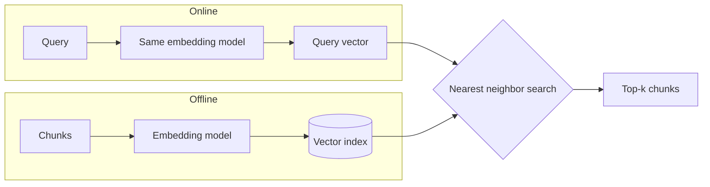
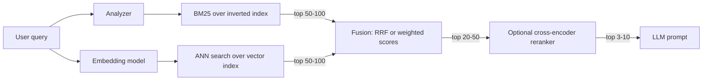
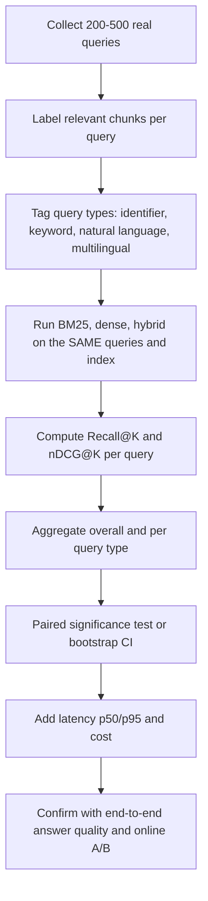

# Retrieval Methods: BM25, Dense Retrieval and Hybrid Search

> **Level:** Beginner to Advanced · **Study time:** ~130 min · **Prerequisites:** [What Is RAG and Why It Matters](01-what-is-rag-and-why-it-matters.md), [Text Embeddings and Similarity Search](02-text-embeddings-and-similarity-search.md), [Chunking Strategies](04-chunking-strategies.md)

## Table of contents

- [Why this matters](#why-this-matters)
- [The big picture: lexical vs semantic retrieval](#the-big-picture-lexical-vs-semantic-retrieval)
- [The running example](#the-running-example)
- [The inverted index](#the-inverted-index)
- [TF-IDF: the idea behind keyword scoring](#tf-idf-the-idea-behind-keyword-scoring)
- [BM25 step by step](#bm25-step-by-step)
- [Computing BM25 by hand](#computing-bm25-by-hand)
- [BM25 in code](#bm25-in-code)
- [Where BM25 shines and where it fails](#where-bm25-shines-and-where-it-fails)
- [Dense retrieval](#dense-retrieval)
- [Cosine similarity and dot product (recap)](#cosine-similarity-and-dot-product-recap)
- [Dense retrieval in code](#dense-retrieval-in-code)
- [Domain-specific terminology: the hardest case](#domain-specific-terminology-the-hardest-case)
- [Learned sparse retrieval: SPLADE](#learned-sparse-retrieval-splade)
- [Hybrid search: combining both worlds](#hybrid-search-combining-both-worlds)
- [Tuning hybrid weights](#tuning-hybrid-weights)
- [Does hybrid actually help? Measuring it properly](#does-hybrid-actually-help-measuring-it-properly)
- [Hybrid retrieval in production](#hybrid-retrieval-in-production)
- [Common mistakes and misconceptions](#common-mistakes-and-misconceptions)
- [Interview questions and model answers](#interview-questions-and-model-answers)
- [Key takeaways](#key-takeaways)
- [Further reading](#further-reading)
- [Next](#next)

## Why this matters

In a RAG system the LLM can only answer from what the retriever hands it. If retrieval misses the right chunk, no prompt engineering will save the answer, and the model will often hallucinate something fluent instead. Real enterprise queries are a messy mix: "how do I get reimbursed for travel?" (a natural-language question) next to "error E401 on SKU-88213" (an exact identifier). Keyword search (BM25) and semantic search (dense embeddings) fail on opposite kinds of queries, which is why almost every serious production RAG stack (Elasticsearch, OpenSearch, Vespa, Weaviate, Qdrant, pgvector plus Postgres full-text) offers **hybrid search**. Interviewers love this topic because it tests whether you understand the mechanics (formulas, fusion), the trade-offs, and, most importantly, whether you can *prove* a change helped with proper evaluation.

## The big picture: lexical vs semantic retrieval

A **retriever** is the component that takes a query and returns the **top-k** chunks: the $k$ highest-scoring chunks out of the whole corpus, where $k$ is a small number you choose (5, 10, 100). Every retriever in this chapter does the same two things: give each chunk a relevance **score** for the query, then sort by that score. They differ only in *how* the score is computed.

There are two big families:

| | Lexical (keyword) retrieval | Semantic (dense) retrieval |
|---|---|---|
| Main example | BM25 | Embedding models |
| Compares | The exact words (tokens) in query and chunk | The *meaning* of query and chunk, represented as vectors |
| Question it asks | "Does this chunk contain the words I typed, especially the rare ones?" | "Is this chunk about the same thing I asked about?" |
| Data structure | Inverted index | Vector index |
| Also called | Sparse retrieval, keyword search, full-text search | Dense retrieval, vector search, embedding search |

**Hybrid search** runs one retriever from each family and merges their results into one list.

Two words you will see throughout come from search evaluation:

- **Precision:** of the chunks you returned, how many are actually relevant? (Return 10 chunks, 8 are relevant: precision 0.8.)
- **Recall:** of all the relevant chunks that exist, how many did you return? (4 relevant chunks exist, 3 are in your results: recall 0.75.)

> **Analogy:** Fishing with a net. Recall is how many of the fish in the lake ended up in your net; precision is how much of your catch is fish rather than old boots. A RAG retriever's first job is recall, because the LLM cannot use a chunk it never sees. Later stages, such as reranking, improve precision.

The roadmap: we build keyword search from the ground up (inverted index, then TF-IDF, then BM25), then dense retrieval, then the hard case of domain jargon, then hybrid fusion, and finally how to *prove* hybrid helps. Exact metric formulas come in the measuring section.

## The running example

We will reuse one tiny IT-support knowledge base for the whole chapter. Imagine each line is a chunk that has already been lowercased and had stopwords ("how", "to", "your", "the") removed.

```text
D1: "reset password steps"                                  (3 tokens)
D2: "error e401 invalid password"                           (4 tokens)
D3: "password policy password length password expiry"       (6 tokens)
D4: "change login credentials"                              (3 tokens)
```

Two queries will follow us around:

- **Q-keyword:** `password e401` (a user pasting an error code)
- **Q-semantic:** `I forgot my login` (a user describing a problem in their own words)

Notice that D4 ("change login credentials") is clearly relevant to password problems, yet it never uses the word "password". Keep an eye on D4; it is the star of the "keyword search fails" story.

## The inverted index

> **Analogy:** The index at the back of a textbook. You do not read all 600 pages to find "photosynthesis"; you look it up and the index says "pages 45, 112, 310". An inverted index does exactly that for every word in your corpus.

A **corpus** is the full collection of documents (here, chunks) you search over. A **term** is a normalized token, the unit we index (for example "password"). A **forward index** maps each document to its terms (what you get by reading documents). An **inverted index** flips this: it maps each term to the list of documents containing it. That list is called a **postings list**, and each entry (a **posting**) usually stores the document ID plus the **term frequency** (how many times the term appears in that document), and sometimes positions for phrase queries.

For our corpus:

```text
term          postings list (doc_id: term frequency)
-----------   --------------------------------------
reset         D1:1
password      D1:1, D2:1, D3:3
steps         D1:1
error         D2:1
e401          D2:1
invalid       D2:1
policy        D3:1
length        D3:1
expiry        D3:1
change        D4:1
login         D4:1
credentials   D4:1
```

To answer `password e401`, the engine only reads two postings lists (`password` and `e401`) and touches only documents D1, D2 and D3. It never looks at D4. With millions of documents, this is the difference between scanning everything and touching a tiny fraction, which is why keyword search is so fast and cheap.

Before indexing, text passes through an **analyzer**: a pipeline that tokenizes, lowercases, optionally removes stopwords, and optionally applies **stemming** (chopping words to a root, "running" to "run") or **lemmatization** (mapping to the dictionary form, "better" to "good"). The query goes through the same analyzer. This detail matters enormously for identifiers: a standard analyzer may split `E-401` into `e` and `401`, or `SKU-88213` into `sku` and `88213`, which changes what matches. More on that later.

> **Interview tip:** If asked "why is BM25 fast?", the answer is the inverted index: query cost scales with the length of the postings lists for the query terms, not with corpus size. Engines also use dynamic pruning algorithms such as WAND ("Weak AND") and block-max WAND: they keep an upper bound on how much each query term can possibly contribute, and skip any document whose best possible score cannot beat the current $k$-th best result.

## TF-IDF: the idea behind keyword scoring

Finding documents that contain a term is easy. Ranking them is the hard part. Two intuitions:

1. **Term frequency (TF):** a document that mentions "password" more often is probably more about passwords.
2. **Inverse document frequency (IDF):** a term that appears in almost every document ("password" in an IT knowledge base) tells you little; a rare term ("e401") is a strong signal.

> **Analogy:** If you are looking for a friend in a crowd, "wears glasses" is weak evidence (half the crowd does), but "wears a bright orange hat" is strong evidence. Rare features discriminate; common ones do not.

The classic formula for a term $t$ in document $d$:

$$\text{tf-idf}(t, d) = \text{tf}(t, d) \times \log\frac{N}{\text{df}(t)}$$

- $\text{tf}(t, d)$: how many times term $t$ occurs in document $d$.
- $N$: number of documents in the corpus.
- $\text{df}(t)$: **document frequency**, the number of documents that contain $t$ at least once.
- $\log$: natural log here (the base only rescales scores, it does not change rankings).

A simple query score adds up tf-idf over the query terms.

**Worked example** for `password e401` ($N = 4$):

- $\text{df}(\text{password}) = 3$, so $\text{idf} = \ln(4/3) = 0.2877$
- $\text{df}(\text{e401}) = 1$, so $\text{idf} = \ln(4/1) = 1.3863$

| Doc | password tf | e401 tf | Score |
|---|---|---|---|
| D1 | 1 | 0 | $1 \times 0.2877 = 0.2877$ |
| D2 | 1 | 1 | $0.2877 + 1.3863 = 1.6740$ |
| D3 | 3 | 0 | $3 \times 0.2877 = 0.8630$ |
| D4 | 0 | 0 | $0$ |

Two problems show up immediately:

1. **TF grows linearly.** D3 gets 3 times the credit for saying "password" 3 times. In reality, the 3rd mention adds much less evidence than the 1st. A document that repeats a word 50 times (keyword stuffing) would dominate.
2. **No length awareness.** A 5,000-word document will naturally contain more occurrences of most words than a 50-word document, so long documents get an unfair advantage.

BM25 fixes both.

> **Common mistake:** Assuming every library computes TF-IDF the same way. scikit-learn's `TfidfVectorizer` by default uses a smoothed IDF, $\ln\frac{1+N}{1+\text{df}} + 1$, and L2-normalizes each document vector, so its numbers will not match the textbook formula above. Rankings are similar in spirit, numbers differ.

## BM25 step by step

**BM25** ("Best Matching 25", from the Okapi system developed by Stephen Robertson, Steve Walker and colleagues at City University London in the 1990s, building on the probabilistic model of Robertson and Karen Sparck Jones) is a ranking function grounded in the probabilistic relevance framework. It is still the default ranking in Lucene, and therefore in Elasticsearch, OpenSearch and Solr. The formula:

$$\text{BM25}(q, d) = \sum_{t \in q} \text{IDF}(t) \cdot \frac{f(t, d)\,(k_1 + 1)}{f(t, d) + k_1 \left(1 - b + b \cdot \frac{|d|}{\text{avgdl}}\right)}$$

with the IDF used by Lucene:

$$\text{IDF}(t) = \ln\left(1 + \frac{N - \text{df}(t) + 0.5}{\text{df}(t) + 0.5}\right)$$

(Lucene 8 and later also drops the constant $(k_1 + 1)$ factor from the numerator, which rescales every score by the same amount and does not change rankings, and Lucene has long stored document lengths in a lossy one-byte encoding. So Elasticsearch or OpenSearch scores will not match hand-computed numbers exactly.)

Every symbol:

- $q$: the query, a bag of terms $t$ (a term repeated in the query is simply summed once per occurrence in most implementations, including the code below).
- $d$: the document being scored.
- $f(t, d)$: term frequency of $t$ in $d$.
- $|d|$: length of $d$ in tokens.
- $\text{avgdl}$: average document length across the corpus.
- $N$, $\text{df}(t)$: as before (corpus size, document frequency).
- $k_1$: **term frequency saturation** parameter, typically 1.2 to 2.0 (Lucene default 1.2).
- $b$: **length normalization** parameter between 0 and 1 (default 0.75).

Let us unpack the three ingredients.

### Ingredient 1: IDF (rare terms matter more)

Same intuition as TF-IDF. The $+0.5$ terms are smoothing that comes from the probabilistic derivation. The classic Robertson-Sparck Jones form is $\ln\frac{N - \text{df} + 0.5}{\text{df} + 0.5}$, which becomes *negative* when a term appears in more than half the documents. Lucene adds the "1 +" inside the log so IDF is always positive. Keep this in mind: different libraries use different IDF variants.

### Ingredient 2: term frequency saturation ($k_1$)

Look at the TF part alone for a document of average length (so the length factor equals 1):

$$\text{TF part} = \frac{f\,(k_1+1)}{f + k_1}$$

With $k_1 = 1.2$, this is $\frac{2.2 f}{f + 1.2}$:

| $f$ (occurrences) | TF part | Gain from previous row |
|---|---|---|
| 0 | 0 | |
| 1 | 2.2 / 2.2 = 1.000 | +1.000 |
| 2 | 4.4 / 3.2 = 1.375 | +0.375 |
| 3 | 6.6 / 4.2 = 1.571 | +0.196 |
| 5 | 11 / 6.2 = 1.774 | |
| 10 | 22 / 11.2 = 1.964 | |
| 100 | 220 / 101.2 = 2.174 | |

It can never exceed $k_1 + 1 = 2.2$. That is **saturation**: the first mention matters most, later mentions add diminishing returns, and keyword stuffing stops paying off.

```text
TF part
 2.2 |                                   ............ (ceiling = k1 + 1)
     |                   .  .  .  .  .
 1.5 |          .  .
     |      .
 1.0 |    .
     |  .
 0.0 +--+----+----+----+----+----+----+---> f (term frequency)
        1    2    3    5    10   ...  100
```

- $k_1 = 0$: TF part becomes exactly 1 whenever the term appears. Pure binary "present or not", the score is just the sum of IDFs.
- Large $k_1$: saturation kicks in slowly, behaving closer to raw TF.

### Ingredient 3: length normalization ($b$)

The expression $1 - b + b\frac{|d|}{\text{avgdl}}$ scales $k_1$ up for long documents and down for short ones. A bigger denominator means a smaller score, so long documents are penalized for "accidentally" containing a term.

- $b = 0$: no length normalization at all.
- $b = 1$: full normalization, each occurrence in a document twice the average length counts like half an occurrence (the TF part behaves as if $f$ were $f \cdot \text{avgdl}/|d|$).
- $b = 0.75$: the common default, a compromise.

> **Analogy:** Finding the word "refund" once in a 2-line FAQ answer is strong evidence that answer is about refunds. Finding it once in a 40-page policy PDF is weak evidence. Length normalization encodes that.

> **Senior insight:** Chunking changes BM25 behavior. If all chunks are roughly the same length (common in RAG), $b$ matters less, because $|d|/\text{avgdl}$ is close to 1 everywhere. With very uneven chunks (tiny title chunks next to giant table chunks), $b$ becomes important. See [Chunking Strategies](04-chunking-strategies.md).

## Computing BM25 by hand

Query `password e401`, with $k_1 = 1.2$, $b = 0.75$.

**Step 1: corpus statistics.**

- $N = 4$
- Lengths: $|D1| = 3$, $|D2| = 4$, $|D3| = 6$, $|D4| = 3$
- $\text{avgdl} = (3 + 4 + 6 + 3) / 4 = 16 / 4 = 4$
- $\text{df}(\text{password}) = 3$, $\text{df}(\text{e401}) = 1$

**Step 2: IDF.**

$$\text{IDF}(\text{password}) = \ln\left(1 + \frac{4 - 3 + 0.5}{3 + 0.5}\right) = \ln\left(1 + \frac{1.5}{3.5}\right) = \ln(1.428571) = 0.356675$$

$$\text{IDF}(\text{e401}) = \ln\left(1 + \frac{4 - 1 + 0.5}{1 + 0.5}\right) = \ln\left(1 + \frac{3.5}{1.5}\right) = \ln(3.333333) = 1.203973$$

"e401" is worth about 3.4 times as much as "password". That ratio is the whole reason BM25 is good at identifiers.

**Step 3: length factor $K(d) = k_1 \left(1 - b + b \cdot |d| / \text{avgdl}\right)$.**

| Doc | $\lvert d \rvert / \text{avgdl}$ | $1 - 0.75 + 0.75 \times \text{ratio}$ | $K(d) = 1.2 \times \text{that}$ |
|---|---|---|---|
| D1 | 3/4 = 0.75 | 0.25 + 0.5625 = 0.8125 | 0.975 |
| D2 | 4/4 = 1.00 | 0.25 + 0.75 = 1.0 | 1.200 |
| D3 | 6/4 = 1.50 | 0.25 + 1.125 = 1.375 | 1.650 |
| D4 | 3/4 = 0.75 | 0.8125 | 0.975 |

**Step 4: TF part $\frac{f \cdot 2.2}{f + K(d)}$.**

- D1, password ($f=1$): $2.2 / (1 + 0.975) = 2.2 / 1.975 = 1.113924$
- D2, password ($f=1$): $2.2 / (1 + 1.2) = 2.2 / 2.2 = 1.000000$
- D2, e401 ($f=1$): also $1.000000$
- D3, password ($f=3$): $6.6 / (3 + 1.65) = 6.6 / 4.65 = 1.419355$
- Everything else: $f = 0$, so 0.

**Step 5: multiply by IDF and sum over query terms.**

| Doc | password contribution | e401 contribution | BM25 score | Rank |
|---|---|---|---|---|
| D1 | 0.356675 x 1.113924 = 0.397309 | 0 | **0.3973** | 3 |
| D2 | 0.356675 x 1.000000 = 0.356675 | 1.203973 x 1.0 = 1.203973 | **1.5606** | 1 |
| D3 | 0.356675 x 1.419355 = 0.506248 | 0 | **0.5062** | 2 |
| D4 | 0 | 0 | **0.0000** | 4 |

What to notice:

- **D2 wins by a mile** because it is the only document with the rare term "e401". Exactly what a user pasting an error code wants.
- **Saturation in action:** D3 says "password" 3 times but only gets 1.42 times the TF credit of a single mention, and its long length (6 tokens) trims it further. Under plain TF-IDF it got a full 3x.
- **Length normalization in action:** D1 and D3 both lack "e401". D1 mentions "password" once in a short doc and gets a TF part of 1.11, higher than D2's 1.00 for the same single mention, because D1 is shorter than average.
- **D4 scores zero.** "change login credentials" is relevant to password trouble, but shares no tokens with the query. This is the **vocabulary mismatch problem**, and no amount of BM25 tuning fixes it.

Now try Q-semantic, `I forgot my login`: after stopword removal it becomes roughly `forgot login`. Only D4 contains "login"; "forgot" appears nowhere. D1 ("reset password steps"), which is exactly the answer, scores zero. Keyword search cannot know that "forgot my login" means "reset password".

## BM25 in code

### From scratch (reproduces the hand calculation)

```python
import math
from collections import Counter

corpus = {
    "D1": "reset password steps",
    "D2": "error e401 invalid password",
    "D3": "password policy password length password expiry",
    "D4": "change login credentials",
}

def tokenize(text: str) -> list[str]:
    # Real systems use an analyzer (lowercase, stopwords, stemming, custom rules for IDs).
    return text.lower().split()

docs = {doc_id: tokenize(text) for doc_id, text in corpus.items()}
N = len(docs)
avgdl = sum(len(toks) for toks in docs.values()) / N

# Inverted index: term -> {doc_id: term frequency}
index: dict[str, dict[str, int]] = {}
for doc_id, toks in docs.items():
    for term, tf in Counter(toks).items():
        index.setdefault(term, {})[doc_id] = tf

def idf(term: str) -> float:
    df = len(index.get(term, {}))
    return math.log(1 + (N - df + 0.5) / (df + 0.5))  # Lucene-style, always positive

def bm25_search(query: str, k1: float = 1.2, b: float = 0.75) -> list[tuple[str, float]]:
    scores = {doc_id: 0.0 for doc_id in docs}
    for term in tokenize(query):
        postings = index.get(term)
        if not postings:          # term not in corpus: contributes nothing
            continue
        w = idf(term)
        for doc_id, f in postings.items():   # only docs that contain the term
            dl = len(docs[doc_id])
            denom = f + k1 * (1 - b + b * dl / avgdl)
            scores[doc_id] += w * f * (k1 + 1) / denom
    return sorted(scores.items(), key=lambda kv: kv[1], reverse=True)

for doc_id, score in bm25_search("password e401"):
    print(doc_id, round(score, 4))
# D2 1.5606
# D3 0.5062
# D1 0.3973
# D4 0.0
```

### With `rank_bm25`

```bash
pip install rank_bm25
```

```python
from rank_bm25 import BM25Okapi

texts = list(corpus.values())
tokenized_corpus = [tokenize(t) for t in texts]

bm25 = BM25Okapi(tokenized_corpus, k1=1.2, b=0.75)   # library default k1 is 1.5
query = tokenize("password e401")

scores = bm25.get_scores(query)                 # one score per document, in corpus order
top2 = bm25.get_top_n(query, texts, n=2)        # the 2 best documents' texts
print(scores)
print(top2)
```

The ranking matches ours (D2, D3, D1, D4), but the numbers differ. `BM25Okapi` uses the classic IDF $\ln\frac{N - \text{df} + 0.5}{\text{df} + 0.5}$, which is negative for "password" (it appears in 3 of 4 docs), and the library replaces negative IDFs with a small floor ($\epsilon$ times the average IDF, $\epsilon = 0.25$ by default). On tiny corpora that floor is very visible; on real corpora it rarely matters. The package also ships `BM25L` and `BM25Plus` variants.

> **Senior insight:** `rank_bm25` is great for prototypes and evaluation notebooks, but it scores every document in pure Python/NumPy and keeps everything in memory. In production you use a search engine (Elasticsearch, OpenSearch, Vespa, Tantivy-based engines, Postgres full-text with a BM25 extension, or the BM25 support built into some vector databases) which uses a real inverted index, analyzers, and top-k pruning.

## Where BM25 shines and where it fails

**Why BM25 is strong for exact keywords and identifiers:**

1. **Exact token matching.** If the query contains `e401`, `SKU-88213`, `ORA-00942`, `CVE-2021-44228`, `getUserById` or "Kubernetes", BM25 matches that exact token. There is no fuzzy approximation.
2. **IDF rewards rarity.** Identifiers, names and error codes are by nature rare, so they get huge IDF weights and dominate the score, exactly as "e401" did above.
3. **No learned model to be confused.** The term does not need to have appeared in any training data. A product code invented yesterday works the moment it is indexed.
4. **Transparent and debuggable.** You can explain any score term by term ("this doc ranked first because it contains 'e401', IDF 1.20").
5. **Cheap and fast.** No GPU, no embedding calls, small index, well-understood scaling.
6. **Robust out of domain.** The BEIR benchmark (Thakur et al., 2021) found BM25 to be a strong zero-shot baseline across very different domains, and several dense retrievers of that era underperformed it on domains they were not trained on.

**Where BM25 fails:**

| Failure | Example | Why |
|---|---|---|
| Synonyms | "laptop" vs "notebook" | Different tokens, zero overlap |
| Paraphrases | "I forgot my login" vs "reset password steps" | Same meaning, no shared words |
| Abbreviations | "PTO" vs "paid time off" | Different tokens unless you add synonyms |
| Morphology | "ran" vs "running" | Needs stemming or lemmatization, which is imperfect |
| Cross-lingual | Spanish query, English docs | No shared vocabulary |
| Word order and meaning | "dog bites man" vs "man bites dog" | Bag-of-words ignores order |
| Typos | "pasword" | Exact match fails (fuzzy matching helps a bit) |

This is the pattern to remember: **BM25 is high precision on what the user literally typed, and blind to meaning.**

## Dense retrieval

> **Analogy:** BM25 is a librarian who only checks if your exact words appear on the page. Dense retrieval is a librarian who understands what you mean, but who sometimes gets fuzzy about exact codes and numbers.

**Dense retrieval** represents each query and each document as a **dense vector** (an embedding: a list of a few hundred to a few thousand real numbers, almost all non-zero) produced by a neural network, and retrieves the documents whose vectors are closest to the query vector. "Dense" contrasts with **sparse** representations like BM25, where a document is a vector over the whole vocabulary (tens of thousands to millions of dimensions, depending on the corpus) with almost all entries zero.

Here is the difference for D1 ("reset password steps"). The sparse values are D1's actual per-term BM25 weights from the hand calculation above (IDF times TF part, for example $0.357 \times 1.114 = 0.397$ for "password"); the dense values are illustrative.

```text
Vocabulary positions:  reset  password  steps  error  e401  ...  login  credentials  ...   (~30,000+ terms)

Sparse vector (BM25):  [1.34,  0.40,    1.34,  0,     0,    ...,  0,     0,           ...]
                       one position per word, almost every entry is 0, you can read it

Dense vector:          [0.12, -0.53, 0.08, 0.91, -0.27, ..., 0.33]
                       384 to 4,096 numbers, almost all non-zero, no single position means a word
```

The standard architecture is the **bi-encoder**: one encoder (or two separate query and passage encoders, as in DPR; often a fine-tuned BERT-style transformer, see [Encoder-Only, Encoder-Decoder and Decoder-Only Models](../04-transformers/07-encoder-only-encoder-decoder-and-decoder-only-models.md)) embeds documents offline and queries online, independently. Similarity is computed with cosine or dot product (both defined, with a worked example, in the recap section below). Training uses **contrastive learning**: pull (query, relevant passage) pairs together and push irrelevant passages apart. A landmark paper is "Dense Passage Retrieval for Open-Domain Question Answering" (DPR, Karpukhin et al., 2020). How embeddings are produced and trained is covered in [Text Embeddings and Similarity Search](02-text-embeddings-and-similarity-search.md).



Finding the nearest vectors among millions quickly requires **approximate nearest neighbor (ANN)** indexes such as HNSW, which trade a tiny amount of recall for a huge speedup; that is the next chapter, [Vector Search Algorithms](06-vector-search-ann-hnsw-ivf-and-product-quantization.md).

### Bi-encoders vs cross-encoders (and late interaction)

Three neural architectures appear in retrieval discussions, and interviewers expect you to place them correctly:

| Architecture | How query and document meet | Can documents be precomputed? | Speed at query time | Quality | Typical role |
|---|---|---|---|---|---|
| **Bi-encoder** (dense retrieval) | Encoded separately into one vector each, compared by a single cosine or dot product | Yes | Very fast (one query embedding plus ANN search) | Good | First-stage retrieval over the whole corpus |
| **Late interaction** (ColBERT) | One vector per token on each side, compared token by token (MaxSim, explained in the SPLADE section) | Yes, but many vectors per document | Fast, more storage | Better | First stage or reranking |
| **Cross-encoder** | Query and document are fed *together* into one transformer, which outputs a relevance score | No, needs one model pass per (query, document) pair | Slow | Best | Reranking the top 20 to 100 candidates |

> **Analogy:** A bi-encoder is like comparing two people by their written summaries, which you can prepare in advance for everyone. A cross-encoder is like interviewing each candidate in person about this specific job: far more accurate, but you can only afford it for a shortlist.

**Strengths of dense retrieval:**

1. **Semantic matching.** "I forgot my login" lands near "reset password steps" and "change login credentials" because the model learned they mean similar things.
2. **Paraphrases and synonyms** for free, without maintaining synonym lists.
3. **Natural-language questions.** Long, conversational queries with few distinctive keywords work well.
4. **Cross-lingual retrieval.** Multilingual embedding models map "¿cómo restablezco mi contraseña?" near "how do I reset my password", so one index serves many languages.
5. **Somewhat tolerant of word variants and minor typos**, since subword tokenization (see [Tokenization](../04-transformers/01-tokenization.md)) often still produces similar vectors. Do not overstate this: research on BERT-based dense retrievers (for example Zhuang and Zuccon, 2021) shows retrieval quality still drops noticeably on misspelled queries unless the model is trained with typo augmentation.
6. **Multimodal extension.** The same idea works for images and text in a shared space (CLIP, see [Vision Transformers, CLIP and Multimodal Models](../03-computer-vision/05-vision-transformers-clip-and-multimodal-models.md)).

**Weaknesses of dense retrieval:**

| Weakness | Example | Why it happens |
|---|---|---|
| Exact identifiers | `SKU-88213` retrieves `SKU-88231` | Both tokenize into similar subword pieces, and the vector captures "a SKU-like thing", not the exact digits |
| Numbers and versions | "Python 3.8 support" vs "Python 3.12 support" | Embeddings are weak at precise numeric distinctions |
| Rare domain terms | Internal project codename "Falcon-X" | The model never saw it; its embedding is near-random or near the bird |
| Out-of-domain text | Legal, medical, chip design docs with a general web model | Training distribution mismatch |
| Negation | "flights that are not refundable" near "refundable flights" | Sentences share almost all content; "not" barely moves the vector |
| Compression of long chunks | One vector for 800 tokens of mixed topics | Details get averaged away |
| Opacity | Why did this rank first? | Hard to explain a 768-dimensional similarity |
| Cost of change | New embedding model | Re-embed the whole corpus |

## Cosine similarity and dot product (recap)

Full treatment is in [Text Embeddings and Similarity Search](02-text-embeddings-and-similarity-search.md) and [Linear Algebra for ML](../00-foundations/02-linear-algebra-for-ml.md). The essentials:

The **dot product** multiplies matching coordinates and sums them:

$$\mathbf{a} \cdot \mathbf{b} = \sum_{i=1}^{n} a_i b_i$$

**Cosine similarity** is the dot product divided by both lengths, so it measures only the angle between vectors:

$$\cos(\mathbf{a}, \mathbf{b}) = \frac{\mathbf{a} \cdot \mathbf{b}}{\lVert \mathbf{a} \rVert \, \lVert \mathbf{b} \rVert}$$

- $a_i, b_i$: the $i$-th coordinates.
- $n$: the dimension.
- $\lVert \mathbf{a} \rVert = \sqrt{\sum_i a_i^2}$: the length (L2 norm).
- Cosine ranges from -1 (opposite) through 0 (orthogonal) to 1 (same direction).

**Tiny example:** $\mathbf{a} = [1, 2, 2]$, $\mathbf{b} = [2, 1, 2]$.

- Dot: $1 \cdot 2 + 2 \cdot 1 + 2 \cdot 2 = 2 + 2 + 4 = 8$
- $\lVert \mathbf{a} \rVert = \sqrt{1 + 4 + 4} = 3$, $\lVert \mathbf{b} \rVert = \sqrt{4 + 1 + 4} = 3$
- Cosine: $8 / (3 \times 3) = 8/9 = 0.889$

Key facts for interviews:

- If vectors are **L2-normalized** (length 1), dot product equals cosine, so you can use the faster dot product.
- Unnormalized dot product also rewards vector **magnitude**. Some models are trained for that (they encode something like "importance" in the length); use **whatever similarity the model was trained with**.
- For normalized vectors, ranking by cosine, by dot product, or by smallest Euclidean distance gives the same order, because $\lVert \mathbf{a} - \mathbf{b} \rVert^2 = 2 - 2\cos(\mathbf{a}, \mathbf{b})$.

**When dot product and cosine disagree.** Take a query $\mathbf{q} = [1, 0]$ and two documents $\mathbf{a} = [1, 0]$ and $\mathbf{b} = [3, 1]$.

| Doc | Dot product with $\mathbf{q}$ | Length | Cosine with $\mathbf{q}$ | Winner |
|---|---|---|---|---|
| $\mathbf{a} = [1, 0]$ | $1$ | $1$ | $1/1 = 1.000$ | Cosine picks $\mathbf{a}$ (same direction) |
| $\mathbf{b} = [3, 1]$ | $3$ | $\sqrt{10} = 3.162$ | $3/3.162 = 0.949$ | Dot product picks $\mathbf{b}$ (longer vector) |

Same vectors, opposite rankings. That is why "which similarity was this model trained with?" is a real question and not a detail.

### Putting it together: a toy dense retrieval

Real embeddings have hundreds of dimensions that no human can read. To build intuition, pretend a model produced 3-dimensional embeddings whose dimensions mean [account access, errors and troubleshooting, rules and policy] (**made-up numbers**):

| Text | Toy embedding | Dot with query | Length | Cosine with query |
|---|---|---|---|---|
| Query: "I forgot my login" | $[3, 1, 0]$ | | $\sqrt{10} = 3.162$ | |
| D1 "reset password steps" | $[3, 0, 1]$ | $9$ | $\sqrt{10} = 3.162$ | $9/10 = 0.900$ |
| D2 "error e401 invalid password" | $[1, 3, 0]$ | $6$ | $\sqrt{10} = 3.162$ | $6/10 = 0.600$ |
| D3 "password policy ... expiry" | $[1, 0, 3]$ | $3$ | $\sqrt{10} = 3.162$ | $3/10 = 0.300$ |
| D4 "change login credentials" | $[3, 1, 1]$ | $10$ | $\sqrt{11} = 3.317$ | $10/\sqrt{110} = 0.953$ |

(For D1 to D3 both lengths are $\sqrt{10}$, so cosine is the dot product divided by $\sqrt{10} \times \sqrt{10} = 10$.)

Dense ranking: D4, D1, D2, D3. Compare with BM25, which gave D1, the ideal answer, a score of **0** for this query. The embedding put "forgot my login" and "reset password steps" close together because both are about *account access*, even though they share no words.

Now notice what the toy space *cannot* express: there is no dimension for "e401" specifically. An embedding is a fixed-size summary of meaning, and summaries drop exact details. A real model has more dimensions, but the same pressure applies to thousands of distinct error codes, SKUs and version numbers. That single picture explains both the main strength and the main weakness of dense retrieval.

## Dense retrieval in code

```bash
pip install sentence-transformers numpy
```

```python
import numpy as np
from sentence_transformers import SentenceTransformer

# A small general-purpose English model; model choice is version- and domain-dependent.
model = SentenceTransformer("sentence-transformers/all-MiniLM-L6-v2")

doc_ids = list(corpus.keys())
doc_texts = list(corpus.values())

# normalize_embeddings=True -> unit-length vectors, so dot product == cosine similarity
doc_emb = model.encode(doc_texts, normalize_embeddings=True)       # shape (4, 384)

def dense_search(query: str, top_k: int = 4) -> list[tuple[str, float]]:
    q_emb = model.encode([query], normalize_embeddings=True)[0]    # shape (384,)
    sims = doc_emb @ q_emb                                         # cosine similarities
    order = np.argsort(-sims)[:top_k]
    return [(doc_ids[i], float(sims[i])) for i in order]

print(dense_search("I forgot my login"))
print(dense_search("password e401"))
```

What you should expect qualitatively (exact numbers depend on the model version): for "I forgot my login", D4 and D1 should rank near the top even though D1 shares no words with the query. For "password e401", the dense model will happily rank password-related documents, but it has no special reason to treat "e401" as a decisive, rare signal the way BM25 does. On a real corpus with dozens of similar error codes, that is where it starts returning the wrong code.

> **Common mistake:** Ignoring the model's required prefixes. Some embedding families expect `"query: "` and `"passage: "` prefixes (the E5 family) or a task instruction on the query side (several BGE and instruction-tuned models). Leaving them out silently degrades retrieval. Read the model card.

## Domain-specific terminology: the hardest case

Most real failures happen on jargon: medical codes (ICD-10 `E11.9`), legal citations, part numbers, internal product names, acronyms that mean different things in different companies ("ARR", "SLA", "PO").

**What goes wrong:**

1. **Dense models never saw the term.** A general web-trained model has no good representation for your internal codename "Falcon-X" or for `E11.9`. Subword tokenization breaks it into fragments, and the vector ends up near generic or wrong concepts.
2. **Ambiguity.** "PO" means purchase order in procurement and "per os" (by mouth) in medicine. A general model picks the more common web meaning.
3. **Near-duplicates look identical to the model.** `ERR-1042` and `ERR-1024` embed almost the same, but are completely different errors.
4. **BM25 has its own issues.** Analyzers may split or mangle identifiers (`E11.9` into `e11` and `9`), stemming can conflate terms, and users write the same thing several ways (`E401`, `E-401`, `error 401`).
5. **Vocabulary mismatch between users and docs.** Users type "VPN keeps dropping"; the docs say "IPsec tunnel renegotiation failure".

**Fixes, roughly from cheapest to most expensive:**

| Fix | What it does | Pros | Cons |
|---|---|---|---|
| Custom analyzers | Keep identifiers whole (`sku-88213` as one token), normalize variants (`E-401` to `e401`) | Cheap, big wins for codes | Needs regex and domain knowledge |
| Synonym dictionaries | Map "PTO" to "paid time off", "laptop" to "notebook" at index or query time | Precise, controllable, instant | Manual upkeep, can over-expand |
| Query expansion | Add related terms to the query (pseudo-relevance feedback such as RM3, which assumes the top few results of a first search are relevant and adds their most characteristic terms to the query; or LLM-generated expansions) | Fixes vocabulary mismatch without retraining | Extra latency, risk of topic drift |
| Document expansion | Append predicted queries to each doc before indexing ("Document Expansion by Query Prediction", doc2query, Nogueira et al., 2019) | Offline cost only | Bigger index, generation cost |
| Hybrid search | Run BM25 and dense together and fuse | Covers both failure modes, the standard default | Two indexes, fusion tuning |
| Fine-tuned embeddings | Contrastive fine-tuning on (query, relevant chunk) pairs from your domain, ideally with **hard negatives** (similar but wrong docs, like `ERR-1024` for an `ERR-1042` query) | Teaches the model your jargon | Needs labeled or synthetic pairs, re-embed corpus, ongoing maintenance |
| Domain-specific models | Use a model pretrained on your domain (biomedical, legal, code) | Strong starting point | May not exist for your niche |
| Reranking | Cross-encoder rescoring of top candidates | Large precision gains | Latency per query, see [Reranking and Query Transformation](08-reranking-and-query-transformation.md) |

> **Senior insight:** A cheap, high-impact production trick is **query routing**. If the query matches an identifier regex (error codes, SKUs, ticket IDs), boost BM25 or even do an exact-match filter first. Natural-language queries go mostly to dense. This often beats a single global fusion weight.

## Learned sparse retrieval: SPLADE

What if we could keep the inverted index (fast, exact-match friendly) but let a neural network decide the term weights and add missing synonyms? That is **learned sparse retrieval**.

**SPLADE** ("SPLADE: Sparse Lexical and Expansion Model for First Stage Ranking", Formal, Piwowarski and Clinchant, 2021) runs a BERT-style model over the text and uses its masked-language-model head to produce a weight for every term in the vocabulary (about 30,000 WordPiece tokens). The masked-language-model head is the part of BERT that was pretrained to guess hidden words, so for every position it already outputs a score for every vocabulary term, including plausible words that are *not* in the text; that is where expansion comes from. The per-position predictions are passed through $\log(1 + \text{ReLU}(\cdot))$ (ReLU sets negative values to 0, and the log dampens very large values) and aggregated over positions (sum in the original paper, max pooling in later versions), and a sparsity regularizer pushes most weights to exactly zero. The result:

- A **sparse vector**: maybe tens to a couple of hundred non-zero terms per document.
- **Expansion:** D4 "change login credentials" can get non-zero weight on "password" and "reset", even though those words are not in the text. That directly attacks vocabulary mismatch.
- **Learned weighting:** instead of IDF, the model decides which terms matter.
- **Served from an inverted index**, so you keep exact-term behavior and interpretability (you can read which terms matched).

Trade-offs: it needs a neural model at indexing and at query time (some variants use a lighter query encoder), indexes are larger than BM25, and like dense models it can underperform on very different domains without adaptation. Several engines and vector databases support sparse vectors natively, so SPLADE-style vectors can be one leg of a hybrid. Related idea worth recognizing by name: **ColBERT** (Khattab and Zaharia, 2020), a "late interaction" model that keeps one vector per token and scores by taking, for each query token, its maximum similarity over the document's tokens and summing those maxima (MaxSim), a middle ground between bi-encoders and cross-encoders.

## Hybrid search: combining both worlds

**Hybrid search** runs a lexical retriever (usually BM25) and a semantic retriever (dense) on the same query, then **fuses** their results into one ranking. Because their failure modes are largely complementary, the union usually has higher recall than either alone.

You have already seen this in the running example. For `password e401`, BM25 put D2, the only chunk with the error code, first, while a dense model has no special reason to treat "e401" as decisive. For `I forgot my login`, BM25 gave the ideal answer D1 a score of 0, while the toy dense retrieval ranked it second with cosine 0.90. Each retriever rescues the other's misses.



The core problem is that the two scores live on different scales. Our BM25 scores went up to 1.56; on a big corpus they may be 5 to 30, unbounded, and depend on the query length. Cosine similarities sit in a narrow band like 0.6 to 0.9 for one model and 0.2 to 0.5 for another. You cannot just add them. There are two families of solutions.

For both, we use this example. Query: "how do I fix error E401 when logging in". The knowledge base now also contains D5 ("E401 appears in VPN logs") and D6 ("troubleshooting sign-in problems"). Each retriever returns its top 4 (scores are **illustrative**):

| Rank | BM25 list | BM25 score | Dense list | Cosine |
|---|---|---|---|---|
| 1 | D2 | 12.4 | D4 | 0.82 |
| 2 | D5 | 9.1 | D2 | 0.80 |
| 3 | D1 | 5.0 | D6 | 0.71 |
| 4 | D3 | 4.2 | D1 | 0.69 |

### Family 1: score normalization fusion

Put both scores on a common scale, then take a weighted sum.

**Min-max normalization** maps each list to $[0, 1]$:

$$s' = \frac{s - s_{\min}}{s_{\max} - s_{\min}}$$

- $s$: the raw score of a document in one list.
- $s_{\min}, s_{\max}$: smallest and largest scores **in that list for this query**.

**Z-score normalization** centers and scales by the spread:

$$z = \frac{s - \mu}{\sigma}$$

- $\mu$: mean of the scores in the list, $\sigma$: their standard deviation.

**Weighted sum** (also called linear or convex combination):

$$\text{score}(d) = \alpha \cdot s'_{\text{dense}}(d) + (1 - \alpha) \cdot s'_{\text{bm25}}(d)$$

- $\alpha \in [0, 1]$: weight on dense. $\alpha = 1$ is pure dense, $\alpha = 0$ is pure BM25.
- A document missing from a list needs a value for that list; a common choice is 0 (the minimum after min-max).

**Worked example with min-max and $\alpha = 0.5$.**

BM25: $s_{\min} = 4.2$, $s_{\max} = 12.4$, range $= 8.2$

- D2: $(12.4 - 4.2)/8.2 = 1.0$
- D5: $(9.1 - 4.2)/8.2 = 4.9/8.2 = 0.5976$
- D1: $(5.0 - 4.2)/8.2 = 0.8/8.2 = 0.0976$
- D3: $(4.2 - 4.2)/8.2 = 0$

Dense: $s_{\min} = 0.69$, $s_{\max} = 0.82$, range $= 0.13$

- D4: $1.0$
- D2: $(0.80 - 0.69)/0.13 = 0.11/0.13 = 0.8462$
- D6: $(0.71 - 0.69)/0.13 = 0.02/0.13 = 0.1538$
- D1: $0$

Fused ($0.5 \times$ BM25' $+ 0.5 \times$ dense'):

| Doc | BM25' | Dense' | Fused | Rank |
|---|---|---|---|---|
| D2 | 1.0 | 0.8462 | 0.5 + 0.4231 = **0.9231** | 1 |
| D4 | 0 (missing) | 1.0 | **0.5000** | 2 |
| D5 | 0.5976 | 0 (missing) | **0.2988** | 3 |
| D6 | 0 (missing) | 0.1538 | **0.0769** | 4 |
| D1 | 0.0976 | 0 | **0.0488** | 5 |
| D3 | 0 | 0 (missing) | **0.0000** | 6 |

Look at D1 ("reset password steps"), which both retrievers found (rank 3 and rank 4). It drops to 5th. Why? Min-max forces the last document in each list to exactly 0, no matter how good its raw score was. A cosine of 0.69 is not bad at all, but it became 0 because the range was tiny (0.13). That is the core fragility of min-max: **it amplifies tiny differences when the score range is narrow and depends heavily on the outliers at the ends of the list.**

Z-score normalization does not pin the endpoints to exactly 0 and 1, so it is less sensitive than min-max to a single extreme value, but it assumes roughly bell-shaped score distributions and still needs a policy for missing documents. For reference, the z-scores here (using the population standard deviation, dividing by 4) are: BM25 ($\mu = 7.675$, $\sigma = 3.301$) D2 1.431, D5 0.432, D1 -0.810, D3 -1.053; dense ($\mu = 0.755$, $\sigma = 0.0559$) D4 1.163, D2 0.805, D6 -0.805, D1 -1.163. With only 4 scores per list these statistics are noisy; real systems normalize over a deeper candidate list (for example 100).

**When score fusion is attractive:** scores carry real information about *how much* better a document is (a BM25 hit on a rare ID with a huge margin), and you have labeled data to tune $\alpha$ and the normalization. Some engines also offer distribution-based variants that normalize using the mean and spread of each score distribution (check your engine's current docs for names and behavior).

### Family 2: Reciprocal Rank Fusion (RRF)

**Reciprocal Rank Fusion** ignores raw scores entirely and uses only each document's **rank position** in each list. It was introduced in "Reciprocal Rank Fusion outperforms Condorcet and individual Rank Learning Methods" (Cormack, Clarke and Buettcher, 2009).

> **Analogy:** Two friends each give you their top-10 restaurant list. You do not know how each friend scores restaurants (one is generous, one is harsh), but you trust their ordering. A place that shows up on both lists, even at 3rd and 4th, is probably a safer bet than one friend's lone favorite.

$$\text{RRF}(d) = \sum_{r \in R} \frac{1}{k + \text{rank}_r(d)}$$

- $R$: the set of ranked lists being fused (here, BM25 and dense).
- $\text{rank}_r(d)$: position of document $d$ in list $r$, starting at 1. If $d$ is not in list $r$, that term contributes 0.
- $k$: a smoothing constant. **$k = 60$ is the convention**, taken from the original paper, where it worked well across experiments.
- A weighted variant uses $\frac{w_r}{k + \text{rank}_r(d)}$ to trust one retriever more.

Why $k$? Without it ($k = 0$), rank 1 gets $1/1 = 1.0$ and rank 2 gets $1/2 = 0.5$, a huge gap: the top result of either list would dominate everything. With $k = 60$, rank 1 gets $1/61$ and rank 2 gets $1/62$, nearly equal, so **agreement between lists** matters more than being first in one list.

**Fully worked example ($k = 60$).** Reciprocals needed:

- $1/61 = 0.016393$
- $1/62 = 0.016129$
- $1/63 = 0.015873$
- $1/64 = 0.015625$

| Doc | BM25 rank | Dense rank | BM25 term | Dense term | RRF score | Final rank |
|---|---|---|---|---|---|---|
| D2 | 1 | 2 | 0.016393 | 0.016129 | **0.032522** | 1 |
| D1 | 3 | 4 | 0.015873 | 0.015625 | **0.031498** | 2 |
| D4 | - | 1 | 0 | 0.016393 | **0.016393** | 3 |
| D5 | 2 | - | 0.016129 | 0 | **0.016129** | 4 |
| D6 | - | 3 | 0 | 0.015873 | **0.015873** | 5 |
| D3 | 4 | - | 0.015625 | 0 | **0.015625** | 6 |

Check D2: $0.016393 + 0.016129 = 0.032522$. Check D1: $0.015873 + 0.015625 = 0.031498$.

Observations:

- Documents found by **both** retrievers (D2, D1) end up with roughly double the score of documents found by only one. D1, which min-max fusion pushed down to 5th, is now 2nd.
- D4, the semantic-only find (dense rank 1), still makes the top 3, so the paraphrase match is not lost.
- No normalization, no score calibration, no training. That is why RRF is one of the most common defaults in hybrid search (some engines default to a normalized score fusion instead, so check yours).

**Effect of $k$.** Redo D4 vs D1 with $k = 1$: D4 gets $1/(1+1) = 0.5$; D1 gets $1/(1+3) + 1/(1+4) = 0.25 + 0.2 = 0.45$. Now D4 beats D1. Small $k$ rewards being at the very top of one list; large $k$ rewards consensus. (D2 still wins: $1/2 + 1/3 = 0.833$.)

### Fusion in code

```python
def rrf(rankings: list[list[str]], k: int = 60,
        weights: list[float] | None = None) -> list[tuple[str, float]]:
    """Reciprocal Rank Fusion. rankings: lists of doc IDs, best first."""
    weights = weights or [1.0] * len(rankings)
    scores: dict[str, float] = {}
    for w, ranking in zip(weights, rankings):
        for rank, doc_id in enumerate(ranking, start=1):   # ranks start at 1
            scores[doc_id] = scores.get(doc_id, 0.0) + w / (k + rank)
    return sorted(scores.items(), key=lambda kv: kv[1], reverse=True)

def min_max(scores: dict[str, float]) -> dict[str, float]:
    lo, hi = min(scores.values()), max(scores.values())
    if hi == lo:                       # avoid division by zero
        return {d: 1.0 for d in scores}
    return {d: (s - lo) / (hi - lo) for d, s in scores.items()}

def weighted_fusion(bm25_scores: dict[str, float], dense_scores: dict[str, float],
                    alpha: float = 0.5) -> list[tuple[str, float]]:
    """alpha = weight on dense; missing documents get 0 for that retriever."""
    b, d = min_max(bm25_scores), min_max(dense_scores)
    fused = {i: (1 - alpha) * b.get(i, 0.0) + alpha * d.get(i, 0.0) for i in set(b) | set(d)}
    return sorted(fused.items(), key=lambda kv: kv[1], reverse=True)

bm25_list = ["D2", "D5", "D1", "D3"]
dense_list = ["D4", "D2", "D6", "D1"]
for doc_id, s in rrf([bm25_list, dense_list]):
    print(doc_id, f"{s:.6f}")
# D2 0.032522
# D1 0.031498
# D4 0.016393
# D5 0.016129
# D6 0.015873
# D3 0.015625

bm25_scores = {"D2": 12.4, "D5": 9.1, "D1": 5.0, "D3": 4.2}
dense_scores = {"D4": 0.82, "D2": 0.80, "D6": 0.71, "D1": 0.69}
for doc_id, s in weighted_fusion(bm25_scores, dense_scores, alpha=0.5):
    print(doc_id, f"{s:.6f}")
# D2 0.923077
# D4 0.500000
# D5 0.298780
# D6 0.076923
# D1 0.048780
# D3 0.000000
```

To build a complete hybrid retriever, call `bm25_search` and `dense_search` from earlier, take each one's top 50 to 100 doc IDs, and pass the two lists to `rrf`.

### Score fusion vs RRF

| | Weighted score fusion (min-max / z-score) | Reciprocal Rank Fusion |
|---|---|---|
| Uses | Raw scores, normalized | Ranks only |
| Tuning | Needs $\alpha$ and a normalization choice, plus labeled data | Works out of the box; $k$ and optional weights |
| Keeps margin information | Yes (a runaway BM25 hit stays dominant) | No (rank 1 by a mile = rank 1 by a hair) |
| Sensitivity | Outliers, narrow ranges, list depth, missing-doc policy | List depth; insensitive to score scales |
| Adding a 3rd retriever (e.g. SPLADE) | Must calibrate another scale | Just add another list |
| Best when | You have labels and want to squeeze out the last points | Default, few labels, heterogeneous retrievers |

> **Interview tip:** A crisp line: "RRF is a robust, calibration-free default because it only trusts ordering; score-based fusion can win when it is tuned on labeled data, because it keeps information about confidence margins that RRF throws away."

## Tuning hybrid weights

Hybrid search has knobs: $\alpha$ (or RRF weights), RRF $k$, the candidate depth per retriever, BM25's $k_1$ and $b$, and the reranker cutoff. How to tune them responsibly:

1. **Build a labeled dev set** of real queries with known relevant chunks (more on this in the next section). Keep a separate held-out test set you do not tune on.
2. **Grid search.** For example $\alpha \in \{0, 0.1, \dots, 1.0\}$ and RRF $k \in \{10, 30, 60, 100\}$, candidate depth in $\{20, 50, 100\}$. Plot Recall@K and nDCG@K against $\alpha$. Expect a curve with a broad plateau; pick a value in the middle of the plateau, not a lucky spike.
3. **Break down by query type.** The best $\alpha$ for identifier queries is often near 0 (BM25-heavy); for conversational queries near 1. If the optimal values differ a lot, a single global $\alpha$ is a compromise and **query-dependent weighting** may win: a regex or small classifier routes identifier-like queries to BM25-heavy weights.
4. **Tune with the reranker in the loop** if you have one. A cross-encoder reranker cares mostly about whether the right document is *anywhere* in the candidate set, so first-stage recall at the reranker's input depth (say Recall@50) is the metric that matters, not nDCG@5 of the fused list.
5. **Re-tune when things change:** new embedding model, new chunking, new document types, a new language, a shift in user query mix (see [Data Drift, Concept Drift and When to Retrain](../01-classical-ml/08-data-drift-concept-drift-and-retraining.md)).

> **Common mistake:** Tuning $\alpha$ on the same queries you report results on. With 100 queries and 11 alpha values, the best value will look better than it really is. That is overfitting to the test set, the same mistake as in [Overfitting, Regularization and Data Leakage](../01-classical-ml/03-overfitting-regularization-and-data-leakage.md).

## Does hybrid actually help? Measuring it properly

"We added hybrid and the demo looked better" is not evidence. Here is how a senior engineer proves it. Metrics are covered in depth in [Evaluating RAG](10-rag-evaluation-metrics-and-ragas.md); we recap the two you need.

### The metrics

**Recall@K:** of all the relevant documents for a query, what fraction appears in the top K?

$$\text{Recall@}K = \frac{|\{\text{relevant docs}\} \cap \{\text{top-}K\text{ retrieved}\}|}{|\{\text{relevant docs}\}|}$$

For RAG, this is the most important first-stage metric: if the right chunk is not in the top K, the LLM never sees it.

Its partner, **Precision@K**, is the fraction of the top K that is relevant: $\text{Precision@}K = |\{\text{relevant}\} \cap \{\text{top-}K\}| / K$. Example: 2 relevant chunks exist, and the top 5 contains 1 of them. Recall@5 $= 1/2 = 0.5$, Precision@5 $= 1/5 = 0.2$.

**nDCG@K** (normalized Discounted Cumulative Gain) rewards putting highly relevant documents near the top, with graded relevance labels (0 = irrelevant, 1 = partially, 2 = highly relevant):

$$\text{DCG@}K = \sum_{i=1}^{K} \frac{2^{\text{rel}_i} - 1}{\log_2(i + 1)}, \qquad \text{nDCG@}K = \frac{\text{DCG@}K}{\text{IDCG@}K}$$

- $i$: rank position (1 = top).
- $\text{rel}_i$: relevance grade of the document at position $i$. The gain $2^{\text{rel}_i} - 1$ is the "exponential gain" convention; some chapters and tools (scikit-learn's `ndcg_score`, for example) use the linear gain $\text{rel}_i$ instead. The two agree for binary 0/1 labels but give different numbers for graded labels, so always state which one you use (see [Evaluating RAG](10-rag-evaluation-metrics-and-ragas.md)).
- $\log_2(i + 1)$: the position discount (rank 1 divides by 1, rank 2 by 1.585, rank 3 by 2, ...).
- $\text{IDCG@}K$: the DCG of the perfect ordering, so nDCG is between 0 and 1.

**Worked example.** Suppose the labels for our E401 query are D2 = 2 (highly relevant), D1 = 1 (partially relevant), everything else 0.

- Ideal order D2, D1: $\text{IDCG} = \frac{2^2 - 1}{\log_2 2} + \frac{2^1 - 1}{\log_2 3} = \frac{3}{1} + \frac{1}{1.585} = 3 + 0.631 = 3.631$
- **RRF** order (D2, D1, D4, D5, D6): DCG@5 $= 3 + 0.631 = 3.631$, so **nDCG@5 = 1.0**, and **Recall@3 = 2/2 = 1.0**.
- **Min-max fusion** order (D2, D4, D5, D6, D1): DCG@5 $= 3 + \frac{1}{\log_2 6} = 3 + \frac{1}{2.585} = 3.387$, so **nDCG@5 = 3.387 / 3.631 = 0.933**, and **Recall@3 = 1/2 = 0.5** (D1 is not in the top 3).

**MRR** (Mean Reciprocal Rank) only cares about the *first* relevant result. For each query, take $1/\text{rank}$ of the first relevant document (0 if none was retrieved), then average over all queries $Q$:

$$\text{MRR} = \frac{1}{|Q|} \sum_{q \in Q} \frac{1}{\text{rank}_q}$$

Example: three queries whose first relevant result sits at rank 1, at rank 3, and nowhere. MRR $= (1 + 1/3 + 0)/3 = 1.333/3 = 0.444$. MRR suits "one right answer" queries (a single FAQ entry). Note its blind spot: in the E401 example both fused orders put D2 first, so both get reciprocal rank 1.0, and MRR cannot see that min-max fusion pushed D1 out of the top 3. That is why you report Recall@K alongside it.

One query proves nothing, of course. That is where the experimental design comes in.

### The experiment



1. **Labeled query set.** Sample real user queries from logs (not just ones you invented), stratified so rare-but-important types are present. Label relevant chunks with domain experts, or bootstrap with LLM-assisted labeling that humans spot-check. The 200-500 size is an illustrative starting point; more is better for detecting small differences. Watch out for **label bias**: if you only labeled what BM25 returned, BM25 will look artificially good. The fix is **pooling**: take the union of the top results from every system you will compare, and label that whole pool.
2. **Three systems, identical conditions:** same chunks, same filters, same K. BM25 alone, dense alone, hybrid (and hybrid plus reranker if relevant).
3. **Metrics:** Recall@K at the depth the next stage consumes (Recall@50 if a reranker follows, Recall@5 if chunks go straight into the prompt), plus nDCG@10 or MRR for ranking quality.
4. **Per-query-type breakdown.** The typical pattern: BM25 wins on identifier queries, dense wins on conversational queries, hybrid is close to the best of both on each slice. A small overall gain can hide a big regression on one slice (for example, hybrid hurting exact-ID queries because dense noise pushed the exact match down).
5. **Statistical significance.** Because both systems are evaluated on the same queries, use a **paired** test on per-query differences: a paired bootstrap confidence interval, the Wilcoxon signed-rank test, or a paired t-test (refresh in [Probability and Statistics](../00-foundations/04-probability-and-statistics.md)). If the 95% confidence interval of the mean difference includes 0, you have not shown an improvement. If you compared many configurations, account for multiple comparisons or confirm on the held-out test set.
6. **Latency and cost.** Hybrid runs two retrievals. If run in parallel, total retrieval latency is roughly that of the slower leg plus a negligible fusion step; if sequential, it is the sum. Measure p50 and p95 (the median latency, and the latency that 95% of queries beat, which captures the slow tail users actually notice), not just averages, and include extra infrastructure cost (a second index, its memory and maintenance).
7. **End-to-end check.** Better retrieval should improve answer correctness and faithfulness (see [Evaluating RAG](10-rag-evaluation-metrics-and-ragas.md)). Finally, confirm with an online A/B test (a random slice of real users gets the new retriever and you compare their outcomes with everyone else's) or shadow traffic (the new retriever runs on copies of real queries but its results are only logged, not shown), on signals like thumbs-up rate, escalation rate or click-through.

> **Why "paired"?** Some queries are hard for every system and some are easy for every system. Comparing the two systems *query by query* cancels that out, the way you would compare two running shoes by having the same runners try both, rather than comparing two different groups of runners.

A tiny example of why significance matters. Five queries, Recall@5 for each system:

| Query | BM25 | Hybrid | Difference (hybrid minus BM25) |
|---|---|---|---|
| q1 | 0.5 | 1.0 | +0.5 |
| q2 | 1.0 | 1.0 | 0 |
| q3 | 0.0 | 1.0 | +1.0 |
| q4 | 0.5 | 0.5 | 0 |
| q5 | 1.0 | 0.5 | -0.5 |

The mean difference is $(0.5 + 0 + 1.0 + 0 - 0.5)/5 = 0.2$, which sounds like "+20 points of recall". But the differences are noisy: their sample standard deviation is $\sqrt{1.30/4} = 0.570$, so the standard error of the mean is $0.570/\sqrt{5} = 0.255$, and a rough 95% interval is $0.2 \pm 1.96 \times 0.255 = 0.2 \pm 0.50$, that is from about $-0.30$ to $+0.70$. It includes 0, so these five queries do not show that hybrid is better. (With only 5 queries, the more correct t-distribution multiplier of 2.78 instead of 1.96 makes the interval even wider; the bootstrap code below estimates the interval by resampling queries instead of assuming a bell curve.) With 300 queries and the same spread, the standard error would shrink to $0.570/\sqrt{300} = 0.033$, and a mean difference of 0.2 would be clearly significant.

A report might look like this (**all numbers illustrative**):

| System | Recall@10 overall | Recall@10 ID queries | Recall@10 NL queries | p95 retrieval latency |
|---|---|---|---|---|
| BM25 | 0.71 | 0.93 | 0.62 | 15 ms |
| Dense | 0.76 | 0.68 | 0.85 | 40 ms |
| Hybrid (RRF) | 0.84 | 0.91 | 0.84 | 45 ms |

Reading it: hybrid gains overall, nearly matches BM25 on IDs and dense on natural language, at a small latency cost because the two retrievers run in parallel. That is the story you want to be able to *show*, with confidence intervals.

### Evaluation code

```python
import numpy as np

def recall_at_k(ranked: list[str], relevant: set[str], k: int) -> float:
    return len(set(ranked[:k]) & relevant) / len(relevant)

def ndcg_at_k(ranked: list[str], grades: dict[str, int], k: int) -> float:
    dcg = sum((2 ** grades.get(d, 0) - 1) / np.log2(i + 2) for i, d in enumerate(ranked[:k]))
    ideal = sorted(grades.values(), reverse=True)[:k]
    idcg = sum((2 ** g - 1) / np.log2(i + 2) for i, g in enumerate(ideal))
    return dcg / idcg if idcg > 0 else 0.0

grades = {"D2": 2, "D1": 1}
rrf_ranked = ["D2", "D1", "D4", "D5", "D6", "D3"]
minmax_ranked = ["D2", "D4", "D5", "D6", "D1", "D3"]
print(round(ndcg_at_k(rrf_ranked, grades, 5), 4))       # 1.0
print(round(ndcg_at_k(minmax_ranked, grades, 5), 4))    # 0.9328
print(recall_at_k(minmax_ranked, set(grades), 3))       # 0.5

def paired_bootstrap(metric_a: list[float], metric_b: list[float],
                     n_boot: int = 10_000, seed: int = 0):
    """Per-query metrics for systems A and B on the SAME queries.
    Returns mean improvement of B over A and a 95% confidence interval."""
    rng = np.random.default_rng(seed)
    diff = np.asarray(metric_b) - np.asarray(metric_a)
    idx = rng.integers(0, len(diff), size=(n_boot, len(diff)))  # resample queries
    boot_means = diff[idx].mean(axis=1)
    lo, hi = np.percentile(boot_means, [2.5, 97.5])
    return diff.mean(), (lo, hi)

# Usage: per_query_recall_bm25 and per_query_recall_hybrid are lists, one value per query.
# mean_gain, (lo, hi) = paired_bootstrap(per_query_recall_bm25, per_query_recall_hybrid)
# If lo > 0, the improvement is unlikely to be noise.
# Alternative: from scipy.stats import wilcoxon; wilcoxon(per_query_recall_hybrid, per_query_recall_bm25)
```

## Hybrid retrieval in production

Things that only show up once real traffic arrives:

- **Two indexes to keep consistent.** Every insert, update and delete must hit both the inverted index and the vector index, or a deleted (or permission-revoked) document can still surface from one leg. Use one ingestion pipeline with idempotent writes (see [Production Ingestion Pipelines](12-production-ingestion-pipelines-at-scale.md)), or an engine that stores both representations in one record.
- **Filters must be applied identically in both legs.** Tenant, permission and date filters belong inside each retriever, before fusion. Filtering after fusion can leak documents or leave you with too few results. See [Secure Multi-Tenant RAG](13-secure-multi-tenant-rag.md).
- **Candidate depth.** Fusing two top-10 lists gives little room for consensus. Typical practice is 50 to 100 candidates per leg, fuse, then rerank the top 20 to 50 down to the 3 to 10 chunks that go in the prompt (see [Reranking and Query Transformation](08-reranking-and-query-transformation.md)).
- **Latency.** Run both legs concurrently. BM25 is usually cheap; the dense leg adds query-embedding time (a model call, possibly over the network) plus ANN search. Cache query embeddings for frequent queries. The reranker is often the most expensive stage.
- **BM25 statistics are corpus-dependent.** IDF and avgdl change as documents are added. In sharded engines like Elasticsearch, each shard computes IDF from its own documents by default, so scores for the same document can differ between shards on small or skewed indexes (Elasticsearch offers a `dfs_query_then_fetch` search type that gathers global term statistics first). Another reason rank-based fusion is attractive.
- **Embedding model upgrades** require re-embedding the whole corpus and a side-by-side evaluation before switching; you cannot mix vectors from two models in one index.
- **Analyzer changes require reindexing** the inverted index too, and they change BM25 behavior in subtle ways (stemming, ID tokenization). Version your analyzer configuration like code.
- **Multilingual corpora.** BM25 needs language-specific analyzers per field; dense needs a multilingual model. Hybrid with a mismatched analyzer can make the BM25 leg pure noise for some languages.
- **Observability.** Log, per query: both legs' top results with ranks and scores, the fused list, and which leg contributed each final chunk. When an answer is wrong, this tells you immediately whether it was a lexical miss, a semantic miss or a fusion problem (see [Debugging RAG Systems](11-debugging-rag-systems.md)).
- **Vendor features change.** Native hybrid search, RRF, weighted fusion and sparse-vector support exist in Elasticsearch, OpenSearch, Vespa, Weaviate, Qdrant, Milvus and others, with parameter names and defaults that evolve by version. Learn the durable concepts here and check current docs for exact APIs. More in [Vector Databases in Practice](07-vector-databases-in-practice.md).

> **Senior insight:** Hybrid is not free and not always a win. On a corpus of clean FAQ prose with conversational users, a good dense model may already be near the ceiling, and BM25 can add noise. On a corpus full of codes and part numbers, BM25 may already win and dense adds little. The answer to "should we use hybrid?" is "let's measure it on our labeled queries, sliced by query type", not a belief.

## Common mistakes and misconceptions

1. **"Semantic search replaced keyword search."** It did not. Dense retrieval is weak on identifiers, numbers and unseen jargon, and BM25 remains a strong, robust baseline, especially out of domain.
2. **Adding raw BM25 scores to cosine similarities.** Different, unbounded scales. Normalize or use RRF.
3. **Using a default analyzer on identifiers.** `SKU-88213` split into `sku` and `88213` loses the exact match that made BM25 valuable. Test your analyzer on real codes.
4. **Treating RRF's $k = 60$ as a law of nature.** It is a robust convention from the original paper, not a tuned value for your data. It is usually fine; tune it if you have labels.
5. **Fusing shallow lists.** Top-5 from each leg gives fusion and the reranker almost nothing to work with.
6. **Evaluating on invented queries only.** Engineers write queries that look like the documents. Real users write typos, fragments and IDs.
7. **Pooling bias in labels.** Labeling only what one system retrieved makes that system look best.
8. **Reporting only the overall average.** Per-query-type breakdowns reveal regressions that averages hide.
9. **Ignoring significance.** A +1 point gain on 50 queries is often noise. Use paired tests or bootstrap intervals.
10. **Mismatched similarity metric.** Using cosine on a model trained for dot product (or forgetting to normalize when your index assumes it) quietly hurts quality.
11. **Forgetting query/passage prefixes** required by some embedding models.
12. **Assuming library BM25 implementations agree.** IDF variants and defaults ($k_1 = 1.2$ vs 1.5) differ between Lucene and `rank_bm25`.
13. **Treating cosine scores as calibrated probabilities.** A cosine of 0.75 can mean "very relevant" for one model and "barely related" for another. Any "drop results below X" threshold must be validated per model and re-validated after a model change.
14. **Filtering after fusion.** Tenant, permission and metadata filters belong inside each leg. Filtering the fused list afterwards can leak documents or leave too few results.
15. **Expecting dense retrieval to handle negation and exact numbers.** "Not refundable" and "Python 3.8" need lexical signals, metadata filters or a cross-encoder reranker.
16. **Confusing the roles of the stages.** The first stage (BM25, dense, hybrid) is judged on recall; the reranker is judged on precision and ordering. Optimizing nDCG@5 of the first stage when a reranker follows optimizes the wrong thing.

## Interview questions and model answers

<details>
<summary><b>Q1. Compare BM25, dense retrieval, and hybrid search.</b></summary>

**Short answer:** BM25 is lexical: it scores documents by exact term overlap, weighting rare terms higher (IDF), with saturating term frequency and length normalization, served from an inverted index. It excels at exact keywords and identifiers and is cheap and explainable, but misses synonyms and paraphrases. Dense retrieval embeds queries and documents into vectors with a neural bi-encoder and ranks by cosine or dot product; it captures meaning, paraphrases and even other languages, but is weak on exact IDs, numbers, rare jargon and out-of-domain text, and costs more. Hybrid runs both and fuses the results (usually with RRF), covering both failure modes, at the cost of two indexes and some tuning.

**Deeper answer and follow-ups:**

| | BM25 | Dense | Hybrid |
|---|---|---|---|
| Representation | Sparse term weights | Dense vector (hundreds to thousands of dims) | Both |
| Index | Inverted index | ANN index (HNSW, IVF) | Both |
| Strong on | IDs, codes, names, rare terms | Paraphrase, synonyms, NL questions, cross-lingual | Mixed query traffic |
| Weak on | Vocabulary mismatch | Exact identifiers, numbers, negation, unseen jargon | Complexity, tuning |
| Cost | Very low, CPU | Embedding model + vector memory | Sum of both |
| Explainability | High | Low | Medium |

- Mention the standard pipeline: hybrid first stage with 50-100 candidates per leg, RRF, then a cross-encoder reranker.
- Failure modes, one line each: BM25 returns nothing useful for a paraphrase (zero word overlap, like D1 scoring 0 for "I forgot my login"); dense returns confident-looking near misses (`ERR-1024` for an `ERR-1042` query); hybrid can let a noisy leg push a correct exact match down if fusion is poorly tuned or the candidate lists are too shallow.
- How to choose: read your query logs. Mostly IDs and codes: BM25 plus exact-match fields. Mostly conversational: dense. Mixed traffic (most enterprise RAG): hybrid. Then confirm with labeled queries sliced by query type.
- Production: hybrid means two indexing paths that must stay in sync (inserts, updates, deletes, permissions), filters applied identically in both legs, and an embedding call added to query latency. Run the legs in parallel.
- Pitfall: claiming hybrid always wins. It must be measured on your queries.

</details>

<details>
<summary><b>Q2. When is keyword search better than semantic search?</b></summary>

**Short answer:** When the query contains exact strings whose identity matters: error codes, SKUs, ticket IDs, function names, legal citations, people and product names, version numbers, and rare domain terms the embedding model never learned. Also when you need explainability, very low cost and latency, or robustness in a domain where no good embedding model exists.

**Deeper answer and follow-ups:**

- Example: `ERR-1042` vs `ERR-1024`. An embedding sees two nearly identical "error code" strings; BM25 sees two different rare tokens and matches only the right one.
- Brand-new terms (a product launched yesterday) work in BM25 immediately; a dense model has no learned representation.
- Out-of-domain robustness: BEIR (Thakur et al., 2021) showed BM25 is a hard-to-beat zero-shot baseline across diverse domains. Caveat worth stating: modern embedding models trained on large, diverse data now beat BM25 on the BEIR average, but BM25 still wins or stays close on several individual datasets, so "measure on your domain" remains the answer.
- Users who copy-paste from logs or forms produce keyword-style queries.
- The mirror image, worth saying out loud: semantic search wins when users paraphrase, ask long natural-language questions, use different words from the documents, or query in another language.
- How to measure: tag identifier and keyword queries in your evaluation set and compare Recall@K and MRR of BM25 vs dense on that slice. A large gap on the slice is the evidence; a gut feeling is not.
- Production: the best answer is often not "BM25 *instead of* dense" but an exact-match keyword field or filter for detected ID patterns, plus hybrid for everything else.
- Follow-up: "How do you get the best of both?" Hybrid with query routing (regex for ID patterns boosts BM25).

</details>

<details>
<summary><b>Q3. Why does BM25 work well for exact keywords and identifiers?</b></summary>

**Short answer:** Because it matches exact tokens through an inverted index, and its IDF term gives rare tokens very large weight. Identifiers are rare by nature, so a single match on one dominates the score. There is no learned model that could blur `E401` into `E410`.

**Deeper answer and follow-ups:**

- Formula: $\text{BM25} = \sum_t \text{IDF}(t) \cdot \frac{f(k_1+1)}{f + k_1(1 - b + b|d|/\text{avgdl})}$.
- Worked example: on a 4-doc corpus, IDF("e401") $= \ln(1 + 3.5/1.5) = 1.204$ vs IDF("password") $= \ln(1 + 1.5/3.5) = 0.357$; the doc containing "e401" scored 1.56 vs 0.51 for the next.
- Saturation ($k_1$) prevents a doc that repeats a common word many times from outscoring the doc with the rare ID.
- Pitfall: the analyzer must keep identifiers intact. If `E-401` is tokenized into `e` and `401`, you lose the advantage. Use custom tokenization or keyword sub-fields for ID-like strings.
- Other failure modes: an "identifier" that is actually common in your corpus (a product name on every page) gets a low IDF and stops being decisive; users typing a partial ID (`88213` without `SKU-`) need an extra sub-field or prefix matching; formatting variants (`E401`, `E-401`, `error 401`) need normalization at both index and query time.
- How to measure: Recall@1 or MRR on an identifier slice of the evaluation set, before and after any analyzer change.
- Production: analyzer changes require a full reindex, so version the analyzer configuration and test it on a list of real IDs with your engine's analyze API before shipping.

</details>

<details>
<summary><b>Q4. What are the strengths of dense retrieval?</b></summary>

**Short answer:** Semantic matching. It retrieves documents that mean the same thing as the query even with no shared words: synonyms, paraphrases, conversational questions, and with multilingual models, queries and documents in different languages. It is somewhat tolerant of word-form changes and small typos (less than often claimed, unless trained with typo augmentation), needs no synonym lists, and can be fine-tuned to a domain.

**Deeper answer and follow-ups:**

- Mechanism: a bi-encoder trained contrastively on (query, relevant passage) pairs maps both into a shared vector space; relevance becomes geometric closeness.
- Example: "I forgot my login" retrieves "reset password steps", where BM25 scores 0.
- Documents are embedded offline, so query time is one embedding call plus ANN search.
- Extends to multimodal (CLIP-style text-image retrieval).
- Trade-offs: an embedding model at index and query time (GPU or a paid API), vector memory (1 million chunks x 768 dimensions x 4 bytes is about 3 GB in float32, before index overhead), and a small recall loss from approximate (ANN) search.
- How to measure: Recall@K on the natural-language and paraphrase slice, and per language for multilingual corpora; compare at least two candidate models on your own labeled queries rather than trusting a public leaderboard.
- Production: pin the model version, apply the required query and passage prefixes, and plan for a full re-embed plus side-by-side evaluation whenever the model changes.
- Follow-up weaknesses to volunteer: exact IDs and numbers, negation, out-of-domain jargon, opacity, re-embedding cost on model change.

</details>

<details>
<summary><b>Q5. What problems arise with domain-specific terminology?</b></summary>

**Short answer:** General embedding models have not seen your jargon, codes or internal names, so they produce poor or misleading vectors; ambiguous acronyms get the common-web meaning; near-identical codes look the same. On the BM25 side, analyzers can mangle identifiers and users write the same term in multiple forms, and there is still vocabulary mismatch between how users ask and how docs are written.

**Deeper answer and follow-ups:**

- Mechanism: subword tokenization breaks an unseen term like "Falcon-X" or `E11.9` into fragments the model has only seen in other contexts, so its vector lands near generic or wrong concepts (the bird, a version number).
- Fixes, cheapest first: custom analyzers and normalization of ID variants; synonym and acronym dictionaries; query expansion (pseudo-relevance feedback or LLM rewriting); document expansion (doc2query); hybrid search; fine-tuning embeddings with domain pairs and hard negatives; domain-pretrained models; cross-encoder reranking.
- Example: "PO" means purchase order in procurement but "by mouth" in medicine.
- Measure: a per-query-type slice for jargon-heavy queries in your evaluation set.
- Pitfall: fine-tuning embeddings requires re-embedding the entire corpus and can regress general queries; evaluate both slices.
- Production: jargon keeps changing. Monitor zero-result queries, low-score queries and terms that never appear in the index to discover new vocabulary; keep synonym and acronym files under version control and review them like code.

</details>

<details>
<summary><b>Q6. What are cosine similarity and dot product?</b></summary>

**Short answer:** The dot product is $\sum_i a_i b_i$: it grows when vectors point the same way and when they are long. Cosine similarity divides the dot product by both vector lengths, so it measures only the angle, from -1 to 1. For L2-normalized vectors they are identical, which is why many systems normalize embeddings and use the faster dot product.

**Deeper answer and follow-ups:**

- Example: $[1,2,2] \cdot [2,1,2] = 8$, both lengths are 3, cosine $= 8/9 = 0.889$.
- For unit vectors, $\lVert a - b \rVert^2 = 2 - 2\cos(a,b)$, so Euclidean, cosine and dot produce the same ranking.
- Use the similarity the embedding model was trained with: some models are trained for dot product and encode useful information in vector magnitude.
- Pitfall: an index configured for inner product but fed unnormalized vectors from a cosine-trained model gives subtly wrong rankings.
- Example where they disagree: query $[1, 0]$, documents $a = [1, 0]$ and $b = [3, 1]$. Dot product ranks $b$ first (3 vs 1); cosine ranks $a$ first (1.0 vs 0.949).
- Production: normalize every vector once at indexing time and every query vector at query time, then use the cheaper inner product; many vector indexes implement cosine exactly this way.
- Pitfall: cosine values are not calibrated probabilities. A threshold like "drop anything below 0.7" means different things for different models and must be validated on labeled data.

</details>

<details>
<summary><b>Q7. What is reciprocal rank fusion? How does reciprocal rank fusion combine rankings?</b></summary>

**Short answer:** RRF merges several ranked lists using only ranks: each document's fused score is $\sum_r \frac{1}{k + \text{rank}_r(d)}$, summed over the lists it appears in, with $k$ conventionally 60 (Cormack, Clarke and Buettcher, 2009). Documents ranked well by multiple retrievers rise to the top. It needs no score normalization, which makes it a robust default for fusing BM25 and dense results.

**Deeper answer and follow-ups:**

- Worked example, $k=60$: BM25 list [D2, D5, D1, D3], dense list [D4, D2, D6, D1]. D2 $= 1/61 + 1/62 = 0.032522$; D1 $= 1/63 + 1/64 = 0.031498$; D4 $= 1/61 = 0.016393$. Final: D2, D1, D4, D5, D6, D3.
- Role of $k$: with $k=0$ rank 1 dominates (1 vs 0.5); with $k=60$ adjacent ranks are almost equal, so consensus matters more. With $k = 1$ in the example, D4 (0.5) overtakes D1 (0.45).
- Weighted RRF: $w_r/(k + \text{rank})$ to trust one retriever more.
- Mechanism step by step: (1) each retriever returns its own ranked list; (2) for every document, add $1/(k + \text{rank})$ for each list it appears in, and nothing for lists it is missing from; (3) sort by the sum.
- Limitation: discards margin information; a dominant BM25 hit on an exact ID is treated like a marginal rank 1.
- Practical: fuse 50-100 candidates per leg, not top-5.
- How to measure and tune: compare RRF against weighted score fusion on a labeled dev set; if labels allow, tune $k$ and per-leg weights, and check the per-query-type slices, not only the average.
- Production: many search engines and vector databases implement RRF natively, with their own parameter names for $k$ and for the per-leg candidate depth. Because only ranks are used, adding a third leg (SPLADE, a title-only BM25 field) needs no recalibration.

</details>

<details>
<summary><b>Q8. How would you determine whether hybrid retrieval actually improves performance?</b></summary>

**Short answer:** Build a labeled set of real queries with known relevant chunks, run BM25, dense and hybrid on exactly the same index and queries, and compare Recall@K and nDCG@K overall and per query type. Check that the gain is statistically significant with a paired test or bootstrap confidence interval, weigh it against added latency and cost, then confirm end-to-end answer quality and with an online A/B test.

**Deeper answer and follow-ups:**

- Queries: sampled from logs, stratified (identifier, keyword, natural language, multilingual), a few hundred as a starting point; separate dev (for tuning $\alpha$/$k$) and test sets.
- Labels: pool candidates from all systems before labeling to avoid favoring one; LLM-assisted labels with human audit are acceptable.
- Metric choice: Recall@K at the depth the next stage consumes (Recall@50 before a reranker; Recall@5 if chunks go straight into the prompt).
- Statistics: per-query paired differences; bootstrap 95% CI or Wilcoxon signed-rank; correct for multiple configurations.
- Cost: p50/p95 latency with legs in parallel, extra index memory and ops burden.
- Pitfall: an overall gain that hides a regression on ID queries.
- Make it permanent: keep the labeled set as a retrieval regression test and rerun it on every change to the embedding model, analyzer, chunking or fusion settings (see [Building an LLM Evaluation Framework and Regression Tests](../05-llms/11-building-an-llm-evaluation-framework-and-regression-tests.md)).

</details>

<details>
<summary><b>Q9. Explain k1 and b in BM25. What happens at the extremes?</b></summary>

**Short answer:** $k_1$ controls term frequency saturation: how quickly extra occurrences stop adding score. $b$ controls length normalization: how much longer-than-average documents are penalized. Defaults are around $k_1 = 1.2$ to 1.5 and $b = 0.75$.

**Deeper answer and follow-ups:**

- $k_1 = 0$: the TF part equals 1 whenever the term is present, so the score is a sum of IDFs (binary model). Large $k_1$: close to raw TF.
- The TF part is capped at $k_1 + 1$; with $k_1 = 1.2$ it goes 1.0, 1.375, 1.571 for $f = 1, 2, 3$ at average length.
- $b = 0$: length ignored. $b = 1$: fully normalized by $|d|/\text{avgdl}$.
- When to tune: very uneven chunk lengths (raise attention to $b$), or fields like titles where repetition is meaningless (lower $k_1$).
- Tune on a labeled dev set like any hyperparameter; gains are usually modest compared to fixing analyzers or adding hybrid.

</details>

<details>
<summary><b>Q10. When would weighted score fusion beat RRF, and what are its pitfalls?</b></summary>

**Short answer:** When you have labeled data to tune the weight and normalization, and score margins carry real information (for example, a BM25 match on a rare ID that towers over everything else). RRF throws away margins; score fusion keeps them.

**Deeper answer and follow-ups:**

- Normalizations: min-max $(s - s_{\min})/(s_{\max} - s_{\min})$ or z-score $(s - \mu)/\sigma$, then $\alpha \cdot \text{dense} + (1-\alpha) \cdot \text{bm25}$.
- Pitfall shown in the worked example: min-max forced the last item of a narrow-range dense list (cosine 0.69 with range 0.13) to 0, pushing a doc found by both retrievers from 2nd (RRF) to 5th.
- Other pitfalls: sensitivity to outliers and list depth, missing-document policy, BM25 scales that vary with query length and corpus statistics.
- Optimal $\alpha$ is often query-type dependent; consider routing or a learned fusion model if you have lots of labels.

</details>

<details>
<summary><b>Q11. What is SPLADE and when would you use it?</b></summary>

**Short answer:** SPLADE (Formal, Piwowarski and Clinchant, 2021) is a learned sparse retriever: a BERT-style model outputs weights over the vocabulary, including expansion terms not present in the text, and the result is stored in an inverted index. It keeps exact-term matching and interpretability while reducing vocabulary mismatch.

**Deeper answer and follow-ups:**

- Example: "change login credentials" can receive weight on "password", so a "password" query finds it.
- Consider it when BM25 is your workhorse but vocabulary mismatch hurts, or as a third leg in hybrid (RRF makes adding legs easy).
- Costs: neural inference at indexing and query time, larger postings than BM25, may need domain adaptation.
- Contrast with ColBERT (late interaction, one vector per token, more storage, strong quality).

</details>

<details>
<summary><b>Q12. Users report that queries containing product SKUs return the wrong products. Your system is dense-only. How do you debug and fix it?</b></summary>

**Short answer:** Confirm with a slice of SKU queries and their correct products, measure Recall@K on that slice, and inspect what is retrieved. Dense models embed similar-looking codes nearly identically, so this is expected. Fix by adding a lexical leg (BM25 with an analyzer that keeps SKUs as single tokens, or an exact-match filter on a SKU field) and fusing, with routing that boosts the lexical leg when a SKU pattern is detected.

**Deeper answer and follow-ups:**

- Check tokenization: how does the embedding tokenizer split `SKU-88213`? How does the BM25 analyzer?
- Structured data belongs in structured fields: a keyword field for SKUs enables exact filtering before semantic ranking.
- Re-evaluate all query types after the change to make sure natural-language queries did not regress.
- Longer term: fine-tune embeddings with hard negatives (neighboring SKUs) if exact codes appear inside natural-language queries.

</details>

<details>
<summary><b>Q13. What operational problems does hybrid search introduce in production?</b></summary>

**Short answer:** Two indexes that must stay in sync for inserts, updates, deletes and permissions; filters that must be applied identically in both legs before fusion; extra latency and cost; separate reindexing triggers (analyzer changes vs embedding model changes); and more complex debugging.

**Deeper answer and follow-ups:**

- Run legs in parallel; total retrieval latency is then roughly the slower leg plus negligible fusion (the sum if run sequentially).
- Sharded BM25 computes IDF per shard by default in Elasticsearch, so scores can vary across shards; `dfs_query_then_fetch` uses global stats at extra cost.
- Log per-leg ranks and the fused list to attribute failures.
- Use one idempotent ingestion pipeline that writes both representations, and test deletion propagation explicitly (a deleted doc surfacing from one leg is a compliance incident).

</details>

<details>
<summary><b>Q14. Why not just use a cross-encoder for retrieval instead of BM25 or a bi-encoder?</b></summary>

**Short answer:** A cross-encoder reads the query and each document together, which is very accurate but requires one model forward pass per (query, document) pair at query time. Over millions of documents that is far too slow. Bi-encoders and BM25 allow precomputed document representations and fast index lookups, so they serve as the first stage, and the cross-encoder reranks only the top 20-100 candidates.

**Deeper answer and follow-ups:**

- This retrieve-then-rerank cascade accepts that stage one caps recall (the reranker can only reorder what it is given, never recover a missed document) in exchange for large precision gains at stage two at an affordable cost.
- The first stage's job is recall; the reranker's job is precision. Evaluate them with different metrics.
- Details in [Reranking and Query Transformation](08-reranking-and-query-transformation.md).

</details>

<details>
<summary><b>Q15. How would you design text analysis for a corpus full of identifiers like E-401, SKU-88213 and CVE-2021-44228?</b></summary>

**Short answer:** Index the text in two ways. Keep the normal prose field with a standard analyzer for natural-language matching, and add a dedicated identifier field whose analyzer keeps IDs whole and normalizes case and separators. Apply the same normalization to the query, search both fields, and boost (or exactly filter on) the identifier field when the query contains an ID pattern.

**Deeper answer and follow-ups:**

- Normalization rules: lowercase and unify separators so `E-401`, `E 401` and `e401` all become `e401`; only strip leading zeros or prefixes if the domain says they carry no meaning.
- Partial matches: users type `88213` without `SKU-`. Add a sub-field with just the numeric part, or edge n-grams (indexed prefixes) for type-ahead style lookups, accepting a bigger index.
- Query side: detect ID patterns with a regex and route them to an exact-match filter or a BM25-heavy fusion weight.
- Testing: run a list of real IDs through your engine's analyze API and check the tokens; version the analyzer configuration, because any change needs a full reindex.
- How to measure: Recall@1 and MRR on the identifier slice before and after, plus a check that natural-language slices did not regress.

</details>

<details>
<summary><b>Q16. Why is BM25 so fast, and how does it compare with dense retrieval in cost and scaling?</b></summary>

**Short answer:** BM25 runs on an inverted index, so a query only reads the postings lists of its own terms, and dynamic pruning (WAND, block-max WAND) skips documents that cannot reach the top-k. No neural model runs at query time. Dense retrieval needs an embedding model call per query plus an ANN search over vectors that mostly need to sit in memory.

**Deeper answer and follow-ups:**

- Rare terms have short postings lists, so ID queries are especially cheap; very common terms have long lists and are the expensive part of a keyword query.
- Index size: postings are integers that compress very well; dense vectors cost $N \times d \times$ bytes per value (1 million chunks x 768 dims x 4 bytes is about 3 GB in float32), which is why vector quantization exists (see [Vector Search Algorithms](06-vector-search-ann-hnsw-ivf-and-product-quantization.md)).
- Updates: inverted indexes absorb new documents cheaply; graph-based vector indexes such as HNSW have a real insertion cost, and changing the embedding model means re-embedding everything.
- Latency: BM25 usually takes milliseconds to tens of milliseconds on CPU; the dense leg adds query embedding time (small on a local GPU, larger over a network API) plus ANN search.
- Trade-off to state: BM25 is cheap but blind to meaning; dense costs more but understands paraphrases. Hybrid pays for both, which is why you measure whether the gain is worth it.

</details>

<details>
<summary><b>Q17. What is query routing (query-dependent fusion), and when does it beat a single global fusion weight?</b></summary>

**Short answer:** Choosing the retrieval strategy or fusion weights per query from features of the query itself: an identifier pattern goes to exact match or BM25-heavy weights, a conversational question goes to dense-heavy weights. It wins when the best $\alpha$ differs a lot between query types, because one global $\alpha$ is then a compromise that is wrong for everyone.

**Deeper answer and follow-ups:**

- Implementation ladder, simplest first: regex rules; a small classifier on query features (length, digits, unknown terms); an LLM-based router (adds latency and cost); a learned fusion or learning-to-rank model over features from both legs (needs many labels).
- Failure mode: misrouting is a hard failure. An ID query sent to dense-only loses the exact match completely. It is safer to shift weights than to drop a leg entirely.
- How to measure: per-slice Recall@K and nDCG@K against the best global $\alpha$, plus the router's own accuracy on labeled query types.
- Production: log every routing decision next to the retrieved results, and review the rules when ID formats or the user population change.

</details>

<details>
<summary><b>Q18. Which metric would you optimize for the first stage of a RAG retriever: Recall@K, nDCG@K or MRR?</b></summary>

**Short answer:** Recall@K at the depth the next stage consumes, because the reranker or the LLM can only use what the first stage returns. nDCG and MRR measure ordering, which matters most for the final list that goes into the prompt.

**Deeper answer and follow-ups:**

- With a reranker reading the top 50: Recall@50 for the first stage, then nDCG@10 or MRR after reranking.
- Without a reranker, the top 5 go straight into the prompt, so Recall@5 and nDCG@5 both matter. Order matters too, because LLMs tend to use information at the start and end of a long context better than in the middle ("Lost in the Middle", Liu et al., 2023).
- MRR suits single-answer queries but ignores everything after the first hit: in this chapter's E401 example it scores both fusion methods 1.0, even though min-max fusion dropped D1 out of the top 3.
- Diagnose by stage: high retrieval recall with poor answers points at generation or context assembly; low recall points at retrieval. See [Evaluating RAG](10-rag-evaluation-metrics-and-ragas.md).

</details>

## Key takeaways

- A retriever scores and sorts chunks; its first job in RAG is **recall** (the right chunk must be in the top K), while reranking later improves **precision** and ordering.
- An **inverted index** maps each term to the documents containing it, so keyword search only touches documents that share query terms.
- **TF-IDF** weights frequent-in-document, rare-in-corpus terms, but its TF grows linearly and ignores document length.
- **BM25** = IDF x saturating TF with length normalization. $k_1$ (about 1.2) caps the value of repeats at $k_1 + 1$; $b$ (about 0.75) penalizes long documents.
- BM25 excels at **exact keywords, identifiers, error codes, SKUs, names and rare terms** because rare tokens get large IDF and matching is exact. It fails on **synonyms and paraphrases** (vocabulary mismatch).
- **Dense retrieval** (bi-encoder embeddings plus cosine or dot product) excels at **meaning, paraphrases and cross-lingual queries**, and is weak on **exact IDs, numbers, negation, rare jargon and out-of-domain text**.
- For **normalized vectors, cosine = dot product**, and both give the same ranking as Euclidean distance. Use the metric the model was trained with.
- **Domain terminology** hurts both; fix with custom analyzers, synonyms, query or document expansion, hybrid, fine-tuned embeddings and reranking.
- **SPLADE** learns sparse term weights with expansion and is served from an inverted index.
- **Hybrid search** runs both and fuses; score scales differ, so never add raw scores.
- **Score fusion** (min-max or z-score plus weighted sum) keeps margins but is fragile and needs tuning.
- **RRF**: $\sum 1/(k + \text{rank})$ with $k = 60$; calibration-free, rewards consensus between retrievers, a very common default.
- Fuse **deep candidate lists** (50-100 per leg) and usually rerank afterwards.
- When identifier queries and conversational queries want very different weights, **query routing** (regex or a small classifier) often beats one global fusion weight.
- Prove hybrid helps with a **labeled query set**, **Recall@K and nDCG@K**, **per-query-type slices**, **paired significance tests**, and **latency/cost**, then confirm end to end and online.

## Further reading

- Robertson, S. and Zaragoza, H. (2009). "The Probabilistic Relevance Framework: BM25 and Beyond." Foundations and Trends in Information Retrieval.
- Manning, C. D., Raghavan, P. and Schütze, H. (2008). *Introduction to Information Retrieval*. Cambridge University Press. Chapters on inverted indexes, TF-IDF and evaluation. Free online at https://nlp.stanford.edu/IR-book/
- Cormack, G. V., Clarke, C. L. A. and Buettcher, S. (2009). "Reciprocal Rank Fusion outperforms Condorcet and individual Rank Learning Methods." SIGIR.
- Karpukhin, V. et al. (2020). "Dense Passage Retrieval for Open-Domain Question Answering." EMNLP.
- Thakur, N. et al. (2021). "BEIR: A Heterogeneous Benchmark for Zero-shot Evaluation of Information Retrieval Models." NeurIPS Datasets and Benchmarks.
- Formal, T., Piwowarski, B. and Clinchant, S. (2021). "SPLADE: Sparse Lexical and Expansion Model for First Stage Ranking." SIGIR.
- Khattab, O. and Zaharia, M. (2020). "ColBERT: Efficient and Effective Passage Search via Contextualized Late Interaction over BERT." SIGIR.
- Nogueira, R. et al. (2019). "Document Expansion by Query Prediction."
- Liu, N. F. et al. (2023). "Lost in the Middle: How Language Models Use Long Contexts." Transactions of the ACL (2024).
- Reimers, N. and Gurevych, I. (2019). "Sentence-BERT: Sentence Embeddings using Siamese BERT-Networks." EMNLP. Plus the Sentence Transformers documentation: https://www.sbert.net/
- Official documentation of your search engine or vector database for its BM25 settings, analyzers and hybrid search (Elasticsearch, OpenSearch, Vespa, Weaviate, Qdrant, Milvus, pgvector).

## Next

- **Next chapter:** [Vector Search Algorithms: Exact kNN, HNSW, IVF and Product Quantization](06-vector-search-ann-hnsw-ivf-and-product-quantization.md), how the dense leg finds nearest neighbors among millions of vectors fast.
- Related:
  - [Text Embeddings and Similarity Search](02-text-embeddings-and-similarity-search.md)
  - [Vector Databases in Practice](07-vector-databases-in-practice.md)
  - [Reranking and Query Transformation](08-reranking-and-query-transformation.md)
  - [Evaluating RAG: Retrieval Metrics, Faithfulness and RAGAS](10-rag-evaluation-metrics-and-ragas.md)
  - [Debugging RAG Systems](11-debugging-rag-systems.md)
  - [System Design: A Scalable Enterprise RAG System](../11-system-design/02-design-a-scalable-enterprise-rag-system.md)
