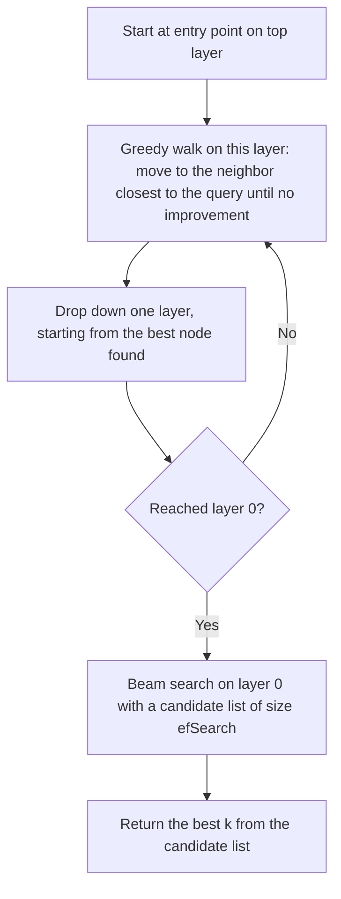
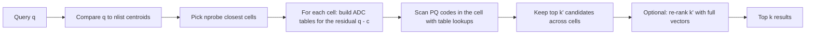
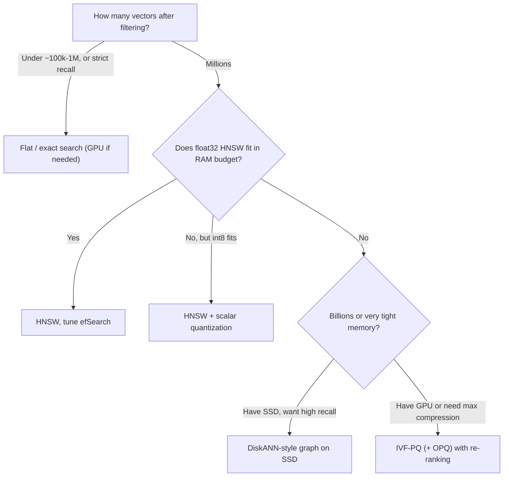
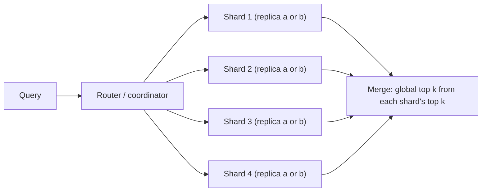

# Vector Search Algorithms: Exact kNN, HNSW, IVF and Product Quantization

> **Level:** Beginner to Advanced · **Study time:** ~140 min · **Prerequisites:** [Linear Algebra for Machine Learning](../00-foundations/02-linear-algebra-for-ml.md), [Text Embeddings and Similarity Search](02-text-embeddings-and-similarity-search.md), [Retrieval Methods: BM25, Dense Retrieval and Hybrid Search](05-retrieval-bm25-dense-and-hybrid-search.md). Helpful: [Unsupervised Learning: Clustering](../01-classical-ml/10-unsupervised-learning-clustering-and-dimensionality-reduction.md) (for k-means).

## Table of contents

- [Why this matters](#why-this-matters)
- [The problem: finding the nearest vectors](#the-problem-finding-the-nearest-vectors)
- [Exact k-nearest-neighbor search (brute force)](#exact-k-nearest-neighbor-search-brute-force)
- [Why approximate nearest neighbor search](#why-approximate-nearest-neighbor-search)
- [Measuring ANN quality: recall@k](#measuring-ann-quality-recallk)
- [HNSW: graph-based search](#hnsw-graph-based-search)
- [IVF: cluster-based search](#ivf-cluster-based-search)
- [Product quantization: compressing vectors](#product-quantization-compressing-vectors)
- [IVF-PQ: combining partitioning and compression](#ivf-pq-combining-partitioning-and-compression)
- [Scalar and binary quantization](#scalar-and-binary-quantization)
- [Graphs on disk: DiskANN](#graphs-on-disk-diskann)
- [FAISS in practice: Flat, HNSW, IVF and IVF-PQ](#faiss-in-practice-flat-hnsw-ivf-and-ivf-pq)
- [The trade-off table and choosing an index](#the-trade-off-table-and-choosing-an-index)
- [When to use exact search](#when-to-use-exact-search)
- [Going deeper: scaling to millions and billions of vectors](#going-deeper-scaling-to-millions-and-billions-of-vectors)
- [Going deeper: benchmarking ANN properly](#going-deeper-benchmarking-ann-properly)
- [Going deeper: production failure modes and debugging](#going-deeper-production-failure-modes-and-debugging)
- [Common mistakes and misconceptions](#common-mistakes-and-misconceptions)
- [Interview questions and model answers](#interview-questions-and-model-answers)
- [Key takeaways](#key-takeaways)
- [Further reading](#further-reading)
- [Next](#next)

## Why this matters

Dense retrieval turns every chunk into an embedding vector and answers a query by finding the vectors closest to the query vector. With a few thousand chunks you can simply compare against all of them. With 10 million chunks, comparing against every vector costs gigabytes of memory traffic per query, so production vector stores and libraries (FAISS, hnswlib, pgvector, Lucene-based Elasticsearch and OpenSearch, Milvus, Qdrant, Weaviate, Pinecone and others) rely on **approximate nearest neighbor** indexes such as HNSW, IVF and product quantization. These algorithms decide your retrieval latency, your RAM bill, and silently cap your RAG quality: a missed neighbor is a missed chunk the LLM never sees. Interviewers ask about them constantly because they test whether you can reason about the three-way trade-off between **recall** (what fraction of the true nearest vectors the index actually returns), **latency** (how long one query takes) and **memory** (bytes needed to hold the index) with real numbers, and whether you know how to tune and benchmark an index instead of trusting defaults.

## The problem: finding the nearest vectors

> **Analogy:** You arrive in a new city and want the 5 coffee shops closest to you. You could measure the distance to every coffee shop in the city (exact, slow), or you could ask a local who points you to the right neighborhood and then check only shops there (approximate, fast, occasionally misses one).

An **embedding** is a list of numbers (a **vector**) that represents the meaning of a piece of text, so that similar texts get nearby vectors (see [Text Embeddings and Similarity Search](02-text-embeddings-and-similarity-search.md)). The number of entries in the vector is its **dimension** $d$ (for example 384, 768 or 1536).

**k-nearest-neighbor (kNN) search**: given a **query vector** $q$ and a **database** (also called corpus or collection) of $N$ vectors $x_1, \dots, x_N$, return the $k$ database vectors with the smallest distance (or highest similarity) to $q$. This is the same "nearest neighbors" idea as the kNN classifier in [k-Nearest Neighbors, SVMs, Naive Bayes](../01-classical-ml/09-knn-svm-naive-bayes-and-other-classic-algorithms.md), but here we only care about *finding* the neighbors fast, not voting on a label.

### Distance and similarity measures (quick recap)

Three measures cover almost every vector index:

| Measure | Formula | Bigger or smaller is closer? | Typical use |
|---|---|---|---|
| Squared Euclidean (L2) distance | $\lVert q - x\rVert^2 = \sum_i (q_i - x_i)^2$ | Smaller | Image features, classic ANN benchmarks |
| Inner product (dot product) | $q \cdot x = \sum_i q_i x_i$ | Bigger | Models trained with dot-product scoring |
| Cosine similarity | $\frac{q \cdot x}{\lVert q\rVert \lVert x\rVert}$ | Bigger | Most text embedding models |

A useful identity links them:

$$\lVert q - x\rVert^2 = \lVert q\rVert^2 - 2\, q \cdot x + \lVert x\rVert^2$$

- $\lVert q\rVert^2$: squared length of the query (the same for every database vector, so it never changes the ranking).
- $q \cdot x$: the dot product.
- $\lVert x\rVert^2$: squared length of the database vector.

**Tiny check:** $q = [1, 2]$, $x = [3, 1]$. Directly: $(1-3)^2 + (2-1)^2 = 4 + 1 = 5$. Via the identity: $\lVert q\rVert^2 = 1 + 4 = 5$, $q \cdot x = 3 + 2 = 5$, $\lVert x\rVert^2 = 9 + 1 = 10$, so $5 - 2 \cdot 5 + 10 = 5$. Same answer.

Consequence: if all vectors are **normalized** to length 1, then $\lVert q - x\rVert^2 = 2 - 2\,(q \cdot x)$, so L2, inner product and cosine produce **exactly the same ranking**. That is why the standard recipe for cosine search is "normalize every vector, then use an inner-product (or L2) index."

> **Common mistake:** Building an L2 or inner-product index over unnormalized vectors from a model that was trained for cosine similarity. With inner product, long vectors (often long or repetitive chunks) then win unfairly; with L2, the $\lVert x\rVert^2$ term lets vector length (not meaning) shift the ranking. Either way the ranking no longer matches cosine. Normalize at ingestion *and* at query time.

### The running example

Throughout this chapter we use one realistic setup, the **help-center index**: a company RAG assistant over **10 million chunks**, each embedded as a **768-dimensional float32** vector (float32 means 4 bytes per number; see [Number Formats and Model Memory](../07-model-compression/01-number-formats-and-model-memory.md)). We want the top $k = 10$ chunks per query, with a latency budget of a few tens of milliseconds for retrieval.

## Exact k-nearest-neighbor search (brute force)

**Exact search** (also **brute-force** or **flat** search) computes the distance from the query to every single database vector, then keeps the $k$ best. It always returns the true nearest neighbors, by definition.

### The cost, worked out

$$\text{memory} = N \cdot d \cdot b \qquad \text{work per query} = N \cdot d \text{ multiply-adds}$$

- $N$: number of vectors.
- $d$: dimension.
- $b$: bytes per number (4 for float32).
- A **multiply-add** is one multiplication plus one addition, the basic step of a dot product.

For the help-center index ($N = 10{,}000{,}000$, $d = 768$, $b = 4$):

- Numbers stored: $10{,}000{,}000 \times 768 = 7{,}680{,}000{,}000$.
- Memory: $7{,}680{,}000{,}000 \times 4 = 30{,}720{,}000{,}000$ bytes $\approx$ **30.7 GB** (about 28.6 GiB).
- Work per query: $10{,}000{,}000 \times 768 = 7.68 \times 10^9$ multiply-adds, which is about $15.4 \times 10^9$ floating-point operations (FLOPs), since each multiply-add counts as 2.

How long does that take? For one query at a time, the bottleneck is not arithmetic but **memory bandwidth**: every query must stream all 30.7 GB from memory through the processor. This is the same compute-bound vs memory-bound reasoning as in [GPU Fundamentals for LLMs](../06-llm-inference/03-gpu-fundamentals-compute-bound-vs-memory-bound.md).

- Illustrative CPU server with 50 GB/s of usable memory bandwidth: $30.72 / 50 \approx 0.61$ seconds per query.
- A data-center GPU with roughly 2 TB/s of memory bandwidth (the order of magnitude of an A100-class card): $30.72 / 2000 \approx 0.015$ s, about 15 ms per query, if the 30.7 GB fits in GPU memory.

Batching changes the picture. If 1,000 queries arrive together, the database is read once and the work becomes a matrix multiplication (compute-bound). Illustratively, at 20 TFLOP/s of usable float32 compute: $1000 \times 15.36 \text{ GFLOP} = 15.36 \text{ TFLOP}$, and $15.36 / 20 \approx 0.77$ s for the whole batch, roughly 1,300 queries per second. Great for offline jobs, not for an interactive service that answers one user at a time.

> **Senior insight:** "Brute force is slow" is too vague. Say *why*: per-query cost is linear in $N \cdot d$, and for single queries it is memory-bandwidth bound. GPUs and batching make brute force surprisingly viable for offline work and for generating ground truth.

### Exact search from scratch (NumPy)

```python
# pip install numpy
import numpy as np

def knn_bruteforce(X: np.ndarray, q: np.ndarray, k: int) -> np.ndarray:
    """Exact k nearest neighbors of q in X under squared L2 distance."""
    # ||x - q||^2 = ||x||^2 - 2 x.q + ||q||^2   (one matrix-vector product)
    d2 = (X ** 2).sum(axis=1) - 2 * X @ q + (q ** 2).sum()
    # argpartition finds the k smallest in O(N) without fully sorting all N
    idx = np.argpartition(d2, k)[:k]
    return idx[np.argsort(d2[idx])]          # sort only those k

rng = np.random.default_rng(0)
X = rng.standard_normal((100_000, 768)).astype("float32")
q = rng.standard_normal(768).astype("float32")
print(knn_bruteforce(X, q, k=10))            # indices of the 10 nearest rows
```

In production you would precompute $\lVert x\rVert^2$ once instead of every query, and use an optimized library (FAISS `IndexFlatL2` / `IndexFlatIP`, shown later) that uses SIMD instructions (single instruction, multiple data: one CPU instruction processes 8 or 16 numbers at once) and BLAS (Basic Linear Algebra Subprograms, heavily optimized matrix routines) for the matrix multiplication.

## Why approximate nearest neighbor search

**Approximate nearest neighbor (ANN) search** returns *most* of the true nearest neighbors while examining only a small fraction of the database. You trade a little accuracy for orders-of-magnitude less work.

Why not use a classic exact data structure like a k-d tree (a tree that splits space one coordinate at a time)? Because of the **curse of dimensionality**: in hundreds of dimensions, distances between random points become similar to each other, and a tree must check so many branches to be sure it found the true nearest neighbor that it degenerates toward brute force. Exactness is the expensive part. Give it up slightly and huge speedups appear.

The main ANN families:

| Family | Idea | Examples | Notes |
|---|---|---|---|
| Graph-based | Link each vector to nearby vectors; walk the graph toward the query | HNSW, Vamana/DiskANN, NSG, CAGRA (GPU) | Best recall vs latency in RAM; memory-hungry |
| Partition-based (clustering) | Group vectors into clusters; search only the closest clusters | IVF, ScaNN's partitioning | Cheap memory, easy to combine with compression |
| Quantization (compression) | Store compact codes instead of full vectors; compute approximate distances | PQ, OPQ, scalar quantization, binary quantization | Shrinks memory 4x to 32x or more; loses some accuracy |
| Hashing | Hash so that similar vectors collide | Locality-sensitive hashing (LSH) | Historically important; usually beaten by graphs and IVF on dense embeddings |

Real indexes combine families, for example IVF + PQ, or HNSW over scalar-quantized vectors.

How much less work? For HNSW on a well-tuned index, a query typically computes distances to a few thousand vectors rather than all $N$. Illustratively, 3,000 distance computations $\times$ 768 = about 2.3 million multiply-adds instead of 7.68 billion: over 3,000 times less work.

## Measuring ANN quality: recall@k

Since ANN can miss neighbors, we need a number for "how much did it miss?"

> **Analogy:** You ask a friend for the 10 tallest people in a stadium. You then measure everyone yourself. If 9 of their 10 picks are in your true top 10, their recall is 0.9.

**ANN recall@k** is the overlap between the ANN result and the exact result, averaged over a set of test queries:

$$\text{recall@}k = \frac{1}{|Q|} \sum_{q \in Q} \frac{\lvert A_k(q) \cap E_k(q)\rvert}{k}$$

- $Q$: the set of test queries; $\lvert Q\rvert$ is how many there are.
- $A_k(q)$: the $k$ ids returned by the ANN index for query $q$.
- $E_k(q)$: the $k$ ids returned by exact search (the **ground truth**).
- $\cap$: set intersection (ids in both); $\lvert\cdot\rvert$ counts them.

**Worked example** with $k = 5$ and two queries:

- Query 1: exact = {A, B, C, D, E}, ANN = {A, B, C, F, E}. Overlap = {A, B, C, E} = 4, so $4/5 = 0.8$.
- Query 2: exact = {P, Q, R, S, T}, ANN = {P, Q, R, S, T}. Overlap = 5, so $5/5 = 1.0$.
- recall@5 $= (0.8 + 1.0) / 2 = 0.9$.

Variants you will see: **1-recall@1** (is the true nearest neighbor ranked first?) and **R@k with a deeper candidate list** (for example "10-recall@100": what fraction of the true top-10 appears anywhere in the ANN top-100, useful when a reranker follows).

> **Senior insight:** ANN recall is *not* the same thing as retrieval quality. ANN recall compares the index to exact search over the same embeddings. Retrieval recall compares results to human-judged relevant documents (see [Evaluating RAG](10-rag-evaluation-metrics-and-ragas.md)). If your embedding model is weak, a perfect index (ANN recall 1.0) still retrieves the wrong chunks. Measure both, and know which one moved.

## HNSW: graph-based search

**HNSW** (Hierarchical Navigable Small World) is the most widely used in-memory ANN index. It was introduced by Malkov and Yashunin ("Efficient and robust approximate nearest neighbor search using Hierarchical Navigable Small World graphs", arXiv 2016, IEEE TPAMI 2018), building on their earlier navigable small world (NSW) graphs.

### Intuition 1: navigable small-world graphs

> **Analogy:** The "six degrees of separation" idea. You can reach almost anyone through a short chain of acquaintances, because most of your friends are local but a few know people far away. To deliver a letter to a stranger, you hand it to whichever friend seems closest to the target, and they do the same.

A **proximity graph** stores each vector as a **node** and connects it with **edges** (links) to some of its nearby vectors. **Greedy search** on such a graph: start at some node, look at its neighbors, move to whichever neighbor is closest to the query, repeat until no neighbor is closer. A graph is **navigable** when this greedy walk reliably reaches the true nearest neighbor in few steps. That needs mostly short links (for precision at the end) plus some long links (to cross the space quickly), which is exactly a **small-world** network.

### Intuition 2: layers like a skip list

> **Analogy:** Travel by highway, then main road, then side street. Highways get you to the right region in a few jumps, side streets get you to the exact door.

A **skip list** (Pugh, 1990) is a sorted linked list with extra "express lanes" on top: every element is on the bottom level, roughly half are also on level 1, a quarter on level 2, and so on. Searching starts in the sparsest top lane and drops down a level whenever the next step would overshoot.

HNSW applies the same idea to a graph:

```text
Layer 2 (very few nodes, long links)      A ----------------------- K
                                          |                         |
Layer 1 (some nodes, medium links)        A -------- F ------------ K ------ P
                                          |          |              |        |
Layer 0 (ALL nodes, short links)          A - B - C - F - G - H - J - K - M - P - R
                                                            ^
                                                         query lands near H
```

- **Layer 0** contains every vector, with links to close neighbors.
- Each higher layer contains a random, exponentially shrinking subset of nodes, so links there span longer distances.
- The **entry point** is a node on the top layer where every search begins.

### How a node's level is chosen

When a vector is inserted, it gets a random maximum level $\ell$:

$$\ell = \lfloor -\ln(U) \cdot m_L \rfloor, \qquad m_L = \frac{1}{\ln M}$$

- $U$: a uniform random number in $(0, 1]$.
- $\ln$: natural logarithm; $\lfloor\cdot\rfloor$ rounds down.
- $M$: the HNSW connectivity parameter (explained below).
- $m_L$: the level multiplier; with $m_L = 1/\ln M$, the probability that a node reaches level 1 or higher is $1/M$, level 2 or higher is $1/M^2$, and so on.

Why $1/M$: $\ell \ge 1$ requires $-\ln(U)/\ln M \ge 1$, that is $U \le 1/M$, which happens with probability $1/M$. One draw with $M = 32$ and $U = 0.02$: $-\ln(0.02) \approx 3.91$, times $m_L = 1/\ln 32 \approx 0.289$ gives $1.13$, so $\ell = 1$ (the node lives on layers 0 and 1).

**Worked example** with $M = 32$ and our $N = 10$ million vectors:

- Level $\ge 1$: $10{,}000{,}000 / 32 = 312{,}500$ nodes.
- Level $\ge 2$: $10{,}000{,}000 / 1024 \approx 9{,}766$ nodes.
- Level $\ge 3$: $10{,}000{,}000 / 32{,}768 \approx 305$ nodes.
- Level $\ge 4$: $10{,}000{,}000 / 1{,}048{,}576 \approx 9.5$ nodes.

So the graph has about 5 layers, roughly $\log_M N = \ln(10^7)/\ln(32) \approx 16.12 / 3.47 \approx 4.65$. This logarithmic layer count is why search cost grows slowly with $N$.

### The search algorithm



On the upper layers the search keeps just 1 best node. On layer 0 it runs a **beam search**: it keeps a dynamic list of the best `efSearch` nodes found so far and keeps expanding the closest unexplored candidate until no unexplored candidate can beat the worst node in the list. A bigger list explores more of the neighborhood, so it is less likely to get stuck in a **local minimum** (a node whose neighbors are all farther from the query, even though better nodes exist elsewhere).

### The insertion (build) algorithm

To insert a new vector:

1. Draw its level $\ell$ as above.
2. From the entry point, greedily descend through the layers above $\ell$.
3. On each layer from $\ell$ down to 0, run the same beam search with a list of size `efConstruction` to find candidate neighbors.
4. Pick up to $M$ neighbors (up to $2M$ on layer 0 in common implementations) using a **diversity heuristic**: a candidate is kept only if it is closer to the new node than to any neighbor already chosen. This avoids linking to 32 near-duplicates in one direction and keeps links that point in different directions, which preserves navigability across clusters.
5. Add links in both directions; if a neighbor now has too many links, prune its list with the same heuristic.

### From-scratch greedy beam search (the layer-0 mechanism)

This toy builds a single-layer proximity graph (exact neighbors plus a few random long links) and runs HNSW's layer search on it. Real HNSW builds the graph incrementally and adds layers, but the search loop is the same.

```python
# pip install numpy
import heapq
import numpy as np

rng = np.random.default_rng(0)
N, d = 3_000, 32
X = rng.standard_normal((N, d)).astype("float32")

# Build a toy graph: 8 nearest neighbors per node + 2 random long-range links.
sq = (X ** 2).sum(1)
D = sq[:, None] - 2 * X @ X.T + sq[None, :]          # all pairwise squared distances
np.fill_diagonal(D, np.inf)
knn = np.argsort(D, axis=1)[:, :8]
graph = [set(knn[i]) | set(rng.integers(0, N, 2)) for i in range(N)]
for i in range(N):                                    # make links bidirectional
    for j in list(graph[i]):
        graph[j].add(i)

def search_layer(q, entry, ef, k):
    dist = lambda i: float(((X[i] - q) ** 2).sum())
    visited = {entry}
    d0 = dist(entry)
    candidates = [(d0, entry)]        # min-heap: closest unexplored node first
    results = [(-d0, entry)]          # max-heap (negated): worst of the best ef on top
    while candidates:
        d_c, c = heapq.heappop(candidates)
        if d_c > -results[0][0]:      # best unexplored is worse than our worst kept: stop
            break
        for nb in graph[c]:
            if nb in visited:
                continue
            visited.add(nb)
            d_n = dist(nb)
            if len(results) < ef or d_n < -results[0][0]:
                heapq.heappush(candidates, (d_n, nb))
                heapq.heappush(results, (-d_n, nb))
                if len(results) > ef:
                    heapq.heappop(results)    # drop the current worst
    best = sorted((-neg, i) for neg, i in results)[:k]
    return [i for _, i in best], len(visited)

q = rng.standard_normal(d).astype("float32")
exact = set(np.argsort(((X - q) ** 2).sum(1))[:10])
for ef in (10, 40, 160):
    found, n_visited = search_layer(q, entry=0, ef=ef, k=10)
    print(f"ef={ef:4d} recall@10={len(exact & set(found))/10:.1f} distances computed={n_visited}")
```

Run it and you should see recall rise and the number of distance computations grow as `ef` grows (one run gave recall 0.8, 1.0, 1.0 with about 490, 920 and 1,960 distance computations). On this tiny 3,000-vector toy, a large `ef` already touches a big fraction of $N$; the savings only become dramatic at millions of vectors, where the visited count grows far more slowly than $N$. Random Gaussian data is a hard case for ANN, so real embeddings usually do better.

### The three knobs: M, efConstruction, efSearch

| Parameter | What it is | Effect on recall | Effect on latency | Effect on memory | Effect on build time | Can change after build? |
|---|---|---|---|---|---|---|
| `M` | Max links per node per layer (often $2M$ on layer 0) | Higher M: better recall, especially for high-dimensional or clustered data | More distance computations per hop, but fewer hops; usually somewhat slower per query at the same efSearch | Linear in M: about $2M \times 4$ bytes per vector for layer 0 | Slower | No (rebuild) |
| `efConstruction` | Candidate list size while inserting | Higher: better-quality graph, so higher recall at the same efSearch, with diminishing returns | None directly | None | Roughly linear increase | No (rebuild) |
| `efSearch` (`ef`) | Candidate list size at query time; effectively at least $k$ (hnswlib and FAISS use $\max(\text{efSearch}, k)$) | Higher: higher recall, diminishing returns as it approaches 1.0 | Roughly linear increase | None (tiny temporary list) | None | Yes, per query |

Common starting points (not universal, always tune on your data): `M` 16 to 64, `efConstruction` 100 to 500, `efSearch` 50 to 500. Default values differ between libraries and versions, and some defaults are low, so always set them explicitly.

> **Interview tip:** The crisp answer to "how does HNSW's search configuration affect performance?" is: `efSearch` is the runtime dial between recall and latency (bigger list, more nodes visited, higher recall, higher latency, no memory cost), while `M` and `efConstruction` are build-time choices that set the quality ceiling, the memory and the build cost. Tune `efSearch` per query or per tenant; rebuild to change the others.

### Memory overhead of the links

Each layer-0 link is typically a 4-byte integer id, and layer 0 holds up to $2M$ links per node. Upper layers add very little because only a $1/M$ fraction of nodes appear there.

$$\text{HNSW memory} \approx N \cdot (d \cdot b + 2M \cdot 4) \text{ bytes}$$

For the help-center index with $M = 32$:

- Links: $2 \times 32 \times 4 = 256$ bytes per vector; $10{,}000{,}000 \times 256 = 2.56$ GB.
- Vectors: 30.72 GB (float32).
- Total: about **33.3 GB**, so links add about 8%.

Now compress the vectors (covered below) and watch the ratio flip:

| Vector storage | Vector bytes | Link bytes (M=32) | Total for 10M | Link share |
|---|---|---|---|---|
| float32 (3,072 B/vector) | 30.72 GB | 2.56 GB | 33.28 GB | 8% |
| int8 scalar quantization (768 B/vector) | 7.68 GB | 2.56 GB | 10.24 GB | 25% |
| PQ with 96 bytes/vector | 0.96 GB | 2.56 GB | 3.52 GB | 73% |

> **Senior insight:** Once vectors are compressed, the graph itself becomes the memory problem. That is one reason IVF-PQ (no graph) is the classic choice at billion scale, and why disk-based graphs exist.

### Deletions and updates

HNSW was designed for inserts. Deletions are awkward because removing a node can disconnect parts of the graph that were reachable only through it.

- **Soft delete (tombstones):** mark the node as deleted; searches still traverse it but never return it. Fast, but deleted nodes keep using memory and search work, and recall can drift as the share of tombstones grows. hnswlib, for example, supports `mark_deleted` and can reuse deleted slots for new inserts.
- **Updates** are usually delete + insert of the new vector.
- **Some implementations do not support removal at all** (FAISS's `IndexHNSWFlat` cannot remove ids), so you rebuild.
- **Production practice:** track the tombstone ratio, and periodically rebuild or compact the index (for example a nightly or weekly rebuild in the background, then an atomic swap). Lucene-based engines handle this through segment merges. See [Production Ingestion Pipelines](12-production-ingestion-pipelines-at-scale.md) for the pipeline side.

```python
# pip install hnswlib   (API shown is from hnswlib 0.7+/0.8; check your version)
import hnswlib
import numpy as np

d = 768
data = np.random.default_rng(0).standard_normal((10_000, d)).astype("float32")
index = hnswlib.Index(space="cosine", dim=d)
index.init_index(max_elements=20_000, M=32, ef_construction=200, allow_replace_deleted=True)
index.add_items(data, ids=np.arange(10_000))
index.set_ef(100)                                   # efSearch
labels, distances = index.knn_query(data[:5], k=10)

index.mark_deleted(42)                              # tombstone: never returned again
new_vec = np.random.default_rng(1).standard_normal((1, d)).astype("float32")
index.add_items(new_vec, ids=[10_000], replace_deleted=True)   # reuse the deleted slot
```

## IVF: cluster-based search

> **Analogy:** A library sorts books into sections (history, cooking, physics). To find books similar to yours, you walk to the 2 or 3 most relevant sections and browse only those shelves, instead of the whole building.

**IVF** (inverted file index) partitions the database into clusters and searches only the clusters closest to the query. The name comes from text search's inverted index (see [Retrieval Methods](05-retrieval-bm25-dense-and-hybrid-search.md)): each cluster has a list of the vector ids assigned to it, called an **inverted list** or **posting list**. The idea was used for visual search by Sivic and Zisserman ("Video Google", 2003) and combined with PQ by Jégou, Douze and Schmid (2011).

### How it works

1. **Train the coarse quantizer.** Run **k-means** clustering (repeat: assign every point to its nearest center, then move each center to the mean of its points; see [Unsupervised Learning](../01-classical-ml/10-unsupervised-learning-clustering-and-dimensionality-reduction.md)) on a sample of vectors to get `nlist` cluster centers called **centroids**. The set of centroids is the **coarse quantizer**: it maps any vector to its nearest centroid. Each centroid owns a **cell** (also called a Voronoi cell): the region of space closer to it than to any other centroid.
2. **Add vectors.** Assign each database vector to its nearest centroid and append it to that cell's inverted list.
3. **Search.** Compare the query to all `nlist` centroids, pick the `nprobe` closest cells, and run exact search only over vectors in those cells.

```text
          cell 1            cell 2               cell 3
      +-------------+-------------------+-----------------+
      |  .   .  .   |     .    .        |   .    .   .    |
      |    (c1)  .  |  .   (c2)   .  q  |  .   (c3)    .  |
      |  .    .     |      .   .     *  |     .   x  .    |
      +-------------+-------------------+-----------------+
  q is in cell 2, but its true nearest neighbor x sits just across the border in cell 3.
  nprobe = 1 searches only cell 2 and MISSES x. nprobe = 2 searches cells 2 and 3 and finds it.
```

That diagram is the whole story of `nprobe`: the true neighbor of a query near a cell border often lives in an adjacent cell.

### What nprobe controls, with numbers

**nprobe** is the number of cells searched per query. It is the runtime recall vs latency dial for IVF, just like `efSearch` for HNSW.

$$\text{fraction scanned} \approx \frac{n_{\text{probe}}}{n_{\text{list}}}, \qquad \text{distance computations} \approx n_{\text{list}} + N \cdot \frac{n_{\text{probe}}}{n_{\text{list}}}$$

- $n_{\text{list}}$: number of cells (centroids).
- $n_{\text{probe}}$: number of cells searched.
- $N$: database size.
- The first term is comparing the query to every centroid; the second is scanning the chosen cells (assuming roughly equal cell sizes).

**Worked example**, help-center index, $N = 10{,}000{,}000$, $n_{\text{list}} = 4096$, $n_{\text{probe}} = 16$:

- Average cell size: $10{,}000{,}000 / 4096 \approx 2{,}441$ vectors.
- Fraction scanned: $16 / 4096 = 0.0039 \approx 0.39\%$.
- Vectors scanned: $16 \times 2{,}441.4 \approx 39{,}063$.
- Plus 4,096 centroid comparisons, for about $43{,}159$ distance computations in total.
- Speedup vs brute force: $10{,}000{,}000 / 43{,}159 \approx 232\times$ less work.

What happens at the extremes?

| nprobe | Vectors scanned (approx.) | Recall | Latency |
|---|---|---|---|
| 1 | 2,441 | Lowest (misses border neighbors) | Lowest |
| 16 | 39,063 | Much higher | Moderate |
| 128 | 312,500 | Near exact for most queries | Higher |
| 4096 (= nlist) | 10,000,000 | Exactly 1.0 for IVF-Flat (it is brute force plus overhead); still approximate if the cells store PQ codes | Worse than flat |

Recall rises steeply for small nprobe and then flattens; latency rises roughly linearly. The recall values depend on your data, so measure them (see benchmarking below).

### Choosing nlist

There is a balance. More cells means smaller cells (less scanning per probe) but more centroids to compare and a higher chance that neighbors are scattered across cells. Minimizing the total work $n_{\text{list}} + N \cdot n_{\text{probe}} / n_{\text{list}}$ (set its derivative with respect to $n_{\text{list}}$, $1 - N n_{\text{probe}} / n_{\text{list}}^2$, to zero) gives $n_{\text{list}} = \sqrt{N \cdot n_{\text{probe}}}$. For $N = 10^7$ and $n_{\text{probe}} = 16$: $\sqrt{1.6 \times 10^8} \approx 12{,}649$, where both terms equal about 12,649, for 25,298 distance computations total.

But recall is not constant: with finer cells, `nprobe = 16` covers a smaller region, so you may need a larger nprobe for the same recall. That is why nlist and nprobe are tuned together. Commonly cited rules of thumb put nlist somewhere from about $\sqrt{N}$ to $16\sqrt{N}$ (FAISS's guidelines lean toward the upper part of that range, about $4\sqrt{N}$ to $16\sqrt{N}$, for million-scale data). With very large nlist (65,536 or more), comparing against all centroids becomes expensive, so the coarse quantizer is itself put in an HNSW index (FAISS notation `IVF65536_HNSW32`).

### Training the quantizer

- **Training sample:** k-means needs enough points per centroid. FAISS warns when there are fewer than about 39 training points per centroid, and by default subsamples to at most 256 per centroid. For nlist = 4096 that means at least $39 \times 4096 = 159{,}744$ and up to $256 \times 4096 = 1{,}048{,}576$ training vectors.
- **Representative sample:** train on vectors from the same embedding model and the same content mix you will index. A quantizer trained on English docs and then filled with code snippets gives badly unbalanced cells.
- **Drift:** adding vectors is cheap (assign to nearest centroid), but if the data distribution shifts, cells become unbalanced (some huge, some empty) and both latency and recall degrade. Monitor cell size distribution and retrain periodically.
- **Deletes:** easy; remove the id from its inverted list. This is a real operational advantage over HNSW.
- **Embedding model change:** a new model means new vectors in a new space, so retrain and rebuild everything. Never mix vectors from two models in one index.

### IVF from scratch

```python
# pip install numpy scikit-learn
import numpy as np
from sklearn.cluster import KMeans

rng = np.random.default_rng(0)
X = rng.standard_normal((20_000, 64)).astype("float32")
nlist = 100

km = KMeans(n_clusters=nlist, n_init=1, random_state=0).fit(X)    # train coarse quantizer
lists = [np.where(km.labels_ == c)[0] for c in range(nlist)]      # inverted lists

def ivf_search(q, k, nprobe):
    cd = ((km.cluster_centers_ - q) ** 2).sum(1)                  # query vs every centroid
    probe = np.argsort(cd)[:nprobe]                               # nprobe closest cells
    cand = np.concatenate([lists[c] for c in probe])              # ids in those cells
    d2 = ((X[cand] - q) ** 2).sum(1)                              # exact distances, cells only
    return cand[np.argsort(d2)[:k]], len(cand)

q = rng.standard_normal(64).astype("float32")
exact = set(np.argsort(((X - q) ** 2).sum(1))[:10])
for nprobe in (1, 5, 20, 100):
    ids, scanned = ivf_search(q, 10, nprobe)
    print(f"nprobe={nprobe:3d} scanned={scanned:6d} recall@10={len(exact & set(ids))/10:.1f}")
```

With `nprobe = 100 = nlist` the scan covers everything and recall is exactly 1.0.

## Product quantization: compressing vectors

HNSW and IVF reduce *how many* vectors you look at. **Quantization** reduces *how big* each vector is. Recall that our float32 index needs 30.7 GB; memory is often the real cost driver.

> **Analogy:** Describing a person's outfit as "hat #12, shirt #200, trousers #7, shoes #41" from four catalogs of standard items. Each catalog has 256 items, so each choice fits in one byte. You lose detail (the shirt is not *exactly* #200), but four bytes describe the whole outfit.

**Product quantization (PQ)** (Jégou, Douze and Schmid, "Product Quantization for Nearest Neighbor Search", IEEE TPAMI 2011):

1. **Split** each $d$-dimensional vector into $m$ **subvectors** of $d/m$ dimensions each.
2. **Train a codebook per subspace:** run k-means with 256 centroids on each subspace separately. A **codebook** is the list of those centroids.
3. **Encode:** replace each subvector by the id (0 to 255) of its nearest centroid in that subspace's codebook. 256 choices fit exactly in one byte (8 bits).
4. The vector is now stored as $m$ bytes, called its **PQ code**.

The "product" in the name: with $m$ codebooks of 256 centroids, the set of representable vectors is every combination, $256^m$ points, which is astronomically many, while you only store $m \times 256$ centroids.

### Compression ratio, worked

$$\text{bytes per vector} = \frac{m \cdot n_{\text{bits}}}{8}, \qquad \text{compression ratio} = \frac{d \cdot 4}{m \cdot n_{\text{bits}} / 8}$$

- $m$: number of subvectors.
- $n_{\text{bits}}$: bits per subvector code (8 means 256 centroids per codebook).
- $d \cdot 4$: bytes of the original float32 vector.

For $d = 768$, $m = 96$ (so each subvector has $768 / 96 = 8$ dimensions), $n_{\text{bits}} = 8$:

- Original: $768 \times 4 = 3{,}072$ bytes.
- PQ code: $96 \times 8 / 8 = 96$ bytes.
- Ratio: $3{,}072 / 96 = $ **32x**.
- 10 million vectors: $10^7 \times 96 = 960$ MB instead of 30.72 GB.
- Codebooks: $96 \times 256 \times 8 \times 4 = 786{,}432$ bytes, about 0.75 MiB. Negligible.

With $m = 48$ (16-dimensional subvectors) you get 48 bytes and 64x compression, with more accuracy loss.

### A tiny PQ example by hand

Take $d = 4$, $m = 2$ subvectors of 2 dimensions, and (for readability) only 4 centroids per codebook instead of 256.

Codebook 1 (for dimensions 1-2): $c_0 = [0, 0]$, $c_1 = [1, 1.5]$, $c_2 = [2, 3]$, $c_3 = [3, 0]$.
Codebook 2 (for dimensions 3-4): $e_0 = [1, 1]$, $e_1 = [2, 4]$, $e_2 = [3, 1.5]$, $e_3 = [0, 0]$.

**Encode** $x = [1.0, 2.0, 3.0, 1.0]$:

- Subvector 1 = $[1, 2]$. Squared distances: to $c_0$: $1 + 4 = 5$; to $c_1$: $0 + 0.25 = 0.25$; to $c_2$: $1 + 1 = 2$; to $c_3$: $4 + 4 = 8$. Nearest is $c_1$, code **1**.
- Subvector 2 = $[3, 1]$. To $e_0$: $4 + 0 = 4$; to $e_1$: $1 + 9 = 10$; to $e_2$: $0 + 0.25 = 0.25$; to $e_3$: $9 + 1 = 10$. Nearest is $e_2$, code **2**.
- Stored code for $x$: **(1, 2)**. It stands for the reconstruction $[1, 1.5, 3, 1.5]$.

**Encode** a second vector $y = [2.0, 2.6, 0.6, 0.0]$:

- Subvector $[2, 2.6]$: to $c_0$: $4 + 6.76 = 10.76$; to $c_1$: $1 + 1.21 = 2.21$; to $c_2$: $0 + 0.16 = 0.16$; to $c_3$: $1 + 6.76 = 7.76$. Code **2**.
- Subvector $[0.6, 0]$: to $e_0$: $0.16 + 1 = 1.16$; to $e_1$: $1.96 + 16 = 17.96$; to $e_2$: $5.76 + 2.25 = 8.01$; to $e_3$: $0.36 + 0 = 0.36$. Code **3**.
- Stored code for $y$: **(2, 3)**.

### Asymmetric distance computation (ADC)

At query time we do *not* decompress every vector. Instead:

1. **Keep the query exact** (not quantized). That is what "asymmetric" means: the query is full precision, the database is compressed. (Quantizing the query too is **symmetric distance computation**, which is less accurate.)
2. **Build a lookup table:** for each subspace $j$ and each centroid $c$, precompute the squared distance from the query's subvector $j$ to $c$.
3. **Score each database code by table lookups:** the approximate distance is the sum over subspaces of the table entry selected by the code.

$$\tilde{D}(q, x) = \sum_{j=1}^{m} T_j\big[\text{code}_j(x)\big], \qquad T_j[c] = \lVert q^{(j)} - C_j[c]\rVert^2$$

- $q^{(j)}$: the query's $j$-th subvector.
- $C_j[c]$: centroid $c$ of codebook $j$.
- $T_j$: the lookup table for subspace $j$ (one entry per centroid).
- $\text{code}_j(x)$: the byte stored for $x$ in subspace $j$.
- $\tilde{D}$: approximate squared distance (equal to the exact distance from $q$ to $x$'s reconstruction).

**Continue the example** with query $q = [2, 2, 2, 0]$:

- Table 1 (query subvector $[2, 2]$): $T_1[0] = 4 + 4 = 8$, $T_1[1] = 1 + 0.25 = 1.25$, $T_1[2] = 0 + 1 = 1$, $T_1[3] = 1 + 4 = 5$.
- Table 2 (query subvector $[2, 0]$): $T_2[0] = 1 + 1 = 2$, $T_2[1] = 0 + 16 = 16$, $T_2[2] = 1 + 2.25 = 3.25$, $T_2[3] = 4 + 0 = 4$.
- $\tilde{D}(q, x) = T_1[1] + T_2[2] = 1.25 + 3.25 = 4.5$.
- $\tilde{D}(q, y) = T_1[2] + T_2[3] = 1 + 4 = 5$.

PQ ranks $x$ (4.5) ahead of $y$ (5). Now the true distances:

- $\lVert q - x\rVert^2 = (2-1)^2 + (2-2)^2 + (2-3)^2 + (0-1)^2 = 1 + 0 + 1 + 1 = 3$.
- $\lVert q - y\rVert^2 = (2-2)^2 + (2-2.6)^2 + (2-0.6)^2 + (0-0)^2 = 0 + 0.36 + 1.96 + 0 = 2.32$.

The true order is $y$ (2.32) before $x$ (3). **PQ flipped the ranking.** This is the accuracy loss of quantization in miniature.

### Why ADC is fast

For our 768-dim, $m = 96$ setup:

- Building the tables: $256 \text{ centroids} \times 768 \text{ dims} = 196{,}608$ multiply-adds, once per query.
- Scoring one database vector: 96 table lookups and adds, instead of 768 multiply-adds, while reading 96 bytes instead of 3,072.
- Scanning 39,063 vectors (the IVF example above): $39{,}063 \times 96 \approx 3.75$ million adds vs $39{,}063 \times 768 \approx 30.0$ million multiply-adds.

The memory-traffic saving (32x fewer bytes) usually matters more than the arithmetic saving. Libraries go further with "fast-scan" variants that use 4-bit codes so the lookup tables fit in SIMD registers.

### Accuracy loss and re-ranking with full vectors

PQ distances are approximate, so rankings near the top get shuffled, as in our example. The standard fix is **re-ranking** (also called **refinement**):

1. Use the compressed index to fetch a larger candidate list, for example $k' = 4k$ to $10k$ (top 40 to 100 for $k = 10$).
2. Fetch the full-precision vectors of those candidates (from RAM, SSD, or a separate store).
3. Compute exact distances and return the true top $k$ among them.

In the example, re-ranking $\{x, y\}$ with exact distances puts $y$ first. Re-ranking 100 candidates costs only $100 \times 768 = 76{,}800$ multiply-adds, which is tiny. The full vectors can live on SSD because only $k'$ of them are read per query.

> **Common mistake:** Confusing this "re-ranking with full vectors" with re-ranking by a cross-encoder model. Both are second-stage rescoring, but the first fixes *compression* error (it recovers exact embedding distances), while the cross-encoder fixes *embedding model* error (it judges relevance better than any embedding distance). Production systems often do both. See [Reranking and Query Transformation](08-reranking-and-query-transformation.md).

Improving PQ itself:

- **OPQ** (Optimized Product Quantization, Ge et al., CVPR 2013) learns a rotation applied before splitting, so information is spread evenly across subvectors. Often a cheap accuracy win.
- **Anisotropic quantization** (ScaNN, Guo et al., "Accelerating Large-Scale Inference with Anisotropic Vector Quantization", ICML 2020) weights quantization error by how much it hurts inner-product ranking.
- **More bytes** (larger $m$) means less error and more memory.

### PQ from scratch with re-ranking

```python
# pip install numpy scikit-learn
import numpy as np
from sklearn.cluster import KMeans

rng = np.random.default_rng(0)
n, d, m = 10_000, 64, 8                 # 8 subvectors of 8 dims -> 8 bytes per vector
ds = d // m
X = rng.standard_normal((n, d)).astype("float32")

# 1) Train one 256-centroid codebook per subspace
books = [KMeans(256, n_init=1, random_state=0).fit(X[:, j*ds:(j+1)*ds]).cluster_centers_
         for j in range(m)]

# 2) Encode: each subvector -> id of nearest centroid (fits in uint8)
codes = np.empty((n, m), dtype=np.uint8)
for j, C in enumerate(books):
    sub = X[:, j*ds:(j+1)*ds]
    codes[:, j] = ((sub[:, None, :] - C[None]) ** 2).sum(-1).argmin(1)

def pq_search(q, k, rerank=0):
    # 3) ADC lookup table: distance from each query subvector to all 256 centroids
    table = np.stack([((C - q[j*ds:(j+1)*ds]) ** 2).sum(1) for j, C in enumerate(books)])  # (m, 256)
    approx = table[np.arange(m), codes].sum(1)          # (n,) sum of m lookups per vector
    if rerank == 0:
        return np.argsort(approx)[:k]
    cand = np.argsort(approx)[:rerank]                  # 4) larger candidate list ...
    exact = ((X[cand] - q) ** 2).sum(1)                 # ... re-scored with full vectors
    return cand[np.argsort(exact)[:k]]

q = rng.standard_normal(d).astype("float32")
truth = set(np.argsort(((X - q) ** 2).sum(1))[:10])
print("PQ only    recall@10:", len(truth & set(pq_search(q, 10))) / 10)
print("PQ+rerank  recall@10:", len(truth & set(pq_search(q, 10, rerank=100))) / 10)
print("bytes/vector:", codes.shape[1], "vs", d * 4)    # bytes/vector: 8 vs 256
```

Expect re-ranking to raise recall noticeably; exact numbers depend on the data.

## IVF-PQ: combining partitioning and compression

**IVF-PQ** (the IVFADC system in Jégou et al., 2011) does both: IVF picks a few cells, and the vectors inside the cells are stored as PQ codes.

One refinement makes it much more accurate: **residual encoding**. Instead of compressing the vector $x$ itself, IVF-PQ compresses the **residual** $r = x - c$, where $c$ is the centroid of $x$'s cell. Residuals are small and centered around zero, so the PQ codebooks spend their 256 centroids describing fine detail instead of the coarse position (which the cell id already encodes).



Memory for the help-center index with nlist = 4096 and $m = 96$:

- PQ codes: $10^7 \times 96$ bytes $= 960$ MB.
- Ids stored in the inverted lists (FAISS uses 8-byte ids): $10^7 \times 8 = 80$ MB.
- Centroids: $4096 \times 768 \times 4 \approx 12.6$ MB.
- Total about **1.05 GB**, versus 33.3 GB for float32 HNSW. That fits on a small machine or a single GPU, which is why IVF-PQ is the classic billion-scale workhorse (the FAISS GPU paper, Johnson, Douze and Jégou, "Billion-scale similarity search with GPUs", 2017, is built around it).

The cost: recall@10 without re-ranking is noticeably lower than HNSW over float32 vectors, so production setups usually re-rank from full vectors stored elsewhere.

## Scalar and binary quantization

Two simpler compression schemes are now standard in vector databases.

### Scalar quantization (SQ)

**Scalar quantization** stores each dimension independently as a small integer, usually 8 bits (int8 or uint8). It is the same idea as weight quantization in [Quantization Fundamentals: Scale and Zero Point](../07-model-compression/02-quantization-fundamentals-scale-and-zero-point.md), applied to embeddings.

$$q_i = \operatorname{round}\left(\frac{x_i - \min_i}{\max_i - \min_i} \cdot 255\right), \qquad \hat{x}_i = \min_i + \frac{q_i}{255}(\max_i - \min_i)$$

- $x_i$: the original value of dimension $i$.
- $\min_i, \max_i$: the range of dimension $i$, learned from a training sample.
- $q_i$: the stored 8-bit integer (0 to 255).
- $\hat{x}_i$: the reconstructed value.

**Worked example:** $x_i = 0.12$ with $\min_i = -0.5$, $\max_i = 0.5$.

- $(0.12 - (-0.5)) / (0.5 - (-0.5)) = 0.62 / 1.0 = 0.62$.
- $0.62 \times 255 = 158.1$, rounded to $q_i = 158$.
- Reconstruct: $-0.5 + (158 / 255) \times 1.0 = -0.5 + 0.61961 = 0.11961$.
- Error: $0.12 - 0.11961 = 0.00039$.

Memory: 1 byte per dimension, so 768 bytes per vector, **4x** compression; 10M vectors take 7.68 GB. Recall loss is often small for int8, but measure it on your embeddings. float16 storage (2x) is an even safer option.

### Binary quantization (BQ)

**Binary quantization** keeps only the sign of each dimension: 1 if positive, 0 otherwise. Distance becomes **Hamming distance**: the number of bit positions that differ, computed with XOR and a popcount (count of 1 bits), which CPUs do extremely fast.

**Worked example** (4 dimensions):

- $a = [0.3, -0.1, 0.8, -0.5] \to 1010$.
- $b = [0.2, 0.4, 0.9, -0.7] \to 1110$.
- XOR: $1010 \oplus 1110 = 0100$, popcount = 1, so Hamming distance = 1.

Memory: 768 bits = 96 bytes, **32x** compression. Accuracy loss is large unless the embedding model was trained or validated for it (high-dimensional models tend to tolerate it better), so BQ is almost always used as a first stage: fetch many candidates by Hamming distance (oversampling), then re-score with int8 or float32 vectors. Some embedding providers offer int8 or binary output types directly; feature availability changes, so check current docs.

```python
# pip install numpy
import numpy as np

rng = np.random.default_rng(0)
X = rng.standard_normal((100_000, 768)).astype("float32")
q = rng.standard_normal(768).astype("float32")

Xb = np.packbits(X > 0, axis=1)              # (100000, 96) uint8: 96 bytes per vector
qb = np.packbits(q > 0)
hamming = np.unpackbits(Xb ^ qb, axis=1).sum(1)   # XOR then count differing bits
cand = np.argsort(hamming)[:200]                  # oversample: 200 candidates for k=10
top10 = cand[np.argsort(-(X[cand] @ q))[:10]]     # re-score candidates with float vectors
```

| Scheme | Bytes per 768-dim vector | Compression | Typical accuracy loss | Typical role |
|---|---|---|---|---|
| float32 | 3,072 | 1x | None | Ground truth, re-ranking |
| float16 / bfloat16 | 1,536 | 2x | Negligible for search in most cases | Default when RAM is tight |
| int8 scalar | 768 | 4x | Small; verify | Main index storage (often with HNSW) |
| PQ ($m = 96$) | 96 | 32x | Moderate; needs re-ranking | IVF-PQ, huge collections |
| Binary | 96 | 32x | Large without re-scoring | Very fast first stage |

A related lever is **reducing the dimension**: some embedding models are trained with Matryoshka Representation Learning (Kusupati et al., NeurIPS 2022) so that the first 256 dimensions of a 768-dim vector still work well on their own. Fewer dimensions shrink memory and work proportionally.

## Graphs on disk: DiskANN

What if even compressed vectors plus an HNSW graph do not fit in RAM? **DiskANN** (Subramanya et al., "DiskANN: Fast Accurate Billion-point Nearest Neighbor Search on a Single Node", NeurIPS 2019) keeps the graph and full vectors on an **SSD** and only compressed vectors in RAM.

- **Vamana graph:** a single-layer graph built with a pruning rule that has a parameter $\alpha > 1$, which deliberately keeps longer edges. Fewer hops matter enormously when each hop is an SSD read instead of a RAM read.
- **In RAM:** PQ codes of all vectors, used to decide which neighbors to visit next.
- **On SSD:** each node's full-precision vector stored next to its neighbor list, so one disk read fetches both. Full vectors gathered along the way are used to re-rank the final results.
- **Beam search with batched reads:** several nodes are fetched from SSD in parallel per step to hide latency.

The paper reported serving a billion-point dataset from a single machine with tens of GB of RAM and an SSD, at high recall and millisecond-scale latency. Follow-ups added streaming updates (FreshDiskANN, Singh et al., 2021) and filtered search (Filtered-DiskANN, Gollapudi et al., WWW 2023). Several vector databases offer DiskANN-style or other disk-backed indexes; check each product's current docs.

## FAISS in practice: Flat, HNSW, IVF and IVF-PQ

**FAISS** (Facebook AI Similarity Search, by Meta; see "The Faiss library", Douze et al., 2024) is the reference library for vector search. Many vector databases embed FAISS, hnswlib or their own implementations of the same algorithms, so understanding FAISS transfers everywhere.

This script builds all four index types on the same synthetic clustered data, computes ground truth with exact search, and reports recall, throughput, latency percentiles and index size. **Throughput** is measured in **QPS** (queries per second). A **latency percentile** such as **p99** is the time that 99% of queries finish within; p50 is the median, and p95/p99 describe the slow tail that users actually notice.

```python
# pip install faiss-cpu numpy
# (FAISS's official docs recommend conda packages; the faiss-cpu wheel is fine for experiments.)
import time
import numpy as np
import faiss

rng = np.random.default_rng(0)
d, nb, nq, k = 128, 200_000, 1_000, 10

# Clustered synthetic data looks more like real embeddings than pure noise.
centers = rng.standard_normal((1_000, d)).astype("float32") * 3
xb = (centers[rng.integers(0, 1_000, nb)] + rng.standard_normal((nb, d))).astype("float32")
xq = (centers[rng.integers(0, 1_000, nq)] + rng.standard_normal((nq, d))).astype("float32")
# For cosine similarity you would call faiss.normalize_L2(xb); faiss.normalize_L2(xq)
# and use IndexFlatIP / METRIC_INNER_PRODUCT instead.

def recall_at_k(I_ann, I_true, k):
    hits = sum(len(set(a[:k]) & set(t[:k])) for a, t in zip(I_ann, I_true))
    return hits / (len(I_true) * k)

def index_mb(index):
    try:
        return faiss.serialize_index(index).nbytes / 1e6   # serialized size ~ memory footprint
    except Exception:                                       # some wrapper indexes may not serialize
        return float("nan")

def bench(index, name):
    t0 = time.perf_counter()
    _, I = index.search(xq, k)                       # batched: measures throughput
    qps = nq / (time.perf_counter() - t0)
    lat = []
    for i in range(200):                             # one query at a time: measures latency
        t = time.perf_counter()
        index.search(xq[i:i + 1], k)
        lat.append(time.perf_counter() - t)
    p50, p95, p99 = np.percentile(lat, [50, 95, 99]) * 1e3
    size_mb = index_mb(index)
    print(f"{name:26s} recall@{k}={recall_at_k(I, I_gt, k):.3f}  QPS={qps:9.0f}  "
          f"p50={p50:.2f}ms p95={p95:.2f}ms p99={p99:.2f}ms  size={size_mb:.0f}MB")

# 1) Flat: exact search, also our ground truth
flat = faiss.IndexFlatL2(d)
flat.add(xb)
_, I_gt = flat.search(xq, k)
bench(flat, "Flat (exact)")

# 2) HNSW: M=32 links, efConstruction set BEFORE adding
hnsw = faiss.IndexHNSWFlat(d, 32)
hnsw.hnsw.efConstruction = 200
t0 = time.perf_counter(); hnsw.add(xb); print(f"HNSW build: {time.perf_counter() - t0:.1f}s")
for ef in (16, 64, 256):
    hnsw.hnsw.efSearch = ef                          # runtime recall/latency dial
    bench(hnsw, f"HNSW32 efSearch={ef}")

# 3) IVF-Flat: k-means coarse quantizer with nlist cells
nlist = 1024
quantizer = faiss.IndexFlatL2(d)                     # keep a Python reference alive
ivf = faiss.IndexIVFFlat(quantizer, d, nlist)
ivf.train(xb[:100_000])                              # >= 39 * 1024 training points
ivf.add(xb)
for nprobe in (1, 8, 32, 128):
    ivf.nprobe = nprobe                              # runtime recall/latency dial
    bench(ivf, f"IVF{nlist},Flat nprobe={nprobe}")

# 4) IVF-PQ: 16 subvectors x 8 bits = 16 bytes/vector (vs 512 bytes float32)
quantizer2 = faiss.IndexFlatL2(d)
ivfpq = faiss.IndexIVFPQ(quantizer2, d, nlist, 16, 8)
ivfpq.train(xb[:100_000])
refined = faiss.IndexRefineFlat(ivfpq)               # wrap BEFORE adding: keeps full vectors too
refined.add(xb)                                      # adds PQ codes to ivfpq + float copies
ivfpq.nprobe = 32
bench(ivfpq, "IVF-PQ16 nprobe=32")
refined.k_factor = 4                                 # fetch 4*k PQ candidates, re-rank exactly
bench(refined, "IVF-PQ16 + refine x4")
```

What to look for when you run it (the exact numbers depend on your machine and FAISS version, so none are claimed here):

- Flat has recall 1.0 by definition and low QPS. It is not necessarily the slowest row: batched Flat search runs as one BLAS matrix multiply, so a high-`nprobe` IVF run (for example `nprobe=128` here) can have lower batched QPS than Flat.
- HNSW recall climbs with `efSearch` while QPS falls.
- IVF recall climbs with `nprobe`; at `nprobe = nlist` it equals Flat.
- This synthetic clustered data is easy, so HNSW and IVF-Flat recall may already reach about 1.0 at small `efSearch` or `nprobe`; real embeddings need larger values.
- IVF-PQ is far smaller on disk and in RAM, has lower recall, and the refine step recovers much of it.

Two practical notes:

- **`index_factory` strings** are FAISS's compact way to describe composite indexes, for example `"HNSW32"`, `"IVF4096,Flat"`, `"IVF4096,PQ96"`, `"OPQ96,IVF4096,PQ96"` or `"IVF4096,SQ8"`. For composite indexes, set nprobe with `faiss.extract_index_ivf(index).nprobe = 16` or `faiss.ParameterSpace().set_index_parameter(index, "nprobe", 16)`.
- **Threads:** FAISS parallelizes with OpenMP. For single-query latency tests, try `faiss.omp_set_num_threads(1)` (or a small number) so thread start-up overhead does not dominate, and test the setting you will deploy.

## The trade-off table and choosing an index

Numbers below are for the help-center index (10M x 768) and are approximate; recall and latency columns are qualitative because they depend on data and tuning.

| Index | Memory (10M x 768) | Recall | Query latency | Build time | Updates and deletes | Best when |
|---|---|---|---|---|---|---|
| Flat (exact) | 30.7 GB | 1.0 (exact) | Very high (linear in N) | None | Trivial | Small N, ground truth, filtered small subsets |
| HNSW (float32, M=32) | ~33.3 GB | Very high (0.95-0.99+ achievable) | Very low | Slow (graph build) | Inserts fine; deletes via tombstones and rebuilds | Low latency, high recall, RAM affordable |
| HNSW + SQ8 | ~10.2 GB | High (slightly below float) | Very low | Slow | Same as HNSW | Default sweet spot for many RAG systems |
| IVF-Flat | ~30.8 GB | High with enough nprobe | Low to moderate | Fast (k-means + assignment) | Easy; retrain on drift | Simpler ops, GPU, frequent deletes |
| IVF-PQ ($m=96$) | ~1.05 GB | Moderate; high with re-ranking | Low | Moderate (k-means + PQ training) | Easy; retrain on drift | Very large N, tight memory, GPU |
| DiskANN (SSD) | Small RAM (PQ codes) + SSD | High | Low to moderate (SSD reads) | Slow | Supported by streaming variants | Larger than RAM, cost-sensitive |
| Binary + re-score | 0.96 GB + rescoring store | Moderate; high with oversampling | Very low | Very fast | Easy | Huge scale first stage, cheap hardware |



> **Interview tip:** Never answer "which index is best?" with a name. Answer with the constraint that decides it (memory budget, recall target, latency SLO, where an SLO or service level objective is the latency target you commit to): "At 10M x 768 float32 HNSW needs about 33 GB; if that fits in our RAM budget and we need p99 under 20 ms at recall 0.95, HNSW. If memory is the constraint, HNSW over int8 or IVF-PQ with re-ranking."

## When to use exact search

ANN is not always the right answer. Use exact (flat) search when:

1. **The collection is small.** 100,000 vectors $\times$ 768 = 76.8 million multiply-adds and 307 MB of float32, which an optimized CPU kernel scans in a few to tens of milliseconds (illustrative). No index build, no tuning, no recall loss. Many teams over-engineer this.
2. **Recall must be perfect.** Legal discovery, compliance checks, deduplication, or safety filters where missing a match is costly and auditable.
3. **Heavy filters leave a small subset.** If a tenant or a metadata filter narrows 10M chunks down to 5,000, brute force over those 5,000 ($5{,}000 \times 768 = 3.84$ million multiply-adds) is fast and exact, while an ANN graph searched with that filter can perform badly (see filtered search below).
4. **Generating ground truth.** Every ANN evaluation needs exact top-k for a sample of queries. Use brute force, ideally batched on GPU.
5. **Offline batch jobs.** Clustering, deduplicating or labeling a corpus with many queries at once: batched brute force on GPU is a matrix multiplication and may beat building an index.
6. **Data changes faster than you can maintain an index.** Very write-heavy, small, short-lived collections (a single user's session documents) do not justify index build costs.

## Going deeper: scaling to millions and billions of vectors

Scaling is a budget problem: keep the bytes per vector small enough, spread the data over machines, and keep tail latency under control.

### Step 1: do the memory math first

| Scale | float32 (768-d) | int8 | PQ 96 B + 8 B id |
|---|---|---|---|
| 1M | 3.07 GB | 0.77 GB | 0.10 GB |
| 10M | 30.7 GB | 7.68 GB | 1.04 GB |
| 100M | 307 GB | 76.8 GB | 10.4 GB |
| 1B | 3.07 TB | 768 GB | 104 GB |

Add graph links if you use HNSW ($2M \times 4$ bytes per vector, 256 B at M=32: 25.6 GB per 100M vectors) and leave headroom for the OS, query buffers and rebuilds (a rebuild often needs room for two copies).

### Step 2: pick the levers

1. **Quantization:** int8, PQ or binary, with re-ranking from full vectors on SSD or in a cheaper store.
2. **Fewer dimensions:** a smaller or Matryoshka-truncated embedding, validated on your retrieval eval set.
3. **Memory tiers:** hot data and compressed codes in RAM, full vectors on SSD (DiskANN, or re-ranking from disk), cold or rarely-queried tenants on object storage loaded on demand (some serverless vector databases are designed this way).
4. **Sharding:** split the vectors across machines. Each shard holds an independent index.
5. **Replication:** copy each shard to several machines to increase throughput (QPS) and survive failures.

### Sharding and replication



- **Scatter-gather:** the router sends the query to every shard, each returns its local top $k$, and the router merges them into the global top $k$. Correct because the global top $k$ must be among the union of the local top $k$ lists.
- **Random or hash sharding:** vectors spread evenly, every query hits every shard. Balanced and simple, but each query's cost is multiplied by the shard count.
- **Partitioned (semantic) sharding:** shards hold clusters (IVF at the cluster level), and a query visits only the few nearest shards. Cheaper per query, but risks hot shards and lower recall.
- **Tenant sharding:** in multi-tenant RAG, put each large tenant on its own shard or index, which also helps isolation (see [Secure Multi-Tenant RAG](13-secure-multi-tenant-rag.md)).

**Worked sizing example** (illustrative): 100M vectors at 768 dims, HNSW with M=32, target 2,000 QPS.

- float32 HNSW: $307.2 + 25.6 = 332.8$ GB. On machines with about 100 GB usable for the index, that is 4 shards of about 83 GB.
- HNSW + int8: $76.8 + 25.6 = 102.4$ GB: 2 shards, half the machines.
- If load tests show one replica of a shard set handles 500 QPS at the target p99, you need $2{,}000 / 500 = 4$ replicas, plus 1 spare for failures and rolling rebuilds.

**Tail latency amplification:** with scatter-gather, a query is as slow as its slowest shard. If each of 16 shards independently exceeds its own p99 latency 1% of the time, the chance that at least one shard is slow on a given query is $1 - 0.99^{16} \approx 1 - 0.851 = 0.149$, about **15%**. A shard's p99 becomes the fleet's p85. Mitigations: fewer, bigger shards; hedged requests (send to a second replica if the first is slow); timeouts that return partial results; and keeping per-shard variance low.

### Filtered search at scale

Real queries carry filters: tenant id, permissions, language, date range. How you combine filters with ANN matters a lot.

| Strategy | How | Pros | Cons |
|---|---|---|---|
| Post-filtering | ANN top $k'$ first, then drop non-matching results | Simple, works with any index | With a selective filter you get too few or zero results |
| Pre-filtering | Find matching ids first, then search only them | Always correct number of results | Needs exact search or a special index over the subset |
| In-traversal (filtered ANN) | Skip non-matching nodes during graph or IVF traversal | Good balance | Graph connectivity breaks when few nodes match; needs special algorithms |
| Partition by filter | Separate index per tenant or category | Fast and isolated | Many small indexes to manage |

**Worked example of why post-filtering fails:** if a filter keeps 1% of documents and you ask the ANN index for the top 100, you expect only $100 \times 0.01 = 1$ matching result. To expect 10 matches you need $10 / 0.01 = 1{,}000$ candidates, and at 0.1% selectivity, 10,000.

Good systems choose the strategy per query based on **filter selectivity** (the fraction of documents that pass): very selective filter, then pre-filter and brute force the small subset; loose filter, then filtered ANN or post-filter with oversampling. Research such as ACORN (Patel et al., SIGMOD 2024) and Filtered-DiskANN builds graphs that stay navigable under filters. Vendor behavior differs; see [Vector Databases in Practice](07-vector-databases-in-practice.md).

> **Senior insight:** Permission filters are a correctness and security requirement, not a relevance nicety. A post-filter that silently returns 2 results instead of 10 degrades answers; a filter applied *after* the LLM sees the text leaks data. Filter inside retrieval, always.

### GPU vector search

GPUs excel at batched brute force and IVF-PQ (FAISS GPU), and at GPU-native graph indexes such as CAGRA in NVIDIA's cuVS library. They shine for high-QPS batched workloads, offline jobs and fast index builds. For low-QPS interactive traffic, CPU HNSW is often cheaper. Library names and features change; check current docs.

## Going deeper: benchmarking ANN properly

The question an interviewer really asks is: "How do you know your index is good enough, and how do you choose its parameters?" The answer is a disciplined benchmark.

### The core plot: recall@k vs QPS

Every ANN index has a dial (efSearch, nprobe, k_factor). Sweep it, and for each setting record recall@k and queries per second. Plot recall on the x-axis and QPS (log scale) on the y-axis. Each index type traces a curve; the upper-right envelope across all indexes and settings is the **Pareto frontier**: the best achievable speed at each recall.

```text
QPS (log)
  ^
  |  *  HNSW
  |    *
  |      *   o IVF-PQ+refine
  |        *  o
  |   x IVF  *  o
  |     x      * o
  |       x      *o
  |         x      o*
  |           x       *  <- flattening: last bit of recall is expensive
  +--------------------------------------> recall@10
     0.80      0.90      0.95     0.99
```

(Illustrative shapes only.) This is the methodology of **ann-benchmarks** (Aumüller, Bernhardsson and Faithfull, "ANN-Benchmarks: A Benchmarking Tool for Approximate Nearest Neighbor Algorithms", Information Systems, 2020) and the billion-scale **big-ann-benchmarks** competitions (NeurIPS 2021 and 2023, the latter with filtered, sparse, out-of-distribution and streaming tracks).

> **Common mistake:** "Index A is 10x faster than index B" means nothing unless both are measured *at the same recall*. Always compare QPS or latency at a fixed recall target (for example recall@10 = 0.95).

### A benchmarking recipe for millions of vectors

1. **Use your real data.** Your embedding model, your corpus (or a large representative sample), and real user queries embedded with the query-side model. Public datasets like SIFT1M or GloVe tell you little about your 768-dim text embeddings.
2. **Hold out queries.** Never use database vectors as queries (each finds itself at distance 0 and inflates recall). Query embeddings are often distributed differently from document embeddings, which is a known hard case (the "out-of-distribution" track exists for this reason).
3. **Compute ground truth once** with exact search over the full corpus, for 1,000 to 10,000 queries, ideally batched on a GPU. Store it.
4. **Sweep parameters:** efSearch (and M, efConstruction in a few builds), nlist and nprobe, PQ $m$ and re-rank factor, quantization type.
5. **Measure for each configuration:**
   - recall@k (and recall at the deeper depth your reranker uses),
   - throughput (QPS) at a realistic concurrency,
   - latency **p50, p95, p99**, not just the average,
   - index memory and disk size,
   - build time and, if relevant, insert and delete throughput,
   - the same metrics under your real filters.
6. **Load-test realistically:** warm caches first, use an open-loop load generator (fixed arrival rate) so slow requests are not hidden. A closed-loop client waits for each reply before sending the next request, so when the server stalls the client also stops sending and the stall is under-counted; this is called **coordinated omission**. Also test with background inserts if production has them.
7. **Pick the operating point:** the cheapest configuration that meets the recall target and the latency SLO (service level objective) with headroom.
8. **Validate end to end:** check that the chosen ANN setting does not hurt downstream retrieval metrics (hit rate: did a relevant chunk appear in the top k; nDCG: a rank-aware relevance score) and RAG answer quality compared with exact search. See [Evaluating RAG](10-rag-evaluation-metrics-and-ragas.md) and [Optimizing and Benchmarking LLM Latency and Cost](../06-llm-inference/07-optimizing-and-benchmarking-llm-latency-and-cost.md) for latency methodology.
9. **Keep it as a regression test:** rerun after embedding model changes, library upgrades and large data growth.

> **Senior insight:** Batched throughput and single-query latency are different experiments. A FAISS benchmark that sends 10,000 queries in one call reports great QPS, but your API serves one user query at a time with a p99 SLO. Benchmark the access pattern you will actually deploy.

## Going deeper: production failure modes and debugging

| Symptom | Likely causes | How to check | Fix |
|---|---|---|---|
| Retrieval quality dropped, no code change | Index growth with fixed efSearch or nprobe; IVF cells unbalanced after drift; tombstones piling up | Recompute ANN recall vs exact on a query sample; inspect cell size histogram; tombstone ratio | Raise efSearch/nprobe; retrain IVF; rebuild graph |
| Good ANN recall but bad answers | Embedding model problem, chunking, missing hybrid search | Compare exact search answers: if exact is also bad, the index is not the problem | Fix embeddings or chunking, add BM25, add reranker |
| Filtered queries return few results | Post-filtering with a selective filter | Log filter selectivity and result counts | Pre-filter + brute force for small subsets, filtered ANN, oversampling |
| p99 latency spikes | Scatter-gather tail amplification, garbage-collection (GC) pauses or compaction, cold pages after restart, noisy neighbors | Per-shard latency; correlate with compaction and deploys | Hedged requests, warm-up, fewer shards, isolate tenants |
| Memory keeps rising | Soft deletes never reclaimed, rebuild double-buffering, unbounded growth | Track vectors live vs stored | Scheduled compaction; capacity plan for 2x during rebuild |
| Results "random" after model upgrade | Mixed vectors from old and new embedding models, or query embedded with a different model | Check model version metadata on vectors and queries | Re-embed everything, blue-green index swap (build the new index beside the old one, switch traffic atomically, keep the old one for rollback; see [Production Ingestion Pipelines](12-production-ingestion-pipelines-at-scale.md)) |
| Recall much lower than expected from day one | Metric mismatch (L2 index, cosine model), forgot to normalize, default efSearch too low | Compare top-k against brute force with the right metric | Normalize, use IP metric, set parameters explicitly |

The first debugging move is always the same: **run exact search on the failing queries**. If exact search finds the right chunk and ANN does not, it is an index problem. If exact search also misses, look upstream (embeddings, chunking, query) using the playbook in [Debugging RAG Systems](11-debugging-rag-systems.md).

## Common mistakes and misconceptions

- **"We need a vector database for 50,000 chunks."** Brute force over 50k vectors is fast; add ANN when measurements say so.
- **Confusing ANN recall with retrieval recall.** One measures the index against exact search, the other measures results against human relevance labels.
- **Comparing indexes at different recall.** Speed claims without a fixed recall target are meaningless.
- **Trusting library defaults.** Some default efSearch and nprobe values are tiny; set them explicitly and tune.
- **Using database vectors as benchmark queries.** Inflates recall because each query finds itself.
- **Metric mismatch.** Cosine models with unnormalized vectors in an L2 or IP index.
- **Training IVF or PQ on a small or unrepresentative sample,** then never retraining as the corpus drifts.
- **Skipping re-ranking after PQ or binary quantization,** then blaming the embedding model for poor results.
- **Post-filtering with selective filters,** producing empty or tiny result sets.
- **Assuming HNSW deletes are free.** Tombstones cost memory and recall until rebuild; some libraries cannot delete at all.
- **Reporting average latency only.** Users feel p95 and p99, and sharding amplifies tails.
- **Mixing embedding model versions** in one index, which silently breaks similarity.
- **Thinking `efSearch` affects memory or `M` can be changed at query time.** efSearch is query-time only and costs no memory; M is fixed at build time and costs memory.

## Interview questions and model answers

<details>
<summary><b>Q1. Explain HNSW, IVF, and approximate nearest-neighbor search.</b></summary>

**Short answer:** Approximate nearest neighbor search finds most of the true closest vectors while examining only a small fraction of the data, trading a bit of recall for orders-of-magnitude speedups over brute force. HNSW does it with a layered proximity graph: start at a sparse top layer, greedily walk toward the query, descend layers, and finish with a beam search on the full bottom layer. IVF does it with clustering: k-means splits the data into nlist cells, and a query scans only the nprobe nearest cells.

**Deeper answer and follow-ups:**
- Exact search costs $N \cdot d$ multiply-adds per query: 7.68 billion for 10M x 768, and reads 30.7 GB, so it is memory-bandwidth bound.
- HNSW: node levels drawn with probability $1/M$ per level, about $\log_M N$ layers; links limited to M per node ($2M$ on layer 0); quality measured as recall@k vs exact.
- IVF: work $\approx n_{\text{list}} + N \cdot n_{\text{probe}}/n_{\text{list}}$; misses happen when a neighbor sits across a cell border.
- HNSW: best recall-latency in RAM, heavy memory, slow builds, awkward deletes. IVF: cheaper memory, fast builds, easy deletes, pairs naturally with PQ, needs training and retraining on drift.
- Pitfall: claiming ANN "loses quality" without saying how much: quote recall at a specific operating point.

</details>

<details>
<summary><b>Q2. What are HNSW, IVF, and product quantization?</b></summary>

**Short answer:** HNSW and IVF are search structures that reduce *how many* vectors you compare against (graph traversal and cluster probing). Product quantization reduces *how big* each vector is: it splits each vector into m subvectors and replaces each by the id of its nearest centroid in a 256-entry codebook, so a 768-dim float32 vector (3,072 bytes) becomes 96 bytes, and distances are computed with lookup tables.

**Deeper answer and follow-ups:**
- PQ bytes per vector $= m \cdot n_{\text{bits}}/8$; with $m = 96$, $n_{\text{bits}} = 8$: 96 bytes, 32x compression, 10M vectors in 960 MB.
- Asymmetric distance computation: query stays exact; per query build an $m \times 256$ table, then each vector costs m lookups instead of d multiply-adds.
- They compose: IVF-PQ (with residual encoding) is the classic billion-scale index; HNSW can sit over SQ or PQ vectors; IVF's coarse quantizer can itself be HNSW.
- PQ loses accuracy and can flip rankings, so fetch more candidates and re-rank with full vectors.
- Follow-up "what is OPQ?": a learned rotation before PQ that balances information across subvectors.

</details>

<details>
<summary><b>Q3. What are the trade-offs between search latency, recall, and memory?</b></summary>

**Short answer:** You cannot maximize all three at once; improving one usually costs at least one of the others. Higher recall costs latency (larger efSearch or nprobe, more vectors scanned) or memory (more graph links, less compression). Lower memory via quantization costs recall unless you pay latency for re-ranking. Build time and update cost are a fourth axis.

**Deeper answer and follow-ups:**
- Runtime dials: efSearch and nprobe trade recall for latency with no memory change; recall saturates while latency keeps growing linearly, so the last 1% of recall is the most expensive.
- Build-time choices: HNSW M raises recall ceiling and memory ($2M \times 4$ bytes per vector: 2.56 GB per 10M at M=32); efConstruction raises recall and build time, not memory.
- Compression: float32 to int8 (4x), PQ or binary (32x); re-ranking restores recall at a small latency cost.
- Concrete table for 10M x 768: float32 HNSW ~33 GB; HNSW+SQ8 ~10 GB; IVF-PQ ~1 GB.
- How to choose: fix the recall target and latency SLO from product requirements, then minimize cost on the recall vs QPS Pareto frontier.
- Failure mode: a setting tuned at today's size silently loses recall as the index grows, drifts or accumulates tombstones, so re-measure recall against exact search on a schedule.

</details>

<details>
<summary><b>Q4. What does nprobe control in IVF?</b></summary>

**Short answer:** nprobe is the number of IVF cells (clusters) searched per query. The query is compared to all nlist centroids, the nprobe nearest cells are scanned, and everything else is skipped. Higher nprobe means higher recall and roughly proportionally higher latency; with IVF-Flat, nprobe = nlist is exact search (with IVF-PQ it is still approximate because the codes are compressed).

**Deeper answer and follow-ups:**
- Fraction scanned $\approx n_{\text{probe}} / n_{\text{list}}$. Example: 10M vectors, nlist 4096, nprobe 16: 0.39% of the data, about 39,000 vectors plus 4,096 centroid comparisons, roughly 230x less work than brute force.
- Why more than 1: neighbors of queries near cell borders live in adjacent cells.
- Tuned jointly with nlist: finer cells need larger nprobe for the same recall; total work is minimized near $n_{\text{list}} = \sqrt{N \cdot n_{\text{probe}}}$.
- It is a query-time parameter, so it can differ per request (higher for premium tiers or for queries with selective filters).
- Pitfall: unbalanced cells after drift make latency vary by query because some probed cells are huge.
- How to set it: sweep nprobe (1, 2, 4, 8, ...) on held-out queries against exact ground truth, and pick the smallest value that meets the recall target within the p99 budget.

</details>

<details>
<summary><b>Q5. How does HNSW's search configuration affect performance?</b></summary>

**Short answer:** efSearch, the size of the candidate list kept during the bottom-layer beam search, is the main runtime knob: larger efSearch visits more nodes, raises recall with diminishing returns, and increases latency roughly linearly, with no memory cost. It must be at least k. M and efConstruction are build-time settings that set the recall ceiling, memory and build time.

**Deeper answer and follow-ups:**
- M: links per node; higher improves recall on high-dimensional or clustered data, increases memory linearly and build time, and per-hop cost.
- efConstruction: candidate list during insertion; better graph, longer builds, no memory change.
- Typical starting ranges: M 16-64, efConstruction 100-500, efSearch 50-500, tuned on a recall vs QPS sweep.
- efSearch can be set per query: raise it when a filter discards many nodes, or when a reranker needs a deeper top-k (efSearch should exceed the k you request).
- As the index grows, the same efSearch yields lower recall, so monitor recall over time.
- Thread count and batching affect measured QPS; benchmark the deployed access pattern.

</details>

<details>
<summary><b>Q6. When would you use exact search instead of approximate search?</b></summary>

**Short answer:** When the collection (or the filtered subset) is small enough that brute force meets the latency budget, when recall must be perfect, when generating ground truth for evaluating an ANN index, and for offline batched jobs where a GPU matrix multiply is simplest.

**Deeper answer and follow-ups:**
- Small N: 100k x 768 is 76.8M multiply-adds, typically milliseconds with optimized kernels; no build, no tuning, no recall loss.
- Strict recall: legal, compliance, deduplication, safety matching.
- Heavy filters: a tenant with 5,000 chunks out of 10M; pre-filter and brute force is exact and fast, while filtered graph search can degrade.
- Ground truth: every ANN benchmark needs exact top-k for a query sample.
- Batch/offline: clustering or deduplicating with many queries at once.
- Rapidly changing tiny collections (per-session uploads) where index maintenance is overhead.
- Decision rule: measure brute-force p99 on the deployed hardware at current and projected N (and at typical filtered-subset sizes); move to ANN only when exact search breaks the SLO. Many systems keep both paths and fall back to exact search automatically for small or heavily filtered subsets.

</details>

<details>
<summary><b>Q7. How would you scale retrieval to millions of vectors?</b></summary>

**Short answer:** Start with the memory math, choose an index and compression that fit the budget at the target recall, then shard for capacity and replicate for throughput and availability, with filtering designed in from the start. For 10M x 768, float32 HNSW is about 33 GB on one machine; int8 cuts it to about 10 GB; at hundreds of millions or billions use IVF-PQ or DiskANN-style SSD graphs with re-ranking.

**Deeper answer and follow-ups:**
- Levers: quantization (SQ8 4x, PQ or binary 32x), lower dimensions (Matryoshka), memory tiers (RAM codes, SSD full vectors, cold tenants on object storage).
- Sharding: scatter-gather with merge of local top-k; random sharding balances load, semantic sharding reduces fan-out but risks hotspots and recall, tenant sharding helps isolation.
- Replication: replicas = target QPS / measured per-replica QPS, plus spares for failures and rolling rebuilds.
- Tail latency: with 16 shards each slow 1% of the time, about 15% of queries hit a slow shard; use hedged requests and timeouts.
- Filtered search: choose pre-filter vs filtered ANN by selectivity.
- Operations: index rebuilds and blue-green swaps on model changes, compaction for deletes, capacity for double-buffering, monitoring recall on sampled queries.

</details>

<details>
<summary><b>Q8. How would you benchmark retrieval at millions of vectors?</b></summary>

**Short answer:** Use real corpus vectors and held-out real queries, compute exact ground truth once (GPU brute force), sweep index parameters, and plot recall@k against QPS and p50/p95/p99 latency under realistic concurrency and filters, plus memory and build time. Choose the cheapest configuration that meets the recall target and latency SLO, then confirm end-to-end retrieval and answer quality.

**Deeper answer and follow-ups:**
- Ground truth: 1,000-10,000 queries; never use database vectors as queries.
- Compare indexes at equal recall (for example recall@10 = 0.95), never at different recall levels.
- Separate experiments for batched throughput and single-query latency; warm up; avoid coordinated omission with an open-loop load generator.
- Include filters, concurrent inserts and deletes if production has them; measure build and rebuild time.
- Methodology follows ann-benchmarks (recall vs QPS Pareto curves) and big-ann-benchmarks (billion scale, filtered and OOD tracks).
- Track two recalls: ANN recall vs exact, and retrieval recall/nDCG vs labels; keep the suite as a regression test for model or library upgrades.

</details>

<details>
<summary><b>Q9. How much memory does an HNSW index over 10 million 768-dimensional embeddings need, and how would you cut it?</b></summary>

**Short answer:** About 30.7 GB of float32 vectors ($10^7 \times 768 \times 4$) plus roughly $2M \times 4$ bytes per vector of links: 2.56 GB at M=32, so about 33 GB. Cut it with int8 scalar quantization (about 10 GB), PQ (vectors under 1 GB, though links then dominate), lower dimensions, or move to IVF-PQ or a disk-based graph.

**Deeper answer and follow-ups:**
- Once vectors are compressed the 2.56 GB of links becomes the majority, which motivates IVF-PQ at large scale.
- Reducing M saves link memory but lowers recall; validate.
- Keep full vectors on SSD for re-ranking so compression does not cost final precision.
- Budget headroom for rebuilds (two copies) and OS caches.

</details>

<details>
<summary><b>Q10. Walk me through asymmetric distance computation in PQ. Why asymmetric?</b></summary>

**Short answer:** For each query, split it into the same m subvectors, compute the distance from each query subvector to all 256 centroids of that subspace's codebook (an m x 256 table), and then score each database code by summing m table lookups. It is asymmetric because the query is kept at full precision and only database vectors are quantized, so only one side carries quantization error; symmetric computation quantizes the query too and is less accurate.

**Deeper answer and follow-ups:**
- Formula: $\tilde{D}(q,x) = \sum_j T_j[\text{code}_j(x)]$, equal to the exact distance between $q$ and $x$'s reconstruction.
- Cost: 256 x 768 = 196,608 multiply-adds per query for tables, then 96 lookups per vector instead of 768 multiply-adds, reading 96 bytes instead of 3,072.
- In IVF-PQ, tables are built per probed cell on the residual $q - c$.
- Error: rankings can flip near the top, so re-rank a candidate list with full vectors.
- Fast-scan variants with 4-bit codes keep tables in SIMD registers.

</details>

<details>
<summary><b>Q11. How do you handle filtered vector search, for example per-tenant or permission filters?</b></summary>

**Short answer:** Decide by filter selectivity. For very selective filters, pre-filter to the matching ids and run exact search on the small subset. For broad filters, use filter-aware ANN traversal or post-filtering with enough oversampling. For strong isolation or large tenants, partition into separate indexes. Never rely on plain post-filtering for permissions.

**Deeper answer and follow-ups:**
- Post-filter math: 1% selectivity means top-100 ANN yields about 1 match; you need about 1,000 candidates to expect 10.
- Graph traversal under restrictive filters can lose connectivity (most neighbors are filtered out), so recall collapses; approaches like ACORN and Filtered-DiskANN address this.
- Raise efSearch or nprobe for filtered queries.
- Security: enforce permissions inside retrieval and audit it; see secure multi-tenant RAG.

</details>

<details>
<summary><b>Q12. How do deletions and updates work in HNSW versus IVF?</b></summary>

**Short answer:** HNSW typically uses soft deletes (tombstones): nodes stay in the graph for navigation but are never returned, and updates are delete plus insert; tombstones waste memory and degrade recall until a rebuild or compaction. IVF deletes are simple removals from an inverted list, and inserts just assign to the nearest centroid, but the centroids can go stale as data drifts, requiring retraining.

**Deeper answer and follow-ups:**
- Some implementations (FAISS IndexHNSWFlat) cannot remove at all; hnswlib supports mark_deleted and slot reuse.
- Physically removing graph nodes requires repairing neighbors' links, otherwise regions can become unreachable.
- Operational pattern: monitor tombstone ratio and cell balance; rebuild in the background and swap atomically.
- Lucene-based engines rebuild graphs during segment merges, which costs CPU and can cause latency spikes.

</details>

<details>
<summary><b>Q13. ANN recall is 0.98 but users say retrieval is bad. What is going on?</b></summary>

**Short answer:** ANN recall only measures agreement with exact search over the same embeddings. If it is 0.98, the index is nearly perfect and the problem is upstream: the embedding model, chunking, query formulation, missing keyword matching, or ranking. Confirm by running exact search on failing queries; if exact search is also wrong, tuning the index will not help.

**Deeper answer and follow-ups:**
- Measure retrieval recall, hit rate or nDCG against labeled relevant chunks.
- Typical fixes: hybrid BM25 + dense for identifiers, a domain-tuned embedding model, better chunking, a cross-encoder reranker, query rewriting.
- Check for metric mismatch and mixed model versions too, which can make both exact and ANN results wrong.

</details>

<details>
<summary><b>Q14. When would you consider DiskANN or a GPU index instead of in-memory HNSW?</b></summary>

**Short answer:** DiskANN when the dataset is too large or too costly to keep in RAM: it keeps PQ codes in memory and the graph plus full vectors on SSD, using a graph designed for few hops. GPU indexes when you need very high batched throughput, fast index builds or offline jobs; for low-QPS interactive traffic CPU HNSW is often cheaper.

**Deeper answer and follow-ups:**
- DiskANN's Vamana graph keeps long edges (alpha > 1) to minimize SSD reads; neighbor list and full vector stored together so one read fetches both.
- Latency depends on SSD performance and hop count; RAM holds only compressed codes.
- GPU: FAISS GPU for brute force and IVF-PQ, graph indexes like CAGRA; check memory capacity and data transfer costs.
- Decision is driven by cost per QPS at the target recall, measured.

</details>

## Key takeaways

- Exact kNN costs $N \cdot d$ multiply-adds and $N \cdot d \cdot 4$ bytes: 7.68 billion multiply-adds per query and 30.7 GB stored (and streamed on every query) for 10M x 768 float32; single queries are memory-bandwidth bound.
- ANN trades a small, measurable loss in recall for orders-of-magnitude less work.
- ANN recall@k = overlap between ANN top-k and exact top-k; it is different from retrieval recall against relevance labels.
- HNSW: layered small-world graph, greedy descent from a sparse top layer, beam search on layer 0; about $\log_M N$ layers.
- HNSW knobs: efSearch (runtime, recall vs latency, no memory), M (memory $\approx 2M \times 4$ bytes per vector, recall ceiling), efConstruction (graph quality vs build time).
- HNSW deletes are tombstones plus periodic rebuilds; some libraries cannot delete.
- IVF: k-means into nlist cells; nprobe cells searched; fraction scanned $\approx$ nprobe/nlist; tune nlist and nprobe together and retrain on drift.
- PQ: m subvectors, 256-centroid codebooks, 1 byte each; 768-d float32 to 96 bytes is 32x; ADC uses per-query lookup tables.
- Quantization flips rankings near the top: fetch more candidates and re-rank with full vectors.
- IVF-PQ with residual encoding fits 10M vectors in about 1 GB; it is the classic billion-scale index.
- Scalar int8 gives 4x with small loss; binary gives 32x with Hamming distance but needs oversampling and re-scoring.
- DiskANN keeps compressed codes in RAM and the graph plus full vectors on SSD.
- Use exact search for small or heavily filtered sets, strict recall, ground truth and batch jobs.
- Scale with memory math first, then quantization, sharding (scatter-gather), replication, memory tiers and selectivity-aware filtering; watch tail amplification.
- Benchmark recall@k vs QPS and p50/p95/p99 on real data and held-out queries, compare at equal recall, and confirm end-to-end quality.

## Further reading

- Malkov and Yashunin, "Efficient and robust approximate nearest neighbor search using Hierarchical Navigable Small World graphs" (arXiv 2016; IEEE TPAMI 2018).
- Jégou, Douze and Schmid, "Product Quantization for Nearest Neighbor Search" (IEEE TPAMI 2011).
- Ge, He, Ke and Sun, "Optimized Product Quantization" (CVPR 2013; extended in IEEE TPAMI 2014).
- Johnson, Douze and Jégou, "Billion-scale similarity search with GPUs" (arXiv 2017; IEEE Transactions on Big Data 2019).
- Douze et al., "The Faiss library" (arXiv 2024), and the FAISS wiki on GitHub (especially "Guidelines to choose an index"): https://github.com/facebookresearch/faiss/wiki
- Subramanya et al., "DiskANN: Fast Accurate Billion-point Nearest Neighbor Search on a Single Node" (NeurIPS 2019).
- Guo et al., "Accelerating Large-Scale Inference with Anisotropic Vector Quantization" (ICML 2020), the ScaNN paper.
- Aumüller, Bernhardsson and Faithfull, "ANN-Benchmarks: A Benchmarking Tool for Approximate Nearest Neighbor Algorithms" (Information Systems, 2020): https://ann-benchmarks.com
- Pugh, "Skip Lists: A Probabilistic Alternative to Balanced Trees" (Communications of the ACM, 1990).
- Kusupati et al., "Matryoshka Representation Learning" (NeurIPS 2022).
- hnswlib repository and README (parameter guidance for M and ef): https://github.com/nmslib/hnswlib

## Next

- **Next chapter:** [Vector Databases in Practice](07-vector-databases-in-practice.md): how products wrap these algorithms with storage, filtering, hybrid search, replication and operations.
- **Related chapters:**
  - [Text Embeddings and Similarity Search](02-text-embeddings-and-similarity-search.md) (where the vectors come from)
  - [Retrieval Methods: BM25, Dense Retrieval and Hybrid Search](05-retrieval-bm25-dense-and-hybrid-search.md)
  - [Reranking and Query Transformation](08-reranking-and-query-transformation.md)
  - [Evaluating RAG: Retrieval Metrics, Faithfulness and RAGAS](10-rag-evaluation-metrics-and-ragas.md)
  - [Production Ingestion Pipelines](12-production-ingestion-pipelines-at-scale.md) and [Secure Multi-Tenant RAG](13-secure-multi-tenant-rag.md)
  - [System Design: A Scalable Enterprise RAG System](../11-system-design/02-design-a-scalable-enterprise-rag-system.md)
  - [Quantization Fundamentals: Scale and Zero Point](../07-model-compression/02-quantization-fundamentals-scale-and-zero-point.md) (the same quantization ideas applied to model weights)
