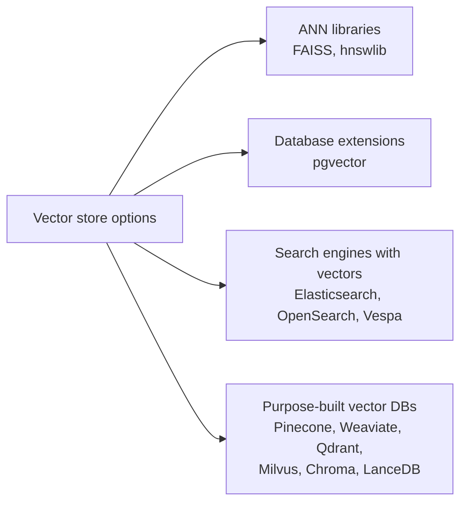
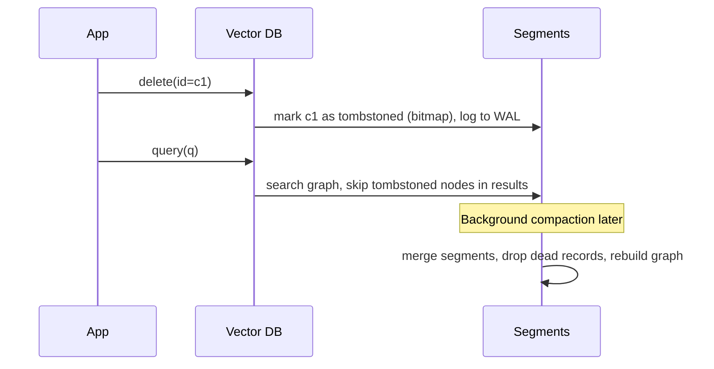
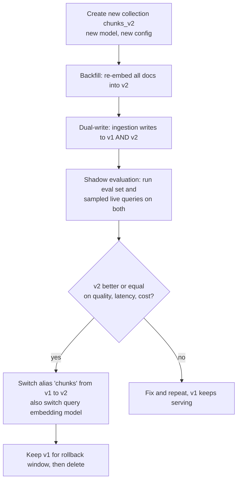
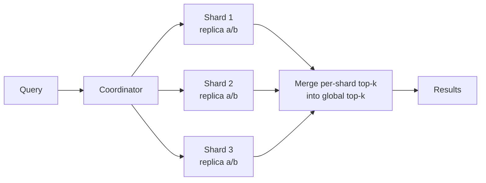
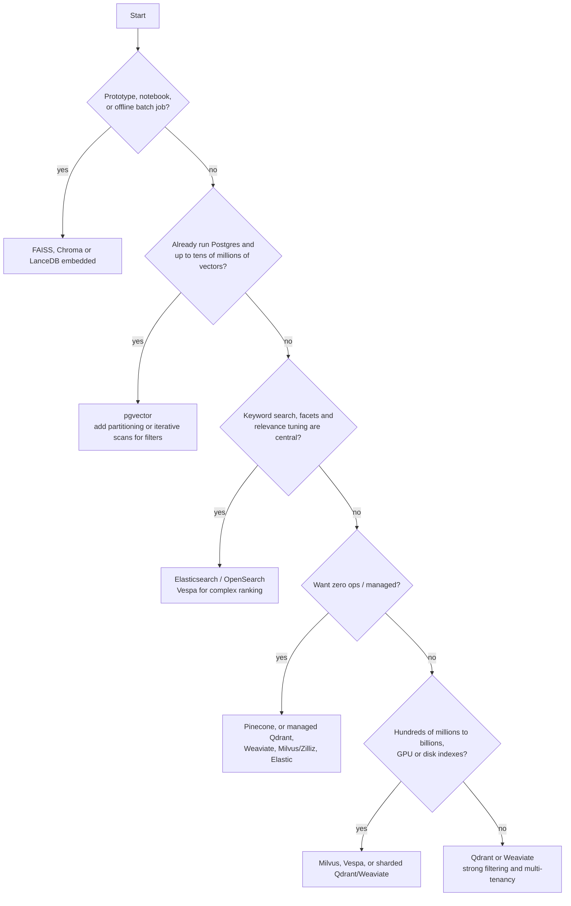

# Vector Databases in Practice

> **Level:** Beginner to Advanced · **Study time:** ~120 min · **Prerequisites:** [Text Embeddings and Similarity Search](02-text-embeddings-and-similarity-search.md), [Retrieval Methods: BM25, Dense Retrieval and Hybrid Search](05-retrieval-bm25-dense-and-hybrid-search.md), [Vector Search Algorithms: Exact kNN, HNSW, IVF and Product Quantization](06-vector-search-ann-hnsw-ivf-and-product-quantization.md)

## Table of contents

- [Why this matters](#why-this-matters)
- [From an ANN library to a vector database](#from-an-ann-library-to-a-vector-database)
- [The running example](#the-running-example)
- [The landscape: four families of vector stores](#the-landscape-four-families-of-vector-stores)
- [Comparing the main systems by architecture](#comparing-the-main-systems-by-architecture)
- [Designing the chunk record](#designing-the-chunk-record)
- [Hands-on: pgvector with SQL](#hands-on-pgvector-with-sql)
- [Hands-on: Python clients](#hands-on-python-clients)
- [Metadata filtering: pre, post and in-graph](#metadata-filtering-pre-post-and-in-graph)
- [Hybrid search inside the database](#hybrid-search-inside-the-database)
- [Multi-tenancy: collections, namespaces and partitions](#multi-tenancy-collections-namespaces-and-partitions)
- [The write path: upserts, deletes, tombstones and compaction](#the-write-path-upserts-deletes-tombstones-and-compaction)
- [Consistency and freshness](#consistency-and-freshness)
- [Index rebuilds and reindexing](#index-rebuilds-and-reindexing)
- [Scaling to millions and billions of vectors](#scaling-to-millions-and-billions-of-vectors)
- [Operating a vector database in production](#operating-a-vector-database-in-production)
- [Choosing a vector store: a decision guide](#choosing-a-vector-store-a-decision-guide)
- [Common mistakes and misconceptions](#common-mistakes-and-misconceptions)
- [Interview questions and model answers](#interview-questions-and-model-answers)
- [Key takeaways](#key-takeaways)
- [Further reading](#further-reading)
- [Next](#next)

## Why this matters

The previous chapter taught you the algorithms (HNSW, IVF, product quantization) that find nearest neighbors fast. But an algorithm is not a system. In production, your RAG index must accept new documents every minute, forget deleted ones immediately (sometimes for legal reasons), never show tenant A's data to tenant B, survive a machine dying, and answer in tens of milliseconds while doing all of that. That is the job of a **vector database**. Interviewers for senior AI roles almost always ask some version of "which vector store would you pick and why?", "how do you filter by permissions?" or "how would you scale to 100 million chunks?", and they are listening for whether you understand the engineering around the index, not just the index itself.

## From an ANN library to a vector database

> **Analogy:** An ANN library is a brilliant librarian with a photographic memory who can instantly point to the 10 books most similar to the one in your hand. A vector database is the whole library: the librarian, plus the building, the catalog cards saying who may borrow what, the returns desk, the fire insurance, the photocopied backup of the catalog, and the rule that new books are on the shelves by tomorrow morning.

Quick recap of terms from earlier chapters:

- An **embedding** is a list of numbers (a vector) that represents the meaning of a piece of text, so that similar texts get nearby vectors (see [Text Embeddings and Similarity Search](02-text-embeddings-and-similarity-search.md)).
- **k-nearest-neighbor (kNN) search** finds the $k$ stored vectors closest to a query vector. **Approximate nearest neighbor (ANN) search** finds *almost* the closest ones, much faster, using an **index** (a data structure such as an HNSW graph) (see [Vector Search Algorithms](06-vector-search-ann-hnsw-ivf-and-product-quantization.md)).
- **Recall@k** for ANN means: of the true top-$k$ neighbors, what fraction did the ANN index return? If exact search says the top 10 are some set and the index returns 8 of them, recall@10 is $8/10 = 0.8$.

An **ANN library** (FAISS, hnswlib) is code you import into your process. You give it a matrix of vectors, it builds an index in memory, and it answers "give me the $k$ nearest row numbers". That is all.

A **vector database** is a server (or managed service) that stores records containing vectors *and* the data around them, and wraps the ANN index with the features every real database needs. Precisely, it adds:

| Capability | What it means | Why RAG needs it |
|---|---|---|
| **CRUD** (Create, Read, Update, Delete) by ID | Insert, fetch, update and delete individual records by a stable key | Documents change; you must replace one chunk without rebuilding everything |
| **Persistence and durability** | Data is written to disk (often via a **write-ahead log**, WAL: an append-only log written before applying a change, so a crash can be replayed) | A restart must not lose the index |
| **Metadata storage** | Each vector carries a **payload** (also called metadata or attributes): tenant, document ID, date, permissions | You need to show the source, filter, and audit |
| **Metadata filtering** | Search restricted to records matching conditions like `tenant_id = 'acme' AND year >= 2024` | Security, freshness, scoping by product or language |
| **Hybrid search** | Combine keyword (BM25) and vector scores in one query | Exact identifiers and rare terms (see [chapter 5](05-retrieval-bm25-dense-and-hybrid-search.md)) |
| **Replication** | Several copies of the data on different machines | Survive failures, serve more queries per second |
| **Sharding** | Splitting data across machines | Corpus bigger than one machine's memory |
| **Access control** | Authentication, roles, per-collection or per-row permissions | Multi-tenant SaaS, compliance |
| **Backups and snapshots** | Point-in-time copies you can restore | Disaster recovery, safe migrations |
| **Concurrency** | Reads and writes at the same time without corrupting the index | Live ingestion while users query |
| **Observability** | Metrics, query logs, index stats | Debugging slow or bad retrieval |

> **Senior insight:** The hard parts of a vector database are not the ANN algorithm (FAISS and hnswlib are excellent and free). The hard parts are filtering correctly, handling updates and deletes inside a graph index that was designed for static data, and doing all of it distributed. That is where products genuinely differ.

## The running example

We reuse the IT-support knowledge base from [chapter 5](05-retrieval-bm25-dense-and-hybrid-search.md), now as a multi-tenant SaaS product with two customer companies (**tenants**): **Acme** and **Globex**. Each chunk has a toy 3-dimensional embedding (real models typically use 384 to 3,072 dimensions, some even more, but 3 lets us compute by hand).

```text
id   tenant   doc    text                                        embedding
c1   acme     doc1   "Reset your password from the login page"   [0.90, 0.30, 0.00]
c2   acme     doc1   "Passwords expire every 90 days"            [0.80, 0.10, 0.20]
c3   acme     doc2   "Error E401 means invalid credentials"      [0.70, 0.50, 0.10]
c4   acme     doc3   "Change login credentials in settings"      [0.85, 0.35, 0.05]
c5   acme     doc4   "VPN setup for remote staff"                [0.10, 0.90, 0.30]
c6   globex   doc5   "Globex password reset via help desk"       [0.60, 0.20, 0.70]
c7   acme     doc6   "Office printer driver install"             [0.00, 0.20, 1.00]
c8   acme     doc7   "Laptop refresh policy"                     [0.20, 0.10, 0.90]
```

The query is "I forgot my password", embedded as $q = [1.0, 0.2, 0.0]$. We score with **cosine similarity**:

$$\cos(q, c) = \frac{q \cdot c}{\lVert q \rVert \, \lVert c \rVert}$$

- $q \cdot c$ is the **dot product**: multiply matching entries and add them up.
- $\lVert q \rVert$ is the **length (norm)** of $q$: the square root of the sum of its squared entries.
- The result ranges from -1 (opposite) to 1 (same direction).

Worked example for c6 (the only Globex chunk):

- Dot product: $1.0 \times 0.6 + 0.2 \times 0.2 + 0.0 \times 0.7 = 0.60 + 0.04 + 0 = 0.64$
- $\lVert q \rVert = \sqrt{1.0^2 + 0.2^2 + 0^2} = \sqrt{1.04} \approx 1.0198$
- $\lVert c6 \rVert = \sqrt{0.36 + 0.04 + 0.49} = \sqrt{0.89} \approx 0.9434$
- Cosine: $0.64 / (1.0198 \times 0.9434) = 0.64 / 0.9621 \approx 0.665$

Doing the same for all eight chunks gives this ranking:

```text
rank  id   tenant   cosine
1     c1   acme     0.992
2     c4   acme     0.980
3     c2   acme     0.968
4     c3   acme     0.906
5     c6   globex   0.665
6     c5   acme     0.288
7     c8   acme     0.233
8     c7   acme     0.038
```

Keep this table in mind. When a **Globex** user asks this question, the correct answer is c6, which sits at rank 5 overall. That single fact will drive the whole filtering section.

## The landscape: four families of vector stores

Almost every product falls into one of four families. Learn the families first; individual products change every year, the families do not.



Terms you will meet in the next two tables (the rest are defined where they are used):

- **OLTP** (online transaction processing): an application's normal stream of small reads and writes, such as orders and logins.
- **ACID transactions:** a group of writes that either all happen or none do, and that other queries never see half-done.
- **Lucene:** the open-source Java search library underneath Elasticsearch and OpenSearch.
- **Segment:** a chunk of a collection with its own small index; systems write new segments and merge old ones (explained under "how writes are handled" below).
- **Faceting:** counting results per category ("Policy (12), FAQ (4)") so users can narrow a search.
- **Sparse vector:** a very long vector that is mostly zeros, one slot per vocabulary term, as produced by BM25 or learned sparse models; the opposite of a dense embedding.
- **DiskANN:** a graph index designed to keep most data on SSD instead of RAM (covered in the scaling section).
- **Pre-filtering / post-filtering:** applying a metadata condition before or after the vector search (the whole filtering section is about this).

| Family | What it is | When to use | Pros | Cons |
|---|---|---|---|---|
| **ANN library** | In-process index you import (C++ with Python bindings) | Research, offline batch jobs, embedding inside your own service, building blocks for other systems | Fastest raw search, full control, free, GPU support (FAISS) | No metadata, no persistence beyond saving a file, no replication, limited deletes; you build everything else |
| **Database extension** | Vector type and ANN index added to an existing general-purpose database | You already run Postgres; up to roughly tens of millions of vectors on one node (illustrative, depends heavily on hardware and dims) | One system for vectors, metadata, joins, transactions, backups, row-level security; mature ops | Vector search shares resources with OLTP traffic; scaling beyond one node is your problem; filter handling depends on the query planner |
| **Search engine with vectors** | Full-text search engine that added dense vector fields and ANN | You need strong keyword search, faceting and relevance tuning alongside vectors | Best-in-class BM25, analyzers, aggregations, mature distributed ops, hybrid search built in | Heavier to run, JVM tuning (Elasticsearch, OpenSearch), vector features evolved later than keyword ones |
| **Purpose-built vector DB** | A database designed around vectors from day one | Vector search is the core workload, large scale, heavy filtering, or you want a managed service | Vector-first features (quantization, filtered HNSW, multi-vector, multi-tenancy), simple APIs | Another system to operate and secure; weaker joins and transactions than a relational DB; vendor maturity varies |

> **Interview tip:** When asked "which vector DB?", do not name a product first. Name the family that fits the constraints ("we already run Postgres and have 5 million chunks, so a database extension"), then a product. It shows you reason from requirements.

## Comparing the main systems by architecture

Published benchmark numbers for vector databases are notoriously hard to compare: they depend on dataset, dimensions, recall target, filters, hardware, concurrency and which version was tested, and many are run by vendors. So we compare by **architecture and features**, which is durable and what interviewers want. Features below reflect the general state as of 2026; vendors ship quickly, so always confirm in the current docs.

| System | Family | Architecture in one line | Notable features | Watch-outs |
|---|---|---|---|---|
| **FAISS** (Meta) | Library | C++ library with Python bindings; many index types (Flat, IVF, PQ, HNSW, combos); CPU and GPU | GPU indexes, compressed indexes for billions of vectors, `IDSelector` for search-time filtering on some index types | No metadata store; deletion (`remove_ids`) unsupported for HNSW indexes; persistence is "write the index to a file" |
| **hnswlib** | Library | Header-only C++ HNSW with Python bindings | Simple, fast HNSW; `mark_deleted`, optional slot reuse for deleted elements, filter callback in recent versions | HNSW only; single process; you handle metadata and durability |
| **pgvector** | DB extension | Postgres extension adding `vector`, `halfvec` and `sparsevec` types (plus vector operators and indexing for Postgres's built-in `bit` type) and HNSW and IVFFlat indexes | SQL, joins, ACID transactions, WAL, streaming replication, point-in-time recovery, row-level security; iterative index scans for filtered queries (added in 0.8.0) | ANN index is post-filtered by default (see filtering section); HNSW/IVFFlat indexes on `vector` support at most 2,000 dimensions (use `halfvec`, up to 4,000, for e.g. 3,072-dim embeddings); index build and vacuum on large HNSW indexes can be slow; scale-out needs partitioning or extensions |
| **Elasticsearch** | Search engine | Distributed Lucene shards; `dense_vector` fields indexed with HNSW per segment | Filters applied during kNN search, hybrid with RRF, vector quantization options, mature security and snapshots | Lucene segments mean many small HNSW graphs that merge over time; memory planning matters; some features depend on license tier |
| **OpenSearch** | Search engine | Fork of Elasticsearch; k-NN plugin with pluggable engines (Lucene, FAISS) | Hybrid query with score normalization pipelines, choice of engine and index type, Apache 2.0 | Engine choice affects which filtering and quantization features you get |
| **Vespa** | Search engine | Distributed serving engine with tensors as first-class data, HNSW, and programmable multi-phase ranking | Real-time updates, ranking expressions that mix BM25, vectors and ML models at query time, automatic choice between pre- and post-filtering based on estimated hit ratio | Steeper learning curve; its own config and schema language |
| **Pinecone** | Purpose-built, managed | Fully managed SaaS; serverless offering separates storage (object storage) from compute | Namespaces for multi-tenancy, metadata filtering, sparse-dense hybrid, no servers to run | Proprietary and cloud-only; you trade control and data residency options for zero ops; cost model differs from self-hosting |
| **Weaviate** | Purpose-built | Open-source (Go); HNSW plus flat and dynamic indexes; inverted index for filters and BM25 | Native multi-tenancy (one shard per tenant, tenants can be deactivated or offloaded), built-in hybrid search, optional vectorizer modules, filter strategies including ACORN-style search | Many tenants and modules need capacity planning; module behavior is version-specific |
| **Qdrant** | Purpose-built | Open-source (Rust); segments with HNSW and payload indexes; distributed mode with shards and replicas | Filterable HNSW with a query planner that falls back to payload-index scans for very selective filters, scalar/binary/product quantization, sparse and named vectors, collection aliases, snapshots | You must create payload indexes on filtered fields; distributed mode needs shard planning |
| **Milvus** | Purpose-built | Open-source, cloud-native distributed system: stateless proxies, separate query, data and index workers, object storage for segments, a log for writes | Widest index menu (HNSW, IVF variants, DiskANN, GPU indexes), partitions and partition keys, tunable consistency levels, scales to billions | Most components to operate when self-hosted (a managed version exists from Zilliz) |
| **Chroma** | Purpose-built | Open-source, developer-first; runs embedded in Python or as a server (managed cloud also offered) | Very easy start, `where` metadata filters, good for prototypes and local apps | Check current scaling and ops features before using it for large multi-tenant production |
| **LanceDB** | Purpose-built, embedded | Embedded library over the Lance columnar file format; data can live on local disk or object storage | No server needed, versioned datasets, IVF-PQ style disk-friendly indexes, multimodal data alongside vectors | Embedded model means concurrency and multi-writer patterns need care; managed offering differs from the OSS library |

Three architectural axes explain most of the differences:

1. **Where the index lives.** In RAM (classic HNSW: fast, expensive), on SSD (DiskANN-style or IVF-PQ: cheaper, slightly slower), or in object storage with a cache (serverless designs: cheapest storage, cold queries slower).
2. **How writes are handled.** Most systems write into a small mutable **segment** (a chunk of the collection with its own small index) and later merge segments in the background, like an LSM tree (log-structured merge tree, a storage design that buffers writes and merges sorted files later). Postgres instead updates rows in place under MVCC (explained below).
3. **How filters and vectors interact.** Bolted on (post-filter), integrated into the graph traversal, or chosen per query by a planner. This is the biggest quality difference for RAG and gets its own section.

## Designing the chunk record

Before picking a product, design what each record looks like. A good schema makes filtering, deletion, reindexing and auditing possible later; a bad one makes them impossible without a full rebuild.

Here is a production-grade RAG chunk record:

```json
{
  "id": "acme:doc1:v3:0002",
  "doc_id": "acme:doc1",
  "tenant_id": "acme",
  "acl": ["group:it-staff", "group:all-employees"],
  "text": "Passwords expire every 90 days. You will get an email 7 days before.",
  "embedding": [0.80, 0.10, 0.20],
  "embedding_model_version": "text-embed-v2@2026-03",
  "metadata": {
    "source_uri": "sharepoint://acme/it/password-policy.docx",
    "title": "Password policy",
    "section": "Expiry",
    "chunk_index": 2,
    "doc_version": 3,
    "language": "en",
    "doc_type": "policy",
    "created_at": "2025-11-02T10:00:00Z",
    "updated_at": "2026-02-14T08:30:00Z",
    "content_hash": "sha256:9f2c..."
  }
}
```

Why each field exists:

| Field | Purpose | What breaks without it |
|---|---|---|
| `id` | Stable, **deterministic** primary key (built from tenant, doc, version and chunk position, or a hash), so re-ingesting the same chunk overwrites instead of duplicating | Duplicate chunks after every re-run of the pipeline |
| `doc_id` | Groups all chunks of one source document | You cannot delete or replace "all chunks of doc1" in one operation |
| `tenant_id` | Hard isolation boundary between customers | Cross-tenant data leaks |
| `acl` | **Access control list**: which users or groups may see this chunk | Users retrieve documents they are not allowed to read |
| `text` | The chunk content sent to the LLM and shown as a citation | You must re-fetch from the source at query time (slow, fragile) |
| `embedding` | The vector used for ANN search | No search |
| `embedding_model_version` | Which model (and version) produced the vector | Mixing vectors from two models in one index silently destroys relevance; you cannot do safe migrations |
| `metadata.content_hash` | Hash of the text, to skip re-embedding unchanged chunks | Paying to re-embed everything every night |
| `metadata.doc_version`, `updated_at` | Freshness filters and "latest version only" logic | Old and new policy versions both retrieved, contradicting each other |
| `metadata.source_uri`, `title`, `section` | Citations and debugging | Users cannot verify answers |

> **Common mistake:** Using random UUIDs generated at ingestion time as chunk IDs. Every re-ingestion creates new IDs, so upserts never overwrite and the index fills with duplicates. Derive IDs deterministically from the source.

> **Senior insight:** Store `text` with the vector even if it duplicates your document store. Retrieval latency matters, and fetching text from a second system per chunk adds a network round trip and a new failure mode. Store large original documents elsewhere and keep a pointer (`source_uri`).

Two more design choices:

- **Which fields to index for filtering.** Fields you filter on (tenant, ACL, doc type, dates) need a **payload index** (a secondary index on metadata, like a B-tree or inverted index in a normal database). Fields you only display do not.
- **Vector dimension and precision.** Fixed per collection (or column) at creation time. Changing either means a new collection, which is why `embedding_model_version` matters.

## Hands-on: pgvector with SQL

**pgvector** is the most common starting point because so many teams already run Postgres. Here is the full schema for our chunk record. Real embeddings would be `vector(768)` or similar; we keep 3 dimensions to match the running example.

```sql
-- Requires the pgvector extension to be installed on the server.
CREATE EXTENSION IF NOT EXISTS vector;

CREATE TABLE chunks (
    id                       text PRIMARY KEY,
    doc_id                   text        NOT NULL,
    tenant_id                text        NOT NULL,
    acl                      text[]      NOT NULL DEFAULT '{}',
    text                     text        NOT NULL,
    embedding                vector(3)   NOT NULL,   -- e.g. vector(768) in real life
    embedding_model_version  text        NOT NULL,
    metadata                 jsonb       NOT NULL DEFAULT '{}',
    content_hash             text        NOT NULL,
    updated_at               timestamptz NOT NULL DEFAULT now(),
    -- full-text column for hybrid search, kept in sync automatically
    tsv tsvector GENERATED ALWAYS AS (to_tsvector('english', text)) STORED
);

-- ANN index: HNSW with cosine distance.
-- m = max neighbor links per node; ef_construction = candidate list size while building (chapter 6).
CREATE INDEX chunks_embedding_hnsw ON chunks
    USING hnsw (embedding vector_cosine_ops) WITH (m = 16, ef_construction = 64);

-- Payload indexes for filters.
CREATE INDEX chunks_tenant_idx ON chunks (tenant_id);
CREATE INDEX chunks_doc_idx    ON chunks (doc_id);
CREATE INDEX chunks_acl_idx    ON chunks USING gin (acl);
CREATE INDEX chunks_tsv_idx    ON chunks USING gin (tsv);
```

pgvector distance operators (each returns a *distance*, so smaller is closer):

| Operator | Meaning | Index opclass |
|---|---|---|
| `<->` | Euclidean (L2) distance | `vector_l2_ops` |
| `<#>` | *Negative* inner product (negated so that smaller is better) | `vector_ip_ops` |
| `<=>` | Cosine distance, equal to $1 - \cos$ | `vector_cosine_ops` |

For c6, cosine distance is $1 - 0.665 = 0.335$. The operator in your query must match the opclass of the index, or Postgres cannot use the index and silently falls back to a full scan.

**Idempotent upsert.** `ON CONFLICT` turns an insert into an update when the ID exists, and the `WHERE` clause skips the write when nothing relevant changed (content, permissions, embedding model or metadata; without the model check, re-embedding unchanged text with a new model would be silently skipped):

```sql
INSERT INTO chunks (id, doc_id, tenant_id, acl, text, embedding,
                    embedding_model_version, metadata, content_hash)
VALUES ($1, $2, $3, $4, $5, $6, $7, $8, $9)
ON CONFLICT (id) DO UPDATE SET
    acl                     = EXCLUDED.acl,
    text                    = EXCLUDED.text,
    embedding               = EXCLUDED.embedding,
    embedding_model_version = EXCLUDED.embedding_model_version,
    metadata                = EXCLUDED.metadata,
    content_hash            = EXCLUDED.content_hash,
    updated_at              = now()
WHERE chunks.content_hash IS DISTINCT FROM EXCLUDED.content_hash
   OR chunks.acl IS DISTINCT FROM EXCLUDED.acl
   OR chunks.embedding_model_version IS DISTINCT FROM EXCLUDED.embedding_model_version
   OR chunks.metadata IS DISTINCT FROM EXCLUDED.metadata;
```

(`$1 ... $9` are query parameters; your driver binds them. Never paste values into SQL strings.)

**Replacing a document** atomically, so readers never see half-old, half-new chunks:

```sql
BEGIN;
DELETE FROM chunks WHERE doc_id = 'acme:doc1';
-- INSERT the new chunks of acme:doc1 here
COMMIT;
```

**Filtered semantic search** for a Globex user in group `all-staff`:

```sql
SET hnsw.ef_search = 100;              -- size of the HNSW candidate list (default 40)
SET hnsw.iterative_scan = relaxed_order;  -- pgvector 0.8.0+: keep scanning if filters remove too many
                                          -- (relaxed_order may return rows slightly out of distance order;
                                          --  use strict_order, or re-sort in an outer query, if exact order matters)

SELECT id, doc_id, text,
       embedding <=> $1 AS cosine_distance
FROM chunks
WHERE tenant_id = 'globex'
  AND acl && ARRAY['group:all-staff']       -- "arrays overlap": user has at least one allowed group
  AND embedding_model_version = 'text-embed-v2@2026-03'
ORDER BY embedding <=> $1
LIMIT 5;
```

> **Common mistake:** Assuming the `WHERE tenant_id = 'globex'` clause makes the HNSW index search only Globex vectors. In pgvector the HNSW index scan produces up to `ef_search` nearest candidates from the *whole* table, and the `WHERE` clause is applied afterwards. That is post-filtering, and with a small tenant it can return fewer than 5 rows or none. Iterative scans (0.8.0+), a higher `ef_search`, partial indexes (an index built only over rows matching a condition, for example `CREATE INDEX ... WHERE tenant_id = 'globex'`) or table partitioning per tenant fix it. The next sections explain why.

## Hands-on: Python clients

### A from-scratch toy vector store

The fastest way to understand upserts, tombstones, compaction, and pre- versus post-filtering is to build a toy one. Exact search with NumPy, no ANN index, but the *mechanisms* are the real ones.

```python
# pip install numpy
import numpy as np

class MiniVectorStore:
    """A toy vector store: append-only storage + tombstones + filters."""

    def __init__(self, dim: int):
        self.dim = dim
        self.vectors = np.empty((0, dim), dtype=np.float32)  # row i = slot i
        self.ids: list[str] = []          # slot -> record id
        self.payloads: list[dict] = []    # slot -> metadata
        self.slot_of: dict[str, int] = {} # record id -> live slot
        self.tombstones: set[int] = set() # dead slots, skipped at query time

    def upsert(self, rid: str, vec, payload: dict) -> None:
        v = np.asarray(vec, dtype=np.float32)
        v = v / np.linalg.norm(v)                 # normalize once: dot = cosine
        if rid in self.slot_of:                   # update = tombstone old + append new
            self.tombstones.add(self.slot_of[rid])
        self.vectors = np.vstack([self.vectors, v])
        self.ids.append(rid)
        self.payloads.append(payload)
        self.slot_of[rid] = len(self.ids) - 1

    def delete(self, rid: str) -> None:
        slot = self.slot_of.pop(rid, None)
        if slot is not None:
            self.tombstones.add(slot)             # cheap: nothing is moved yet

    def _scores(self, q):
        q = np.asarray(q, dtype=np.float32)
        return self.vectors @ (q / np.linalg.norm(q))

    def search_post_filter(self, q, k, where, candidates):
        """ANN-style: take the top `candidates` first, THEN apply the filter."""
        scores = self._scores(q)
        top = np.argsort(-scores)[:candidates]
        hits = [(self.ids[i], round(float(scores[i]), 3)) for i in top
                if i not in self.tombstones and where(self.payloads[i])]
        return hits[:k]

    def search_pre_filter(self, q, k, where):
        """Filter FIRST, then exact search over the survivors."""
        allowed = [i for i in range(len(self.ids))
                   if i not in self.tombstones and where(self.payloads[i])]
        if not allowed:
            return []
        scores = self._scores(q)[allowed]
        order = np.argsort(-scores)[:k]
        return [(self.ids[allowed[j]], round(float(scores[j]), 3)) for j in order]

    def compact(self) -> None:
        """Physically drop tombstoned slots and rebuild the id -> slot map."""
        keep = [i for i in range(len(self.ids)) if i not in self.tombstones]
        self.vectors = self.vectors[keep]
        self.ids = [self.ids[i] for i in keep]
        self.payloads = [self.payloads[i] for i in keep]
        self.slot_of = {rid: s for s, rid in enumerate(self.ids)}
        self.tombstones.clear()


store = MiniVectorStore(dim=3)
data = [  # id, tenant, toy 3-d embedding
    ("c1", "acme",   [0.9, 0.3, 0.0]),   # Reset your password from the login page
    ("c2", "acme",   [0.8, 0.1, 0.2]),   # Passwords expire every 90 days
    ("c3", "acme",   [0.7, 0.5, 0.1]),   # Error E401 means invalid credentials
    ("c4", "acme",   [0.85, 0.35, 0.05]),# Change login credentials in settings
    ("c5", "acme",   [0.1, 0.9, 0.3]),   # VPN setup for remote staff
    ("c6", "globex", [0.6, 0.2, 0.7]),   # Globex password reset via help desk
    ("c7", "acme",   [0.0, 0.2, 1.0]),   # Office printer driver install
    ("c8", "acme",   [0.2, 0.1, 0.9]),   # Laptop refresh policy
]
for rid, tenant, vec in data:
    store.upsert(rid, vec, {"tenant_id": tenant})

q = [1.0, 0.2, 0.0]                       # "forgot my password"
is_globex = lambda p: p["tenant_id"] == "globex"

print(store.search_post_filter(q, k=3, where=is_globex, candidates=3))
# []                <- post-filtering: top 3 were all Acme, filter removed them all
print(store.search_pre_filter(q, k=3, where=is_globex))
# [('c6', 0.665)]   <- pre-filtering finds the only Globex chunk

store.delete("c1")                        # tombstone, not yet removed
print(len(store.ids), len(store.tombstones))
# 8 1
print(store.search_pre_filter(q, k=2, where=lambda p: p["tenant_id"] == "acme"))
# [('c4', 0.98), ('c2', 0.968)]   <- c1 is invisible even though still stored
store.compact()
print(len(store.ids), len(store.tombstones))
# 7 0
```

Notice three things that real systems also do: an update is "delete old plus insert new"; a delete is just a mark until compaction; and post-filtering can silently return nothing.

### A generic client interface

Every vector database client, whatever the vendor, boils down to the same handful of operations. Coding your application against a small interface like this keeps you able to switch stores later (and makes testing easy, since the toy store above can implement it):

```python
from typing import Any, Protocol, Sequence

class VectorStore(Protocol):
    def upsert(self, records: Sequence[dict[str, Any]]) -> None: ...
    def delete(self, *, ids: Sequence[str] | None = None,
               where: dict[str, Any] | None = None) -> None: ...
    def query(self, vector: Sequence[float], *, k: int,
              where: dict[str, Any] | None = None) -> list[dict[str, Any]]: ...

def retrieve(store: VectorStore, embed, question: str, user) -> list[dict]:
    """Application code depends only on the interface, not on a vendor SDK."""
    return store.query(
        embed(question),
        k=5,
        where={"tenant_id": user.tenant_id,        # isolation: always server-derived
               "acl": {"any_of": user.groups},     # permissions
               "embedding_model_version": "text-embed-v2@2026-03"},
    )
```

### pgvector from Python

```python
# pip install "psycopg[binary]" pgvector numpy
import numpy as np
import psycopg
from pgvector.psycopg import register_vector

SEARCH_SQL = """
SELECT id, text, embedding <=> %s AS dist
FROM chunks
WHERE tenant_id = %s AND acl && %s::text[]
ORDER BY embedding <=> %s
LIMIT %s
"""

def search(conn, qvec: np.ndarray, tenant: str, groups: list[str], k: int = 5):
    return conn.execute(SEARCH_SQL, (qvec, tenant, groups, qvec, k)).fetchall()

with psycopg.connect("postgresql://localhost/rag", autocommit=True) as conn:
    register_vector(conn)                    # teaches psycopg the vector type
    conn.execute("SET hnsw.ef_search = 100")
    rows = search(conn, np.array([1.0, 0.2, 0.0]), "globex", ["group:all-staff"])
    for rid, text, dist in rows:
        print(rid, round(1 - dist, 3), text)   # convert distance back to cosine
```

### A purpose-built vector DB client (Qdrant)

Vendor SDKs change faster than SQL. The code below matches recent `qdrant-client` releases (1.10 and later, which introduced `query_points`); treat it as realistic but check the docs for your version. `QdrantClient(":memory:")` runs an in-process local mode, which is handy for tests.

```python
# pip install qdrant-client
from qdrant_client import QdrantClient, models

client = QdrantClient(":memory:")   # local mode; use QdrantClient(url=...) for a server
client.create_collection(
    collection_name="chunks_v1",
    vectors_config=models.VectorParams(size=3, distance=models.Distance.COSINE),
)
# On a real server, index every payload field you filter on.
client.create_payload_index(collection_name="chunks_v1", field_name="tenant_id",
                            field_schema=models.PayloadSchemaType.KEYWORD)

data = [  # (chunk_id, tenant, doc_id, vector) from the running example
    ("c1", "acme", "doc1", [0.9, 0.3, 0.0]),  ("c2", "acme", "doc1", [0.8, 0.1, 0.2]),
    ("c3", "acme", "doc2", [0.7, 0.5, 0.1]),  ("c4", "acme", "doc3", [0.85, 0.35, 0.05]),
    ("c5", "acme", "doc4", [0.1, 0.9, 0.3]),  ("c6", "globex", "doc5", [0.6, 0.2, 0.7]),
    ("c7", "acme", "doc6", [0.0, 0.2, 1.0]),  ("c8", "acme", "doc7", [0.2, 0.1, 0.9]),
]
client.upsert(collection_name="chunks_v1", points=[
    models.PointStruct(id=i, vector=vec,
                       payload={"chunk_id": rid, "tenant_id": t, "doc_id": d})
    for i, (rid, t, d, vec) in enumerate(data, start=1)   # ids: int or UUID
])

tenant_filter = models.Filter(must=[
    models.FieldCondition(key="tenant_id", match=models.MatchValue(value="globex"))
])
res = client.query_points(collection_name="chunks_v1", query=[1.0, 0.2, 0.0],
                          query_filter=tenant_filter, limit=3)
for p in res.points:
    print(p.payload["chunk_id"], round(p.score, 3))
# c6 0.665   <- filter is applied during search, not after

# Delete every chunk of one document by filter:
client.delete(collection_name="chunks_v1", points_selector=models.FilterSelector(
    filter=models.Filter(must=[models.FieldCondition(
        key="doc_id", match=models.MatchValue(value="doc1"))])))
```

## Metadata filtering: pre, post and in-graph

### Why filters matter

> **Analogy:** You ask a librarian for "books like this one, but only in Spanish and only ones I am allowed to borrow". If the librarian first fetches the 10 most similar books and *then* throws away the non-Spanish ones, you might leave with nothing, even though great Spanish books exist on shelf 40.

A **metadata filter** is a condition on the payload (tenant, permissions, date, language, document type, product) that every returned record must satisfy. Filters are useful whenever **relevance is not only about meaning**:

- **Security and isolation:** tenant ID and ACLs. These are not optional; they are correctness requirements.
- **Freshness and versioning:** "only the current version of each policy", "documents updated after 2025".
- **Scoping:** product line, region, language, document type ("only search the API reference").
- **User intent made explicit:** facets the UI exposes ("filter by team"), or constraints an LLM extracts from the query ("Q3 2025 sales report" becomes `quarter = '2025-Q3'`, a technique called **self-query** retrieval).
- **Precision boost:** narrowing the candidate set removes semantically similar but wrong-context chunks (the 2019 policy that looks just like the 2026 one).
- **Operations:** restricting to the right `embedding_model_version` during a migration.

### The key number: selectivity

The **selectivity** $s$ of a filter is the fraction of records that pass it:

$$s = \frac{\text{number of records matching the filter}}{\text{total number of records}}$$

In our running example, the Globex filter matches 1 of 8 chunks, so $s = 1/8 = 0.125$. In a SaaS product with 1,000 tenants of similar size, a tenant filter has $s \approx 0.001$. Low $s$ means a **restrictive** (highly selective) filter. Selectivity decides which strategy works.

### Strategy 1: post-filtering

**Post-filtering** runs ANN search first to get $k'$ candidates (some multiple of $k$), then drops the ones failing the filter.

If filter matches were spread randomly among the candidates, the expected number of survivors is:

$$E[\text{survivors}] = k' \cdot s$$

and the probability that **none** survive is:

$$P(\text{zero results}) = (1 - s)^{k'}$$

- $k'$ is the candidate count fetched before filtering.
- $s$ is the filter selectivity.
- $(1-s)$ is the chance one candidate fails the filter; raising it to $k'$ assumes the candidates are independent (a simplification, but a useful one).

Worked example 1: $k' = 100$, $s = 0.01$ (a tenant owning 1% of the data).

- Expected survivors: $100 \times 0.01 = 1$. You asked for $k = 10$ and expect to get about 1.
- $P(\text{zero}) = 0.99^{100}$. Since $\ln 0.99 \approx -0.01005$, we get $e^{100 \times -0.01005} = e^{-1.005} \approx 0.366$. About a 37% chance of returning nothing.

Worked example 2: $k' = 100$, $s = 0.001$ (one of 1,000 tenants).

- Expected survivors: $100 \times 0.001 = 0.1$.
- $P(\text{zero}) = 0.999^{100} \approx e^{-0.10005} \approx 0.905$. About a 90% chance of returning nothing.

To expect $k$ survivors you need $k' \approx k / s$. For $k = 10$ and $s = 0.001$ that is $10{,}000$ candidates per query, which defeats the point of ANN.

And reality is often *worse* than the random model: filters are usually **correlated** with the query. Our running example shows this: the query is about passwords, Acme has many password chunks, so the top candidates are all Acme and the post-filter returned `[]` for Globex even though Globex's chunk was relevant. Correlation can also help (if a filter matches records that are similar to the query, survivors are plentiful), which is exactly why behavior is unpredictable.

> **Common mistake:** Saying "post-filtering just returns slightly fewer results". It can return **zero** results while relevant matching data exists, and because the user sees a confident LLM answer ("I could not find any information about that"), nobody notices. This is one of the most common silent RAG failures.

### Strategy 2: pre-filtering

**Pre-filtering** first computes the set of records that pass the filter (using a payload index), then searches only among them.

- If the matching set is **small**, just do an exact brute-force scan over it: perfect recall and cheap. Scanning 1,000 matching vectors of 768 dims is about $1{,}000 \times 768 = 768{,}000$ multiply-adds, trivial for a CPU.
- If the matching set is **large**, brute force gets expensive, and you need an index that can search a *subset*. You can pass the allow-list (a bitmap of permitted IDs) into the ANN search, which leads to strategy 3.

### Strategy 3: filtered (in-graph) search

**In-graph filtering** (also called filtered HNSW or single-stage filtering) walks the HNSW graph normally but only *accepts* nodes that pass the filter into the result list, while still being allowed to *traverse through* non-matching nodes to reach matching ones.

```text
HNSW traversal with an allow-list (A = Acme, G = Globex, user is Globex)

   entry -> [A] -> [A] -> [A] -> [G]*   <- traverse through A nodes,
                     \                      collect only G nodes
                      [A] -> [G]*
```

It works well for moderate selectivity. It breaks down when the filter is very restrictive: almost every neighbor is rejected, the search wanders through huge numbers of non-matching nodes, and the matching nodes may not be well connected to each other (the graph was built without knowing about filters). Production systems handle this in several ways:

- **Query planning by cardinality:** estimate how many records match (from the payload index); if few, switch to brute force over the matches; if many, use filtered HNSW. Qdrant and Vespa both do this kind of switching, and Postgres's planner can choose between the HNSW index and a B-tree plus exact scan.
- **Filter-aware graph construction:** add extra edges between nodes that share a frequently filtered value, so the subgraph for each value stays connected. See "Filtered-DiskANN" (Gollapudi et al., 2023) and "ACORN: Performant and Predicate-Agnostic Search Over Vector Embeddings and Structured Data" (Patel et al., 2024).
- **Physical partitioning:** if a filter is *always* present (like tenant), do not filter at all: give each tenant its own partition or index (next section).

| Strategy | How it works | Best when | Pros | Cons |
|---|---|---|---|---|
| Post-filter | ANN top-$k'$, then drop non-matching | Filter matches most records ($s$ close to 1) | Simple, works with any ANN library | Too few or zero results for selective filters; must over-fetch |
| Pre-filter + brute force | Payload index finds matches, exact scan over them | Very selective filters (small match set) | Exact recall, predictable | Cost grows linearly with match count |
| Pre-filter + allow-list into ANN (in-graph) | Traverse graph, accept only allowed nodes | Moderate selectivity | Good recall and speed in the middle range | Degrades for very restrictive filters unless graph is filter-aware |
| Planner-chosen hybrid | Estimate cardinality, pick one of the above per query | General production workloads | Robust across selectivities | Needs payload indexes and good statistics |
| Partition by filter value | Separate index per tenant or value | Filter always present, few distinct values per query | No filtering cost, strong isolation | Many small indexes to manage |

> **Interview tip:** A crisp line to use: "Post-filtering fails on selective filters, brute force fails on broad filters, and good engines estimate selectivity and pick the strategy per query. For tenant isolation I would not filter at all, I would partition."

### How to measure filtered retrieval

Compute recall@k **per filter selectivity bucket**, against exact filtered search as ground truth. A system can show 0.98 recall unfiltered and much lower recall for queries with a 0.1% selectivity filter (illustrative). Also track the fraction of queries returning fewer than $k$ results; a non-zero rate on queries where enough matching data exists is a red flag for post-filtering.

## Hybrid search inside the database

[Chapter 5](05-retrieval-bm25-dense-and-hybrid-search.md) owns hybrid search; here is what it looks like inside a database. The most common fusion method is **Reciprocal Rank Fusion (RRF)**:

$$\text{RRF}(d) = \sum_{r \in \text{retrievers}} \frac{1}{k_{\text{rrf}} + \text{rank}_r(d)}$$

- $\text{rank}_r(d)$ is the position of document $d$ in retriever $r$'s list (1 = best); a retriever that did not return $d$ contributes 0.
- $k_{\text{rrf}}$ is a smoothing constant, conventionally 60 (chapter 5 calls it $k$; we add a subscript here so it is not confused with the top-$k$ result count).

Tiny example: c4 is rank 2 in the vector list and rank 1 in the keyword list: $\frac{1}{62} + \frac{1}{61} \approx 0.01613 + 0.01639 = 0.03252$. c1 is rank 1 in the vector list only: $\frac{1}{61} \approx 0.01639$. So c4 wins after fusion.

In pgvector you can do it in one SQL statement using Postgres full-text search (note that `ts_rank_cd` is Postgres's own ranking function, not BM25):

```sql
WITH semantic AS (
    SELECT id, RANK() OVER (ORDER BY embedding <=> $1) AS rnk
    FROM chunks
    WHERE tenant_id = $2
    ORDER BY embedding <=> $1
    LIMIT 20
),
keyword AS (
    SELECT id, RANK() OVER (ORDER BY ts_rank_cd(tsv, query) DESC) AS rnk
    FROM chunks, plainto_tsquery('english', $3) AS query
    WHERE tenant_id = $2 AND tsv @@ query
    ORDER BY ts_rank_cd(tsv, query) DESC
    LIMIT 20
)
SELECT COALESCE(s.id, k.id) AS id,
       COALESCE(1.0 / (60 + s.rnk), 0) + COALESCE(1.0 / (60 + k.rnk), 0) AS rrf_score
FROM semantic s
FULL OUTER JOIN keyword k ON s.id = k.id
ORDER BY rrf_score DESC
LIMIT 5;
```

Elasticsearch, OpenSearch, Vespa, Weaviate, Qdrant, Milvus and Pinecone all offer some form of built-in hybrid search (dense plus BM25 or dense plus learned sparse vectors); the exact query syntax is version-specific. The durable point: if hybrid matters to you (it usually does in enterprise RAG), prefer a store that does both in one query with shared filters, rather than two systems whose filters can drift apart.

## Multi-tenancy: collections, namespaces and partitions

**Multi-tenancy** means one deployment serves many customers whose data must never mix. Vendors use different words for similar ideas:

- A **collection** (Qdrant, Milvus, Chroma), **index** (Elasticsearch, OpenSearch, Pinecone) or **class/collection** (Weaviate) is a top-level container with its own schema and vector config, like a table.
- A **namespace** (Pinecone) is a named partition inside an index; queries target exactly one namespace.
- A **partition** (Milvus partitions and partition keys, Postgres table partitions) or **shard** physically groups records so a query can skip the rest. Weaviate's native multi-tenancy gives each tenant its own shard.

Three patterns:

```text
(A) Collection per tenant      (B) Partition/namespace per tenant   (C) Shared collection + filter
+---------+ +---------+        +---------------------------+        +---------------------------+
| acme    | | globex  |        | chunks                    |        | chunks                    |
| index   | | index   |        | [ns: acme ] [ns: globex ] |        | acme,globex,... mixed     |
+---------+ +---------+        +---------------------------+        | WHERE tenant_id = ?       |
                                                                    +---------------------------+
```

| Pattern | Isolation | Scales to | Pros | Cons |
|---|---|---|---|---|
| (A) Collection or index per tenant | Strongest (separate index, can be separate keys, regions, backups) | Tens to low thousands of tenants (each collection has fixed overhead) | Easy deletion of a tenant, per-tenant tuning, noisy-neighbor control | Overhead per collection, painful schema migrations across thousands of collections |
| (B) Namespace or partition per tenant | Strong logical isolation; query only touches one partition | Many thousands to millions of tenants, depending on system | No filter selectivity problem, cheap tenant deletion, small per-tenant overhead | Vendor-specific limits; cross-tenant queries (rare) are harder |
| (C) Shared collection + `tenant_id` filter | Weakest: one missing `WHERE` leaks data | Unlimited tenants | Simplest, efficient for many tiny tenants | Selective filter problem for small tenants, noisy neighbors (one tenant's heavy load slows everyone), risky if filter is forgotten |

Common production blend: pattern (B) or (C) for the long tail of small tenants, pattern (A) for a few huge or regulated tenants. Note how this links to filtering: partitioning by tenant converts the hardest filter (very selective, always present) into no filter at all.

> **Senior insight:** Never let the client choose its tenant. Derive `tenant_id` and the user's groups on the server from the authenticated session, and inject them into every query in one central retrieval function. Defense in depth: Postgres **row-level security** (RLS: a policy the database itself enforces on every query) or per-tenant API keys scoped to one collection or namespace. The full security design is in [Secure Multi-Tenant RAG](13-secure-multi-tenant-rag.md).

## The write path: upserts, deletes, tombstones and compaction

### Upserts

An **upsert** ("update or insert") writes a record by ID: if the ID exists it is replaced, otherwise created. It makes ingestion **idempotent** (running it twice gives the same result as once), which is essential because pipelines retry. Deterministic IDs plus upserts are the foundation of safe re-ingestion; the pipeline side is covered in [Production Ingestion Pipelines](12-production-ingestion-pipelines-at-scale.md).

A subtle trap: if a document shrinks from 12 chunks to 9, upserting the 9 new chunks leaves chunks 10, 11 and 12 behind as **orphans** that still get retrieved. Fix: delete by `doc_id` then insert (in a transaction where supported), or delete the IDs that exist for that `doc_id` but are not in the new set.

### Why deletes are hard in graph indexes

HNSW is a graph: each vector is a node linked to its neighbors. Physically removing a node leaves its neighbors with dangling links and can disconnect parts of the graph, hurting recall. So most systems do not remove it right away. Instead they use a **tombstone**: a marker saying "this record is deleted; skip it in results".



Tombstones have a cost. Tombstoned nodes still sit in the graph and are still visited during search; they just cannot be returned. If the candidate list has 10 entries and 30% are tombstoned, only 7 live results remain, so recall drops unless the system over-fetches. Search work is also wasted on dead nodes.

**Compaction** (also called merging or vacuuming) is the background job that rewrites segments without dead records and rebuilds their indexes. It costs CPU, memory and disk I/O, so it competes with queries. Systems typically trigger it when the deleted fraction of a segment exceeds a threshold.

How common systems handle this, in general terms:

| System type | Update/delete mechanism | Cleanup |
|---|---|---|
| Segment-based (Lucene in Elasticsearch/OpenSearch, Milvus, Qdrant) | Writes go to a new or mutable segment; deletes are bitmaps over immutable segments | Segment merges or compaction rebuild indexes without dead records |
| Weaviate (mutable per-shard HNSW) | Deletes add tombstones to the live graph; objects live in an LSM store | A background tombstone cleanup reconnects neighbors and removes dead nodes in place |
| Postgres (pgvector) | **MVCC** (multi-version concurrency control): an update writes a new row version; the old version becomes a **dead tuple** | `VACUUM` removes dead tuples and cleans index entries; can be slow on large HNSW indexes |
| hnswlib | `mark_deleted` hides a node; optional reuse of deleted slots for new inserts | Rebuild for a full clean-up |
| FAISS | `remove_ids` supported on flat and IVF indexes, not HNSW | Rebuild |

> **Senior insight:** "Deleted" and "gone" are different. For GDPR-style erasure requests (the EU privacy law gives people a right to have their personal data erased), a tombstoned vector still exists on disk, in snapshots and in backups. Your deletion SLA (service level agreement: the deadline you promise for the deletion to take effect) must include compaction and backup retention, and you should be able to *prove* a record no longer exists (for example, a periodic audit that searches for deleted `doc_id`s and checks segment stats).

### Metrics to watch on the write path

- Deleted-record ratio per segment or table (dead tuples in Postgres).
- Compaction backlog and duration.
- Indexing lag (see next section).
- Recall on a fixed evaluation set over time: a slow downward drift after heavy churn often means the graph needs compaction or a rebuild.

## Consistency and freshness

> **Analogy:** You post a photo and refresh your profile, and it is not there yet. A second later it appears. The system was *eventually consistent*.

**Consistency** answers: after a write is acknowledged, will the next read see it?

- **Strong consistency:** yes, always.
- **Read-your-writes (session) consistency:** the same client sees its own writes; others may see them slightly later.
- **Bounded staleness:** reads may be behind by at most some time window.
- **Eventual consistency:** reads will see the write *at some point*, with no guarantee when.

Vector databases often choose weaker consistency because building index structures on every write is expensive. For example, Lucene-based engines make new documents searchable at the next **refresh** (by default, about once per second in Elasticsearch), Milvus lets you choose a consistency level per query (Strong, Bounded, Session, Eventually), and Postgres gives normal transactional visibility on the primary (committed rows are visible to new statements), but asynchronous streaming read replicas lag behind, so reads routed to a replica are only eventually consistent. Managed services typically document their own freshness behavior; check it.

**Freshness** is the end-to-end question the business cares about: how long from "a document changed in the source" to "the new content is retrievable"? It is the sum of pipeline stages. Illustrative example:

```text
source change detected (CDC / webhook / poll)   5 s
queue wait                                      10 s
parse + chunk + embed                            2 s
upsert to vector DB                              1 s
index refresh / visibility                       1 s
-------------------------------------------------------
freshness lag                                   19 s   (illustrative)
```

Here **CDC** (change data capture) means streaming row-level changes out of a source database. Most of the lag is usually in the pipeline (polling intervals, queues, batch schedules), not the database. A nightly batch job means up to 24 hours of staleness no matter how fast the DB is.

Practical rules:

- Define a freshness **SLO** (service level objective, a target such as "95% of changes searchable within 5 minutes") and measure it by writing a canary document and timing when it becomes retrievable.
- Deletions and permission changes need a tighter SLO than new content: showing a revoked document is a security incident, showing a slightly old one is a quality issue. For the strictest cases, also check permissions at query time against the source of truth.
- If a user uploads a file and immediately asks about it, you need read-your-writes for that user (wait for the write acknowledgment plus refresh, or query with a strong consistency level).

## Index rebuilds and reindexing

**Reindexing** means building a new index (and often new embeddings) for the whole corpus. Triggers:

| Trigger | Re-embed needed? | Why |
|---|---|---|
| New embedding model or model version | Yes | Vectors from different models live in different spaces; their similarities are meaningless |
| Change of dimension or distance metric | Yes (dimension) / maybe (metric) | Collection config is fixed at creation |
| New chunking strategy | Yes | Chunks themselves change |
| HNSW parameter change (`M`, `ef_construction`) or quantization change | No, rebuild index only | Graph structure is set at build time |
| Heavy deletes and updates degraded recall | No, compact or rebuild | Graph quality decays with churn |
| IVF centroids no longer match data distribution | No, retrain and rebuild | IVF clusters were learned from old data |

> **Common mistake:** Upgrading the embedding model and re-embedding only *new* documents. Queries are embedded with the new model and compared against old vectors from a different space. Retrieval quality collapses silently. Never mix embedding models in one index; the `embedding_model_version` field exists so you can detect and prevent this.

### Zero-downtime reindexing: the blue-green pattern



Key details:

- An **alias** is a stable name pointing to a real collection or index (Elasticsearch, OpenSearch, Qdrant and Milvus support aliases; in Postgres you can use a view or swap table names in a transaction). The application always queries the alias, so cutover is one atomic switch.
- The **query embedding model must switch at the same moment** as the index. Version them together in config.
- Start dual-writes *before* the backfill finishes (or replay changes that happened during it), otherwise v2 misses updates and deletes made during the backfill.
- Budget the cost. Illustrative: 10 million chunks of about 400 tokens is $10{,}000{,}000 \times 400 = 4{,}000{,}000{,}000$ tokens. At an illustrative embedding price of \$0.02 per million tokens, that is $4{,}000 \times 0.02 = \$80$. At an illustrative 5,000 chunks per second of embedding throughput it takes $10{,}000{,}000 / 5{,}000 = 2{,}000$ seconds, about 33 minutes. Real prices and throughput vary widely; the point is to compute this before promising a migration date.
- During the overlap you pay for two indexes (double storage and memory).

## Scaling to millions and billions of vectors

### Step 1: do the memory math

The first scaling question is always memory. A float32 number takes 4 bytes, so one vector takes:

$$\text{bytes per vector} = d \times b$$

- $d$ is the number of dimensions.
- $b$ is bytes per dimension (4 for float32, 2 for float16, 1 for int8, $1/8$ for binary).

For $d = 768$, float32: $768 \times 4 = 3{,}072$ bytes.

| Corpus | float32 (4 B) | float16 (2 B) | int8 (1 B) | binary (1 bit) |
|---|---|---|---|---|
| 1M vectors | $10^6 \times 3{,}072$ = 3.07 GB | 1.54 GB | 0.77 GB | 0.096 GB |
| 100M vectors | 307.2 GB | 153.6 GB | 76.8 GB | 9.6 GB |

Check one cell: $100{,}000{,}000 \times 768 \times 1 = 76{,}800{,}000{,}000$ bytes = 76.8 GB. For binary: $768 / 8 = 96$ bytes per vector, $\times 10^8 = 9.6$ GB.

On top of raw vectors, an HNSW graph stores neighbor links. With $M = 16$, the bottom layer keeps up to $2M = 32$ neighbor IDs per node; at 4 bytes per ID that is about 128 bytes per vector, plus smaller upper layers and implementation overhead (illustrative; varies by implementation). Then add metadata, payload indexes and text.

So 1 million chunks fits comfortably on one machine. 100 million float32 vectors does not fit in a typical single server's RAM without compression.

### Step 2: the scaling toolbox

| Technique | What it does | Trade-off |
|---|---|---|
| **Quantization** (scalar int8, binary, product quantization) | Shrinks vectors 4x to 32x or more (see [chapter 6](06-vector-search-ann-hnsw-ivf-and-product-quantization.md)) | Some recall loss; usually fixed by **rescoring**: retrieve more candidates with compressed vectors, re-rank them with full-precision vectors kept on disk |
| **Disk-based indexes** (DiskANN-style graphs, IVF-PQ on SSD, memory-mapped segments) | Keep compressed vectors in RAM and full vectors on fast SSD | Higher latency per query than all-in-RAM; needs fast NVMe |
| **Smaller embeddings** | Use a model with fewer dims, or truncate Matryoshka-style embeddings (models trained so the first $n$ dims are still useful) | Possible quality loss; must evaluate |
| **Sharding** | Split the corpus across nodes; each holds a part | Every query fans out to all shards (scatter-gather) unless routed |
| **Replication** | Copy each shard to several nodes | More QPS and availability; multiplies memory cost |
| **Partitioning / routing** | Route queries to the relevant shard (by tenant, region, language) | Only works when queries carry the routing key |
| **Tiering** | Hot tenants or recent data in RAM, cold in disk or object storage | Cold queries are slower |
| **Caching** | Cache embeddings of frequent queries and their results | Invalidation on updates |

**Sharding** splits data so each node searches only its part; the coordinator merges the per-shard top-$k$ lists into a global top-$k$. **Replication** copies data so more nodes can answer queries in parallel. Rule of thumb: shard for **data size**, replicate for **query throughput and availability**.



### Step 3: watch the tail latency of fan-out

**Tail latency** is the latency of the slowest queries, usually reported as **p95** or **p99**: the time under which 95% or 99% of queries finish. Users and SLOs care about the tail, not the average.

With scatter-gather, a query is as slow as its **slowest** shard. If each shard independently has a 1% chance of a slow response (say, over 50 ms), then with 10 shards:

$$P(\text{at least one slow}) = 1 - 0.99^{10} = 1 - 0.904 = 0.096$$

So about 9.6% of queries are slow, even though each shard is slow only 1% of the time. This is the "tail at scale" effect (Dean and Barroso, "The Tail at Scale", 2013). Mitigations: fewer, larger shards; routing by tenant so most queries hit one shard; hedged requests to replicas; and tight per-shard timeouts with partial results.

### A worked sizing exercise (illustrative)

"Design retrieval for 50 million chunks, 768 dims, 200 QPS (queries per second), p95 under 100 ms, 2,000 tenants."

1. Raw float32: $5 \times 10^7 \times 3{,}072 = 1.536 \times 10^{11}$ bytes = 153.6 GB. Too big for comfort in one node's RAM.
2. Scalar int8 quantization: 38.4 GB in RAM for search, full vectors on SSD for rescoring. Plus graph links ($5 \times 10^7 \times 128$ bytes = 6.4 GB) and metadata.
3. Split into a few shards so each fits comfortably with headroom for compaction (which temporarily needs extra memory), and use 2 replicas for availability and throughput. For example, $38.4 + 6.4 \approx 45$ GB split over 3 shards is about 15 GB per shard; with 2 copies of each shard that is 6 shard copies, which could sit on 6 modest nodes or fewer larger ones.
4. Partition by tenant where the store supports it, so a typical query hits one shard and needs no selective filter.
5. Benchmark *your* data at *your* recall target with filters and concurrent writes before committing to node sizes.

## Operating a vector database in production

| Concern | What good looks like |
|---|---|
| **Replication and HA** | At least 2 replicas per shard across availability zones; tested failover |
| **Backups** | Scheduled snapshots (collection snapshots, Elasticsearch snapshots, Postgres base backups plus WAL archiving for point-in-time recovery); **restore drills**, because an untested backup is a hope, not a backup. Remember you can also rebuild from source documents, but re-embedding a large corpus may take hours and cost money, so backups shorten recovery |
| **Access control** | Authentication on every endpoint (never expose an unauthenticated vector DB to a network), role-based access, per-tenant keys or RLS, encryption in transit and at rest, audit logs |
| **Observability** | Query latency p50/p95/p99, QPS, error rate, results-returned-count distribution, memory, segment count, deleted ratio, indexing lag, recall on a canary eval set |
| **Capacity planning** | Headroom for compaction and index builds (they can temporarily need much more memory), growth forecast, quantization plan |
| **Schema and migrations** | Versioned collection config in code; aliases for cutovers; never edit production collections by hand |
| **Cost** | Memory is the main driver for in-RAM indexes; replicas multiply it; managed services trade higher unit cost for less engineering time |

How to debug "retrieval got worse":

1. **Same embedding model for query and index?** Check `embedding_model_version` on returned records.
2. **Filters too restrictive or post-filtered?** Log result counts per query; compare with the same query without filters.
3. **Recall vs exact search:** run exact (brute-force) search on a sample of queries and compare with ANN results; low overlap means index parameters (`ef_search`) or graph health.
4. **Stale or duplicate data:** check for orphan chunks and old versions of documents.
5. **Recent writes visible?** Check indexing lag and consistency level.

A broader playbook lives in [Debugging RAG Systems](11-debugging-rag-systems.md), and monitoring practice in [Monitoring ML and LLM Systems in Production](../10-mlops/06-monitoring-ml-and-llm-systems-in-production.md).

## Choosing a vector store: a decision guide

Five questions decide most choices:

1. **Scale:** how many vectors now and in two years, at what dimension? Thousands to a few million is easy anywhere. Hundreds of millions to billions needs distribution, quantization or disk indexes.
2. **Filtering needs:** simple tenant filters, or complex, selective, frequently changing ACLs and facets? The harder the filters, the more you need a planner-driven filtered search.
3. **Ops maturity:** does the team have people to run a stateful distributed system, or should it be managed?
4. **Existing stack:** already Postgres? Already Elasticsearch or OpenSearch for search? Adding a new datastore has a real cost (security review, backups, on-call, skills).
5. **Cost and constraints:** RAM versus disk, managed pricing versus engineering time, data residency, open-source licensing requirements.



| Situation | Reasonable default | Why |
|---|---|---|
| Startup MVP, < 1M chunks, Postgres already used | pgvector | One database, transactions, joins with app data, RLS |
| Enterprise with Elasticsearch/OpenSearch search platform | Their vector fields + hybrid | Reuse ops, security, analyzers; hybrid in one query |
| Multi-tenant SaaS, many tenants, heavy ACL filtering, self-hosted | Qdrant or Weaviate | Filter-aware search, native multi-tenancy or payload-based tenancy |
| Very large scale, GPU indexing, many index types | Milvus | Distributed architecture built for it |
| Small team, no infra staff, fast time to market | Managed service (Pinecone or a managed OSS offering) | Pay to avoid ops |
| Complex ranking with ML models at query time | Vespa | Multi-phase ranking with tensors |
| Local apps, multimodal data lake, prototypes | LanceDB or Chroma | Embedded, no server |
| Research, offline dedup, clustering | FAISS | Raw speed, GPU, no server needed |

> **Interview tip:** Always add "and I would validate with a benchmark on our own data, at our recall target, with our filters and write load". Vendor benchmarks rarely include realistic filters and concurrent ingestion, which are exactly where systems differ.

> **Senior insight:** For most RAG products, the vector store is not the bottleneck for answer quality; chunking, hybrid retrieval, reranking and evaluation matter more. Pick a store that is boring to operate and handles your filters correctly, then spend your effort upstream.

## Common mistakes and misconceptions

- **"A vector DB is just FAISS with an API."** The ANN index is the easy part. Filtering, updates, deletes, consistency, replication and security are where systems differ.
- **Post-filtering selective filters.** Returns too few or zero results silently. Use pre-filtering, filter-aware search or partitioning.
- **Random chunk IDs.** Breaks idempotent upserts; duplicates pile up.
- **Upserting a shrunk document without deleting orphans.** Old chunks 10 to 12 still get retrieved.
- **Mixing embedding models in one index.** Silent quality collapse. Version vectors and migrate with blue-green.
- **Treating tombstoned as deleted for compliance.** Data persists until compaction and backup expiry.
- **Forgetting payload indexes.** Filters become full scans; latency explodes as data grows.
- **Trusting the client for `tenant_id`.** One forged parameter leaks another tenant's data.
- **Choosing by a vendor benchmark chart.** Benchmarks without your filters, dims, recall target and write load are not predictive.
- **Ignoring compaction headroom.** Index builds and merges temporarily need extra memory and disk; a node sized at 95% memory falls over during compaction.
- **Assuming writes are instantly searchable.** Many engines are eventually consistent; test read-after-write.
- **Mismatched distance operator and index opclass in pgvector.** The index is ignored and every query is a sequential scan.

## Interview questions and model answers

<details>
<summary><b>Q1. When are metadata filters useful?</b></summary>

**Short answer:** Whenever relevance depends on more than semantic similarity. The big cases are security (tenant and ACL filters, which are mandatory), freshness and versioning (only current documents), scoping (product, region, language, document type), explicit user or UI constraints, and operational needs like restricting to one embedding model version during a migration. Filters improve precision by removing look-alike chunks from the wrong context. The catch is implementation: selective filters done as post-filtering can return zero results, so I would use pre-filtering or filter-aware search, and partition by tenant.

**Deeper answer and follow-ups:**

- **Security:** tenant isolation and document permissions must be enforced at retrieval time, not by asking the LLM to ignore chunks. Derive filter values server-side from the authenticated user.
- **Precision:** a 2019 and a 2026 version of the same policy embed almost identically; a `doc_version = latest` or date filter is the only reliable way to pick the right one.
- **Self-query:** an LLM can extract structured filters from natural language ("Q3 2025 EMEA sales") but validate extracted values against allowed lists, and fall back to unfiltered search if the filter returns nothing.
- **Selectivity math:** with post-filtering, expected survivors $= k' \cdot s$ and $P(\text{zero}) = (1-s)^{k'}$. For $k' = 100$, $s = 0.01$: 1 expected result and about a 37% chance of none.
- **Cost:** filters need payload indexes; without them every filtered query scans payloads.
- **Pitfall:** over-filtering. Too many hard filters (especially LLM-extracted ones) remove the right answer. Track the "fewer than $k$ results" rate.
- **Hard filter vs soft boost:** use hard filters only for rules that must hold (security, tenant, legal hold). Preferences such as "recent is better" often work better as a ranking boost, because a hard filter deletes the answer when it happens to be older.
- **Dirty metadata:** a filter is only as good as the payload. Chunks with a missing or misspelled `language` or `doc_type` silently drop out of every filtered query, so validate metadata at ingestion and monitor the share of records with null filter fields.
- **How to measure:** recall@k per selectivity bucket against exact filtered search, the zero-result and fewer-than-$k$ rates, and filtered-query latency (which jumps if a payload index is missing).

</details>

<details>
<summary><b>Q2. How would you scale retrieval to millions of vectors?</b></summary>

**Short answer:** Start with the memory math: 1 million 768-dim float32 vectors is about 3 GB, which fits on one node with an HNSW index, so a single well-configured node (pgvector, Qdrant, Weaviate, OpenSearch) with replicas for availability is enough. As we grow toward hundreds of millions, I add quantization with full-precision rescoring, disk-based indexes, then sharding for data size and replication for throughput, and I partition by tenant so queries hit one shard. I validate each step with recall@k against exact search and p95/p99 latency under realistic filters and write load.

**Deeper answer and follow-ups:**

- **Memory:** $d \times b$ bytes per vector. 100M x 768 x 4 B = 307.2 GB float32; int8 = 76.8 GB; binary = 9.6 GB. Plus roughly 100+ bytes per vector of HNSW links (illustrative, $M=16$) and metadata.
- **Index choice:** HNSW in RAM for low latency; IVF-PQ or DiskANN-style indexes when RAM cost dominates; tune `ef_search` or `nprobe` to the recall target.
- **Sharding vs replication:** shard for size, replicate for QPS and HA. Scatter-gather merges per-shard top-$k$.
- **Tail latency:** with 10 shards each slow 1% of the time, $1 - 0.99^{10} \approx 9.6\%$ of queries are slow. Route by tenant, hedge requests, use fewer larger shards.
- **Ingestion at scale:** batch upserts, bulk index builds (build after bulk load rather than insert one by one), plan compaction headroom.
- **Retrieval quality at scale:** more data means more near-duplicates and distractors; hybrid search and a reranker (see [Reranking and Query Transformation](08-reranking-and-query-transformation.md)) matter more than raw ANN speed.
- **Cost:** memory and replicas drive cost; quantization and tiering cold tenants to disk are the main levers.
- **Pitfall:** scaling before measuring. Many "millions of vectors" workloads run fine on one node.
- **Rough staging (illustrative):** up to a few million vectors, one node with HNSW in RAM plus a replica; tens to hundreds of millions, add int8 or binary quantization with rescoring and shard by size; billions, compressed or disk-based indexes (IVF-PQ, DiskANN-style) on a distributed system.
- **Failure modes:** hot shards when a few huge tenants share one shard (route or split them), slow rebalancing when adding nodes, memory spikes during compaction or index builds, recall loss from aggressive quantization without rescoring, and fan-out tail latency.
- **How to measure:** recall@k against exact search on sampled real queries (with filters), p95/p99 latency at target QPS *while* ingestion is running, memory headroom per node, and cost per million queries. Re-run after every change to shards, quantization or index parameters.

</details>

<details>
<summary><b>Q3. What does a vector database give you that FAISS does not?</b></summary>

**Short answer:** FAISS is an in-process ANN library: it maps vectors to nearest row IDs, very fast. A vector database adds the system around that: CRUD by stable IDs, durable storage with a WAL, metadata storage and filtered search, hybrid keyword plus vector queries, replication and sharding, access control, backups and snapshots, concurrent reads and writes, and monitoring. If I use FAISS directly I have to build all of that myself.

**Deeper answer and follow-ups:**

- FAISS shines for offline batch jobs (deduplication, clustering, evaluation ground truth), research, and GPU-heavy workloads.
- Some FAISS index types do not support removal (HNSW), so updates mean rebuilds.
- Be precise about what FAISS *does* have: custom 64-bit integer IDs (`IndexIDMap`), search-time ID filtering via `IDSelector` in search parameters, and index serialization to a file. What it lacks is a payload store, a query language over metadata, a WAL, replication and access control.
- Many vector databases use FAISS-like or hnswlib-like algorithms internally; the differentiation is in filtering, write handling and distribution.
- Good follow-up: "When would you still choose FAISS in production?" When the corpus is static or rebuilt on a schedule, no metadata filtering is needed, and the index can be embedded in a stateless service that loads it at startup.

</details>

<details>
<summary><b>Q4. A user filter on a small tenant returns zero results, but the tenant has relevant documents. What is happening and how do you fix it?</b></summary>

**Short answer:** Almost certainly post-filtering: the ANN index returns the top candidates from the whole corpus, they all belong to bigger tenants, and the filter removes them all. Fixes, from quickest to best: raise the candidate count or enable iterative scanning, switch to an engine or mode that filters during search with a cardinality-based planner, use brute-force search over the filtered subset for small tenants, or partition the data by tenant so no filter is needed.

**Deeper answer and follow-ups:**

- Diagnose: run the same query with exact search restricted to the tenant; if results exist, the index path is the culprit. Log candidate counts before and after filtering.
- Math: survivors $\approx k' \cdot s$. With $s = 0.001$ and $k' = 100$, $P(\text{zero}) \approx 0.905$.
- pgvector specifics: HNSW index scans return `ef_search` candidates then apply `WHERE`; use `hnsw.iterative_scan` (0.8.0+), partial indexes for large tenants, or table partitioning by tenant.
- Correlation makes it worse: when the query topic is dominated by other tenants' data, the global top candidates are all theirs.
- Add a monitor on "results returned < k" so this does not fail silently again.

</details>

<details>
<summary><b>Q5. How would you design multi-tenancy in a vector store for a SaaS product with 5,000 customers?</b></summary>

**Short answer:** I would use per-tenant namespaces or partitions (or the store's native multi-tenancy) for the long tail, so every query touches only one tenant's data and no selective filter is needed, and dedicated collections for a few very large or regulated tenants. Tenant ID comes from the authenticated session on the server, never from the client, and is enforced again in the database (scoped API keys or row-level security). Within a tenant, ACL filters handle per-user permissions.

**Deeper answer and follow-ups:**

- Collection-per-tenant gives the strongest isolation but each collection has overhead; thousands of them complicate migrations.
- Shared collection with a `tenant_id` filter is simplest but has the selectivity problem and the "one forgotten filter leaks data" risk.
- Tenant deletion (offboarding) is trivial with partitions or collections: drop it. With a shared collection it is a large filtered delete plus compaction.
- Noisy neighbors: one tenant's bulk reindex can hurt others' latency; per-tenant rate limits and separate ingestion queues help.
- See [Secure Multi-Tenant RAG](13-secure-multi-tenant-rag.md) for permissions, auditing and isolation testing.

</details>

<details>
<summary><b>Q6. How do updates and deletes work in an HNSW-based vector database, and what are the consequences?</b></summary>

**Short answer:** Removing a node from an HNSW graph would break its neighbors' links, so systems mark it with a tombstone and skip it in results; an update is usually delete-plus-insert. Background compaction later rewrites segments without dead records and rebuilds their graphs. Consequences: tombstones waste search effort and can reduce recall until compaction, compaction consumes CPU, memory and I/O, and deleted data still physically exists until compaction and backup expiry, which matters for GDPR erasure.

**Deeper answer and follow-ups:**

- Example: a candidate list of 10 with 30% tombstoned yields 7 live results.
- Postgres differs: MVCC dead tuples are cleaned by VACUUM, which also cleans index entries.
- Deletion SLA must cover the source, the vector DB (including compaction), caches, snapshots and backups.
- Monitor deleted ratios and recall drift on a fixed eval set; schedule rebuilds after heavy churn.
- Orphan chunks: when a document shrinks, delete by `doc_id` rather than only upserting new chunks.

</details>

<details>
<summary><b>Q7. You are switching to a new embedding model. How do you migrate with zero downtime?</b></summary>

**Short answer:** Blue-green reindexing. Create a new collection with the new model's dimension and config, backfill by re-embedding the whole corpus, dual-write new changes to both collections, evaluate offline and with shadow traffic, then atomically switch an alias and the query embedding model together. Keep the old collection for a rollback window, then delete it.

**Deeper answer and follow-ups:**

- Never mix vectors from two models in one index; query and document embeddings must come from the same model version.
- Start dual-writes before the backfill completes, or replay the change log, so updates and deletes during backfill are not lost.
- Estimate cost and time: tokens = chunks x average tokens per chunk; illustrative 10M x 400 = 4B tokens.
- Compare recall@k, MRR or nDCG on a labeled set, plus end-to-end answer quality (see [Evaluating RAG](10-rag-evaluation-metrics-and-ragas.md)), latency and memory.
- Budget for double storage during the overlap.

</details>

<details>
<summary><b>Q8. pgvector or a dedicated vector database: how do you decide?</b></summary>

**Short answer:** pgvector if we already run Postgres, the corpus is up to roughly tens of millions of vectors, and we value transactions, joins with application data, row-level security and one operational system. A dedicated vector database when vector search is the core workload at large scale, when we need advanced filtered search and multi-tenancy features, quantization and disk indexes, or horizontal scaling that Postgres does not give us out of the box.

**Deeper answer and follow-ups:**

- pgvector strengths: ACID updates (replace a document's chunks in one transaction), mature backups and replication, SQL hybrid search with full-text.
- pgvector watch-outs: HNSW post-filtering by default (mitigate with iterative scans, partial indexes or partitioning), index builds need `maintenance_work_mem`, vector search competes with OLTP traffic (use a read replica, accepting replication lag), and HNSW/IVFFlat on the `vector` type is limited to 2,000 dimensions (store 3,072-dim embeddings as `halfvec`, which indexes up to 4,000).
- Dedicated DB strengths: filter-aware HNSW with planners, native multi-tenancy, quantization with rescoring, sharding.
- The cost of a new datastore is real: security review, backups, on-call, skills. Do not add one without a measured need.

</details>

<details>
<summary><b>Q9. How would you know whether your vector database is returning the right results in production?</b></summary>

**Short answer:** Measure two layers. ANN fidelity: recall@k of the index versus exact brute-force search on a sample of real queries, broken down by filter selectivity. Retrieval relevance: recall@k, MRR or nDCG (rank-aware metrics covered in [Evaluating RAG](10-rag-evaluation-metrics-and-ragas.md)) against a labeled evaluation set, tracked over time and after every index or model change. Add operational signals: results-count distribution (especially zero or fewer than $k$), latency percentiles, indexing lag and deleted ratios.

**Deeper answer and follow-ups:**

- Example: exact top 10 vs ANN top 10 share 8 IDs, so recall@10 = 0.8; raise `ef_search` and re-measure.
- A canary document written periodically measures freshness end to end.
- Drift after heavy churn hints at graph degradation; compaction or rebuild fixes it.
- Separate "index missed it" from "embedding model ranks it low": if exact search also misses it, the problem is embeddings or chunking, not the database.

</details>

## Key takeaways

- An ANN library finds nearest neighbors; a vector database adds CRUD, persistence, metadata, filtering, hybrid search, replication, access control and backups.
- Four families: libraries (FAISS, hnswlib), DB extensions (pgvector), search engines (Elasticsearch, OpenSearch, Vespa), purpose-built DBs (Pinecone, Weaviate, Qdrant, Milvus, Chroma, LanceDB). Choose the family first.
- Compare systems by architecture (where the index lives, how writes work, how filters integrate), not vendor benchmark charts.
- A good chunk record has a deterministic `id`, `doc_id`, `tenant_id`, `acl`, `text`, `embedding`, `embedding_model_version` and metadata such as content hash and version.
- Post-filtering expects $k' \cdot s$ survivors and returns zero with probability about $(1-s)^{k'}$: selective filters break it.
- Pre-filter with brute force for very selective filters, in-graph filtering for moderate ones, and let a planner choose; partition by tenant to avoid the hardest filter entirely.
- Multi-tenancy: collection per tenant (strongest, heaviest), namespace or partition per tenant (usual default), shared collection plus filter (simplest, riskiest).
- Graph indexes delete with tombstones; compaction reclaims space and restores recall. Deleted is not gone until compaction and backups expire.
- Freshness is end to end and mostly pipeline lag; define an SLO, tighter for deletes and permission changes.
- Never mix embedding models in one index; reindex blue-green with dual-writes, shadow evaluation and an alias switch.
- Memory math: $d \times b$ bytes per vector; 1M x 768 float32 is about 3 GB, 100M is about 307 GB. Quantize, go to disk, then shard for size and replicate for throughput.
- Fan-out amplifies tail latency: $1 - 0.99^{10} \approx 9.6\%$ slow queries with 10 shards.
- Always validate a choice with your own data, recall target, filters and write load.

## Further reading

- "Billion-scale similarity search with GPUs", Johnson, Douze and Jégou (2017): the FAISS paper. Repository: https://github.com/facebookresearch/faiss
- "Efficient and robust approximate nearest neighbor search using Hierarchical Navigable Small World graphs", Malkov and Yashunin (2016/2018): the HNSW paper behind hnswlib and most vector DBs.
- "DiskANN: Fast Accurate Billion-point Nearest Neighbor Search on a Single Node", Subramanya et al. (NeurIPS 2019).
- "Filtered-DiskANN: Graph Algorithms for Approximate Nearest Neighbor Search with Filters", Gollapudi et al. (WWW 2023).
- "ACORN: Performant and Predicate-Agnostic Search Over Vector Embeddings and Structured Data", Patel et al. (SIGMOD 2024).
- "Milvus: A Purpose-Built Vector Data Management System", Wang et al. (SIGMOD 2021).
- "The Tail at Scale", Dean and Barroso (Communications of the ACM, 2013).
- pgvector README and documentation: https://github.com/pgvector/pgvector
- Official documentation for Qdrant, Weaviate, Milvus, Pinecone, Elasticsearch, OpenSearch k-NN, Vespa, Chroma and LanceDB (read the sections on filtering, multi-tenancy, consistency and snapshots for the version you use).
- *Designing Data-Intensive Applications*, Martin Kleppmann (O'Reilly, 2017): replication, partitioning, consistency and LSM trees, all of which apply directly to vector databases.

## Next

Continue with [Reranking and Query Transformation](08-reranking-and-query-transformation.md), where we take the candidates your vector store returns and reorder them with cross-encoders, and rewrite queries to retrieve better candidates in the first place.

Related chapters:

- [Vector Search Algorithms: Exact kNN, HNSW, IVF and Product Quantization](06-vector-search-ann-hnsw-ivf-and-product-quantization.md) for the index internals used here.
- [Retrieval Methods: BM25, Dense Retrieval and Hybrid Search](05-retrieval-bm25-dense-and-hybrid-search.md) for hybrid search in depth.
- [Production Ingestion Pipelines: Idempotency, Updates, Deletions and Re-Embedding](12-production-ingestion-pipelines-at-scale.md) for the pipeline that feeds the database.
- [Secure Multi-Tenant RAG: Permissions, Isolation and Auditing](13-secure-multi-tenant-rag.md) for the full security design.
- [System Design: A Scalable Enterprise RAG System](../11-system-design/02-design-a-scalable-enterprise-rag-system.md) to put it all together in an interview setting.
