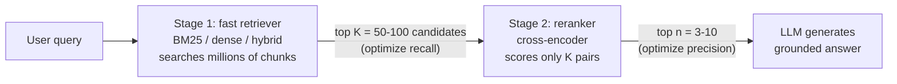
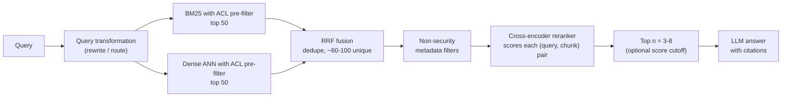
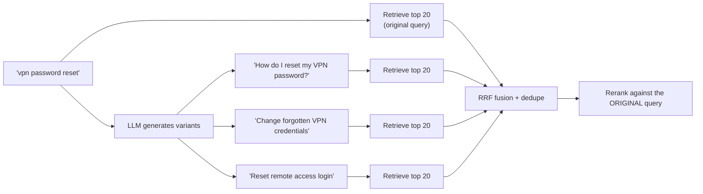

# Reranking and Query Transformation

> **Level:** Beginner to Advanced · **Study time:** ~120 min · **Prerequisites:** [Text Embeddings and Similarity Search](02-text-embeddings-and-similarity-search.md), [Retrieval Methods: BM25, Dense Retrieval and Hybrid Search](05-retrieval-bm25-dense-and-hybrid-search.md), [The Attention Mechanism, Step by Step](../04-transformers/03-attention-mechanism-step-by-step.md), [Encoder-Only, Encoder-Decoder and Decoder-Only Models](../04-transformers/07-encoder-only-encoder-decoder-and-decoder-only-models.md)

## Table of contents

- [Why this matters](#why-this-matters)
- [The running example](#the-running-example)
- [Two-stage retrieval: recall first, precision second](#two-stage-retrieval-recall-first-precision-second)
- [Bi-encoders: encode separately, compare later](#bi-encoders-encode-separately-compare-later)
- [Cross-encoders: read the query and document together](#cross-encoders-read-the-query-and-document-together)
- [Why a cross-encoder is more accurate and more expensive](#why-a-cross-encoder-is-more-accurate-and-more-expensive)
- [Reranking in code with sentence-transformers](#reranking-in-code-with-sentence-transformers)
- [Late interaction: ColBERT as a middle ground](#late-interaction-colbert-as-a-middle-ground)
- [LLM-based rerankers: pointwise, pairwise and listwise](#llm-based-rerankers-pointwise-pairwise-and-listwise)
- [When to rerank and how many candidates](#when-to-rerank-and-how-many-candidates)
- [Combining reranking with hybrid retrieval](#combining-reranking-with-hybrid-retrieval)
- [Evaluating whether a reranker justifies its latency](#evaluating-whether-a-reranker-justifies-its-latency)
- [Query transformation: fixing the question before searching](#query-transformation-fixing-the-question-before-searching)
- [Conversational query rewriting](#conversational-query-rewriting)
- [Multi-query retrieval](#multi-query-retrieval)
- [HyDE: hypothetical document embeddings](#hyde-hypothetical-document-embeddings)
- [Query expansion and when it hurts](#query-expansion-and-when-it-hurts)
- [Step-back prompting](#step-back-prompting)
- [Query routing](#query-routing)
- [Query decomposition (preview)](#query-decomposition-preview)
- [Going deeper: reranking and query transformation in production](#going-deeper-reranking-and-query-transformation-in-production)
- [Common mistakes and misconceptions](#common-mistakes-and-misconceptions)
- [Interview questions and model answers](#interview-questions-and-model-answers)
- [Key takeaways](#key-takeaways)
- [Further reading](#further-reading)
- [Next](#next)

## Why this matters

First-stage retrieval (BM25, dense, or hybrid) is built to be fast over millions of chunks, and it pays for that speed with precision: the right chunk is often somewhere in the top 50, but not in the top 3 that the LLM actually reads. Reranking fixes the order, and query transformation fixes the question, so together they are two of the highest-leverage knobs in a RAG system. Many serious production stacks (enterprise search, support chatbots, coding assistants) use a reranker, and conversational products need some way, usually a rewrite, to turn follow-up questions like "and how long does that take?" into something searchable. Interviewers ask about these topics because they test whether you understand the core accuracy-versus-latency trade-off in retrieval, and whether you can *prove* that an extra 100 ms of reranking was worth it.

## The running example

We reuse a tiny IT-helpdesk knowledge base of **4 documents** (think of each as a chunk, as defined in [Chunking Strategies](04-chunking-strategies.md)):

| ID | Text |
|---|---|
| D1 | "To reset your VPN password, open the IT portal and choose Reset Credentials. The new password works within 5 minutes." |
| D2 | "VPN setup guide: install the client, enter the server address vpn.corp.example and sign in." |
| D3 | "Password policy: passwords must have 12 characters and must be rotated every 90 days." |
| D4 | "Error E401 on the VPN client means your token expired. Re-authenticate in the IT portal." |

And the query:

> **Q:** "How do I reset my VPN password?"

D1 is the answer. D2 and D3 are **topically similar** (they mention VPN and password) but do not answer the question. D4 is related but about a different problem. This "lots of near-misses" situation is exactly where first-stage retrievers struggle and rerankers shine.

## Two-stage retrieval: recall first, precision second

> **Analogy:** Hiring for a job. A recruiter skims 10,000 CVs for keywords in a few seconds each and keeps 50. Then a senior engineer interviews those 50 carefully for an hour each. Nobody can interview 10,000 people, and nobody should hire from a keyword skim. The skim optimizes for *not missing* good candidates; the interview optimizes for *picking the best*.

Two terms to define first:

- **Recall@K**: of all the relevant documents for a query, the fraction that appear in the top $K$ results. High recall means "the right answer is somewhere in the pile".
- **Precision** (in ranking, informally): how much of the *top* of the list is relevant. High precision means "the first few results are the right ones".

**Two-stage retrieval** (also called **retrieve-then-rerank**) splits the job:

1. **Stage 1, candidate generation:** a cheap retriever (BM25, dense vector search, or hybrid; see [Retrieval Methods](05-retrieval-bm25-dense-and-hybrid-search.md)) scans the whole corpus and returns $K$ **candidates**, typically 20 to 200. Goal: high Recall@K. Speed: milliseconds over millions of documents.
2. **Stage 2, reranking:** an expensive, accurate model, the **reranker**, rescores only those $K$ candidates and reorders them. Goal: high precision at the very top. The best $n$ (typically 3 to 10) go to the LLM.



Why not just use the accurate model on everything? Because the accurate model costs one neural network run *per query-document pair*. On 10 million chunks that is 10 million forward passes per query, which would take hours. On 50 candidates it is 50 passes, which can take tens of milliseconds on a GPU. Two-stage retrieval gives you most of the accuracy of the expensive model at a tiny fraction of its cost.

> **Senior insight:** The two stages have different jobs, so you tune them with different metrics. Stage 1 is judged by **Recall@K** (did the right chunk make it into the candidate pool?). Stage 2 is judged by top-heavy ranking metrics such as **nDCG@n**, **MRR** or **Recall@n** for small $n$ (is the right chunk at the top?), all defined in the evaluation section below. A reranker can never recover a document that stage 1 did not return. This is called the **recall ceiling**.

## Bi-encoders: encode separately, compare later

You met bi-encoders in [Text Embeddings and Similarity Search](02-text-embeddings-and-similarity-search.md). Quick recap.

A **bi-encoder** is a neural network (usually a transformer encoder like BERT, see [Encoder-Only, Encoder-Decoder and Decoder-Only Models](../04-transformers/07-encoder-only-encoder-decoder-and-decoder-only-models.md)) that turns *one* piece of text into *one* fixed-size vector, called an **embedding**. The query and each document are encoded **independently**, and relevance is a cheap similarity between the two vectors, such as cosine similarity or a dot product.

> **Analogy:** Two people each write a one-paragraph summary of themselves on a dating site without ever meeting. A matching algorithm compares the summaries. Fast, and summaries can be written in advance, but a lot of nuance is lost because they never talk to each other.

```text
            BI-ENCODER (independent encoding)

   Query: "How do I reset my VPN password?"     Document D1: "To reset your VPN password, ..."
                  |                                               |
         +-----------------+                             +-----------------+
         |  Transformer    |                             |  Transformer    |
         |  encoder        |   (same or twin weights)    |  encoder        |
         +-----------------+                             +-----------------+
                  |                                               |
            pool to 1 vector                                pool to 1 vector
                  |                                               |
            q = [0.12, ...]                                 d = [0.10, ...]   <-- computed OFFLINE,
                  |                                               |              stored in vector DB
                  +-----------------> cos(q, d) <-----------------+
                                       score
```

The formula is cosine similarity:

$$s_{\text{bi}}(q, d) = \cos(\mathbf{q}, \mathbf{d}) = \frac{\mathbf{q} \cdot \mathbf{d}}{\lVert \mathbf{q} \rVert \, \lVert \mathbf{d} \rVert}$$

- $\mathbf{q} = E(q)$: the query's embedding vector, produced by encoder $E$.
- $\mathbf{d} = E(d)$: the document's embedding vector, produced by the same (or a twin) encoder.
- $\mathbf{q} \cdot \mathbf{d}$: the dot product (multiply matching entries, add them up).
- $\lVert \cdot \rVert$: vector length. If vectors are normalized to length 1, cosine equals the dot product.

**Tiny example.** With normalized 2-D vectors $\mathbf{q} = [0.6, 0.8]$ and $\mathbf{d} = [0.8, 0.6]$: $\mathbf{q} \cdot \mathbf{d} = 0.6 \times 0.8 + 0.8 \times 0.6 = 0.48 + 0.48 = 0.96$.

The key property: **document vectors do not depend on the query**. You compute them once, at indexing time, and store them in a vector index (see [Vector Search Algorithms](06-vector-search-ann-hnsw-ivf-and-product-quantization.md)). At query time you run the encoder *once* (on the query) and then do a fast **approximate nearest-neighbor (ANN)** search, which finds the closest stored vectors without comparing against every one. That is why bi-encoders scale to billions of documents.

The price: everything the model knows about a document must be squeezed into one vector *before it knows the question*. For our query, D1, D2 and D3 all live in the "VPN / password" region of embedding space, and the bi-encoder may score them close together. It cannot easily tell "reset a VPN password" apart from "VPN setup" plus "password policy", because the fine-grained interaction between "reset" in the query and "Reset Credentials" in D1 is never computed directly.

## Cross-encoders: read the query and document together

A **cross-encoder** is a transformer that takes the query and the document **concatenated into a single input** and outputs a single relevance score. Because both texts are in the same sequence, every query token can attend to every document token in every layer. This is **full cross-attention** between query and document (here "cross-attention" is used loosely: it is ordinary self-attention, described in [The Attention Mechanism, Step by Step](../04-transformers/03-attention-mechanism-step-by-step.md), running over the joint sequence).

> **Analogy:** Instead of comparing two pre-written summaries, you put the candidate and the interviewer in the same room for a conversation. Every question can probe every detail of the answer. Much more accurate, but you need a new conversation for every (candidate, interviewer) pair, and nothing can be prepared in advance.

```text
            CROSS-ENCODER (joint encoding)

   [CLS] how do i reset my vpn password ? [SEP] to reset your vpn password , open the it portal ... [SEP]
     |    \___________ query ___________/        \______________ document ______________/
     |                    \                                  /
     |                     \_____ every token attends _____/
     |                            to every other token
     v                            in every layer
   +---------------------------------------------------------------------------------------+
   |                  Transformer encoder (e.g. 6 or 12 layers)                             |
   +---------------------------------------------------------------------------------------+
     |
   h_[CLS]  (vector summarizing the PAIR)
     |
   linear layer  -->  one number: relevance score for (query, D1)

   Nothing here can be precomputed: the input depends on the query.
```

Three special tokens to define: **[CLS]** is a special token placed at the start whose final hidden vector is used as a summary of the whole input; **[SEP]** separates the two texts; the model also adds **segment (token type) embeddings** in BERT-style models so it knows which tokens belong to which text.

The scoring formula, for a cross-encoder with one output:

$$s_{\text{cross}}(q, d) = \sigma\left(\mathbf{w}^\top \mathbf{h}_{\text{[CLS]}}(q, d) + b\right)$$

- $\mathbf{h}_{\text{[CLS]}}(q, d)$: the final hidden vector at the [CLS] position after running the encoder on the joint input. It depends on *both* $q$ and $d$.
- $\mathbf{w}$: a learned weight vector, the "relevance direction".
- $b$: a learned bias (a single number).
- $\mathbf{w}^\top \mathbf{h}$: dot product, giving one number called a **logit** (a raw, unbounded score).
- $\sigma(z) = \frac{1}{1 + e^{-z}}$: the **sigmoid** function, squashing the logit into $(0, 1)$. Many published rerankers return the raw logit instead; only the *order* matters for ranking.

**Tiny worked example** (illustrative 3-dimensional numbers; real hidden vectors have 384 to 1024 dimensions):

- $\mathbf{h} = [0.5, -1.0, 2.0]$, $\mathbf{w} = [1.0, 0.5, 0.25]$, $b = -0.2$
- $\mathbf{w}^\top \mathbf{h} = 1.0 \times 0.5 + 0.5 \times (-1.0) + 0.25 \times 2.0 = 0.5 - 0.5 + 0.5 = 0.5$
- Logit: $0.5 + (-0.2) = 0.3$
- $\sigma(0.3) = 1 / (1 + e^{-0.3}) = 1 / (1 + 0.7408) = 1 / 1.7408 \approx 0.574$

**How it is trained.** Cross-encoder rerankers are usually trained as binary classifiers (relevant vs not) or with ranking losses on (query, passage, label) examples. A classic training source is **MS MARCO** (Nguyen et al., 2016), a large set of real search queries with passages marked as relevant. The loss is typically **binary cross-entropy** (see [Loss Functions](../02-deep-learning/04-loss-functions.md)). The original demonstration that BERT-based cross-encoders massively improve passage ranking is "Passage Re-ranking with BERT" (Nogueira and Cho, 2019).

### Bi-encoder vs cross-encoder side by side

| Aspect | Bi-encoder | Cross-encoder |
|---|---|---|
| Input | One text at a time | Query and document concatenated |
| Output | One vector per text | One relevance score per pair |
| Query-document interaction | Only at the end, via one dot product | In every layer, token to token |
| Precompute documents? | Yes, embeddings stored in an index | No, nothing about the pair exists until the query arrives |
| Query-time cost | 1 encoder pass + ANN search | $K$ encoder passes (one per candidate) |
| Scales to | Billions of documents | Tens to a few hundred candidates per query |
| Accuracy at the top of the list | Good | Usually clearly better |
| Typical role | Stage 1 retrieval | Stage 2 reranking |
| Example models (2026, versions change) | all-MiniLM, E5, BGE, GTE families, OpenAI text-embedding-3 | ms-marco-MiniLM cross-encoders, BGE rerankers, Cohere Rerank, Jina and mixedbread rerankers |

> **Interview tip:** One sentence that lands well: "A bi-encoder compresses each text into a vector *before* seeing the other one, so documents can be precomputed and searched at scale. A cross-encoder reads the query and document *together* with full attention, so it is more accurate but needs one forward pass per pair at query time, which is why we only use it on a short candidate list."

## Why a cross-encoder is more accurate and more expensive

### Why more accurate

1. **No bottleneck.** A bi-encoder must compress a 300-token chunk into one vector without knowing which part will matter. A cross-encoder keeps all tokens available and decides what matters *given the query*.
2. **Token-level matching.** The query word "reset" can attend directly to "Reset Credentials" in D1, while in D3 there is no such match. Negation ("does *not* support SSO"), exact numbers and word order are captured much better.
3. **The output is trained for relevance directly**, not for a geometric similarity that must work for all possible queries.

On our running example, a typical bi-encoder might rank D2 or D3 surprisingly close to D1 (all three are about "VPN" and "password"), while a well-trained cross-encoder would put D1 clearly first because only D1 actually describes *resetting a VPN password*. (This is the expected qualitative behavior; exact scores depend on the model.)

### Why more expensive

A cross-encoder's input depends on the query, so **nothing is precomputable**. For each query you must run the full transformer once per candidate. Let us put numbers on it.

A standard rule of thumb for transformer inference: a forward pass costs about **2 floating-point operations (FLOPs) per parameter per token** (one multiply and one add). This ignores the attention term that grows with the square of sequence length, which adds a little more at the lengths used here. Strictly, $P$ should count only the non-embedding parameters, because looking up a token's embedding row is nearly free; in a MiniLM-L6-size model roughly half of the ~22M parameters are the vocabulary embedding table, so real compute is lower than the numbers below. We keep 22M to make the arithmetic easy: the *scaling* (linear in $K$, model size and length) is what matters.

$$\text{FLOPs} \approx 2 \times P \times T$$

- $P$: number of model parameters.
- $T$: number of tokens processed.

**Worked latency arithmetic** (all hardware throughput numbers are illustrative; measure your own):

Setup:
- A small cross-encoder with about $P = 22$ million parameters (MiniLM-L6 size).
- Query of 20 tokens, chunk of 300 tokens, plus a few special tokens: about $T = 320$ tokens per pair.

Per pair:

$$2 \times 22{,}000{,}000 \times 320 = 14{,}080{,}000{,}000 \approx 14.08 \text{ GFLOPs}$$

Here a **GFLOP** is a billion FLOPs and **TFLOP/s** means a trillion FLOPs per second, the usual unit of hardware throughput.

For $K$ candidates:

| Candidates $K$ | Total FLOPs | GPU at 20 TFLOP/s effective (illustrative) | CPU at 1 TFLOP/s effective (illustrative) |
|---|---|---|---|
| 50 | $50 \times 14.08 \text{ G} = 704 \text{ GFLOPs}$ | $0.704 / 20 = 0.035 \text{ s} \approx 35 \text{ ms}$ | $0.704 / 1 \approx 704 \text{ ms}$ |
| 100 | $100 \times 14.08 \text{ G} = 1{,}408 \text{ GFLOPs}$ | $1.408 / 20 = 0.070 \text{ s} \approx 70 \text{ ms}$ | $1.408 / 1 \approx 1{,}408 \text{ ms}$ |

Now compare with the bi-encoder's query-time work: encode only the 20-token query.

$$2 \times 22{,}000{,}000 \times 20 = 880{,}000{,}000 \approx 0.88 \text{ GFLOPs}$$

That is $1{,}408 / 0.88 = 1{,}600$ times less compute than reranking 100 candidates, and the ANN search over precomputed vectors usually takes a few milliseconds.

What changes the cost:

- **Linear in $K$.** Doubling candidates from 50 to 100 doubles reranking compute.
- **Linear in model size.** A ~110M-parameter (BERT-base size) reranker is 5 times the compute of the 22M one by this total-parameter rule of thumb: $5 \times 70 = 350$ ms for 100 candidates on the same illustrative GPU. (Counting only non-embedding parameters, about 86M vs 11M, the real ratio is closer to 8.) Large rerankers (several hundred million parameters, or LLM-based ones with billions) cost much more.
- **Roughly linear in chunk length**, plus the quadratic attention term. Long chunks get truncated at the model's maximum input (often 512 tokens for BERT-style rerankers).
- **Throughput at scale.** At 50 queries per second with $K = 100$: $50 \times 100 = 5{,}000$ pairs per second, which is $5{,}000 \times 14.08 \text{ G} = 70.4$ TFLOP/s. At 20 TFLOP/s effective per GPU that is $70.4 / 20 = 3.52$, so about 4 GPUs just for reranking, before headroom.

> **Common mistake:** Saying "the cross-encoder is slow because it is a bigger model". The real reason is structural: it needs one forward pass *per query-document pair at query time*, and nothing can be cached ahead of the query. Even a tiny cross-encoder becomes expensive if you run it over thousands of candidates.

## Reranking in code with sentence-transformers

```bash
pip install sentence-transformers torch transformers
```

### From scratch: see the joint encoding with Hugging Face transformers

This version shows exactly what a cross-encoder does: tokenize the (query, document) pair into one sequence, run the encoder, read one logit.

```python
# Cross-encoder mechanics with plain Hugging Face transformers.
import torch
from transformers import AutoTokenizer, AutoModelForSequenceClassification

name = "cross-encoder/ms-marco-MiniLM-L-6-v2"   # small public reranker trained on MS MARCO
tok = AutoTokenizer.from_pretrained(name)
model = AutoModelForSequenceClassification.from_pretrained(name).eval()

query = "How do I reset my VPN password?"
docs = [
    "To reset your VPN password, open the IT portal and choose Reset Credentials. "
    "The new password works within 5 minutes.",
    "VPN setup guide: install the client, enter the server address vpn.corp.example and sign in.",
    "Password policy: passwords must have 12 characters and must be rotated every 90 days.",
    "Error E401 on the VPN client means your token expired. Re-authenticate in the IT portal.",
]

# One sequence PER PAIR: [CLS] query [SEP] doc [SEP]
batch = tok([query] * len(docs), docs, padding=True, truncation=True,
            max_length=512, return_tensors="pt")
print(tok.decode(batch["input_ids"][0])[:80])   # shows the joint "[CLS] how do i reset ... [SEP] to reset ..." input

with torch.no_grad():
    logits = model(**batch).logits.squeeze(-1)   # shape: (4,), one raw score per pair

for i in torch.argsort(logits, descending=True):
    print(f"D{i.item() + 1}  score={logits[i].item():.2f}")
```

Notice: 4 documents means a batch of 4 full forward passes. There is no "document vector" anywhere that could have been stored in advance.

### Standard version: `CrossEncoder`

```python
# Reranking with the sentence-transformers CrossEncoder wrapper.
from sentence_transformers import CrossEncoder

reranker = CrossEncoder("cross-encoder/ms-marco-MiniLM-L-6-v2", max_length=512)

query = "How do I reset my VPN password?"
candidates = docs  # in a real system: the top-K from BM25 / dense / hybrid retrieval

# Option 1: score pairs yourself
scores = reranker.predict([(query, d) for d in candidates], batch_size=32)
ranked = sorted(zip(candidates, scores), key=lambda x: x[1], reverse=True)
for doc, s in ranked:
    print(f"{s:7.2f}  {doc[:60]}")

# Option 2: the convenience method (available in recent sentence-transformers versions)
results = reranker.rank(query, candidates, top_k=2, return_documents=True)
for r in results:
    print(r["corpus_id"], round(float(r["score"]), 2), r["text"][:60])
```

Notes:

- For this particular model (with current sentence-transformers versions and the model's current config) the scores are raw logits, so they can be negative. Older library versions applied a sigmoid by default to single-output cross-encoders, and you can request one explicitly with the `activation_fn` argument, so check what your version returns. Do not read them as probabilities unless you apply a sigmoid, and even then do not assume they are calibrated (more on this later).
- `batch_size` matters for throughput: on a GPU, scoring 100 pairs in batches of 32 is far faster than 100 separate calls.
- The model name is one of many public rerankers. Larger or multilingual rerankers (for example the BGE reranker family) follow the same API. Model choice changes over time; the pattern does not.

### Bi-encoder first stage plus cross-encoder rerank

```python
# Minimal two-stage pipeline: bi-encoder retrieves, cross-encoder reranks.
import numpy as np
from sentence_transformers import SentenceTransformer, CrossEncoder

bi = SentenceTransformer("sentence-transformers/all-MiniLM-L6-v2")
ce = CrossEncoder("cross-encoder/ms-marco-MiniLM-L-6-v2")

doc_vecs = bi.encode(docs, normalize_embeddings=True)          # OFFLINE: computed once (docs from the snippet above)

def search(query: str, k: int = 3, n: int = 2):
    q = bi.encode([query], normalize_embeddings=True)[0]       # ONLINE: 1 encoder pass
    sims = doc_vecs @ q                                        # cosine, since vectors are normalized
    cand = np.argsort(-sims)[:k]                               # stage 1: top-k by bi-encoder
    ce_scores = ce.predict([(query, docs[i]) for i in cand])   # stage 2: k forward passes
    order = cand[np.argsort(-ce_scores)][:n]
    return [(int(i) + 1, docs[i][:50]) for i in order]

print(search("How do I reset my VPN password?"))
```

## Late interaction: ColBERT as a middle ground

Is there something between "one vector per document" (fast, less accurate) and "full joint attention" (accurate, slow)? Yes: **late interaction**, introduced by **ColBERT** ("ColBERT: Efficient and Effective Passage Search via Contextualized Late Interaction over BERT", Khattab and Zaharia, 2020).

> **Analogy:** Instead of one summary paragraph per person (bi-encoder) or a full interview (cross-encoder), each person fills in a detailed questionnaire in advance, one answer per topic. At match time you quickly compare each of your questions against their best-matching answer. Preparation is done ahead, but the comparison is still fine-grained.

How it works:

1. Encode each document **independently** (like a bi-encoder) but keep **one vector per token** instead of pooling to one vector. Store all of them.
2. At query time, encode the query into one vector per query token.
3. Score with **MaxSim**: for each query token, find its most similar document token, then sum those maxima.

$$S(q, d) = \sum_{i=1}^{|q|} \max_{j = 1, \dots, |d|} \; \mathbf{q}_i \cdot \mathbf{d}_j$$

- $|q|$, $|d|$: number of tokens in the query and document.
- $\mathbf{q}_i$: the contextual vector of query token $i$.
- $\mathbf{d}_j$: the contextual vector of document token $j$ (precomputed).
- $\max_j$: pick the best-matching document token for this query token.
- $\sum_i$: add up the best matches over all query tokens.

**Tiny worked example** (2-D vectors, illustrative). Query tokens $\mathbf{q}_1 = [1, 0]$, $\mathbf{q}_2 = [0, 1]$. Document tokens $\mathbf{d}_1 = [0.9, 0.1]$, $\mathbf{d}_2 = [0.2, 0.8]$, $\mathbf{d}_3 = [0.5, 0.5]$.

- $\mathbf{q}_1$ against each: $0.9$, $0.2$, $0.5$. Max $= 0.9$.
- $\mathbf{q}_2$ against each: $0.1$, $0.8$, $0.5$. Max $= 0.8$.
- $S = 0.9 + 0.8 = 1.7$.

The "late" in late interaction means the query and document only interact at the very end (the MaxSim step), not inside the transformer layers. That is why document vectors can be precomputed.

The catch is **storage**. A 300-token chunk with 128-dimensional token vectors in 16-bit floats needs $300 \times 128 \times 2 = 76{,}800$ bytes (75 KB), while a single 768-dimensional 16-bit embedding needs $768 \times 2 = 1{,}536$ bytes. That is $76{,}800 / 1{,}536 = 50$ times more. **ColBERTv2** (Santhanam et al., 2022) reduces this with residual compression, and the PLAID engine speeds up search. ColBERT-style models can be used as a first-stage retriever (with a special index) or as a reranker over candidates.

| | Bi-encoder | ColBERT (late interaction) | Cross-encoder |
|---|---|---|---|
| Document precompute | 1 vector | 1 vector per token | Nothing |
| Interaction | 1 dot product | MaxSim over token pairs | Full attention, every layer |
| Query-time cost | Lowest | Low to moderate | Highest (1 pass per pair) |
| Storage | Smallest | Large (many vectors per chunk) | No document index needed for reranking |
| Accuracy | Good | Better | Usually best |
| Use when | Huge corpora, first stage | Need better than bi-encoder quality at large scale, can afford storage | Reranking tens to hundreds of candidates |

## LLM-based rerankers: pointwise, pairwise and listwise

General-purpose LLMs can also rerank. Three styles, defined by how many documents the model sees per judgment:

**Pointwise:** score each document on its own. Prompt: "Query: ... Document: ... Is the document relevant to the query? Answer Yes or No." Use the model's probability of "Yes" as the score. If the model gives logits $z_{\text{yes}}$ and $z_{\text{no}}$ for the two answer tokens, normalize over just those two:

$$P(\text{yes}) = \frac{e^{z_{\text{yes}}}}{e^{z_{\text{yes}}} + e^{z_{\text{no}}}}$$

- $z_{\text{yes}}$, $z_{\text{no}}$: the model's raw scores (logits) for the tokens "Yes" and "No" (see [Softmax, Entropy, Cross-Entropy and KL Divergence](../00-foundations/05-softmax-entropy-cross-entropy-and-kl-divergence.md)).

Example: $z_{\text{yes}} = 2.0$, $z_{\text{no}} = 0.5$. $e^{2.0} \approx 7.389$, $e^{0.5} \approx 1.649$, sum $\approx 9.038$, so $P(\text{yes}) \approx 7.389 / 9.038 \approx 0.818$.

A fine-tuned sequence-to-sequence version of this idea is **monoT5** ("Document Ranking with a Pretrained Sequence-to-Sequence Model", Nogueira et al., 2020). Pointwise is easy to parallelize, but scores across documents are judged in isolation, so the model never compares them.

**Pairwise:** show two documents and ask which is more relevant ("Large Language Models are Effective Text Rankers with Pairwise Ranking Prompting", Qin et al., 2023). Accurate, but the number of comparisons grows quickly (all pairs of $K$ documents is $K(K-1)/2$; for $K = 20$ that is $20 \times 19 / 2 = 190$ calls, and twice that, 380, if each pair is also asked in swapped order to cancel position bias, as the PRP paper does), so sorting-based or sliding-window variants are used.

**Listwise:** show the query and a list of numbered passages, ask for the order ("[3] > [1] > [2] ..."). Popularized by **RankGPT** ("Is ChatGPT Good at Search? Investigating Large Language Models as Re-Ranking Agents", Sun et al., 2023); open models fine-tuned for it include RankVicuna and RankZephyr (Pradeep et al., 2023). Because the context window is limited, listwise reranking uses a **sliding window**: rank the last 20 candidates, keep the best 10, slide the window up by 10, and repeat toward the top so good documents bubble up. Listwise prompts also suffer from **position bias**: the output order depends partly on where a passage sat in the input list, not only on its content (shuffling the input and averaging, or fine-tuned rankers, reduce it).

Sliding-window arithmetic: $K = 100$ candidates, window 20, step 10. Windows cover ranks 81-100, 71-90, ..., 1-20. Number of LLM calls $= (100 - 20)/10 + 1 = 9$, and they are *sequential*, since each depends on the previous one.

| Reranker type | Calls per query (K = 100) | Strengths | Weaknesses |
|---|---|---|---|
| Cross-encoder | 100 small forward passes, batched | Fast, cheap, self-hostable, strong | Needs domain fine-tuning for very specialized text, fixed max length |
| LLM pointwise | 100 LLM calls (parallel) | Uses LLM world knowledge, easy to prompt with domain rules | Expensive, scores not comparable across documents |
| LLM pairwise | Many (hundreds without tricks) | Very accurate comparisons | Most expensive |
| LLM listwise | ~9 sequential calls (window 20, step 10) | Compares documents directly, strong quality | Sequential latency, position bias, output parsing failures, missing or repeated IDs |

> **Senior insight:** LLM rerankers trade latency and cost for flexibility. A common production pattern is: cross-encoder reranks 100 candidates down to 20, and an LLM listwise pass (or simply the generator itself) handles the final selection only when the query is high-value. Another is **distillation**: use an LLM reranker offline to label data, then train a small cross-encoder on those labels (see [Knowledge Distillation Fundamentals](../07-model-compression/05-knowledge-distillation-fundamentals.md)).

## When to rerank and how many candidates

### When a cross-encoder reranker is worth it

Use one when:

- **The answer must come from the top few chunks.** RAG prompts typically include 3 to 10 chunks. If the right chunk is at rank 15, the LLM never sees it.
- **Your Recall@50 is much higher than your Recall@5.** This gap is the reranker's opportunity: the right chunk is retrieved but ranked too low. Measure it on a labeled set.
- **The corpus has many near-duplicates or near-misses** (policies with versions, product manuals for similar models, legal clauses). Fine-grained reading matters.
- **Queries are long and specific** (constraints, negations, comparisons).
- **You want to send fewer chunks to the LLM.** A better top-3 lets you cut context, which often pays for the reranker.
- **You fuse multiple retrievers** (hybrid, multi-query), whose merged list has no single trustworthy score.

Skip it, or make it conditional, when:

- **Latency budget is extremely tight** (autocomplete, sub-50 ms search on CPU).
- **First-stage Recall@n is already near the ceiling** on your evaluation set.
- **Queries are exact lookups** (an order ID, an error code) where BM25 already puts the match first.
- **Stage 1 recall is the actual problem.** If the right chunk is not in the top 100, fix chunking, embeddings or hybrid search first. A reranker cannot help.

### How many candidates to rerank ($K$) and keep ($n$)

There is no universal number, but the trade-off is clear:

- **Larger $K$** raises the recall ceiling (more chance the right chunk is in the pool) but costs linearly more reranking time.
- Returns diminish: going from 20 to 50 candidates often helps a lot, going from 200 to 500 rarely does.
- Common starting points: $K = 50$ to $100$ for a cross-encoder, $K = 20$ to $30$ for an LLM reranker; keep $n = 3$ to $10$ for the LLM prompt.

How to pick $K$ properly: plot **Recall@K of stage 1** against $K$ on your labeled queries. Choose the $K$ where the curve flattens (for example where adding 50 more candidates adds less than about 1 point of recall), then check that reranking $K$ candidates fits the p95 latency budget (**p95** is the latency that 95% of requests stay under; it is defined more fully in the evaluation section). Then sweep $n$ to find the smallest context that keeps answer quality.

> **Interview tip:** A crisp answer to "how many should you rerank?" is "enough that stage 1 recall has plateaued, few enough to fit the latency budget, and I would find that point with a $K$ sweep on a labeled set. Typical values are 50 to 100 for a cross-encoder."

## Combining reranking with hybrid retrieval

Recall the hybrid idea from [Retrieval Methods](05-retrieval-bm25-dense-and-hybrid-search.md): **BM25** (keyword) and **dense** (semantic) retrieval fail on opposite queries, so you run both and fuse them. The standard fusion is **Reciprocal Rank Fusion (RRF)** (Cormack, Clarke and Buettcher, 2009):

$$\text{RRF}(d) = \sum_{r \in R} \frac{1}{k + \text{rank}_r(d)}$$

- $R$: the set of ranked lists (here BM25 and dense).
- $\text{rank}_r(d)$: position of document $d$ in list $r$ (1 = top). Lists that do not contain $d$ contribute nothing.
- $k$: smoothing constant, conventionally 60.

Then the reranker sits **after** fusion. The full production pipeline:



Why this order works: **hybrid maximizes candidate recall** (BM25 catches "E401", dense catches "can't log into the remote network"); **RRF is a cheap, calibration-free merge** that only knows ranks, not true relevance; and **the cross-encoder re-judges every fused candidate with one consistent model**, so the final order no longer depends on how BM25 scores compare to cosine scores.

**Small worked example** (illustrative ranks for our query, $k = 60$):

| Doc | BM25 rank | Dense rank | RRF score | RRF rank |
|---|---|---|---|---|
| D1 | 1 | 3 | $1/61 + 1/63 = 0.016393 + 0.015873 = 0.032266$ | 1 |
| D2 | 4 | 1 | $1/64 + 1/61 = 0.015625 + 0.016393 = 0.032018$ | 2 |
| D3 | 3 | 2 | $1/63 + 1/62 = 0.015873 + 0.016129 = 0.032002$ | 3 |
| D4 | 2 | not retrieved | $1/62 = 0.016129$ | 4 |

The RRF scores of D1, D2 and D3 differ only from the fourth decimal place onward: fusion barely separates them. A cross-encoder would typically give D1 a much higher score than D2 and D3, making the top-1 decision robust. That is the reranker's job.

Practical details:

- **Retrieve 25 to 100 per leg**, fuse, **deduplicate** (the same chunk appears in both lists), then rerank the union.
- **Apply permission filters inside retrieval** (as a pre-filter in both the BM25 and the dense query), so forbidden chunks never reach fusion, the reranker or the LLM. Dropping them after retrieval is post-filtering: it can empty the result list and lets forbidden text reach memory, logs and the reranker. Reranking forbidden chunks wastes compute and risks leaking them. See [Secure Multi-Tenant RAG](13-secure-multi-tenant-rag.md).
- **Some teams skip RRF** and rerank the raw union of both lists. That works too: the reranker ignores first-stage scores. RRF still helps if you must cap $K$ (it decides which 60 of the 100 unique candidates get reranked).
- **Pass the same text to the reranker that the LLM will see**, including useful metadata such as the document title or section heading. Rerankers often do better with a short title prefix like "IT Portal Guide > VPN: To reset your ...".

```python
# Hybrid (BM25 + dense) -> RRF -> cross-encoder -> top-n. Runs on the 4-doc corpus.
# pip install rank-bm25 sentence-transformers
import re
import numpy as np
from rank_bm25 import BM25Okapi
from sentence_transformers import SentenceTransformer, CrossEncoder

tokenize = lambda s: re.findall(r"\w+", s.lower())   # strips punctuation, so "password?" matches "password"
bm25 = BM25Okapi([tokenize(d) for d in docs])
bi = SentenceTransformer("sentence-transformers/all-MiniLM-L6-v2")
ce = CrossEncoder("cross-encoder/ms-marco-MiniLM-L-6-v2")
doc_vecs = bi.encode(docs, normalize_embeddings=True)

def rrf(rankings: list[list[int]], k: int = 60) -> list[int]:
    scores: dict[int, float] = {}
    for ranking in rankings:
        for rank, doc_id in enumerate(ranking, start=1):
            scores[doc_id] = scores.get(doc_id, 0.0) + 1.0 / (k + rank)
    return sorted(scores, key=scores.get, reverse=True)

def hybrid_rerank(query: str, per_leg: int = 50, rerank_k: int = 100, top_n: int = 3):
    bm25_rank = list(np.argsort(-bm25.get_scores(tokenize(query)))[:per_leg])
    q = bi.encode([query], normalize_embeddings=True)[0]
    dense_rank = list(np.argsort(-(doc_vecs @ q))[:per_leg])
    fused = rrf([bm25_rank, dense_rank])[:rerank_k]           # deduplicated union, fused order
    ce_scores = ce.predict([(query, docs[i]) for i in fused], batch_size=32)
    best = [fused[i] for i in np.argsort(-ce_scores)][:top_n]
    return [(f"D{i + 1}", docs[i][:50]) for i in best]

print(hybrid_rerank("How do I reset my VPN password?"))
print(hybrid_rerank("error E401"))
```

## Evaluating whether a reranker justifies its latency

A reranker always adds latency and cost. It earns its place only if it measurably improves what users get. Senior engineers evaluate on four axes.

### Axis 1: retrieval quality gain

Use a labeled set of queries with known relevant chunks (see [Evaluating RAG](10-rag-evaluation-metrics-and-ragas.md) for building one). Key metrics:

- **Recall@n**, where $n$ is the number of chunks you actually pass to the LLM. This is the most direct "did the LLM get the evidence?" metric.
- **MRR** (mean reciprocal rank): average of $1/\text{rank}$ of the first relevant result (0 if none is found). Example: first relevant result at ranks 1, 3 and "not found" for three queries gives $\text{MRR} = (1 + 1/3 + 0)/3 = 1.333/3 \approx 0.444$. MRR only looks at the *first* hit, which fits RAG when one good chunk is enough.
- **nDCG@n** (normalized discounted cumulative gain), which rewards relevant results more the higher they appear:

$$\text{DCG@}n = \sum_{i=1}^{n} \frac{\text{rel}_i}{\log_2(i + 1)}, \qquad \text{nDCG@}n = \frac{\text{DCG@}n}{\text{IDCG@}n}$$

- $\text{rel}_i$: relevance of the result at rank $i$ (1 or 0 for binary labels; graded labels like 0-3 also work). This is the "linear gain" form; [Evaluating RAG](10-rag-evaluation-metrics-and-ragas.md) and [Retrieval Methods](05-retrieval-bm25-dense-and-hybrid-search.md) use the "exponential gain" $2^{\text{rel}_i} - 1$. Both give the same result for binary labels, but differ for graded labels, so state which one you report.
- $\log_2(i + 1)$: the position discount; rank 1 divides by $\log_2 2 = 1$, rank 3 divides by $\log_2 4 = 2$.
- $\text{IDCG@}n$: the DCG of the perfect ordering, so nDCG is between 0 and 1.

**Worked example**, 3 queries, one relevant chunk each, $n = 5$, rerank depth $K = 50$:

| Query | Rank of relevant chunk before | nDCG@5 before | Rank after rerank | nDCG@5 after |
|---|---|---|---|---|
| A | 3 | $1/\log_2 4 = 1/2 = 0.5$ | 1 | $1/1 = 1.0$ |
| B | 1 | $1.0$ | 1 | $1.0$ |
| C | not in top 50 | $0$ | not in candidates | $0$ |
| **Mean** | | $(0.5 + 1.0 + 0)/3 = 0.5$ | | $(1.0 + 1.0 + 0)/3 \approx 0.667$ |

Two lessons: the reranker helped query A, and it could do *nothing* for query C (the recall ceiling). Always report stage-1 **Recall@K** next to the reranker's gain so you know which problem you are solving.

### Axis 2: answer quality gain

Retrieval metrics are a proxy. What matters is the final answer. Run the full RAG pipeline with and without the reranker and measure **answer correctness**, **faithfulness** (is the answer supported by the retrieved chunks?) and **citation accuracy**, with human labels or an LLM judge (see [Evaluating LLMs: Metrics, Benchmarks and LLM-as-a-Judge](../05-llms/10-llm-evaluation-metrics-and-llm-as-a-judge.md)). A retrieval gain that does not move answer quality can still be worth it if it lets you shrink the context, which leads to the next axis.

### Axis 3: latency and cost added

- **p95 and p99 latency** of the reranking step, not the average. **p95** is the latency that 95% of requests beat; tail latency is what users notice and what **SLOs** (service-level objectives, such as "p95 under 2 s") are written against. Reranking latency grows with $K$ and chunk length, so long-chunk queries form the tail.
- **End-to-end latency**, not just the reranker's: a reranker that lets you pass 4 chunks instead of 10 shortens LLM **prefill** (processing the prompt, see [LLM Inference Fundamentals](../06-llm-inference/01-inference-fundamentals-prefill-decode-and-latency-metrics.md)), which can offset part of its own cost.
- **Cost per 1,000 queries**: GPU hours for a self-hosted reranker, or per-search pricing for a hosted rerank API, minus LLM token savings.

Token-savings arithmetic (illustrative): without a reranker you pass the top 10 chunks of 300 tokens each, $10 \times 300 = 3{,}000$ input tokens. With a reranker you trust the top 4: $4 \times 300 = 1{,}200$ tokens. Savings: $3{,}000 - 1{,}200 = 1{,}800$ input tokens per query. At 1 million queries per month that is $1{,}800 \times 1{,}000{,}000 = 1.8$ billion fewer input tokens.

### Axis 4: per-segment analysis

Averages hide trade-offs. Slice results by query type:

| Segment (illustrative numbers) | Share of traffic | nDCG@5 without reranker | nDCG@5 with reranker | Verdict |
|---|---|---|---|---|
| Natural-language how-to questions | 60% | 0.62 | 0.78 | Big win |
| Exact identifiers (error codes, SKUs) | 25% | 0.91 | 0.89 | Flat or slightly worse |
| Long multi-constraint questions | 10% | 0.48 | 0.66 | Big win |
| Non-English queries | 5% | 0.55 | 0.41 | Regression: reranker is English-only |

This table (made up for illustration) tells a richer story than "average up by X": it suggests routing identifier queries around the reranker and swapping in a multilingual model.

### Making the decision

1. Offline: compute the gains above on a labeled set, with **confidence intervals** (for example a paired bootstrap over queries: resample queries with replacement many times and look at the spread of the difference). A gain smaller than the noise is not a gain.
2. Sweep $K$ (20, 50, 100, 200) and model size; plot quality against p95 latency and pick a point on the **Pareto frontier** (settings where you cannot improve quality without adding latency).
3. Online: run an **A/B test** or canary (see [Model Deployment Patterns](../10-mlops/04-model-deployment-patterns.md)) and watch user-facing metrics: thumbs up/down, escalation to human agents, citation clicks, follow-up "that is not what I asked" rates.
4. Ship if the quality gain is significant on the segments you care about, the p95 stays within the SLO, and the cost per query is acceptable. Otherwise try a smaller reranker, a smaller $K$, or conditional reranking.

> **Interview tip:** Structure your answer as "quality gain (retrieval and answer), cost (p95 latency and money), and segments", then end with "and I would A/B it online because offline labels never fully match real traffic". That covers what interviewers listen for.

## Query transformation: fixing the question before searching

Reranking fixes the *order* of results. **Query transformation** fixes the *query* before retrieval, because user queries are often a poor match for how documents are written:

- They depend on chat history ("what about for contractors?").
- They are short and vague ("vpn broken").
- They are phrased as questions while documents are phrased as statements.
- They combine several questions in one.

> **Analogy:** A good librarian does not search the catalog with your exact words. They first ask "do you mean the 2023 edition?", translate your description into catalog terms, and sometimes look in several sections. Query transformation is the librarian's step between hearing you and searching.

Most techniques below use an LLM to transform the query, so each adds one LLM call (latency and cost) before retrieval even starts. A small, fast model is usually enough.

| Technique | What it does | Best for | Main risk | Extra cost |
|---|---|---|---|---|
| Conversational rewriting | Turns a follow-up into a standalone query | Chatbots, multi-turn | Rewriter drops or invents constraints | 1 small LLM call |
| Multi-query | Generates several paraphrases, retrieves for each, fuses | Vague or ambiguous queries, vocabulary mismatch | More retrieval calls, can add noise | 1 LLM call + N retrievals |
| HyDE | Generates a fake answer, embeds it, searches with it | Question-vs-statement mismatch, zero-shot domains | Hallucinated specifics steer search wrong | 1 LLM generation (longer) |
| Query expansion | Adds synonyms or related terms | Short keyword queries, BM25 vocabulary gaps | Topic drift, diluted identifiers | Small (rules) to 1 LLM call |
| Step-back prompting | Also retrieves for a more general question | Questions needing background principles | Retrieves generic, less specific content | 1 LLM call + 1 retrieval |
| Routing | Picks the index, tool or strategy | Many sources, mixed query types | Misrouting hides the right source | Rules (free) or 1 classifier call |
| Decomposition | Splits into sub-questions | Multi-part, comparison, multi-hop | Error compounding, latency | 1 LLM call + several retrievals |

## Conversational query rewriting

In a chat, the latest user message often cannot be searched on its own:

```text
User:      How do I reset my VPN password?
Assistant: Open the IT portal and choose Reset Credentials ...
User:      And how long until it works?
```

Searching for "And how long until it works?" retrieves nothing useful: "it" refers to the reset VPN password. **Conversational query rewriting** (also called query **contextualization** or **condensing**) uses the chat history to produce a **standalone query**: "How long does it take for a reset VPN password to start working?" That query retrieves D1, which contains "works within 5 minutes".

A typical prompt (wording is illustrative; tune it on your data):

```text
Given the conversation and a follow-up message, rewrite the follow-up as a
standalone search query. Resolve pronouns and references using the conversation.
Keep all names, numbers, product codes and error codes exactly as written.
Do not answer the question. Do not add facts that are not in the conversation.
If the follow-up is already standalone, return it unchanged.

Conversation:
{history}

Follow-up: {message}
Standalone query:
```

Production practices:

- **Keep the original message too.** Retrieve with the rewrite, and optionally also with the raw message, then fuse. This protects against a bad rewrite.
- **Skip the rewrite for first turns** or when a cheap check says the message is already standalone, saving a call.
- **Use a small, fast model** with low temperature; this is a narrow task.
- **Log the rewrite** next to the original in traces (see [LLMOps: Tracing, Prompt Management, Langfuse and RAGAS in Practice](../10-mlops/08-llmops-tracing-prompt-management-and-langfuse.md)) so you can debug "why did it retrieve that?".
- **Evaluate the rewriter** separately: build a set of (history, follow-up, gold standalone query) examples and measure retrieval Recall@n using the rewritten query versus the gold query.

> **Common mistake:** Letting the rewriter "helpfully" add terms or answer the question. "And for contractors?" must become "How do contractors reset their VPN password?", not "Contractors reset VPN passwords via the vendor portal", which is a hallucinated answer that will steer retrieval.

## Multi-query retrieval

**Multi-query retrieval** generates several differently worded versions of the user's query, retrieves results for each version, and fuses the result lists (usually with RRF) into one ranking.

> **Analogy:** If you are not sure what a shop calls an item, you ask for it three different ways ("sneakers", "trainers", "running shoes") and keep whatever comes up repeatedly.

Why it helps: a single query embedding is one point in embedding space, and a single keyword set is one guess at the document's vocabulary. Paraphrases sample several points and vocabularies, so a relevant chunk that one phrasing misses can be caught by another. Documents that show up for *several* variants get boosted by RRF, which acts as a vote.



**Worked fusion example** ($k = 60$, illustrative ranks across 3 variants):

- D1 ranks 1, 2, 1: $1/61 + 1/62 + 1/61 = 0.016393 + 0.016129 + 0.016393 \approx 0.048916$
- D2 ranks 2, 1, not found: $1/62 + 1/61 = 0.016129 + 0.016393 = 0.032522$
- D4 ranks not found, not found, 2: $1/62 = 0.016129$

D1 wins because it was consistently near the top.

```python
# Multi-query retrieval with RRF. The LLM call is a stub so the example runs offline;
# replace generate_variants() with a real LLM call (SDK APIs change often).
def generate_variants(query: str, n: int = 3) -> list[str]:
    # Real version: prompt an LLM with "Write {n} different search queries for: {query}"
    # and parse one query per line (or use structured output).
    return [
        "How do I reset my VPN password?",
        "change forgotten VPN credentials",
        "reset remote access login IT portal",
    ][:n]

def dense_search(query: str, k: int = 20) -> list[int]:
    q = bi.encode([query], normalize_embeddings=True)[0]
    return list(np.argsort(-(doc_vecs @ q))[:k])

def multi_query_search(query: str, top_n: int = 3) -> list[int]:
    variants = [query] + generate_variants(query)          # always keep the original
    rankings = [dense_search(v) for v in variants]         # run these in parallel in production
    fused = rrf(rankings)                                  # rrf() defined earlier
    ce_scores = ce.predict([(query, docs[i]) for i in fused])   # rerank against the ORIGINAL query
    return [int(fused[i]) + 1 for i in np.argsort(-ce_scores)][:top_n]   # 1-based doc IDs (D1 = 1)

print(multi_query_search("vpn password reset"))
```

Trade-offs:

- **Latency:** one LLM generation (often a few hundred milliseconds or more, depending on the model) plus $N$ retrievals. Run retrievals in parallel so they cost roughly one retrieval's wall time.
- **Cost:** $N$ times the retrieval load on your vector database.
- **Noise:** a bad paraphrase pulls in off-topic chunks. Mitigate by always including the original query and by reranking the fused pool against the *original* query.
- **Diminishing returns:** 3 to 5 variants is a common range; more rarely helps.

The pattern is sometimes called **RAG-Fusion** when paired with RRF. Frameworks ship ready-made versions (for example LangChain's `MultiQueryRetriever`), but their APIs change between versions, so treat them as conveniences around the simple logic above.

## HyDE: hypothetical document embeddings

**HyDE** (Hypothetical Document Embeddings), from "Precise Zero-Shot Dense Retrieval without Relevance Labels" (Gao et al., 2022), attacks a specific mismatch: queries look like *questions*, documents look like *answers*. Their embeddings may not land close together.

The trick: ask an LLM to *write a plausible answer* (a hypothetical document), embed that answer, and search with its embedding. The fake answer is written in "document style", so it lands near real documents that answer the question, even if some of its facts are wrong.

> **Analogy:** To find a book in a library you have never visited, you write a fake first page of the book you want, then ask the librarian "find me books whose first page looks like this".

```text
Query: "How do I reset my VPN password?"

LLM writes (hypothetical, may contain made-up details):
  "To reset your VPN password, go to the self-service portal, select
   'Forgot password', verify with MFA, and set a new password. Changes
   apply within a few minutes."

Embed THIS text  ->  nearest neighbors  ->  D1 (real document) ranks high
```

In the paper, several hypothetical documents are generated and their embeddings averaged together with the query embedding, which smooths out any single bad generation.

```python
# HyDE with a hard-coded "hypothetical answer" so the example runs without an LLM.
hypothetical = ("To reset your VPN password, go to the self-service portal, select "
                "Forgot password, verify your identity and set a new password. "
                "Changes apply within a few minutes.")

query = "How do I reset my VPN password?"
vecs = bi.encode([query, hypothetical], normalize_embeddings=True)
hyde_vec = vecs.mean(axis=0)
hyde_vec /= np.linalg.norm(hyde_vec)                     # re-normalize after averaging
print(np.argsort(-(doc_vecs @ hyde_vec))[:3] + 1)        # doc IDs ranked by HyDE vector
```

When HyDE helps: zero-shot or weak embedding models, short questions against long expository documents, domains where the LLM knows the general shape of answers.

When it hurts:

- **The LLM does not know the domain.** For internal jargon ("How do I file a TPS-7 form?") it invents content that points in the wrong direction.
- **Identifier and exact-match queries.** Generating prose around "E401" dilutes the one token that mattered. Keep BM25 on the raw query.
- **Hallucinated specifics bias retrieval** toward documents that match the invented details (a wrong product name, a wrong version).
- **Latency:** generating a 100-token paragraph is slower than a short rewrite, and it sits on the critical path before retrieval.
- **Strong modern embedding models** trained on question-to-passage data already handle the question/answer asymmetry well, so the gain can shrink or vanish. Measure it.

## Query expansion and when it hurts

**Query expansion** adds terms to the query to bridge vocabulary gaps: the user writes "laptop", the document says "notebook". Variants:

- **Synonym or thesaurus expansion:** curated domain dictionaries ("PTO" -> "paid time off", "vacation").
- **Pseudo-relevance feedback (PRF):** run the query, assume the top few results are relevant, extract their frequent terms and add them (classic methods include Rocchio and RM3).
- **LLM expansion:** ask an LLM for related terms or a short pseudo-document and append it to the query. **Query2doc** ("Query2doc: Query Expansion with Large Language Models", Wang et al., 2023) appends an LLM-generated pseudo-document, with the largest reported gains for sparse retrieval such as BM25.

Expansion helps most for **short, underspecified queries** and **lexical retrievers** that cannot match synonyms.

### When query expansion hurts

1. **Topic drift.** Added terms pull results toward a different topic. "Python memory leak" expanded with "snake", "reptile" (bad synonyms) or even with broad terms like "performance", "optimization" can surface generic performance docs instead of leak debugging. PRF drifts when the initial top results were already wrong: it amplifies the mistake.
2. **Diluting precise identifiers.** "error E401 on vpn client" expanded with "authentication failure, login problem, access denied, credentials" gives BM25 many common words that match dozens of chunks; the one rare, decisive token "E401" now carries a smaller share of the score. For dense retrieval, the embedding of the expanded text drifts toward the generic "login problems" region.
3. **Already precise queries.** Long, specific queries usually lose precision when expanded; there is little vocabulary gap to fill.
4. **Strong retrievers.** A study of LLM-based expansion across many retrievers ("When do Generative Query and Document Expansions Fail? A Comprehensive Study Across Methods, Retrievers, and Datasets", Weller et al., 2024) found that expansions tended to help weaker retrievers but often hurt stronger ones. Your gain must be measured, not assumed.
5. **Hallucinated or ambiguous terms.** LLM expansions can add plausible but wrong terms ("Cisco AnyConnect" when your company uses a different VPN client), or resolve an ambiguous term the wrong way.
6. **Latency and cost.** An LLM call before retrieval adds directly to time-to-first-token for every query, including those that did not need it.

Mitigations:

- **Weight original terms higher** than expansion terms (most search engines support term boosts).
- **Never expand identifier-like tokens**; detect them (regex for codes, SKUs, versions) and keep them as required terms.
- **Expand only one retrieval leg** (often BM25), and keep the dense leg on the original query, then fuse.
- **Rerank against the original query**, so expansion only affects which candidates enter the pool, not the final judgment.
- **Apply expansion conditionally**, for example only when the first retrieval returns low scores or few results.

> **Senior insight:** Expansion and multi-query are both *recall* tools. The reranker is a *precision* tool. A healthy pattern is "expand to widen the pool, rerank against the original query to restore precision". Expansion without a reranker is a common source of precision regressions.

## Step-back prompting

**Step-back prompting** comes from "Take a Step Back: Evoking Reasoning via Abstraction in Large Language Models" (Zheng et al., 2023). The idea: before answering a specific question, ask a more general "step-back" question about the underlying principle, and use both.

In RAG, you retrieve for both the original and the step-back question:

```text
Original:  "Can I use my VPN token from a hotel network in Germany next week?"
Step-back: "What is the company policy for VPN access while travelling abroad?"
```

The specific question may match nothing directly (no document mentions hotels in Germany), while the step-back question retrieves the travel and remote-access policy that contains the answer. Combine both result sets (fuse, then rerank against the original question).

Use it for questions that need **background rules or principles** (policy, physics, law). Do not use it for direct lookups, where the general question just adds generic content to the context.

## Query routing

**Query routing** decides *where* and *how* to search before searching. Real systems have several indexes and tools: a product-docs vector index, a ticket database, a SQL warehouse, a web search tool, or "no retrieval needed".

> **Analogy:** A hospital receptionist who sends you to cardiology, radiology or the pharmacy based on what you say, instead of sending everyone through every department.

Routing decisions include:

- **Which source or collection:** HR policies vs engineering docs vs customer tickets.
- **Which retrieval strategy:** BM25-heavy for identifiers, dense for natural language, SQL for "how many orders last week?".
- **Whether to transform:** only rewrite follow-ups; only use HyDE for conceptual questions.
- **Whether to retrieve at all:** "thanks!" or "translate this sentence" needs no retrieval.
- **Metadata filters:** extract "in 2024", "for the EU region" into structured filters (sometimes called **self-querying**).

Implementations, from cheapest to most flexible:

```python
# A tiny rule-based router. Real systems often add an LLM or a small classifier
# with structured output (see the structured outputs chapter) for ambiguous cases.
import re

ID_PATTERN = re.compile(r"\b([A-Z]{1,4}-?\d{2,}|SKU-\d+|E\d{3})\b")

def route(query: str) -> str:
    if ID_PATTERN.search(query):
        return "bm25_heavy"            # exact identifiers: keyword match first, no expansion
    if re.search(r"\b(how many|count|average|total)\b", query.lower()):
        return "sql"                   # aggregation questions go to the warehouse, not the vector DB
    if len(query.split()) <= 2:
        return "multi_query"           # very short, vague queries: widen recall
    return "hybrid_rerank"             # default path

for q in ["error E401 on vpn", "how many tickets were opened last week",
          "vpn", "How do I reset my VPN password?"]:
    print(q, "->", route(q))
# error E401 on vpn -> bm25_heavy
# how many tickets were opened last week -> sql
# vpn -> multi_query
# How do I reset my VPN password? -> hybrid_rerank
```

For LLM-based routing, ask the model to return a choice from a fixed set via structured output (see [Structured Outputs, JSON Mode and Function Calling](../05-llms/05-structured-outputs-and-function-calling.md)). Routing is also a core agent pattern, covered in [Agent Design Patterns](../09-agents/03-agent-design-patterns.md).

Failure mode to watch: **silent misrouting**. If a question goes to the wrong index, retrieval looks "fine" (it returns something) but the answer is wrong. Log route decisions, evaluate router accuracy on a labeled set, and consider a fallback that searches a default index when the routed source returns low reranker scores.

## Query decomposition (preview)

Some questions contain several questions: "Compare the VPN reset process for employees and contractors, and tell me which one needs manager approval." No single chunk answers it. **Query decomposition** splits it into sub-questions ("How do employees reset VPN passwords?", "How do contractors reset VPN passwords?", "Which VPN reset requires manager approval?"), retrieves for each, and combines the evidence. When later sub-questions depend on earlier answers, this becomes **multi-hop retrieval**. Both are covered in depth in [Advanced RAG Patterns](09-advanced-rag-patterns.md).

## Going deeper: reranking and query transformation in production

### Latency budgets add up

A RAG request is a chain, and each step adds to time-to-first-token. An illustrative budget for a chat assistant with a 2-second p95 target for the first token:

| Step | Illustrative p95 |
|---|---|
| Conversational rewrite (small LLM) | 300 ms |
| Hybrid retrieval (parallel BM25 + dense) | 50 ms |
| Cross-encoder rerank, $K = 100$, GPU | 80 ms |
| LLM prefill and first token | 800 ms |
| Network, filters, overhead | 150 ms |
| **Total** | **1,380 ms** |

The numbers are illustrative, but the lesson is durable: **LLM-based query transformation is often more expensive than the reranker**, and stacking several transformations (rewrite + multi-query + HyDE) can blow the budget. Pick the one that fixes your measured failure.

### Making rerankers fast

- **Batch** all candidates of a query into one or a few forward passes; on a GPU this is essential.
- **Choose model size deliberately**: a small reranker on 100 candidates often beats a large reranker on 20, because recall matters too. Sweep both.
- **Truncate smartly**: rerankers have a maximum input length (often 512 tokens). Chunks longer than that are cut, and anything past the cut is invisible to the reranker. Keep chunks within the limit or rerank the most relevant window.
- **Compress the model**: export to ONNX (an open model format that optimized inference runtimes such as ONNX Runtime can execute), quantize to INT8, or distill a large reranker into a small one (see [Post-Training Quantization vs Quantization-Aware Training](../07-model-compression/03-ptq-vs-qat-and-calibration.md) and [Knowledge Distillation Fundamentals](../07-model-compression/05-knowledge-distillation-fundamentals.md)). Always re-measure ranking quality after compression.
- **Cache**: identical (query, chunk) pairs recur for popular questions; a cache keyed on normalized query plus chunk ID and model version avoids recomputation. Invalidate when chunks change.
- **Timeouts with fallbacks**: if the reranker exceeds its budget, return the fused first-stage order instead of failing the request, and record that it happened.
- **Conditional reranking**: skip reranking when routing says it is an exact-ID query, or when the first-stage top result has a large margin.

### Score thresholds and calibration

Teams often want "only pass chunks with reranker score above X". Be careful: cross-encoder scores are trained for *ordering*, and the same score can mean different things for different queries and domains. Before using an absolute threshold:

- Plot the score distribution of relevant vs non-relevant chunks on labeled data and pick the threshold from that, per model version.
- Combine a threshold with a minimum and maximum $n$ (for example "at least 2, at most 8 chunks").
- Use a low top score as a signal for "I could not find this" (abstain or ask a clarifying question) rather than letting the LLM answer from weak evidence. This reduces hallucinations (see [Hallucinations: Why LLMs Make Things Up](../05-llms/06-hallucinations-and-grounding.md)).

### Diversity and ordering for the LLM

- **Near-duplicates**: rerankers happily put 5 almost identical chunks in the top 5, wasting context. Deduplicate, or apply **Maximal Marginal Relevance (MMR)** (Carbonell and Goldstein, 1998), which trades relevance against similarity to already-selected chunks.
- **Order in the prompt**: LLMs can under-use information placed in the middle of long contexts ("Lost in the Middle: How Language Models Use Long Contexts", Liu et al., 2023). With fewer, better-ranked chunks this matters less; some teams put the strongest chunks first or at both ends.

### Domain adaptation

Public rerankers are trained mostly on web search data, so on specialized corpora (legal, medical, code, non-English text) they can underperform or even hurt a segment. Options, from cheapest: benchmark several off-the-shelf rerankers (including multilingual ones) on your labeled set; **fine-tune** a cross-encoder on (query, positive, hard negative) triples, where **hard negatives** are chunks that look relevant but are not, mined from your own first-stage results (like D2 and D3 in our example); or label data with an LLM judge and distill into the cross-encoder. Split train and test by document, not by random pair, to avoid leakage.

### Monitoring and security

- **Reranker score distribution** over time: a falling top-1 score suggests new query types or content gaps (see [Monitoring ML and LLM Systems in Production](../10-mlops/06-monitoring-ml-and-llm-systems-in-production.md)).
- **Rank shift rate**: how often the reranker changes the top-1. Near zero means it may not be earning its latency; very high may mean stage 1 is weak.
- **Latency p95/p99 by $K$ and chunk length**, plus timeout, fallback and route-share counts.
- **Security:** rewriting and routing put user text into an LLM whose output steers retrieval. Enforce permissions from the authenticated user in the retrieval layer, never from what the rewriter outputs (see [Secure Multi-Tenant RAG](13-secure-multi-tenant-rag.md)).

### A decision guide

| Observed problem (on your eval set) | First thing to try |
|---|---|
| Right chunk retrieved but ranked 10-50 | Cross-encoder reranker |
| Right chunk not in top 100 at all | Fix stage 1: chunking, hybrid, better embeddings (not a reranker) |
| Follow-up questions fail in chat | Conversational rewriting |
| Short or vague queries miss synonyms | Multi-query or expansion, then rerank |
| Question/answer style mismatch with a weak embedder | HyDE (measure against a better embedder first) |
| Identifier queries fail | BM25 leg, routing, no expansion |
| Several sources, wrong one searched | Routing |
| Multi-part questions | Decomposition (see Advanced RAG Patterns) |

## Common mistakes and misconceptions

1. **"A reranker improves recall."** It only reorders candidates. It improves Recall@n for small $n$ (the right chunk moves into the top $n$), but it can never exceed stage-1 Recall@K.
2. **Reranking too few candidates.** Reranking the top 5 from stage 1 to choose the top 3 gives the reranker almost nothing to work with. Rerank a meaningfully larger pool.
3. **Treating cross-encoder scores as calibrated probabilities.** Many models return raw logits; even sigmoid outputs vary across queries and domains. Calibrate any threshold on labeled data.
4. **Ignoring truncation.** A reranker with a 512-token limit never sees the end of a 1,500-token chunk. If the answer is at the end, the reranker scores the chunk as irrelevant.
5. **Reranking against the transformed query.** After multi-query or expansion, rerank against the *original* (or standalone-rewritten) user query, not against an expanded string full of extra terms.
6. **Expanding identifiers.** Turning "E401" into a paragraph about authentication errors destroys the precise signal BM25 needed.
7. **Stacking every query transformation.** Rewrite + HyDE + multi-query + step-back on every request adds seconds of latency and noise. Fix measured failures with targeted techniques.
8. **Judging a reranker only by average nDCG.** Segment by query type and language; a global gain can hide a regression on an important slice.
9. **Evaluating offline only.** Labeled sets are small and biased toward queries someone thought of. Confirm with an A/B test.
10. **Letting the rewriter answer the question.** A rewrite that contains an invented answer steers retrieval toward confirming the hallucination.

## Interview questions and model answers

<details>
<summary><b>Q1. Explain reranking and query rewriting.</b></summary>

**Short answer:** Both sit around first-stage retrieval in a RAG pipeline. Reranking happens *after* retrieval: a fast retriever returns, say, 50-100 candidates optimized for recall, then a more accurate but expensive model, usually a cross-encoder, rescores each candidate against the query and reorders them so the best 3-10 go to the LLM. Query rewriting happens *before* retrieval: it transforms the user's query into a better search query, for example turning a chat follow-up like "and how long does it take?" into a standalone query, generating paraphrases, or expanding terms.

**Deeper answer and follow-ups:**
- Reranking fixes *ordering* (precision at the top); query rewriting fixes *matching* (recall and search intent). Rewrite or expand to widen the pool, rerank against the user's original intent to restore precision.
- Rerankers: cross-encoders (most common), late interaction (ColBERT), LLM rerankers. Rewriting family: conversational rewriting, multi-query, HyDE, expansion, step-back, routing, decomposition.
- Both add latency (reranking: tens to hundreds of ms depending on model, hardware and $K$; rewriting: an LLM call before retrieval), so justify each with measured gains.
- Pitfalls: a reranker cannot recover documents retrieval missed; a rewriter can inject hallucinated terms, so keep the original query as a fallback.
- How to measure each: the reranker by the change in nDCG@n or Recall@n at the $n$ the LLM sees (with stage-1 Recall@K reported alongside as the ceiling); the rewriter by Recall@n of the rewritten query vs the raw query vs a gold standalone query on multi-turn examples. Both must also move end-to-end answer quality.

</details>

<details>
<summary><b>Q2. How does a cross-encoder differ from a bi-encoder?</b></summary>

**Short answer:** A bi-encoder encodes the query and each document separately into one vector each and scores them with a dot product or cosine, so document vectors can be precomputed and searched with an ANN index at massive scale. A cross-encoder concatenates query and document into one input, runs a transformer with full attention across both, and outputs one relevance score; it is more accurate but nothing can be precomputed, so it is only used to rerank a short candidate list.

**Deeper answer and follow-ups:**
- Bi-encoder: $s = \cos(E(q), E(d))$. Interaction happens only at the final dot product, so the document representation is a query-independent bottleneck.
- Cross-encoder: input "[CLS] query [SEP] document [SEP]", score $= \sigma(\mathbf{w}^\top \mathbf{h}_{\text{[CLS]}} + b)$ or the raw logit. Every query token attends to every document token in every layer.
- Training: bi-encoders are usually trained contrastively, pulling each query vector toward its relevant passage and away from the other passages in the same batch ("in-batch negatives", as in DPR and most modern sentence-transformers embedding models); cross-encoders are usually trained as relevance classifiers or with ranking losses (Nogueira and Cho, 2019).
- Cross-encoder failure modes: truncation at the max input length (often 512 tokens), domain shift from web-search training data, and scores that are not calibrated across queries, so thresholds need labeled data.
- Roles: bi-encoder for stage-1 retrieval over millions of chunks; cross-encoder for stage-2 reranking of tens to hundreds.
- Middle ground: ColBERT keeps per-token document vectors and scores with MaxSim, precomputable yet more fine-grained than a single vector.
- Follow-up "can you use a cross-encoder for first-stage retrieval?": not at scale; it would need one forward pass per document in the corpus per query.

</details>

<details>
<summary><b>Q3. Why is a cross-encoder generally more expensive?</b></summary>

**Short answer:** Because its input is the (query, document) pair, it must run a full transformer forward pass for every candidate at query time, and nothing can be computed before the query arrives. A bi-encoder runs the encoder once on the query and compares against document vectors computed offline. Reranking $K$ candidates costs about $K$ times a forward pass over query plus document tokens.

**Deeper answer and follow-ups:**
- Rule of thumb: FLOPs $\approx 2 \times P \times T$. For a 22M-parameter reranker and 320 tokens per pair: $2 \times 22\text{M} \times 320 \approx 14.08$ GFLOPs per pair, so 100 candidates $\approx 1.41$ TFLOPs. At an illustrative 20 TFLOP/s effective on a GPU that is about 70 ms; 50 candidates about 35 ms. On a CPU at an illustrative 1 TFLOP/s it is about 1.4 s for 100.
- The bi-encoder's query encoding is $2 \times 22\text{M} \times 20 \approx 0.88$ GFLOPs, 1,600 times less than reranking 100 candidates, plus a few ms of ANN search.
- Cost scales linearly with $K$, with model size (a 110M model is 5 times the 22M one), and with sequence length (plus attention's quadratic term).
- Capacity: 50 QPS with $K = 100$ is 5,000 pair evaluations per second, about 70 TFLOP/s of compute in this example, so several GPUs.
- Mitigations: smaller $K$, smaller or distilled models, INT8 quantization, batching, caching repeated pairs, conditional reranking.
- Production gotcha: batches are padded to the longest pair, so one very long chunk slows the whole batch; capping chunk length (or sorting pairs by length before batching) keeps p95 stable.

</details>

<details>
<summary><b>Q4. When should you use a cross-encoder reranker? When should you rerank results?</b></summary>

**Short answer:** Rerank when the relevant chunk is usually retrieved but not ranked at the very top, which you see as a big gap between Recall@50 and Recall@5 on a labeled set, and when the LLM only reads a few chunks. It pays off most for natural-language, specific or nuanced queries, corpora with many near-duplicates, and when fusing multiple retrievers. Skip it or make it conditional when the latency budget is very tight, when first-stage precision is already near the ceiling, for exact identifier lookups, or when the real problem is stage-1 recall.

**Deeper answer and follow-ups:**
- Rerank depth: choose $K$ where stage-1 Recall@K plateaus, typically 50-100 for a cross-encoder and 20-30 for an LLM reranker; pass $n = 3$-10 to the LLM.
- Its cost can be partly or fully offset downstream: a better top-4 lets you cut context from 10 chunks to 4, saving LLM prefill tokens (illustrative: 3,000 to 1,200 tokens per query).
- Signals it is not working: low rank shift rate (rarely changes the top-1), no answer-quality gain, regressions on some segments (for example non-English queries with an English-only reranker).
- Alternatives when latency is tight: ColBERT-style late interaction, a smaller distilled reranker, or reranking only a subset of routes (for example skip it for exact-ID queries, or when the first-stage top result already wins by a large margin).

</details>

<details>
<summary><b>Q5. What is multi-query retrieval?</b></summary>

**Short answer:** An LLM generates several paraphrases or alternative formulations of the user's query, you run retrieval for each (plus the original), and fuse the result lists, typically with Reciprocal Rank Fusion. Documents that appear for several variants rise to the top. It improves recall for vague, short or ambiguous queries and for vocabulary mismatches, at the cost of an extra LLM call and $N$ times the retrieval load.

**Deeper answer and follow-ups:**
- RRF: $\text{RRF}(d) = \sum_r 1/(60 + \text{rank}_r(d))$. Example: a document at ranks 1, 2, 1 across three variants scores $1/61 + 1/62 + 1/61 \approx 0.0489$, beating one found once at rank 1 ($\approx 0.0164$).
- Always include the original query; rerank the fused pool against the original query to filter noise from bad paraphrases.
- Run retrievals in parallel so wall-clock cost is roughly one retrieval plus the LLM generation.
- 3-5 variants is a common range; returns diminish beyond that.
- Related: RAG-Fusion (multi-query plus RRF), HyDE (generate an answer instead of a paraphrase), decomposition (generate *different* sub-questions instead of paraphrases of the same one).
- Pitfall: on precise queries, paraphrases add little and can introduce drift; route those around multi-query.
- How to measure: compare Recall@K of the fused pool against original-query-only retrieval on a labeled set (multi-query is a recall tool), then check final nDCG@n after reranking and the added p95 latency of the LLM call.

</details>

<details>
<summary><b>Q6. When does query expansion hurt retrieval?</b></summary>

**Short answer:** When the added terms change what the query is about or dilute what made it precise. Typical cases: topic drift (expanded or pseudo-relevance-feedback terms pull results toward a related but different topic, especially when the initial results were wrong), diluting exact identifiers like error codes or SKUs with common words, already specific long queries, strong retrievers that do not need help, hallucinated or wrongly disambiguated terms from an LLM, and the added latency of an LLM call on every request.

**Deeper answer and follow-ups:**
- Example: "error E401 on vpn client" expanded with "authentication failure, login problem, access denied" makes BM25 match many generic chunks; the decisive rare token E401 carries less of the score.
- Pseudo-relevance feedback amplifies errors: if the top 3 initial results are off-topic, their terms push the query further off-topic.
- Research on LLM-based expansion across retrievers (Weller et al., 2024) found expansions tend to help weaker retrievers and can hurt stronger ones, so measure on your stack.
- Mitigations: boost original terms over expansion terms, never expand identifier-like tokens, expand only the BM25 leg, apply expansion conditionally (low first-pass scores), and rerank against the original query.
- Evaluate per segment: expansion might help short queries and hurt identifier queries at the same time.

</details>

<details>
<summary><b>Q7. How would you combine reranking with hybrid retrieval?</b></summary>

**Short answer:** Run BM25 and dense retrieval in parallel with permission filters applied inside both queries (pre-filtering), take the top 25-100 from each, fuse with RRF and deduplicate, apply any remaining metadata filters, then send the fused candidates (about 50-100) to a cross-encoder that scores each (query, chunk) pair against the original or standalone-rewritten query. Keep the top 3-8 by reranker score, optionally with a calibrated score cutoff, and pass them to the LLM.

**Deeper answer and follow-ups:**
- Hybrid maximizes recall (BM25 for identifiers, dense for paraphrases); RRF merges without score calibration; the reranker gives one consistent relevance judgment, so the final order no longer depends on mixing BM25 and cosine scales. Strong candidates often have nearly tied RRF scores (0.0323 vs 0.0320); the reranker separates them.
- Some systems rerank the raw union and skip RRF; RRF still decides which candidates survive if you must cap $K$.
- Production details: title or section metadata in the reranker input, respect max length, timeout with fallback to the fused order, cache frequent pairs. Tune per-leg depth, $K$ and $n$ with a sweep watching Recall@K, nDCG@n and p95 latency.
- How to measure: run an ablation on the same labeled set (BM25 only, dense only, hybrid, hybrid plus rerank) and report Recall@K of each leg and of the union, plus nDCG@n after reranking. This shows whether the gain comes from recall (fusion) or ordering (reranker).
- Failure mode: the reranker can demote an exact-identifier match that BM25 ranked first (rare codes split into odd subword tokens). Mitigate with routing for identifier queries or by blending the reranker score with a small first-stage prior, tuned on labeled data.

</details>

<details>
<summary><b>Q8. How would you evaluate whether a reranker justifies its latency?</b></summary>

**Short answer:** Compare the pipeline with and without the reranker on four things: retrieval quality (nDCG@n, MRR, Recall@n where $n$ is what the LLM sees), end-to-end answer quality (correctness, faithfulness, citation accuracy), cost (added p95/p99 latency and dollars per query, minus any LLM token savings from passing fewer chunks), and per-segment results by query type and language. Use confidence intervals offline, sweep $K$ and model size to find the best quality-latency trade-off, then confirm with an online A/B test.

**Deeper answer and follow-ups:**
- Report stage-1 Recall@K alongside: if the relevant chunk is not in the candidate pool, no reranker helps. Example: relevant at rank 3 then 1 gives nDCG@5 from 0.5 to 1.0; a query whose relevant chunk is outside the top 50 stays at 0.
- Use p95, not mean: reranking latency grows with $K$ and chunk length, so long-chunk queries dominate the tail.
- Count savings: 10 chunks to 4 chunks at 300 tokens each saves 1,800 prompt tokens per query, which shortens prefill and lowers cost.
- Significance: paired bootstrap or permutation tests over queries.
- Online: A/B or canary with user signals (thumbs, escalations, reformulations) and latency SLO guardrails.
- Decision: ship if significant gain on important segments, p95 within SLO, acceptable cost; otherwise try smaller models, smaller $K$, quantization, or conditional reranking.

</details>

<details>
<summary><b>Q9. What is late interaction (ColBERT), and when would you choose it over a cross-encoder?</b></summary>

**Short answer:** ColBERT encodes queries and documents separately but keeps one vector per token. Relevance is MaxSim: for each query token, take its best dot product with any document token, then sum. Document token vectors are precomputed, so it is much cheaper at query time than a cross-encoder while capturing token-level matches better than a single-vector bi-encoder. Choose it when you need better-than-bi-encoder quality over large candidate sets or as a first-stage retriever, and can afford the storage.

**Deeper answer and follow-ups:**
- $S(q, d) = \sum_i \max_j \mathbf{q}_i \cdot \mathbf{d}_j$. Tiny example: maxima 0.9 and 0.8 give $S = 1.7$.
- Storage: a 300-token chunk at 128 dims in FP16 is $300 \times 128 \times 2 = 76{,}800$ bytes vs 1,536 bytes for one 768-dim FP16 vector, 50 times more. ColBERTv2's residual compression and the PLAID engine reduce cost.
- Accuracy usually sits between bi-encoders and cross-encoders; a cross-encoder reranker on top can still help.
- Operational cost: specialized indexes and more complex infrastructure than a standard vector database, though support in vector databases and libraries has grown (version-dependent).

</details>

<details>
<summary><b>Q10. What is HyDE and when does it fail?</b></summary>

**Short answer:** HyDE (Gao et al., 2022) asks an LLM to write a hypothetical answer document for the query, embeds that document (often averaged with the query and other generations), and uses it for dense search. The fake answer is written in document style, so it lands near real answer passages even if its details are wrong. It fails when the LLM does not know the domain, for identifier or exact-match queries, when hallucinated specifics bias retrieval, and when the generation latency is unacceptable.

**Deeper answer and follow-ups:**
- Best fit: zero-shot settings, weak embedders, questions vs expository documents.
- Modern embedding models trained on question-passage pairs already handle much of the asymmetry, so measure the gain.
- Keep BM25 on the raw query in a hybrid setup so identifiers are not lost.
- Generation length matters: a 100-token paragraph is slower than a short rewrite and sits before retrieval on the critical path.
- Mitigation: generate a few hypotheses at moderate temperature and average them with the query embedding to reduce the effect of one bad generation.

</details>

<details>
<summary><b>Q11. Your reranker raised nDCG@10 offline, but answer quality did not change. What could explain it?</b></summary>

**Short answer:** Several things: the LLM was already given enough chunks that the right one was in context before reranking (Recall@n was already high, only the order changed); the eval set's labels do not reflect what the answer actually needs; the gains landed on query types that are rare in the answer eval set; or the answer evaluation is too noisy to detect the difference.

**Deeper answer and follow-ups:**
- Check Recall@n at the actual $n$ passed to the LLM, before and after. If both are high, reordering inside the context matters little. Conversely, if the LLM only sees the top 3 to 5, an nDCG@10 gain may come entirely from moves within ranks 6 to 10, which the LLM never reads; evaluate at the $n$ you actually use.
- Exploit the gain differently: cut $n$ (fewer chunks, same quality) to save latency and tokens.
- Look at per-segment results and at failure cases: maybe failures are in generation (faithfulness), not retrieval. See [Debugging RAG Systems](11-debugging-rag-systems.md).
- Check the judge: an LLM judge with high variance or a small eval set can hide real changes; increase sample size or use paired comparisons.
- Check ordering effects in the prompt (lost in the middle) and chunk truncation.

</details>

<details>
<summary><b>Q12. How would you implement and evaluate conversational query rewriting for a RAG chatbot?</b></summary>

**Short answer:** Use a small, fast LLM with a prompt that turns the latest message plus recent history into a standalone search query, resolving pronouns, keeping identifiers verbatim, and never answering the question. Retrieve with the rewrite (and optionally the original message, then fuse). Evaluate it with a labeled set of (history, follow-up, gold standalone query or gold relevant chunks) and compare retrieval Recall@n using the rewrite vs the gold query, plus end-to-end answer quality on multi-turn conversations.

**Deeper answer and follow-ups:**
- Skip the call on first turns or already-standalone messages; use low temperature and only the last few turns of history to control latency and cost.
- Failure modes: dropping constraints ("for contractors"), adding hallucinated facts, carrying over a stale topic after the user switches subject.
- Log original and rewritten queries in traces and sample them for review. The rewrite must never control permissions.

</details>

<details>
<summary><b>Q13. How do LLM rerankers compare to cross-encoders, and when would you use one?</b></summary>

**Short answer:** LLM rerankers prompt a large model to judge relevance pointwise (score each document, for example by the probability of "Yes"), pairwise (which of two is better) or listwise (output an ordering of a numbered list, with a sliding window for long lists). They bring world knowledge and can follow domain-specific relevance instructions, but they are much slower and more expensive than cross-encoders. Use them for low-volume, high-value queries, as a final stage over a short list, or offline to generate labels for training a cross-encoder.

**Deeper answer and follow-ups:**
- Pointwise: $P(\text{yes}) = e^{z_{\text{yes}}}/(e^{z_{\text{yes}}} + e^{z_{\text{no}}})$; with logits 2.0 and 0.5 that is about 0.818. Parallel but no cross-document comparison.
- Listwise sliding window: 100 candidates, window 20, step 10 gives 9 sequential calls, which hurts latency.
- Pairwise over all pairs grows as $K(K-1)/2$: 190 comparisons for 20 candidates (380 if each pair is also scored in swapped order to cancel position bias), which is why sorting or sliding-window variants are used.
- Failure modes: position bias in listwise prompts, malformed or incomplete output (missing or duplicated IDs), cost unpredictability, model-version drift. Validate output with structured parsing and fall back to the input order.
- Common hybrid: cross-encoder 100 down to 20, LLM listwise 20 down to 5 only when the extra quality is worth it.

</details>

## Key takeaways

- **Two-stage retrieval**: a cheap, high-recall retriever narrows millions of chunks to $K$ candidates; an expensive, high-precision reranker orders them. Judge stage 1 by Recall@K and stage 2 by nDCG@n, MRR or Recall@n.
- **Bi-encoder**: encodes query and document separately into vectors; documents precomputed; one encoder pass plus ANN search per query. Scales to billions.
- **Cross-encoder**: reads "[CLS] query [SEP] document [SEP]" together with full attention and outputs one score. More accurate, but one forward pass per pair at query time and nothing precomputable.
- **Cost arithmetic**: FLOPs $\approx 2PT$. A 22M reranker on 100 pairs of 320 tokens is about 1.4 TFLOPs, roughly 70 ms on an illustrative 20 TFLOP/s GPU, about 1.4 s on an illustrative 1 TFLOP/s CPU. Linear in $K$ and model size.
- **Recall ceiling**: a reranker can never surface a document stage 1 did not return.
- **ColBERT** (late interaction) keeps per-token vectors and scores with MaxSim: precomputable, finer than a bi-encoder, but uses far more storage.
- **LLM rerankers** (pointwise, pairwise, listwise) are flexible and strong but slow and costly; great for a final stage or for distilling labels into a cross-encoder.
- **Rerank depth**: choose $K$ where stage-1 recall plateaus within the latency budget (often 50-100 for a cross-encoder); pass 3-10 chunks to the LLM.
- **Standard pipeline**: BM25 + dense in parallel (permissions pre-filtered inside both), RRF fusion and dedupe, cross-encoder rerank against the original query, top-n to the LLM.
- **Justify a reranker** with retrieval gain, answer-quality gain, p95 latency and cost (minus LLM token savings), and per-segment analysis, then an A/B test.
- **Conversational rewriting** turns follow-ups into standalone queries; keep identifiers verbatim and never let the rewriter answer.
- **Multi-query** generates paraphrases, retrieves for each and fuses with RRF; **HyDE** searches with the embedding of a generated hypothetical answer.
- **Query expansion hurts** through topic drift, diluted identifiers, already precise queries, strong retrievers and added latency. Expand to widen recall, rerank against the original query to restore precision.
- **Step-back prompting** retrieves background principles; **routing** picks the source and strategy; **decomposition** splits multi-part questions.
- Every LLM-based query transformation adds a call before retrieval; stack them only when each fixes a measured failure.

## Further reading

- Nogueira and Cho, "Passage Re-ranking with BERT" (2019): the paper that established BERT cross-encoders for reranking.
- Nogueira, Yang, Cho and Lin, "Multi-Stage Document Ranking with BERT" (2019): monoBERT and duoBERT multi-stage pipelines.
- Reimers and Gurevych, "Sentence-BERT: Sentence Embeddings using Siamese BERT-Networks" (2019): the bi-encoder approach behind sentence-transformers.
- Karpukhin et al., "Dense Passage Retrieval for Open-Domain Question Answering" (2020): dense bi-encoder retrieval.
- Khattab and Zaharia, "ColBERT: Efficient and Effective Passage Search via Contextualized Late Interaction over BERT" (2020), and Santhanam et al., "ColBERTv2: Effective and Efficient Retrieval via Lightweight Late Interaction" (2022).
- Nogueira et al., "Document Ranking with a Pretrained Sequence-to-Sequence Model" (2020): monoT5.
- Sun et al., "Is ChatGPT Good at Search? Investigating Large Language Models as Re-Ranking Agents" (2023): RankGPT and sliding-window listwise reranking.
- Qin et al., "Large Language Models are Effective Text Rankers with Pairwise Ranking Prompting" (2023).
- Pradeep et al., "RankZephyr: Effective and Robust Zero-Shot Listwise Reranking is a Breeze!" (2023).
- Cormack, Clarke and Buettcher, "Reciprocal Rank Fusion outperforms Condorcet and individual Rank Learning Methods" (2009).
- Gao et al., "Precise Zero-Shot Dense Retrieval without Relevance Labels" (2022): HyDE.
- Wang et al., "Query2doc: Query Expansion with Large Language Models" (2023).
- Weller et al., "When do Generative Query and Document Expansions Fail? A Comprehensive Study Across Methods, Retrievers, and Datasets" (2024).
- Zheng et al., "Take a Step Back: Evoking Reasoning via Abstraction in Large Language Models" (2023).
- Liu et al., "Lost in the Middle: How Language Models Use Long Contexts" (2023).
- Carbonell and Goldstein, "The Use of MMR, Diversity-Based Reranking for Reordering Documents and Producing Summaries" (1998).
- Nguyen et al., "MS MARCO: A Human Generated MAchine Reading COmprehension Dataset" (2016).
- Sentence-transformers documentation, sections on Cross-Encoders and retrieve-and-rerank: https://www.sbert.net
- Manning, Raghavan and Schuetze, "Introduction to Information Retrieval" (Cambridge University Press, 2008): chapters on evaluation and relevance feedback (query expansion).

## Next

- **Next chapter:** [Advanced RAG Patterns: Parent-Child, Contextual Retrieval, Multi-Hop, GraphRAG and Agentic RAG](09-advanced-rag-patterns.md), where query decomposition, multi-hop retrieval and agentic retrieval loops are covered in depth.
- Related:
  - [Retrieval Methods: BM25, Dense Retrieval and Hybrid Search](05-retrieval-bm25-dense-and-hybrid-search.md) (the first stage and RRF in full)
  - [Text Embeddings and Similarity Search](02-text-embeddings-and-similarity-search.md) (bi-encoders in detail)
  - [Evaluating RAG: Retrieval Metrics, Faithfulness and RAGAS](10-rag-evaluation-metrics-and-ragas.md) (nDCG, MRR, faithfulness)
  - [Debugging RAG Systems: A Systematic Playbook](11-debugging-rag-systems.md)
  - [Optimizing and Benchmarking LLM Latency and Cost](../06-llm-inference/07-optimizing-and-benchmarking-llm-latency-and-cost.md)
  - [System Design: A Scalable Enterprise RAG System](../11-system-design/02-design-a-scalable-enterprise-rag-system.md)
