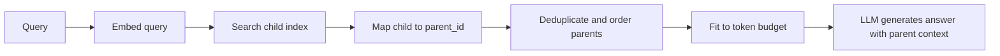
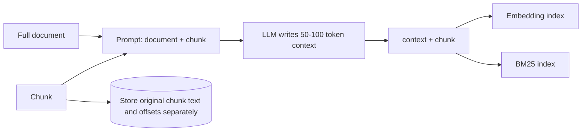
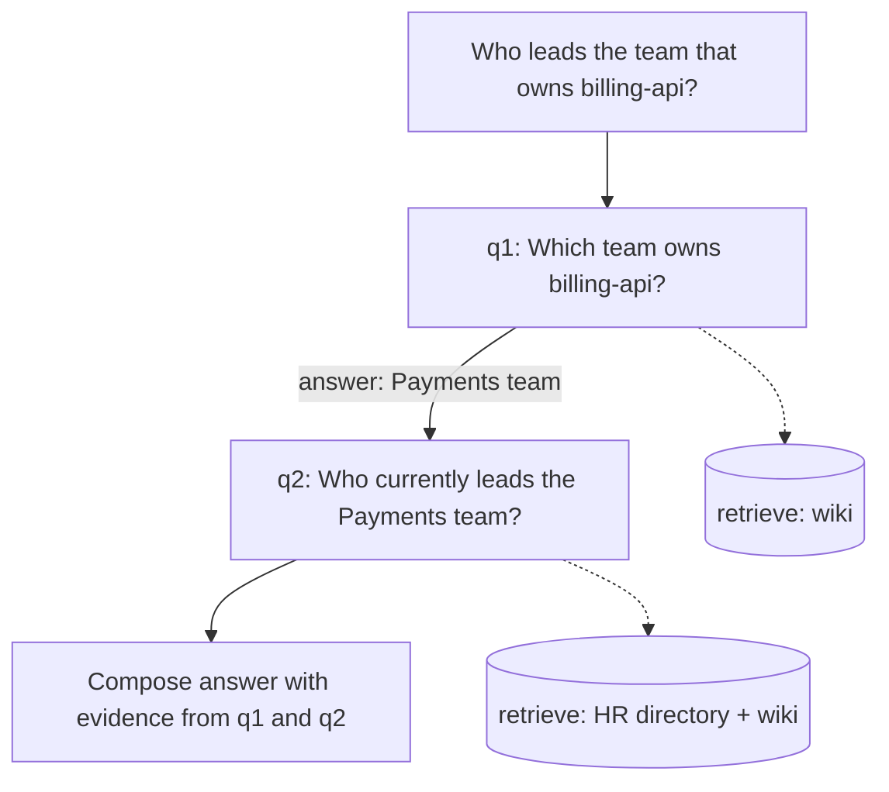
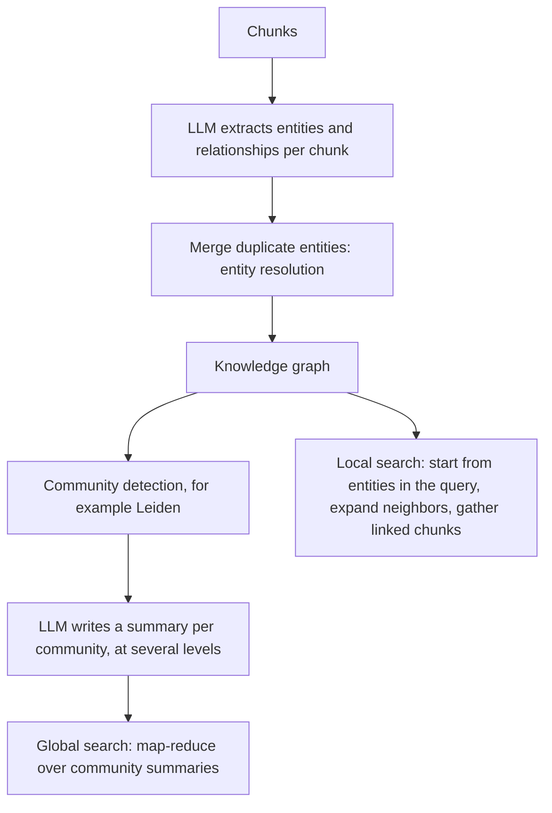
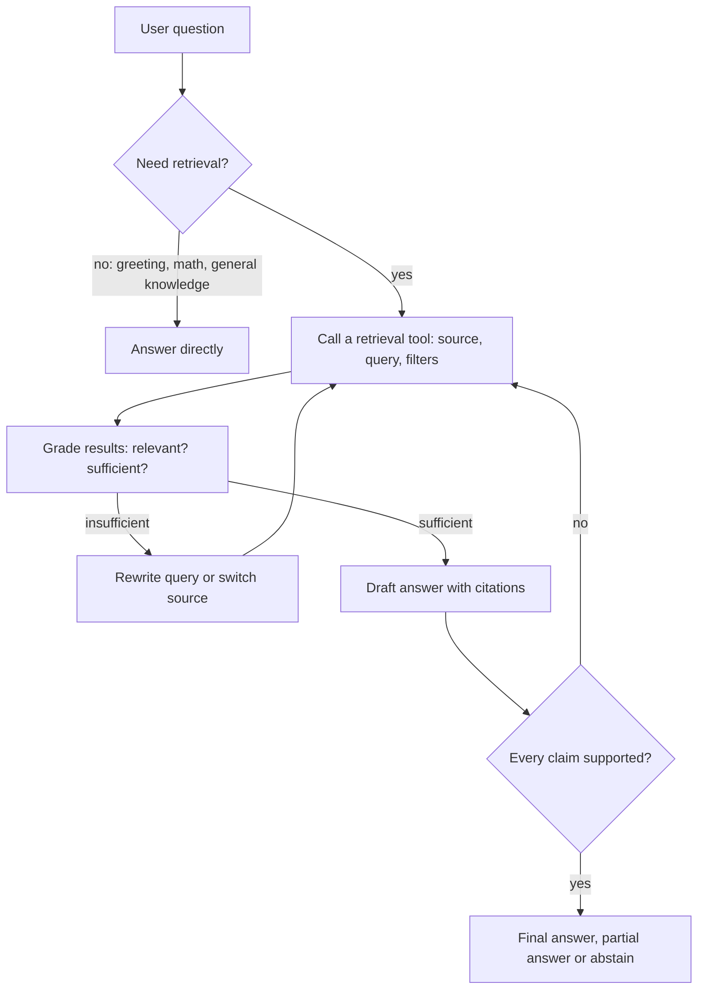
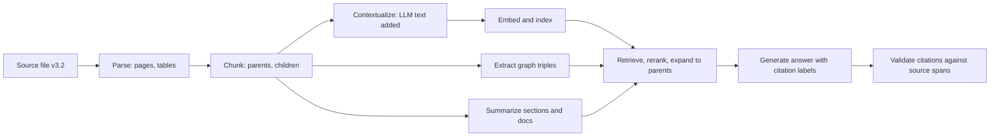

# Advanced RAG Patterns: Parent-Child, Contextual Retrieval, Multi-Hop, GraphRAG and Agentic RAG

> **Level:** Beginner to Advanced · **Study time:** ~150 min · **Prerequisites:** [What Is RAG and Why It Matters](01-what-is-rag-and-why-it-matters.md), [Chunking Strategies](04-chunking-strategies.md), [Retrieval Methods: BM25, Dense Retrieval and Hybrid Search](05-retrieval-bm25-dense-and-hybrid-search.md), [Vector Databases in Practice](07-vector-databases-in-practice.md), [Reranking and Query Transformation](08-reranking-and-query-transformation.md)

## Table of contents

- [Why this matters](#why-this-matters)
- [The map: which problem each pattern fixes](#the-map-which-problem-each-pattern-fixes)
- [The running example](#the-running-example)
- [Metadata filtering](#metadata-filtering)
- [Auto-extracting filters from the query](#auto-extracting-filters-from-the-query)
- [Parent-child (small-to-big) retrieval](#parent-child-small-to-big-retrieval)
- [Sentence-window retrieval](#sentence-window-retrieval)
- [Contextual retrieval](#contextual-retrieval)
- [Hierarchical indexes and document summaries](#hierarchical-indexes-and-document-summaries)
- [Tables and cross-references at query time](#tables-and-cross-references-at-query-time)
- [Multi-hop and complex questions](#multi-hop-and-complex-questions)
- [Verifying evidence and deciding how to respond](#verifying-evidence-and-deciding-how-to-respond)
- [GraphRAG and knowledge graphs](#graphrag-and-knowledge-graphs)
- [Agentic RAG](#agentic-rag)
- [Preserving provenance end to end](#preserving-provenance-end-to-end)
- [Going deeper: choosing patterns, cost, latency and evaluation](#going-deeper-choosing-patterns-cost-latency-and-evaluation)
- [Common mistakes and misconceptions](#common-mistakes-and-misconceptions)
- [Interview questions and model answers](#interview-questions-and-model-answers)
- [Key takeaways](#key-takeaways)
- [Further reading](#further-reading)
- [Next](#next)

## Why this matters

A basic RAG pipeline (chunk, embed, retrieve the top-k most similar chunks, generate) works well in a demo and then breaks on real enterprise questions: "what is the retention period *in version 3.2*?", "who leads the team that owns billing-api?", "what are the main themes across all incident reports this year?". Each of these failures has a known fix, and the fixes have names: metadata filtering, parent-child retrieval, contextual retrieval, query decomposition, GraphRAG, agentic RAG. Senior interviewers rarely ask you to define them in isolation. They describe a failure and expect you to pick the right pattern, explain what it costs (ingestion LLM calls, storage, latency, re-indexing pain) and say how you would prove it helped. This chapter gives you that toolbox, in the order you would actually reach for it.

## The map: which problem each pattern fixes

Before diving in, one idea organizes almost everything in this chapter:

> **Senior insight:** The unit you **search** over and the unit you **show** the LLM do not have to be the same. Small units match precisely; large units give the LLM enough context to answer. Most "advanced" patterns are clever ways of decoupling the two, or of searching more than once.

Two terms we will use constantly:

- A **retrieval unit** is the piece of text that gets embedded and scored against the query (a sentence, a chunk, a summary).
- A **context unit** is the piece of text that is actually pasted into the LLM prompt (a chunk, a parent section, a whole table).

Vocabulary carried over from earlier chapters (one line each, so nothing below is undefined):

- **BM25:** lexical (keyword) scoring that rewards exact term matches, weighted by how rare each term is in the corpus.
- **Dense retrieval:** embed the query and the chunks as vectors and rank by cosine similarity.
- **Hybrid search:** run BM25 and dense retrieval, then fuse the two ranked lists ([Retrieval Methods](05-retrieval-bm25-dense-and-hybrid-search.md)).
- **Reranker (cross-encoder):** a slower model that reads the query and one passage together and rescores the top candidates ([Reranking and Query Transformation](08-reranking-and-query-transformation.md)).

| Symptom you observe | Pattern to reach for | Main cost |
|---|---|---|
| Right topic, wrong version, wrong year, wrong department, or a user sees a document they should not | Metadata filtering | Clean metadata at ingestion; filter extraction errors |
| Retrieved chunk matches but lacks the surrounding facts needed to answer | Parent-child or sentence-window retrieval | More prompt tokens per query |
| Chunk is ambiguous on its own ("it increased 3%": what did?) so it never matches | Contextual retrieval | One LLM call per chunk at ingestion, re-indexing |
| "Summarize this document" or "which document covers X?" questions | Hierarchical indexes, document summaries | Summary generation, possible summary hallucination |
| Numbers live in tables; text says "see Section 4.2" | Table-aware chunks, reference expansion, SQL routing | Parsing work, extra retrieval calls |
| Answer needs facts from 2+ places that are linked by an entity you do not know yet | Query decomposition, iterative (multi-hop) retrieval | Extra LLM calls and latency |
| Relationship questions ("how is X connected to Y?") or global questions ("main themes across the corpus") | GraphRAG, knowledge graphs | Expensive graph construction, hard updates |
| Some questions need no retrieval, others need several rounds with checks | Agentic RAG (retrieval as a tool, Self-RAG, corrective RAG) | Unpredictable latency and cost, harder evaluation |
| Citations point at the wrong place after all these transformations | Provenance tracking (stable IDs, offsets, versions) | Discipline in the data model |

## The running example

We reuse one small corpus throughout. It is an internal knowledge base for a fictional company, Acme, with **4 documents**:

| ID | Title | Type | Department | Language | Effective date |
|---|---|---|---|---|---|
| D1 | Acme Cloud Admin Guide, version 3.2 | manual | support | en | 2026-02-10 |
| D2 | Acme Cloud Admin Guide, version 2.0 | manual | support | en | 2023-05-02 |
| D3 | Service catalog | wiki | engineering | en | 2026-06-01 |
| D4 | Engineering newsletter, March 2024 | newsletter | engineering | en | 2024-03-15 |

Key contents:

- **D1, Section 4.2 Retention policy:** "Deleted files move to the trash. Files in the trash are kept for 30 days on Basic. Pro and Enterprise keep trash for 90 days." Section 4.1 has a plan table (storage per plan). Section 4.3 says "Export limits are listed in Table 4 (see Section 4.1)."
- **D2, Section 3.5 (old version):** "Files in the trash are kept for 14 days on all plans."
- **D3:** "billing-api: owner Payments team, tier 1, runbook RB-12."
- **D4:** "Daniel Kim, who leads the Payments team, announced the billing-api queue migration."

There is also one **structured source**: an HR directory API that returns the current lead of each team (today it says the Payments team is led by Priya Shah, since January 2026).

You will see this corpus produce every classic failure: the old manual competing with the new one, a chunk that is too small to answer, a two-hop question whose bridge fact lives in a different document, and a tempting but stale join between 2024 and 2026 facts.

## Metadata filtering

### Intuition

> **Analogy:** In a library you do not read every book that mentions "retention". You first walk to the right shelf (Law, 2026 editions, English), then search there. Metadata filters are the shelf signs.

**Metadata** is structured information about a chunk, stored next to its text and vector: document ID, version, date, department, document type, language, access-control list, and so on. **Metadata filtering** restricts retrieval to chunks whose metadata satisfies a condition (for example `version == "3.2" AND lang == "en"`), before or during the similarity search.

Why do you need it if embeddings capture meaning? Because embeddings capture *topic*, not *applicability*. D1 and D2 both talk about trash retention in nearly identical words, so their vectors are close. Similarity search cannot tell that only one of them is valid for a customer on version 3.2. A filter can, exactly and cheaply.

### Use cases

| Filter dimension | Example query | Why similarity alone fails | Typical filter |
|---|---|---|---|
| Time range | "What changed in Q2 2026 incidents?" | Old and new incidents read alike | `date >= 2026-04-01 AND date < 2026-07-01` |
| Product version | "Retention period in v3.2?" | Versions share most of their text | `product == "acme-cloud" AND version == "3.2"` |
| Department or team | "What is *our* on-call policy?" (asked by an engineer) | Each department has its own policy | `dept IN ("engineering", "company-wide")` |
| Document type | "Show me the runbook, not the postmortem" | Runbooks and postmortems use the same terms | `doc_type == "runbook"` |
| Language | German user, multilingual corpus | Multilingual embeddings mix languages | `lang == "de"` (or prefer, then fall back) |
| Permissions | Any query | Similarity knows nothing about access rights | `acl_groups ∩ user_groups ≠ ∅` |
| Freshness or status | "Current pricing" | Draft and archived pages look identical | `status == "published" AND is_latest == true` |
| Tenant | Multi-tenant SaaS | Tenants have similar documents | `tenant_id == "t_123"` (often a separate index) |

Note that the permissions row is different in kind: it is a **security boundary**, not a relevance hint. It must always be applied, it must come from the authenticated user's identity (never from the query text or the LLM), and it must be enforced inside the retrieval engine, not after generation. The full treatment lives in [Secure Multi-Tenant RAG](13-secure-multi-tenant-rag.md).

### Pre-filtering vs post-filtering (recap)

How the filter interacts with approximate nearest neighbor search is covered in [Vector Databases in Practice](07-vector-databases-in-practice.md). The short version:

- **Pre-filtering** (or filtered search inside the index): only candidates that pass the filter are considered. Correct results, but very selective filters can slow some index types or hurt recall if the engine handles them poorly.
- **Post-filtering:** retrieve top-k first, then drop non-matching results. Fast, but if 9 of your top 10 are v2.0 chunks, you end up with 1 result. A poor choice for permissions: when most top hits are forbidden the user gets few or no results, and it is only safe at all if forbidden chunks are dropped before anything reaches the LLM, the logs or the user. Enforce permissions as a pre-filter (or with per-tenant indexes) instead.

### Hard filters vs soft boosts

Not every metadata condition should be a hard filter.

| Approach | What it does | Use when | Risk |
|---|---|---|---|
| Hard filter | Excludes non-matching chunks entirely | Permissions, tenant, explicit version in the query | Zero results if metadata is wrong or missing |
| Soft boost | Adds a score bonus to matching chunks (for example newer documents) | "Recent" preferences, preferred language | Non-matching chunks can still outrank matching ones |
| Filter with fallback | Try strict filter; if fewer than N results, relax non-security conditions | Auto-extracted filters | Must tell the user you relaxed it |

A small, runnable sketch of filtering with a permission filter that can never be relaxed:

```python
from datetime import date

CHUNKS = [
    {"id": "D1#4.2", "text": "Pro and Enterprise keep trash for 90 days.",
     "meta": {"doc_type": "manual", "version": "3.2", "lang": "en",
              "date": date(2026, 2, 10), "acl": {"all-staff"}}},
    {"id": "D2#3.5", "text": "Files in the trash are kept for 14 days on all plans.",
     "meta": {"doc_type": "manual", "version": "2.0", "lang": "en",
              "date": date(2023, 5, 2), "acl": {"all-staff"}}},
    {"id": "D3#billing", "text": "billing-api: owner Payments team, tier 1.",
     "meta": {"doc_type": "wiki", "version": None, "lang": "en",
              "date": date(2026, 6, 1), "acl": {"engineering"}}},
]

def matches(meta: dict, flt: dict) -> bool:
    for key, cond in flt.items():
        if key == "date_from":
            if meta["date"] < cond:
                return False
        elif meta.get(key) != cond:
            return False
    return True

def filtered_candidates(user_groups: set[str], flt: dict, min_results: int = 1):
    # 1) Permission filter: always applied, comes from the auth system, never relaxed.
    allowed = [c for c in CHUNKS if c["meta"]["acl"] & user_groups]
    # 2) Relevance filters: applied strictly first, relaxed if too few results.
    strict = [c for c in allowed if matches(c["meta"], flt)]
    if len(strict) >= min_results:
        return strict, flt
    return allowed, {}  # relaxed: caller must disclose this to the user

hits, used = filtered_candidates({"all-staff"}, {"version": "3.2"})
print([c["id"] for c in hits], used)   # ['D1#4.2'] {'version': '3.2'}
hits, used = filtered_candidates({"all-staff"}, {"version": "9.9"})
print([c["id"] for c in hits], used)   # ['D1#4.2', 'D2#3.5'] {}
```

In a real system the candidates then go to vector or hybrid search; the filter only shrinks the pool. In production databases this is a filter clause on the query (Qdrant, Weaviate, pgvector `WHERE`, Elasticsearch `bool.filter`, and so on), and the exact syntax is vendor-specific.

> **Common mistake:** Filtering on metadata you never validated. If 20% of chunks have `version = null` because the parser could not find it, a strict version filter silently hides them. Measure metadata coverage (percent of chunks with a valid value per field) as an ingestion metric.

## Auto-extracting filters from the query

Users do not type `version == "3.2"`. They type "how long do deleted files stay in the trash on 3.2?". **Filter extraction** (sometimes called **self-querying**) uses an LLM or a rules-based parser to turn the natural-language query into two parts: a **semantic query** for similarity search and a **structured filter**.

```text
"How long do deleted files stay in trash on v3.2, Pro plan?"
                │
                ▼  (LLM with a schema of allowed fields)
semantic query : "how long deleted files stay in trash, Pro plan"
filter         : {"product": "acme-cloud", "version": "3.2"}
```

Notice that "Pro plan" stayed in the semantic query: there is no `plan` metadata field, so it cannot be a filter. The extractor must only use fields that exist.

The robust recipe:

1. Give the LLM the **schema**: field names, types, and allowed values (or a list of known versions). Use structured output so the response is valid JSON (see [Structured Outputs, JSON Mode and Function Calling](../05-llms/05-structured-outputs-and-function-calling.md)).
2. **Validate** the output in code: drop unknown fields, drop values not in the allowed set, parse dates, reject impossible ranges.
3. **Never** let the extractor produce security filters. Permissions and tenant come from the session.
4. **Fall back** if the filter returns too few results, and tell the user ("I found nothing for v3.2, showing results for all versions").
5. **Log** the extracted filter for every query, so you can debug "why did it ignore my question?".

```python
import json
from datetime import date

ALLOWED = {
    "version": {"2.0", "3.2"},
    "doc_type": {"manual", "wiki", "newsletter", "runbook"},
    "lang": {"en", "de"},
}

def validate_filters(raw_json: str) -> dict:
    """Keep only known fields with allowed values. Never trust LLM output blindly."""
    try:
        raw = json.loads(raw_json)
    except json.JSONDecodeError:
        return {}
    if not isinstance(raw, dict):   # e.g. the model returned a JSON list or a bare string
        return {}
    clean = {}
    for key, value in raw.items():
        # isinstance check first: a list value would raise TypeError on set membership
        if key in ALLOWED and isinstance(value, str) and value in ALLOWED[key]:
            clean[key] = value
        elif key == "date_from":
            try:
                clean[key] = date.fromisoformat(value)
            except (TypeError, ValueError):
                pass   # unparseable date: drop it rather than fail the query
    return clean

# Pretend this came back from the LLM. It invented a "color" field and an "acl" field.
llm_output = '{"version": "3.2", "doc_type": "manual", "color": "blue", "acl": "admins", "date_from": "2026-01-01"}'
print(validate_filters(llm_output))
# {'version': '3.2', 'doc_type': 'manual', 'date_from': datetime.date(2026, 1, 1)}
```

> **Interview tip:** When asked about auto-extracted filters, mention three failure modes: the extractor invents a filter the user did not imply (over-filtering, zero results), it misses an implied filter ("latest" should mean newest version), and it maps a synonym wrongly ("v3" vs "3.2"). The fixes are a schema with allowed values, validation, fallback with disclosure, and an evaluation set of queries with their expected filters.

## Parent-child (small-to-big) retrieval

### The problem

Chunk size is a tug of war (see [Chunking Strategies](04-chunking-strategies.md)):

- **Small chunks** (one sentence, 50-150 tokens) have focused embeddings. One topic per vector means a sharp match.
- **Large chunks** (500-2,000 tokens) carry the surrounding facts the LLM needs, but their embedding is an average of many topics, so it matches any single question less sharply.

> **Analogy:** A book index points you to the exact line on page 212. But you do not tear out that one line and read it alone; you read the whole page. Parent-child retrieval searches the index (small) and reads the page (big).

### The definition

In **parent-child retrieval** (also called **small-to-big retrieval**) each document is split twice:

- **Parent chunks:** large, meaningful units (a section, a page, or around 1,000 tokens).
- **Child chunks:** small pieces inside each parent (sentences, or around 100-200 tokens). Each child stores a pointer `parent_id`.

Only the children are embedded and searched. At query time, you retrieve the top children, map each to its parent, **deduplicate** parents, and send the parents to the LLM.

```text
INGESTION                                     QUERY TIME
                                              query: "How long are deleted files kept on Pro?"
Document D1                                          │
├── Parent P1: "4.1 Storage plans" ─────┐            ▼
│     ├── child c0  (embedded)          │     search child index ──► top children:
│     └── child c1  (embedded)          │                             P2.c1 (0.52)
├── Parent P2: "4.2 Retention policy"   │                             P2.c0 (0.47)
│     ├── child c0  (embedded)          │                             P2.c3 (0.33)
│     ├── child c1  (embedded)          │            │
│     ├── child c2  (embedded)          │            ▼  map child -> parent_id, dedupe
│     └── child c3  (embedded)          │     context = [ P2 full text ]  (one parent, not 3 snippets)
└── Parent P3: "4.3 Audit logs"         │            │
      └── ...                           │            ▼
Parents stored in a doc store (by ID) ◄─┘     LLM answers from the whole section
```

(Scores in the diagram are illustrative. The code below numbers parents from 0, so P2 here is `p1` there.)



### Implementation sketch

This is a from-scratch version that runs with the standard library only. It uses a toy bag-of-words "embedding" so you can see the mechanism; in practice you would swap `embed` for a real embedding model (see [Text Embeddings and Similarity Search](02-text-embeddings-and-similarity-search.md)). Notice the character offsets: they are how we keep provenance later.

```python
import math
import re
from collections import Counter
from dataclasses import dataclass

DOC_ID = "admin-guide@v3.2"
DOC = """## 4.1 Storage plans
Acme Cloud offers Basic, Pro and Enterprise plans. Basic includes 100 GB of storage. Pro includes 1 TB. Enterprise storage is unlimited.

## 4.2 Retention policy
Deleted files move to the trash. Files in the trash are kept for 30 days on Basic. Pro and Enterprise keep trash for 90 days. Admins can restore files from the trash during that window.

## 4.3 Audit logs
Audit logs record sign-ins and sharing events. Enterprise admins can export audit logs as CSV."""

@dataclass
class Chunk:
    chunk_id: str
    parent_id: str | None   # None for parents
    text: str
    start: int              # character offsets into DOC (provenance)
    end: int

def build_index(doc: str) -> tuple[dict[str, Chunk], list[Chunk]]:
    """Parents = sections (split on blank lines). Children = sentences."""
    parents, children = {}, []
    for p_no, m in enumerate(re.finditer(r"[^\n](?:.|\n(?!\n))*", doc)):
        pid = f"{DOC_ID}#p{p_no}"
        parents[pid] = Chunk(pid, None, m.group(), m.start(), m.end())
        for c_no, s in enumerate(re.finditer(r"[A-Z][^.\n]*\.", m.group())):
            cid = f"{pid}.c{c_no}"
            children.append(Chunk(cid, pid, s.group().strip(),
                                  m.start() + s.start(), m.start() + s.end()))
    return parents, children

def embed(text: str) -> Counter:
    """Toy bag-of-words 'embedding'. Swap for a real embedding model."""
    return Counter(re.findall(r"[a-z0-9]+", text.lower()))

def cosine(a: Counter, b: Counter) -> float:
    dot = sum(a[w] * b[w] for w in a)
    na = math.sqrt(sum(v * v for v in a.values()))
    nb = math.sqrt(sum(v * v for v in b.values()))
    return dot / (na * nb) if na and nb else 0.0

def small_to_big(query: str, k_children: int = 3, max_parents: int = 2):
    q = embed(query)
    ranked = sorted(children, key=lambda c: cosine(q, embed(c.text)), reverse=True)
    hits = ranked[:k_children]
    seen, context = set(), []
    for c in hits:                      # keep best-child order, dedupe parents
        if c.parent_id not in seen:
            seen.add(c.parent_id)
            context.append(parents[c.parent_id])
        if len(context) == max_parents:
            break
    return hits, context

parents, children = build_index(DOC)
hits, context = small_to_big("How long are deleted files kept on the Pro plan?")
for c in hits:
    print("child :", c.chunk_id, "|", c.text)
for p in context:
    print("parent:", p.chunk_id, f"[{p.start}:{p.end}]", "|", p.text.splitlines()[0])
# child : admin-guide@v3.2#p1.c1 | Files in the trash are kept for 30 days on Basic.
# child : admin-guide@v3.2#p1.c0 | Deleted files move to the trash.
# child : admin-guide@v3.2#p1.c3 | Admins can restore files from the trash during that window.
# parent: admin-guide@v3.2#p1 [159:368] | ## 4.2 Retention policy
```

Look closely at that output, because it is the whole argument for parent-child retrieval. The best-matching child says "30 days on Basic", which is the **wrong answer** for a Pro question. The sentence with the right answer ("Pro and Enterprise keep trash for 90 days") ranked lower because our toy embedding does not know that "keep" and "kept" are related. If we had sent only the top child, the LLM would likely answer "30 days". Because we send the whole parent section, the correct sentence is in the context anyway.

With libraries: LangChain has a `ParentDocumentRetriever` and LlamaIndex has hierarchical node parsers with an `AutoMergingRetriever`. Names and import paths change between versions, so treat them as starting points and check the current docs. The pattern is simple enough that many teams implement it directly: store `parent_id` in the vector database's metadata, and keep parents in a key-value store or a separate table.

### Token budget math

Parent-child retrieval trades precision of matching for more prompt tokens. You should be able to estimate the budget.

$$
T_{\text{context}} = \sum_{p \in \mathcal{P}} L_p \;\le\; \min(k, P_{\max}) \cdot L_{\max}
$$

- $T_{\text{context}}$: tokens of retrieved context sent to the LLM.
- $\mathcal{P}$: the set of **unique** parents of the top-$k$ children.
- $L_p$: length of parent $p$ in tokens; $L_{\max}$ is the longest parent.
- $k$: how many children you retrieve.
- $P_{\max}$: the cap on how many parents you include.

Worked example (illustrative sizes): children of 128 tokens, parents of 1,024 tokens, $k = 8$.

- Without dedupe, if every child had a different parent: $8 \times 1{,}024 = 8{,}192$ tokens.
- In practice top children cluster. Suppose the 8 children come from 3 unique parents: $3 \times 1{,}024 = 3{,}072$ tokens.
- Compare with sending the 8 children alone: $8 \times 128 = 1{,}024$ tokens. Parent-child costs 3x more tokens here, in exchange for complete context.

### Auto-merging: a smarter middle ground

**Auto-merging retrieval** only swaps children for their parent when enough siblings were retrieved:

$$
\text{merge}(p) \iff \frac{r_p}{n_p} \ge \tau
$$

- $r_p$: number of retrieved children belonging to parent $p$.
- $n_p$: total number of children of parent $p$.
- $\tau$: merge threshold (for example 0.5).

Worked example: parent P2 has $n_p = 8$ children, and $r_p = 5$ of them are in the top results. $5 / 8 = 0.625 \ge 0.5$, so we send P2. Another parent P5 has only $r_p = 1$ of $n_p = 8$: $1 / 8 = 0.125 < 0.5$, so we send just that child. This keeps the prompt small when a parent is only tangentially relevant.

### Trade-offs and pitfalls

- **Parents that are too large** (whole 30-page documents) bring back the "lost in the middle" problem: LLMs use information at the start and end of long contexts more reliably than in the middle ("Lost in the Middle", Liu et al., 2023). Keep parents at a meaningful, bounded size (a section, capped at a token limit).
- **Reranking:** rerank children for *which* parents to include, or rerank parents directly? Reranking parents is more faithful to what the LLM sees, but cross-encoders have input limits (often 512 tokens for BERT-style rerankers; some newer rerankers accept several thousand), so long parents can get truncated. A common compromise: rerank children, then aggregate per parent with the max child score.
- **Citations:** cite the parent with the child's offsets highlighted, so the user lands on the exact sentence.
- **Updates:** when a parent changes, all of its children must be re-embedded and the old ones deleted, which is why stable IDs matter (see [Production Ingestion Pipelines](12-production-ingestion-pipelines-at-scale.md)).

## Sentence-window retrieval

**Sentence-window retrieval** is the most fine-grained version of small-to-big. Every sentence is a retrieval unit. At query time, you return the matched sentence plus $w$ sentences on each side.

```text
Sentences in D1 Section 4.2 (window w = 1):

 s0  Deleted files move to the trash.
 s1  Files in the trash are kept for 30 days on Basic.      ◄── matched sentence
 s2  Pro and Enterprise keep trash for 90 days.
 s3  Admins can restore files from the trash during that window.

Context returned = s0, s1, s2    (window of 2w + 1 = 3 sentences)
```

With $w$ sentences on each side, the context unit is $2w + 1$ sentences (fewer at document edges). With $w = 2$, that is 5 sentences.

| | Parent-child | Sentence window | Plain chunks |
|---|---|---|---|
| Retrieval unit | Small child chunk | One sentence | Fixed chunk |
| Context unit | Structural parent (section) | Matched sentence plus neighbors | Same chunk |
| Boundaries | Respect document structure | Fixed distance, can cross section boundaries | Fixed or structural |
| Best for | Structured docs (manuals, policies, contracts) | Dense prose, FAQs, transcripts | Simple baselines |
| Weakness | Large parents inflate tokens | Window may miss a fact 4 sentences away; many tiny vectors | Size tug of war |

> **Common mistake:** Using sentence windows on documents where sentences are not self-contained (tables flattened into text, code, bullet fragments). Sentence splitting on such content produces nonsense units. Use structure-aware children instead.

A related idea is to make children **propositions**: atomic, self-contained factual statements rewritten by an LLM ("Pro plans keep deleted files in the trash for 90 days"). "Dense X Retrieval: What Retrieval Granularity Should We Use?" (Chen et al., 2023) studied this and found proposition-level indexing can improve retrieval over passage or sentence units. It costs an LLM call per passage at ingestion.

## Contextual retrieval

### The problem: chunks that do not know where they are

Take this chunk from D1, Section 4.2:

```text
"Pro and Enterprise keep trash for 90 days."
```

Now imagine a different chunk from a quarterly report: "Revenue grew 3% over the previous quarter." Which company? Which quarter? The chunk does not say, because the document said it once, three pages earlier. Its embedding and its BM25 terms contain nothing about "Acme Cloud" or "Q2 2026", so a query that mentions those terms will not match it.

> **Analogy:** A photocopied paragraph found on a desk, with no header, is hard to file. Write "From Acme Cloud Admin Guide v3.2, Section 4.2 Retention policy" on the top, and anyone can file it correctly.

### The technique

**Contextual retrieval** is an ingestion-time technique: for each chunk, an LLM reads the **whole document plus the chunk** and writes a short description (typically 50-100 tokens) situating the chunk in the document. That description is **prepended** to the chunk text before both embedding and BM25 indexing.

```text
BEFORE                                   AFTER (text that gets embedded AND BM25-indexed)
"Pro and Enterprise keep trash           "This chunk is from the Acme Cloud Admin Guide
 for 90 days."                            version 3.2, Section 4.2 Retention policy. It
                                          describes how long deleted files stay in the
                                          trash for each subscription plan.
                                          Pro and Enterprise keep trash for 90 days."
```

Now a query like "Acme Cloud 3.2 deleted file retention Pro" matches through both channels: the dense embedding captures "retention of deleted files", and BM25 matches "Acme", "3.2", "retention", "deleted".



A typical prompt (wording is yours to tune):

```text
<document>
{whole document text}
</document>
Here is a chunk from the document:
<chunk>
{chunk text}
</chunk>
Write a short context (at most 2 sentences) that situates this chunk within the
document, to improve search retrieval. Mention the document title, version, section
and any entity or time period the chunk refers to implicitly. Answer with the context only.
```

A runnable pipeline sketch, with a fake LLM so you can see the data flow (replace `fake_llm` with your provider's SDK; those APIs are version-specific):

```python
import hashlib
from dataclasses import dataclass

PROMPT_VERSION = "ctx-v1"

@dataclass
class IndexedChunk:
    chunk_id: str
    original_text: str      # what we cite and show to users
    context: str            # LLM-generated, used only for indexing
    index_text: str         # context + original: what gets embedded and BM25-indexed
    cache_key: str          # decides whether we must regenerate the context

def fake_llm(prompt: str) -> str:
    return "From the Acme Cloud Admin Guide v3.2, Section 4.2 Retention policy (trash retention per plan)."

def contextualize(doc_id: str, doc_version: str, doc_text: str,
                  chunks: list[tuple[str, str]], llm=fake_llm) -> list[IndexedChunk]:
    out = []
    for chunk_id, text in chunks:
        # Context depends on the whole document, the chunk, the prompt and the model.
        key_src = f"{doc_id}|{doc_version}|{text}|{PROMPT_VERSION}|model-x"
        cache_key = hashlib.sha256(key_src.encode()).hexdigest()[:16]
        # The document goes FIRST so the shared prefix can be prompt-cached across chunks.
        prompt = f"<document>\n{doc_text}\n</document>\n<chunk>\n{text}\n</chunk>\nSituate the chunk."
        ctx = llm(prompt)
        out.append(IndexedChunk(chunk_id, text, ctx, f"{ctx}\n{text}", cache_key))
    return out

rows = contextualize("D1", "3.2", "...full admin guide...",
                     [("D1#4.2.c2", "Pro and Enterprise keep trash for 90 days.")])
print(rows[0].index_text)
# From the Acme Cloud Admin Guide v3.2, Section 4.2 Retention policy (trash retention per plan).
# Pro and Enterprise keep trash for 90 days.
```

Two design decisions are visible in the code:

1. **Store the context separately from the original text.** Citations and offsets point into the original document, not into LLM-generated text. Whether you also show the context to the answering LLM is a choice (it can help), but it must never be quoted as if it were source text.
2. **The document goes first in the prompt.** Every chunk of the same document shares the same long prefix, which is exactly what prompt caching exploits.

### Benefits

- Fixes the "orphan chunk" problem (a chunk whose meaning depends on context it no longer carries) for both dense and lexical retrieval at once.
- Complements everything else: it stacks with hybrid search and reranking (covered in [Retrieval Methods](05-retrieval-bm25-dense-and-hybrid-search.md) and [Reranking and Query Transformation](08-reranking-and-query-transformation.md)).
- Zero extra cost at query time: no extra LLM call, no extra latency per query.

Published evaluations of this technique report meaningful reductions in retrieval failures, especially combined with hybrid search and reranking, but the size of the gain depends heavily on the corpus. Measure it on your own evaluation set before paying for it.

### Costs, worked through

**Cost 1: one LLM call per chunk at ingestion.** Each call reads the whole document. Illustrative example: a document of 8,000 tokens split into 40 chunks of 200 tokens, with a 100-token instruction.

- Input per call: $8{,}000 + 200 + 100 = 8{,}300$ tokens.
- Input for the document: $40 \times 8{,}300 = 332{,}000$ tokens.
- That is $332{,}000 / 8{,}000 = 41.5$ times the size of the document itself.
- Output: $40 \times 80 = 3{,}200$ tokens of context (at about 80 tokens each).

In general, the input cost per document grows with the number of chunks times the document length:

$$
\text{InputTokens} = n \cdot (L_{\text{doc}} + L_{\text{chunk}} + L_{\text{instr}})
$$

- $n$: number of chunks in the document.
- $L_{\text{doc}}$, $L_{\text{chunk}}$, $L_{\text{instr}}$: token lengths of the document, one chunk, and the instruction.

Because $n$ itself grows with $L_{\text{doc}}$, the cost grows roughly with the **square** of document length. A 100-page manual is far more than 10 times as expensive as a 10-page one. For very long documents, pass the relevant section (or a document summary plus the section) instead of the whole document.

**Using prompt caching to reduce it.** **Prompt caching** lets a provider or your own server reuse the computed state of an identical prompt prefix across calls (mechanics in [Speculative Decoding, Prompt Caching and Other Inference Speedups](../06-llm-inference/05-speculative-decoding-caching-and-other-speedups.md)). Cached tokens are billed at a discount by most providers; the exact discount, cache lifetime and any cache-write surcharge are vendor-specific and change over time. Illustrative assumption: cached input tokens cost 10% of normal input, and we ignore write surcharges.

- Call 1 pays full price: $8{,}300$ token-equivalents.
- Calls 2 to 40 (39 calls) each pay $8{,}000 \times 0.1 + 300 = 800 + 300 = 1{,}100$ token-equivalents.
- Total: $8{,}300 + 39 \times 1{,}100 = 8{,}300 + 42{,}900 = 51{,}200$ token-equivalents.
- Saving: $332{,}000 / 51{,}200 \approx 6.5$ times cheaper.

To get this, process all chunks of one document **consecutively** (so the cache is warm) and keep the document as the exact, unchanged prefix. If you fire all 40 calls in parallel before the first one has written the cache, most of them miss it; send one call first, then fan out. Providers also typically require a minimum prefix length before anything is cached and expire entries after a few minutes of inactivity (vendor-specific). With a self-hosted model, prefix caching in your serving engine gives the same effect for latency and GPU time.

**Cost 2: storage.** Each chunk grows by the context length. 200-token chunks plus 80 tokens of context are $280 / 200 = 1.4$, so 40% more text in the BM25 index and document store. The embedding vectors do not grow (a vector has a fixed dimension regardless of input length), but the input to the embedding model is 40% longer, so embedding compute grows too.

**Cost 3: re-indexing when documents change.** The context depends on the *whole* document. If someone edits Section 2, the context for a chunk in Section 7 might technically change (for example the document title or version did). Options:

| Strategy | What you regenerate | Pros | Cons |
|---|---|---|---|
| Full regeneration | All chunks of the changed document | Always consistent | Most expensive, quadratic cost again |
| Changed chunks only | Chunks whose text hash changed | Cheap | Contexts of unchanged chunks may be stale (old version number) |
| Hybrid | Changed chunks now, full regeneration when the version or title changes, or on a schedule | Good balance | More logic to maintain |

The cache key in the code above (document version, chunk text, prompt version, model) makes this explicit: if any part changes, the context is regenerated. It behaves like the hybrid strategy: a version bump regenerates every chunk, while an edit that does not bump the version only regenerates the chunks whose text changed (title changes and scheduled refreshes need their own trigger). If you want full consistency instead, put a hash of the whole document text in the key. Changing the prompt or the model means regenerating every chunk in the corpus, which is a backfill job (reprocessing all existing data), not a quick deploy.

**Cost 4: quality risk.** The contextualizer can hallucinate ("this chunk describes the Enterprise plan" when it describes all plans). Spot-check generated contexts, and keep them short and factual.

### Alternatives on a cost ladder

| Technique | Ingestion cost | What it adds |
|---|---|---|
| Prepend document title and section path ("Admin Guide v3.2 > 4 Data > 4.2 Retention") | Nearly free, no LLM | Most of the "where am I" signal for well-structured docs |
| Prepend metadata (product, version, date) as text | Nearly free | Version and time terms become searchable by BM25 |
| **Late chunking** ("Late Chunking: Contextual Chunk Embeddings Using Long-Context Embedding Models", Günther et al., 2024): embed the whole document with a long-context embedding model, then pool token embeddings per chunk | One embedding pass per document, no LLM | Chunk vectors carry document context; does not help BM25 |
| LLM-generated contextual description | One LLM call per chunk | Best at resolving implicit references, helps dense and BM25 |

> **Senior insight:** Always try the free rung first. Prepending the heading path is a one-line change and often recovers a large share of the benefit on structured documents. Pay for LLM contexts when evaluation shows the remaining failures are implicit references ("it", "the company", "this quarter").

## Hierarchical indexes and document summaries

Some questions are not about a fact in one chunk:

- "Which document describes our data retention rules?" (routing to a document)
- "Summarize the admin guide's chapter on security." (a section-level question)
- "What are the main changes between v2.0 and v3.2?" (a document-level comparison)

A **hierarchical index** stores representations at several levels: document summaries, section summaries, and chunks. Retrieval walks down the levels.

```text
Level 0  [ Corpus ]
Level 1  [ D1 summary ]   [ D2 summary ]   [ D3 summary ]   [ D4 summary ]
              │
Level 2  [ 4.1 summary ] [ 4.2 summary ] [ 4.3 summary ]
              │
Level 3  [ chunk ] [ chunk ] [ chunk ] ...
```

Common variants:

| Variant | How it works | Good for |
|---|---|---|
| Two-stage routing | Search document summaries first, then search chunks only inside the top documents | Large corpora with many similar chunks across documents |
| Multi-vector per document | Embed a summary, some hypothetical questions and the chunks, all pointing to the same parent ID | Matching different query styles to the same content |
| Summary index | Answer "what is X about" questions directly from stored summaries | Overview questions, catalog-style browsing |
| RAPTOR tree | Recursively cluster chunks, summarize each cluster, cluster the summaries, and so on ("RAPTOR: Recursive Abstractive Processing for Tree-Organized Retrieval", Sarthi et al., 2024); retrieve from any level | Questions that need information spread across a long document |

Worked example of the routing win (illustrative sizes): 10,000 documents with 50 chunks each is 500,000 chunks. Two-stage routing picks the top 5 documents from 10,000 summaries, then scores only $5 \times 50 = 250$ chunks. That narrows the candidate set by a factor of $500{,}000 / 250 = 2{,}000$, which mainly helps **precision** (fewer look-alike chunks from irrelevant documents) and makes expensive per-candidate scoring affordable.

Risks to state in an interview:

- **Routing errors are unrecoverable.** If stage 1 picks the wrong documents, stage 2 cannot find the answer. Mitigate by taking more documents at stage 1, or running a parallel flat chunk search and fusing.
- **Summaries can hallucinate or omit.** A summary is a lossy, generated artifact. Never cite a summary as evidence for a fact; follow it down to the source chunk and cite that.
- **Summaries go stale.** They must be regenerated when the document changes, like contextual descriptions.

## Tables and cross-references at query time

Parsing tables and detecting structure is an ingestion problem covered in [Document Ingestion and Parsing](03-document-ingestion-and-parsing.md). Here we focus on what you do at **query time** once the structure is preserved.

### Tables

Tables break naive RAG in three ways: chunking splits rows from their headers, embeddings of numbers are weak, and LLMs make arithmetic and lookup errors on large flattened tables.

Strategies, from simple to advanced:

1. **Table as one context unit.** Keep a small table whole, with its caption and column headers, as a parent. Embed a short **table description** ("Table 4: storage and export limits per plan: Basic, Pro, Enterprise") as the child. This is parent-child applied to tables.
2. **Row-level children with repeated headers.** For larger tables, make each row a child, and include the header and caption in every row's text, so "Pro | 1 TB | 500 exports/day" becomes "Table 4 (limits per plan). Plan: Pro. Storage: 1 TB. Daily exports: 500." Retrieve rows; return the row plus header (or the whole table if it fits).
3. **Route numeric and aggregate questions to structured querying.** "Which plans allow more than 200 exports per day?" or "average incident duration in Q2" should run as SQL or pandas over the extracted table, not as an LLM reading text. The LLM writes the query (text-to-SQL), code executes it, and the result is cited back to the table ID (see [Tool Calling in Depth](../09-agents/02-tool-calling-in-depth.md) for executing such tools safely).

```python
def table_rows_to_children(table_id: str, caption: str,
                           header: list[str], rows: list[list[str]]) -> list[dict]:
    """Each row becomes a self-contained child that repeats caption and headers."""
    children = []
    for i, row in enumerate(rows):
        cells = ". ".join(f"{h}: {v}" for h, v in zip(header, row))
        children.append({"chunk_id": f"{table_id}.r{i}", "parent_id": table_id,
                         "text": f"{caption}. {cells}."})
    return children

for c in table_rows_to_children("D1#table4", "Table 4: limits per plan",
                                ["Plan", "Storage", "Daily exports"],
                                [["Basic", "100 GB", "50"], ["Pro", "1 TB", "500"]]):
    print(c["chunk_id"], "|", c["text"])
# D1#table4.r0 | Table 4: limits per plan. Plan: Basic. Storage: 100 GB. Daily exports: 50.
# D1#table4.r1 | Table 4: limits per plan. Plan: Pro. Storage: 1 TB. Daily exports: 500.
```

### Cross-references

D1 Section 4.3 says "Export limits are listed in Table 4 (see Section 4.1)." If you retrieve Section 4.3 alone, the LLM knows the limits exist but not what they are.

- **At ingestion**, detect references ("see Section 4.1", "as defined in Appendix B", "Table 4", "per policy HR-12") with patterns or an LLM, resolve them to target IDs, and store them as **links** in the chunk's metadata.
- **At query time**, after retrieval, **expand** one hop: for each retrieved chunk, fetch the targets of its links and add them to the candidate set (then rerank or budget them like any other candidate). Cap the expansion (one hop, at most a few targets) to avoid pulling in the whole document.
- **Definitions** deserve special handling: legal and policy documents define terms once ("'Confidential Data' means..."). Index the definitions section and attach the relevant definition whenever a retrieved chunk uses a defined term.

```python
import re

LINKS = {"D1#4.3": ["D1#4.1"]}                 # resolved at ingestion
TEXT = {"D1#4.3": "Export limits are listed in Table 4 (see Section 4.1).",
        "D1#4.1": "Table 4: limits per plan. Pro: 500 daily exports."}

def expand_references(chunk_ids: list[str], max_extra: int = 3) -> list[str]:
    out, extra = list(chunk_ids), 0
    for cid in chunk_ids:
        for target in LINKS.get(cid, []):
            if target not in out and extra < max_extra:
                out.append(target)
                extra += 1
    return out

print(expand_references(["D1#4.3"]))   # ['D1#4.3', 'D1#4.1']
print(bool(re.search(r"see Section \d+(\.\d+)*", TEXT["D1#4.3"])))   # True
```

> **Interview tip:** When asked about tables and cross-references, structure your answer as ingestion (preserve structure, keep headers with rows, resolve references into links) and query time (retrieve the description, return the full table or row with header, follow links one hop, route numeric questions to SQL). Then mention evaluation: build test questions that specifically target table cells and referenced sections, because generic eval sets under-sample them.

## Multi-hop and complex questions

### What makes a question "multi-hop"

A **single-hop question** can be answered from one retrieved passage: "How long does Pro keep trash?" A **multi-hop question** needs two or more facts, where finding a later fact depends on an earlier one: "Who leads the team that owns billing-api?"

1. Hop 1: which team owns billing-api? (D3: the Payments team)
2. Hop 2: who leads the Payments team? (HR directory: Priya Shah)

The intermediate entity ("Payments team") is called the **bridge entity**. The question never mentions it, which is why a single similarity search struggles: the query embedding is about "billing-api" and "leads", and no single chunk contains both.

Other complex question types:

| Type | Example | What it needs |
|---|---|---|
| Bridge (sequential) | "Who leads the team that owns billing-api?" | Hop 2's query depends on hop 1's answer |
| Comparison | "Did trash retention for Pro increase between v2.0 and v3.2?" | Two parallel lookups, then compare |
| Aggregation | "How many tier-1 services does Payments own?" | Many lookups or a structured query |
| Temporal | "Who led Payments when the queue migration was announced?" | Facts valid at a specific time |
| Global or thematic | "What are the recurring causes across all 2026 incidents?" | Coverage of the whole corpus (see GraphRAG) |

Standard research benchmarks for this are HotpotQA (Yang et al., 2018), 2WikiMultiHopQA (Ho et al., 2020) and MuSiQue (Trivedi et al., 2022).

### Query decomposition

**Query decomposition** means using an LLM (or rules) to break a complex question into simpler **sub-questions** that can each be answered by one retrieval, plus a plan for combining the answers. It is related to the query rewriting in [Reranking and Query Transformation](08-reranking-and-query-transformation.md), but produces several dependent queries instead of a better single one.

> **Analogy:** A good reference librarian asked "who runs the team behind our billing system?" does not search for that sentence. They first look up the service catalog, then the org chart.

Sub-questions form a small **dependency graph**: some can run in parallel (comparison), others must run in sequence (bridge). Ask the LLM for structured output that makes this explicit:

```json
{
  "sub_questions": [
    {"id": "q1", "text": "Which team owns the billing-api service?", "depends_on": []},
    {"id": "q2", "text": "Who currently leads {q1.answer}?", "depends_on": ["q1"]}
  ],
  "final": "Answer: the lead from q2, citing q1 and q2 evidence."
}
```



Classic prompting methods to know by name:

- **Least-to-Most prompting** (Zhou et al., 2022): decompose into simpler subproblems first, then solve them in order.
- **Self-Ask** ("Measuring and Narrowing the Compositionality Gap in Language Models", Press et al., 2022): the model explicitly asks itself follow-up questions and answers each, optionally with a search engine.
- **IRCoT** ("Interleaving Retrieval with Chain-of-Thought Reasoning for Knowledge-Intensive Multi-Step Questions", Trivedi et al., 2023): alternate one reasoning step and one retrieval, using the latest reasoning sentence as the next query.

### Iterative retrieval

Decomposition plans up front. **Iterative retrieval** decides the next query after seeing results, which handles cases where you cannot know hop 2's question until hop 1 is answered.

```text
loop (max N steps):
    query      = next_query(question, evidence_so_far)
    results    = retrieve(query)
    evidence  += useful(results)
    if enough_evidence(question, evidence): break
answer from evidence (or respond partially / abstain)
```

Always cap the loop (steps, tokens, wall-clock time). Without a cap, a model that never feels "sure" will loop until your latency budget is gone.

| Approach | Plans | Latency | Good for | Failure mode |
|---|---|---|---|---|
| Single retrieval with a rewritten query | Nothing | Lowest | Most single-hop questions | Misses bridge entities |
| Decompose then retrieve in parallel | All sub-questions up front | Low to medium | Comparisons, multi-part questions | Wrong decomposition, cannot adapt |
| Sequential decomposition | Ordered sub-questions with dependencies | Medium | Bridge questions with a clear chain | Error in hop 1 propagates |
| Iterative (IRCoT-style) | One step at a time | Highest | Open-ended research questions | Loops, drift, cost |

### Retrieving from multiple sources

Real questions span sources: the wiki (D3), a newsletter (D4), the HR directory API, a ticket system, a SQL warehouse. Design points:

1. **Routing:** an LLM or classifier with short source descriptions picks the sources per sub-question ("who currently leads" goes to the HR directory).
2. **Parallel fan-out with timeouts:** if a source fails, continue with the rest and **say so** in the answer.
3. **Source-specific queries:** keywords for ticket search, embeddings for the wiki, SQL or an API call for structured data.
4. **Rank-based fusion:** a BM25 score of 12 and a cosine of 0.8 are not comparable, so use Reciprocal Rank Fusion (introduced in [Retrieval Methods](05-retrieval-bm25-dense-and-hybrid-search.md)) or rerank the union with one cross-encoder.
5. **Deduplication:** hash normalized content, since the same document may live in two systems.
6. **Permissions and authority:** enforce each source's ACLs with the user's identity, and define which source wins for which fact (the HR directory, not a newsletter, is authoritative for team leads).

Quick RRF recap with a worked example:

$$
\text{RRF}(d) = \sum_{s \in S} \frac{1}{k + \text{rank}_s(d)}
$$

- $d$: a candidate document or chunk; $S$: the set of sources (ranked lists).
- $\text{rank}_s(d)$: position of $d$ in source $s$'s list (1 = best); sources where $d$ is absent contribute 0.
- $k$: a smoothing constant, commonly 60.

Chunk X is rank 1 in the wiki and rank 3 in the ticket search: $\frac{1}{61} + \frac{1}{63} \approx 0.016393 + 0.015873 = 0.032266$. Chunk Y is rank 2 in the wiki only: $\frac{1}{62} \approx 0.016129$. X wins because two sources agree on it.

## Verifying evidence and deciding how to respond

Retrieving for each sub-question is not enough. Before answering, a careful system checks three things: **is every required fact present, does the evidence fit together, and what should we say if not.**

### A checklist of sub-answers with evidence

Turn the decomposition into a **checklist**: each required fact (sub-question) needs an answer *and* at least one evidence chunk that supports it. Support can be judged by an NLI (natural language inference) model, which classifies whether a passage entails, contradicts or is neutral toward a claim, or by an LLM judge asked "does this passage support this claim?" (see [Hallucinations and Grounding](../05-llms/06-hallucinations-and-grounding.md)).

$$
\text{coverage} = \frac{|\{ f \in F : f \text{ has supporting evidence} \}|}{|F|}
$$

- $F$: the set of required facts (one per sub-question, or per slot such as "team", "lead", "date").
- The numerator counts the facts that have at least one supporting evidence passage.

Example: the question "Who leads the team that owns billing-api, and what is its runbook?" has $|F| = 3$ facts: owner team, lead, runbook. If we found owner team (D3) and runbook (D3) but no source for the lead, coverage is $2 / 3 \approx 0.67$. Only coverage $= 1$ permits a full answer.

### Avoiding joining unrelated evidence

The sneakiest multi-hop failure is a **false join**: two true facts, combined as if they referred to the same thing, producing a false answer.

In our corpus, D3 (2026) says Payments owns billing-api, and D4 (March 2024) says Daniel Kim leads Payments. Joining them gives "Daniel Kim leads the team that owns billing-api", fluent, cited, and wrong today: the HR directory says Priya Shah has led Payments since January 2026. Each fact is true at its own time. The join is false.

Consistency checks to apply before combining facts:

| Check | Question to ask | Example of a failure |
|---|---|---|
| Entity consistency | Do both facts refer to the *same* entity (same ID), not just the same name? | "Payments team" (Acme) vs "Payments team" (an acquired subsidiary) |
| Time consistency | Were both facts valid at the same time, or at the time the question asks about? | 2024 team lead joined with a 2026 ownership record |
| Version consistency | Do both facts come from the same product version or policy edition? | Retention from v2.0 combined with plan names from v3.2 |
| Scope consistency | Same region, tenant, plan, customer? | EU data-residency rule applied to a US account |
| Unit consistency | Same units and definitions? | "exports per day" vs "exports per hour" |

Mechanisms that make these checks possible:

- **Entity linking at ingestion:** map mentions to canonical IDs (`team:payments`) so you compare IDs, not strings.
- **Temporal metadata on facts:** effective date, and if possible `valid_from` / `valid_to`. Interpret "currently" as "as of today" and "when the migration was announced" as "as of 2024-03-15".
- **Authority ranking:** prefer the system of record (HR directory) over incidental mentions (newsletter).
- **Explicit bridge check:** hop 2's evidence must mention the bridge entity *from hop 1*, not a similar-looking one.

A runnable sketch of the checklist with time and entity checks:

```python
from dataclasses import dataclass, field
from datetime import date

@dataclass
class Evidence:
    chunk_id: str
    entity: str          # canonical entity ID the fact is about
    as_of: date          # when the fact was stated or valid

@dataclass
class SubAnswer:
    question: str
    answer: str | None
    about_entity: str    # entity this sub-question asks about (the bridge for hop 2)
    evidence: list[Evidence] = field(default_factory=list)

def check(subs: list[SubAnswer], today: date, max_age_days: int = 365):
    missing = [s.question for s in subs if not s.answer or not s.evidence]
    wrong_entity = [e.chunk_id for s in subs for e in s.evidence if e.entity != s.about_entity]
    stale = [e.chunk_id for s in subs for e in s.evidence
             if (today - e.as_of).days > max_age_days]
    return {"missing": missing, "wrong_entity": wrong_entity, "stale": stale}

today = date(2026, 10, 23)
q1 = SubAnswer("Which team owns billing-api?", "Payments team", "service:billing-api",
               [Evidence("D3#billing", "service:billing-api", date(2026, 6, 1))])
q2_bad = SubAnswer("Who currently leads team:payments?", "Daniel Kim", "team:payments",
                   [Evidence("D4#p2", "team:payments", date(2024, 3, 15))])
print(check([q1, q2_bad], today))
# {'missing': [], 'wrong_entity': [], 'stale': ['D4#p2']}

q2_good = SubAnswer("Who currently leads team:payments?", "Priya Shah", "team:payments",
                    [Evidence("hr-api:team:payments", "team:payments", date(2026, 10, 23))])
print(check([q1, q2_good], today))
# {'missing': [], 'wrong_entity': [], 'stale': []}
```

The D4 evidence is $952$ days old on 2026-10-23 (730 days from 2024-03-15 to 2026-03-15, plus 222 days to 2026-10-23), well over the 365-day freshness limit for a "currently" question, so the check flags it and the system goes to the authoritative source instead. The right freshness limit depends on the fact type: a team lead changes yearly, a product's founding date never.

### Answer partially, ask a clarifying question, or abstain

After the checks, choose one of four responses:

| Response | When | Example |
|---|---|---|
| **Answer** fully, with citations | All required facts supported, consistent, unambiguous | "Priya Shah leads the Payments team, which owns billing-api [D3][HR]." |
| **Answer partially** | Some facts supported, others missing; the found part is useful on its own | "Payments owns billing-api [D3]. I could not find the current lead; the latest source I have (March 2024) names Daniel Kim [D4], which may be outdated." |
| **Ask a clarifying question** | The question has several interpretations that lead to *different* answers, and you cannot cheaply cover them all | "Do you mean billing-api in production or the legacy billing-api-v1?" |
| **Abstain** | No supporting evidence, unresolvable conflict between authoritative sources, or high stakes with low confidence | "I could not find this in the documents you can access. The HR directory or the Payments channel is the place to check." |

Decision rules worth stating in an interview:

- **Clarify only when it changes the answer and the user can answer it.** If you can cover all interpretations briefly ("Basic keeps trash 30 days; Pro and Enterprise 90 days"), do that instead: clarifying costs the user a turn.
- **Partial answers must be labeled.** State what is supported, what is missing, and any caveat (staleness, conflict). Never fill gaps with the model's own knowledge silently.
- **Abstention is a feature.** For high-stakes domains (legal, medical, finance, security), set a stricter threshold. Measure abstention rate together with accuracy: a system that abstains on 40% of answerable questions is not "safe", it is useless.
- **Conflicts are information.** If v2.0 says 14 days and v3.2 says 90 days, the right answer explains the difference by version rather than picking one at random.

```python
def decide_response(report: dict, n_facts: int, ambiguous: bool, high_stakes: bool) -> str:
    n_missing = len(report["missing"])
    problems = report["wrong_entity"] or report["stale"]
    if ambiguous:
        return "clarify"
    if n_missing == n_facts:
        return "abstain"
    if high_stakes and (n_missing or problems):
        return "abstain"
    if n_missing or problems:
        return "partial"
    return "answer"

print(decide_response({"missing": [], "wrong_entity": [], "stale": ["D4#p2"]}, 2, False, False))  # partial
print(decide_response({"missing": [], "wrong_entity": [], "stale": []}, 2, False, False))         # answer
```

## GraphRAG and knowledge graphs

### When text chunks are the wrong shape

Vector retrieval finds passages *similar to the question*. Two kinds of questions are poorly served by that:

- **Relationship questions:** "Which services depend on teams that Priya Shah leads?" The answer is a path through several entities, stated in many separate documents.
- **Global questions:** "What are the main themes across all 2026 incident reports?" No single chunk is similar to that question; the answer requires looking at the *whole* corpus.

### Knowledge graph basics

A **knowledge graph** (KG) stores facts as **nodes** (entities: people, teams, services, products) and **edges** (relationships between them). Each fact is a **triple**: (subject, relation, object).

```text
(billing-api) --owned_by--> (Payments team) --led_by--> (Priya Shah)
      │                                            [source: hr-api, as_of 2026-10-23]
      └--depends_on--> (ledger-db) --owned_by--> (Data Platform team)
   [source: D3#billing]
```

Multi-hop questions become graph traversals. Notice that every edge carries its **source** and **date**: that is how graph answers stay citable and how you can apply the time checks from the previous section.

```python
from collections import defaultdict

# (subject, relation, object, source_chunk_id, as_of)
TRIPLES = [
    ("billing-api", "owned_by", "team:payments", "D3#billing", "2026-06-01"),
    ("team:payments", "led_by", "Priya Shah", "hr-api", "2026-10-23"),
    ("team:payments", "led_by", "Daniel Kim", "D4#p2", "2024-03-15"),
    ("billing-api", "depends_on", "ledger-db", "D3#billing", "2026-06-01"),
]

graph = defaultdict(list)
for s, r, o, src, as_of in TRIPLES:
    graph[s].append((r, o, src, as_of))

def follow(start: str, path: list[str]):
    """Follow a relation path; at each hop keep the most recent edge (time consistency)."""
    node, trail = start, []
    for rel in path:
        edges = [e for e in graph[node] if e[0] == rel]
        if not edges:
            return None, trail          # missing hop: caller answers partially or abstains
        rel, node, src, as_of = max(edges, key=lambda e: e[3])   # ISO dates sort as strings
        trail.append((rel, node, src, as_of))
    return node, trail

answer, trail = follow("billing-api", ["owned_by", "led_by"])
print(answer)   # Priya Shah
for hop in trail:
    print(hop)
# ('owned_by', 'team:payments', 'D3#billing', '2026-06-01')
# ('led_by', 'Priya Shah', 'hr-api', '2026-10-23')
```

In production you would use a graph database (Neo4j and similar) or a graph library such as `networkx` (`pip install networkx`) for analysis.

### How GraphRAG builds and uses the graph

**GraphRAG** usually refers to the approach in "From Local to Global: A Graph RAG Approach to Query-Focused Summarization" (Edge et al., 2024, Microsoft Research), though the name is now used loosely for any RAG system that uses a graph. The pipeline:



- **Entity and relationship extraction:** an LLM reads each chunk and outputs entities (with types and descriptions) and relationships between them.
- **Entity resolution:** merge "Payments", "Payments team" and "the payments squad" into one node. Errors here either split one entity into many or merge two different ones (which causes false joins).
- **Community detection:** a graph algorithm groups densely connected nodes into **communities** (clusters of related entities). The GraphRAG paper uses the Leiden algorithm ("From Louvain to Leiden: guaranteeing well-connected communities", Traag et al., 2019), applied recursively (hierarchical Leiden) so that each community is split into sub-communities, giving a hierarchy of communities.
- **Community summaries:** an LLM writes a report for each community ("The Payments cluster: billing-api, ledger-db, invoicing; recent incidents...").
- **Global search:** to answer a corpus-wide question, ask the question against every relevant community summary (map), then combine the partial answers (reduce). This is how it answers "main themes" questions that no single chunk can.
- **Local search:** find the entities mentioned in the question, pull their neighbors, relationships and the source chunks attached to them, and answer from that focused context.

Lighter-weight variants exist, for example LightRAG ("LightRAG: Simple and Fast Retrieval-Augmented Generation", Guo et al., 2024), which aims to cut graph construction and update costs.

### When graphs help, and what they cost

| | Vector or hybrid RAG | Knowledge graph or GraphRAG |
|---|---|---|
| Best questions | Specific facts in one or a few passages | Relationships, multi-hop paths over entities, corpus-wide themes |
| Ingestion cost | Embeddings (cheap) | LLM extraction over every chunk, often multiple calls; community summaries |
| Updates | Add or delete chunks independently | New facts may change entity merges, communities and summaries; incremental update is hard |
| Query latency | One search plus generation | Local: graph lookups plus generation; global: map-reduce over many summaries (many LLM calls) |
| Failure modes | Missed retrieval, wrong chunk | Extraction misses, wrong entity merges, summary hallucination, schema drift |
| Explainability | Cited passages | Cited paths, if edges keep their sources |

> **Senior insight:** Do not build GraphRAG because it is fashionable. Collect real user questions, label which ones are relationship or global questions, and measure how often vector RAG fails on them. If 3% of traffic is global questions, a cheaper fix may be a precomputed summary index or a SQL table of entities. A graph pays off when relationships are the product (dependency maps, investigations, compliance, research over entity-rich corpora), and often the best graph is not LLM-extracted at all: it is the service catalog, CMDB (configuration management database: the inventory of systems, owners and dependencies) or org chart you already have as structured data.

## Agentic RAG

### From pipeline to loop

Everything so far was a **fixed pipeline**: the same steps for every question. **Agentic RAG** gives an LLM (the agent) retrieval as a **tool** it can call, zero, one or many times, choosing queries, sources and filters, and deciding when it has enough. (What makes something an agent, and agents vs workflows, is covered in [What Is an AI Agent?](../09-agents/01-what-is-an-ai-agent.md).)



The tools are ordinary functions described to the model with a schema, for example:

```json
{
  "name": "search_docs",
  "description": "Search internal documents. Use for product behavior, policies and runbooks.",
  "parameters": {
    "type": "object",
    "properties": {
      "query":   {"type": "string"},
      "source":  {"type": "string", "enum": ["wiki", "manuals", "tickets"]},
      "version": {"type": "string", "description": "Product version, if the user specified one"}
    },
    "required": ["query", "source"]
  }
}
```

The function-calling mechanics are in [Structured Outputs, JSON Mode and Function Calling](../05-llms/05-structured-outputs-and-function-calling.md), and the loop designs (ReAct, plan-and-execute, reflection) are in [Agent Design Patterns](../09-agents/03-agent-design-patterns.md).

### Ideas from the research: deciding when and whether to trust retrieval

- **Self-RAG** ("Self-RAG: Learning to Retrieve, Generate, and Critique through Self-Reflection", Asai et al., 2023): trains a model to emit special **reflection tokens** that decide whether to retrieve, judge whether each passage is relevant, whether the generated text is supported by the passage, and how useful the response is. The durable idea: retrieval should be **on demand**, and generation should be **critiqued against the evidence**. In practice most teams approximate it with prompted grading steps rather than a specially trained model.
- **Corrective RAG (CRAG)** ("Corrective Retrieval Augmented Generation", Yan et al., 2024): a lightweight **retrieval evaluator** scores the retrieved documents. If they look correct, the system refines them (keeps the relevant strips); if incorrect, it falls back to another source (web search in the paper); if ambiguous, it combines both. The durable idea: **grade retrieval before generating**, and have a fallback.
- **FLARE** ("Active Retrieval Augmented Generation", Jiang et al., 2023): while generating a long answer, retrieve again when the model is about to produce low-confidence tokens. The durable idea: retrieval can be triggered **mid-generation**.
- **Adaptive-RAG** (Jeong et al., 2024): a classifier predicts query complexity and routes to no retrieval, single-step retrieval or multi-step retrieval. The durable idea: **match effort to difficulty**.

### Deciding when to retrieve

Signals a router or agent can use:

| Signal | Retrieve? | Why |
|---|---|---|
| Question about internal, private or recent facts | Yes | The model cannot know them |
| Small talk, formatting, translation of user-supplied text | No | Retrieval adds latency and noise |
| Question already answered by context in this conversation | Usually no | Reuse earlier evidence (still cite it) |
| Model's draft contains claims without citations | Yes, targeted | Verify or remove those claims |
| Retrieved results graded irrelevant | Retry with a rewrite or another source, then abstain | Avoid answering from noise |

> **Common mistake:** Letting the agent "decide" to skip retrieval for factual questions about your domain because the model thinks it knows. For enterprise assistants, default to retrieving for anything domain-specific, and make "answer without retrieval" the exception the router must justify.

### Production concerns

- **Budgets:** cap tool calls (for example at most 4 retrievals), tokens and wall-clock time. Agentic loops make p95 latency (the latency 95% of requests stay under) and cost far more variable than a fixed pipeline.
- **Observability:** trace every tool call, query, filter, result and stop reason (see [LLMOps: Tracing, Prompt Management, Langfuse and RAGAS in Practice](../10-mlops/08-llmops-tracing-prompt-management-and-langfuse.md)).
- **Security:** retrieved text is untrusted data that may contain prompt injections; tools must enforce the user's permissions themselves (see [Making Agents Reliable and Secure for Production](../09-agents/08-agent-reliability-security-and-prompt-injection.md)).
- **Evaluation:** score the final answer *and* the trajectory (right source, number of steps); see [Evaluating and Observing Agents](../09-agents/09-evaluating-and-observing-agents.md).
- **Start simple:** a fixed pipeline with a router and one corrective retry often captures most of the benefit with predictable latency. Agent framework APIs (LangGraph and others) change quickly, so keep retrieval tools framework-agnostic.

## Preserving provenance end to end

### Why it is hard

**Provenance** is the record of where a piece of information came from: which source document, which version, which exact span. In basic RAG it is easy: the chunk is a substring of the document. Advanced patterns add many transformations between the source and the citation:



At each arrow, an ID or offset can be lost, and then the citation either breaks or, worse, points confidently at the wrong place.

### The rules

1. **Stable IDs.** Every source has a stable `doc_id` that does not change when the file is renamed or re-uploaded. Every chunk has an ID derived deterministically (for example `doc_id + version + structural path`, or a hash of normalized content). Random UUIDs per ingestion run break deduplication and citation history.
2. **Versions.** Store `doc_version` (or content hash) on every derived object. A citation should say "Admin Guide v3.2", and an answer should never mix versions without saying so.
3. **Offsets into the original.** Store character offsets (and page numbers, bounding boxes for PDFs, row and column for tables, timestamps for audio) that point into the *parsed original*, never into transformed text.
4. **Derived artifacts point back.** Contextual descriptions, summaries, propositions and graph edges are *derived*. Each stores the list of source chunk IDs it came from. A summary is never cited directly; you cite the chunks behind it.
5. **Carry IDs through the prompt.** Label each context block in the prompt with its ID (`[D1#4.2]`), ask the model to cite those labels, and map labels back to source spans after generation.
6. **Validate citations.** After generation, check that every cited ID was actually in the context, and (ideally) that the cited span supports the claim. Drop or flag citations that fail.
7. **Log the snapshot.** Store which index version, chunk IDs and document versions were used for each answer, so you can reproduce and audit it later.

```python
from dataclasses import dataclass, field

@dataclass(frozen=True)
class Span:
    doc_id: str
    doc_version: str
    start: int            # character offsets into the parsed original text
    end: int
    page: int | None = None

@dataclass
class Derived:
    """Anything generated from sources: a summary, a context, a graph edge."""
    kind: str
    text: str
    sources: list[Span] = field(default_factory=list)

SOURCE = {("D1", "3.2"): "Deleted files move to the trash. Pro and Enterprise keep trash for 90 days."}

def resolve(span: Span) -> str:
    return SOURCE[(span.doc_id, span.doc_version)][span.start:span.end]

def validate_citation(claim_quote: str, span: Span) -> bool:
    """A citation is valid only if the quoted evidence really sits at that span."""
    return claim_quote in resolve(span)

span = Span("D1", "3.2", 33, 75, page=12)
print(resolve(span))                                     # Pro and Enterprise keep trash for 90 days.
print(validate_citation("keep trash for 90 days", span)) # True
print(validate_citation("keep trash for 30 days", span)) # False
summary = Derived("section_summary", "Section 4.2 covers trash retention.", [span])
print([f"{s.doc_id}@{s.doc_version}[{s.start}:{s.end}]" for s in summary.sources])
# ['D1@3.2[33:75]']
```

> **Interview tip:** When asked "how would you preserve provenance through every transformation?", walk the pipeline left to right and say what ID or offset each stage must carry forward, then finish with citation validation and audit logging. Interviewers want to hear that generated text (contexts, summaries) is never cited as source.

## Going deeper: choosing patterns, cost, latency and evaluation

### A sensible order of adoption

Do not stack every pattern on day one. Each one adds cost and moving parts. A typical progression, each step justified by measured failures:

1. Good parsing and structure-aware chunking, heading path prepended (cheap).
2. Hybrid retrieval plus a reranker.
3. Metadata filters (and permissions from day one, they are not optional).
4. Parent-child or sentence-window retrieval when answers are cut off.
5. Contextual retrieval when failures are implicit references.
6. Decomposition or iterative retrieval for the multi-hop slice of traffic, behind a router.
7. Graph or agentic approaches for the question types that still fail and matter.

### Where the cost lands

| Pattern | Ingestion cost | Query-time latency | Prompt tokens | Re-indexing burden |
|---|---|---|---|---|
| Metadata filtering | Metadata extraction | None or slight (filter extraction call if LLM-based) | Same | Low |
| Parent-child | Two-level split, parent store | One extra key-value lookup | Higher | Medium (re-embed children of changed parents) |
| Sentence window | Many small vectors | Neighbor lookup | Slightly higher | Medium |
| Contextual retrieval | One LLM call per chunk | None | Same or slightly higher | High (context depends on the whole document) |
| Hierarchical summaries | One LLM call per doc or section | Extra search stage | Same | Medium to high |
| Decomposition, iterative | None | One planning LLM call (one per step if iterative) plus N retrievals, possibly sequential | Higher | None |
| GraphRAG | LLM extraction per chunk, community summaries | Local: low to medium; global: high | Varies | High |
| Agentic RAG | None | Highly variable | Higher | None |

### Measuring whether a pattern helped

Evaluation is covered in depth in [Evaluating RAG](10-rag-evaluation-metrics-and-ragas.md). Pattern-specific advice:

- **Slice the evaluation set by question type** (single-hop, multi-hop, table, version-specific, global, unanswerable). Patterns help one slice and can hurt another; an average hides that.
- **Measure retrieval and generation separately:** for parent-child, check that the *needed fact* reaches the context, not just that a child matched. For multi-hop, add per-hop recall, false-join rate and correctness of partial or abstain decisions.
- **Track cost and latency next to quality.** A 2-point gain that doubles p95 latency may not be worth it.

### Debugging these systems

When an advanced pipeline gives a wrong answer, find the **first stage where the truth was lost**: the extracted filter, the child ranking (check top-50, not just top-5), parent expansion and the token budget, the decomposition and hop 1's bridge entity, the consistency checks and response policy, and finally the citation mapping. Log each stage so this takes minutes, not hours. The full playbook is in [Debugging RAG Systems](11-debugging-rag-systems.md).

### What changes at scale

- **Ingestion LLM spend** becomes a budget line item. Batch APIs, prompt caching and smaller models for contextualization or extraction matter. Track cost per 1,000 documents ingested.
- **Backfills** after prompt or model changes for contextual retrieval and graph extraction can take days; version the derived data and switch over atomically (blue-green indexes: build the new index beside the live one, then point queries at it in one step).
- **Filter cardinality and selectivity** affect vector database performance; very selective filters (one tenant among thousands) often argue for separate indexes or partitions.
- **Sequential steps add up:** latencies of sequential calls sum, so 3 dependent retrievals of 300 ms each take about 900 ms end to end, and a slow tail on any one call delays the whole chain. Parallel calls cost roughly the slowest one instead. Parallelize independent sub-questions and set per-step timeouts.

## Common mistakes and misconceptions

- **"Embeddings understand versions and dates."** They capture topic, not applicability. Use metadata filters for version, time, department, language and permissions.
- **Letting the LLM produce permission filters.** Security filters come from the authenticated identity, always applied, never relaxed.
- **Strict auto-extracted filters with no fallback.** One hallucinated filter value gives zero results and a confident "I don't know".
- **Parents that are whole documents.** You lose the token savings and reintroduce lost-in-the-middle problems. Bound parent size.
- **Citing generated text.** Contextual descriptions and summaries are indexing aids, not evidence. Cite the original span.
- **Joining facts by matching names and ignoring time.** Two true facts from 2024 and 2026 can combine into a false answer.
- **Filling missing hops with the model's own knowledge.** Partial answers must say what is missing.
- **Building GraphRAG without measuring the question mix.** Graphs are expensive to build and update; prove you have relationship or global questions first.
- **Evaluating only the average.** Advanced patterns help specific question slices; evaluate per slice.

## Interview questions and model answers

<details>
<summary><b>Q1. Explain metadata filtering, parent-child retrieval, and contextual retrieval.</b></summary>

**Short answer:** They fix three different retrieval problems. Metadata filtering restricts the search to chunks whose structured attributes match (version, date, department, language, permissions), because embeddings capture topic but not applicability. Parent-child retrieval embeds small child chunks for precise matching but sends the larger parent section to the LLM, so the answer has full context. Contextual retrieval prepends a short LLM-generated description of where a chunk sits in its document before embedding and BM25 indexing, so chunks that rely on implicit context ("it grew 3%") become findable.

**Deeper answer and follow-ups:**
- Filtering acts on the candidate set (what is eligible); parent-child acts on the context unit (what the LLM sees); contextual retrieval acts on the representation (what gets indexed).
- They compose: filter to v3.2, search contextualized children, expand to parents, rerank, generate.
- Costs differ: filtering needs clean metadata; parent-child costs prompt tokens at query time; contextual retrieval costs an LLM call per chunk at ingestion and complicates re-indexing.
- How to measure each: wrong-version or wrong-scope rate on version-specific queries (filtering); whether the needed fact reaches the final context (parent-child); recall@k before and after contextualization (contextual retrieval). Adopt each only when its slice improves.

</details>

<details>
<summary><b>Q2. When are metadata filters useful?</b></summary>

**Short answer:** Whenever relevance depends on an attribute that similarity cannot see: product version, time range, department or team, document type, language, tenant and permissions. Typical signal: retrieved chunks are on the right topic but from the wrong version, year or audience.

**Deeper answer and follow-ups:**
- Examples: "retention in v3.2" (version), "incidents in Q2 2026" (time), "our on-call policy" for an engineer (department), "the runbook" (doc type), German users (language).
- Permissions and tenant are mandatory security filters, applied in the retrieval engine from the user's identity, never from the LLM or the query text.
- Auto-extracted filters: an LLM maps the query to a schema with allowed values; validate, fall back with disclosure when results are empty, and log the filter.
- Pitfall: missing or wrong metadata silently hides documents; track metadata coverage at ingestion.
- Hard filter vs soft boost: hard-filter requirements (permissions, an explicit version); soft-boost preferences ("recent", preferred language). Measure extraction accuracy on a labeled query set, plus zero-result rate and fallback rate in production.

</details>

<details>
<summary><b>Q3. How can small child chunks be retrieved while returning larger parent context?</b></summary>

**Short answer:** Split each document into parents (sections, around 1,000 tokens) and children (sentences or 100-200 tokens) that store a `parent_id`. Embed and index only the children. At query time, retrieve top-k children, map them to parent IDs, deduplicate while keeping the best child order, fetch the parents from a document store, fit them into the token budget and send them to the LLM.

**Deeper answer and follow-ups:**
- Context size is the sum over unique parents: with 128-token children, 1,024-token parents and 8 children from 3 parents, that is 3,072 tokens instead of 1,024 for children alone.
- Auto-merging: only swap to the parent when at least a threshold fraction of its children are retrieved (for example 5 of 8 = 0.625 over a 0.5 threshold).
- Reranking: rerank children and aggregate by max per parent, or rerank parents if they fit the reranker's input limit.
- Pitfalls: parents that are too large (token cost, lost in the middle), and stale children after a parent changes (delete by `parent_id` on update).
- Measure: context recall of the needed fact and prompt tokens per query, against a plain-chunk baseline.

</details>

<details>
<summary><b>Q4. What are the costs of adding contextual information to chunks?</b></summary>

**Short answer:** Ingestion: one LLM call per chunk, each reading the whole document, so cost grows roughly with document length squared. Storage: every chunk's indexed text grows by the context length (for example 200 to 280 tokens, +40%), and embedding input grows too. Maintenance: when a document, the prompt or the model changes, contexts must be regenerated, which can be a full backfill. Quality risk: the generated context can be wrong. Prompt caching of the shared document prefix cuts the ingestion cost a lot.

**Deeper answer and follow-ups:**
- Worked example (illustrative): 8,000-token doc, 40 chunks, 100-token instruction: $40 \times 8{,}300 = 332{,}000$ input tokens, 41.5x the document size.
- With caching at an illustrative 10% price for cached tokens: $8{,}300 + 39 \times 1{,}100 = 51{,}200$ token-equivalents, about 6.5x cheaper. Process a document's chunks consecutively with the document as the exact prefix.
- Re-indexing options: regenerate all chunks of a changed document, only changed chunks, or a hybrid; key the cache on doc version, chunk text, prompt version and model.
- Cheaper alternatives first: prepend heading path and metadata (free), late chunking (embedding-only, no BM25 benefit).
- Store context separately from original text so citations point to source spans.
- Measure before paying: compare retrieval failure rate (recall@k) with and without contexts on your own evaluation set, and spot-check generated contexts for hallucinations. Published gains vary a lot by corpus.

</details>

<details>
<summary><b>Q5. How would you handle tables and cross-references?</b></summary>

**Short answer:** Preserve structure at ingestion, then use it at query time. For tables: keep small tables whole as a parent with caption and headers and embed a short description; for large tables make row-level children that repeat the caption and headers; route numeric or aggregate questions to SQL or pandas over the extracted table. For cross-references: resolve "see Section 4.1" and "Table 4" into links at ingestion and expand one hop at query time, with a cap, and attach definitions for defined terms.

**Deeper answer and follow-ups:**
- Why naive chunking fails: rows separated from headers, weak number embeddings, LLM lookup and arithmetic errors on flattened tables.
- Text-to-SQL: the LLM writes the query, code executes it with the user's permissions, and the answer cites the table ID and row.
- Provenance: cite table ID plus row and column; for references, cite the target section, not the referring one.
- Evaluation: add test questions that specifically hit table cells and referenced sections.

</details>

<details>
<summary><b>Q6. How would you preserve provenance through every transformation?</b></summary>

**Short answer:** Give every source a stable `doc_id` and version, give every chunk a deterministic ID and character offsets into the parsed original, and make every derived artifact (contexts, summaries, propositions, graph edges, table rows) store the source spans it came from. Carry IDs into the prompt as citation labels, map them back after generation, validate that each citation was in context and supports the claim, and log the index version and chunk IDs used per answer.

**Deeper answer and follow-ups:**
- Offsets point to the original, never to transformed text (contextualized chunks, flattened tables).
- Generated text is never cited as evidence; cite the spans behind it.
- Deterministic IDs (path or content hash) enable idempotent updates (re-running ingestion yields the same index, with no duplicates) and stable citation history; random IDs per run break both.
- Include page and bounding box for PDFs, row and column for tables, timestamps for media, so the UI can highlight the exact source.
- Audit: store the snapshot (index version, doc versions, chunk IDs, prompt version) to reproduce any answer.
- Measure: citation validity rate (cited ID was in context and its offsets resolve) and citation precision (the cited span supports the claim), tracked as release metrics.

</details>

<details>
<summary><b>Q7. How do you handle multi-hop or complex questions in RAG?</b></summary>

**Short answer:** First classify the question (single-hop, bridge, comparison, aggregation, temporal, global). For multi-hop, decompose it into sub-questions with dependencies, retrieve for each (in parallel when independent, in sequence when a later query needs an earlier answer, iteratively when you cannot plan ahead), check that every required fact has supporting, consistent evidence, then answer, answer partially, clarify or abstain.

**Deeper answer and follow-ups:**
- Why single retrieval fails: the bridge entity ("Payments team") is not in the question.
- Methods: Least-to-Most, Self-Ask, IRCoT (interleaved retrieval and reasoning).
- Cap steps and time; parallelize independent hops to control latency.
- Evaluate per hop (did hop 1 find the right bridge?) and on known-unanswerable questions.

</details>

<details>
<summary><b>Q8. What is query decomposition?</b></summary>

**Short answer:** Using an LLM (or rules) to split a complex question into simpler sub-questions that can each be answered by one retrieval, with an explicit plan of how they depend on each other and how to combine the answers. "Who leads the team that owns billing-api?" becomes "which team owns billing-api?" then "who leads {that team}?".

**Deeper answer and follow-ups:**
- Ask for structured output: sub-question IDs, text, `depends_on`, and a combination step.
- Parallel decomposition for comparisons ("v2.0 vs v3.2 retention"), sequential for bridge questions.
- Difference from query rewriting or multi-query: those produce alternative phrasings of the same question; decomposition produces different questions.
- Failure modes: over-decomposing simple questions (latency, drift), wrong decomposition, errors propagating from hop 1.
- Mitigation: route by complexity, validate each hop's answer before substituting it, and cap the number of sub-questions.
- Measure: decomposition quality against hand-labeled sub-questions on a sample, per-hop recall, and the share of simple questions that were needlessly decomposed (wasted latency).

</details>

<details>
<summary><b>Q9. How would you retrieve information from multiple sources?</b></summary>

**Short answer:** Route each sub-question to the relevant sources using source descriptions, fan out in parallel with per-source timeouts and queries in each source's own language (embeddings, keywords, SQL, APIs), enforce each source's permissions with the user's identity, merge with rank-based fusion such as RRF or a single reranker over the union, deduplicate, and prefer the authoritative source for each fact type.

**Deeper answer and follow-ups:**
- Scores from different engines are not comparable; RRF uses ranks: $\sum_s 1/(k + \text{rank}_s)$ with $k = 60$. A chunk ranked 1 and 3 in two sources scores about $0.0323$, beating one ranked 2 in a single source ($0.0161$).
- Partial failure: continue without a timed-out source and tell the user which source was unavailable.
- Authority: the HR directory beats a newsletter for "who leads a team".
- Structured sources (warehouse, CMDB) are often better for aggregations and current-state facts than text.
- Measure: router accuracy (were the right sources chosen?), per-source latency and timeout rate, and answer quality when one source is down.

</details>

<details>
<summary><b>Q10. How would you verify that all required facts are present?</b></summary>

**Short answer:** Turn the decomposition into a checklist of required facts, and require each one to have an answer plus at least one evidence passage that supports it (checked by an NLI model or an LLM judge). Compute coverage as supported facts over required facts; only full coverage permits a full answer, otherwise answer partially, retrieve again or abstain.

**Deeper answer and follow-ups:**
- Coverage $= |\text{supported facts}| / |F|$; for owner, lead and runbook with no source for lead, $2/3 \approx 0.67$.
- Check support claim by claim, not just "some document mentions the topic".
- Iterative fix: for each missing fact, issue a targeted retrieval before giving up (with a cap).
- After generation, run a groundedness check: every sentence of the answer must map to evidence; remove or flag unsupported sentences.
- Evaluate with questions where you deliberately removed one required document from the corpus: the system should notice the gap.

</details>

<details>
<summary><b>Q11. How would you avoid joining unrelated evidence?</b></summary>

**Short answer:** Before combining facts, check that they are about the same entity (by canonical ID, not just name), valid at the same time or at the time the question asks about, from the same version and scope, and in compatible units. Use entity linking and temporal metadata at ingestion, prefer authoritative sources, and require hop 2's evidence to mention the exact bridge entity from hop 1.

**Deeper answer and follow-ups:**
- Example false join: "Payments owns billing-api" (2026) plus "Daniel Kim leads Payments" (2024) gives a fluent, cited, wrong answer; the current lead is in the HR directory.
- Interpret time words: "currently" means as of today; "when X happened" means as of X's date.
- Freshness limits per fact type (team lead: about a year; product founding date: never stale).
- When facts conflict, explain the conflict (by version or date) instead of choosing silently.
- Measure: build a trap set with stale facts and same-name entities (two "Payments" teams), and track false-join rate as its own metric, since overall accuracy hides it.

</details>

<details>
<summary><b>Q12. When should the system answer partially, ask a clarifying question, or abstain?</b></summary>

**Short answer:** Answer fully when all required facts are supported and consistent. Answer partially when some facts are supported and useful on their own, clearly stating what is missing or uncertain. Ask a clarifying question when the question has interpretations that lead to different answers and you cannot cheaply cover them all. Abstain when there is no supporting evidence, authoritative sources conflict unresolvably, or the stakes are high and confidence is low.

**Deeper answer and follow-ups:**
- Prefer covering interpretations over clarifying when it is short ("Basic: 30 days; Pro and Enterprise: 90 days").
- Partial answers label caveats (staleness, missing source); never fill gaps from model memory silently.
- Thresholds depend on domain risk; stricter for legal, medical, finance, security.
- Measure the policy: accuracy of answered questions, abstention rate on answerable questions, and correct abstention rate on unanswerable ones; tune so you are neither reckless nor useless.

</details>

<details>
<summary><b>Q13. What is GraphRAG, and when is it worth its cost?</b></summary>

**Short answer:** GraphRAG builds a knowledge graph from the corpus with an LLM (entities and relationships per chunk, entity resolution), detects communities of related entities, and writes summaries for them. It answers relationship questions by traversing the graph (local search) and corpus-wide questions by map-reducing over community summaries (global search). It is worth it when relationship or global questions are a real, measured share of traffic and vector RAG fails on them.

**Deeper answer and follow-ups:**
- Reference: "From Local to Global: A Graph RAG Approach to Query-Focused Summarization" (Edge et al., 2024); communities via Leiden.
- Costs: LLM extraction over every chunk, community summarization, hard incremental updates, expensive global queries, entity-resolution errors.
- Cheaper alternatives: an existing structured graph (service catalog, org chart, CMDB), a summary index, or SQL over extracted entities.
- Know what the paper actually showed: its wins were on global "sensemaking" questions, judged by an LLM on comprehensiveness and diversity against naive vector RAG, not on factoid accuracy. For single-fact lookups, plain hybrid RAG is usually as good and far cheaper.
- Evaluate on a labeled slice of relationship and global questions, not on generic QA.

</details>

<details>
<summary><b>Q14. What is agentic RAG, and how do Self-RAG and corrective RAG relate to it?</b></summary>

**Short answer:** Agentic RAG gives an LLM retrieval as a tool it can call zero or more times, choosing the source, query and filters, grading what comes back and deciding when it has enough. Self-RAG trains a model to decide when to retrieve and to critique relevance and support with reflection tokens. Corrective RAG adds a retrieval evaluator that, depending on confidence, refines the retrieved documents, falls back to another source, or combines both.

**Deeper answer and follow-ups:**
- Durable ideas: retrieve on demand, grade retrieval before generating, verify the answer against evidence, and have a fallback.
- FLARE retrieves mid-generation on low-confidence tokens; Adaptive-RAG routes by predicted complexity.
- Controls: step and token budgets, tracing, tools that enforce permissions, trajectory evaluation.
- Pragmatic default: fixed pipeline plus router plus one corrective retry; free-form agents only where needed.

</details>

<details>
<summary><b>Q15. How do document updates interact with parent-child, contextual retrieval and graphs?</b></summary>

**Short answer:** Every derived structure must be updated consistently. Parent-child: when a parent changes, delete its old children by `parent_id` and re-embed new ones. Contextual retrieval: regenerate contexts for changed chunks, and for all chunks when document-level facts (title, version) change. Summaries and graph communities: recompute those whose source chunks changed. Deterministic IDs and content hashes make this incremental and idempotent.

**Deeper answer and follow-ups:**
- Version derived data with the prompt and model version; a prompt change is a backfill.
- Graph updates are the hardest: entity merges and community structure can shift; many teams rebuild communities on a schedule.
- Deletions must propagate to every derived artifact, or deleted content can still leak through summaries (important for compliance).
- Details in [Production Ingestion Pipelines](12-production-ingestion-pipelines-at-scale.md).

</details>

<details>
<summary><b>Q16. How would you evaluate whether an advanced pattern actually helped?</b></summary>

**Short answer:** Build an evaluation set sliced by question type (single-hop, multi-hop, table, version-specific, global, unanswerable), run the baseline and the new pattern on the same set, and compare retrieval metrics (context recall of the needed facts), answer correctness, faithfulness, abstention behavior, cost and latency per slice. Ship only if the target slice improves without unacceptable regressions elsewhere.

**Deeper answer and follow-ups:**
- Parent-child: measure whether the required fact is in the final context, not just whether a child matched.
- Multi-hop: per-hop recall, false-join rate, and correctness of partial or abstain decisions.
- Add the failures that motivated the change as regression tests.
- Framework details in [Evaluating RAG](10-rag-evaluation-metrics-and-ragas.md) and [Building an LLM Evaluation Framework](../05-llms/11-building-an-llm-evaluation-framework-and-regression-tests.md).

</details>

## Key takeaways

- The search unit and the context unit can differ: search small, show big. Parent-child, sentence-window and auto-merging all exploit this.
- Metadata filters handle what embeddings cannot: version, time, department, type, language, permissions. Permission filters come from identity, are always applied and are never relaxed.
- Auto-extracted filters need a schema, validation, fallback with disclosure, and logging.
- Parent-child context cost is the sum of unique parent lengths; dedupe parents and bound their size.
- Contextual retrieval prepends an LLM-written "where this chunk sits" description before embedding and BM25 indexing. It costs one LLM call per chunk (roughly quadratic in document length), extra storage and painful re-indexing; prompt caching of the document prefix cuts the cost substantially.
- Try free context first: heading path and metadata prepended to chunks.
- Hierarchical indexes route through summaries, but never cite a summary; follow it down to source chunks.
- Tables: keep headers with rows, return whole tables or header plus row, route numeric questions to SQL. Cross-references: resolve to links at ingestion, expand one hop at query time.
- Multi-hop: classify, decompose (parallel or sequential), retrieve per sub-question (iteratively if needed), across sources fused by rank.
- Verify with a checklist: every required fact needs supporting evidence; coverage below 1 means no full answer.
- Avoid false joins with entity, time, version, scope and unit consistency checks.
- Answer, answer partially (labeled), clarify (only when interpretations change the answer) or abstain (no evidence, unresolvable conflict, high stakes).
- GraphRAG fits relationship and global questions, at high build and update cost; measure the question mix first.
- Agentic RAG makes retrieval a tool with grading and fallbacks; budget steps, trace everything, treat retrieved text as untrusted.
- Provenance: stable IDs, versions and offsets into the original, carried through every derived artifact into validated citations.

## Further reading

- Lewis et al., 2020. "Retrieval-Augmented Generation for Knowledge-Intensive NLP Tasks." The original RAG paper.
- Liu et al., 2023. "Lost in the Middle: How Language Models Use Long Contexts."
- Chen et al., 2023. "Dense X Retrieval: What Retrieval Granularity Should We Use?"
- Günther et al., 2024. "Late Chunking: Contextual Chunk Embeddings Using Long-Context Embedding Models."
- Sarthi et al., 2024. "RAPTOR: Recursive Abstractive Processing for Tree-Organized Retrieval."
- Yang et al., 2018. "HotpotQA: A Dataset for Diverse, Explainable Multi-hop Question Answering."
- Trivedi et al., 2022. "MuSiQue: Multihop Questions via Single-hop Question Composition."
- Zhou et al., 2022. "Least-to-Most Prompting Enables Complex Reasoning in Large Language Models."
- Press et al., 2022. "Measuring and Narrowing the Compositionality Gap in Language Models" (Self-Ask).
- Trivedi et al., 2023. "Interleaving Retrieval with Chain-of-Thought Reasoning for Knowledge-Intensive Multi-Step Questions" (IRCoT).
- Edge et al., 2024. "From Local to Global: A Graph RAG Approach to Query-Focused Summarization" (GraphRAG).
- Traag, Waltman and van Eck, 2019. "From Louvain to Leiden: guaranteeing well-connected communities."
- Guo et al., 2024. "LightRAG: Simple and Fast Retrieval-Augmented Generation."
- Asai et al., 2023. "Self-RAG: Learning to Retrieve, Generate, and Critique through Self-Reflection."
- Yan et al., 2024. "Corrective Retrieval Augmented Generation" (CRAG).
- Jiang et al., 2023. "Active Retrieval Augmented Generation" (FLARE).
- Jeong et al., 2024. "Adaptive-RAG: Learning to Adapt Retrieval-Augmented Large Language Models through Question Complexity."
- Yao et al., 2022. "ReAct: Synergizing Reasoning and Acting in Language Models."
- Official documentation of LangChain (parent document and self-query retrievers) and LlamaIndex (hierarchical node parsing, auto-merging and sentence-window retrieval). These APIs change often; read the current version.

## Next

Continue with [Evaluating RAG: Retrieval Metrics, Faithfulness and RAGAS](10-rag-evaluation-metrics-and-ragas.md), where you will learn to measure whether these patterns actually improve your system.

Related chapters:

- [Reranking and Query Transformation](08-reranking-and-query-transformation.md) (query rewriting, HyDE, multi-query, rerankers)
- [Debugging RAG Systems](11-debugging-rag-systems.md)
- [Production Ingestion Pipelines](12-production-ingestion-pipelines-at-scale.md) (updates, deletions, re-embedding)
- [Secure Multi-Tenant RAG](13-secure-multi-tenant-rag.md) (permission filtering in depth)
- [Agent Design Patterns](../09-agents/03-agent-design-patterns.md) (the loops behind agentic RAG)
- [System Design: A Scalable Enterprise RAG System](../11-system-design/02-design-a-scalable-enterprise-rag-system.md)
- [Debugging Case: A RAG Application Gives Fluent but Unsupported Answers](../11-system-design/07-debugging-case-rag-fluent-but-unsupported-answers.md)
