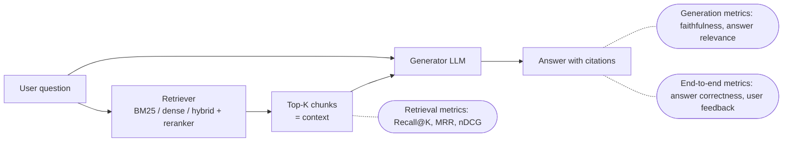
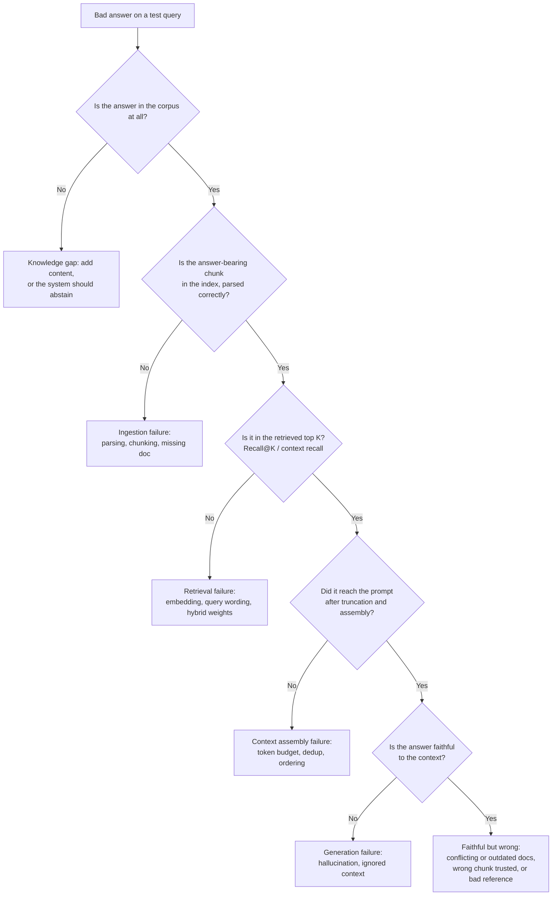
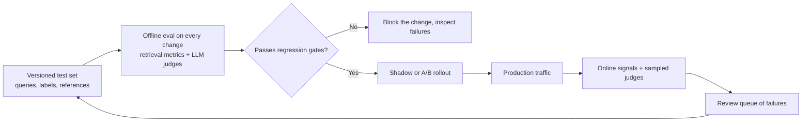

# Evaluating RAG: Retrieval Metrics, Faithfulness and RAGAS

> **Level:** Beginner to Advanced · **Study time:** ~120 min · **Prerequisites:** [What Is RAG and Why It Matters](01-what-is-rag-and-why-it-matters.md), [Retrieval Methods: BM25, Dense Retrieval and Hybrid Search](05-retrieval-bm25-dense-and-hybrid-search.md), [Reranking and Query Transformation](08-reranking-and-query-transformation.md), [Evaluating LLMs: Metrics, Benchmarks and LLM-as-a-Judge](../05-llms/10-llm-evaluation-metrics-and-llm-as-a-judge.md)

## Table of contents

- [Why this matters](#why-this-matters)
- [The big picture: evaluate retrieval, generation and end to end](#the-big-picture-evaluate-retrieval-generation-and-end-to-end)
- [The running example](#the-running-example)
- [Building a reliable retrieval test set](#building-a-reliable-retrieval-test-set)
- [Retrieval metrics, worked by hand](#retrieval-metrics-worked-by-hand)
- [Retrieval metrics in code](#retrieval-metrics-in-code)
- [Measuring retrieval recall in practice](#measuring-retrieval-recall-in-practice)
- [Generation metrics: faithfulness, relevance and correctness](#generation-metrics-faithfulness-relevance-and-correctness)
- [Context precision and context recall (RAGAS style)](#context-precision-and-context-recall-ragas-style)
- [Citation precision and citation recall](#citation-precision-and-citation-recall)
- [Telling a retrieval failure from a generation failure](#telling-a-retrieval-failure-from-a-generation-failure)
- [Using RAGAS](#using-ragas)
- [Building a custom evaluator](#building-a-custom-evaluator)
- [When automated scores disagree with humans](#when-automated-scores-disagree-with-humans)
- [Online signals from real users](#online-signals-from-real-users)
- [Going deeper: RAG evaluation in production](#going-deeper-rag-evaluation-in-production)
- [Common mistakes and misconceptions](#common-mistakes-and-misconceptions)
- [Interview questions and model answers](#interview-questions-and-model-answers)
- [Key takeaways](#key-takeaways)
- [Further reading](#further-reading)
- [Next](#next)

## Why this matters

A RAG demo that looks great on five hand-picked questions tells you almost nothing about the 50,000 questions real users will ask. Without measurement, every change (a new embedding model, a different chunk size, a reranker, a new prompt) is a guess, and teams routinely ship "improvements" that quietly make things worse. RAG is also a two-stage system, so when an answer is wrong you need to know *which* stage broke: did the retriever miss the right document, or did the LLM ignore or distort a perfectly good one? Interviewers ask about RAG evaluation constantly because it separates people who have built a demo from people who have run a RAG system in production: they want to hear about labeled test sets, Recall@K and nDCG computed correctly, faithfulness, how far to trust an LLM judge, and how you would debug a bad answer.

## The big picture: evaluate retrieval, generation and end to end

Recall the RAG pipeline from [What Is RAG and Why It Matters](01-what-is-rag-and-why-it-matters.md): a user question goes to a **retriever**, which returns the top-K most relevant **chunks** (small passages of documents); these chunks are pasted into the prompt as **context**, and an LLM, the **generator**, writes the answer. (Quick reminder of the retriever types in the diagram: **BM25** is keyword search, **dense** retrieval compares embedding vectors, **hybrid** combines both, and a **reranker** re-scores a candidate list with a slower, more accurate model.)



> **Analogy:** A student writing an open-book exam. Two things can go wrong: they open the book to the wrong page (retrieval failure), or they open it to the right page and still write something wrong or made up (generation failure). A teacher who only grades the final answer cannot tell which help the student needs: a better index in the book, or more careful reading.

There are three layers of evaluation, and you need all three:

| Layer | Question it answers | Typical metrics | Needs an LLM? | Speed and cost |
|---|---|---|---|---|
| **Retrieval** | Did the right chunks come back, near the top? | Hit rate, Recall@K, Precision@K, MRR, MAP, nDCG | No (only labels) | Fast, cheap, deterministic |
| **Generation** | Given this context, is the answer grounded and on topic? | Faithfulness, answer relevance, citation precision and recall | Usually (as a judge) | Slower, costs judge calls |
| **End to end** | Is the final answer correct and useful for the user? | Answer correctness vs a reference, human ratings, online feedback | Usually | Slowest, closest to what users feel |

Why separately *and* end to end?

- **Separately**, because it localizes failures. If Recall@5 is 0.95 but answers are often wrong, stop tuning the retriever and look at the prompt, the model or context assembly.
- **Retrieval metrics need no LLM**, so they are cheap and deterministic enough to run on every commit. This is how you evaluate RAG retrieval "independently from the LLM".
- **End to end**, because the stages interact. A better retriever that returns longer, noisier context can make answers worse, and the user only experiences the final answer.

The stages compound. With illustrative numbers: if the right chunk is retrieved 90% of the time, the LLM answers correctly 85% of the time when it has the right chunk, and 20% of the time when it does not (from its own memory or luck):

$$P(\text{correct}) = 0.9 \times 0.85 + 0.1 \times 0.20 = 0.765 + 0.020 = 0.785$$

So both stages cap the system, and improving either one helps only up to the other's ceiling.

> **Senior insight:** The **RAG triad** (a framing popularized by the TruLens project) is a compact way to remember the **reference-free** checks (checks that need no human-written correct answer, so they can run on live traffic): **context relevance** (is the retrieved context relevant to the question?), **groundedness** (is the answer supported by the context?), and **answer relevance** (does the answer address the question?). Each edge of the question-context-answer triangle gets one check.

## The running example

We will use one tiny knowledge base for the whole chapter: a fictional company's HR and IT help center, split into 10 chunks.

| Chunk | Text (shortened) |
|---|---|
| C1 | Holiday calendar: the office is closed on the public holidays listed below. |
| C2 | Vacation policy: full-time employees receive 20 days of paid vacation per year. In their first year, vacation accrues monthly. |
| C3 | Home office stipend: employees may expense ergonomic chairs and desks up to an annual limit set by their region. |
| C4 | Eligible home office categories in the expense tool: chair, desk, monitor, keyboard. |
| C5 | Vacation requests must be submitted in the HR portal at least two weeks in advance. |
| C6 | Parking permits are issued by the facilities team. |
| C7 | VPN password reset: open the self-service portal, choose "Reset VPN credentials" and confirm with your authenticator app. |
| C8 | Expense reports need itemized receipts and must be filed within 30 days. |
| C9 | The guest Wi-Fi password rotates weekly. |
| C10 | Laptops are refreshed every three years. |

Three test queries, with **graded relevance labels** (a number saying *how* relevant each chunk is, not just yes or no). We use a 0 to 2 scale: **2** = directly answers the question, **1** = partially useful, **0** = not relevant (any chunk not listed).

| Query | Relevant chunks (grade) |
|---|---|
| q1: "How many vacation days do new employees get?" | C2 (2), C5 (1) |
| q2: "How do I reset my VPN password?" | C7 (2) |
| q3: "Can I expense a home office chair?" | C3 (2), C4 (2), C8 (1) |

Our retriever (call it System A) returned these top-5 rankings, best first. Relevant chunks are marked with their grade:

```text
rank:      1        2       3        4        5
q1:     C5 (1)    C1     C2 (2)     C6       C9
q2:       C1      C6       C9     C7 (2)     C10
q3:     C3 (2)  C8 (1)     C1       C6     C4 (2)
```

Already you can see the stories: q1 got both relevant chunks but put the *partial* one first; q2 found the answer only at rank 4; q3 found everything but buried a highly relevant chunk at rank 5. The metrics below turn these stories into numbers.

## Building a reliable retrieval test set

Every retrieval metric needs a **test set** (also called a **golden set** or **evaluation set**): a list of queries, each paired with the chunks or documents that a correct retriever should return. In information retrieval these labels are called **qrels** (query relevance judgments). The metrics are only as good as this set, so a senior engineer spends more time here than on the formulas.

> **Analogy:** The test set is the answer key for an exam. If the key is wrong, incomplete or only contains easy questions, grades are meaningless no matter how carefully you add them up.

### Where queries come from

| Source | How | Pros | Cons |
|---|---|---|---|
| **Real user queries from logs** | Sample from production search or chat logs; **stratify** (sample a fixed share from each group) by topic, frequency and user type; deduplicate; scrub personal data | Real wording, typos, real distribution of intents | Needs a live system; logs may contain PII (personally identifiable information); frequent "head" queries dominate unless you stratify |
| **SME-written queries** | Subject-matter experts (SMEs: the HR specialist, the support lead) write questions they know users ask | Covers known important cases, high quality | Slow, expensive; experts write cleaner questions than users do |
| **Synthetic generation** | An LLM reads a chunk and writes a question it answers; humans review | Cheap, scales to thousands, covers rare documents | Questions copy the chunk's wording, are too easy and single-hop; must be reviewed |
| **Hard and adversarial cases** | Deliberately written: paraphrases, jargon, multi-hop, numbers, dates, negation | Stress-tests weak spots | Over-representing them distorts the average |
| **Unanswerable questions** | Questions the corpus cannot answer ("What is the CEO's salary?") | Tests abstention and hallucination | Need separate metrics (relevance-based metrics are undefined) |

A good set mixes these, and you **tag every query** with its type (`source=logs`, `type=multi_hop`, `topic=expenses`) so you can report metrics per slice. An average across all queries can hide a disaster on one slice.

> **Common mistake:** Building the test set only from synthetic questions generated from chunks. The LLM tends to reuse the chunk's exact words, so keyword search (BM25) looks artificially strong and the questions are easier than real ones. Always review synthetic questions, rewrite some into user-like phrasing, and keep real log queries as the backbone.

### Labeling relevance

Once you have queries, someone has to mark which chunks are relevant. Practical rules:

1. **Write labeling guidelines** with examples for every grade. "Relevant" is ambiguous: is a chunk about vacation *requests* relevant to a question about vacation *days*? Your guideline should say (here: grade 1, partially useful).
2. **Use graded relevance** when you can (0 = not relevant, 1 = partial, 2 = answers it; some teams use 0 to 3). It costs little extra effort and enables nDCG.
3. **Use domain experts** for specialized content (legal, medical, internal policy). A generalist cannot tell whether a policy clause actually answers the question.
4. **Measure agreement**: have two people label a sample of the same queries and compute **inter-annotator agreement** (how often labelers agree, often measured with Cohen's kappa, defined [later](#calibrating-a-judge-against-humans)). Low agreement means your guidelines are unclear, not that your labelers are bad.
5. **Label from a pool, not from one system.** If you only show labelers the top 10 from your current retriever, relevant chunks it never retrieves will never be labeled, and any new retriever that finds them gets *penalized*. The fix, used for decades in TREC (the US Text REtrieval Conference evaluations), is **pooling**: label the union of the top-K results from several different retrievers (BM25, dense, hybrid) plus keyword searches by the labeler.

### Document level vs chunk level labels

| Label level | Meaning | Pros | Cons |
|---|---|---|---|
| **Document** | "The vacation policy PDF is relevant" | Survives re-chunking; cheaper to label | Coarse: a 50-page PDF being retrieved does not mean the right paragraph was |
| **Chunk** | "Chunk C2 is relevant" | Matches what the LLM actually sees | Labels break when chunk size or boundaries change |
| **Answer span** | "This sentence (character offsets or quoted text) contains the answer" | Survives re-chunking and is precise | More labeling effort; need overlap matching |

> **Senior insight:** The best long-lived option is to label the **answer-bearing span** (the exact text that answers the question, stored with its document ID and text). At evaluation time a retrieved chunk counts as relevant if it contains, or substantially overlaps, a labeled span. Then you can change chunk sizes from 300 to 800 tokens and still compare systems on the same labels. Pure chunk IDs force you to relabel after every chunking experiment, which kills iteration speed.

### Size, confidence and versioning

How many queries do you need? Metrics are averages over queries, so they have sampling noise. For a yes/no metric like hit rate with true value $p$ over $n$ queries, the **standard error** (how much the measured average typically wobbles) is:

$$SE = \sqrt{\frac{p(1-p)}{n}}$$

- $p$: the true proportion (for example the true hit rate).
- $n$: the number of test queries.
- A 95% confidence interval is roughly $p \pm 1.96 \times SE$ (a normal approximation; when $p$ is near 0 or 1 or $n$ is small, prefer a Wilson interval or the bootstrap).

Worked example: hit rate $p = 0.8$ on $n = 100$ queries. $p(1-p) = 0.8 \times 0.2 = 0.16$. $0.16 / 100 = 0.0016$. $\sqrt{0.0016} = 0.04$. $1.96 \times 0.04 = 0.078$. So the interval is about $0.72$ to $0.88$. With $n = 400$: $SE = \sqrt{0.16/400} = \sqrt{0.0004} = 0.02$, interval $\pm 0.039$. To halve the uncertainty you need four times the queries. Practical guidance (illustrative, not a rule): start with 50 to 100 carefully labeled queries to catch big problems, then grow toward several hundred or more as the system matures, with enough queries in each important slice. For comparing two systems on the *same* queries, use a **paired** test or paired bootstrap (analyze the per-query *differences* between the two systems, so query difficulty cancels out; the recipe is in Q17 of the interview section and in [Retrieval Methods](05-retrieval-bm25-dense-and-hybrid-search.md#does-hybrid-actually-help-measuring-it-properly)).

Treat the test set like code:

- **Version it** (in git or a data versioning tool, see [Data Versioning, Model Versioning and the Model Registry](../10-mlops/02-data-and-model-versioning-and-model-registry.md)) together with the **corpus snapshot** it was labeled against and the **guideline version**. If a document is updated, its labels may be wrong.
- **Keep a held-out portion** you do not look at while tuning, or you will overfit your chunk size and prompts to the dev set.
- **Refresh it**: add new failure cases from production regularly, and retire queries about deleted documents.

A test record might look like this (stored as JSONL, one query per line; wrapped here for readability):

```json
{"query_id": "q3", "query": "Can I expense a home office chair?",
 "relevant": [{"doc_id": "hr-expenses-2026", "span": "employees may expense ergonomic chairs and desks", "grade": 2},
              {"doc_id": "expense-tool-guide", "span": "chair, desk, monitor, keyboard", "grade": 2},
              {"doc_id": "expense-rules", "span": "itemized receipts and must be filed within 30 days", "grade": 1}],
 "reference_answer": "Yes. Ergonomic chairs are an eligible home office expense, up to your region's annual limit. File the report with itemized receipts within 30 days.",
 "answerable": true, "tags": ["topic:expenses", "source:logs"], "corpus_version": "2026-09-30", "label_version": "v3"}
```

The `reference_answer` is used later for answer correctness and context recall.

## Retrieval metrics, worked by hand

All classic retrieval metrics start from **binary relevance**: a chunk is either relevant or not. With graded labels we pick a threshold; here any grade $\geq 1$ counts as relevant. Only nDCG uses the grades themselves.

Every metric is computed **per query** and then **averaged** over queries (this is called **macro-averaging**: every query counts equally). The alternative, **micro-averaging**, pools all relevant items across queries before dividing, so queries with many relevant chunks dominate; IR and RAG reports almost always macro-average. The "@K" means "looking only at the top K results".

> **Analogy:** You search a library catalog and look at the first K books on the list. **Hit rate**: did at least one useful book show up? **Recall**: what share of all the useful books in the library are on your list? **Precision**: what share of your list is useful? **MRR**: how far down did you scroll before the first useful book? **nDCG**: are the *most* useful books at the very top?

### Hit rate (Hit@K)

**Hit rate@K** (also called **success@K** or "top-K accuracy") is 1 for a query if at least one relevant chunk is in the top K, else 0.

$$\text{Hit@}K(q) = \begin{cases} 1 & \text{if } |\text{Rel}_q \cap \text{Top}_K(q)| \geq 1 \\ 0 & \text{otherwise} \end{cases}$$

- $\text{Rel}_q$: the set of relevant chunks for query $q$.
- $\text{Top}_K(q)$: the set of the first $K$ retrieved chunks.
- $|\cdot|$: the number of elements in a set.

Worked example, K = 3: q1 top 3 = {C5, C1, C2} contains C5 and C2, so 1. q2 top 3 = {C1, C6, C9} contains nothing relevant, so 0. q3 top 3 = {C3, C8, C1}, so 1. Mean Hit@3 $= (1 + 0 + 1)/3 = 0.667$.

K = 5: q2 now includes C7 at rank 4, so all three are hits. Hit@5 $= 3/3 = 1.0$.

Hit rate fits single-answer questions where one good chunk is enough. It ignores how *many* relevant chunks came back.

### Recall@K

**Recall@K**: of all the relevant chunks for this query, what fraction appears in the top K?

$$\text{Recall@}K(q) = \frac{|\text{Rel}_q \cap \text{Top}_K(q)|}{|\text{Rel}_q|}$$

- Numerator: how many relevant chunks we retrieved in the top K.
- Denominator: how many relevant chunks exist for the query according to the labels.

Worked example, K = 3:

- q1: relevant {C2, C5}, both in top 3: $2/2 = 1.0$.
- q2: relevant {C7}, not in top 3: $0/1 = 0.0$.
- q3: relevant {C3, C4, C8}, top 3 has C3 and C8: $2/3 = 0.667$.
- Mean Recall@3 $= (1.0 + 0.0 + 0.667)/3 = 1.667/3 = 0.556$.

K = 5: q1 $= 1.0$, q2 $= 1/1 = 1.0$, q3 $= 3/3 = 1.0$, so Recall@5 $= 1.0$.

This is **retrieval recall**: the fraction of the information the answer needs that actually reached the LLM. It is the single most important retrieval metric for RAG, because the generator cannot use a chunk it never sees. Recall always grows (or stays flat) as K grows, which is why you must always state K.

### Precision@K

**Precision@K**: of the top K chunks, what fraction is relevant?

$$\text{Precision@}K(q) = \frac{|\text{Rel}_q \cap \text{Top}_K(q)|}{K}$$

Worked example, K = 3: q1 $= 2/3 = 0.667$, q2 $= 0/3 = 0$, q3 $= 2/3 = 0.667$. Mean $= 1.333/3 = 0.444$.

K = 5: q1 $= 2/5 = 0.4$, q2 $= 1/5 = 0.2$, q3 $= 3/5 = 0.6$. Mean $= 1.2/3 = 0.4$.

Precision tells you how much **noise** you feed the LLM. Irrelevant chunks cost tokens (money and latency) and can distract the model. Note the cap: q2 has only one relevant chunk, so its Precision@5 can never exceed $1/5 = 0.2$. Precision@K is therefore hard to compare across queries with different numbers of relevant items.

### MRR (Mean Reciprocal Rank)

The **reciprocal rank** of a query is $1/\text{rank}$ of the *first* relevant result (0 if none is retrieved). **MRR** averages it over all queries $Q$:

$$\text{MRR} = \frac{1}{|Q|} \sum_{q \in Q} \frac{1}{\text{rank}_q}$$

- $|Q|$: the number of queries.
- $\text{rank}_q$: the position of the first relevant chunk for query $q$ (1 = top).

Worked example (cutoff K = 5): q1's first relevant chunk is C5 at rank 1, so $1/1 = 1$. q2's is C7 at rank 4, so $1/4 = 0.25$. q3's is C3 at rank 1, so $1$. MRR $= (1 + 0.25 + 1)/3 = 2.25/3 = 0.75$.

With cutoff K = 3 (MRR@3), q2 contributes 0, so MRR@3 $= 2/3 = 0.667$.

MRR rewards getting *something* relevant to the very top, which suits FAQ-style "one right answer" queries. Its blind spots are visible in q1: the first hit is C5, the merely partial chunk, yet q1 scores a perfect 1.0, and MRR ignores everything after the first hit.

### MAP (Mean Average Precision), briefly

**Average precision (AP)** for one query averages the precision at each position where a relevant chunk appears, divided by the total number of relevant chunks (so missed ones count as 0). **MAP** is the mean of AP over queries.

$$\text{AP@}K(q) = \frac{1}{|\text{Rel}_q|} \sum_{k=1}^{K} \text{Precision@}k(q) \cdot \text{rel}_q(k)$$

- $\text{rel}_q(k)$: 1 if the chunk at rank $k$ is relevant, else 0.

Worked example, K = 5:

- q1: relevant at ranks 1 and 3. Precision@1 $= 1/1 = 1$, Precision@3 $= 2/3 = 0.667$. AP $= (1 + 0.667)/2 = 0.833$.
- q2: relevant at rank 4. Precision@4 $= 1/4 = 0.25$. AP $= 0.25/1 = 0.25$.
- q3: relevant at ranks 1, 2, 5. Precision@1 $= 1$, Precision@2 $= 2/2 = 1$, Precision@5 $= 3/5 = 0.6$. AP $= (1 + 1 + 0.6)/3 = 2.6/3 = 0.867$.
- MAP@5 $= (0.833 + 0.25 + 0.867)/3 = 1.95/3 = 0.65$.

MAP rewards both finding all relevant chunks and ranking them high, but it only uses binary relevance and is harder to explain to stakeholders. In RAG you will mostly see Recall@K, MRR and nDCG; MAP shows up in classic IR papers and in object detection (see [Object Detection in Depth](../03-computer-vision/02-object-detection-yolo-faster-rcnn-and-map.md), where "mAP" is a related but different averaging).

### nDCG with graded relevance

**nDCG** (normalized Discounted Cumulative Gain, Järvelin and Kekäläinen, 2002) is the metric that uses the *grades* and the *positions* together. The idea in three steps:

1. **Gain**: each retrieved chunk earns points according to its grade. Highly relevant is worth much more than partially relevant.
2. **Discount**: points earned lower in the list are divided by a growing number, because users (and LLMs) pay less attention further down.
3. **Normalize**: divide by the best possible score for that query, so every query lands between 0 and 1.

$$\text{DCG@}K = \sum_{i=1}^{K} \frac{2^{\text{rel}_i} - 1}{\log_2(i + 1)}, \qquad \text{nDCG@}K = \frac{\text{DCG@}K}{\text{IDCG@}K}$$

- $i$: the rank position (1, 2, 3, ...).
- $\text{rel}_i$: the graded relevance of the chunk at position $i$ (0, 1 or 2 here).
- $2^{\text{rel}_i} - 1$: the **gain**. Grade 0 gives 0, grade 1 gives 1, grade 2 gives 3. This "exponential gain" form (popularized by Burges et al., 2005) strongly rewards highly relevant items. Some tools use the **linear gain** $\text{rel}_i$ instead; both are legitimate, but you must not mix them.
- $\log_2(i + 1)$: the **discount**. Position 1 divides by $\log_2 2 = 1$, position 2 by $\log_2 3 = 1.585$, and so on.
- $\text{IDCG@}K$: the **ideal DCG**, the DCG of the perfect ranking, built by sorting *all* labeled relevant chunks for the query by grade, highest first (including ones the system failed to retrieve).

The discount factors we need ($1/\log_2(i+1)$):

| Position $i$ | $\log_2(i+1)$ | Discount $1/\log_2(i+1)$ |
|---|---|---|
| 1 | 1.000 | 1.000 |
| 2 | 1.585 | 0.631 |
| 3 | 2.000 | 0.500 |
| 4 | 2.322 | 0.431 |
| 5 | 2.585 | 0.387 |

**q1** (ranking C5, C1, C2, C6, C9 with grades 1, 0, 2, 0, 0):

- Gains: $2^1 - 1 = 1$, $0$, $2^2 - 1 = 3$, $0$, $0$.
- DCG@5 $= 1 \times 1.000 + 3 \times 0.500 = 1 + 1.5 = 2.5$.
- Ideal order: C2 (grade 2, gain 3), then C5 (grade 1, gain 1). IDCG@5 $= 3 \times 1.000 + 1 \times 0.631 = 3.631$.
- nDCG@5 $= 2.5 / 3.631 = 0.689$.

Notice what MRR missed: putting the partial chunk above the fully relevant one costs q1 about 31% of its possible score.

**q2** (C7, grade 2, at position 4):

- DCG@5 $= 3 \times 0.431 = 1.292$.
- IDCG@5 $= 3 \times 1.000 = 3$ (one grade-2 chunk at the top).
- nDCG@5 $= 1.292 / 3 = 0.431$.

**q3** (C3, C8, C1, C6, C4 with grades 2, 1, 0, 0, 2):

- Gains: 3, 1, 0, 0, 3.
- DCG@5 $= 3 \times 1.000 + 1 \times 0.631 + 3 \times 0.387 = 3 + 0.631 + 1.161 = 4.791$ (using unrounded discounts; with the rounded table values you get 4.792).
- Ideal order: C3 (3), C4 (3), C8 (1). IDCG@5 $= 3 \times 1.000 + 3 \times 0.631 + 1 \times 0.500 = 3 + 1.893 + 0.5 = 5.393$.
- nDCG@5 $= 4.791 / 5.393 = 0.888$.

Mean nDCG@5 $= (0.689 + 0.431 + 0.888)/3 = 2.008/3 = 0.669$.

> **Common mistake:** Computing IDCG only from the chunks the system *retrieved*. If q2 had missed C7 entirely and you built the ideal ranking from retrieved chunks only, IDCG would be 0 (or the query silently dropped), hiding the failure. IDCG must come from **all labeled relevant chunks** for the query.

### Putting the numbers side by side

| Metric (System A) | q1 | q2 | q3 | Mean |
|---|---|---|---|---|
| Hit@3 | 1 | 0 | 1 | 0.667 |
| Hit@5 | 1 | 1 | 1 | 1.000 |
| Recall@3 | 1.000 | 0.000 | 0.667 | 0.556 |
| Recall@5 | 1.000 | 1.000 | 1.000 | 1.000 |
| Precision@3 | 0.667 | 0.000 | 0.667 | 0.444 |
| Precision@5 | 0.400 | 0.200 | 0.600 | 0.400 |
| MRR (cutoff 5) | 1.000 | 0.250 | 1.000 | 0.750 |
| MAP@5 | 0.833 | 0.250 | 0.867 | 0.650 |
| nDCG@5 | 0.689 | 0.431 | 0.888 | 0.669 |

Read it like an engineer: Recall@5 is perfect, so the right information *is* in the top 5. But Recall@3 is only 0.556 and nDCG@5 is 0.669, so ordering is weak. If the prompt only gets the top 3 chunks, q2 will fail. That is exactly the situation a **reranker** fixes (see [Reranking and Query Transformation](08-reranking-and-query-transformation.md)): it reorders a candidate list without changing recall at the candidate depth.

### Which metric for which job

| Metric | Measures | Uses grades? | Order-aware? | Use it when |
|---|---|---|---|---|
| Hit@K | At least one relevant in top K | No | No | One good chunk is enough (FAQ bots) |
| Recall@K | Share of relevant items found | No | No (within K) | First-stage retrieval; the top-K that feeds the prompt or reranker |
| Precision@K | Share of top K that is relevant | No | No (within K) | Controlling noise and token cost in the context |
| MRR | Position of first relevant item | No | Yes | Single-answer queries, navigational search |
| MAP | Precision across all relevant positions | No | Yes | Classic IR comparisons, many relevant items |
| nDCG@K | Graded relevance with position discount | Yes | Yes | The final ranked list that goes into the prompt |

> **Interview tip:** State the K that matches the pipeline. "Recall@50 for the first stage, because the reranker reads 50 candidates; nDCG@5 after reranking, because the top 5 go into the prompt." That one sentence shows you understand the system, not just the formulas.

## Retrieval metrics in code

A from-scratch implementation makes the definitions concrete. It runs with the standard library only and reproduces every number above.

```python
import math

# Graded labels: chunk_id -> grade (2 = answers it, 1 = partially useful). Unlisted = 0.
qrels = {
    "q1": {"C2": 2, "C5": 1},
    "q2": {"C7": 2},
    "q3": {"C3": 2, "C4": 2, "C8": 1},
}
# Ranked retriever output, best first.
run = {
    "q1": ["C5", "C1", "C2", "C6", "C9"],
    "q2": ["C1", "C6", "C9", "C7", "C10"],
    "q3": ["C3", "C8", "C1", "C6", "C4"],
}

def is_rel(labels, doc, threshold=1):
    return labels.get(doc, 0) >= threshold   # binarize graded labels

def hit_at_k(ranked, labels, k):
    return float(any(is_rel(labels, d) for d in ranked[:k]))

def recall_at_k(ranked, labels, k):
    n_relevant = sum(is_rel(labels, d) for d in labels)
    found = sum(is_rel(labels, d) for d in ranked[:k])
    return found / n_relevant if n_relevant else 0.0

def precision_at_k(ranked, labels, k):
    return sum(is_rel(labels, d) for d in ranked[:k]) / k

def reciprocal_rank(ranked, labels, k):
    for i, d in enumerate(ranked[:k], start=1):
        if is_rel(labels, d):
            return 1.0 / i
    return 0.0

def average_precision(ranked, labels, k):
    n_relevant = sum(is_rel(labels, d) for d in labels)
    hits, total = 0, 0.0
    for i, d in enumerate(ranked[:k], start=1):
        if is_rel(labels, d):
            hits += 1
            total += hits / i                  # precision at this relevant position
    return total / n_relevant if n_relevant else 0.0

def dcg(grades):
    return sum((2 ** g - 1) / math.log2(i + 1) for i, g in enumerate(grades, start=1))

def ndcg_at_k(ranked, labels, k):
    actual = [labels.get(d, 0) for d in ranked[:k]]
    ideal = sorted(labels.values(), reverse=True)[:k]   # from ALL labeled items
    idcg = dcg(ideal)
    return dcg(actual) / idcg if idcg > 0 else 0.0

def mean(xs):
    return sum(xs) / len(xs)

k = 5
for name, fn in [("Hit", hit_at_k), ("Recall", recall_at_k), ("Precision", precision_at_k),
                 ("MRR", reciprocal_rank), ("MAP", average_precision), ("nDCG", ndcg_at_k)]:
    print(f"{name}@{k}: {mean([fn(run[q], qrels[q], k) for q in qrels]):.3f}")
# Hit@5: 1.000
# Recall@5: 1.000
# Precision@5: 0.400
# MRR@5: 0.750
# MAP@5: 0.650
# nDCG@5: 0.669
```

In real projects use a tested library rather than your own code, and check its definitions:

- **scikit-learn** has `sklearn.metrics.ndcg_score`, but it uses **linear gain** ($\text{rel}_i$, not $2^{\text{rel}_i} - 1$), and it computes the ideal ranking only from the items you pass in, so you must include unretrieved relevant items.
- **pytrec_eval** (Python bindings for the classic `trec_eval` tool) and **ranx** compute standard IR metrics from qrels and run dictionaries in the same shape as above. Read each library's documentation for its exact nDCG gain convention (trec_eval's standard nDCG uses the grade itself as the gain, i.e. linear gain; ranx offers both a trec_eval-style `ndcg` and an exponential-gain `ndcg_burges`).

```python
# pip install scikit-learn
from sklearn.metrics import ndcg_score

# q1: true grades and the retriever's scores for the same 5 chunks (C5, C1, C2, C6, C9).
y_true  = [[1, 0, 2, 0, 0]]
y_score = [[5, 4, 3, 2, 1]]          # higher score = ranked higher
print(round(ndcg_score(y_true, y_score, k=5), 3))   # 0.76 with LINEAR gain (we got 0.689 with exponential gain)
```

Linear gain: DCG $= 1 \times 1 + 2 \times 0.5 = 2.0$, IDCG $= 2 \times 1 + 1 \times 0.631 = 2.631$, nDCG $= 2.0/2.631 = 0.760$. Same ranking, different number. Always report which convention you used.

## Measuring retrieval recall in practice

"Retrieval recall" means: *of the information needed to answer, how much made it into the retrieved context?* There are three practical ways to measure it, from most to least rigorous:

| Method | What you need | How it works | Weakness |
|---|---|---|---|
| **Label-based Recall@K** | Labeled relevant chunks, documents or spans per query | Count labeled items in the top K (the formula above) | Labels can be incomplete; chunk IDs break on re-chunking |
| **Span or string match** | Labeled answer spans or a short reference answer | A retrieved chunk "hits" if it contains or overlaps the span | Paraphrased answers do not string-match |
| **LLM-judged context recall** | A reference answer only | Split the reference into claims; an LLM checks if each claim is supported by the retrieved context (defined [below](#context-precision-and-context-recall-ragas-style)) | Costs judge calls; inherits judge errors |

Subtleties a senior engineer should mention:

- **Incomplete labels.** Recall is measured against the *known* relevant set. A new retriever that finds a relevant chunk nobody labeled gets no credit (and its precision is underestimated). Pooling and periodic relabeling reduce this.
- **Duplicates.** If the corpus contains the same paragraph in three documents, decide whether retrieving any copy counts. Label-at-span-level plus deduplication handles it.
- **Recall at the right depth.** Measure recall at the depth the next stage reads: the reranker's input size, then the final prompt size.
- **End-to-end recall.** Context assembly can truncate chunks to fit a token budget. Measure recall on what *actually entered the prompt*, not on the retriever's raw output. This is a common silent bug.

## Generation metrics: faithfulness, relevance and correctness

Retrieval metrics stop at the context. Generation metrics judge the answer. Most of them use an **LLM-as-a-judge**: a (usually strong) LLM prompted with a rubric to score or classify an output. How judges work in general, and their biases, are covered in [Evaluating LLMs](../05-llms/10-llm-evaluation-metrics-and-llm-as-a-judge.md); here we focus on the RAG-specific metrics.

A useful split:

- **Reference-free** metrics need only the question, context and answer. You can run them on live production traffic.
- **Reference-based** metrics need a **reference answer** (a human-written correct answer, also called **ground truth**). They only run on your labeled test set.

We will continue with q1. The retriever returned C5, C1 and C2 as the top 3, which became the context. The LLM answered:

```text
Answer: New full-time employees get 20 vacation days per year, accrued monthly
during their first year. Unused days roll over to the next year.
```

The reference answer is: "Full-time employees get 20 paid vacation days per year; in the first year they accrue monthly."

### Faithfulness (groundedness)

> **Analogy:** A fact-checker at a newspaper takes a reporter's article, underlines every factual claim, and checks each one against the source notes. Claims without a source get flagged, even if they happen to be true.

**Faithfulness** (also called **groundedness**) measures whether every claim in the answer is supported by the retrieved context. It does *not* ask whether the answer is true in the world, only whether the context backs it up. An unsupported claim is a **hallucination** relative to the context (see [Hallucinations](../05-llms/06-hallucinations-and-grounding.md)).

The standard recipe (used by RAGAS, and similar to FActScore, Min et al., 2023):

1. **Decompose** the answer into **atomic claims**: short, self-contained statements that are each true or false.
2. **Verify** each claim against the context: is it **entailed** (logically follows from the context)? This is a **natural language inference (NLI)** judgment, made by an LLM judge or a trained NLI model.
3. **Score**:

$$\text{Faithfulness} = \frac{\text{number of claims supported by the context}}{\text{total number of claims in the answer}}$$

Worked example on the q1 answer:

| # | Claim | Supported by context? |
|---|---|---|
| 1 | New full-time employees get 20 vacation days per year. | Yes (C2) |
| 2 | Vacation accrues monthly during the first year. | Yes (C2) |
| 3 | Unused days roll over to the next year. | No: no chunk mentions rollover |

Faithfulness $= 2/3 = 0.667$.

Notes:

- Claim 3 might even be true in the real policy. It is still unfaithful, because the user cannot verify it from the sources, and the model may have invented it.
- An answer that says "I don't know based on the provided documents" has zero factual claims; tools differ on whether that scores 1, 0 or is skipped. Evaluate abstention separately.
- Claim granularity matters: splitting into more, smaller claims changes the score. Keep the decomposition prompt fixed between runs you compare.

### Answer relevance

**Answer relevance** measures whether the answer actually addresses the question, regardless of whether it is correct. It penalizes answers that are evasive, incomplete or padded with off-topic material.

> **Analogy:** You ask a colleague "what time is the meeting?" and they reply with a perfectly accurate description of the meeting's agenda. Faithful, maybe even correct, but not relevant to what you asked.

RAGAS computes it in a clever reverse way:

1. Ask an LLM to generate $N$ questions that the answer would be a good response to.
2. Embed each generated question $g_i$ and the original question $q$ with an embedding model (see [Text Embeddings and Similarity Search](02-text-embeddings-and-similarity-search.md)).
3. Average the cosine similarities:

$$\text{AnswerRelevance} = \frac{1}{N} \sum_{i=1}^{N} \cos(\mathbf{e}_{g_i}, \mathbf{e}_q)$$

- $N$: number of generated questions (often 3).
- $\mathbf{e}_{g_i}$: embedding of the $i$-th generated question.
- $\mathbf{e}_q$: embedding of the original question.
- $\cos$: cosine similarity, between -1 and 1, near 1 for very similar meaning.

Worked example (illustrative similarities): from our q1 answer, the judge generates "How many vacation days do new full-time employees get?" (cosine 0.95), "How does vacation accrue in the first year?" (0.88) and "Do unused vacation days roll over?" (0.80). Score $= (0.95 + 0.88 + 0.80)/3 = 2.63/3 = 0.877$. The rollover sentence pulled the score down a little because it answers a question nobody asked.

Some RAGAS versions also set the score to 0 when the judge flags the answer as **noncommittal** ("I'm not sure"). An alternative, simpler implementation is a direct judge prompt: "On a 1 to 5 scale, how directly does this answer address the question?"

> **Common mistake:** Treating answer relevance as correctness. A confident, on-topic, wrong answer ("New employees get 25 days") scores high on answer relevance. You need faithfulness and correctness too.

### Answer correctness against a reference

**Answer correctness** compares the answer with the reference answer. The RAGAS-style recipe treats it like a classification problem at the claim level:

- **TP (true positive)**: claims in the answer that are also in the reference.
- **FP (false positive)**: claims in the answer not in the reference.
- **FN (false negative)**: claims in the reference missing from the answer.

$$F_1 = \frac{TP}{TP + \tfrac{1}{2}(FP + FN)}$$

This is the usual F1 score (the harmonic mean of precision and recall, see [Classification Metrics](../01-classical-ml/04-classification-metrics-and-imbalanced-data.md)) rewritten in counts.

Worked example: reference claims are "20 days per year" and "accrues monthly in the first year". Answer claims: "20 days" (TP), "accrues monthly" (TP), "rollover" (FP). FN = 0. So $F_1 = 2/(2 + 0.5 \times (1 + 0)) = 2/2.5 = 0.8$.

RAGAS combines this factual F1 with an embedding similarity between answer and reference, as a weighted sum $w_1 F_1 + w_2 \cdot \text{sim}$ with configurable weights. Other options: exact match for short factual answers (numbers, IDs, yes/no), or an LLM judge with a rubric that grants partial credit.

The weak point is the reference itself: if the reference answer is outdated or incomplete, a better answer gets punished. We return to this in [When automated scores disagree with humans](#when-automated-scores-disagree-with-humans).

## Context precision and context recall (RAGAS style)

These two metrics judge the *retrieved context* using an LLM instead of chunk labels, which makes them usable when you have reference answers but no per-chunk relevance labels.

### Context recall

**Context recall** asks: does the retrieved context contain everything needed to produce the reference answer?

1. Split the **reference answer** into claims.
2. For each claim, an LLM judges whether it can be **attributed** to (is supported by) the retrieved context.
3. Score:

$$\text{ContextRecall} = \frac{\text{reference claims attributable to the retrieved context}}{\text{total reference claims}}$$

Worked example, q1 with context {C5, C1, C2}: reference claims "20 days per year" (in C2, yes) and "accrues monthly in the first year" (in C2, yes). Context recall $= 2/2 = 1.0$. If the retriever had returned {C5, C1, C6}, both claims would be unsupported and context recall would be $0/2 = 0$: a clear retrieval failure, detected without any chunk labels.

This is the LLM-judged version of retrieval recall: instead of "did we get the labeled chunks?", it asks "did we get the *facts* the right answer needs?". It is robust to re-chunking and duplicates, but it depends on the reference answer and the judge.

### Context precision

**Context precision** asks: are the *useful* chunks ranked near the top? An LLM judges each retrieved chunk as useful (1) or not (0) for producing the reference answer (in some variants, for producing the generated answer, which removes the need for a reference). Then it computes a rank-aware score very similar to average precision:

$$\text{ContextPrecision@}K = \frac{\sum_{k=1}^{K} \text{Precision@}k \times v_k}{\text{number of useful chunks in the top } K}$$

- $v_k$: 1 if the chunk at rank $k$ was judged useful, else 0.
- $\text{Precision@}k$: the fraction of useful chunks among the top $k$.

Worked example, q1 context [C5, C1, C2]. Suppose the judge marks C5 as useful (it is about vacation), C1 not, C2 useful, so $v = [1, 0, 1]$. Precision@1 $= 1/1 = 1$, Precision@3 $= 2/3 = 0.667$. Score $= (1 \times 1 + 0.667 \times 1)/2 = 1.667/2 = 0.833$. A stricter judge that calls C5 not useful for producing the reference answer gives $v = [0, 0, 1]$ and score $= (0.333 \times 1)/1 = 0.333$: the judge's notion of "useful" matters a lot.

Note the difference from AP: the denominator is the number of useful chunks *retrieved*, not the number that *exist*, so context precision says nothing about missed chunks. That is context recall's job.

### How these metrics fit together

| Metric | Inputs needed | Judges | Catches |
|---|---|---|---|
| Recall@K, nDCG (label-based) | Query, ranked chunk IDs, relevance labels | Retriever | Missed or badly ranked chunks, no LLM needed |
| Context recall | Question, context, **reference answer** | Retriever | Missing facts in the context |
| Context precision | Question, context, reference (or answer) | Retriever ranking | Noise above useful chunks |
| Faithfulness | Question, context, answer | Generator | Hallucination relative to context |
| Answer relevance | Question, answer | Generator | Evasive, off-topic or padded answers |
| Answer correctness | Answer, **reference answer** | Whole system | Wrong or incomplete final answers |
| Citation precision and recall | Answer with citations, cited chunks | Generator | Wrong or missing citations |

## Citation precision and citation recall

Many enterprise RAG systems show **citations**: markers like [C2] that link each sentence to its source chunk. Users trust and click them, so they need their own metrics. The definitions below follow the ALCE benchmark ("Enabling Large Language Models to Generate Text with Citations", Gao et al., 2023), simplified:

- **Citation recall**: the fraction of answer statements that are **fully supported by the chunks they cite**. A statement with no citation, or whose cited chunks do not support it, counts as a miss.
- **Citation precision**: the fraction of individual citations that are **needed or helpful**: the cited chunk supports the statement on its own, or removing it would leave the statement unsupported by the remaining citations. A citation that adds nothing is imprecise, and in ALCE every citation on a statement that its citations do not support counts as imprecise.

$$\text{CitationRecall} = \frac{\text{statements supported by their citations}}{\text{total statements}}, \qquad \text{CitationPrecision} = \frac{\text{supporting citations}}{\text{total citations}}$$

Worked example. The answer with citations:

```text
S1: New full-time employees get 20 vacation days per year [C2].
S2: Vacation accrues monthly in the first year [C2][C5].
S3: Unused days roll over to the next year [C5].
```

- S1: C2 supports it. Supported. Citation C2 is supporting.
- S2: C2 supports it. Supported. Citation C2 is supporting; C5 (about requesting vacation) does not support it and removing it changes nothing, so it is not.
- S3: C5 does not say anything about rollover. Not supported. Citation C5 is not supporting.

Citation recall $= 2/3 = 0.667$. Citation precision $= 2/4 = 0.5$ (4 citations, 2 supporting).

Faithfulness asks "is it supported by *any* retrieved context?"; citation metrics ask "is it supported by *the chunk the user will click*?". An answer can be fully faithful yet have wrong citations, which destroys trust the first time a user clicks one.

## Telling a retrieval failure from a generation failure

This is the most practical skill in this chapter. For any bad answer, check in order:



Two quick experiments make the split crisp:

- **Oracle-context test**: give the generator the *gold* chunks directly (skip the retriever). If answers become correct, the generator is fine and retrieval is the bottleneck. If they are still wrong, the prompt or model is the problem.
- **Closed-book test**: ask the generator with *no* context. If it answers correctly anyway, your evaluation may be measuring the model's memory rather than RAG, and faithfulness checks matter even more.

A diagnostic table for a single test query:

| Gold chunk retrieved? | Answer faithful? | Answer correct? | Likely diagnosis |
|---|---|---|---|
| No | n/a | No | Retrieval (or ingestion) failure |
| No | No | Yes | Model answered from memory: lucky, unverifiable, risky |
| Yes | No | No | Generation failure: hallucinated or ignored context |
| Yes | Yes | No | Wrong chunk trusted (conflicting or stale documents), lost in a long context, or a bad reference answer |
| Yes | Yes | Yes | Success |

Aggregated over the test set, this becomes a **failure breakdown**: for example (illustrative) "of 60 wrong answers, 35 were retrieval misses, 15 generation errors, 10 bad references". That tells you where to spend the next sprint. The step-by-step debugging playbook is in [Debugging RAG Systems](11-debugging-rag-systems.md).

> **Interview tip:** When asked "how do you distinguish retrieval from generation failure", say the one-liner first: "check whether the answer-bearing chunk was in the context the LLM actually saw; if not, retrieval failed; if yes and the answer is still wrong or unsupported, generation failed." Then mention the oracle-context test.

## Using RAGAS

**RAGAS** ("RAGAS: Automated Evaluation of Retrieval Augmented Generation", Es, James, Espinosa-Anke and Schockaert, 2023) is an open-source Python library that implements the LLM-judged metrics above: faithfulness, answer (response) relevance, context precision, context recall, answer correctness and more, plus synthetic test set generation.

> **Common mistake:** Copying RAGAS code from an old blog post. The API has changed significantly between versions: early 0.1.x releases used a Hugging Face `Dataset` with columns `question`, `answer`, `contexts`, `ground_truth` and lowercase metric objects like `faithfulness`; 0.2.x moved to `EvaluationDataset` with fields `user_input`, `response`, `retrieved_contexts`, `reference` and metric classes; later releases changed things again. Pin the version in `requirements.txt` and check the official docs for the version you install.

The example below follows the 0.2-style API. Treat it as realistic but version-dependent.

```python
# pip install "ragas==0.2.*" langchain-openai   (pin a version; the API changes between releases)
from ragas import EvaluationDataset, evaluate
from ragas.metrics import (
    Faithfulness, ResponseRelevancy, LLMContextPrecisionWithReference, LLMContextRecall,
)
from ragas.llms import LangchainLLMWrapper
from ragas.embeddings import LangchainEmbeddingsWrapper
from langchain_openai import ChatOpenAI, OpenAIEmbeddings

# The judge: pin the exact model version and use temperature 0 for repeatability.
judge_llm = LangchainLLMWrapper(ChatOpenAI(model="gpt-4o-mini", temperature=0))
judge_emb = LangchainEmbeddingsWrapper(OpenAIEmbeddings())

samples = [
    {
        "user_input": "How many vacation days do new employees get?",
        "retrieved_contexts": [
            "Vacation requests must be submitted in the HR portal at least two weeks in advance.",
            "Holiday calendar: the office is closed on the public holidays listed below.",
            "Vacation policy: full-time employees receive 20 days of paid vacation per year. "
            "In their first year, vacation accrues monthly.",
        ],
        "response": "New full-time employees get 20 vacation days per year, accrued monthly "
                    "during their first year. Unused days roll over to the next year.",
        "reference": "Full-time employees get 20 paid vacation days per year; "
                     "in the first year they accrue monthly.",
    },
    # ... one dict per test query, produced by running YOUR RAG pipeline on the test set
]

dataset = EvaluationDataset.from_list(samples)
result = evaluate(
    dataset=dataset,
    metrics=[Faithfulness(), ResponseRelevancy(), LLMContextPrecisionWithReference(), LLMContextRecall()],
    llm=judge_llm,
    embeddings=judge_emb,
)
print(result)                  # aggregate score per metric
df = result.to_pandas()        # per-sample scores: sort by worst faithfulness and read those cases
```

How to use it well:

1. **Generate the samples from your real pipeline**: run each test query through the retriever and generator, and log the exact contexts that entered the prompt.
2. **Read the worst cases**, not just the averages. Sort by lowest faithfulness and lowest context recall; read 20 of each. The averages tell you *whether* something is wrong; the examples tell you *what*.
3. **Pin the judge model and the RAGAS version**, or score changes between runs may come from the evaluator, not your system.
4. **Budget the cost.** Each LLM-judged metric makes one or more judge calls per sample (faithfulness makes at least two: decompose, then verify). Illustratively, 500 samples times 4 metrics times about 2 calls is about 4,000 judge calls per run. Cache results keyed by (sample, metric, judge version), and use a cheaper judge for iteration and a stronger one for release decisions.
5. **Calibrate against humans** before trusting any threshold (covered below).

RAGAS also offers **synthetic test set generation**: it builds questions (simple, multi-hop, reasoning) from your documents. It is a good way to bootstrap coverage of rare documents, but follow the test set rules above: human-review the questions and keep real user queries as the core.

Alternatives with overlapping features include DeepEval, TruLens, Arize Phoenix and the evaluation features of LLMOps platforms such as Langfuse (see [LLMOps: Tracing, Prompt Management, Langfuse and RAGAS in Practice](../10-mlops/08-llmops-tracing-prompt-management-and-langfuse.md)). The concepts transfer; the APIs differ.

## Building a custom evaluator

Off-the-shelf metrics are generic. You will often need a **custom evaluator**: your own judge prompt and scoring logic, because your domain has its own definition of a good answer ("must cite the policy section number", "must never give a dollar amount without the region"), or because you want full control over cost, prompts and versioning.

A custom faithfulness evaluator in two steps, with JSON outputs so results are machine-checkable. The `llm` function is any chat model call; the OpenAI SDK is shown as one example (version-dependent).

```python
# pip install openai
import json
from openai import OpenAI

client = OpenAI()                     # reads OPENAI_API_KEY from the environment
JUDGE_MODEL = "gpt-4o-mini"           # pin it; changing the judge changes the scores

def llm(prompt: str) -> dict:
    """Call the judge and parse a JSON object from its reply."""
    resp = client.chat.completions.create(
        model=JUDGE_MODEL,
        temperature=0,
        response_format={"type": "json_object"},
        messages=[{"role": "user", "content": prompt}],
    )
    return json.loads(resp.choices[0].message.content)

EXTRACT = """Split the ANSWER into short, self-contained factual claims.
Ignore greetings and hedges. Return JSON: {{"claims": ["...", "..."]}}
ANSWER: {answer}"""

VERIFY = """You are checking claims against SOURCES only. Do not use outside knowledge.
For each claim, verdict is "supported" only if the SOURCES state or directly imply it.
Return JSON: {{"verdicts": [{{"claim": "...", "verdict": "supported" or "unsupported", "evidence": "quote or empty"}}]}}
SOURCES:
{context}
CLAIMS:
{claims}"""

def faithfulness(answer: str, contexts: list[str]) -> dict:
    claims = llm(EXTRACT.format(answer=answer))["claims"]
    if not claims:                                    # e.g. "I don't know" answers
        return {"score": None, "claims": []}          # report abstentions separately
    context = "\n\n".join(f"[{i}] {c}" for i, c in enumerate(contexts, start=1))
    verdicts = llm(VERIFY.format(context=context, claims=json.dumps(claims)))["verdicts"]
    supported = sum(v["verdict"] == "supported" for v in verdicts)
    # Divide by the number of extracted claims, not verdicts: if the judge silently
    # drops a claim, dividing by len(verdicts) would inflate the score.
    return {"score": supported / len(claims), "verdicts": verdicts}

# Example (the score depends on the judge; for our q1 answer we expect 2 of 3 claims supported):
# result = faithfulness(answer_q1, [c5_text, c1_text, c2_text])
# print(result["score"], [v["claim"] for v in result["verdicts"] if v["verdict"] == "unsupported"])
```

Design choices that make a custom evaluator trustworthy:

- **Ask for evidence.** Requiring a quote for each "supported" verdict reduces lazy judgments and makes errors easy to audit.
- **Tell the judge not to use outside knowledge.** Otherwise it marks true-but-unsupported claims as supported, the most common faithfulness-judge error.
- **Prefer binary or small discrete scales** with clear definitions over "rate 1 to 10". Judges are more consistent on "supported / unsupported" than on fine-grained scores.
- **Use deterministic checks where possible**: citation format, cited IDs exist in the context, numbers in the answer appear in the context, required disclaimers present. These are free, fast and never drift.
- **Version the prompt**, store it with the results, and keep a small set of human-labeled examples as a regression test for the evaluator itself.
- **Consider an NLI model** (a small classifier trained on natural language inference) for claim verification at high volume: much cheaper than an LLM call, usually less accurate on long or complex contexts.

How to integrate evaluators into a framework with regression tests and CI gates is covered in [Building an LLM Evaluation Framework and Regression Tests](../05-llms/11-building-an-llm-evaluation-framework-and-regression-tests.md).

## When automated scores disagree with humans

Automated scores are proxies. They regularly disagree with careful human judgment, and you need to know why.

| Cause | What happens | Example |
|---|---|---|
| **Judge bias** | LLM judges prefer longer answers (**verbosity bias**), the first option shown (**position bias**) and outputs similar to their own (**self-preference**), as documented in "Judging LLM-as-a-Judge with MT-Bench and Chatbot Arena" (Zheng et al., 2023) | A padded answer outscores a crisp correct one |
| **Judge uses its own knowledge** | It marks a claim "supported" because it knows it is true, not because the context says so | The rollover claim passes faithfulness if the judge assumes rollover is common |
| **Rubric mismatch** | The metric measures something other than what users value | Answer relevance rewards on-topic text; users wanted a yes or no first |
| **Reference quality** | The reference answer is outdated, incomplete or just one of several valid answers | The policy changed to 22 days; the correct new answer is scored wrong |
| **Partial credit** | Humans give partial credit in nuanced ways; metrics are binary or use arbitrary weights | An answer with the right number but a missing caveat: humans say "acceptable", the metric says 0.5 |
| **Claim decomposition** | Different splitting gives different scores | One long claim with one wrong detail vs five small claims with one wrong |
| **Noise and drift** | Judge outputs vary across runs; a provider silently updates the model | Scores move 3 points with no code change |
| **Humans disagree too** | Annotators differ on borderline cases | Two SMEs disagree on whether C5 is "relevant" |

### Calibrating a judge against humans

**Calibration** here means measuring how well the automated judge agrees with humans, then fixing the judge until agreement is good enough for the decision you are making.

1. **Sample** 100 to 300 (illustrative) outputs, stratified across score ranges and slices.
2. **Have humans label them** with the *same* rubric the judge uses, ideally two annotators per item so you also know human-human agreement (your realistic ceiling).
3. **Measure agreement**: accuracy, a **confusion matrix** (where judge and humans disagree), and **Cohen's kappa** for categorical labels or **Spearman rank correlation** (how similarly judge and humans *order* the items, from -1 to 1) for scores.
4. **Read the disagreements**, fix the rubric, add few-shot examples of borderline cases, require evidence, or switch judge models.
5. **Repeat** until agreement is close to human-human agreement, then **freeze** the judge prompt and model version. Re-run the calibration whenever either changes.

**Cohen's kappa** (Cohen, 1960) corrects raw agreement for the agreement you would get by chance:

$$\kappa = \frac{p_o - p_e}{1 - p_e}$$

- $p_o$: observed agreement, the fraction of items where judge and human give the same label.
- $p_e$: expected chance agreement, computed from how often each rater uses each label.
- $\kappa = 1$ is perfect agreement; $\kappa = 0$ means no better than chance.

Worked example: 100 answers labeled pass or fail for faithfulness. Humans say pass on 70, the judge says pass on 75. They agree on 85 items (65 both pass, 20 both fail). The 15 disagreements: 5 where humans pass but the judge fails, 10 where humans fail but the judge passes.

- $p_o = 85/100 = 0.85$.
- $p_e = P(\text{both pass by chance}) + P(\text{both fail by chance}) = 0.70 \times 0.75 + 0.30 \times 0.25 = 0.525 + 0.075 = 0.60$.
- $\kappa = (0.85 - 0.60)/(1 - 0.60) = 0.25/0.40 = 0.625$.

85% agreement sounds great, but once chance agreement is removed kappa is only 0.625, and the confusion matrix shows the judge is **too lenient**: it passes 10 answers that humans failed. For a faithfulness gate that is the dangerous direction, so you would tighten the rubric ("supported only if the sources state it") and re-measure.

> **Senior insight:** For reporting a final number, you can combine a large set of cheap judge labels with a small set of human labels to correct the judge's bias statistically. This idea, **prediction-powered inference** (Angelopoulos et al., 2023), is used by the ARES framework (Saad-Falcon et al., 2023) to give confidence intervals on RAG metrics that account for judge error.

## Online signals from real users

Offline test sets never fully match production. Once the system is live, collect **online signals**:

| Signal | What it suggests | Caveats |
|---|---|---|
| Thumbs up or down, star ratings | Direct satisfaction | Sparse (few users click), biased toward angry users |
| Regenerate or rephrase rate | The first answer did not help | Some users explore on purpose |
| **Citation click-through** | Users check sources; clicks then a quick return may mean the citation was wrong | Clicks are ambiguous: interest, distrust or verification |
| **Escalation** to a human agent or ticket after the chat | The bot failed to resolve the issue | Some issues always need a human |
| Copy-answer events, task completion, **deflection rate** (share of issues resolved without a human) | The answer was useful | Need product instrumentation |
| "No answer" or abstention rate | Coverage gaps or overly cautious prompts | Abstaining correctly is good; track both directions |
| Reference-free judges on sampled traffic | Faithfulness and answer relevance trends over time | Judge cost; no reference, so no correctness |

Good practice:

- **Close the loop**: route thumbs-down answers and escalated conversations into a review queue; reviewed failures become new test set entries.
- **Run judges on a sample** of live traffic (for example a fixed percentage per day, illustrative) and alert on drops, broken down by topic and tenant.
- **Use A/B tests or shadow traffic** (the new version processes copies of real requests, but users only see the old version's answers) to compare a new retriever or prompt on real users (see [Model Deployment Patterns](../10-mlops/04-model-deployment-patterns.md)).
- Monitoring dashboards, alerting and drift detection are covered in [Monitoring ML and LLM Systems in Production](../10-mlops/06-monitoring-ml-and-llm-systems-in-production.md).

## Going deeper: RAG evaluation in production

### The offline-online evaluation loop



### Regression gates and what to put in CI

- **Cheap and deterministic on every pull request**: retrieval metrics (Recall@K, nDCG@K, MRR) on the full test set, plus deterministic answer checks (citations exist, format valid). No LLM judge needed for retrieval, so it is fast and stable.
- **LLM-judged metrics on a nightly or pre-release schedule**: faithfulness, answer correctness, context recall on a larger set.
- **Gates on slices, not only averages**: "no slice drops more than X points" catches a regression on, say, multi-hop questions that the average hides.
- **Use paired comparisons**: the same queries through old and new systems, with a paired bootstrap or significance test, rather than comparing to a historical number measured under different conditions.

### Evaluating each component of an advanced pipeline

Advanced pipelines (see [Advanced RAG Patterns](09-advanced-rag-patterns.md)) have more stages, and each deserves its own metric:

| Component | Metric |
|---|---|
| Query rewriting or expansion | Recall@K with vs without rewriting, per slice |
| First-stage retriever | Recall@K at the reranker's input depth |
| Reranker | nDCG@k and MRR on the reranked list; recall must not drop |
| Context assembly | Recall on the final prompt contents; token count |
| Generator | Faithfulness, answer relevance, citation metrics given fixed context |
| Router or agentic retrieval | Routing accuracy, number of retrieval steps, end-to-end correctness |
| Whole system | Answer correctness, abstention accuracy, latency, cost per query |

### Unanswerable questions and abstention

For unanswerable questions, retrieval metrics are undefined (no relevant chunks exist, so recall has a zero denominator). Exclude them from retrieval averages and score them separately as a classification problem: did the system **abstain** ("I couldn't find this in the documents") when it should, and answer when it could? Report both a **false abstention rate** (refused an answerable question) and a **false answer rate** (answered an unanswerable one). A prompt change that improves faithfulness by making the model refuse more often can quietly raise false abstentions.

### Multi-turn and conversational RAG

In a chat, the user's message "and for part-timers?" is meaningless alone. Evaluate retrieval on the **rewritten standalone query** (and evaluate the rewrite itself), and build test cases as short conversations, not isolated questions. Faithfulness should be judged against the context retrieved for that turn plus any context legitimately carried over.

### Cost, latency and scale

- Retrieval evaluation is essentially free; LLM-judged evaluation dominates cost. Keep the expensive judges for the questions that need them.
- Judges add no latency to users if run asynchronously after the response; never put a slow judge in the request path unless it is a deliberate guardrail (see [LLM Safety, Guardrails and Responsible AI](../05-llms/13-llm-safety-guardrails-and-responsible-ai.md)).
- At scale, evaluate per **tenant** or business unit: a corpus that works for HR documents may fail for engineering runbooks.
- Re-embedding or re-chunking the corpus invalidates chunk-ID labels; span-level labels keep your history comparable (see [Production Ingestion Pipelines](12-production-ingestion-pipelines-at-scale.md)).

### Overfitting the test set and contamination

Tuning prompts, chunk sizes and hybrid weights against the same test set over and over overfits it, exactly like overfitting a validation set (see [Overfitting, Bias-Variance, Regularization and Data Leakage](../01-classical-ml/03-overfitting-regularization-and-data-leakage.md)); keep a held-out set for final decisions. And if test questions come from public documents the LLM saw in pretraining, it may answer correctly from memory, so measure faithfulness, not only correctness (see [Catastrophic Forgetting, Data Contamination and Memorization](../05-llms/09-catastrophic-forgetting-contamination-and-memorization.md)).

## Common mistakes and misconceptions

1. **Only evaluating end to end.** You learn that answers are bad but not why. Always also measure retrieval separately.
2. **Not stating K.** "Recall is 0.9" is meaningless without the depth. Recall@50 and Recall@3 can differ hugely.
3. **Computing IDCG from retrieved items only.** It inflates nDCG and hides complete misses. Use all labeled relevant items.
4. **Mixing nDCG conventions.** Exponential gain ($2^{rel} - 1$) and linear gain ($rel$) give different numbers (0.689 vs 0.760 for q1). Pick one and document it.
5. **Using MRR when multiple chunks are needed.** MRR only sees the first hit; a multi-hop question that needs three chunks can score 1.0 with two of them missing.
6. **Labeling only the current system's results.** Without pooling, new systems that find unlabeled relevant chunks are penalized.
7. **Trusting synthetic questions blindly.** They are easier and lexically closer to the source than real queries.
8. **Confusing faithfulness or answer relevance with correctness.** Faithful means supported by the context (an outdated context gives a faithful wrong answer); relevant means on topic (an on-topic wrong answer still scores high).
9. **Evaluating on the retriever's raw output instead of the actual prompt.** Truncation in context assembly can silently drop the answer.
10. **Not pinning the judge model, prompt and library version.** Scores drift for reasons that have nothing to do with your system.
11. **Never checking the judge against humans.** An uncalibrated judge can be systematically lenient exactly where it matters.
12. **Reporting only averages.** Slice by topic, query type, source and tenant; read the worst examples.
13. **Treating a small difference as real.** On 100 queries, a 2-point change is usually within noise; use paired tests and confidence intervals.

## Interview questions and model answers

<details>
<summary><b>Q1. How do you evaluate and debug retrieval quality?</b></summary>

**Short answer:** Build a labeled test set of real queries with known relevant chunks (ideally graded), run the retriever, and compute Recall@K at the depth the next stage consumes, plus nDCG@K or MRR for ordering, overall and per slice. Then debug by reading the failures: for each miss, check whether the answer-bearing chunk exists and was parsed correctly, where it ranked, and why (vocabulary mismatch, bad chunking, embedding model weakness, filters).

**Deeper answer and follow-ups:**
- Test set: real log queries plus SME and reviewed synthetic queries, hard and unanswerable cases, pooled labels, versioned with the corpus.
- Metrics: Recall@50 for a first stage feeding a reranker; nDCG@5 and Recall@5 for the final list that enters the prompt.
- Debugging loop: sort queries by worst recall, inspect retrieved vs gold chunks, look up the gold chunk's rank (is it at 12 or not retrieved at all?), compare BM25 vs dense on the same query, check metadata filters and permissions, check chunk boundaries.
- Common root causes: parsing (tables, PDFs), chunking that splits the answer, jargon or IDs that dense models miss (fix with hybrid), stale index, wrong filters.
- Validate fixes with a paired comparison on the same queries and a significance test; confirm end-to-end answer quality and online.
- Production: log a retrieval trace per request (original and rewritten query, filters applied, top-K IDs with scores, what entered the prompt) so any bad answer can be replayed and turned into a new test case.

</details>

<details>
<summary><b>Q2. Explain Recall@K, Precision@K, MRR and nDCG.</b></summary>

**Short answer:** Recall@K is the fraction of all relevant items that appear in the top K. Precision@K is the fraction of the top K that is relevant. MRR is the average of 1/rank of the first relevant item. nDCG@K uses graded relevance and a logarithmic position discount, normalized by the ideal ranking, so it rewards putting the most relevant items at the very top.

**Deeper answer and follow-ups:**
- Formulas: $\text{Recall@}K = |\text{Rel} \cap \text{Top}_K| / |\text{Rel}|$; $\text{Precision@}K = |\text{Rel} \cap \text{Top}_K| / K$; $\text{MRR} = \frac{1}{|Q|}\sum 1/\text{rank}_q$; $\text{DCG@}K = \sum (2^{rel_i}-1)/\log_2(i+1)$, $\text{nDCG} = \text{DCG}/\text{IDCG}$.
- Example: relevant {C2 (grade 2), C5 (grade 1)}, ranking C5, C1, C2: Recall@3 = 1.0, Precision@3 = 0.667, RR = 1, nDCG@5 = 2.5/3.631 = 0.689.
- Recall and precision ignore order within K; MRR only sees the first hit; nDCG sees all positions and grades.
- For RAG: recall matters most for the first stage; nDCG matters for the final ordering because LLMs use information at the start (and end) of a long context better than information in the middle ("Lost in the Middle", Liu et al., 2023), so the best chunks should come first.
- Pitfall: Precision@K is capped when a query has fewer than K relevant items.

</details>

<details>
<summary><b>Q3. How would you measure Recall@K, Precision@K, MRR and nDCG in practice? How would you measure retrieval recall?</b></summary>

**Short answer:** Create qrels (query to relevant chunk, document or span, with grades), run the retriever on every query to get ranked lists, compute each metric per query, then macro-average. For retrieval recall specifically, measure label-based Recall@K against the labeled relevant items; if you only have reference answers, use LLM-judged context recall (the fraction of reference claims supported by the retrieved context).

**Deeper answer and follow-ups:**
- Use a tested library (pytrec_eval, ranx) or a small verified function; document the nDCG gain convention (scikit-learn uses linear gain).
- Compute IDCG from all labeled relevant items, not just retrieved ones.
- Label at span level so metrics survive re-chunking: a chunk counts as relevant if it contains a labeled answer span.
- Measure recall on what actually entered the prompt (after truncation and deduplication), at the depth each stage reads.
- Report confidence intervals: on 100 queries with mean recall 0.8 the 95% interval is at most about plus or minus 0.08 (the binary-proportion formula is an upper bound here, because per-query recall can take values between 0 and 1); a bootstrap over queries gives the exact interval.
- Label completeness: pool candidates from several retrievers so new systems are not penalized for finding unlabeled relevant items.

</details>

<details>
<summary><b>Q4. How do you evaluate RAG independently from the LLM?</b></summary>

**Short answer:** Evaluate the retrieval stage on its own with a labeled test set and IR metrics (Recall@K, nDCG@K, MRR). No LLM is involved: you only compare ranked chunk IDs with relevance labels, so it is cheap, fast, deterministic and can run in CI on every change.

**Deeper answer and follow-ups:**
- This isolates retriever, chunking, embedding and reranker changes from prompt or model changes.
- Also evaluate the generator independently by fixing the context: the oracle-context test feeds gold chunks directly, so generator quality is measured without retrieval noise.
- Context recall and context precision in RAGAS also target the retrieval stage, but they use an LLM judge, so they are not LLM-free; use them when you have reference answers but no chunk labels.
- When comparing retrievers end to end, hold the generator fixed (same model, prompt and temperature 0) so score differences are attributable to retrieval.
- If the interviewer means "without trusting an LLM judge", add deterministic answer checks (exact match on short answers, numbers and cited IDs present in the context), a small NLI classifier for claim checks, and periodic human review.
- Caveat: retrieval metrics are necessary, not sufficient. Always confirm that retrieval gains translate into better end-to-end answers.

</details>

<details>
<summary><b>Q5. What is retrieval recall?</b></summary>

**Short answer:** The fraction of the relevant information for a query that the retriever actually returns within the top K, usually measured as Recall@K against labeled relevant chunks. It is the ceiling on RAG quality: the LLM cannot use what it never sees.

**Deeper answer and follow-ups:**
- Formula: $|\text{Rel}_q \cap \text{Top}_K(q)| / |\text{Rel}_q|$, averaged over queries.
- Example: relevant {C3, C4, C8}, top 3 contains C3 and C8: Recall@3 = 2/3 = 0.667.
- Label-free variant: RAGAS context recall, the share of reference-answer claims supported by the retrieved context.
- Depends on K and on label completeness; always state K and measure at the depth the next stage consumes.
- Trade-off: raising K raises recall but adds noise, tokens, cost and latency, which is why a reranker is often placed between a high-recall first stage and a small final K.

</details>

<details>
<summary><b>Q6. What is faithfulness?</b></summary>

**Short answer:** Faithfulness (groundedness) measures whether the answer's claims are supported by the retrieved context. You split the answer into atomic claims, check each against the context with an NLI-style judgment, and report supported claims divided by total claims.

**Deeper answer and follow-ups:**
- Example: three claims, two supported by C2, "unused days roll over" not in any chunk: faithfulness = 2/3.
- Faithfulness is not correctness: a faithful answer from an outdated document is still wrong; a correct answer from model memory is unfaithful.
- Judge pitfalls: the judge using its own knowledge, inconsistent claim splitting, long contexts. Mitigate with "sources only" instructions, required evidence quotes and calibration against humans.
- Can run reference-free on live traffic, which makes it a key production monitoring metric.
- Cheaper alternative at scale: a trained NLI classifier for claim verification.

</details>

<details>
<summary><b>Q7. What is answer relevance?</b></summary>

**Short answer:** Answer relevance measures whether the answer directly addresses the user's question, regardless of correctness. RAGAS computes it by having an LLM generate several questions the answer would respond to and averaging their embedding cosine similarity with the original question; a direct judge rubric also works.

**Deeper answer and follow-ups:**
- Formula: $\frac{1}{N}\sum_i \cos(\mathbf{e}_{g_i}, \mathbf{e}_q)$; illustrative example: similarities 0.95, 0.88, 0.80 give 0.877.
- It penalizes evasive, incomplete or padded answers; some implementations zero out noncommittal answers.
- It does not check facts: an on-topic wrong answer scores high, so pair it with faithfulness and correctness.
- Depends on the embedding model; scores are comparable only with the same embedder and judge.
- Gaming risk: an answer that mostly restates the question can still score well, so never use answer relevance alone as a release gate.

</details>

<details>
<summary><b>Q8. How do you distinguish a retrieval failure from a generation failure?</b></summary>

**Short answer:** Check whether the answer-bearing chunk was in the context the LLM actually saw. If not, it is a retrieval (or ingestion, or context-assembly) failure. If it was there and the answer is still wrong or unsupported, it is a generation failure.

**Deeper answer and follow-ups:**
- Walk the chain: is the answer in the corpus, is the chunk indexed and parsed, is it in the top K (Recall@K or context recall), did it survive truncation into the prompt, is the answer faithful?
- Oracle-context test: give the LLM the gold chunks; if it now answers correctly, retrieval is the bottleneck.
- Closed-book test: if the model answers without context, correctness may come from memory, not RAG.
- "Faithful but wrong" is its own category: conflicting or stale documents, the model trusted the wrong chunk, or the reference is wrong.
- Aggregate into a failure breakdown over the test set to decide where to invest.

</details>

<details>
<summary><b>Q9. How would you use RAGAS or a custom evaluator?</b></summary>

**Short answer:** Run my RAG pipeline on the test set, log question, retrieved contexts, answer and reference for each query, then compute RAGAS metrics such as faithfulness, response relevancy, context precision and context recall with a pinned judge model. I read the worst-scoring samples, not just averages. Where generic metrics do not capture my domain, I write a custom evaluator: a versioned judge prompt with a narrow rubric, JSON output, evidence quotes, plus deterministic checks.

**Deeper answer and follow-ups:**
- RAGAS's API changes between versions (0.1 used `question/answer/contexts/ground_truth`, 0.2 uses `user_input/response/retrieved_contexts/reference`), so pin the version.
- Cost: each LLM metric makes one or more judge calls per sample; cache by (sample, metric, judge version).
- Custom evaluator design: binary verdicts, "use sources only", evidence required, few-shot borderline examples, prompt versioning, regression tests for the evaluator itself.
- Calibrate any evaluator on a human-labeled sample before using it as a release gate.
- Combine with label-based retrieval metrics, which need no judge at all.

</details>

<details>
<summary><b>Q10. Why can an automated evaluation score disagree with human judgment?</b></summary>

**Short answer:** Because the judge is a biased, noisy model applying a rubric that may not match what humans value, often against an imperfect reference. Typical causes are verbosity, position and self-preference bias, the judge using its own knowledge, rubric mismatch, bad or outdated references, and partial credit that the metric cannot express.

**Deeper answer and follow-ups:**
- Claim decomposition granularity changes faithfulness scores.
- Judge models drift when providers update them; outputs are not perfectly deterministic.
- Humans also disagree, so measure human-human agreement as the ceiling.
- Calibrate: label 100 to 300 (illustrative) samples, compute agreement and Cohen's kappa, read the confusion matrix (lenient or strict?), refine the rubric, freeze the judge.
- Worked example: 85% raw agreement with chance agreement 0.60 gives $\kappa = 0.25/0.40 = 0.625$, and the confusion matrix shows the judge passes 10 answers humans failed.
- For statistically sound reporting, prediction-powered inference corrects judge bias with a small human-labeled set (used in ARES).

</details>

<details>
<summary><b>Q11. How do you create a reliable retrieval test set?</b></summary>

**Short answer:** Start from real user queries sampled from logs (stratified, deduplicated, PII-scrubbed), add SME-written and human-reviewed synthetic questions, include hard and unanswerable cases, and have experts label relevant documents or answer spans with graded relevance using written guidelines. Pool candidates from several retrievers, measure inter-annotator agreement, and version the set with the corpus snapshot.

**Deeper answer and follow-ups:**
- Synthetic questions: cheap coverage of rare documents, but they copy source wording and are too easy; review and rewrite them.
- Label level: span-level labels survive re-chunking; chunk IDs break whenever chunking changes.
- Tag queries by type and topic for slice metrics.
- Size: confidence intervals shrink with $1/\sqrt{n}$; 100 queries give roughly plus or minus 0.08 on a 0.8 hit rate.
- Keep a held-out split; refresh with production failures; retire queries about deleted documents.

</details>

<details>
<summary><b>Q12. Your faithfulness scores are high, but users say the answers are wrong. What is going on?</b></summary>

**Short answer:** Faithfulness only checks that the answer matches the retrieved context. If the context itself is wrong (outdated policy, wrong version, wrong tenant, a superseded document ranking higher), the model faithfully repeats the wrong information. It can also mean the judge is too lenient.

**Deeper answer and follow-ups:**
- Check answer correctness against references and context precision: is a stale or irrelevant chunk ranked above the right one?
- Look for duplicate or conflicting documents; add recency or version metadata and filters.
- Audit the judge with a human-labeled sample; check if it uses outside knowledge.
- Check retrieval recall: maybe the right document is missing and the model answers faithfully from a near-miss.

</details>

<details>
<summary><b>Q13. Which retrieval metric would you put in a CI gate, and at what K?</b></summary>

**Short answer:** Recall@K at the depth each stage consumes (for example Recall@50 for the first stage feeding a reranker, Recall@5 for the final prompt), plus nDCG@5 for the final list, computed on a versioned labeled set with slice-level thresholds. These need no LLM, so they are fast and deterministic.

**Deeper answer and follow-ups:**
- Gate mainly on "no significant drop" via a paired comparison with the current production system, rather than only on an absolute number measured under different conditions. Caveat: on a small set a real drop can fail to reach significance, so also set a maximum tolerated drop (for example a few points) and a minimum absolute floor.
- Add slice gates so a regression on, say, ID-style queries is not hidden by the average.
- Run LLM-judged faithfulness and correctness nightly or before release, where cost and noise are acceptable.
- Watch latency and cost alongside quality: a reranker that adds 300 ms (illustrative) may not be worth a tiny nDCG gain.

</details>

<details>
<summary><b>Q14. What is the difference between RAGAS context precision and classic Precision@K?</b></summary>

**Short answer:** Precision@K counts labeled relevant chunks in the top K divided by K and ignores order within K. RAGAS context precision uses an LLM to judge each chunk's usefulness and computes a rank-weighted average of precision at each useful position, divided by the number of useful chunks retrieved, so it rewards useful chunks ranked earlier.

**Deeper answer and follow-ups:**
- Example: usefulness [1, 0, 1]: Precision@3 = 0.667, context precision = (1 + 0.667)/2 = 0.833.
- Context precision does not penalize missed relevant chunks (its denominator counts only retrieved useful ones); that is context recall's job.
- It needs no chunk labels, but depends on how strictly the judge defines "useful".

</details>

<details>
<summary><b>Q15. How do you evaluate unanswerable questions?</b></summary>

**Short answer:** Exclude them from retrieval averages (recall is undefined with no relevant items) and score abstention as a classification task: the false answer rate (answered when it should abstain) and the false abstention rate (abstained when the answer was available).

**Deeper answer and follow-ups:**
- Include near-miss unanswerables: questions that look answerable because similar documents exist ("vacation days for contractors" when only employee policy exists).
- Track both errors because prompt changes trade them off: a stricter "only answer from sources" prompt raises faithfulness but may raise false abstentions.
- Online, monitor the "no answer" rate per topic to spot content gaps.

</details>

<details>
<summary><b>Q16. You changed the chunk size and all your retrieval metrics changed. Can you trust the comparison?</b></summary>

**Short answer:** Only if your labels are chunking-independent. With chunk-ID labels, the new chunks have new IDs, so the old labels no longer apply. Label answer spans (document ID plus answer text) and count a retrieved chunk as relevant if it contains the span; then both configurations are judged on the same ground truth.

**Deeper answer and follow-ups:**
- Larger chunks make it easier to "contain" a span, inflating Recall@K at fixed K while sending more tokens; compare at equal token budgets too.
- Also compare end-to-end faithfulness and correctness, since chunk size affects generation (more context, more distraction).
- Alternatively, use context recall from reference answers, which is chunking-agnostic.

</details>

<details>
<summary><b>Q17. How many test queries do you need, and how do you know an improvement is real?</b></summary>

**Short answer:** Enough that the confidence interval is narrower than the change you care about. For a proportion, $SE = \sqrt{p(1-p)/n}$: at $p = 0.8$, 100 queries give about plus or minus 0.08 and 400 give about plus or minus 0.04. Compare systems with paired tests on the same queries.

**Deeper answer and follow-ups:**
- Paired bootstrap: resample queries with replacement, recompute the metric difference each time, and check whether the 95% interval of the difference excludes zero.
- Paired comparisons are usually far more sensitive than comparing two independent averages because per-query difficulty cancels out (the gain is large when the two systems' per-query scores are strongly correlated, which is the normal case).
- Ensure each important slice has enough queries on its own; a slice of 10 queries cannot support any conclusion.

</details>

## Key takeaways

- Evaluate RAG in three layers: **retrieval** (did the right chunks come back?), **generation** (is the answer grounded and on topic?), and **end to end** (is it correct and useful?).
- Retrieval metrics need **no LLM**, only labeled queries, so they are cheap, deterministic and CI-friendly.
- The test set is the foundation: real log queries, SME and reviewed synthetic questions, hard and unanswerable cases, **graded**, **pooled**, **span-level** labels, **versioned** with the corpus.
- **Recall@K** = relevant found in top K / all relevant; **Precision@K** = relevant in top K / K; **MRR** = mean of 1/rank of the first hit; **nDCG@K** = DCG / IDCG with gain $2^{rel}-1$ and discount $\log_2(i+1)$.
- Always state **K**, match it to the stage (Recall@50 before a reranker, nDCG@5 for the prompt), and compute **IDCG from all labeled relevant items**.
- **Retrieval recall** is the ceiling on answer quality; measure it on what actually entered the prompt.
- **Faithfulness** = supported claims / total claims, checked against the context only; it is not correctness.
- **Answer relevance** checks the answer addresses the question; **answer correctness** compares to a reference (claim-level F1).
- **Context recall** (reference claims supported by context) and **context precision** (useful chunks ranked high) evaluate retrieval with an LLM judge and no chunk labels.
- **Citation recall** and **citation precision** check that the cited chunks, the ones users click, support each statement.
- Distinguish failures by asking whether the answer-bearing chunk reached the prompt; use the **oracle-context** test.
- RAGAS implements these metrics, but its **API changes between versions**: pin it, pin the judge, read the worst samples.
- Automated judges disagree with humans due to **bias, rubric mismatch, reference quality and partial credit**; **calibrate** with a human-labeled sample and Cohen's kappa.
- Close the loop with **online signals** (feedback, escalations, citation clicks, sampled judges) feeding new test cases.

## Further reading

- Shahul Es, Jithin James, Luis Espinosa-Anke, Steven Schockaert, "RAGAS: Automated Evaluation of Retrieval Augmented Generation" (2023).
- RAGAS official documentation: https://docs.ragas.io (check the version selector; APIs differ between releases).
- Jon Saad-Falcon, Omar Khattab, Christopher Potts, Matei Zaharia, "ARES: An Automated Evaluation Framework for Retrieval-Augmented Generation Systems" (2023).
- Anastasios Angelopoulos et al., "Prediction-Powered Inference" (Science, 2023).
- Kalervo Järvelin and Jaana Kekäläinen, "Cumulated Gain-Based Evaluation of IR Techniques" (ACM Transactions on Information Systems, 2002), the origin of nDCG.
- Christopher Manning, Prabhakar Raghavan, Hinrich Schütze, *Introduction to Information Retrieval* (Cambridge University Press, 2008), chapter 8 "Evaluation in information retrieval".
- Ellen Voorhees and Donna Harman (eds.), *TREC: Experiment and Evaluation in Information Retrieval* (MIT Press, 2005), for pooling and test collections.
- Tianyu Gao, Howard Yen, Jiatong Yu, Danqi Chen, "Enabling Large Language Models to Generate Text with Citations" (ALCE, 2023).
- Sewon Min et al., "FActScore: Fine-grained Atomic Evaluation of Factual Precision in Long Form Text Generation" (2023).
- Lianmin Zheng et al., "Judging LLM-as-a-Judge with MT-Bench and Chatbot Arena" (2023).
- Nelson F. Liu et al., "Lost in the Middle: How Language Models Use Long Contexts" (2023).
- Nandan Thakur et al., "BEIR: A Heterogeneous Benchmark for Zero-shot Evaluation of Information Retrieval Models" (2021).
- Jacob Cohen, "A Coefficient of Agreement for Nominal Scales" (Educational and Psychological Measurement, 1960).

## Next

- **Next chapter:** [Debugging RAG Systems: A Systematic Playbook](11-debugging-rag-systems.md), which turns these metrics into a step-by-step debugging process.
- Related:
  - [Retrieval Methods: BM25, Dense Retrieval and Hybrid Search](05-retrieval-bm25-dense-and-hybrid-search.md) (proving hybrid helps with significance tests)
  - [Reranking and Query Transformation](08-reranking-and-query-transformation.md)
  - [Evaluating LLMs: Metrics, Benchmarks and LLM-as-a-Judge](../05-llms/10-llm-evaluation-metrics-and-llm-as-a-judge.md)
  - [Building an LLM Evaluation Framework and Regression Tests](../05-llms/11-building-an-llm-evaluation-framework-and-regression-tests.md)
  - [LLMOps: Tracing, Prompt Management, Langfuse and RAGAS in Practice](../10-mlops/08-llmops-tracing-prompt-management-and-langfuse.md)
  - [System Design: An Enterprise Support Chatbot and Its Evaluation Framework](../11-system-design/04-design-an-enterprise-support-chatbot-with-evaluation.md)
  - [Debugging Case: A RAG Application Gives Fluent but Unsupported Answers](../11-system-design/07-debugging-case-rag-fluent-but-unsupported-answers.md)
