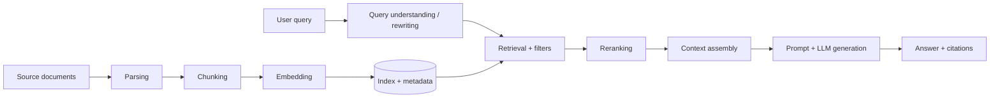
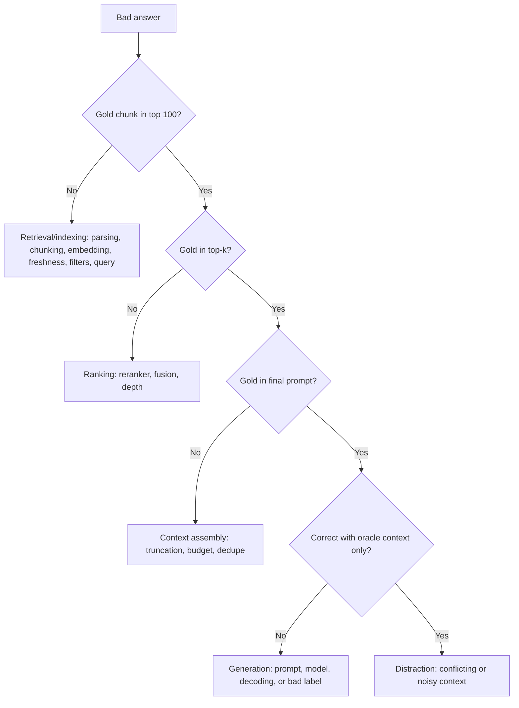

# Debugging RAG Systems: A Systematic Playbook

> **Level:** Beginner to Advanced · **Study time:** ~120 min · **Prerequisites:** [What Is RAG and Why It Matters](01-what-is-rag-and-why-it-matters.md), [Document Ingestion and Parsing](03-document-ingestion-and-parsing.md), [Chunking Strategies](04-chunking-strategies.md), [Retrieval Methods: BM25, Dense and Hybrid](05-retrieval-bm25-dense-and-hybrid-search.md), [Reranking and Query Transformation](08-reranking-and-query-transformation.md), [Evaluating RAG](10-rag-evaluation-metrics-and-ragas.md)

## Table of contents

- [Why this matters](#why-this-matters)
- [The golden rule: inspect the evidence before blaming the LLM](#the-golden-rule-inspect-the-evidence-before-blaming-the-llm)
- [The pipeline as a line of suspects](#the-pipeline-as-a-line-of-suspects)
- [How to inspect retrieval results](#how-to-inspect-retrieval-results)
- [The failure taxonomy: symptoms and checks per stage](#the-failure-taxonomy-symptoms-and-checks-per-stage)
- [Retrieval error or generation error? Two decisive tests](#retrieval-error-or-generation-error-two-decisive-tests)
- [Per-request tracing of every stage](#per-request-tracing-of-every-stage)
- [When to change the embedding model](#when-to-change-the-embedding-model)
- [Tuning retrieval parameters systematically](#tuning-retrieval-parameters-systematically)
- [Full walkthrough: fluent answers, low faithfulness](#full-walkthrough-fluent-answers-low-faithfulness)
- [Preventing regressions: eval sets in CI and monitoring](#preventing-regressions-eval-sets-in-ci-and-monitoring)
- [Going deeper: debugging RAG at scale](#going-deeper-debugging-rag-at-scale)
- [Common mistakes and misconceptions](#common-mistakes-and-misconceptions)
- [Interview questions and model answers](#interview-questions-and-model-answers)
- [Key takeaways](#key-takeaways)
- [Further reading](#further-reading)
- [Next](#next)

## Why this matters

Building a RAG demo takes an afternoon; making it correct on real company documents takes months, and most of that time is debugging. When a RAG system gives a wrong answer, the visible symptom (a bad sentence from the LLM) is almost never where the bug lives: the cause is usually upstream, in a garbled PDF table, a chunk cut in half, a stale index or a filter that silently removed the right document. Teams that skip diagnosis tend to "fix" things by swapping to a bigger LLM, which costs more and often produces even more convincing wrong answers. Interviewers for senior AI roles love RAG debugging questions precisely because they reveal whether you think in systems (stage by stage, with evidence and metrics) or in vibes. This chapter gives you a repeatable playbook you can use both at work and on a whiteboard.

## The golden rule: inspect the evidence before blaming the LLM

> **Analogy:** A student gives a confident but wrong answer in an open-book exam. Before concluding the student is bad at reasoning, you check which pages they had open. If they were reading last year's textbook, or the page with the answer was torn out, no amount of "smarter student" fixes the problem.

A RAG system has two halves:

- **Retrieval**: finding the pieces of text (**chunks**, small passages cut from your documents) most relevant to the user's question.
- **Generation**: an LLM reads those chunks and writes an answer.

The LLM can only be as correct as the evidence it was shown. So the golden rule is:

> **Golden rule:** For any bad answer, first look at exactly what text the LLM received. Only after you confirm the right evidence was in front of the model should you blame the model.

This rule sounds obvious, yet it is the single most commonly skipped step. People read the final answer, feel the wrongness, and start editing prompts.

### The running example

We will reuse one tiny system throughout the chapter: an HR assistant for a company, with a **4-document corpus**:

| ID | Document | Content (simplified) |
|----|----------|----------------------|
| D1 | `parental_leave_2026.pdf` | Current policy: 16 weeks paid parental leave from 1 January 2026 |
| D2 | `parental_leave_2022.pdf` | Old policy (superseded): 12 weeks paid parental leave |
| D3 | `expenses.pdf` | Travel meals reimbursed up to 50 USD per day |
| D4 | `benefits_faq.pdf` | A table: leave type vs number of weeks (parental 16, sick 10) |

A user asks: *"How many weeks of paid parental leave do I get?"* The system answers, fluently and with a citation: *"You are entitled to 12 weeks of paid parental leave."* Wrong. The rest of the chapter is about finding out why, quickly and systematically.

## The pipeline as a line of suspects

Before debugging, you need a map. Every RAG system, however fancy, is a chain of stages. Each stage is a suspect.



Quick definitions of each stage (each has its own chapter; here we only need the vocabulary):

- **Parsing**: converting raw files (PDF, HTML, DOCX) into clean text plus structure such as headings and tables. See [Document Ingestion and Parsing](03-document-ingestion-and-parsing.md).
- **Chunking**: splitting text into retrievable passages. **Chunk boundaries** are where one chunk ends and the next begins. See [Chunking Strategies](04-chunking-strategies.md).
- **Embedding**: turning text into a vector (a list of numbers) so that similar meanings land close together. Closeness is usually measured by **cosine similarity**, the cosine of the angle between two vectors (1.0 means same direction, 0 means orthogonal, usually read as unrelated, and -1 means opposite; in practice many embedding models give even unrelated texts clearly positive cosines, so compare scores relative to each other rather than to 0). See [Text Embeddings and Similarity Search](02-text-embeddings-and-similarity-search.md).
- **Index**: the searchable store of chunks, vectors and **metadata** (extra fields such as document ID, version, date, department, access permissions). See [Vector Databases in Practice](07-vector-databases-in-practice.md).
- **Query understanding**: interpreting or rewriting the user's question before search (expanding acronyms, resolving "what about contractors?" using chat history).
- **Retrieval**: finding candidate chunks, using keyword search (**BM25**), vector search (**dense retrieval**) or both (**hybrid search**). See [Retrieval Methods](05-retrieval-bm25-dense-and-hybrid-search.md).
- **Metadata filter**: a hard rule applied during retrieval, such as `tenant_id = 42` or `status = "current"`.
- **Reranking**: a slower, more accurate model (often a **cross-encoder**, which reads the query and chunk together) that re-orders the top candidates. See [Reranking and Query Transformation](08-reranking-and-query-transformation.md).
- **Context assembly**: choosing which chunks go into the prompt, in what order, within the **token budget** (the number of tokens the model's context window has room for).
- **Generation**: the LLM writes an answer from the prompt.
- **Citation**: the answer points to the chunks that support each claim.

### Why errors compound

Every stage can lose the right evidence. If you treat each stage as independently succeeding with some probability, end-to-end success is roughly the product:

$$P_{\text{end-to-end}} \approx \prod_{i=1}^{n} p_i = p_1 \times p_2 \times \cdots \times p_n$$

- $P_{\text{end-to-end}}$: probability a query gets a correct, grounded answer.
- $n$: number of stages.
- $p_i$: probability stage $i$ does its job correctly for a query.
- $\prod$: "multiply all of these together".

**Worked example (illustrative numbers).** Parsing 0.95, chunking 0.90, retrieval 0.90, generation 0.95:

- $0.95 \times 0.90 = 0.855$
- $0.855 \times 0.90 = 0.7695$
- $0.7695 \times 0.95 = 0.731025$

So about 73% end to end, even though no single stage looks bad. Real stages are not independent, so treat this as intuition, not a model. The lesson: you cannot debug a RAG system by staring at the last stage, because the loss is spread along the chain.

## How to inspect retrieval results

"Inspect the evidence" needs to be concrete. The key concept is the **gold chunk**: the chunk (or chunks) that a human says contains the answer. For our example, the gold chunks are D1 (and D4's table row). Debugging largely means asking: *where along the pipeline did the gold chunk get lost?*

For a failing query, you want a **retrieval report** with these fields:

| Field | Why you need it |
|-------|-----------------|
| Original query and rewritten query | Did query rewriting change the meaning? |
| Filters actually applied (with values) | Did a filter exclude the right document? |
| Retriever(s) used and their raw scores | Is the gold chunk scoring low, or absent? |
| Top-k chunk IDs, source doc, version, date | Is the evidence stale or from the wrong doc? |
| Full chunk text (not just a preview) | Is the text garbled, cut mid-sentence, missing a table? |
| Rank before and after reranking | Did the reranker push the right chunk down? |
| Final list of chunks that made it into the prompt | Was anything truncated or dropped? |

Two metrics make this precise. You will meet them fully in [Evaluating RAG](10-rag-evaluation-metrics-and-ragas.md); here is a quick recap.

**Recall@k** asks: of the relevant chunks, what fraction appear in the top $k$ results?

$$\text{Recall@}k = \frac{|\text{Relevant} \cap \text{TopK}|}{|\text{Relevant}|}$$

- $\text{Relevant}$: the set of gold chunks for this query.
- $\text{TopK}$: the set of the first $k$ retrieved chunks.
- $|\cdot|$: number of items in a set; $\cap$ means "in both sets".

**Example:** Relevant = {D1, D4}. Top-3 retrieved = [D2, D1, D3]. The intersection is {D1}, size 1. Recall@3 $= 1/2 = 0.5$.

**Reciprocal rank** asks how high the first relevant chunk is: $\text{RR} = 1 / \text{rank of first relevant result}$. Here D1 is at rank 2, so $\text{RR} = 1/2 = 0.5$. Averaged over queries it is called **MRR** (mean reciprocal rank).

### A retrieval inspector in code

Here is a tiny, runnable inspector for our 4-document corpus. It uses TF-IDF (a simple keyword-weighting scheme) as a stand-in retriever so you can run it anywhere; in production you would plug in your real retriever.

```python
# pip install scikit-learn
from sklearn.feature_extraction.text import TfidfVectorizer
from sklearn.metrics.pairwise import cosine_similarity

chunks = [
    {"id": "D1", "doc": "parental_leave_2026.pdf", "status": "current",
     "text": "Employees receive 16 weeks of paid parental leave from 1 January 2026."},
    {"id": "D2", "doc": "parental_leave_2022.pdf", "status": "superseded",
     "text": "Employees receive 12 weeks of paid parental leave."},
    {"id": "D3", "doc": "expenses.pdf", "status": "current",
     "text": "Meals during travel are reimbursed up to 50 USD per day."},
    {"id": "D4", "doc": "benefits_faq.pdf", "status": "current",
     "text": "Leave type | Weeks Parental | 16 Sick | 10"},  # a badly flattened table
]

vectorizer = TfidfVectorizer()
matrix = vectorizer.fit_transform([c["text"] for c in chunks])

def retrieve(query, k=4, status_filter=None):
    scores = cosine_similarity(vectorizer.transform([query]), matrix)[0]
    ranked = sorted(zip(scores, chunks), key=lambda x: x[0], reverse=True)
    if status_filter:
        ranked = [(s, c) for s, c in ranked if c["status"] == status_filter]
    return ranked[:k]

def inspect(query, gold_ids, **kwargs):
    print(f"QUERY: {query!r}  filters={kwargs}")
    results = retrieve(query, **kwargs)
    for rank, (score, c) in enumerate(results, start=1):
        mark = "GOLD" if c["id"] in gold_ids else "    "
        print(f"{mark} rank={rank} score={score:.3f} {c['id']} [{c['status']}] {c['doc']}")
        print(f"      text: {c['text']}")
    found = [r for r, (_, c) in enumerate(results, 1) if c["id"] in gold_ids]
    print("gold ranks:", found or "NOT RETRIEVED")

q = "How many weeks of paid parental leave do I get?"
inspect(q, gold_ids={"D1", "D4"})
inspect(q, gold_ids={"D1", "D4"}, status_filter="current")
```

Run the first call and you should see the superseded D2 chunk ranked first: it shares the same query words as D1 but is shorter, so its keyword similarity is higher. The LLM then faithfully repeats "12 weeks". **The LLM did nothing wrong.** It was handed stale evidence at rank 1. The second call shows one fix (a `status` filter); better fixes live upstream (removing or marking superseded documents at ingestion).

> **Interview tip:** When asked "how would you inspect retrieval results before looking at generated answers?", describe the retrieval report above, and say you would look at the *full chunk text*, the *scores and ranks*, the *metadata* (version, date, source) and the *final prompt*. Mentioning "the final prompt as sent to the model" signals real production experience.

## The failure taxonomy: symptoms and checks per stage

Now we walk the pipeline left to right. For each stage: what goes wrong, what you see, and how to check.

### 1. Parsing errors

**What goes wrong:** the text extracted from documents is wrong or incomplete. Common causes: multi-column PDFs read across columns, tables flattened into word soup (our D4), headers and footers repeated in every chunk, scanned PDFs with no text layer (needing **OCR**, optical character recognition), hyphenated words split across lines, encoding errors that turn `€` into garbage.

**Symptoms:**
- Questions about tables, numbers or forms fail far more than prose questions.
- Retrieved chunks contain text that "reads strangely" when you print it.
- Some documents never get retrieved at all (empty or near-empty extraction).

**Checks:**
- Print the parsed text for a sample of documents and read it next to the original. There is no substitute.
- Compute per-document statistics: characters extracted per page, fraction of non-alphabetic characters, number of empty pages. Outliers usually point to OCR or layout problems.
- Search the index for a distinctive phrase you know is in a document. If exact search cannot find it, it never made it in.

### 2. Bad chunk boundaries

**What goes wrong:** the answer is split across two chunks, or the chunk containing the fact lacks the context that makes it findable. Classic case: a chunk says "This applies for 16 weeks" but the heading "Parental leave" is in the previous chunk. Neither chunk alone matches the query well.

**Symptoms:**
- Retrieved chunks start or end mid-sentence or mid-table.
- The gold chunk is retrieved but does not contain the full answer.
- Answers are partially correct (they get the condition but miss the exception in the next paragraph).

**Checks:**
- Print the chunks around the gold location and look at their boundaries.
- Check whether chunks carry their section headings (or a document title) as context.
- Measure the chunk length distribution. Very small chunks lose context; very large ones dilute the embedding (one vector has to represent many topics).

**Typical fixes:** structure-aware chunking (split on headings), overlap, prepending titles and section paths, parent-child retrieval (see [Advanced RAG Patterns](09-advanced-rag-patterns.md)).

### 3. Embedding model mismatch

**What goes wrong:** the vectors do not capture what "similar" means for your queries. This comes in several flavors:

| Flavor | What happened | Check |
|--------|---------------|-------|
| Different models for query and documents | Index built with model A, queries embedded with model B (or a new version of A). Vectors from different models live in unrelated spaces. | Re-embed a stored chunk with today's document-side embedding code and compare to its stored vector: cosine should be about 1.0 (tiny deviations from hardware or batching are normal). Then confirm the query path loads the same model name and version. |
| Missing instruction prefixes | Some models expect prefixes (the E5 family uses `query: ` and `passage: `). Forgetting them degrades quality silently. | Read the model card; check the embedding code path. |
| Normalization mismatch | The model was trained for cosine but vectors were stored unnormalized in a dot-product index, so vectors with large norms get inflated scores regardless of relevance; or the model was trained for raw dot product and you normalized, discarding signal it relies on. | Check vector norms in the index; they should match what the model and metric assume. |
| Silent truncation | Embedding models have a maximum input length (a few hundred tokens for many classic sentence-transformers models such as MiniLM, several thousand for many newer ones). Text past the limit is ignored. | Compare chunk token counts with the model's maximum length (`model.max_seq_length` in sentence-transformers). |
| Domain or language mismatch | A general-purpose English model on legal, medical, code or non-English text; acronyms and product codes are poorly represented. | Labeled eval on domain queries; compare against BM25 on the same set. |

**Symptoms:** semantically obvious matches score low; keyword search (BM25) beats dense search on your queries; exact identifiers (error codes, SKUs) are never found.

### 4. Stale or incomplete index

**What goes wrong:** the index does not reflect the current state of the source. Documents were added but never ingested (a failed job), updated documents still have old chunks, deleted documents still exist, or two versions coexist (our D1 and D2).

**Symptoms:**
- Answers reflect an old policy ("12 weeks").
- Users say "I just uploaded this and it can't find it".
- A document that definitely exists is never retrieved, for any query.

**Checks:**
- Compare document counts: source system vs index. Look up specific document IDs directly in the index.
- Track **index freshness lag**: time between a source change and the index reflecting it.
- Check ingestion job logs for failures and dead-letter queues (queues where failed jobs are parked).
- Search for duplicate versions of the same logical document.

Fixes belong to the ingestion pipeline (idempotent updates, deletions, version metadata), covered in [Production Ingestion Pipelines](12-production-ingestion-pipelines-at-scale.md).

### 5. Wrong metadata filters or permissions

**What goes wrong:** a filter excludes the right documents or includes the wrong ones. Causes: a wrong value (`"HR"` vs `"hr"`), date formats that do not compare correctly, a missing field on some documents (so a filter on that field drops them), permission lists (**ACLs**, access control lists) out of sync with the source system.

A subtle one with vector search: **post-filtering**. If the system retrieves the top 10 by similarity and *then* applies a filter, it might filter away all 10 and return nothing, even though matching documents exist further down. **Pre-filtering** or filter-aware search (supported by most vector databases) avoids this, though very selective filters can still reduce ANN recall or raise latency in some engines, so test them on your own filter distribution.

**Symptoms:**
- Certain users or tenants get much worse answers than others.
- Empty or very short result lists for some queries.
- Results change wildly when a filter is toggled.

**Checks:**
- In a safe debug environment with admin rights (never in a user-facing path), rerun the query without filters. If the gold chunk appears, the filter is the culprit.
- Inspect the gold chunk's metadata: is the field present and in the expected format?
- Log the number of results before and after filtering.

> **Common mistake:** Debugging permissions by loosening them in production. Permission bugs are also security bugs. Reproduce with the affected user's permissions in a controlled environment. See [Secure Multi-Tenant RAG](13-secure-multi-tenant-rag.md).

### 6. Poor query understanding

**What goes wrong:** the search runs on a query that does not represent what the user meant. Examples: acronyms ("PTO" when documents say "paid time off"), typos, multi-part questions ("compare the 2022 and 2026 policies"), and especially conversational follow-ups. If a user asks "and for contractors?", embedding those three words alone retrieves nothing useful; the system must rewrite it using chat history into "parental leave policy for contractors".

**Symptoms:**
- First-turn questions work, follow-up questions fail.
- Failing queries are short, ambiguous or full of jargon.
- A query rewriter (if you have one) produces a rewritten query that drifts from the user's intent.

**Checks:** log and read the rewritten query; test the same question phrased three ways; compare retrieval with the original vs rewritten query.

### 7. Ranking errors

**What goes wrong:** the gold chunk is retrieved but ends up too low to be used. Causes: no reranker, a reranker that truncates long chunks before scoring them, bad **fusion**, meaning the step that combines BM25 and dense results into one ranking (adding raw BM25 scores, which can be 20 or more, to cosine scores between -1 and 1 lets BM25 dominate), a recency or popularity boost that overwhelms relevance, or near-duplicate chunks crowding out diverse evidence.

**Symptoms:** the gold chunk is at rank 15 or 40 but your final top-k is 5; reranking makes some queries worse.

**Checks:** record ranks before and after each ranking step; compute recall@k at several depths (for example 5, 20, 100). A large gap between recall@100 and recall@5 is a ranking problem, not a retrieval problem.

### 8. Context assembly and truncation

**What goes wrong:** the right chunks were ranked highly but did not reach the model in usable form.

**Token budget truncation.** The context window is shared between the system prompt, chat history, retrieved chunks, the question and room for the answer.

**Worked example (illustrative settings).** Context window 8,192 tokens; system prompt 600; chat history 1,500; question 100; reserved for output 1,000. Room for chunks:

$$8192 - 600 - 1500 - 100 - 1000 = 4992 \text{ tokens}$$

With 512-token chunks: $9 \times 512 = 4608 \le 4992$, but $10 \times 512 = 5120 > 4992$. So if top-k is 10, the 10th chunk is cut off or the request fails. If your assembly code silently truncates from the end, and the gold chunk was 10th, it vanishes without an error. Worse, some code truncates the *beginning* of the prompt, which can remove the system instructions.

**Lost in the middle.** "Lost in the Middle: How Language Models Use Long Contexts" (Liu et al., 2023) showed that models used information best when it was near the beginning or end of a long context and worse when it was in the middle. Newer models vary in how much they suffer from this, so test on your own model, but the practical rules hold: put the strongest evidence first (or first and last), and do not stuff 30 marginal chunks in "just in case".

**Other assembly bugs:** chunks from different documents concatenated without separators or source labels; chunk order shuffled so that citation numbers no longer match; duplicates wasting budget.

**Checks:** log the exact final prompt and its token count (counted with the model's own tokenizer, since tokenizers differ, see [Tokenization](../04-transformers/01-tokenization.md)); check whether the gold chunk is present in that string, and at what position.

### 9. Prompt and generation errors

**What goes wrong:** the right evidence is in the prompt, but the model still answers badly. Causes:
- The prompt does not tell the model to answer *only* from the context or to say "I don't know" when the evidence is missing, so it falls back on its **parametric knowledge** (what it memorized during training).
- Conflicting instructions, or the system prompt is long and the grounding instruction is buried.
- The model is too small for the reasoning required (multi-hop, arithmetic over a table).
- Sampling settings encourage creativity (high temperature) where you want precision; see [Decoding Strategies](../05-llms/03-text-generation-and-decoding-strategies.md).
- For self-hosted open models: the wrong **chat template** (the special formatting the model was trained with), which quietly degrades instruction following.

**Symptoms:** the evidence is visibly correct in the logged prompt, yet the answer contradicts it or adds unsupported details. This is the classic **hallucination** case; see [Hallucinations and Grounding](../05-llms/06-hallucinations-and-grounding.md).

### 10. Citation errors

**What goes wrong:** the answer cites sources, but the citations are wrong: pointing to a chunk that does not support the sentence, pointing to a chunk that was never retrieved (fabricated), or shifted by one because the chunk numbering changed between assembly and rendering.

**Symptoms:** users click a citation and cannot find the claim; citation-precision metrics are low while answer correctness is fine.

**Checks:**
- Verify that every cited ID is in the set of chunks actually sent to the model. A cited ID outside that set is a guaranteed bug.
- For each (sentence, cited chunk) pair, check support with an **NLI model** (natural language inference: classifies whether a premise entails a hypothesis) or an **LLM judge** (a separate LLM prompted to grade an output against a rubric).
- For quote-style citations, check that the quoted string literally appears in the chunk.

### The taxonomy at a glance

| Stage | Typical symptom | Fastest check | Typical fix |
|-------|-----------------|---------------|-------------|
| Parsing | Tables, numbers, scanned docs fail | Read parsed text vs original | Better parser, OCR, table extraction |
| Chunk boundaries | Partial answers, mid-sentence chunks | Print neighbors of gold chunk | Structure-aware chunks, overlap, titles |
| Embedding mismatch | BM25 beats dense; obvious matches score low | Re-embed stored chunk, compare; domain eval | Fix code path; hybrid; new or fine-tuned model |
| Stale/incomplete index | Old facts, missing new docs | Count and ID lookups vs source | Fix ingestion, versioning, deletions |
| Filters/permissions | Some users/tenants worse; empty results | Rerun without filter in debug env | Fix metadata, pre-filtering, ACL sync |
| Query understanding | Follow-ups and jargon fail | Read rewritten query | Rewriting with history, acronym expansion |
| Ranking | Gold at rank 20, top-k is 5 | Recall@5 vs recall@100 | Reranker, fusion fix, deeper candidate pool |
| Context assembly | Gold ranked well but missing from prompt | Search final prompt for gold text | Budget-aware assembly, ordering, dedupe |
| Prompt/generation | Evidence present, answer wrong | Oracle-context test | Grounding prompt, abstention, model choice |
| Citations | Citations do not support claims | Cited IDs subset of context IDs; NLI check | Stable IDs, citation verification step |

This mirrors the empirical study "Seven Failure Points When Engineering a Retrieval Augmented Generation System" (Barnett et al., 2024), which lists failure points such as missing content, missed top-ranked documents, content not in context, failure to extract the answer, wrong format, incorrect specificity and incomplete answers.

## Retrieval error or generation error? Two decisive tests

The single most useful split in RAG debugging is: *did the model fail to get the evidence, or fail to use it?* Two cheap tests answer this.

### Test 1: Was the gold chunk retrieved at any rank?

Retrieve deep, for example the top 100 candidates, and find the rank of the gold chunk. This one number sorts failures into buckets:

| Gold chunk position | Diagnosis | Look at |
|---------------------|-----------|---------|
| Not in top 100 at all | Retrieval or indexing failure | Parsing, chunking, embedding, index freshness, filters, query |
| In top 100 but below your top-k | Ranking failure | Reranker, fusion, top-k, candidate depth |
| In top-k but not in the final prompt | Context assembly failure | Truncation, dedupe, budget logic |
| In the final prompt | Evidence was available | Go to Test 2 |

If "not in top 100", narrow down further: search the index by document ID (is it indexed at all?), then search for an exact phrase (is the text intact?), then remove filters in a debug environment (is a filter excluding it?).

### Test 2: The oracle-context test

Give the LLM the gold evidence directly (the **oracle context**: what a perfect retriever would have returned), with the same prompt and settings, and see if it answers correctly.

- **Correct with oracle context, wrong in production:** the generator is capable; the problem is retrieval, ranking or assembly.
- **Wrong even with oracle context:** the problem is the prompt or the model (or the "gold" label is itself wrong, so double-check it).

A useful variant: give the oracle chunk *plus* the distractors your retriever normally returns. If the model is correct with the gold chunk alone but wrong when it is surrounded by distractors (like our stale D2), the issue is distraction or conflicting evidence, which points at ranking, filtering or deduplication of versions.



### The two tests in code

This sketch classifies each failing example from your eval set into a bucket. It is runnable as written with fake data; in production you would plug in your retriever and LLM.

```python
from collections import Counter

def diagnose(gold_ids, deep_ranked_ids, final_context_ids, k, oracle_correct=None):
    """Return the stage where the gold evidence was lost."""
    ranks = [deep_ranked_ids.index(g) + 1 for g in gold_ids if g in deep_ranked_ids]
    if not ranks:
        return "not_retrieved"          # parsing, chunking, embedding, index, filters, query
    if min(ranks) > k:
        return "ranked_too_low"         # reranker, fusion, top-k
    if not any(g in final_context_ids for g in gold_ids):
        return "dropped_in_assembly"    # truncation, token budget, dedupe
    if oracle_correct is False:
        return "generation_failure"     # prompt, model, decoding
    return "distraction_or_other"       # correct with oracle alone, wrong with full context

# Each failing example: (gold ids, deep ranking, ids in final prompt, oracle result)
failures = [
    ({"D1"}, ["D2", "D3", "D1"], ["D2", "D3"], None),   # gold at rank 3, k=2
    ({"D7"}, ["D2", "D3", "D1"], ["D2", "D3"], None),   # gold never retrieved
    ({"D1"}, ["D1", "D2"], ["D1", "D2"], False),        # in prompt, model still wrong
]
buckets = Counter(diagnose(g, r, c, k=2, oracle_correct=o) for g, r, c, o in failures)
print(buckets)
# Counter({'ranked_too_low': 1, 'not_retrieved': 1, 'generation_failure': 1})
```

The point is not the code; it is the habit. Once you have counts per bucket, you fix the biggest bucket first, instead of the most visible one.

> **Senior insight:** Gold labels are expensive, so you will not have them for every production failure. For unlabeled cases, use a strong LLM to judge "does the retrieved context contain enough information to answer?" (a reference-free proxy for **context recall**, sometimes called context sufficiency; RAGAS-style context recall proper needs a reference answer). Calibrate that judge against 30 to 50 human-labeled cases before trusting it.

At the eval-set level, pairing context recall with **faithfulness** (the share of answer claims supported by the retrieved context, defined in the walkthrough below) gives a quick first split:

| | Faithfulness high | Faithfulness low |
|---|---|---|
| **Context recall high** | Healthy grounding; still check answer correctness | Generation problem: evidence present but ignored or embellished (prompt, model, distraction) |
| **Context recall low** | Retrieval problem: answer sticks to incomplete context, so it is incomplete or abstains | Retrieval miss plus gap-filling from memory: the "fluent but unfaithful" signature |

## Per-request tracing of every stage

You cannot run the two tests after the fact unless you recorded what happened. **Tracing** means recording, for every request, a structured log of each stage. In observability terms, a **trace** is the record of one request end to end, and a **span** is one timed step inside it (parse query, retrieve, rerank, generate). OpenTelemetry is the common open standard for this; LLM-focused tools (Langfuse, Arize Phoenix, LangSmith and others) build on similar ideas. See [LLMOps: Tracing and Langfuse](../10-mlops/08-llmops-tracing-prompt-management-and-langfuse.md) for tooling.

What a RAG trace should capture per stage:

| Span | Record |
|------|--------|
| Request | Request ID, user/tenant ID (or a hash), timestamp, app version, prompt template version, index version |
| Query rewrite | Input query, rewritten query(ies), model used |
| Retrieval | Retriever type, filters with values, top-N IDs with scores, latency, result count before and after filters |
| Rerank | Model, input IDs, output IDs with scores, latency |
| Context assembly | Final chunk IDs in order, token counts per part, anything truncated or dropped |
| Generation | Model name and version, decoding parameters, full prompt (or a reference to it), output, token usage, latency |
| Post-processing | Citations extracted, citation validity check result, guardrail outcomes |
| Feedback | User thumbs up/down, follow-up rephrase, escalation |

A minimal tracer in plain Python shows the mechanism:

```python
import json, time, uuid
from contextlib import contextmanager

class Trace:
    def __init__(self, **attrs):
        self.data = {"trace_id": str(uuid.uuid4()), **attrs, "spans": []}

    @contextmanager
    def span(self, name, **attrs):
        record = {"name": name, **attrs}
        start = time.perf_counter()
        try:
            yield record                     # the stage adds its outputs to `record`
        finally:
            record["latency_ms"] = round((time.perf_counter() - start) * 1000, 2)
            self.data["spans"].append(record)

trace = Trace(app_version="1.4.2", index_version="hr_v7", prompt_version="grounded_v3")
with trace.span("retrieve", filters={"status": "current"}) as s:
    s["results"] = [{"id": "D1", "score": 0.81}, {"id": "D4", "score": 0.64}]
with trace.span("assemble") as s:
    s["context_ids"], s["context_tokens"], s["dropped"] = ["D1", "D4"], 412, []
with trace.span("generate", model="example-llm-v2", temperature=0.0) as s:
    s["answer"] = "You get 16 weeks of paid parental leave [D1]."
print(json.dumps(trace.data, indent=2))
```

Production concerns a senior engineer should raise:

- **Privacy:** prompts and chunks may contain personal or confidential data. Redact PII (personally identifiable information), restrict access to traces, and set retention limits.
- **Volume and cost:** storing full prompts for every request is expensive at scale. Common approach: store full payloads for a sample (plus all requests with negative feedback or errors) and store IDs and scores for everything.
- **Versions everywhere:** without the index version and prompt version in the trace, you cannot tell whether a failure predates or follows a change.
- **Replayability:** the gold standard is being able to replay a request against a new configuration. That requires the inputs (query, history, filters) and the index snapshot or version.

## When to change the embedding model

Changing the embedding model is a popular first move and usually the wrong one. It is expensive (every chunk must be re-embedded) and it cannot fix problems that happen before embedding. Use this order:

1. **Fix parsing first.** Garbage text produces garbage vectors with any model.
2. **Fix chunking next.** A chunk without its heading, or mixing five topics, embeds badly with any model.
3. **Rule out code-path bugs.** Same model and version for queries and documents, correct prefixes, normalization, no silent truncation.
4. **Try cheaper wins.** Add BM25 to make retrieval hybrid (it rescues exact identifiers and rare terms), add a reranker, add query rewriting.
5. **Then measure.** Build a labeled eval set of real domain queries with gold chunks. If recall@k on domain queries is still poor (and the misses are semantic, such as synonyms, jargon, cross-language), the embedding model is now a legitimate suspect.

### Compare candidates on your data, not on leaderboards

Public leaderboards such as MTEB ("MTEB: Massive Text Embedding Benchmark", Muennighoff et al., 2022) are useful for shortlisting, but your domain, languages and query styles differ. Evaluate shortlisted models on your own labeled set:

```python
# pip install sentence-transformers numpy
import numpy as np
from sentence_transformers import SentenceTransformer

corpus = {
    "D1": "Employees receive 16 weeks of paid parental leave from 1 January 2026.",
    "D3": "Meals during travel are reimbursed up to 50 USD per day.",
    "D5": "Staff may work remotely up to three days per week with manager approval.",
}
eval_set = [  # (query, gold chunk id); in practice use hundreds of real queries
    ("How long is maternity or paternity leave?", "D1"),
    ("Can I claim dinner on a business trip?", "D3"),
    ("Am I allowed to work from home?", "D5"),
]

def recall_at_k(model_name, k=1, query_prefix="", doc_prefix=""):
    model = SentenceTransformer(model_name)
    ids = list(corpus)
    doc_vecs = model.encode([doc_prefix + corpus[i] for i in ids], normalize_embeddings=True)
    hits = 0
    for query, gold in eval_set:
        q = model.encode([query_prefix + query], normalize_embeddings=True)[0]
        top = np.argsort(-(doc_vecs @ q))[:k]          # cosine = dot product after normalizing
        hits += gold in [ids[i] for i in top]
    return hits / len(eval_set)

for name in ["sentence-transformers/all-MiniLM-L6-v2", "BAAI/bge-small-en-v1.5"]:
    print(name, recall_at_k(name, k=1))
```

Notes: check each model card for required prefixes (the `query_prefix`/`doc_prefix` arguments exist for that); recent sentence-transformers releases (v5 and later) also offer `encode_query` and `encode_document`, which apply prompts stored in the model's configuration. Running this block downloads both models from the Hugging Face Hub on first use. A 3-query eval is only for illustration; you need hundreds of queries, sliced by query type, to make a decision.

What to compare beyond recall:

| Criterion | Why it matters |
|-----------|----------------|
| Recall@k and MRR on your labeled set | The actual goal |
| Performance per slice (jargon, IDs, languages, long queries) | Averages hide where a model fails |
| Embedding dimension | Drives storage and search cost |
| Max input length | Determines whether your chunks are truncated |
| Latency and throughput (query side) | Query embedding is on the critical path |
| Hosting: API vs self-hosted, license, data residency | Some data cannot leave your infrastructure |
| Cost of re-embedding the corpus | One-off but can be large |

### Plan for re-embedding

Vectors from different models are not comparable, so a model change means re-embedding *everything* and building a new index. You cannot mix old and new vectors in one index.

**Storage worked example.** 10 million chunks stored as 32-bit floats (4 bytes per number):

- 768 dimensions: $10{,}000{,}000 \times 768 \times 4 = 30{,}720{,}000{,}000$ bytes, about 30.7 GB.
- 1024 dimensions: $10{,}000{,}000 \times 1024 \times 4 = 40{,}960{,}000{,}000$ bytes, about 41.0 GB.

That is raw vectors only; index structures add overhead, for example **HNSW** (Hierarchical Navigable Small World), a graph index for **approximate nearest neighbor (ANN)** search that finds most of the true closest vectors far faster than comparing against every vector (see [Vector Search Algorithms](06-vector-search-ann-hnsw-ivf-and-product-quantization.md)).

**Time worked example (illustrative throughput).** If your embedding service sustains 2,000 chunks per second, re-embedding 10 million chunks takes $10{,}000{,}000 / 2000 = 5000$ seconds, about 83 minutes, plus index build time. Measure your real throughput; API rate limits often dominate.

A safe migration:

1. Version the index (`hr_v7_minilm` vs `hr_v8_bge`) and record the embedding model with it.
2. Backfill the new index in the background while the old one serves traffic; dual-write new documents to both.
3. Run the eval set and **shadow traffic** (send real queries to both, serve only the old one, compare results) against the new index.
4. Switch via an alias or config flag; keep the old index for fast rollback.
5. Delete the old index only after the new one has been stable for a while.

Alternatives to switching: fine-tune the current embedding model on your domain pairs, or keep it and lean on hybrid search plus a reranker. A senior answer mentions these.

## Tuning retrieval parameters systematically

RAG has many knobs. Turning several at once while eyeballing three queries is how teams waste weeks. The systematic method borrows from ordinary experimentation:

1. **Freeze an eval set.** A fixed set of representative queries with gold chunks (and ideally reference answers), versioned like code. Keep a held-out portion you look at rarely, so you do not overfit the main set.
2. **Establish a baseline.** Run the current configuration and record all metrics.
3. **Change one thing at a time.** Sweep one parameter across a range while holding the others fixed. Interactions exist (chunk size and top-k interact through the token budget), so after one-at-a-time sweeps, run a small grid around the best region.
4. **Measure quality and cost together.** Retrieval metrics (recall@k, MRR, and **nDCG**, a rank-weighted score that rewards putting relevant chunks higher), end-to-end metrics (faithfulness, answer correctness), latency (**p50** and **p95**: the times under which 50% and 95% of requests finish), and tokens per request.
5. **Check significance.** Small eval sets are noisy (below).
6. **Record every run** with its configuration, in an experiment tracker (see [Experiment Tracking](../10-mlops/01-ml-lifecycle-and-experiment-tracking.md)).

### The main knobs

| Parameter | What it controls | Too low | Too high |
|-----------|-----------------|---------|----------|
| Chunk size | Tokens per chunk | Facts lose context | Embeddings blur; fewer chunks fit in budget |
| Chunk overlap | Repeated tokens between neighbors | Answers split at boundaries | Index bloat, duplicate evidence |
| Top-k (retrieved candidates) | How many candidates retrieval returns | Gold missed | More latency, more reranker cost |
| Hybrid weight | Balance of BM25 vs dense | Lose keyword or semantic matches | Lose the other |
| Reranker depth | How many candidates the reranker scores | Gold never reaches the reranker | Reranker latency grows roughly linearly |
| Final k (into prompt) | Chunks given to the LLM | Missing evidence | Distraction, cost, lost in the middle |
| ANN search parameter (for example HNSW `ef_search`) | How many candidates the graph search explores per query, hence ANN accuracy | Approximate search misses true neighbors | Latency |

Each chunking change requires re-chunking and re-embedding, so it is the most expensive knob to sweep: do it on a sample corpus that covers your eval set.

**Hybrid weight, a quick reminder.** One common fusion is a weighted sum of normalized scores:

$$s = \alpha \cdot s_{\text{dense}} + (1 - \alpha) \cdot s_{\text{sparse}}$$

- $s$: final score for a chunk.
- $s_{\text{dense}}$: dense (vector) similarity, normalized to [0, 1].
- $s_{\text{sparse}}$: BM25 score, normalized to [0, 1] (raw BM25 is unbounded, so normalization is mandatory).
- $\alpha$: weight between 0 (pure BM25) and 1 (pure dense).

**Example:** $s_{\text{dense}} = 0.82$, $s_{\text{sparse}} = 0.40$, $\alpha = 0.7$: $0.7 \times 0.82 = 0.574$, $0.3 \times 0.40 = 0.12$, total $s = 0.694$. Reciprocal Rank Fusion is a rank-based alternative that avoids normalization; both are covered in [Retrieval Methods](05-retrieval-bm25-dense-and-hybrid-search.md).

### Is the improvement real? Noise in small eval sets

If recall@5 is $p = 0.80$ on $n = 200$ queries, its standard error (the typical size of random fluctuation) is roughly:

$$\text{SE} = \sqrt{\frac{p(1-p)}{n}}$$

- $p$: the measured proportion (here, recall as a hit rate).
- $n$: number of queries.

**Example:** $p(1-p) = 0.8 \times 0.2 = 0.16$; $0.16 / 200 = 0.0008$; $\sqrt{0.0008} \approx 0.0283$. So about 2.8 percentage points. A change from 0.80 to 0.82 (4 more queries out of 200) is within noise. Because both configurations run on the same queries, a **paired** comparison is more sensitive: look at which specific queries flipped from miss to hit and vice versa, and use a **paired bootstrap**: resample the query set with replacement thousands of times, recompute the B minus A difference on each resample, and read a 95% confidence interval from the spread of those differences. If the interval includes 0, the gain is not established.

```python
import numpy as np

def paired_bootstrap(hits_a, hits_b, n_boot=10_000, seed=0):
    """hits_a/hits_b: 0/1 per query for configs A and B on the SAME queries."""
    a, b = np.asarray(hits_a), np.asarray(hits_b)
    rng = np.random.default_rng(seed)
    idx = rng.integers(0, len(a), size=(n_boot, len(a)))   # resample queries
    diffs = b[idx].mean(axis=1) - a[idx].mean(axis=1)
    return diffs.mean(), np.percentile(diffs, [2.5, 97.5])

# Illustrative: 200 queries, B fixes 10 misses but breaks 6 hits of A
a = np.array([1] * 160 + [0] * 40)
b = a.copy(); b[160:170] = 1; b[0:6] = 0
print(paired_bootstrap(a, b))   # mean diff about +0.02, 95% interval about [-0.02, 0.06]: includes 0
```

Also look at the **flips** themselves. A change that fixes 10 queries and breaks 6 is not the same as one that fixes 4 and breaks none, even though both net +4.

### A sweep harness

```python
import time

BASE = {"chunk_size": 512, "top_k": 50, "alpha": 0.5, "rerank_depth": 50, "final_k": 5}
SWEEPS = {"top_k": [20, 50, 100], "alpha": [0.3, 0.5, 0.7], "rerank_depth": [20, 50, 100]}

def run_eval(config):
    """Plug in your pipeline: run every eval query, return metrics.
    Here it is a stub so the harness runs."""
    t0 = time.perf_counter()
    metrics = {"recall@5": None, "mrr": None, "faithfulness": None}
    metrics["p95_ms"] = None
    metrics["wall_s"] = round(time.perf_counter() - t0, 3)
    return metrics

results = [{"config": BASE, **run_eval(BASE)}]
for param, values in SWEEPS.items():          # one parameter at a time
    for v in values:
        if v == BASE[param]:
            continue
        cfg = {**BASE, param: v}
        results.append({"config": cfg, **run_eval(cfg)})
for r in results:
    print(r)
```

An illustrative result for a reranker-depth sweep (numbers invented to show the shape, not a benchmark):

| Rerank depth | Recall@5 (illustrative) | p95 retrieval latency (illustrative) |
|--------------|-------------------------|--------------------------------------|
| 20 | 0.71 | 120 ms |
| 50 | 0.78 | 210 ms |
| 100 | 0.79 | 390 ms |

Reading it: going from 20 to 50 buys a lot; 50 to 100 buys almost nothing for nearly double the latency. Choose the knee of the curve that fits your latency budget, and confirm the 0.78 vs 0.79 difference is noise before arguing about it.

## Full walkthrough: fluent answers, low faithfulness

This is the classic practical exercise. Here it is end to end.

**Situation.** An internal support assistant over product and policy documents. Users like the tone; answers read well. But an offline evaluation shows a **faithfulness** score of 0.62 (illustrative). **Faithfulness** is the fraction of claims in the answer that are supported by the retrieved context:

$$\text{Faithfulness} = \frac{\text{number of answer claims supported by the context}}{\text{total number of claims in the answer}}$$

For example, an answer with 5 claims, 3 of which appear in the retrieved chunks, has faithfulness $3/5 = 0.6$. (Details in [Evaluating RAG](10-rag-evaluation-metrics-and-ragas.md).)

The tempting move: "the LLM hallucinates, switch to a bigger model". Resist. High fluency plus low faithfulness is the signature of a model that is *good at writing* and is *filling gaps*. The question is where the gaps come from.

### Step 0: Trust the measurement

Before debugging the system, debug the metric. Faithfulness is often scored by an LLM judge. Take 30 to 50 low-scoring examples and label them by hand. Is the judge right? Typical judge errors: penalizing correct paraphrases, or claiming "unsupported" when the support is in a table the judge read poorly. If the judge disagrees with humans often, fix the judge first (see [LLM-as-a-Judge](../05-llms/10-llm-evaluation-metrics-and-llm-as-a-judge.md)).

### Step 1: Inspect the evidence for a sample of failures

Pull traces for about 50 unfaithful answers. For each, read the question, the full retrieved chunks, the final prompt and the answer side by side. Tag each case with *why* it is unfaithful. This is slow, manual and the highest-value hour you will spend.

### Step 2: Run the gold-rank check

For cases where you can identify the gold evidence, find its rank in a deep retrieval (top 100). This splits "not retrieved" vs "ranked too low" vs "dropped in assembly" vs "in the prompt".

### Step 3: Run the oracle-context test

For cases where the evidence was missing, feed the gold chunk directly. If answers become faithful, generation is fine and the gap is upstream. For cases where the evidence was present but the answer was still unfaithful, you have genuine generation problems.

### Step 4: Bucket and count

After steps 1 to 3, an illustrative tally of the 50 cases:

| Bucket | Count (illustrative) | Root cause stage |
|--------|---------------------|------------------|
| No relevant evidence retrieved; model answered from memory | 18 | Retrieval (and missing abstention) |
| Superseded document retrieved (old policy) | 9 | Stale index / versioning |
| Gold evidence was a table that parsed into garbage | 6 | Parsing |
| Gold retrieved but truncated or buried mid-context | 5 | Context assembly |
| Evidence correct and present; model added unsupported details | 10 | Prompt / generation |
| Judge error (answer was actually faithful) | 2 | Measurement |
| **Total** | **50** | |

Check: $18 + 9 + 6 + 5 + 10 + 2 = 50$. Notice that only 10 of 50 (20%) are generation failures. A bigger LLM would, at best, address those 10, and could make the 18 "answered from memory" cases *more* convincing.

### Step 5: Diagnose each bucket in pipeline order

Walk left to right, because upstream fixes often shrink downstream buckets:

1. **Parsing (6 cases).** Read the parsed text for the table documents. Switch to a table-aware parser or convert tables to Markdown or row-wise sentences ("Parental leave: 16 weeks"). Re-ingest.
2. **Chunking.** While re-ingesting, check that headings travel with their chunks.
3. **Index freshness (9 cases).** Find why superseded documents are still searchable: missing deletion handling, no `status` or `version` metadata. Fix the ingestion pipeline; add a filter on current versions.
4. **Retrieval (18 cases).** For "not retrieved", check whether the documents exist in the index at all (maybe the corpus simply lacks the answer, which is a content gap, not a bug). Then check query rewriting, then hybrid search for exact terms, then whether the embedding model handles the domain vocabulary.
5. **Ranking and assembly (5 cases).** Put the best evidence first, enforce a token budget with explicit logging of dropped chunks, deduplicate.
6. **Generation (10 cases).** Now, and only now, work on the prompt: instruct the model to use only the provided context, to say "I don't know based on the available documents" when evidence is missing, to cite a chunk for every claim, and set temperature low. Consider a verification step that checks each sentence against its cited chunk and removes or flags unsupported ones. Only if a capable prompt still fails on the oracle test do you compare other LLMs, on your eval set.
7. **Abstention.** The 18 "answered from memory" cases also reveal a generation-side gap: when evidence is missing, the model should refuse rather than invent. Add a retrieval-confidence check (for example, if the top reranker score is below a threshold tuned on the eval set, answer "I couldn't find this in the documents").

### Step 6: Re-measure and lock in

Re-run the full eval set after each fix, one at a time, and record faithfulness, answer correctness, context recall, abstention rate and latency. Add the 50 diagnosed examples (with their gold evidence) to the regression set so these bugs stay fixed.

> **Interview tip:** In this exercise, the interviewer is grading the *order* of your steps. Say out loud: "Before touching the LLM, I verify the metric, then inspect retrieved evidence, then check whether the gold evidence was retrieved at all, then run an oracle test. Only failures that persist with oracle context are generation problems."

## Preventing regressions: eval sets in CI and monitoring

Debugging is reactive. Mature teams make regressions hard to ship and fast to detect.

### Layered tests

| Layer | What it tests | Example check |
|-------|---------------|---------------|
| Parser snapshot tests | Known documents parse the same way | Parsed text of `benefits_faq.pdf` contains "Parental" and "16" in one row |
| Chunking tests | Boundaries and metadata | No chunk exceeds the embedding model's max length; every chunk has `doc_id`, `version`, `heading` |
| Retrieval eval | Recall@k, MRR on the golden set | Recall@5 does not drop more than an agreed tolerance from baseline |
| End-to-end eval | Faithfulness, correctness, citation validity | Faithfulness above threshold; zero citations outside the context |
| Canary queries | Critical, must-pass questions | "Parental leave weeks" returns 16 and cites D1 |

A retrieval regression test that runs in CI (see [CI/CD and Testing for ML Pipelines](../10-mlops/07-ci-cd-and-testing-for-ml-pipelines.md) and [Building an LLM Evaluation Framework](../05-llms/11-building-an-llm-evaluation-framework-and-regression-tests.md)):

```python
# test_retrieval.py   (run with: pytest -q)
import json

BASELINE_RECALL_AT_5 = 0.80   # stored from the last approved release
TOLERANCE = 0.02              # agreed allowance for eval noise

def load_eval_set(path="eval/golden_retrieval.jsonl"):
    with open(path, encoding="utf-8") as f:
        return [json.loads(line) for line in f]

def test_recall_at_5_does_not_regress(retriever):     # `retriever` is a pytest fixture
    cases = load_eval_set()
    # Hit rate: a query counts if ANY gold id is in the top 5 (equals recall@5
    # when each query has one gold chunk; with several, average per-query recall instead)
    hits = sum(
        any(g in [r.id for r in retriever.search(c["query"], k=5)] for g in c["gold_ids"])
        for c in cases
    )
    recall = hits / len(cases)
    assert recall >= BASELINE_RECALL_AT_5 - TOLERANCE, f"recall@5 fell to {recall:.3f}"

def test_canary_parental_leave(retriever):
    ids = [r.id for r in retriever.search("How many weeks of parental leave?", k=3)]
    assert "D1" in ids and "D2" not in ids     # current policy in, superseded policy out
```

Run cheap retrieval tests on every change; run the slower, LLM-judged end-to-end suite on changes to prompts, models, chunking or the index, and nightly.

### What triggers a re-evaluation

Anything that can change answers: prompt edits, LLM version changes (including a vendor silently updating a model behind the same name), embedding or reranker changes, parser library upgrades, chunking changes, and large corpus changes.

### Production monitoring

Offline evals cover known questions; monitoring catches the unknown. Useful RAG signals (more in [Monitoring ML and LLM Systems](../10-mlops/06-monitoring-ml-and-llm-systems-in-production.md)):

- **Retrieval health:** distribution of top-1 scores (a drop suggests drift or a broken embedding path), empty-result rate, results-after-filter counts.
- **Index health:** document counts vs source, freshness lag, ingestion failure rate.
- **Answer health:** abstention ("I don't know") rate, citation-validity rate, sampled online faithfulness scored by a judge on a small percentage of traffic.
- **User signals:** thumbs down, rephrased follow-ups, escalations to humans.
- **Cost and latency:** tokens per request, p95 latency per stage.

Close the loop: every production failure you debug becomes a new eval case.

## Going deeper: debugging RAG at scale

### Slice before you average

An overall recall of 0.85 can hide a tenant at 0.40 or a document type (scanned contracts) at 0.20. Slice metrics by tenant, language, document type, query type (lookup vs comparison vs how-to), and query length. Many "mysterious" quality complaints are a single slice.

### Approximate search is another suspect

Vector databases use **approximate nearest neighbor (ANN)** search: fast, but it can miss true nearest neighbors. If dense recall is mysteriously poor, compare ANN results to exact search on a sample. If they disagree often, tune the index (for HNSW, raise `ef_search`) before blaming the embeddings.

```python
# pip install faiss-cpu numpy
import faiss, numpy as np

rng = np.random.default_rng(0)
d, n = 64, 20_000
xb = rng.standard_normal((n, d)).astype("float32"); faiss.normalize_L2(xb)
xq = rng.standard_normal((100, d)).astype("float32"); faiss.normalize_L2(xq)

exact = faiss.IndexFlatIP(d); exact.add(xb)
_, true_ids = exact.search(xq, 10)

hnsw = faiss.IndexHNSWFlat(d, 16, faiss.METRIC_INNER_PRODUCT); hnsw.add(xb)
for ef in [16, 64, 256]:
    hnsw.hnsw.efSearch = ef
    _, ann_ids = hnsw.search(xq, 10)
    overlap = np.mean([len(set(a) & set(t)) / 10 for a, t in zip(ann_ids, true_ids)])
    print(f"efSearch={ef}: ANN recall@10 vs exact = {overlap:.3f}")
```

You should see ANN recall rise toward 1.0 as `efSearch` grows (with this seed, roughly 0.34, 0.67 and 0.96; exact values can vary slightly across FAISS versions). Random Gaussian vectors are a near worst case for ANN, so real embeddings, which have more structure, usually reach high recall at lower `efSearch`. The same check on your real vectors tells you how much quality the ANN index is costing you. Details in [Vector Search Algorithms](06-vector-search-ann-hnsw-ivf-and-product-quantization.md).

### Non-determinism and caching

- LLM outputs vary between runs; with temperature 0 most outputs repeat but bit-exact determinism is not guaranteed on all serving stacks. When reproducing a bug, run it several times.
- Answer caches (**semantic caches**, which return a stored answer when a new query is similar enough to a past one, and exact-match response caches) can serve answers built from an old index. Include the index version in cache keys, and invalidate on re-index. (Provider prompt or KV prefix caches are keyed on the exact prompt tokens, so new retrieved chunks produce a new prompt and they do not serve stale answers.)
- Hybrid indexes may update their keyword and vector parts at different times, producing temporary inconsistencies.

### Content gaps are not bugs

Sometimes the corpus simply does not contain the answer. Your taxonomy needs a "content gap" bucket, and the right fix is abstention plus a report to the document owners, not retrieval tuning. Track the most common unanswerable questions as a product signal.

### Cost and latency of debugging fixes

Every fix has a price. A reranker adds tens to hundreds of milliseconds per request (depending on model and depth). Larger top-k means more prompt tokens, raising cost and **TTFT** (time to first token, see [Inference Fundamentals](../06-llm-inference/01-inference-fundamentals-prefill-decode-and-latency-metrics.md)). Query rewriting adds an extra LLM call. Re-embedding has a one-off compute and engineering cost. A senior answer always pairs a quality fix with its latency and cost impact and with the metric that justifies it.

### Debugging agentic and multi-hop RAG

When an agent decides what to search (see [Advanced RAG Patterns](09-advanced-rag-patterns.md) and [Evaluating and Observing Agents](../09-agents/09-evaluating-and-observing-agents.md)), the trace becomes a tree of search calls. The same questions apply per hop: what was searched, what came back, what was used. Add one more failure class: the agent stopped too early or searched for the wrong sub-question.

## Common mistakes and misconceptions

- **Reading only the final answer.** The answer is a symptom. Always read the retrieved chunks and the final prompt.
- **Swapping the LLM first.** A stronger model cannot use evidence it never received, and it may hide retrieval gaps behind more fluent prose.
- **Swapping the embedding model before fixing parsing and chunking.** You will pay for re-embedding and keep the same garbage-in problem.
- **Judging retrieval by "the top result looks relevant".** Look for the *gold* chunk and its rank; a plausible-looking but wrong chunk (like the 2022 policy) is the most dangerous kind.
- **Tuning on five favorite queries.** Use a fixed, versioned eval set with enough queries, and check significance.
- **Changing several knobs at once.** You will not know which change helped, and you may cancel out a good change with a bad one.
- **Ignoring the token budget.** Silent truncation is a classic "the right chunk was retrieved but never seen" bug.
- **Trusting LLM-judge metrics blindly.** Calibrate judges against human labels before acting on their scores.
- **Debugging permissions by disabling them in production.** Reproduce in a controlled environment with the affected user's rights.
- **Treating content gaps as retrieval bugs.** If the answer is not in the corpus, the right behavior is abstention.
- **Not logging versions.** Without index, prompt and model versions in each trace, you cannot connect a regression to a change.
- **Fixing a bug without adding a test.** Every debugged failure should become a regression case.

## Interview questions and model answers

<details>
<summary><b>Q1. Your RAG system retrieves the wrong documents. How do you debug it?</b></summary>

**Short answer:** I reproduce with a set of failing queries and look at the retrieval report for each: rewritten query, filters, top results with scores, metadata and full chunk text. I label the gold chunk, find its rank in a deep retrieval (say top 100), and use that to localize the failure: not indexed or not retrievable at all (parsing, chunking, embedding, freshness, filters, query), retrieved but ranked low (ranking), or retrieved but dropped (assembly). Then I fix the largest bucket first and confirm with recall@k on a fixed eval set.

**Deeper answer and follow-ups:**
- Look up the gold document by ID in the index first: if it is missing, it is an ingestion problem, not a ranking problem.
- Search an exact phrase from the gold chunk: if not found, the text is garbled (parsing) or split (chunking).
- Rerun without filters in a debug environment: if the gold appears, a filter or ACL is wrong.
- Compare BM25 vs dense on the same queries: if BM25 wins on identifiers and jargon, add hybrid search or revisit the embedding model.
- Inspect *why* the wrong documents win: superseded versions (needs version metadata), near-duplicates, boilerplate-heavy chunks, unnormalized score fusion.
- Pitfall: debugging on one query. Collect 20 to 50 failures and bucket them.

</details>

<details>
<summary><b>Q2. How would you inspect retrieval results before looking at generated answers?</b></summary>

**Short answer:** I make sure every request is traced, then for a failing query I review the retrieval stage in isolation: the original and rewritten query, the filters with their values, the top-N chunk IDs with scores and ranks before and after reranking, each chunk's source, version and date, the full chunk text, and the exact final prompt. I compare that against the gold chunk a human says contains the answer.

**Deeper answer and follow-ups:**
- Metrics that summarize inspection: recall@k (is the gold in the top k?), MRR (how high?), and context precision (how much of the retrieved context is relevant; the RAGAS version is also rank-aware, rewarding relevant chunks placed higher).
- Inspect at multiple depths (5, 20, 100) to separate retrieval from ranking.
- Read full text, not previews: truncated previews hide parsing errors and mid-sentence boundaries.
- Check the final prompt for presence and position of the gold text, since assembly can drop or bury it.
- Build a small inspection tool (or use a tracing UI) so this takes seconds, not a custom script each time.
- Inspect the stored trace of the original request, not only a fresh re-run: the index, caches or model may have changed since, so a re-run can "pass" while the user's failure stays unexplained.

</details>

<details>
<summary><b>Q3. Could the problem be caused by parsing, chunking, embeddings, filters, or indexing? How would you tell which?</b></summary>

**Short answer:** Yes, any of them, and each leaves a distinct fingerprint. Parsing: the text itself is wrong when you read it. Chunking: the text is fine but the fact is split or lacks its heading. Embeddings: text and chunks are fine but semantic matches score low, and BM25 often beats dense. Filters: the gold appears when filters are removed. Indexing: the document is missing, outdated or duplicated in the index compared to the source.

**Deeper answer and follow-ups:**
- Parsing check: read parsed output next to the original; flag pages with few characters or high symbol ratios.
- Chunking check: print neighboring chunks; verify headings and titles are carried.
- Embedding check: re-embed a stored chunk and compare to its stored vector (cosine about 1.0 confirms the same model and preprocessing); check prefixes, normalization and max length; evaluate on a labeled domain set.
- Filter check: count results before and after filters; verify metadata values and formats; watch for post-filtering that empties result lists.
- Index check: source vs index counts, freshness lag, ingestion job failures, duplicated versions.
- Work in pipeline order, because upstream bugs masquerade as downstream ones, and run the cheap checks first: ID lookups and exact-phrase searches take seconds, embedding experiments take hours.

</details>

<details>
<summary><b>Q4. How do you distinguish retrieval errors from generation errors?</b></summary>

**Short answer:** Two tests. First, check whether the gold chunk was retrieved at any rank and whether it made it into the final prompt. If it did not, it is a retrieval, ranking or assembly error. Second, the oracle-context test: give the model the gold evidence directly with the same prompt. If it answers correctly, generation is fine and the problem is upstream; if it still fails, it is a prompt or model problem.

**Deeper answer and follow-ups:**
- Add a variant: gold chunk plus the usual distractors. Correct alone but wrong with distractors means conflicting or noisy context (fix ranking, version filtering, dedupe).
- Without gold labels, approximate with an LLM judge asking "does the context contain the answer?" (context recall), calibrated on human labels.
- Metric pairing: low context recall with high faithfulness means retrieval problems; high context recall with low faithfulness means generation problems; low on both means retrieval missed and the model filled the gap from memory (fix retrieval first, then add abstention).
- Also double-check the gold label; a wrong label looks like a generation error.

</details>

<details>
<summary><b>Q5. When would you change the embedding model?</b></summary>

**Short answer:** Only after fixing parsing, chunking and embedding code-path bugs, and only when a labeled eval on real domain queries shows poor recall that cheaper fixes (hybrid search, reranking, query rewriting) do not close. Then I compare candidate models on my own data, not just leaderboards, and plan the re-embedding migration.

**Deeper answer and follow-ups:**
- Signals: semantic misses on domain vocabulary, new languages, much longer chunks than the model's max input length, or BM25 consistently beating dense on paraphrased queries.
- Compare: recall@k and MRR per slice, dimension (storage: 10M chunks at 1024 float32 dims is about 41 GB of raw vectors), max length, latency, hosting and license.
- Migration: new versioned index, background backfill, dual-write, shadow comparison, alias switch, rollback path. Old and new vectors cannot be mixed.
- Alternatives: fine-tune the current model on domain query-chunk pairs; strengthen hybrid search and reranking.

</details>

<details>
<summary><b>Q6. How do you tune retrieval parameters systematically?</b></summary>

**Short answer:** Fix a versioned eval set with gold chunks, record a baseline, then change one parameter at a time across a range (chunk size, overlap, top-k, hybrid weight, reranker depth, final k, ANN search parameters), tracking retrieval metrics, end-to-end metrics, latency and token cost for every run. Pick the best trade-off, confirm with a small grid around it, check significance, and validate on a held-out set.

**Deeper answer and follow-ups:**
- Noise: with 200 queries and recall 0.8, the standard error is about $\sqrt{0.8 \times 0.2 / 200} \approx 0.028$, so a 2-point gain may be noise; use paired comparisons and inspect flipped queries.
- Interactions: chunk size and final k compete for the same token budget; reranker depth caps what the reranker can recover.
- Cost: chunk-size sweeps need re-chunking and re-embedding, so sweep on a representative sample.
- Look for the knee in quality vs latency curves rather than the maximum.
- Log configs and results in an experiment tracker; keep a held-out set to avoid overfitting the eval set.

</details>

<details>
<summary><b>Q7. Practical exercise: a RAG system has strong answer fluency but low faithfulness. Diagnose the pipeline in order, starting with retrieval and evidence inspection rather than immediately changing the LLM.</b></summary>

**Short answer:** Fluent but unfaithful usually means the model is filling gaps, so I start with the evidence, not the LLM. Step 0, validate the faithfulness metric against human labels. Step 1, pull about 50 unfaithful traces and read retrieved chunks and final prompts. Step 2, find the gold chunk's rank to split not-retrieved, ranked-low and dropped-in-assembly. Step 3, run the oracle-context test. Step 4, bucket and count. Then fix in pipeline order: parsing, chunking, index freshness, filters, query understanding, ranking, assembly, and only then prompt and model, adding abstention and citation verification.

**Deeper answer and follow-ups:**
- Typical buckets: no relevant evidence (model answers from memory), stale evidence, garbled tables, truncated or buried evidence, genuine generation over-reach, judge errors.
- Generation fixes: "answer only from context", explicit "I don't know" behavior, citation per claim, low temperature, a post-generation verification pass that checks each sentence against its cited chunk.
- Retrieval-confidence gating: if the best reranker score is below a tuned threshold, abstain.
- Why not swap the LLM first: it cannot fix missing evidence, costs more, and can make unsupported answers more convincing.
- Lock in: re-run the eval after each fix, add diagnosed cases to the regression set, monitor faithfulness on sampled production traffic.
- Measurement trap: faithfulness alone can be gamed. Terse answers that just restate the context score well, and abstentions are often excluded or scored as trivially faithful, so the score can rise without users being helped. Track it together with answer correctness or relevance, context recall and abstention rate.
- See also [Debugging Case: Fluent but Unsupported Answers](../11-system-design/07-debugging-case-rag-fluent-but-unsupported-answers.md).

</details>

<details>
<summary><b>Q8. What would you log in a per-request trace for a RAG system?</b></summary>

**Short answer:** One trace per request with a span per stage: query and rewritten query, filters, retrieval results with IDs, scores and ranks, rerank inputs and outputs, final context IDs in order with token counts and anything dropped, the full prompt (or a reference), model and decoding parameters, output, citations and their validity, latency per stage, plus app, index, prompt and model versions and user feedback.

**Deeper answer and follow-ups:**
- Versions are what let you tie a regression to a change.
- Privacy: redact PII, restrict access, set retention; store full payloads for a sample plus all errors and negative feedback.
- Replayability: store enough inputs to rerun the request against a new configuration.
- Standards and tools: OpenTelemetry for spans; LLM observability tools (Langfuse, Phoenix, LangSmith and similar; APIs change by version).

</details>

<details>
<summary><b>Q9. What is "lost in the middle", and how do you handle context assembly?</b></summary>

**Short answer:** Liu et al. (2023) found that models used relevant information best when it sat at the beginning or end of a long context and worse when it was in the middle. So I keep contexts focused, place the strongest evidence first, deduplicate, label each chunk with its source, and manage the token budget explicitly so nothing is silently truncated.

**Deeper answer and follow-ups:**
- Budget arithmetic: window minus system prompt, history, question and output reserve gives room for chunks; e.g., $8192 - 600 - 1500 - 100 - 1000 = 4992$ tokens fits nine 512-token chunks, not ten.
- Log dropped chunks; never truncate the system prompt.
- More context is not free: it raises cost and TTFT, and adds distractors.
- The effect varies by model; measure accuracy vs gold position on your own model.

</details>

<details>
<summary><b>Q10. Users report answers based on an outdated policy. How do you debug it?</b></summary>

**Short answer:** That is most often an indexing and versioning problem. I check whether the new document was ingested, whether the old one was removed or marked superseded, and whether both versions coexist and compete. Then I check caches and the freshness lag of the ingestion pipeline.

**Deeper answer and follow-ups:**
- First confirm the old figure actually appears in a retrieved chunk in the trace. If it does not, the model is answering from parametric memory (a generation and abstention problem), or the source system itself was never updated.
- Look up both document IDs in the index; compare source vs index timestamps.
- If both exist, the shorter or more keyword-dense old one may outrank the new one (as with D2 in this chapter).
- Fixes: version and status metadata, deletion handling, filter on current versions, recency signals in ranking, cache keys including index version.
- Monitor freshness lag and ingestion failures; add a canary query for critical policies. See [Production Ingestion Pipelines](12-production-ingestion-pipelines-at-scale.md).

</details>

<details>
<summary><b>Q11. Your new configuration improves recall@5 by 2 points on 200 queries. Do you ship it?</b></summary>

**Short answer:** Not on that number alone. Two points on 200 queries is about 4 queries, within the noise (standard error about 2.8 points at 80% recall). I would do a paired comparison on the same queries, inspect which queries flipped in each direction, check latency and cost, check end-to-end metrics, and confirm on a held-out set.

**Deeper answer and follow-ups:**
- Paired bootstrap gives a confidence interval for the difference.
- A change that fixes 10 and breaks 6 deserves a look at the 6: are they critical queries?
- If the change is cheap and the interval is mostly positive, a shadow or canary rollout with online metrics can decide.

</details>

<details>
<summary><b>Q12. Answers include citations, but the cited passages do not support the claims. What is going on?</b></summary>

**Short answer:** Either the model is citing loosely (generation), or the plumbing is broken (citation IDs shifted, renumbered after reordering, or pointing to chunks not in the context). I first verify that every cited ID was in the context sent to the model, then check sentence-level support with an NLI model or LLM judge.

**Deeper answer and follow-ups:**
- Use stable chunk IDs in the prompt, not positional numbers that change after reordering.
- Ask for per-sentence citations and verify them post-generation; drop or flag unsupported sentences.
- Track citation precision (cited chunks that support the claim) and citation validity (cited IDs present in context) as monitored metrics.

</details>

<details>
<summary><b>Q13. How do you prevent RAG quality from regressing over time?</b></summary>

**Short answer:** Layered tests in CI (parser snapshots, chunk checks, retrieval recall on a golden set, end-to-end faithfulness and citation checks, canary queries), re-evaluation on any change to prompts, models, embeddings, parsers or the index, and production monitoring of retrieval scores, empty results, freshness, abstention rate, citation validity, sampled faithfulness and user feedback.

**Deeper answer and follow-ups:**
- Thresholds with a tolerance for noise; block merges on large drops.
- Vendor model updates behind the same name can regress quality: pin versions where possible and re-run evals on change.
- Every debugged production failure becomes a regression case.
- See [Building an LLM Evaluation Framework](../05-llms/11-building-an-llm-evaluation-framework-and-regression-tests.md).

</details>

<details>
<summary><b>Q14. Dense recall is poor, but the embedding model scores well on public benchmarks. What else could it be?</b></summary>

**Short answer:** Benchmark scores do not transfer automatically, but before blaming the model I would check the code path (same model and version on both sides, prefixes, normalization, truncation), the ANN index (compare against exact search; tune parameters such as `ef_search`), and the inputs (parsing and chunking quality).

**Deeper answer and follow-ups:**
- ANN recall vs exact search on a sample quantifies index loss directly.
- Domain mismatch remains possible: compare against BM25 and a couple of candidate models on a labeled domain set.
- Score fusion bugs in hybrid setups can hide good dense results.

</details>

## Key takeaways

- **Golden rule:** inspect the retrieved evidence and the final prompt before blaming the LLM.
- A RAG pipeline is a chain of suspects; losses compound across parsing, chunking, embedding, indexing, filtering, query understanding, ranking, assembly, generation and citation.
- Use the **gold chunk's rank** in a deep retrieval to localize failures: not retrieved, ranked too low, dropped in assembly, or present.
- The **oracle-context test** separates retrieval failures from generation failures; add distractors to detect distraction.
- Trace every request with a span per stage, including versions of the app, index, prompt and model; mind privacy and storage cost.
- Each stage has a fingerprint: garbled text (parsing), split facts (chunking), BM25 beating dense (embeddings), gold reappearing without filters (filters), missing or duplicate versions (index).
- Respect the token budget and "lost in the middle": fewer, better-ordered chunks beat stuffing.
- Change the embedding model last: after parsing, chunking and code-path fixes, when a labeled domain eval shows poor recall, comparing candidates on your data and planning a versioned re-embedding migration.
- Tune retrieval with a fixed eval set, one change at a time, tracking quality, latency and cost; small gains on small sets may be noise.
- Fluent but unfaithful answers usually mean missing or wrong evidence plus no abstention; diagnose bottom-up, count buckets, fix in pipeline order.
- Prevent regressions with layered CI tests, canary queries, re-evaluation on every model or prompt change, and production monitoring.
- Every debugged failure becomes a regression test.

## Further reading

- "Retrieval-Augmented Generation for Knowledge-Intensive NLP Tasks", Lewis et al., 2020: the paper that named RAG.
- "Lost in the Middle: How Language Models Use Long Contexts", Liu et al., 2023: position effects in long contexts.
- "Seven Failure Points When Engineering a Retrieval Augmented Generation System", Barnett et al., 2024: an empirical failure taxonomy from real RAG projects.
- "RAGAS: Automated Evaluation of Retrieval Augmented Generation", Es et al., 2023: faithfulness, answer relevance and context metrics.
- "ARES: An Automated Evaluation Framework for Retrieval-Augmented Generation Systems", Saad-Falcon et al., 2023: judge-based RAG evaluation with confidence intervals.
- "BEIR: A Heterogeneous Benchmark for Zero-shot Evaluation of Information Retrieval Models", Thakur et al., 2021: why retrievers generalize unevenly across domains.
- "MTEB: Massive Text Embedding Benchmark", Muennighoff et al., 2022: the standard embedding leaderboard and its task categories.
- *Introduction to Information Retrieval*, Manning, Raghavan and Schütze, 2008: evaluation metrics and ranking fundamentals.
- OpenTelemetry documentation (traces and spans): https://opentelemetry.io/docs/

## Next

- **Next chapter:** [Production Ingestion Pipelines: Idempotency, Updates, Deletions and Re-Embedding](12-production-ingestion-pipelines-at-scale.md), where many of the fixes in this chapter (freshness, versioning, re-embedding) are built properly.
- **Related:**
  - [Evaluating RAG: Retrieval Metrics, Faithfulness and RAGAS](10-rag-evaluation-metrics-and-ragas.md)
  - [Secure Multi-Tenant RAG](13-secure-multi-tenant-rag.md)
  - [Hallucinations and Grounding](../05-llms/06-hallucinations-and-grounding.md)
  - [LLMOps: Tracing, Prompt Management, Langfuse and RAGAS in Practice](../10-mlops/08-llmops-tracing-prompt-management-and-langfuse.md)
  - [Debugging Case: A RAG Application Gives Fluent but Unsupported Answers](../11-system-design/07-debugging-case-rag-fluent-but-unsupported-answers.md)
  - [How to Approach AI/ML System Design and Debugging Interviews](../11-system-design/01-how-to-approach-ai-system-design-interviews.md)
