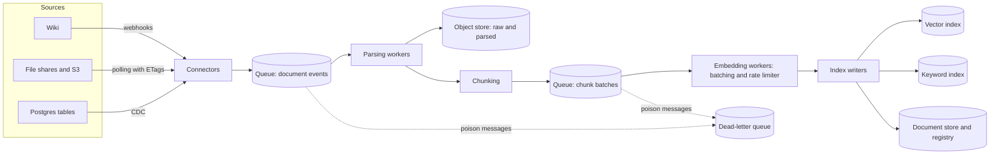
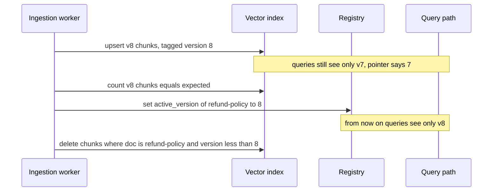
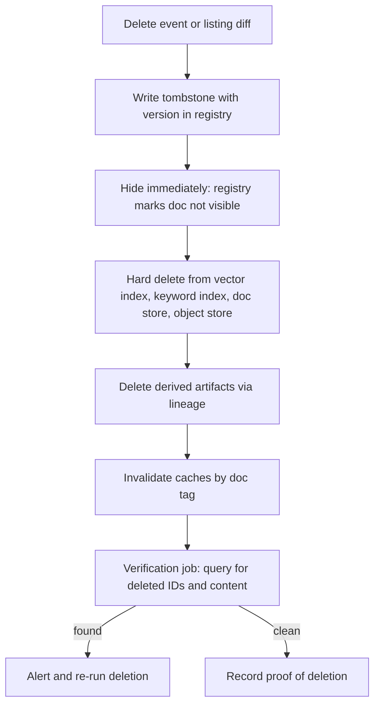
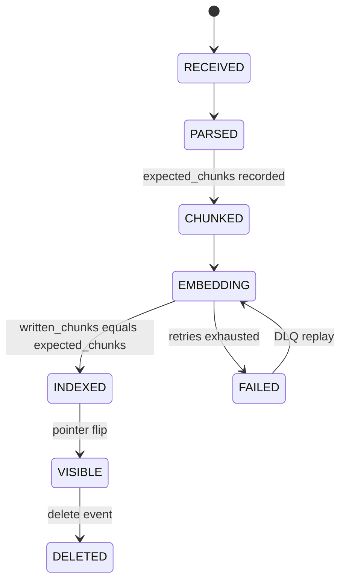
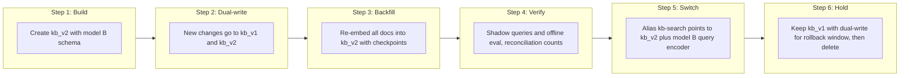

# Production Ingestion Pipelines: Idempotency, Updates, Deletions and Re-Embedding

> **Level:** Beginner to Advanced · **Study time:** ~120 min · **Prerequisites:** [Document Ingestion and Parsing](03-document-ingestion-and-parsing.md), [Chunking Strategies](04-chunking-strategies.md), [Vector Databases in Practice](07-vector-databases-in-practice.md)

## Table of contents

- [Why this matters](#why-this-matters)
- [The running example](#the-running-example)
- [Ingestion architecture: the big picture](#ingestion-architecture-the-big-picture)
- [Throughput and cost math](#throughput-and-cost-math)
- [Idempotent ingestion](#idempotent-ingestion)
- [Avoiding duplicate chunks](#avoiding-duplicate-chunks)
- [Detecting changed documents](#detecting-changed-documents)
- [Handling document updates without mixed versions](#handling-document-updates-without-mixed-versions)
- [Guaranteeing deleted documents are no longer retrievable](#guaranteeing-deleted-documents-are-no-longer-retrievable)
- [Recovering from partial embedding failures](#recovering-from-partial-embedding-failures)
- [Generating and versioning embeddings](#generating-and-versioning-embeddings)
- [Migrating to a new embedding model safely](#migrating-to-a-new-embedding-model-safely)
- [Monitoring ingestion](#monitoring-ingestion)
- [Going deeper: what changes at scale](#going-deeper-what-changes-at-scale)
- [Common mistakes and misconceptions](#common-mistakes-and-misconceptions)
- [Interview questions and model answers](#interview-questions-and-model-answers)
- [Key takeaways](#key-takeaways)
- [Further reading](#further-reading)
- [Next](#next)

## Why this matters

A RAG demo ingests a folder of PDFs once. A production RAG system ingests a moving target: thousands of documents change every day, some are deleted for legal reasons, connectors crash halfway through, embedding APIs throttle you, and one day you will want to switch to a better embedding model without taking search offline. Many "the chatbot quoted an outdated policy" and "the chatbot showed a document that was deleted last week" incidents are ingestion bugs, not LLM bugs. Interviewers ask about ingestion because it separates people who have built a notebook from people who have run a data system: they want to hear words like *idempotent*, *upsert*, *dead-letter queue*, *reconciliation* and *alias switch*, and they want you to explain why each one is there.

## The running example

We will reuse one small corpus and one big one throughout the chapter.

**The small corpus (4 documents)** from "Acme Corp's" internal help center:

| doc_id | Title | Chunks | Notes |
|---|---|---|---|
| `refund-policy` | Refund policy | 5 | Will be edited (14 days becomes 30 days) |
| `travel-policy` | Travel reimbursement | 4 | Also copied into a second wiki space (a duplicate) |
| `vpn-setup` | VPN setup guide | 3 | Unchanged |
| `holiday-2025` | 2025 holiday calendar | 2 | Will be deleted |

**The big corpus (illustrative):** 2 million documents averaging 5 chunks each, so **10 million chunks** of about **400 tokens** each, embedded into **1,024-dimensional** vectors. These numbers are made up but realistic in shape; we will use them for every cost and throughput calculation.

## Ingestion architecture: the big picture

> **Analogy:** Think of a library's back office. Couriers bring in new books and recall notices (connectors), a mailroom holds parcels until someone is free (the queue), clerks unpack and cut books into index cards (parsing and chunking), a specialist writes a catalog code on each card (embedding), filing staff put cards into the drawers (index writers), and a master ledger records which cards belong to which book and edition (the document store). If any clerk goes home sick, the parcels wait in the mailroom instead of being lost.

**Ingestion** is the process of getting content from source systems into a searchable index. In RAG it means: fetch, parse, chunk, embed, and write to the indexes, then keep doing that as the sources change. The parsing and chunking steps themselves are covered in [Document Ingestion and Parsing](03-document-ingestion-and-parsing.md) and [Chunking Strategies](04-chunking-strategies.md); this chapter is about the *pipeline* around them.



Here is every box, defined (the arrow labels, webhooks, polling with ETags and CDC, are ways of learning that a source changed; they are defined in [Detecting changed documents](#detecting-changed-documents)):

| Component | What it does | Why it exists |
|---|---|---|
| **Connector** | Code that talks to one source system (wiki, Google Drive, SharePoint, S3, a database) and emits events like "doc X created/updated/deleted" | Each source has its own API, auth and change-notification style |
| **Change feed** | An ordered stream of change events from a source, read with a **cursor** (a bookmark saying "I have processed up to here") | Lets you process only what changed instead of re-reading everything |
| **Message queue** | A durable buffer (Kafka, SQS, Pub/Sub, RabbitMQ) between stages | Decouples fast producers from slow consumers, survives crashes, enables retries |
| **Parsing workers** | Turn raw bytes (PDF, HTML, DOCX) into clean text plus structure | CPU-heavy, sometimes crashes on weird files, so isolate it |
| **Chunking** | Splits parsed text into retrievable pieces | Determines what the retriever can return |
| **Embedding workers** | Call an embedding model (API or self-hosted GPU) in batches, respecting rate limits | The most expensive and most throttled step |
| **Index writers** | Upsert vectors and text into the vector index and keyword index | Centralizes write logic, batching and versioning rules |
| **Document store / registry** | The ledger: for each document, its versions, content hash, chunk IDs, status, permissions | The source of truth for "what should be in the index"; enables updates, deletes and reconciliation |
| **Dead-letter queue (DLQ)** | A side queue where messages go after failing too many times | Stops one bad file from blocking the pipeline forever |

Two words you will see constantly:

- **Backpressure**: when a downstream stage is slower than an upstream stage, work piles up. A queue absorbs the pile and lets you scale consumers, instead of the producer crashing or dropping data.
- **At-least-once delivery**: most queues guarantee every message is delivered *at least* once, which means sometimes *more* than once (for example, a worker crashes after doing the work but before acknowledging the message). This single fact is why idempotency, the main topic of this chapter, is not optional.

> **Senior insight:** Separate stages by their resource profile. Parsing is CPU and memory heavy, embedding is GPU or API-quota bound, index writes are I/O bound. Putting a queue between them lets you scale each independently and makes failures local.

**Push vs pull ingestion.** Sources either *push* changes to you (webhooks, CDC streams) or you *pull* them (polling, scheduled crawls). Push gives low latency, but some push channels (webhooks especially) can drop events; log-based CDC is the reliable exception, at the price of operating it. Pull is reliable but slower and costlier. Production systems use both: push for freshness, plus a periodic pull-based reconciliation as a safety net. We will come back to this.

## Throughput and cost math

Before building anything, a senior engineer estimates how long the initial load (the **backfill**) will take and what it will cost. All prices and limits below are **illustrative**: real prices and quotas change by vendor and year, so always plug in current numbers.

### Total tokens

$$T = N \times \bar{t}$$

- $T$: total tokens to embed.
- $N$: number of chunks.
- $\bar{t}$: average tokens per chunk.

Worked example: $T = 10{,}000{,}000 \times 400 = 4{,}000{,}000{,}000$ tokens, that is 4 billion tokens.

### Cost

$$C = \frac{T}{10^6} \times p$$

- $C$: cost in dollars.
- $p$: price per million tokens (illustrative: \$0.02 per million tokens for a hosted embedding model).

Worked example: $\frac{4 \times 10^9}{10^6} = 4{,}000$ million-token units, and $4{,}000 \times 0.02 = \$80$.

That is surprisingly cheap. The lesson: for hosted embedding APIs, **the backfill is usually limited by time and rate limits, not money**. (LLM-generated derived data, like per-chunk context or summaries, can be 10 to 100 times more expensive, because it uses a generative model.)

### Time under a rate limit

Providers limit **requests per minute (RPM)** and **tokens per minute (TPM)**. The binding constraint is whichever runs out first.

$$t_{\text{minutes}} = \max\left(\frac{T}{R_{\text{TPM}}},\ \frac{N / B}{R_{\text{RPM}}}\right)$$

- $R_{\text{TPM}}$: your token-per-minute quota (illustrative: 1,000,000).
- $R_{\text{RPM}}$: your request-per-minute quota (illustrative: 3,000).
- $B$: batch size, chunks per request (say 100).

Worked example:

- Token bound: $4 \times 10^9 / 10^6 = 4{,}000$ minutes.
- Request bound: $N/B = 10^7 / 100 = 100{,}000$ requests, and $100{,}000 / 3{,}000 \approx 33.3$ minutes.
- The max is 4,000 minutes $= 66.7$ hours $\approx 2.8$ days. Tokens are the bottleneck, so bigger batches will not help; you need a bigger quota, multiple quota pools, an offline batch endpoint if your provider offers one, or a self-hosted model.

### How many concurrent requests do you need?

Suppose the business wants the backfill done in 24 hours. **Little's Law** from queueing theory says:

$$L = \lambda \times W$$

- $L$: average number of requests in flight at once (your concurrency).
- $\lambda$: arrival rate (requests per second you must sustain).
- $W$: average time each request takes.

Worked example:

1. Chunks per second: $10^7 / 86{,}400 \approx 115.7$.
2. With batch size 64, batches per second: $115.7 / 64 \approx 1.81$.
3. If one batch takes $W = 1.5$ s, then $L = 1.81 \times 1.5 \approx 2.7$, so about **3 concurrent requests**.
4. Sanity check against the quota: $4 \times 10^9$ tokens in 1,440 minutes is $\approx 2.78$ million TPM, which is 2.78 times our illustrative 1M TPM quota. So the plan fails on quota, not concurrency. Good thing we checked.

### Storage

$$S = N \times d \times b$$

- $d$: embedding dimension (1,024).
- $b$: bytes per number (4 for float32).

Worked example: $10^7 \times 1{,}024 \times 4 = 40{,}960{,}000{,}000$ bytes $\approx 41$ GB (about 38 GiB) of raw vectors, before the overhead of the approximate nearest neighbor (ANN) index structure (graph links for HNSW) and replicas. Halving to float16 gives about 20.5 GB; product quantization or int8 shrinks it further, see [Vector Search Algorithms](06-vector-search-ann-hnsw-ivf-and-product-quantization.md).

### Steady state is cheap, re-embedding is not

If 1% of chunks change per day: $10^5$ chunks $\times 400 = 4 \times 10^7$ tokens $= 40$ million tokens, costing $40 \times 0.02 = \$0.80$ per day (illustrative). Incremental ingestion is cheap *if you only re-embed what changed*. The expensive events are the backfill and every **full re-embed** (new model, new chunker), which cost the full 4 billion tokens again plus double storage during migration.

> **Interview tip:** When asked "how would you ingest 10 million documents," do this arithmetic out loud. Saying "4 billion tokens, roughly 80 dollars but nearly 3 days at 1M TPM, so the bottleneck is quota" signals seniority instantly.

## Idempotent ingestion

> **Analogy:** Pressing an elevator button five times does not summon five elevators. The button is *idempotent*: doing it again has no additional effect.

An operation is **idempotent** if applying it twice gives the same result as applying it once: $f(f(x)) = f(x)$. An ingestion pipeline is idempotent if processing the same event (or the same document) any number of times leaves the index in exactly the same state.

Why you need it: queues deliver at least once, workers crash mid-batch, operators replay a DLQ, a backfill gets restarted. Without idempotency, every one of these creates duplicate chunks.

### Ingredient 1: deterministic chunk IDs

A **deterministic ID** is computed from the content's identity, so the same chunk always gets the same ID. A random UUID generated at write time is the classic bug: retry the write and you get a second copy with a different ID.

| ID scheme | Example | Pros | Cons | Use when |
|---|---|---|---|---|
| Random UUID | `uuid4()` | Trivial | Retries create duplicates | Never for chunks |
| `doc_id + chunk_index` | `refund-policy#3` | Stable, readable | A new version overwrites in place, so an edit mid-flight can mix versions; if a doc shrinks, leftover chunks linger | Simple pipelines with orphan cleanup |
| `doc_id + version + chunk_index` | `refund-policy@v7#3` | Old and new versions coexist, enabling atomic swaps | Every edit rewrites every chunk | Versioned swaps (recommended default) |
| `doc_id + content_hash(chunk)` | `refund-policy:9f2c...` | Unchanged chunks keep their IDs, so you re-embed only changed chunks | Identical chunks within one doc collide (add an occurrence counter); ordering must be stored separately | Large docs with small edits; cost-sensitive re-embedding |

These schemes combine well. A common production setup uses versioned IDs for the *records* plus an embedding cache keyed by chunk content hash: a new version rewrites every record, but only chunks whose text actually changed call the embedding model (see [Generating embeddings in production](#generating-embeddings-in-production)).

Many vector databases restrict ID formats (Qdrant, for example, accepts unsigned integers or UUIDs), so a common trick is a **UUIDv5**: a UUID derived deterministically by hashing a name inside a fixed namespace.

```python
# pip install: nothing, standard library only
import hashlib
import uuid

# A fixed namespace for your system. Generate once, then never change it,
# or every ID in your index changes too.
CHUNK_NAMESPACE = uuid.uuid5(uuid.NAMESPACE_URL, "https://acme.example/rag/chunks")

def content_hash(text: str) -> str:
    """SHA-256 of whitespace-normalized text. Same text -> same hash."""
    normalized = " ".join(text.split())
    return hashlib.sha256(normalized.encode("utf-8")).hexdigest()

def chunk_id(doc_id: str, version: int, index: int) -> str:
    """Deterministic UUIDv5: same (doc, version, index) -> same ID, forever."""
    return str(uuid.uuid5(CHUNK_NAMESPACE, f"{doc_id}@v{version}#{index}"))

a = chunk_id("refund-policy", 7, 3)
b = chunk_id("refund-policy", 7, 3)
print(a == b)                                   # True
print(content_hash("Refunds  within\n14 days") == content_hash("Refunds within 14 days"))  # True
```

### Ingredient 2: upserts

An **upsert** ("update or insert") writes a record by ID: if the ID exists it is overwritten, otherwise it is created. Upsert plus deterministic IDs equals idempotent writes. Plain "insert" is not idempotent.

### Ingredient 3: safe retries and orphan cleanup

Idempotent chunk writes are not enough. Watch what happens when a document *shrinks*:

```python
import hashlib

def fake_embed(text: str) -> list[float]:
    """Deterministic stand-in for an embedding model."""
    h = hashlib.sha256(text.encode()).digest()
    return [b / 255 for b in h[:4]]

class ToyIndex:
    def __init__(self):
        self.points: dict[str, tuple[list[float], dict]] = {}
    def upsert(self, pid: str, vector, payload: dict):
        self.points[pid] = (vector, payload)          # overwrite-or-create
    def delete(self, ids):
        for pid in ids:
            self.points.pop(pid, None)                # deleting twice is fine
    def ids_for_doc(self, doc_id: str) -> set[str]:
        return {pid for pid, (_, p) in self.points.items() if p["doc_id"] == doc_id}

def ingest(index: ToyIndex, doc_id: str, chunks: list[str]):
    new_ids = set()
    for i, text in enumerate(chunks):
        pid = f"{doc_id}#{i}"                         # deterministic
        index.upsert(pid, fake_embed(text), {"doc_id": doc_id, "text": text})
        new_ids.add(pid)
    # Orphan cleanup: anything for this doc that is not in the new set must go.
    index.delete(index.ids_for_doc(doc_id) - new_ids)

idx = ToyIndex()
v1 = [f"refund paragraph {i}" for i in range(5)]
ingest(idx, "refund-policy", v1)
ingest(idx, "refund-policy", v1)                      # a retry: no duplicates
print(len(idx.points))                                # 5

v2 = [f"refund paragraph {i} (edited)" for i in range(3)]
ingest(idx, "refund-policy", v2)                      # doc shrank from 5 to 3 chunks
print(len(idx.points))                                # 3, orphans #3 and #4 removed
```

Without the last line of `ingest`, chunks `#3` and `#4` of the old version would stay searchable forever. That is the most common silent bug in naive pipelines.

### Ingredient 4: ordering and version guards

Retries also cause *reordering*: the "v8" event might be processed before a delayed retry of "v7". If you blindly apply v7 last, you have rolled the document back.

Two defenses:

1. **Version guard (optimistic concurrency):** store the latest applied version per document in the registry and ignore any event whose version is not newer. Use a source-provided monotonic value (revision number, sequence number, CDC log position) rather than wall-clock time where you can.
2. **Partition by document ID:** in Kafka, use `doc_id` as the message key so all events for one document land in the same partition and are consumed in order; SQS FIFO queues give similar per-group ordering with a message group ID. This prevents two workers from processing the same document concurrently in normal operation. It is not airtight: a Kafka consumer-group rebalance can briefly let two consumers handle the same message, and changing the partition count remaps keys, so keep the version guard as the real safety net.

### Ingredient 5: idempotency for expensive side effects

Some steps are naturally idempotent (upserts). Others cost money each time they run, such as generating an LLM summary or a contextual prefix per chunk. Cache their results keyed by an **idempotency key** like `hash(model_id, prompt_version, chunk_content_hash)`, so a retry reuses the stored output instead of paying again.

> **Common mistake:** Believing your queue's "exactly-once" setting makes your pipeline exactly-once. Exactly-once features (such as Kafka transactions) cover reads and writes *within* that system. The moment you call an external embedding API and write to a vector database, you are back to at-least-once. The practical recipe is **at-least-once delivery plus idempotent processing**, sometimes called "effectively once."

## Avoiding duplicate chunks

Duplicates hurt RAG in three ways: they waste top-k slots (five copies of the same paragraph push out four useful ones), they inflate cost and storage, and they skew evaluation. They come from several places:

| Source of duplicates | Example | Fix |
|---|---|---|
| Non-idempotent writes | Random IDs plus retries | Deterministic IDs and upserts (previous section) |
| Same document at several URLs | `?utm_source=mail`, trailing slashes, `http` vs `https` | Canonical URLs |
| Copies across systems | `travel-policy` copied into two wiki spaces, an attachment also stored on a file share | Exact content hashing at document level |
| Near-identical versions or templates | Same page with a different footer or date | Near-duplicate detection (MinHash, SimHash) |
| Boilerplate inside documents | Every page repeats the same legal disclaimer | Strip boilerplate during parsing, or dedupe at chunk level |

### Canonical URLs

A **canonical URL** is the single normalized form of a URL that many variants map to. Normalize before using it as a document key.

```python
from urllib.parse import urlsplit, urlunsplit, parse_qsl, urlencode

TRACKING_PARAMS = {"utm_source", "utm_medium", "utm_campaign", "utm_term",
                   "utm_content", "gclid", "fbclid"}

def canonical_url(url: str) -> str:
    p = urlsplit(url)
    scheme = p.scheme.lower()
    netloc = p.netloc.lower()
    if (scheme, netloc.rsplit(":", 1)[-1]) in {("http", "80"), ("https", "443")}:
        netloc = netloc.rsplit(":", 1)[0]                 # drop default ports
    path = p.path.rstrip("/") or "/"                      # site-specific: verify this is safe
    query = urlencode(sorted((k, v) for k, v in parse_qsl(p.query, keep_blank_values=True)
                             if k.lower() not in TRACKING_PARAMS))
    return urlunsplit((scheme, netloc, path, query, ""))  # drop #fragment

print(canonical_url("HTTPS://Help.Acme.com:443/refunds/?utm_source=mail&lang=en#top"))
# https://help.acme.com/refunds?lang=en
```

If a page declares `<link rel="canonical" href="...">`, prefer that. Careful: path case and trailing slashes *can* matter on some servers, so make the rules per source.

### Exact duplicates: hashing

Normalize the extracted text (whitespace, Unicode normalization, maybe strip boilerplate), then hash it with SHA-256. Equal hashes mean identical content. Keep a table `content_hash -> canonical doc_id`. When a second copy arrives, store it as an *alias* of the canonical document rather than indexing it again.

> **Senior insight:** Deduplicating content is not the same as deduplicating *access*. If `travel-policy` lives in the HR space (visible to HR) and in the public space (visible to everyone), merging them into one chunk must keep the union of source references and permissions correctly, or you will leak or hide content. See [Secure Multi-Tenant RAG](13-secure-multi-tenant-rag.md).

### Near duplicates: Jaccard similarity on shingles

Exact hashes miss documents that differ by one word. To measure "almost the same," turn each text into a set of **shingles** (overlapping runs of $k$ consecutive words, also called $k$-grams) and compare the sets with **Jaccard similarity**:

$$J(A, B) = \frac{|A \cap B|}{|A \cup B|}$$

- $A, B$: the shingle sets of two texts.
- $|A \cap B|$: number of shingles in both.
- $|A \cup B|$: number of distinct shingles in either.
- $J$ ranges from 0 (nothing shared) to 1 (identical sets).

Worked example with 2-word shingles, using the `refund-policy` edit:

- A = "refunds are issued within 14 days" gives {refunds are, are issued, issued within, within 14, 14 days}: 5 shingles.
- B = "refunds are issued within 30 days" gives {refunds are, are issued, issued within, within 30, 30 days}: 5 shingles.
- Intersection: {refunds are, are issued, issued within} = 3.
- Union: 5 + 5 - 3 = 7.
- $J = 3/7 \approx 0.43$.

Notice the trap: these two sentences differ by one number, and that number is the whole point of the policy. Near-duplicate detection is for removing *redundant copies* (mirrors, templates, reposts), not for deciding that a new version is "close enough" to skip. Change detection is a separate job (next section).

### MinHash: Jaccard at scale

Comparing every pair of 2 million documents is about $2 \times 10^{12}$ pairs, which is far too many. **MinHash** (Broder, "On the resemblance and containment of documents", 1997) compresses each set into a short **signature** such that signatures can estimate Jaccard.

The key fact: apply a random hash function $h$ to every shingle and keep the minimum value. Then

$$P\big[\min_{x \in A} h(x) = \min_{x \in B} h(x)\big] = J(A, B)$$

Intuition: under a random ordering of all shingles in $A \cup B$, the first one is equally likely to be any of them, and the two minimums agree exactly when that first shingle is in both sets. So with $k$ independent hash functions, the fraction of positions where the two signatures agree estimates $J$.

Signatures still need pairwise comparison, so **locality-sensitive hashing (LSH)** with **banding** finds candidates: split the $k$-number signature into $b$ bands of $r$ rows ($k = b \times r$), hash each band into buckets, and call two documents candidates if *any* band matches exactly. The probability that a pair with similarity $s$ becomes a candidate is

$$P(\text{candidate}) = 1 - \left(1 - s^{r}\right)^{b}$$

- $s^r$: probability all $r$ rows of one band match.
- $1 - s^r$: probability that band does not match.
- $(1 - s^r)^b$: probability no band matches.

Worked example with $b = 20$, $r = 5$ (so $k = 100$):

- For $s = 0.8$: $0.8^5 = 0.32768$, $1 - 0.32768 = 0.67232$, $0.67232^{20} \approx 0.00036$, so $P \approx 0.9996$. True near-duplicates are almost always caught.
- For $s = 0.3$: $0.3^5 = 0.00243$, $1 - 0.00243 = 0.99757$, $0.99757^{20} \approx 0.9525$, so $P \approx 0.047$. Dissimilar pairs rarely become candidates.
- The threshold where the S-curve rises is roughly $(1/b)^{1/r} = (0.05)^{0.2} \approx 0.55$.

Candidates are then verified with the actual Jaccard estimate. Here is MinHash from scratch to show the mechanism:

```python
import hashlib

def shingles(text: str, k: int = 2) -> set[str]:
    words = text.lower().split()
    return {" ".join(words[i:i + k]) for i in range(len(words) - k + 1)}

def jaccard(a: set, b: set) -> float:
    return len(a & b) / len(a | b)

def minhash_signature(items: set[str], num_hashes: int = 128) -> list[int]:
    sig = []
    for seed in range(num_hashes):          # each seed acts as a different hash function
        sig.append(min(int.from_bytes(hashlib.sha1(f"{seed}:{x}".encode()).digest()[:8], "big")
                       for x in items))
    return sig

def estimate_jaccard(sig_a: list[int], sig_b: list[int]) -> float:
    return sum(x == y for x, y in zip(sig_a, sig_b)) / len(sig_a)

A = shingles("refunds are issued within 14 days")
B = shingles("refunds are issued within 30 days")
print(round(jaccard(A, B), 3))                          # 0.429
print(estimate_jaccard(minhash_signature(A), minhash_signature(B)))  # close to 0.43, varies with hashes
```

In production use a library. `datasketch` has a stable, widely used API:

```python
# pip install datasketch
from datasketch import MinHash, MinHashLSH

def mh(text: str, num_perm: int = 128) -> MinHash:
    m = MinHash(num_perm=num_perm)
    for s in shingles(text, k=3):           # reuse shingles() from above
        m.update(s.encode("utf-8"))
    return m

lsh = MinHashLSH(threshold=0.8, num_perm=128)   # picks b and r for you
corpus = {"travel-hr": "Employees may claim travel costs within 30 days of the trip ...",
          "travel-public": "Employees may claim travel costs within 30 days of the trip ..."}
for key, text in corpus.items():
    sig = mh(text)
    dupes = lsh.query(sig)                  # existing near-duplicates
    if dupes:
        print(f"{key} is a near-duplicate of {dupes}")
    lsh.insert(key, sig)
```

### SimHash and embedding-based dedup

**SimHash** (Charikar, "Similarity estimation techniques from rounding algorithms", 2002) produces one 64-bit fingerprint per document such that similar documents differ in few bits; you compare fingerprints with **Hamming distance** (number of differing bits). Manku, Jain and Das Sarma ("Detecting Near-Duplicates for Web Crawling", 2007) used 64-bit SimHash at Google web-crawl scale and found a threshold of about 3 differing bits worked well for their data.

| Method | Measures | Storage per doc | Strengths | Weaknesses | Good for |
|---|---|---|---|---|---|
| SHA-256 of normalized text | Exact equality | 32 bytes | Trivial, zero false positives | Misses one-character differences | Copies, re-uploads, retries |
| MinHash + LSH | Jaccard of shingle sets | ~128 integers | Tunable threshold, well understood | More storage and tuning | Templates, mirrors, reposts |
| SimHash | Angular (cosine) similarity of weighted term vectors, via bit agreement | 8 bytes | Tiny, fast lookups | Coarser, best for whole documents | Web-scale crawls |
| Embedding cosine | Semantic similarity | The vector you already have | Catches paraphrases | Also flags genuinely different docs on the same topic; expensive at scale | Final chunk-level cleanup with a high threshold |

> **Common mistake:** Using embedding similarity to dedupe at a loose threshold such as 0.9 cosine. Two versions of a policy with different numbers, or "how to enable MFA" vs "how to disable MFA," can embed very close together. Cosine thresholds are also model-specific (some models, E5 among them, put even unrelated texts at fairly high cosine), so calibrate on labeled pairs rather than reusing a number. Deduplicate conservatively and log what you dropped.

## Detecting changed documents

Re-ingesting everything every night is the simplest correct strategy, and at small scale it is fine. At 2 million documents it wastes compute and leaves content stale for up to a day. We want to know *which* documents changed, ideally within minutes.

| Method | How it works | Latency | Reliability | Cost | Catches deletes? |
|---|---|---|---|---|---|
| Full recrawl + content hash | Fetch everything, hash the extracted text, compare with stored hash | Hours | High (ground truth) | High fetch cost, low embed cost | Yes, by set difference |
| Modified timestamps | Ask the source for items with `modified_at > last_sync` | Minutes | Medium: clock skew, "touched but not changed," some edits do not bump it | Low | No |
| HTTP ETag / Last-Modified | Conditional GET with `If-None-Match` or `If-Modified-Since`; server replies `304 Not Modified` if unchanged | Per poll | Medium to high, server-dependent | Low (no body on 304) | Yes, via 404/410 |
| Delta / changes APIs | Many SaaS APIs return "changes since cursor token" | Minutes | High if you persist the cursor correctly | Low | Usually yes |
| Change data capture (CDC) | Read the database's transaction log (Postgres WAL, MySQL binlog), for example with Debezium | Seconds | Very high, ordered | Low per change, ops overhead | Yes, delete events |
| Webhooks | Source calls your endpoint on change | Seconds | Low to medium: deliveries can be dropped, duplicated, reordered | Low | Often |

Definitions for the new terms:

- An **ETag** ("entity tag") is an opaque identifier a web server assigns to a specific version of a resource. On a correctly behaving server, if the content changes, the ETag changes (weak ETags, prefixed `W/`, may stay the same across changes the server deems insignificant).
- **Change data capture (CDC)** turns every committed insert, update and delete in a database into an event, by tailing the log the database already writes for crash recovery and replication. **Debezium** is a widely used open-source CDC platform that streams these events, most commonly into Kafka.
- A **webhook** is an HTTP callback: the source system POSTs a small message to your URL when something happens.

### The two-level hash

A good pipeline uses cheap signals to decide *what to look at* and content hashes to decide *what to redo*:

1. Cheap trigger (webhook, CDC, ETag, timestamp) says "doc X may have changed."
2. Fetch and parse doc X, compute the **document hash** of normalized text. If it equals the stored hash, stop: nothing to do. (This filters out "touched but not changed.")
3. If different, re-chunk and compute **per-chunk hashes**. Re-embed only chunks whose hash is new; reuse stored vectors for the rest.

Step 3 works well with chunkers that produce stable boundaries (structure-based chunking by headings). With fixed-size windows, inserting one sentence near the top shifts every later boundary, so every chunk hash changes. That is one practical argument for structure-aware chunking.

### Hash the pipeline too

A document must also be reprocessed when *your* side changes: a new parser version, a new chunk size, a new embedding model. Store a **pipeline fingerprint** next to each document:

```python
import hashlib, json

def pipeline_fingerprint(cfg: dict) -> str:
    """Anything that changes the output of ingestion belongs in here."""
    return hashlib.sha256(json.dumps(cfg, sort_keys=True).encode()).hexdigest()[:16]

CFG = {"parser": "pdf-parser-2.3", "chunker": "headings-v4", "chunk_tokens": 400,
       "overlap": 50, "embed_model": "e5-large-v2", "embed_revision": "pinned-sha",
       "normalize": True}

def needs_reprocessing(stored: dict, new_text_hash: str) -> bool:
    return (stored.get("content_hash") != new_text_hash
            or stored.get("pipeline_fp") != pipeline_fingerprint(CFG))
```

### Conditional fetching with ETags

```python
# pip install requests
import requests

def fetch_if_changed(url: str, etag: str | None, last_modified: str | None):
    headers = {}
    if etag:
        headers["If-None-Match"] = etag
    if last_modified:
        headers["If-Modified-Since"] = last_modified
    r = requests.get(url, headers=headers, timeout=30)
    if r.status_code == 304:
        return None, etag, last_modified          # unchanged, nothing downloaded
    if r.status_code in (404, 410):
        raise LookupError("deleted at source")    # emit a delete event
    r.raise_for_status()
    return r.content, r.headers.get("ETag"), r.headers.get("Last-Modified")
```

### Deletes are the hardest change to detect

A timestamp query cannot return a document that no longer exists. You learn about deletions from explicit delete events (CDC, webhooks, delta APIs) or by **listing diffs**: periodically list all IDs at the source and compare with all IDs in your registry. Anything in the registry but not at the source is a candidate delete. Always have the listing diff as a backstop, because event-based delete notifications get lost.

> **Senior insight:** Webhooks are a latency optimization, not a correctness mechanism. Design as if every webhook could be lost, and run periodic reconciliation (covered below) to guarantee eventual correctness.

## Handling document updates without mixed versions

When `refund-policy` goes from v7 ("14 days") to v8 ("30 days"), a retriever running at the same moment might see:

- Only v7 chunks (stale but consistent): acceptable for a few seconds.
- Only v8 chunks: the goal.
- **A mix of v7 and v8 chunks**: the LLM reads "14 days" and "30 days" in the same context and either picks one at random or hedges. This is the bug to prevent.
- **No chunks at all**: the document briefly disappears.

### Three strategies

**1. Upsert in place plus orphan delete** (IDs = `doc_id#index`). Overwrite chunk by chunk, then delete leftovers. During the write, some chunks are v8 and some v7: a mixed window. Fine for low-stakes content, not for policies.

**2. Delete-then-insert.** Delete all v7 chunks, then insert v8. No mix, but a **gap window** where the document is missing, and if the insert fails, the document is gone until a retry succeeds.

**3. Versioned swap (insert-then-flip-then-delete).** IDs include the version. Write all v8 chunks while v7 stays live, verify, then flip a single **active version pointer**, then garbage-collect v7.

| Strategy | Mixed-version window | Missing-document window | Extra storage | Complexity | Use when |
|---|---|---|---|---|---|
| Upsert in place + orphan delete | Yes | No | None | Low | Low-stakes content, tiny docs |
| Delete-then-insert | No | Yes | None | Low | Batch rebuilds during quiet hours |
| Versioned swap | No | No | Temporarily 2x for that doc | Medium | Default for anything users rely on |



How does the query path know the active version? Three options:

- **Filter on a payload flag** (the **payload** is the metadata stored next to each vector, such as `doc_id`, `version` and ACLs): new chunks are written with `active=false`; the flip updates the flag on both versions. Only atomic if your store supports multi-record transactions. **pgvector** inherits real ACID transactions from Postgres, which makes this easy; many dedicated vector databases offer atomicity only per record or per batch, so check yours.
- **Post-filter against the registry:** retrieve top $k'$ (slightly more than $k$), look up `active_version[doc_id]` in a fast key-value store, drop chunks whose version does not match. The flip is one key-value write, which is atomic. The cost is over-fetching, and if many hits are filtered out you can return fewer than $k$ results, so size $k'$ with headroom and garbage-collect old versions promptly. This is a version-visibility filter applied inside the user's already-authorized scope, not an access control: tenant and ACL conditions still belong in the search query itself as a pre-filter, because post-filtering is not a safe way to enforce permissions (see [Secure Multi-Tenant RAG](13-secure-multi-tenant-rag.md)).
- **Pre-filter with a version list:** pass allowed `(doc_id, version)` pairs as a filter. Only practical for small scopes.

```python
class VersionedStore:
    def __init__(self):
        self.chunks: dict[str, dict] = {}       # chunk_id -> {"doc_id", "version", "text"}
        self.active: dict[str, int] = {}        # doc_id -> active version (the pointer)

    def search(self, word: str) -> list[str]:
        """Stand-in for vector search plus the active-version post-filter."""
        hits = [c for c in self.chunks.values() if word in c["text"]]
        return [c["text"] for c in hits if self.active.get(c["doc_id"]) == c["version"]]

def update_document(store: VersionedStore, doc_id: str, version: int, texts: list[str]):
    if version <= store.active.get(doc_id, -1):
        return "ignored stale event"                          # version guard
    ids = [f"{doc_id}@v{version}#{i}" for i in range(len(texts))]
    for cid, t in zip(ids, texts):                            # 1. write new, invisible
        store.chunks[cid] = {"doc_id": doc_id, "version": version, "text": t}
    assert all(cid in store.chunks for cid in ids)            # 2. verify completeness
    store.active[doc_id] = version                            # 3. atomic flip
    for cid in [k for k, c in store.chunks.items()            # 4. garbage-collect old
                if c["doc_id"] == doc_id and c["version"] < version]:
        del store.chunks[cid]
    return "applied"

s = VersionedStore()
update_document(s, "refund-policy", 7, ["refunds within 14 days", "contact support"])
update_document(s, "refund-policy", 8, ["refunds within 30 days", "contact support"])
print(s.search("refunds"))                                    # ['refunds within 30 days']
print(update_document(s, "refund-policy", 7, ["refunds within 14 days"]))  # ignored stale event
```

If step 4 fails, nothing user-visible breaks: old chunks are hidden by the pointer, and a cleanup job removes them later. That is the beauty of the pattern: every failure leaves the system in a safe state.

> **Senior insight:** The same "build aside, then flip a pointer" idea appears three times in this chapter: for one document (versioned swap), for the whole index (alias switch during model migration), and in deployments generally (blue/green deployment, see [Model Deployment Patterns](../10-mlops/04-model-deployment-patterns.md)). Recognizing the pattern makes many interview questions easy.

## Guaranteeing deleted documents are no longer retrievable

`holiday-2025` is deleted at the source. Or worse: a customer exercises their legal **right to erasure** (GDPR Article 17) and their data must be gone. "We deleted the vectors" is rarely enough, because a document leaves traces in many places.

> **Analogy:** Recalling a defective product is not just pulling it from one shelf. You check every store, every warehouse, the online catalog, the photos in the brochure, and the returns pile, then send an inspector to confirm.

### Where a document lives after ingestion

| Location | Example | How to delete |
|---|---|---|
| Vector index | Chunk vectors | Hard delete by `doc_id` filter or by stored chunk IDs |
| Keyword index | BM25 postings | Delete by `doc_id`; deletes are often purged on segment merge |
| Document store / chunk text | Text shown to the LLM | Delete rows |
| Object store | Raw PDF, parsed JSON | Delete objects, including old object versions if bucket versioning is on |
| Caches | Retrieval cache, semantic answer cache, CDN | Invalidate by doc tag, or keep TTLs (time-to-live expiry) short |
| Derived artifacts | Document summaries, contextual chunk prefixes, parent docs, knowledge-graph entities (see [Advanced RAG Patterns](09-advanced-rag-patterns.md)) | Track **lineage** (what was derived from what) and delete descendants |
| Agent and chat memory | "User's summary of the holiday policy" | Lineage, or TTL |
| Eval sets, fine-tuning data | Golden questions referencing the doc | Lineage, dataset versioning |
| Logs and traces | Prompts containing retrieved text | Retention limits, redaction |
| Replicas and backups | Snapshots of the index | Retention windows, or crypto-shredding |

Key terms:

- A **soft delete** marks a record as deleted (a flag or tombstone) while the bytes still exist. A **hard delete** physically removes it.
- Many ANN indexes and Lucene-style search engines implement deletes as soft deletes internally: the vector is marked deleted, skipped at query time, and physically removed later during **compaction** (merging and rewriting segments). Until compaction, the bytes still sit on disk. Some index libraries cannot remove vectors from certain index types at all, so you filter by ID and rebuild periodically. For legal deletion, know your engine's compaction behavior and force or schedule it.
- A **tombstone** is a registry record saying "doc X was deleted at version N." It prevents **resurrection**: a delayed update event for v7 arriving after the delete must be ignored, which the version guard does only if the tombstone is kept.
- **Crypto-shredding** encrypts data with a per-tenant (or per-document) key and deletes the key when the data must be erased, making even backup copies unreadable. It is the practical answer to "how do you delete from immutable backups."

### The deletion workflow



Note the order. Step C makes the document invisible in one fast write (the same post-filter used for versioned swaps), so the user-facing guarantee does not depend on every slow physical delete succeeding. Steps D to F then remove the bytes, and step G proves it.

```python
def delete_document(doc_id: str, version: int, registry, stores: list, caches: list, lineage):
    registry.tombstone(doc_id, version)            # 1. durable record, blocks resurrection
    registry.set_visible(doc_id, False)            # 2. hidden from queries right now
    for store in stores:                           # 3. vector, keyword, doc store, objects
        store.delete_by_doc(doc_id)
    for child in lineage.descendants(doc_id):      # 4. summaries, contextual chunks, entities
        for store in stores:
            store.delete_by_doc(child)
    for cache in caches:                           # 5. anything that might replay old text
        cache.invalidate_tag(doc_id)

def verify_deletions(deleted_ids: list[str], vector_index, keyword_index, probe_texts: dict):
    """Run on a schedule. Every hit is a bug: alert, then re-run delete_document."""
    leaks = []
    for doc_id in deleted_ids:
        if vector_index.count(filter={"doc_id": doc_id}) > 0:
            leaks.append((doc_id, "vector index by ID"))
        if keyword_index.count(filter={"doc_id": doc_id}) > 0:
            leaks.append((doc_id, "keyword index by ID"))
        # Content probe: search for a distinctive sentence from the deleted doc.
        # Catches copies stored under another ID (a duplicate or derived summary).
        for hit in keyword_index.search(probe_texts[doc_id], k=5):
            if hit.score > 0.9 * hit.max_possible_score:   # illustrative threshold
                leaks.append((doc_id, f"content still present as {hit.doc_id}"))
    return leaks
```

(The store, cache and lineage objects here are interfaces you would implement for your stack; the logic is the point.)

The content probe matters: the ID check proves you deleted what you *know* about, while the probe catches what you *forgot* about, such as a copy of the same PDF uploaded under another name.

> **Interview tip:** Answer "how do you guarantee deletion" with three layers: *hide fast* (registry flag and post-filter), *remove everywhere* (inventory of stores, lineage for derived data, caches, compaction, backups) and *prove it* (verification jobs that query for deleted IDs and content). Most candidates only mention the first half of the second layer.

## Recovering from partial embedding failures

Partial failure is the normal state of a large pipeline. Out of 10 million chunks, some requests will hit rate limits, some will time out, some inputs will be malformed. The goal: **no chunk is silently lost, no document is half-visible, and recovery is automatic.**

### Classify the error first

| Kind | Examples | Right response |
|---|---|---|
| **Transient** | HTTP 429 (rate limited), 503, timeouts, connection resets | Retry with backoff |
| **Permanent / poison** | Input longer than the model's context, invalid UTF-8, empty text, 400 Bad Request | Do not retry blindly: split the batch, isolate the bad item, send it to the DLQ |
| **Systemic** | Expired API key, model deprecated, quota exhausted for the day | Stop the consumers (circuit breaker) and page a human; retrying just burns time |

A **circuit breaker** stops calling a dependency after many consecutive failures, waits, then tries a few requests before resuming. It prevents a whole fleet of workers from hammering a broken service.

### Retries with exponential backoff and jitter

Waiting a fixed time between retries makes all workers retry in lockstep (a "thundering herd"). **Exponential backoff** doubles the wait each attempt; **jitter** randomizes it so workers spread out. The "full jitter" variant described in the AWS Architecture Blog post "Exponential Backoff And Jitter" (Brooker, 2015) is:

$$d_n = \text{uniform}\big(0,\ \min(c,\ a \cdot 2^{n})\big)$$

- $d_n$: delay before retry number $n$ (starting at $n = 0$).
- $a$: base delay (say 1 s).
- $c$: cap (say 60 s).

Worked example: the upper bounds for $n = 0, 1, 2, \dots, 7$ are $1, 2, 4, 8, 16, 32, 60, 60$ seconds (because $2^6 = 64 > 60$, the cap kicks in at $n = 6$). Each actual wait is a random number between 0 and that bound. If the provider sends a `Retry-After` header, respect it.

```python
import random
import time

class TransientError(Exception): ...
class PermanentError(Exception): ...

def call_with_backoff(fn, max_attempts: int = 6, base: float = 1.0, cap: float = 60.0,
                      sleep=time.sleep):
    for attempt in range(max_attempts):
        try:
            return fn()
        except TransientError:
            if attempt == max_attempts - 1:
                raise                                   # give up: caller sends to DLQ
            sleep(random.uniform(0, min(cap, base * 2 ** attempt)))   # full jitter

def embed_with_bisect(items, embed_fn, dead_letters: list):
    """items: list of (chunk_id, text). Splits a failing batch to isolate poison inputs."""
    if not items:
        return {}
    try:
        vectors = call_with_backoff(lambda: embed_fn([t for _, t in items]))
        return {cid: v for (cid, _), v in zip(items, vectors)}
    except PermanentError as e:
        if len(items) == 1:
            dead_letters.append({"chunk_id": items[0][0], "error": str(e)})
            return {}
        mid = len(items) // 2
        return (embed_with_bisect(items[:mid], embed_fn, dead_letters)
                | embed_with_bisect(items[mid:], embed_fn, dead_letters))

# Demo: one poisoned (empty) chunk in a batch of 8.
def fake_api(texts):
    if any(t == "" for t in texts):
        raise PermanentError("400: empty input")
    return [[float(len(t))] for t in texts]

dlq = []
batch = [(f"c{i}", "text" if i != 5 else "") for i in range(8)]
out = embed_with_bisect(batch, fake_api, dlq)
print(len(out), dlq)    # 7 [{'chunk_id': 'c5', 'error': '400: empty input'}]
```

Isolating one poison item takes about $2\log_2 B + 1$ calls (two per halving step) instead of $B$ single-item calls: in the demo above with $B = 8$, that is $2 \times 3 + 1 = 7$ calls. Bisection pays off for large batches and few poison items; if many items in a batch are bad, falling back to single-item calls is simpler. Libraries such as `tenacity` (`pip install tenacity`) implement retry policies declaratively; the logic is the same.

### Dead-letter queues

After retries are exhausted, the message moves to the DLQ with its error, attempt count and pipeline fingerprint. The DLQ is not a trash can: alert on its size, triage it (fix the parser, raise a limit, truncate inputs), then **replay** it through the same idempotent pipeline. Idempotency is what makes replay safe.

### Checkpoints for long backfills

A **checkpoint** is a durably saved progress marker. For a 3-day backfill, save the source cursor (or the last processed doc ID in sorted order) every few thousand documents. On restart, resume from the checkpoint; because writes are idempotent, re-processing the few documents after the checkpoint is harmless. Without checkpoints a crash on day 2 means starting over.

### Visibility gating: never show half a document

Track each document through a small state machine in the registry:



The rule: **a document version becomes visible only when every one of its chunks is indexed**. The chunker records `expected_chunks`; index writers increment `written_chunks` (idempotently: count distinct chunk IDs, not write calls); the flip happens only when they match. This is the same pointer flip as the versioned swap, so a partially embedded v8 is simply invisible while v7 keeps serving.

### Reconciliation: the safety net that catches everything else

A **reconciliation job** periodically compares what *should* be indexed (from the source or registry) with what *is* indexed, and repairs differences. It catches lost webhooks, bugs, manual edits and half-finished deletes.

```python
def reconcile(source: dict[str, str], indexed: dict[str, str]) -> dict[str, set[str]]:
    """source / indexed: doc_id -> content hash (source of truth vs what the index serves)."""
    return {
        "missing":  source.keys() - indexed.keys(),            # never indexed: enqueue ingest
        "orphaned": indexed.keys() - source.keys(),            # deleted at source: enqueue delete
        "stale":    {d for d in source.keys() & indexed.keys()
                     if source[d] != indexed[d]},              # changed: enqueue re-ingest
    }

source  = {"refund-policy": "h8", "travel-policy": "h2", "vpn-setup": "h3"}
indexed = {"refund-policy": "h7", "travel-policy": "h2", "vpn-setup": "h3", "holiday-2025": "h4"}
print(reconcile(source, indexed))
# {'missing': set(), 'orphaned': {'holiday-2025'}, 'stale': {'refund-policy'}}
```

At scale you do not compare 2 million entries one by one across the network. Partition by ID prefix, compute a hash per partition (a **Merkle-tree** style summary, where each parent hash covers its children), and drill only into partitions whose hashes differ.

> **Senior insight:** Event-driven ingestion gives you freshness, reconciliation gives you correctness. Say both in an interview. A pipeline without reconciliation is correct only as long as nothing ever goes wrong.

## Generating and versioning embeddings

The mechanics of embedding models are in [Text Embeddings and Similarity Search](02-text-embeddings-and-similarity-search.md). Here is what matters for a pipeline.

### Generating embeddings in production

- **Same model, same preprocessing for documents and queries.** Some models expect different prefixes for each side (the E5 family uses `"query: "` and `"passage: "`); getting this wrong silently degrades recall.
- **Batch by length.** Sorting chunks by token count before batching reduces padding on self-hosted GPUs, which can noticeably raise throughput.
- **Respect the max input length.** Text beyond the model's limit is truncated (silently by some libraries, with an error by some APIs). Enforce chunk size in tokens of the *embedding model's* tokenizer.
- **Normalize consistently.** If your index uses inner product as cosine, L2-normalize every vector (scale it to length 1, so inner product equals cosine similarity), at write time and query time.
- **Cache by content.** Key an embedding cache by `(embedding_fingerprint, chunk_content_hash)`. Unchanged chunks, duplicates and replays never hit the model twice.

A minimal self-hosted generation step with a mainstream library:

```python
# pip install sentence-transformers
from sentence_transformers import SentenceTransformer

MODEL_ID = "intfloat/e5-large-v2"
model = SentenceTransformer(MODEL_ID)        # in production also pin the revision (commit hash)

chunks = ["Refunds are issued within 30 days.", "Install the VPN client, then sign in."]
passages = ["passage: " + c for c in chunks]               # E5 convention
vecs = model.encode(passages, batch_size=64, normalize_embeddings=True)
print(vecs.shape)                                          # (2, 1024)
```

### Versioning embeddings

Every vector should carry, or be traceable to, an **embedding fingerprint**: model name, exact revision, dimension, normalization, query/passage prefixes, plus the chunker and parser versions that produced its text. Store it in the index metadata (per collection) and in the registry (per document).

Why so strict? Because **vectors from different models live in different coordinate systems**. Two models may both output 1,024 numbers, but dimension 17 means something unrelated in each, so the cosine similarity between a model-A query and a model-B document is meaningless (the rare exception is a model explicitly trained to be backward compatible with an older one, which you should verify rather than assume). It will not raise an error. It will just return confident garbage.

> **Analogy:** Embedding models are like map projections with private coordinate grids. Coordinates (51.5, -0.1) are London on one map and somewhere in the ocean on another. Mixing points from two maps on one chart gives nonsense distances even though every point "looks" valid.

Consequences:

1. **Never mix vectors from different models in one index.** Not even "just for new documents while we migrate."
2. **Pin model versions.** If you use a hosted API, use a versioned model name rather than an alias that might be silently upgraded; if self-hosted, pin the weight revision. An unannounced model change is a full re-embed you did not plan for.
3. **The query encoder is part of the index.** The serving config must bind "index X" to "query model Y" so they can only change together.

> **Common mistake:** Upgrading the embedding model in the query service first ("it's the same dimension, so it works") and re-embedding documents later. Recall collapses immediately, and nothing errors.

## Migrating to a new embedding model safely

You want to move from model A (index `kb_v1`) to model B. Model B may even have a different dimension. The safe plan is **blue/green for indexes**: build the new index side by side, prove it is better, switch atomically, keep the old one for rollback.



Step by step:

1. **Build a new index** (`kb_v2`) with model B's dimension and distance metric. Do not touch `kb_v1`.
2. **Dual-write**: from now on, every ingestion event writes to both indexes, each embedded with its own model. Start dual-writing *before* the backfill so changes during the backfill are not missed.
3. **Backfill**: re-embed every document into `kb_v2`, with checkpoints and the idempotent pipeline. If a dual-write and a backfill write race on the same doc, the version guard keeps the newest. With our numbers, this is the full 4 billion tokens again (about \$80 and 2.8 days at 1M TPM, illustrative), plus about 41 GB more raw vector storage (if model B is also 1,024-dimensional float32) until the old index is dropped.
4. **Verify**:
   - **Completeness:** reconciliation shows identical document sets and chunk counts in both indexes.
   - **Offline evaluation:** run your golden question set (a curated set of queries with known relevant documents) against both and compare recall@k (share of relevant documents found in the top $k$), MRR (how high the first relevant result ranks) and nDCG (a rank-weighted relevance score); see [Evaluating RAG](10-rag-evaluation-metrics-and-ragas.md).
   - **Shadow evaluation:** send a copy of live queries to `kb_v2` without showing results to users; compare overlap of top-k, latency, and, on a sample, judged relevance or end-to-end answer quality.
5. **Atomic alias switch.** An **alias** is a stable name (`kb-search`) that points to a physical index. Search engines such as Elasticsearch and OpenSearch, and several vector databases (for example Qdrant and Milvus), support aliases; check your version. The application always queries the alias, and the switch is one atomic metadata operation. Crucially, switch the query encoder at the same moment: store the (index, query model) pair together in one config record and deploy them as a unit.
6. **Rollback window.** Keep `kb_v1` and keep dual-writing to it for days or weeks. Rolling back is pointing the alias (and encoder) back. Only after the window, stop dual-writes and delete `kb_v1`.

A tiny shadow-comparison metric:

```python
def overlap_at_k(a: list[str], b: list[str], k: int = 10) -> float:
    """Fraction of top-k doc IDs shared by two retrievers (1.0 = same set)."""
    return len(set(a[:k]) & set(b[:k])) / k

old = ["refund-policy", "travel-policy", "vpn-setup", "faq", "pricing"]
new = ["refund-policy", "returns-faq", "travel-policy", "faq", "shipping"]
print(overlap_at_k(old, new, k=5))      # 0.6
```

Low overlap is not bad by itself (the new model is supposed to be different); it tells you *which queries* to send to human or LLM judges to see who is right.

| Migration approach | Downtime | Risk | Cost | Notes |
|---|---|---|---|---|
| Re-embed in place into the live index | None, but mixed vectors | Very high: wrong results during migration | 1x storage | Never do this |
| Stop ingestion, rebuild, swap | Freshness gap during rebuild | Medium | 2x storage briefly | OK for small, slow-changing corpora |
| Side-by-side + dual-write + alias switch | None | Low, with rollback | 2x storage during migration, double write cost | The standard answer |
| Map old vectors to new space with a learned adapter | None | Quality loss, research-grade | Low | Occasionally a stopgap; re-embedding remains the durable fix |

> **Senior insight:** The same playbook applies to *any* change that alters vectors or chunks: a new chunk size, a new parser, adding contextual prefixes. All of them are "new index" changes, and all of them deserve the same evaluation gate as a model change. Treat the index like a deployed model artifact, with versions in a registry (see [Data Versioning, Model Versioning and the Model Registry](../10-mlops/02-data-and-model-versioning-and-model-registry.md)).

## Monitoring ingestion

If you cannot see the pipeline, you will learn about failures from users. The metrics fall into four groups.

| Group | Metric | What it catches |
|---|---|---|
| Freshness | **Ingestion lag**: time from source change to searchable; queue **consumer lag** (messages waiting) | Slow or stuck pipeline |
| Reliability | Error rate per stage, retry rate, 429 rate, DLQ depth and age, circuit breaker state | Failing dependencies, poison inputs |
| Correctness | Source doc count vs index doc count, orphan count, stale count (from reconciliation), deletion-probe leaks, docs stuck in a non-visible state | Silent data loss and leaks |
| Quality and cost | Empty-text rate after parsing, chunks per doc distribution, tokens embedded per day, cost per day, index size and growth | Parser regressions, runaway costs |

### Freshness SLO

An **SLO (service level objective)** is a target for a measured behavior over a window. For ingestion, a typical form is: "99% of source changes are searchable within 15 minutes, measured over 28 days" (illustrative numbers).

$$\text{lag}_i = t_{\text{visible},i} - t_{\text{changed},i}$$

$$\text{compliance} = \frac{\#\{i : \text{lag}_i \le \tau\}}{n}$$

- $t_{\text{changed},i}$: when change $i$ happened at the source (use the source's timestamp, not when you noticed it, or lost webhooks will look "fast").
- $t_{\text{visible},i}$: when the pointer flip made it searchable.
- $\tau$: the target (15 minutes).
- $n$: number of changes in the window.

Worked example: 1,000 changes, 985 visible within 15 minutes. Compliance $= 985 / 1{,}000 = 98.5\%$, below the 99% target, so the SLO is breached. The **error budget** was $1\% \times 1{,}000 = 10$ late changes; 15 were late, so the budget is overspent by 5.

```python
import numpy as np

lags_min = np.array([0.5, 2, 3, 1, 40, 4, 6, 2, 1, 12])   # illustrative lags in minutes
tau = 15
print("compliance:", (lags_min <= tau).mean())             # 0.9
print("p95 lag:", np.percentile(lags_min, 95))             # driven by the 40-minute outlier
```

Also track lag for *deletes* separately, often with a stricter target, since a slow delete is a compliance risk while a slow update is a quality issue. General monitoring practice (dashboards, alerting, burn rates) is covered in [Monitoring ML and LLM Systems in Production](../10-mlops/06-monitoring-ml-and-llm-systems-in-production.md).

> **Interview tip:** "Index document count drifting away from source document count" is the single most useful correctness alert. It catches lost events, broken deletes and stuck documents with one line on a dashboard.

## Going deeper: what changes at scale

**Priorities.** Run separate queues (or priorities) for deletes, live updates and backfills. Deletes first (compliance), live updates second (freshness), backfill last. Otherwise a 3-day re-embed starves every user-facing update.

**Fairness across tenants and sources.** One tenant uploading 500,000 files should not delay everyone else. Partition queues per tenant or apply per-tenant rate limits.

**Big and weird documents.** A 2,000-page PDF or a 300 MB spreadsheet can blow up parser memory. Set per-document limits, stream large files, split processing per page, and route oversized documents to a dedicated worker pool with more memory.

**The outbox pattern.** If your own application writes documents to a database and then publishes "doc changed" to a queue, a crash between the two loses the event. The **transactional outbox** writes the event into an outbox table in the same database transaction as the document, and a relay (or CDC on the outbox table) publishes it. Ingestion then never misses your own changes.

**Embedding cost levers.** Skip unchanged chunks (per-chunk hashes), cache by content hash, deduplicate before embedding, use offline batch endpoints where your provider offers them for non-urgent backfills, or self-host an open model on GPUs for very large or frequent re-embeds. Self-hosting trades API cost for GPU and ops cost; do the arithmetic from the throughput section with your real numbers.

**Index build vs incremental writes.** Building an HNSW graph in bulk is typically faster than inserting the same vectors one at a time, and heavy deletes degrade graph quality until compaction or rebuild. For large backfills, many teams build a fresh collection offline and alias-switch, rather than streaming millions of upserts into the live index.

**Consistency across indexes.** A hybrid system writes a vector index and a keyword index (see [Retrieval Methods](05-retrieval-bm25-dense-and-hybrid-search.md)). These are separate systems, so a doc might be in one but not the other. The active-version pointer in the registry, used by both query paths as a post-filter, keeps them consistent from the user's point of view.

**Permissions travel with content.** An update that changes only the access list (not the text) must still be propagated quickly, ideally without re-embedding. Store ACLs as metadata that can be updated independently and include ACL changes in your freshness SLO. Details are in [Secure Multi-Tenant RAG](13-secure-multi-tenant-rag.md).

**Testing the pipeline.** Unit-test ID generation and change detection; integration-test "ingest twice gives the same index," "shrink a document leaves no orphans," "delete then late update does not resurrect," and "poison message lands in DLQ." These are cheap and prevent the worst incidents. See [CI/CD and Testing for ML Pipelines](../10-mlops/07-ci-cd-and-testing-for-ml-pipelines.md).

## Common mistakes and misconceptions

- **Random chunk IDs.** Every retry creates duplicates. Use deterministic IDs and upserts.
- **Forgetting orphans.** Upserting the new version without deleting chunks that no longer exist leaves stale text searchable.
- **"Exactly-once" magic.** Queue features do not extend to external APIs and vector databases. Use at-least-once plus idempotency.
- **Trusting timestamps or webhooks alone.** Both miss changes. Use content hashes to confirm and reconciliation to backstop.
- **Updating chunk by chunk in place for important docs.** Creates a mixed-version window. Use a versioned swap.
- **Deleting only from the vector index.** Keyword index, chunk text store, caches, summaries, contextual chunks, backups and logs still hold the content.
- **No tombstones.** A late update event resurrects a deleted document.
- **Marking a doc visible as soon as its first chunk is indexed.** Users see half a document. Gate visibility on all chunks.
- **Retrying permanent errors.** A poison input retried forever blocks a partition. Classify errors, bisect batches, use a DLQ.
- **Mixing embedding models in one index, or switching the query model separately from the index.** Silent, total recall loss.
- **Floating model versions.** An unpinned hosted model or weights revision can change vectors under you.
- **Near-dup thresholds that are too loose.** Policy versions differing by one number get merged.
- **No freshness or count monitoring.** You discover pipeline death from user complaints.

## Interview questions and model answers

<details>
<summary><b>Q1. How would you handle document ingestion at scale?</b></summary>

**Short answer:** I would build an event-driven pipeline: connectors that detect changes per source (webhooks, CDC, delta APIs, ETags), a durable queue partitioned by document ID, separate worker pools for parsing, chunking and embedding (with batching and rate limiting), and index writers that upsert into the vector and keyword indexes using deterministic IDs. A registry tracks every document's version, content hash, chunk IDs and state, and a document only becomes visible when all its chunks are indexed. Periodic reconciliation compares source and index, and I monitor lag, failures and counts against a freshness SLO.

**Deeper answer and follow-ups:**
- Size it first: 10M chunks x 400 tokens = 4B tokens; at an illustrative \$0.02 per million tokens that is about \$80, but at 1M TPM it takes about 66.7 hours, so the bottleneck is quota, not money.
- Queues decouple stages with different resource profiles (CPU parsing, GPU/API embedding, I/O writes) and provide backpressure and retries.
- Priorities: deletes > live updates > backfill.
- Correctness tools: idempotent writes, versioned swaps, DLQ, checkpoints, reconciliation.
- Large backfills: build a new collection offline and alias-switch rather than streaming millions of upserts into the live index.
- Pitfall: designing only the happy path; interviewers will ask "what if the embedding API fails halfway?" next.

</details>

<details>
<summary><b>Q2. How do you make ingestion idempotent?</b></summary>

**Short answer:** Deterministic IDs plus upserts plus orphan cleanup plus version guards. Each chunk's ID is derived from `doc_id + version + chunk_index` (or a content hash), so reprocessing the same input overwrites the same records. After writing a document, I delete any chunk of that document not in the new ID set. A version check in the registry ignores events older than what is already applied, so retries and reordering cannot roll a document back.

**Deeper answer and follow-ups:**
- Why needed: queues are at-least-once; workers crash after writing but before acknowledging; operators replay DLQs.
- Use UUIDv5 when the vector store requires UUIDs: same name in the same namespace always gives the same UUID.
- Partition by `doc_id` (Kafka message key, SQS FIFO message group) so one document is processed in order by one consumer.
- Expensive non-idempotent side effects (LLM summaries) get an idempotency key and a cache.
- Test it: "ingest the same batch twice, assert identical index state."
- Pitfall: claiming exactly-once delivery solves it; it does not cover external APIs and databases.

</details>

<details>
<summary><b>Q3. How do you avoid duplicate chunks?</b></summary>

**Short answer:** Remove the causes at each layer. Deterministic IDs and upserts stop retry duplicates. Canonical URLs stop the same page under several URLs. Exact content hashes of normalized text catch copies across systems. MinHash with LSH (or SimHash) catches near-duplicates like templated pages. Boilerplate stripping removes repeated headers and footers inside documents.

**Deeper answer and follow-ups:**
- Jaccard on shingles: $J = |A \cap B| / |A \cup B|$; "refunds within 14 days" vs "within 30 days" with 2-word shingles gives $3/7 \approx 0.43$.
- MinHash: probability two min-hashes match equals Jaccard; LSH banding gives candidate probability $1 - (1 - s^r)^b$, for $b=20, r=5$ about 0.9996 at $s=0.8$ and about 0.047 at $s=0.3$.
- Keep one canonical copy but record all source locations and merge permissions correctly, or dedup becomes a security bug.
- Be conservative with near-dup and embedding-similarity thresholds: two versions of a policy can look 95% similar and mean opposite things.
- Measure: duplicate rate in top-k results on a query sample.

</details>

<details>
<summary><b>Q4. How do you detect changed documents?</b></summary>

**Short answer:** Use cheap signals to trigger and content hashes to confirm. Triggers come from CDC on databases, webhooks or delta APIs from SaaS tools, and conditional HTTP requests with ETags or Last-Modified for web content. When a trigger fires, I fetch, parse and hash the normalized text; if the hash matches what is stored, I skip. If it differs, I re-chunk and re-embed only chunks whose hashes changed. Deletes come from explicit events plus a periodic listing diff.

**Deeper answer and follow-ups:**
- Timestamps suffer from clock skew and "touched but unchanged"; webhooks can be lost, duplicated or reordered.
- Store a pipeline fingerprint (parser, chunker, model versions) so internal changes also trigger reprocessing.
- Stable chunk boundaries (structure-based chunking) make per-chunk hashing effective; fixed windows shift after an insertion.
- Persist delta cursors only after the batch is safely processed, or you skip changes after a crash.
- Reconciliation is the backstop for anything the events missed.
- Measure: the share of triggers whose hash turns out unchanged (tells you how noisy the cheap signal is), ingestion lag from the source's change timestamp, and the reconciliation "stale" and "orphaned" counts, which should stay near zero; a rising count means a change feed is dropping events.

</details>

<details>
<summary><b>Q5. How do you recover from partial embedding failures?</b></summary>

**Short answer:** Classify errors, retry transient ones with exponential backoff and jitter, isolate poison inputs by bisecting the batch and sending them to a dead-letter queue, checkpoint long backfills, and keep a document invisible until all of its chunks are indexed. A reconciliation job finds anything still missing or stale and re-enqueues it. Because the pipeline is idempotent, every retry and replay is safe.

**Deeper answer and follow-ups:**
- Full jitter: $d_n = \text{uniform}(0, \min(c, a \cdot 2^n))$; with $a = 1$ s and $c = 60$ s, bounds are 1, 2, 4, 8, 16, 32, 60 s. Respect `Retry-After`.
- Systemic errors (expired key, quota exhausted) trigger a circuit breaker and an alert, not retries.
- Visibility gate: registry stores `expected_chunks`; flip the active-version pointer only when distinct written chunks equal expected.
- DLQ needs alerting on depth and age, triage, and a replay tool.
- Pitfall: partial success with immediate visibility, where users see half of a document's chunks.

</details>

<details>
<summary><b>Q6. How would you version embedding models without corrupting existing indexes?</b></summary>

**Short answer:** One index per embedding fingerprint, never mixed. For a new model I create a new index side by side, dual-write new changes to both, backfill the new one with the idempotent pipeline, evaluate it offline and in shadow mode, then atomically switch an alias that bundles the index and the matching query encoder. I keep the old index and dual-writes during a rollback window, then delete it.

**Deeper answer and follow-ups:**
- Vectors from different models are in different coordinate systems; cross-model cosine is meaningless and fails silently, even at the same dimension.
- Fingerprint: model name, pinned revision, dimension, normalization, prefixes, chunker and parser versions.
- Start dual-writing before the backfill so no changes are missed; version guards resolve races.
- Gate on recall@k/nDCG on a golden set, overlap@k on shadow traffic with judged samples, latency and cost.
- Cost: a full re-embed is the whole token count again plus 2x storage during migration.
- Same playbook for chunker or parser changes.
- Guard writes: index writers reject any vector whose fingerprint differs from the target collection's stored fingerprint, so one misconfigured worker cannot silently corrupt the live index.

</details>

<details>
<summary><b>Q7. How do you guarantee deleted documents are no longer retrievable?</b></summary>

**Short answer:** Three layers. Hide fast: a tombstone and visibility flag in the registry that the query path filters on, so the doc disappears immediately. Remove everywhere: hard delete from the vector index, keyword index, chunk store, object store, caches, and all derived artifacts found through lineage (summaries, contextual chunks, graph entities), with compaction for soft-deleting engines and retention or crypto-shredding for backups. Prove it: a scheduled verification job queries by deleted IDs and probes with distinctive content, and alerts on any hit.

**Deeper answer and follow-ups:**
- Tombstones with versions prevent resurrection by late update events.
- Many ANN and Lucene-style engines only mark deletes until segments merge; legal deletion needs to account for that.
- Track delete lag separately with a stricter SLO.
- Content probes catch copies under other IDs that ID checks cannot.
- Logs, traces and eval sets that contain retrieved text need retention limits too.

</details>

<details>
<summary><b>Q8. How do you handle document updates and deletions?</b></summary>

**Short answer:** Updates use a versioned swap: write the new version's chunks with version-tagged IDs while the old version still serves, verify all are present, flip the document's active-version pointer in one atomic write, then garbage-collect the old chunks. That avoids both a mixed-version window and a missing-document window. Deletions use a tombstone and immediate hide, then physical removal everywhere, then verification.

**Deeper answer and follow-ups:**
- Compare: upsert in place (mixed window), delete-then-insert (gap window), versioned swap (neither, costs 2x storage for that doc briefly).
- The pointer is enforced by post-filtering retrieved chunks against the registry, or by a transactional flag flip in stores with transactions (pgvector).
- Version guards ignore stale events; partitioning by doc_id serializes work per document.
- If cleanup fails, old chunks are invisible anyway; a GC job removes them.
- Permission-only updates should update metadata without re-embedding.
- Measure: update and delete lag against their SLOs, docs stuck in a non-visible state, leftover old-version chunk count (GC backlog), and an assertion in a test or sampled audit that no result set ever contains two versions of the same document.

</details>

<details>
<summary><b>Q9. How do you generate and version embeddings?</b></summary>

**Short answer:** Generate them in batched embedding workers with the same model, prefixes and normalization used at query time, enforcing the model's max input length, and cache vectors by (embedding fingerprint, chunk content hash) so unchanged content is never re-embedded. Version them by attaching a fingerprint (model, pinned revision, dimension, normalization, chunker and parser versions) to every index and document, keeping one index per fingerprint, and migrating with side-by-side indexes and an alias switch.

**Deeper answer and follow-ups:**
- Batch by length on GPUs to reduce padding; use Little's Law ($L = \lambda W$) to size concurrency for API calls.
- Pin hosted model versions; unannounced upgrades are unplanned re-embeds.
- The query encoder is bound to the index in one config record.
- Store embeddings' lineage in a registry like any model artifact.
- Pitfall: same-dimension models treated as interchangeable.
- Measure: embedding cache hit rate, tokens embedded per day, truncation rate (chunks longer than the model limit), and a startup check that the query encoder's fingerprint matches the index's stored fingerprint, failing loudly on mismatch.

</details>

<details>
<summary><b>Q10. Can you get exactly-once processing in an ingestion pipeline?</b></summary>

**Short answer:** Not end to end across a queue, an external embedding API and a vector database. You get at-least-once delivery and make processing idempotent, so duplicates have no effect. That is "effectively once," and it is the standard design.

**Deeper answer and follow-ups:**
- Kafka transactions give exactly-once semantics for read-process-write within Kafka, not for side effects in other systems.
- Stream processors such as Flink reach end-to-end exactly-once only with transactional (two-phase commit) or idempotent sinks; a paid embedding API is neither, and most vector databases offer no distributed transactions, so idempotent upserts are the practical tool.
- Ingredients: deterministic IDs, upserts, version guards, idempotency keys for paid side effects.
- The transactional outbox avoids losing events from your own application database.

</details>

<details>
<summary><b>Q11. A user reports the assistant quoted a document that was deleted last week. How do you debug it?</b></summary>

**Short answer:** Trace the answer back to the exact retrieved chunk IDs and their source, then check, in order: did the delete event arrive (registry tombstone), was it hidden (visibility flag), was it physically removed from each store, and is the text coming from somewhere else (a duplicate under another ID, a derived summary, a cache, or agent memory)?

**Deeper answer and follow-ups:**
- No tombstone: the connector missed the delete; fix with listing-diff reconciliation.
- Tombstone but still retrievable: the query path is not filtering, or one index (keyword vs vector) missed the delete.
- Different chunk ID with same content: dedup or lineage gap; add content probes to verification.
- Answer cache hit: invalidate by doc tag; shorten TTLs.
- Then add a regression test and a probe for this doc. See [Debugging RAG Systems](11-debugging-rag-systems.md).

</details>

<details>
<summary><b>Q12. You change the chunk size from 512 to 300 tokens. What has to happen?</b></summary>

**Short answer:** Treat it like a model change: every chunk's text and boundaries change, so every document must be re-chunked and re-embedded into a new index, evaluated against the old one, and switched in via an alias. Chunk IDs change, so in-place upserts would leave orphans and mixed granularity.

**Deeper answer and follow-ups:**
- The pipeline fingerprint changes, so reconciliation flags everything as stale automatically.
- Cost: chunk count rises (about 512/300 times as many chunks, roughly 1.7x), but total tokens stay about the same plus overlap; storage and index size grow with chunk count.
- Evaluate retrieval metrics and end-to-end answer quality, not just similarity scores.

</details>

<details>
<summary><b>Q13. How do you keep ingestion fresh during a three-day re-embedding backfill?</b></summary>

**Short answer:** Separate priority lanes: deletes and live updates have their own queues and quota, the backfill gets the leftover capacity. During a model migration, live updates are dual-written to both indexes so the new index is not stale when the backfill finishes.

**Deeper answer and follow-ups:**
- Reserve a share of the embedding quota for live traffic (illustratively 20%), or run the backfill on a separate quota pool or self-hosted GPUs.
- Checkpoint the backfill so it can be paused during peaks.
- Monitor freshness SLO separately for live changes and backfill progress.

</details>

<details>
<summary><b>Q14. Webhooks from a SaaS source are unreliable. How do you still guarantee correctness?</b></summary>

**Short answer:** Use webhooks only as low-latency hints and add a pull-based safety net: a delta API with a persisted cursor where available, plus periodic full reconciliation comparing source IDs and content hashes with the registry. Make webhook handling idempotent because deliveries can repeat or arrive out of order.

**Deeper answer and follow-ups:**
- Webhook handler: verify the signature, enqueue the doc ID, acknowledge fast; do the work asynchronously.
- Re-fetch the current state of the doc instead of trusting the webhook payload, which avoids out-of-order payload bugs.
- Reconcile at scale with partitioned hash summaries (Merkle-style) instead of comparing every record.

</details>

<details>
<summary><b>Q15. Where should deduplication happen: document level or chunk level?</b></summary>

**Short answer:** Both, for different reasons. Document-level dedup (canonical URLs, exact hashes, MinHash) is cheap and removes whole copies before any embedding cost. Chunk-level dedup removes repeated boilerplate and shared sections across otherwise different documents, which otherwise crowd top-k.

**Deeper answer and follow-ups:**
- Chunk-level dedup must keep references to every parent document (for citations and permissions).
- Prefer stripping boilerplate in parsing over deduping it afterwards.
- Watch over-merging: chunks that are similar but come from different product versions should stay distinct and carry version metadata.

</details>

## Key takeaways

- An ingestion pipeline is connectors and change feeds, a durable queue, parse/chunk/embed workers, index writers, and a **registry** that records what should exist.
- Do the math first: tokens = chunks x tokens per chunk; for hosted embeddings the backfill is usually **quota-bound, not cost-bound**. Use Little's Law to size concurrency.
- Queues are **at-least-once**, so processing must be **idempotent**: deterministic chunk IDs, upserts, orphan cleanup and version guards.
- Partition work by `doc_id` to keep per-document ordering; ignore stale versions.
- Duplicates: deterministic IDs (retries), canonical URLs (variants), SHA-256 (exact copies), MinHash/SimHash (near copies). Keep thresholds conservative and merge permissions correctly.
- Detect change with cheap triggers (CDC, webhooks, delta APIs, ETags) and **confirm with content hashes**; include a pipeline fingerprint. Detect deletes with events plus listing diffs.
- Update with a **versioned swap**: write new version aside, verify, flip one pointer, garbage-collect. No mixed versions, no gaps.
- Deletion = **hide fast, remove everywhere, prove it**: tombstones, all stores, caches, derived artifacts via lineage, compaction, backups, verification probes.
- Failures: classify, backoff with jitter, bisect poison batches, DLQ with replay, checkpoints, **visible only when all chunks are indexed**, and reconciliation as the safety net.
- **Never mix embedding models in one index.** Bind query encoder and index together; pin model revisions.
- Model migration: new index side by side, dual-write, backfill, offline plus shadow eval, **atomic alias switch**, rollback window.
- Monitor lag against a **freshness SLO**, failure and DLQ rates, and especially **source count vs index count**.

## Further reading

- Andrei Broder, "On the resemblance and containment of documents" (1997): the MinHash paper.
- Moses Charikar, "Similarity estimation techniques from rounding algorithms" (STOC 2002): the basis of SimHash.
- Gurmeet Singh Manku, Arvind Jain, Anish Das Sarma, "Detecting Near-Duplicates for Web Crawling" (WWW 2007).
- Jure Leskovec, Anand Rajaraman, Jeffrey Ullman, *Mining of Massive Datasets*, chapter 3 ("Finding Similar Items"): shingling, MinHash and LSH banding. Free online.
- Martin Kleppmann, *Designing Data-Intensive Applications* (O'Reilly, 2017): delivery guarantees, idempotence, change data capture, derived data.
- Marc Brooker, "Exponential Backoff And Jitter", AWS Architecture Blog (2015).
- Betsy Beyer et al., *Site Reliability Engineering* (O'Reilly/Google, 2016): SLOs and error budgets.
- Official documentation for Debezium (CDC), Apache Kafka (partitioning and delivery semantics), `datasketch`, and your vector database's pages on upserts, deletes, compaction and collection aliases.

## Next

Continue with [Secure Multi-Tenant RAG: Permissions, Isolation and Auditing](13-secure-multi-tenant-rag.md), which builds on the registry, metadata and deletion machinery from this chapter.

Related chapters:

- [Document Ingestion and Parsing](03-document-ingestion-and-parsing.md) and [Chunking Strategies](04-chunking-strategies.md): the stages inside this pipeline.
- [Vector Databases in Practice](07-vector-databases-in-practice.md): upserts, filters and collection management.
- [Debugging RAG Systems](11-debugging-rag-systems.md): many ingestion bugs surface as retrieval bugs.
- [Monitoring ML and LLM Systems in Production](../10-mlops/06-monitoring-ml-and-llm-systems-in-production.md) and [Model Deployment Patterns](../10-mlops/04-model-deployment-patterns.md).
- [System Design: A Scalable Enterprise RAG System](../11-system-design/02-design-a-scalable-enterprise-rag-system.md): puts this pipeline into a full design interview answer.
