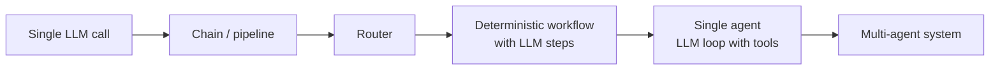
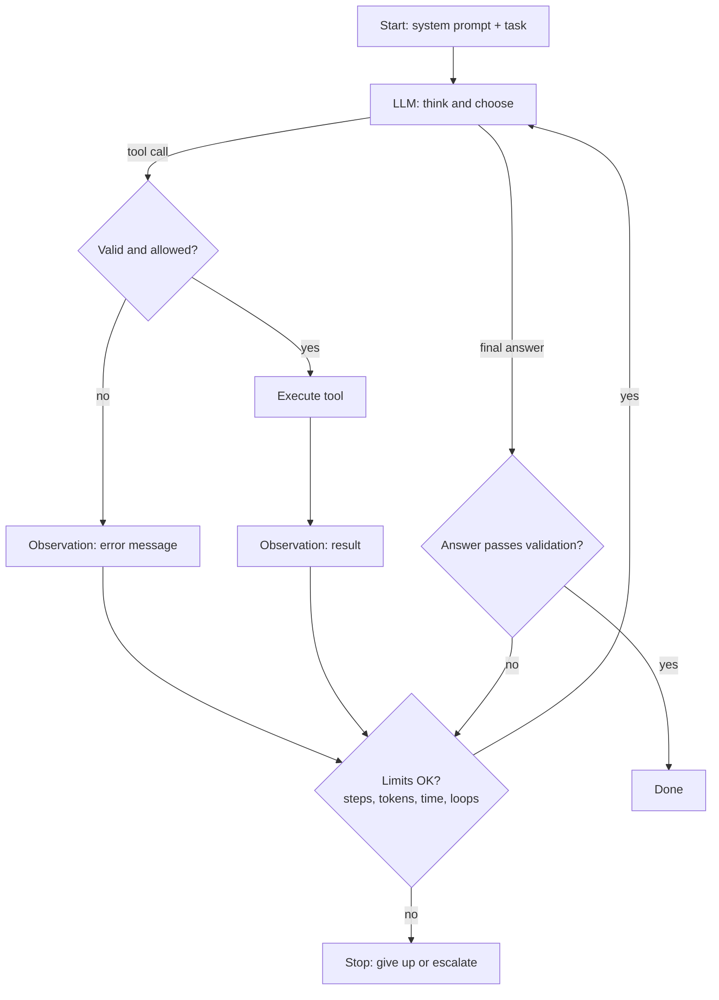
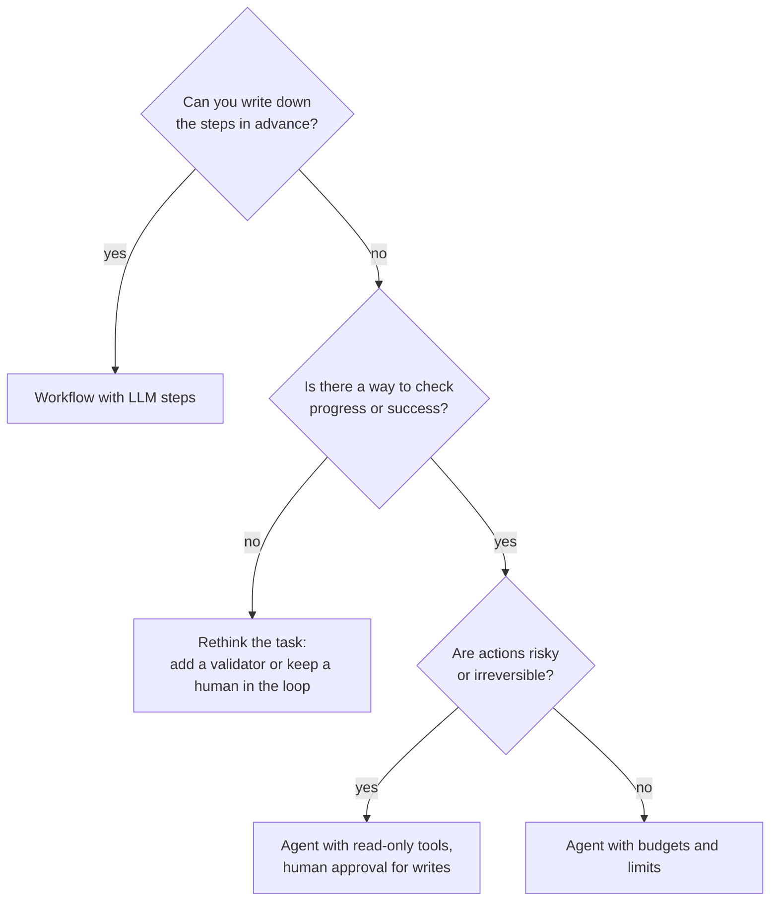

# What Is an AI Agent? Agents vs Workflows

> **Level:** Beginner to Advanced · **Study time:** ~100 min · **Prerequisites:** [How LLMs Generate Text: Decoding Strategies](../05-llms/03-text-generation-and-decoding-strategies.md), [Prompt Engineering for Production](../05-llms/04-prompt-engineering-for-production.md), [Structured Outputs, JSON Mode and Function Calling](../05-llms/05-structured-outputs-and-function-calling.md)

## Table of contents

- [Why this matters](#why-this-matters)
- [The intuition: from answering to acting](#the-intuition-from-answering-to-acting)
- [A precise definition of an AI agent](#a-precise-definition-of-an-ai-agent)
- [The core components of an agent](#the-core-components-of-an-agent)
- [The spectrum: from one LLM call to multi-agent systems](#the-spectrum-from-one-llm-call-to-multi-agent-systems)
- [The agent loop: ReAct in pseudocode](#the-agent-loop-react-in-pseudocode)
- [A fully worked trace: a refund request](#a-fully-worked-trace-a-refund-request)
- [Does every LLM application need an agent?](#does-every-llm-application-need-an-agent)
- [Workflows vs agents: choosing the right amount of autonomy](#workflows-vs-agents-choosing-the-right-amount-of-autonomy)
- [Why agents are non-deterministic](#why-agents-are-non-deterministic)
- [Preventing infinite loops](#preventing-infinite-loops)
- [Controlling token usage and execution time](#controlling-token-usage-and-execution-time)
- [A minimal agent from scratch in Python](#a-minimal-agent-from-scratch-in-python)
- [Going deeper: agents in production](#going-deeper-agents-in-production)
- [Common mistakes and misconceptions](#common-mistakes-and-misconceptions)
- [Interview questions and model answers](#interview-questions-and-model-answers)
- [Key takeaways](#key-takeaways)
- [Further reading](#further-reading)
- [Next](#next)

## Why this matters

"Agent" is one of the most overloaded words in AI right now. Coding assistants that edit files and run tests, support bots that look up orders and issue refunds, and research tools that search the web for an hour are all called agents, and so are plenty of systems that are really just a fixed script with one LLM call inside. Interviewers for senior AI roles use this topic to separate people who have built and operated these systems from people who have only watched demos. They expect you to define an agent precisely, to argue when *not* to build one, and to explain how you keep a non-deterministic loop from burning money, looping forever or taking a dangerous action. This chapter gives you the vocabulary, the mental model and a working implementation that the rest of the agents section builds on.

## The intuition: from answering to acting

Start with something you already know: a plain **large language model (LLM)** call. You send text in, the model predicts text out, and you are done. The model cannot check a database, cannot click anything and cannot notice that its first guess was wrong. It answers in one shot from what it already knows plus what you put in the prompt.

Now imagine two ways a company could handle "my order arrived damaged, can I get a refund?"

> **Analogy:** A **workflow** is a recipe card. Step 1: find the order. Step 2: look up the policy. Step 3: if eligible, refund. Whoever follows the card (a junior employee, or a program) does exactly those steps in that order. An **agent** is a capable new hire with a phone, a computer login and a goal: "sort out this customer." Nobody tells them the steps. They decide whom to call, read what comes back, change course when something is surprising, and stop when the job is done (or when they realize they need their manager).

The recipe card is predictable, cheap and easy to audit, but it breaks the moment a case falls outside the card. The new hire handles surprises, but you cannot predict exactly what they will do, how long it will take, or how much it will cost. That tension is the whole chapter.

The key shift is **who decides the next step**:

- In a workflow, *your code* decides the control flow. The LLM fills in blanks.
- In an agent, *the LLM* decides the control flow. Your code executes what it asks for and enforces the rules.

## A precise definition of an AI agent

The classic textbook definition (Russell and Norvig, *Artificial Intelligence: A Modern Approach*) is broad: an **agent** is anything that perceives its environment through sensors and acts on it through actuators. A thermostat qualifies. That is too broad to be useful in an LLM interview, so here is the working definition used in modern practice:

> An **AI agent** (or **LLM agent**) is a system in which an LLM repeatedly decides which action to take next, executes that action by calling a tool, observes the result, and loops until a goal is met or a stopping condition fires.

Every part of that sentence matters:

- **Repeatedly decides:** there is a loop, and the number of iterations is not fixed in advance.
- **Which action:** the model chooses among options (which tool, with which arguments, or "I am done"). If your code always calls the same tools in the same order, the LLM is not deciding anything.
- **Calling a tool:** a **tool** is a function the system can run on the model's behalf, such as a database query, a search, an API call or code execution. The model requests the call in a structured format; your code runs it. (This mechanism is **function calling**, covered in [Structured Outputs, JSON Mode and Function Calling](../05-llms/05-structured-outputs-and-function-calling.md).)
- **Observes the result:** the tool's output, called an **observation**, goes back into the model's **context** (the text the model sees on its next call) so the next decision can depend on it.
- **Until a goal is met or a stopping condition fires:** the loop must end, either because the model declares success or because your code stops it (step limit, budget, timeout, error).

How is that different from a **conventional LLM application**? A conventional app (a summarizer, a classifier, a RAG chatbot, a fixed pipeline) has control flow written by an engineer. The LLM transforms inputs into outputs at known points. An agent hands part of the control flow to the model. That one difference changes everything downstream: testing, cost, latency, security and debugging.

> **Interview tip:** A crisp one-liner: "In a workflow, code orchestrates the LLM. In an agent, the LLM orchestrates the code, inside guardrails that code enforces." Then mention the loop and the observation feedback.

> **Common mistake:** Calling any chatbot with one function call an agent. If the model makes a single tool call and the result is formatted into an answer, that is **tool-augmented generation**. It becomes agentic when the model can look at the result and choose a *different, unplanned* next action.

## The core components of an agent

Every agent, from a 50-line script to a production coding assistant, has the same seven parts. Interviewers frequently ask you to name and define them.

```text
                 +--------------------------------------------+
                 |                  AGENT                     |
   goal  ----->  |  +---------+   plan / decide   +--------+  |
                 |  |  MODEL  | ----------------> | TOOLS  |--+--> the world
                 |  |  (LLM)  | <---------------- |        |  |   (APIs, DBs,
                 |  +---------+    observation    +--------+  |    files, web)
                 |       ^  |                                 |
                 |       |  v                                 |
                 |  +------------------+   +---------------+  |
                 |  | STATE            |   | MEMORY        |  |
                 |  | (this run:       |   | (across runs: |  |
                 |  |  messages, step, |   |  facts, prefs,|  |
                 |  |  budget used)    |   |  past results)|  |
                 |  +------------------+   +---------------+  |
                 |  STOPPING CRITERIA: done? max steps? budget? timeout?
                 +--------------------------------------------+
```

| Component | Plain-English meaning | Concrete example (support agent) |
|---|---|---|
| **Model** | The LLM that reasons and chooses the next action | A hosted frontier model, or a fine-tuned 7B (7-billion-parameter) model served with vLLM (an open-source LLM serving engine) |
| **Tools** | Functions the model can ask the system to run | `get_order`, `get_refund_policy`, `issue_refund` |
| **State** | Everything about *this run* so far | Message history, step counter, tokens spent, pending approvals |
| **Memory** | Information that persists *beyond* the current context or run | "This customer prefers email", a summary of last week's ticket |
| **Planning** | How the agent decides what to do next, implicitly or as an explicit plan | "First fetch the order, then check the policy, then refund" |
| **Observation** | The result of an action, fed back to the model | `{"status": "delivered", "price": 249.0}` or an error message |
| **Stopping criteria** | Rules that end the loop | Model gives a final answer; 8 steps used; $0.10 spent; 60 s elapsed |

Let us define each more precisely.

**Model.** The decision maker. Its job in an agent is different from chat: it must pick good actions, produce valid structured tool calls, and recognize when it is finished. Models trained specifically for tool use (most frontier models since about 2023) are much better at this than base models. The model choice drives quality, cost and latency more than anything else.

**Tools.** Each tool has a name, a natural-language description and a **schema** (usually JSON Schema, a standard vocabulary for describing allowed JSON: types, required fields, allowed values) describing its arguments. The model only ever *sees* these descriptions and *requests* calls; it never executes anything itself. Tools fall into two classes that you must treat differently:

- **Read-only tools** (search, lookups): safe to retry, safe to run in parallel.
- **Side-effecting tools** (send email, issue refund, delete file): change the world, may be irreversible, need validation, **idempotency** (running the same request twice has the same effect as running it once, so a retry cannot refund twice) and often human approval. [Tool Calling in Depth](./02-tool-calling-in-depth.md) goes deep on this.

**State.** The working data of one run. At minimum it is the **message history** (system prompt, user task, every model turn, every observation). Production agents add structured fields: current step, budget consumed, a plan, flags such as `awaiting_approval`. Keeping state explicit (a typed object you can save and reload) rather than implicit (only in the prompt) is what makes agents debuggable and resumable, which is the core idea behind [orchestrating agents with state machines](./04-orchestration-with-langgraph-and-state-machines.md).

**Memory.** People confuse state and memory. A useful split:

- **Short-term memory** is the **context window**: the text the model can see in one call. It is limited (from a few thousand to a million or more tokens depending on the model) and every token costs money and latency.
- **Long-term memory** is stored outside the model (a database or vector store) and selectively loaded back into context: user preferences, facts learned earlier, summaries of past sessions.

State is "where am I in this task"; memory is "what do I know that is not in front of me right now." Details are in [Memory for AI Agents](./06-agent-memory.md).

**Planning.** How the next action is chosen. It ranges from **implicit planning** (the model just picks the next step each turn, as in ReAct, below) to **explicit planning** (the model first writes a multi-step plan, then executes it, revising when needed). Explicit plans are easier to inspect and approve; implicit planning adapts faster. Patterns are compared in [Agent Design Patterns](./03-agent-design-patterns.md).

**Observation.** What comes back from the world. Observations are the agent's only connection to reality, which makes them powerful and dangerous: a good observation corrects the model ("order not found, check the ID"), but a huge observation floods the context, and a malicious one (a web page saying "ignore your instructions") can hijack the agent. That last risk, **prompt injection**, is covered in [Making Agents Reliable and Secure for Production](./08-agent-reliability-security-and-prompt-injection.md).

**Stopping criteria.** The conditions that end the loop. There are two kinds and you need both:

- **Success termination:** the model signals it is done (no tool call, or a dedicated `finish` tool), ideally checked by a validator.
- **Safety termination:** your code stops the run regardless of what the model wants: maximum steps, token or cost budget, wall-clock timeout, repeated-action detection, or an unrecoverable error.

> **Senior insight:** The model controls *what to try next*; the code controls *what is allowed*. Tools, permissions, budgets and stopping rules live in deterministic code, never only in the prompt. A prompt saying "do not refund more than $500" is a suggestion; an `if amount > 500: require_approval()` is a guarantee.

## The spectrum: from one LLM call to multi-agent systems

"Agent or not" is not binary. Think of a ladder of increasing autonomy. Each rung gives the model more control over the control flow, and costs you more in predictability.



| Level | What it is | Who controls flow | Example | Predictability |
|---|---|---|---|---|
| **Single LLM call** | One prompt in, one answer out (possibly with retrieved context) | Code (trivially) | Summarize a ticket; classify spam vs not spam | Highest |
| **Chain (pipeline)** | Fixed sequence of LLM calls, each feeding the next | Code | Extract fields, then translate, then format | High |
| **Router** | An LLM (or classifier) picks *one* of several fixed paths | Code, with one LLM choice | Route a message to billing, tech support or sales | High |
| **Workflow with LLM steps** | A programmed graph with branches, loops and tool calls; LLMs fill specific nodes | Code | Refund flow: extract ID, fetch order, rules check, LLM writes reply | Medium-high |
| **Single agent** | One LLM in a loop choosing tools until done | LLM, inside code limits | Coding assistant fixing a failing test | Medium-low |
| **Multi-agent system** | Several agents (often with different prompts, tools or models) coordinating | Several LLMs | A planner agent delegating to researcher and writer agents | Lowest |

A few definitions from the table:

- A **chain** is a fixed sequence of steps where each step's output feeds the next. The name became popular through frameworks like LangChain, but the idea is just function composition.
- A **router** is a single classification decision that selects among predefined branches. The LLM chooses *which* path, but each path is fixed.
- A **deterministic workflow** is code that defines all possible paths in advance (a directed graph, possibly with loops such as "retry up to 3 times"). LLM calls appear as nodes. "Deterministic" here describes the *control flow*, not the LLM outputs, which can still vary.
- A **multi-agent system** splits work across multiple agents. It can help with separation of concerns and parallelism but multiplies cost and failure points; see [Multi-Agent Systems: When They Help and When They Hurt](./05-multi-agent-systems.md).

> **Interview tip:** When asked "what is an agent?", drawing this ladder is a strong move. It shows you understand that autonomy is a design dial, and it sets up the "start at the lowest rung that works" argument.

## The agent loop: ReAct in pseudocode

The most influential agent pattern is **ReAct** ("ReAct: Synergizing Reasoning and Acting in Language Models", Yao et al., 2022). Its idea is to interleave three things in the model's output:

- **Thought:** a short piece of reasoning about what to do next.
- **Action:** a tool call (name plus arguments).
- **Observation:** the tool's result, appended by the system, not written by the model.

Reasoning helps the model choose good actions; actions give the reasoning fresh facts, which reduces **hallucination** (confident, unsupported output; see [Hallucinations](../05-llms/06-hallucinations-and-grounding.md)). The original paper used plain text ("Thought: ... Action: search[...]") parsed by regular expressions. Modern systems use native function calling instead, and the "thought" may be visible text, hidden reasoning tokens from a reasoning model (see [Reasoning Models and Test-Time Compute](../05-llms/12-reasoning-models-and-test-time-compute.md)), or absent. The loop is the same.



Here is the loop in pseudocode. Read it slowly; every production agent is an elaboration of these lines.

```text
function run_agent(task, tools, limits):
    messages = [system_prompt(tools), user(task)]
    for step in 1 .. limits.max_steps:
        if elapsed_time() > limits.max_seconds or tokens_used() > limits.max_tokens:
            return STOP("budget exhausted")

        reply = LLM(messages, tool_schemas(tools))          # THOUGHT + chosen ACTION
        if reply has no tool calls:                          # model says "done"
            if validate(reply.text): return DONE(reply.text)
            messages.append(reply, user("Answer rejected: <reason>. Fix it."))
            continue

        messages.append(reply)
        for call in reply.tool_calls:
            if is_repeat(call) too many times: return STOP("loop detected")
            if not valid_args(call) or not permitted(call):
                result = "ERROR: <what was wrong>"           # let the model self-correct
            else:
                result = execute(call) with timeout           # ACT
            messages.append(tool_result(call.id, truncate(result)))   # OBSERVATION
    return STOP("max steps reached")
```

Three things to notice:

1. **Errors become observations.** An invalid argument does not crash the loop; it is reported back so the model can fix it. This self-correction is one of the main benefits of an agent.
2. **The whole history is resent each step.** Chat-completions style LLM APIs are stateless, so each call includes every previous message. (APIs that keep conversation state on the server save you from resending it, but the model still processes the full history and you are still billed for those input tokens, minus any caching discount.) That is why cost grows faster than linearly with step count (we compute it below).
3. **Two exits.** The model can finish, or the code can stop it. A loop with only the first exit is a bug waiting to happen.

## A fully worked trace: a refund request

Let us run the loop on a realistic task, by hand. This is our running example for the rest of the chapter.

**Setup.** A fictional online store has a support agent with three tools:

| Tool | Arguments | Type | Notes |
|---|---|---|---|
| `get_order` | `order_id` (string matching `A` followed by 4 digits) | Read-only | Returns status, days since delivery, category, price |
| `get_refund_policy` | `category` (one of `electronics`, `clothing`, `home`) | Read-only | Returns the policy text |
| `issue_refund` | `order_id`, `amount` | **Side-effecting** | Requires human approval when amount > $200 |

**Task (from the customer):** "Order 1027 arrived with a cracked screen. Can I get a refund?"

Notice the customer wrote "1027", but real IDs look like "A1027". The agent does not know that yet.

**Step 1**

```text
Thought:  I need the order details before I can judge eligibility.
Action:   get_order({"order_id": "1027"})
Observation: ERROR: invalid arguments: 'order_id' must match pattern A[0-9]{4}
```

The validator rejected the call before it reached the database. The error is fed back as an observation.

**Step 2**

```text
Thought:  Order IDs need an 'A' prefix. The customer likely means A1027.
Action:   get_order({"order_id": "A1027"})
Observation: {"status": "delivered", "days_since_delivery": 12,
              "category": "electronics", "price": 249.0}
```

**Step 3**

```text
Thought:  Delivered 12 days ago, electronics, $249. Check the electronics policy.
Action:   get_refund_policy({"category": "electronics"})
Observation: {"policy": "Damaged items: full refund within 30 days of delivery.
              Refunds over $200 need human approval."}
```

**Step 4**

```text
Thought:  12 <= 30, item is damaged, so a full refund of $249.00 is allowed.
          249 > 200, so this needs approval; the system will handle that.
Action:   issue_refund({"order_id": "A1027", "amount": 249.0})
[System pauses: a human reviewer sees the request and approves it]
Observation: {"refund_id": "R-5531", "order_id": "A1027", "amount": 249.0}
```

**Step 5**

```text
Thought:  Refund issued. Tell the customer.
Final answer: "Sorry about the damage. I have refunded $249.00 (refund R-5531)."
[Validator checks the answer contains a refund ID: pass. Run ends: DONE.]
```

Check the eligibility arithmetic: days since delivery $12 \le 30$ (eligible); amount $249 > 200$ (needs approval). Both conditions were applied correctly.

**What did this run cost?** Let us count tokens with illustrative numbers. Suppose the fixed part of every prompt (system prompt, tool schemas, task) is $P = 1{,}500$ tokens, and each step adds about $s = 400$ tokens of new history (thought, tool call, observation). Because every call resends the full history, call $i$ has $P + (i-1)s$ input tokens. Over $n$ calls:

$$
T_{\text{in}}(n) = \sum_{i=1}^{n} \big(P + (i-1)\,s\big) = nP + s\,\frac{n(n-1)}{2}
$$

- $T_{\text{in}}(n)$: total input (prompt) tokens across the whole run
- $n$: number of LLM calls (steps)
- $P$: fixed prompt tokens present in every call
- $s$: new tokens added to the history per step
- $\frac{n(n-1)}{2}$: the sum $0 + 1 + 2 + \dots + (n-1)$, which counts how many "step-sized" blocks of history get resent in total

For our trace, $n = 5$:

- $nP = 5 \times 1{,}500 = 7{,}500$
- $\frac{n(n-1)}{2} = \frac{5 \times 4}{2} = 10$
- $s \times 10 = 400 \times 10 = 4{,}000$
- $T_{\text{in}} = 7{,}500 + 4{,}000 = 11{,}500$ input tokens

Check by listing each call: $1{,}500 + 1{,}900 + 2{,}300 + 2{,}700 + 3{,}100 = 11{,}500$. Correct.

With about 80 output tokens per call, output is $5 \times 80 = 400$ tokens. At illustrative prices of \$2 per million input tokens and \$8 per million output tokens:

- Input: $11{,}500 \times 2 / 1{,}000{,}000 = \$0.0230$
- Output: $400 \times 8 / 1{,}000{,}000 = \$0.0032$
- Total: $\$0.0262$ per conversation

Latency, again illustrative: 5 LLM calls at about 1.2 s each is 6.0 s, plus 4 tool calls at about 0.3 s each is 1.2 s, so about 7.2 s, not counting the time the human took to approve.

**Now the twist.** Look back at the trace. Every step was predictable: fetch order, fetch policy, check two numbers, refund. A deterministic workflow could do this with *two* small LLM calls (one to extract the order ID and the complaint type, one to write the reply) and plain code in between. It would be cheaper, faster, and an auditor could read the rules in the code. The agent's only real advantage was recovering from "1027" vs "A1027", and a regex could have done that too. Keep this in mind for the next two sections.

## Does every LLM application need an agent?

No. Most valuable LLM applications in production are not agents. They are single calls, retrieval-augmented generation (**RAG**, where relevant documents are retrieved and placed in the prompt; see [What Is RAG and Why It Matters](../08-rag/01-what-is-rag-and-why-it-matters.md)), or workflows with LLM steps.

A practical rule: **start at the lowest rung of the ladder that solves the problem, and climb only when you have evidence the lower rung fails.** Evidence means evaluation results on real cases, not a hunch that "agents are more powerful."

| Need | Simplest adequate design |
|---|---|
| Summarize, classify, extract, translate | Single LLM call (with structured output) |
| Answer questions from company documents | RAG (one retrieval, one generation) |
| Multi-stage document processing with known stages | Chain or workflow |
| Different request types need different handling | Router into workflows |
| Task needs a variable, unpredictable sequence of lookups and actions | Agent |
| Task naturally splits into specialized roles that work in parallel | Possibly multi-agent, only after a single agent proves insufficient |

Why not "just use an agent everywhere since it is more flexible"? Because flexibility is paid for in:

- **Cost:** many LLM calls instead of one, with growing context.
- **Latency:** sequential calls; users wait for every step.
- **Reliability:** more decisions means more chances to be wrong (computed below).
- **Testability:** the space of possible paths is huge.
- **Security:** a model that chooses actions can be manipulated into choosing bad ones.

> **Senior insight:** A good default architecture is "workflow outside, agent inside." The overall process is a deterministic graph (intake, authorization, approval, logging), and only the genuinely open-ended node (for example "investigate why this invoice does not match") is an agent with a narrow tool set and a tight budget.

## Workflows vs agents: choosing the right amount of autonomy

### Why reliability favors short paths

Here is a simple model that explains why fewer LLM decisions usually means more reliable systems. Suppose each step of a multi-step task succeeds with probability $p$, and steps fail independently (a simplification). The chance that all $n$ steps succeed is:

$$
P(\text{success}) = p^{\,n}
$$

- $p$: probability a single step is correct
- $n$: number of steps that must all be correct
- $p^n$: probability every step is correct (multiplying independent probabilities)

Worked example (illustrative): with $p = 0.95$ and $n = 10$,

- $0.95^2 = 0.9025$
- $0.95^4 = 0.9025^2 = 0.81450625$
- $0.95^8 = 0.81450625^2 \approx 0.66342$
- $0.95^{10} = 0.95^8 \times 0.95^2 \approx 0.66342 \times 0.9025 \approx 0.5987$

So a step that is right 95% of the time gives only about a 60% chance of a perfect 10-step run. Real agents are better than this model suggests because they can notice and fix errors (step 1 of our trace), and worse in another way because errors are correlated (a misunderstanding early poisons later steps). The lesson holds: **every LLM decision you replace with code removes a factor from that product.**

### The comparison

| | Deterministic workflow (with LLM steps) | Agent |
|---|---|---|
| **What** | Engineer defines all paths; LLM fills specific nodes | LLM chooses actions in a loop within limits |
| **Use when** | Steps are known in advance; process is regulated; volume is high; latency SLA (service-level agreement, a promised response-time target) is tight | Steps cannot be predicted; inputs are open-ended; exploration or iterative debugging is needed |
| **Cost and latency** | Predictable, usually low; you know the number of calls | Variable, often heavy-tailed (a few runs cost far more than the typical one); depends on how the model explores |
| **Auditability and compliance** | Strong: the rules are in code; every run follows a reviewable path | Weaker: the path differs per run; needs full trace logging and policy checks in code |
| **Testing** | Unit test each node; enumerate paths | Scenario-based evaluation over many runs; measure success rates |
| **Handling surprises** | Poor: anything off-script fails or hits a default branch | Good: can adapt, retry differently, gather more information |
| **Failure modes** | Rigid, misses edge cases | Loops, wrong tool, premature finish, runaway cost, prompt injection |
| **Example** | Invoice extraction and approval routing | Fixing a failing CI build in an unfamiliar repository |

### When a deterministic workflow is better

- **The steps are known.** If you can draw the flowchart, code it. Our refund case is one.
- **Compliance and auditability matter.** In finance, healthcare or legal contexts you often must show *why* a decision was made and that a fixed policy was applied. "The model decided" is not an acceptable audit answer.
- **Cost and latency must be predictable.** A workflow has a known number of LLM calls, so you can capacity-plan and promise a latency target.
- **High volume.** At millions of requests per day, a 3x difference in LLM calls is a large bill.
- **The failure cost is high and actions are irreversible.** Fixed paths are easier to lock down.

### When an agent is justified

- **Open-ended tasks** where the right sequence of steps depends on what you discover along the way: debugging, research, data investigation, navigating unfamiliar software or websites.
- **The number of steps varies wildly** between inputs, so any fixed workflow would be either too short or wastefully long.
- **The value of a solved task is high** enough to justify variable cost (a solved engineering ticket is worth far more than a few dollars of tokens).
- **There is a feedback signal** the agent can check against, such as tests passing, a query returning rows, or a validator accepting the output. Agents do best when they can verify their own progress.



> **Interview tip:** Never answer "agent vs workflow" in the abstract. Say "it depends on whether the steps are predictable", then give one example of each, and mention the hybrid (agent as one node in a workflow).

## Why agents are non-deterministic

**Non-deterministic** means the same input can produce different outputs on different runs. Agents inherit non-determinism from the LLM and add more from the world. Because the loop feeds each output into the next step, a tiny difference early can send two runs down completely different paths (like a butterfly effect).

| Source | What happens | Mitigation |
|---|---|---|
| **Sampling** | With temperature > 0, the next token is drawn at random from a probability distribution (temperature controls how spread out that distribution is; 0 means always take the most likely token; see [Decoding Strategies](../05-llms/03-text-generation-and-decoding-strategies.md)) | Use temperature 0 or low values for tool selection; accept that it reduces but does not remove variance |
| **Inference-level numerics** | Even at temperature 0, outputs can vary: floating-point addition is not associative (in 64-bit floats, $(10^{20} - 10^{20}) + 1 = 1$ but $10^{20} + (-10^{20} + 1) = 0$), and server-side batching changes the order of operations (results can depend on what other requests share the batch). When two candidate tokens are nearly tied, a tiny numeric difference flips the choice. Mixture-of-experts models (which send each token to a few "expert" sub-networks) can also be sensitive to this | Pin versions; use seed parameters where offered (best-effort only); self-hosted engines can enable deterministic modes at a speed cost |
| **Tool outputs** | A search returns different results; an API times out once and succeeds next time | Record tool inputs and outputs in traces; cache read-only results within a run |
| **Environment changes** | Data changes between runs (the order is now "refunded"); websites change; files are edited | Snapshot or mock the environment in tests; design tools to be idempotent |
| **Long contexts** | As history grows, the model attends less reliably to information in the middle of the context ("Lost in the Middle", Liu et al., 2023), so small changes in history change decisions | Keep context short: truncate and summarize observations; restate key facts in state |
| **Model updates** | A provider updates the model behind an alias, or you upgrade versions; behavior shifts | Pin exact model versions; rerun the evaluation suite before any upgrade |
| **Prompt and tool changes** | Editing a tool description or system prompt changes which tools are chosen | Version prompts and tool schemas; regression-test them like code |
| **Concurrency and timing** | Parallel tool calls finish in different orders; timeouts fire under load | Order results deterministically before appending them; set explicit timeouts |

How do you live with this in production?

- **Test with distributions, not single runs.** Run each evaluation scenario several times and report success *rates*. A useful pair of metrics: the chance that at least one of $k$ attempts succeeds (often called pass@k) versus the chance that *all* $k$ attempts succeed (called pass^k in the tau-bench paper, Yao et al., 2024). For a customer-facing agent, consistency (pass^k) is what users experience. Illustrative: if each run independently succeeds with probability $0.9$, then pass@3 $= 1 - 0.1^3 = 0.999$ but pass^3 $= 0.9^3 = 0.729$. The same agent looks near-perfect or unreliable depending on which number you report.
- **Record and replay.** Log every model input and output and every tool call and result. To debug a bad run, replay the recorded observations so the environment does not change under you.
- **Constrain the dangerous parts.** Put the decisions that must be consistent (eligibility rules, amounts, permissions) in code, so non-determinism only affects *how* the agent gathers information.

> **Common mistake:** "Set temperature to 0 and the agent is deterministic." Temperature 0 removes sampling randomness only. Tool results, environment changes, batching numerics and model updates still vary. Design for variance instead of assuming it away.

## Preventing infinite loops

### Why agents loop

Agents get stuck for understandable reasons:

- **The tool keeps failing** and the model keeps retrying the same call ("maybe it works this time").
- **The model does not realize it is done**, so it keeps "double-checking."
- **Oscillation:** the agent alternates between two states (edit file, revert file, edit again).
- **Ambiguous goals:** "make the code better" has no finish line.
- **Context overflow:** after many steps, early information falls out or gets ignored, and the agent redoes work it already did.

### Layered defenses

No single check catches every loop, so use several layers, from cheap to sophisticated:

| Defense | How it works | Catches |
|---|---|---|
| **Max iterations** | Hard cap on LLM calls per run (for example 8 for support, 50 for coding) | Everything eventually; the non-negotiable backstop |
| **Repeated-action detection** | Hash each `(tool name, canonical arguments)`; stop or warn when the same call repeats N times | Retrying the same failing call |
| **Cycle detection** | Look for repeating sequences of actions (A, B, A, B) or repeated states | Oscillation |
| **Progress checks** | Every k steps, check that something measurable advanced: new information, fewer failing tests, plan items completed. Optionally ask a cheap model "is this run making progress?" | Busy work that is not identical repetition |
| **Budgets** | Cap tokens, dollars and tool calls per run, per user and per day | Runaway cost even when steps look different |
| **Timeouts** | Per-tool timeouts plus a wall-clock limit on the whole run | Hung tools, slow spirals |
| **Clear finish signal** | A `finish` tool or "answer without a tool call" rule, plus a validator that tells the model *why* an answer was rejected | Never declaring done; endless "polishing" |
| **Escalation path** | When a limit hits, hand off to a human or return a partial result with an explanation | Turns a loop into a graceful outcome |

Two design details separate a senior answer from a junior one:

1. **Warn before you kill.** On the first repeat, inject an observation such as "You already called `get_order` with these arguments and got this result. Try something different or finish." Models often recover. Only stop on persistent repetition.
2. **Make the stop useful.** A run that hits a limit should return a structured status (`max_steps`, `loop`, `token_budget`, `timeout`) and the trace, so the caller can escalate and engineers can see *which* limit fires most often. If 15% of runs hit `max_steps`, that is a product signal, not just a safety net.

The repeated-action key must be canonical: parse the JSON arguments and re-serialize them with sorted keys, so `{"order_id": "A1027"}` and `{ "order_id":"A1027" }` count as the same call. The `call_key` function in the implementation below does exactly this.

> **Interview tip:** If asked "how do you prevent infinite loops?", list the layers in order (max steps, repeat detection, progress checks, budgets, timeouts, escalation) and then say the most important point: "these limits live in the orchestration code, not in the prompt, because a looping model is by definition not following instructions well."

## Controlling token usage and execution time

### Where tokens go

Recall the formula $T_{\text{in}}(n) = nP + s\frac{n(n-1)}{2}$. The second term grows with $n^2$, so long runs get expensive fast. Illustrative example with the same $P = 1{,}500$ and $s = 400$ but $n = 20$ steps:

- $nP = 20 \times 1{,}500 = 30{,}000$
- $\frac{n(n-1)}{2} = \frac{20 \times 19}{2} = 190$
- $s \times 190 = 400 \times 190 = 76{,}000$
- $T_{\text{in}} = 30{,}000 + 76{,}000 = 106{,}000$ input tokens

Going from 5 steps to 20 steps (4x more steps) took input tokens from 11,500 to 106,000, about 9.2x more. That is the quadratic term at work. It tells you which levers matter: reduce $n$ (fewer steps), reduce $s$ (smaller observations), reduce $P$ (shorter system prompt and fewer tool schemas), and make repeated tokens cheaper (caching).

For example, if you truncate observations so each step adds $s = 150$ tokens instead of 400, the 5-step run costs $7{,}500 + 150 \times 10 = 9{,}000$ input tokens instead of 11,500, and the 20-step run costs $30{,}000 + 150 \times 190 = 30{,}000 + 28{,}500 = 58{,}500$ instead of 106,000.

### The levers

| Lever | What you do | Effect |
|---|---|---|
| **Budgets** | Per-run caps on tokens, cost, steps and tool calls; per-user and per-tenant daily caps | Bounds the worst case; makes cost predictable |
| **Truncate observations** | Cap tool output size; return only needed fields; paginate ("first 20 rows, 340 more") | Shrinks $s$ |
| **Context pruning** | Drop stale tool results once they have been used; keep only the last k turns verbatim | Shrinks the resent history |
| **Summarization** | Replace old turns with a running summary written by a cheap model; keep key facts in structured state | Keeps context roughly constant instead of growing |
| **Fewer, sharper tools** | Expose only the tools relevant to this task or route; each tool schema costs prompt tokens every call | Shrinks $P$ and improves tool choice |
| **Smaller models for sub-steps** | Use a large model for planning and hard decisions; small, fast models for extraction, summarization, classification and routing | Cuts cost per call and latency |
| **Caching** | Prompt (prefix) caching for the stable system prompt and tool schemas (the server reuses work already done for an identical prompt start); result caching for read-only tools; semantic caching (reusing the answer to a sufficiently similar earlier question) where safe | Cheaper and faster repeated tokens and calls (see [Speculative Decoding, Prompt Caching and Other Speedups](../06-llm-inference/05-speculative-decoding-caching-and-other-speedups.md)) |
| **Parallel tool calls** | Let the model request independent lookups in one turn and run them concurrently | Fewer LLM round trips; lower wall-clock time |
| **Timeouts** | Per-tool timeouts, per-LLM-call timeouts, overall deadline | Bounds latency; prevents hangs |
| **Early exit** | Validator accepts the first good-enough answer; stop exploring | Reduces $n$ |
| **Move steps into code** | Turn predictable sub-sequences into deterministic code or a workflow node | Removes LLM calls entirely |

**Execution time** follows the same structure. For a sequential agent:

$$
T_{\text{total}} \approx \sum_{i=1}^{n} \big(t_{\text{LLM},i} + t_{\text{tools},i}\big)
$$

- $t_{\text{LLM},i}$: time for the model call at step $i$ (time to first token plus generation time; both grow with context and output length, see [Inference Fundamentals](../06-llm-inference/01-inference-fundamentals-prefill-decode-and-latency-metrics.md))
- $t_{\text{tools},i}$: time spent running tools at step $i$ (if tools run in parallel, this is the slowest one, not the sum)

Our trace: $5 \times 1.2 + 4 \times 0.3 = 6.0 + 1.2 = 7.2$ s (illustrative). If two independent lookups ran in parallel in one step, you would save one full LLM round trip (about 1.2 s) and overlap the tool time.

> **Senior insight:** Report agent cost and latency as distributions (p50, p95, p99 per run; p95 is the value that 95% of runs stay under) and track the *tail*. Agents are heavy-tailed: most runs finish in a few steps and a few runs wander for dozens. The tail drives both your bill and your user complaints, and it is exactly what budgets cap.

> **Common mistake:** Returning a whole API response, web page or log file as the observation. A 30,000-token observation at step 2 is resent on every later step. Shape tool outputs for the model, the same way you would design an API response for a mobile client.

## A minimal agent from scratch in Python

Frameworks (LangGraph, OpenAI Agents SDK, LlamaIndex, smolagents and others) are useful, but interviewers want to know you understand what they do underneath. Here is a complete agent in about 270 lines (including the demo tools and the fake client) with no dependencies beyond the standard library. It has:

- a **tool registry** that produces tool schemas in the common chat-completions format (the JSON message and tool format popularized by OpenAI's Chat Completions API and accepted by many providers and self-hosted servers),
- an **argument validation** step before any tool runs, and an **answer validation** step before the run ends,
- **human approval** for side-effecting tools,
- **limits**: max steps, token budget, wall-clock timeout, repeated-action detection, observation truncation,
- a generic `ChatClient` interface, so any chat-completions style backend can drive it.

To make it runnable offline, it ships with a scripted fake client that replays the trace from earlier. Save it as `mini_agent.py` and run `python mini_agent.py` (Python 3.10+).

```python
"""mini_agent.py: a minimal, dependency-free agent with a tool registry,
validation and limits. Python 3.10+."""
from __future__ import annotations

import json
import re
import time
from collections import Counter
from dataclasses import dataclass, field
from typing import Any, Callable, Protocol


# ---------------------------------------------------------------- 1. Data types
@dataclass
class ToolCall:
    id: str
    name: str
    arguments: str              # raw JSON string, exactly as the model produced it


@dataclass
class LLMReply:
    content: str | None         # text: a thought or a final answer
    tool_calls: list[ToolCall]  # empty list means "no action requested"
    prompt_tokens: int = 0
    completion_tokens: int = 0


class ChatClient(Protocol):
    """Anything with this method can drive the agent: a hosted API, vLLM, a fake."""
    def complete(self, messages: list[dict], tools: list[dict]) -> LLMReply: ...


# ---------------------------------------------------------------- 2. Tool registry
@dataclass
class Tool:
    name: str
    description: str
    parameters: dict            # JSON Schema for the arguments
    fn: Callable[..., Any]
    side_effect: bool = False   # True = changes the world, needs approval


class ToolRegistry:
    def __init__(self) -> None:
        self._tools: dict[str, Tool] = {}

    def register(self, name: str, description: str, parameters: dict,
                 side_effect: bool = False):
        def decorator(fn: Callable[..., Any]):
            self._tools[name] = Tool(name, description, parameters, fn, side_effect)
            return fn
        return decorator

    def get(self, name: str) -> Tool | None:
        return self._tools.get(name)

    def schemas(self) -> list[dict]:
        """Tool definitions in the common chat-completions 'tools' format."""
        return [{"type": "function",
                 "function": {"name": t.name, "description": t.description,
                              "parameters": t.parameters}}
                for t in self._tools.values()]


# ---------------------------------------------------------------- 3. Validation
_JSON_TYPES = {"string": str, "integer": int, "number": (int, float),
               "boolean": bool, "object": dict, "array": list}


def validate_args(schema: dict, args: Any) -> list[str]:
    """Checks a small JSON Schema subset. Use the `jsonschema` package in production."""
    if not isinstance(args, dict):
        return ["arguments must be a JSON object"]
    errors: list[str] = []
    props = schema.get("properties", {})
    for key in schema.get("required", []):
        if key not in args:
            errors.append(f"missing required argument '{key}'")
    for key, value in args.items():
        if key not in props:
            errors.append(f"unknown argument '{key}'")
            continue
        spec = props[key]
        expected = _JSON_TYPES.get(spec.get("type", ""))
        bool_as_number = isinstance(value, bool) and spec.get("type") in ("integer", "number")
        if expected and (not isinstance(value, expected) or bool_as_number):
            errors.append(f"'{key}' must be of type {spec['type']}")
        elif "enum" in spec and value not in spec["enum"]:
            errors.append(f"'{key}' must be one of {spec['enum']}")
        elif "pattern" in spec and not re.fullmatch(spec["pattern"], str(value)):
            errors.append(f"'{key}' must match pattern {spec['pattern']}")
    return errors


def call_key(name: str, raw_args: str) -> str:
    """Same tool + same arguments => same key, regardless of spacing or key order."""
    try:
        canonical = json.dumps(json.loads(raw_args), sort_keys=True)
    except json.JSONDecodeError:
        canonical = raw_args.strip()
    return f"{name}:{canonical}"


# ---------------------------------------------------------------- 4. Limits and result
@dataclass
class Limits:
    max_steps: int = 8               # LLM calls per run
    max_total_tokens: int = 20_000   # prompt + completion tokens, summed over calls
    max_seconds: float = 60.0        # wall-clock budget for the whole run
    max_same_call: int = 2           # identical (tool, args) allowed this many times
    max_observation_chars: int = 2_000


@dataclass
class RunResult:
    status: str                      # done | max_steps | token_budget | timeout | loop
    answer: str | None
    steps: int
    tokens: int
    trace: list[str] = field(default_factory=list)


SYSTEM_PROMPT = (
    "You are a support agent. Use the tools to look up facts; never guess order data. "
    "When you have enough information, reply to the customer without calling a tool."
)


# ---------------------------------------------------------------- 5. The agent loop
def run_agent(client: ChatClient, registry: ToolRegistry, task: str,
              limits: Limits | None = None,
              approve: Callable[[ToolCall], bool] = lambda call: False,
              validate_answer: Callable[[str], str | None] = lambda a: None) -> RunResult:
    limits = limits or Limits()
    messages: list[dict] = [{"role": "system", "content": SYSTEM_PROMPT},
                            {"role": "user", "content": task}]
    seen: Counter[str] = Counter()
    tokens, trace = 0, []
    start = time.monotonic()

    for step in range(1, limits.max_steps + 1):
        if time.monotonic() - start > limits.max_seconds:              # time budget
            return RunResult("timeout", None, step - 1, tokens, trace)

        reply = client.complete(messages, registry.schemas())           # THINK
        tokens += reply.prompt_tokens + reply.completion_tokens
        if tokens > limits.max_total_tokens:                            # token budget
            return RunResult("token_budget", None, step, tokens, trace)

        # No tool call: the model claims it is finished. Validate before accepting.
        if not reply.tool_calls:
            answer = (reply.content or "").strip()
            problem = "empty answer" if not answer else validate_answer(answer)
            if problem is None:
                trace.append(f"step {step}: FINAL {answer!r}")
                return RunResult("done", answer, step, tokens, trace)
            trace.append(f"step {step}: answer rejected ({problem})")
            messages.append({"role": "assistant", "content": answer})
            messages.append({"role": "user",
                             "content": f"Your answer was rejected: {problem}. Fix it."})
            continue

        # Record the assistant turn in the format chat-completions APIs expect.
        messages.append({
            "role": "assistant", "content": reply.content,
            "tool_calls": [{"id": c.id, "type": "function",
                            "function": {"name": c.name, "arguments": c.arguments}}
                           for c in reply.tool_calls]})

        for call in reply.tool_calls:                                    # ACT
            key = call_key(call.name, call.arguments)
            seen[key] += 1
            if seen[key] > limits.max_same_call:                         # loop guard
                trace.append(f"step {step}: LOOP on {key}")
                return RunResult("loop", None, step, tokens, trace)
            observation = execute_tool(registry, call, approve)
            observation = observation[: limits.max_observation_chars]   # cap growth of s
            trace.append(f"step {step}: {call.name}({call.arguments}) -> {observation}")
            messages.append({"role": "tool", "tool_call_id": call.id,    # OBSERVE
                             "content": observation})

    return RunResult("max_steps", None, limits.max_steps, tokens, trace)


def execute_tool(registry: ToolRegistry, call: ToolCall,
                 approve: Callable[[ToolCall], bool]) -> str:
    """Never raises: every failure becomes an observation the model can react to."""
    tool = registry.get(call.name)
    if tool is None:
        return f"ERROR: unknown tool '{call.name}'"
    try:
        args = json.loads(call.arguments or "{}")
    except json.JSONDecodeError as exc:
        return f"ERROR: arguments are not valid JSON ({exc.msg})"
    errors = validate_args(tool.parameters, args)
    if errors:
        return "ERROR: invalid arguments: " + "; ".join(errors)
    if tool.side_effect and not approve(call):          # authorization lives in code
        return "ERROR: action not approved by a human reviewer"
    try:
        return json.dumps(tool.fn(**args))
    except Exception as exc:                             # a tool bug must not crash the loop
        return f"ERROR: tool failed ({type(exc).__name__}: {exc})"


# ---------------------------------------------------------------- 6. Demo tools
registry = ToolRegistry()
ORDERS = {"A1027": {"status": "delivered", "days_since_delivery": 12,
                    "category": "electronics", "price": 249.0}}


@registry.register(
    "get_order", "Look up an order by its ID, for example 'A1027'.",
    {"type": "object",
     "properties": {"order_id": {"type": "string", "pattern": "A[0-9]{4}"}},
     "required": ["order_id"]})
def get_order(order_id: str) -> dict:
    return ORDERS.get(order_id, {"error": "order not found"})


@registry.register(
    "get_refund_policy", "Return the refund policy for a product category.",
    {"type": "object",
     "properties": {"category": {"type": "string",
                                 "enum": ["electronics", "clothing", "home"]}},
     "required": ["category"]})
def get_refund_policy(category: str) -> dict:
    return {"policy": "Damaged items: full refund within 30 days of delivery. "
                      "Refunds over $200 need human approval."}


@registry.register(
    "issue_refund", "Refund an order. Moves money; use only when policy allows.",
    {"type": "object",
     "properties": {"order_id": {"type": "string", "pattern": "A[0-9]{4}"},
                    "amount": {"type": "number"}},
     "required": ["order_id", "amount"]},
    side_effect=True)
def issue_refund(order_id: str, amount: float) -> dict:
    return {"refund_id": "R-5531", "order_id": order_id, "amount": amount}


# ---------------------------------------------------------------- 7. A scripted fake LLM
class ScriptedClient:
    """Replays canned replies so the demo runs offline and deterministically."""
    def __init__(self, replies: list[LLMReply]) -> None:
        self.replies = iter(replies)

    def complete(self, messages: list[dict], tools: list[dict]) -> LLMReply:
        return next(self.replies)


if __name__ == "__main__":
    script = [
        LLMReply(None, [ToolCall("c1", "get_order", '{"order_id": "1027"}')], 1500, 40),
        LLMReply(None, [ToolCall("c2", "get_order", '{"order_id": "A1027"}')], 1600, 40),
        LLMReply(None, [ToolCall("c3", "get_refund_policy",
                                 '{"category": "electronics"}')], 1700, 40),
        LLMReply(None, [ToolCall("c4", "issue_refund",
                                 '{"order_id": "A1027", "amount": 249.0}')], 1800, 40),
        LLMReply("Sorry about the damage. I have refunded $249.00 (refund R-5531).",
                 [], 1900, 30),
    ]
    result = run_agent(
        ScriptedClient(script), registry,
        "Order 1027 arrived with a cracked screen. Can I get a refund?",
        approve=lambda call: True,  # stand-in for a human clicking "approve"
        validate_answer=lambda a: None if "R-" in a else "missing refund id")
    for line in result.trace:
        print(line)
    print(result.status, result.steps, result.tokens)
    # Last line printed: done 5 8690
```

The scripted token counts are made up for the demo (1,500 + 1,600 + 1,700 + 1,800 + 1,900 = 8,500 prompt tokens, plus 4 x 40 + 30 = 190 completion tokens, so 8,690 in total). The trace lines match the hand-worked trace above. One simplification to notice: `execute_tool` calls `approve` for *every* side-effecting call, while the policy in the trace only requires approval above \$200. In a real system that threshold rule ("auto-approve refunds up to \$200, send larger ones to a human") lives inside the `approve` callback or a policy check before it, still in code.

**Plugging in a real model.** Any chat-completions style API can implement `ChatClient`. Here is a sketch for the OpenAI Python SDK (v1 style). SDKs change frequently, so treat field names as version-dependent and check the current docs; many self-hosted servers such as vLLM expose a compatible endpoint, so the same adapter often works there.

```python
# pip install openai   (API shape is version-dependent; this follows the v1 SDK)
from openai import OpenAI

class OpenAICompatClient:
    def __init__(self, model: str, base_url: str | None = None) -> None:
        # base_url lets you target vLLM etc.; the client still needs an api_key
        # (OPENAI_API_KEY env var, or any placeholder string for a local server).
        self.client = OpenAI(base_url=base_url)
        self.model = model

    def complete(self, messages: list[dict], tools: list[dict]) -> LLMReply:
        # Some reasoning models reject a temperature argument; drop it for those.
        resp = self.client.chat.completions.create(
            model=self.model, messages=messages, tools=tools, temperature=0)
        msg = resp.choices[0].message
        calls = [ToolCall(c.id, c.function.name, c.function.arguments)
                 for c in (msg.tool_calls or [])]
        return LLMReply(msg.content, calls,
                        resp.usage.prompt_tokens, resp.usage.completion_tokens)
```

**What this minimal agent deliberately leaves out** (each is a later chapter): per-tool timeouts and retries with backoff, idempotency keys for side effects, parallel execution of independent calls, context summarization, persistence so a run can pause for approval and resume hours later, tracing and metrics, and prompt-injection defenses. Notice that approval here is a synchronous callback; in production, approval is usually asynchronous, which means the run's state must be saved and resumed, a key reason teams adopt graph-based orchestrators.

> **Interview tip:** In a live coding round, build exactly this shape: messages list, loop with a step cap, tool dispatch through a dictionary, errors returned as observations, a final-answer exit. Then *say out loud* which production features you skipped. That combination signals both fluency and judgment. More practice is in [Coding Exercises: Transformers, LLMs, RAG and Agents](../12-interview-practice/02-coding-exercises-llm-rag-and-agents.md).

## Going deeper: agents in production

### Failure modes you should be able to name

| Failure mode | Symptom | Typical fix |
|---|---|---|
| **Wrong tool selection** | Calls `search_web` when `get_order` was needed | Fewer tools, clearer descriptions with "use when" guidance, routing to a smaller tool set |
| **Invalid or hallucinated arguments** | Made-up IDs, wrong types | Schema validation, constrained decoding (generation restricted so output must match the schema), enum/pattern constraints, error messages that teach |
| **Premature finish** | Answers before gathering facts ("Yes, you get a refund") | Answer validators, required evidence fields, "never guess" instructions checked by code |
| **Never finishing** | Loops, endless double-checking | The loop defenses above |
| **Context overflow and drift** | Forgets the original goal after many steps | Restate goal in state, summarization, shorter observations |
| **Unsafe action** | Refunds too much, deletes data | Authorization in code, approval gates, least-privilege tools (each tool gets only the permissions its job needs) |
| **Prompt injection via observations** | A web page or email instructs the agent to exfiltrate data | Treat observations as untrusted data; isolate privileges (see [Making Agents Reliable and Secure](./08-agent-reliability-security-and-prompt-injection.md)) |
| **Cascading tool failure** | Downstream API down; agent retries forever | Circuit breakers (after repeated failures, stop calling the dependency for a cooldown period), retry limits, fallback answers |

### Levels of autonomy and human-in-the-loop

Autonomy is a dial you set per action, not per system:

| Level | Agent can... | Typical use |
|---|---|---|
| Suggest only | Propose actions; a human executes | High-risk domains, early rollout |
| Act with approval | Execute after a human approves each side effect | Refunds above a threshold, emails to customers |
| Act within limits | Execute autonomously under hard caps (amount, scope, rate) | Low-value refunds, internal tickets |
| Fully autonomous | Act and report | Read-only research, sandboxed coding |

A common rollout path: start with "suggest only", measure how often humans accept suggestions unchanged, then raise autonomy for the action classes with high acceptance rates.

### How to measure an agent

Measure at three levels (details in [Evaluating and Observing Agents](./09-evaluating-and-observing-agents.md)):

- **Outcome:** task success rate on a scenario suite, consistency across repeated runs, human escalation rate.
- **Trajectory:** number of steps, wrong-tool rate, invalid-argument rate, repeated calls, which stopping condition ended each run.
- **Efficiency:** tokens, cost and latency per *successful* task (p50 and p95), not per call.

Cost per successful task is the honest metric: an agent that is cheap per run but succeeds half the time is expensive per solved problem. Illustrative example: \$0.03 per run at 50% success is \$0.03 / 0.5 = \$0.06 per success, while \$0.04 per run at 90% success is \$0.04 / 0.9, about \$0.044 per success. The pricier agent is cheaper where it counts.

### How to debug an agent run

1. **Get the full trace:** every prompt, model output, tool call, argument, observation, token count and timing. Without traces, agent debugging is guesswork. Tooling is covered in [LLMOps: Tracing, Prompt Management and Langfuse](../10-mlops/08-llmops-tracing-prompt-management-and-langfuse.md).
2. **Find the first bad decision**, not the final bad answer. Agent failures cascade; the root cause is usually several steps before the visible error.
3. **Classify it:** wrong information in context (retrieval or tool problem), right information but wrong decision (prompt or model problem), or right decision but bad execution (tool bug).
4. **Replay** that step with recorded observations to test a fix in isolation, then add the case to your regression suite.

### What changes at scale

- **Durable execution.** Long runs (minutes to hours, or waiting for approval) must survive process restarts. Persist state after every step (checkpointing) so a run can resume rather than restart and repeat side effects.
- **Idempotency.** If a step is retried after a crash, a refund must not be issued twice. Side-effecting tools take an idempotency key.
- **Concurrency and quotas.** Thousands of concurrent agents hammer both the LLM endpoint and your internal APIs. Rate-limit per tenant and per tool; agents can create surprising load on systems that were designed for human traffic.
- **Cost governance.** Per-tenant budgets and alerts on cost-per-task drift. A prompt change that adds two steps on average is a budget incident.
- **Model upgrades.** Treat a model version change like a dependency upgrade: rerun the evaluation suite, compare trajectory metrics, then canary (send a small slice of live traffic to the new version first).

> **Senior insight:** The best production agents look boring from the outside: a narrow job, a short tool list, strong validators, hard limits, a human escape hatch and complete traces. The intelligence is in the model; the reliability is in the engineering around it.

## Common mistakes and misconceptions

- **"Agent" means "uses an LLM."** It means the LLM controls part of the control flow in a loop with tools. A RAG chatbot is usually not an agent.
- **Reaching for an agent first.** Most tasks are better served by a single call, RAG or a workflow. Climb the ladder only with evidence.
- **Putting rules only in the prompt.** Limits, permissions and business rules must be enforced in code. The prompt explains them; the code guarantees them.
- **Only one exit from the loop.** Relying on the model to say "done" without a max step count, budget and timeout.
- **Assuming temperature 0 makes agents deterministic.** Tools, environments, batching numerics and model versions still vary.
- **Dumping raw tool output into context.** It inflates cost quadratically over the run and buries the signal.
- **Crashing on tool errors.** Errors should become informative observations so the model can recover.
- **Too many tools.** Dozens of overlapping tools confuse selection and cost tokens on every call.
- **Testing with one run per scenario.** Agents need repeated runs and success rates, plus trajectory checks.

## Interview questions and model answers

<details>
<summary><b>Q1. What is an AI agent, and how is it different from a conventional LLM application?</b></summary>

**Short answer:** An AI agent is a system where an LLM repeatedly decides which action to take, calls tools to execute it, observes the result and loops until the goal is met or a stopping rule fires. In a conventional LLM application, the engineer's code fixes the control flow and the LLM transforms inputs at known points. In an agent, the model chooses the control flow at run time, inside limits that code enforces.

**Deeper answer and follow-ups:**
- Key ingredients: a loop with a variable number of iterations, model-chosen actions, observations fed back into context, and two kinds of exit (model says done, code stops it).
- One function call is not an agent; it becomes agentic when the model can choose an unplanned next action based on what it observed.
- Consequences of handing over control flow: variable cost and latency, many possible paths to test, new security risks (the model can be manipulated into choosing actions), and the need for traces to debug.
- Show the spectrum: single call, chain, router, workflow with LLM steps, single agent, multi-agent. Autonomy is a dial, not a yes/no.
- Pitfall: equating "agent" with "chatbot" or "uses tools". Many tool-using systems are workflows.

</details>

<details>
<summary><b>Q2. When should you use an AI agent instead of a deterministic workflow?</b></summary>

**Short answer:** Use an agent when the task is open-ended and the sequence of steps cannot be predicted in advance, when the value per task justifies variable cost, and when there is a feedback signal the agent can check progress against. Use a deterministic workflow when the steps are known, when compliance and auditability matter, and when cost and latency must be predictable.

**Deeper answer and follow-ups:**
- Workflow wins: known steps (a refund process), regulated decisions that must be explainable, high volume, tight latency SLAs, irreversible actions.
- Agent wins: debugging, research, data investigation, navigating unfamiliar systems, tasks with wildly varying numbers of steps.
- Reliability argument: if each step succeeds with probability $p$ and steps are independent, an $n$-step chain succeeds with $p^n$; $0.95^{10} \approx 0.60$ (illustrative). Every decision moved into code removes a factor.
- Best of both: "workflow outside, agent inside." Deterministic intake, authorization and approval, with an agent only in the open-ended node.
- Decide with evidence: build the simplest version, evaluate on real cases, and add autonomy only where the simple version fails.
- The move also runs in reverse: if agent traces show the same trajectory on most runs, freeze that path into a workflow and keep the agent only for the remainder. Watch the failure mode of each side: workflows grow an unmaintainable thicket of special-case branches; agents grow cost tails and decisions that are hard to audit.

</details>

<details>
<summary><b>Q3. What are tools, state, memory, planning, and observation?</b></summary>

**Short answer:** Tools are functions the model can ask the system to run, described by name, description and argument schema. State is the working data of the current run (messages, step count, budget used, plan). Memory is information that persists beyond the current context or run and is loaded selectively. Planning is how the agent chooses its next actions, implicitly step by step or via an explicit plan. Observation is the result of an action, fed back into the model's context.

**Deeper answer and follow-ups:**
- Tools: split into read-only (safe to retry, parallelize) and side-effecting (need validation, idempotency, approval). The model only requests calls; code executes them.
- State vs memory: state answers "where am I in this task"; memory answers "what do I know that is not in front of me." Short-term memory is the context window; long-term memory lives in a store.
- Planning: implicit (ReAct, adapts quickly) vs explicit plan-and-execute (inspectable, approvable, cheaper when a smaller model executes steps).
- Observation: the agent's only link to reality. It enables self-correction but also brings context bloat and prompt injection risk, so truncate it and treat it as untrusted data.
- Also mention the model and the stopping criteria to complete the seven components.

</details>

<details>
<summary><b>Q4. Does every LLM application need an agent?</b></summary>

**Short answer:** No. Most production value comes from single calls, RAG and workflows with LLM steps. Agents add cost, latency, variance and attack surface, so you use one only when the task genuinely requires the model to choose a variable sequence of actions.

**Deeper answer and follow-ups:**
- Mapping: classification, extraction, summarization are single calls; document Q&A is RAG; multi-stage processing with known stages is a workflow; only unpredictable multi-step tasks need an agent.
- Example: a "refund for a damaged item" looks agentic but is a known procedure; a workflow needs about two LLM calls and has rules an auditor can read.
- Climb the ladder only with evidence from evaluations, not because agents seem more capable.
- Follow-up "What would make you switch from a workflow to an agent?": a growing share of cases hitting the default or fallback branch, and those cases needing varied investigation steps.

</details>

<details>
<summary><b>Q5. What makes an agent non-deterministic?</b></summary>

**Short answer:** Sampling randomness in the LLM, inference numerics that vary even at temperature 0 (floating-point ordering and batching on the server), changing tool outputs, a changing environment, long contexts where small differences change attention, and model, prompt or tool-schema updates. The loop amplifies all of these because each output becomes the next input.

**Deeper answer and follow-ups:**
- Temperature 0 removes sampling randomness only; floating-point addition is not associative, and results can depend on how requests are batched, which depends on server load.
- Tools: search results differ, APIs time out intermittently, data changes between runs.
- Long contexts: models use information in the middle of long contexts less reliably ("Lost in the Middle", Liu et al., 2023).
- Mitigations: pin model versions, low temperature for tool selection, put consistency-critical decisions in code, record and replay traces for debugging, snapshot or mock environments in tests.
- Measure with repeated runs: success rate and consistency across $k$ trials (pass^k, as used by tau-bench), not one run per test.

</details>

<details>
<summary><b>Q6. How do you prevent infinite loops? How do you prevent an agent from entering an infinite loop?</b></summary>

**Short answer:** Layered limits enforced in orchestration code: a hard maximum number of iterations, repeated-action detection on a canonical hash of tool name and arguments, cycle and progress checks, token, cost and tool-call budgets, per-tool and whole-run timeouts, a clear finish signal with a validator, and an escalation path when any limit fires.

**Deeper answer and follow-ups:**
- Why loops happen: failing tools retried, the model not realizing it is done, oscillation between states, vague goals, context overflow.
- Warn before killing: inject "you already tried this, with this result" on the first repeat; stop on persistent repetition.
- Progress checks: measurable advancement every k steps (new facts, fewer failing tests, plan items closed), optionally judged by a cheap model.
- Return a structured status (`loop`, `max_steps`, `timeout`, `token_budget`) plus the trace, and monitor how often each limit fires; frequent hits are a product signal.
- Pitfall: putting "do not loop" in the prompt. A looping model is already not following instructions; the guarantee must be in code.
- Loops can also live outside the run: a job scheduler or caller that automatically relaunches failed runs recreates the loop one level up. Cap retries at the job level too, and make side-effecting tools idempotent so a relaunch cannot repeat an action.

</details>

<details>
<summary><b>Q7. How do you control token usage and execution time?</b></summary>

**Short answer:** Cap the run with budgets (tokens, cost, steps, time), keep the context small (truncate observations, prune stale turns, summarize history), use smaller models for sub-steps, cache stable prompt prefixes and read-only tool results, run independent tool calls in parallel, and move predictable steps into code.

**Deeper answer and follow-ups:**
- Why it matters: each call resends history, so input tokens are $nP + s\,n(n-1)/2$. With $P=1{,}500$, $s=400$: 5 steps is 11,500 tokens, 20 steps is 106,000 (illustrative). Reduce $n$, $s$ and $P$.
- Observation shaping: return only needed fields, paginate, cap characters. Cutting $s$ from 400 to 150 takes the 20-step run from 106,000 to 58,500 input tokens.
- Model routing: large model for planning, small models for extraction, summarization and classification.
- Prompt caching makes the repeated prefix (system prompt and tool schemas) cheaper and faster; result caching avoids repeat tool calls.
- Time: $T \approx \sum (t_{\text{LLM}} + t_{\text{tools}})$; parallel tool calls remove LLM round trips; set per-call timeouts and an overall deadline; stream the final answer.
- Track p50/p95 cost and latency per successful task; budgets exist to cut the heavy tail.
- Setting the numbers: derive limits from evaluation runs (for example, `max_steps` a little above the p99 step count of *successful* runs), then monitor how often each limit fires. Too tight cuts off runs that would have succeeded; too loose lets the tail burn money.
- Enforce before spending: the minimal loop checks the token budget after a call, so it can overshoot by one call. In production, estimate the next prompt's size and set the API's maximum-output-tokens parameter on every call, so one call cannot blow the budget.
- Degrade gracefully: when a budget runs out, make one last call with tools disabled asking for the best answer from what has been gathered, or return a partial result with a clear status, instead of failing silently.

</details>

<details>
<summary><b>Q8. Explain ReAct. Why does interleaving reasoning and acting help?</b></summary>

**Short answer:** ReAct (Yao et al., 2022) has the model alternate between a thought, an action (tool call) and an observation from the environment. Reasoning helps it choose and sequence actions; actions ground the reasoning in fresh facts, which reduces hallucination compared with reasoning alone, and lets the model react to surprises.

**Deeper answer and follow-ups:**
- Original implementation parsed text like "Action: search[query]"; modern systems use native function calling, and the thought may be hidden reasoning tokens.
- What the paper actually showed: the clearest wins were on interactive decision-making tasks (ALFWorld, WebShop) and in grounding (fewer hallucinated facts than chain-of-thought). On knowledge-heavy QA (HotpotQA), ReAct alone did not beat chain-of-thought with self-consistency; the best results came from combining the two (falling back from one to the other). Saying this shows you read past the abstract.
- Weaknesses: myopic step-by-step planning, many sequential LLM calls, and vulnerability to bad observations (an uninformative search result can derail the reasoning or cause repeated searches).
- Alternatives: plan-and-execute (explicit plan, cheaper executors), reflection (self-critique after failures, as in Reflexion, Shinn et al., 2023). See the design patterns chapter.

</details>

<details>
<summary><b>Q9. How do you decide what an agent is allowed to do without a human?</b></summary>

**Short answer:** Classify actions by risk and reversibility. Read-only actions run freely; low-risk, reversible writes run within hard caps; high-value or irreversible actions require human approval. Enforce all of it in code with least-privilege credentials, never in the prompt.

**Deeper answer and follow-ups:**
- Autonomy levels: suggest only, act with approval, act within limits, fully autonomous.
- Use thresholds (refunds over $200 need approval), scopes (only this customer's orders) and rate limits.
- Roll out by starting at "suggest only", measuring how often humans accept suggestions unchanged, and raising autonomy per action class.
- Approval is asynchronous in practice, so state must be persisted and the run resumed; side effects need idempotency keys.

</details>

<details>
<summary><b>Q10. Why do long-horizon agents fail more often, and what do you do about it?</b></summary>

**Short answer:** Errors compound: if each step is right with probability $p$, an $n$-step task is fully right with roughly $p^n$, and context grows so later decisions are made with a noisier, longer history. Fixes are fewer steps, verification points, and keeping context focused.

**Deeper answer and follow-ups:**
- Illustrative: $0.95^{10} \approx 0.60$; $0.99^{10} \approx 0.90$. Small per-step gains matter a lot.
- Add checkpoints where progress is verified by code (tests pass, validator accepts), so errors are caught early.
- Decompose: explicit plans, sub-tasks with their own budgets, or deterministic steps for predictable portions.
- Manage context: summarize completed sub-tasks, keep the goal and key facts in structured state.

</details>

<details>
<summary><b>Q11. An agent works in the demo but fails 30% of the time in production. How do you debug it?</b></summary>

**Short answer:** Pull full traces of failing runs, find the first bad decision in each, classify failures (bad information from tools or retrieval, bad decision by the model, bad execution by a tool, or a limit firing), fix the most common class, and add those cases to a regression suite that runs each scenario several times.

**Deeper answer and follow-ups:**
- Look at trajectory metrics: steps per run, wrong-tool rate, invalid-argument rate, which stop condition fired.
- Replay failing steps with recorded observations to test prompt or tool-description fixes in isolation.
- Common root causes: production inputs differ from demo inputs, tool outputs are larger or messier, too many tools, missing validators, model version changed.
- Compare cost and success per task before and after each fix; avoid fixing one case by breaking others.

</details>

<details>
<summary><b>Q12. Sketch the minimal code for an agent loop. What would you add for production?</b></summary>

**Short answer:** A messages list with system prompt and task; a loop up to `max_steps` that calls the model with tool schemas; if no tool call, validate and return the answer; otherwise append the assistant turn, validate and execute each call through a registry, turn errors into observations, truncate results and append them as tool messages; stop on budget, timeout or repeated calls.

**Deeper answer and follow-ups:**
- Production additions: per-tool timeouts and retries with backoff, idempotency keys, approval gates with persisted state and resume, parallel calls, context summarization, tracing and metrics, prompt-injection defenses, per-tenant budgets.
- Keep the LLM client behind an interface so you can swap providers and use a scripted fake in unit tests.
- Test the guards themselves: a fake model that loops should end with status `loop`, one that overspends with `token_budget`.

</details>

## Key takeaways

- An **AI agent** is an LLM in a loop that chooses actions, calls tools, observes results and continues until done or stopped; the defining feature is that the model controls part of the control flow.
- The seven components: **model, tools, state, memory, planning, observation, stopping criteria**. State is this run; memory persists across runs.
- Autonomy is a ladder: single call, chain, router, workflow with LLM steps, single agent, multi-agent. Start at the lowest rung that works.
- Not every LLM application needs an agent; most do not.
- Use **workflows** for known steps, compliance, auditability and predictable cost and latency; use **agents** for open-ended tasks whose steps cannot be predicted and whose progress can be checked.
- Reliability compounds: roughly $p^n$ for $n$ steps ($0.95^{10} \approx 0.60$), so every decision moved into code helps.
- ReAct interleaves thought, action and observation; errors become observations so the model can self-correct.
- Non-determinism comes from sampling, inference numerics, tool outputs, environment changes, long contexts and model or prompt updates; temperature 0 does not fix it. Evaluate with repeated runs.
- Prevent loops with layered, code-enforced limits: max steps, repeated-action detection, progress checks, budgets, timeouts and escalation.
- Input tokens grow quadratically with steps: $nP + s\,n(n-1)/2$. Control them with budgets, small observations, pruning, summarization, smaller models for sub-steps, caching and moving steps into code.
- Business rules, permissions and limits belong in code, not only in the prompt.
- Measure cost and latency per successful task, including p95, and track which stopping condition ends each run.

## Further reading

- *ReAct: Synergizing Reasoning and Acting in Language Models*, Yao et al., 2022 (ICLR 2023).
- *Toolformer: Language Models Can Teach Themselves to Use Tools*, Schick et al., 2023.
- *MRKL Systems: A Modular, Neuro-Symbolic Architecture that Combines Large Language Models, External Knowledge Sources and Discrete Reasoning*, Karpas et al., 2022.
- *Reflexion: Language Agents with Verbal Reinforcement Learning*, Shinn et al., 2023.
- *Chain-of-Thought Prompting Elicits Reasoning in Large Language Models*, Wei et al., 2022.
- *Lost in the Middle: How Language Models Use Long Contexts*, Liu et al., 2023.
- *tau-bench: A Benchmark for Tool-Agent-User Interaction in Real-World Domains*, Yao et al., 2024 (introduces the pass^k consistency metric).
- *SWE-bench: Can Language Models Resolve Real-World GitHub Issues?*, Jimenez et al., 2023.
- *Artificial Intelligence: A Modern Approach*, Russell and Norvig (the agent chapters for the classical definition).
- LangGraph documentation, the "Workflows and agents" conceptual guide (framework details are version-dependent).

## Next

Continue with [Tool Calling in Depth: Reliable and Secure Execution](./02-tool-calling-in-depth.md), which hardens the tool layer of the agent you just built.

Related chapters:

- [Structured Outputs, JSON Mode and Function Calling](../05-llms/05-structured-outputs-and-function-calling.md) for the function-calling mechanics underneath every agent.
- [Agent Design Patterns: ReAct, Plan-and-Execute, Reflection and Routing](./03-agent-design-patterns.md)
- [Orchestrating Agents with LangGraph and State Machines](./04-orchestration-with-langgraph-and-state-machines.md)
- [Memory for AI Agents](./06-agent-memory.md)
- [Making Agents Reliable and Secure for Production](./08-agent-reliability-security-and-prompt-injection.md)
- [Evaluating and Observing Agents](./09-evaluating-and-observing-agents.md)
- [Case Study: Designing a Production Procurement and Support Agent](./10-case-study-designing-a-production-agent.md)
