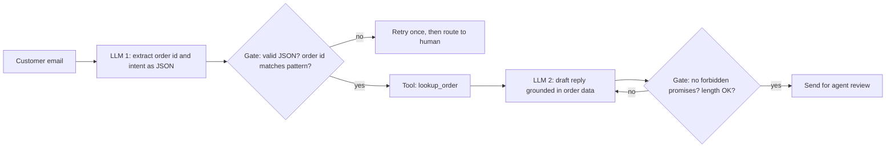
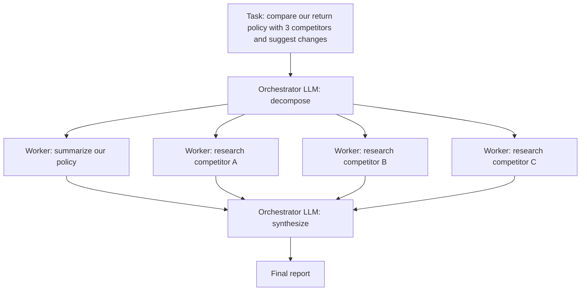
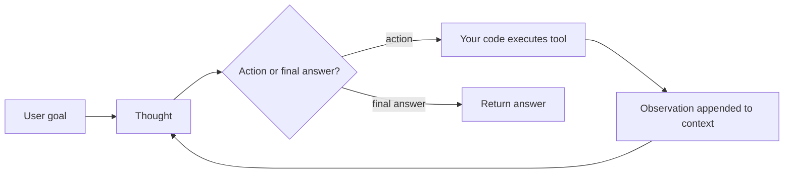
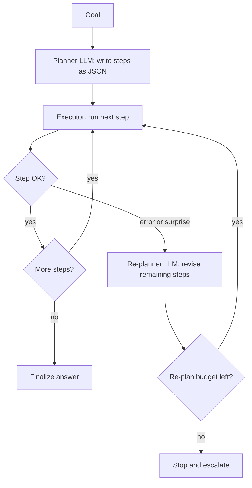
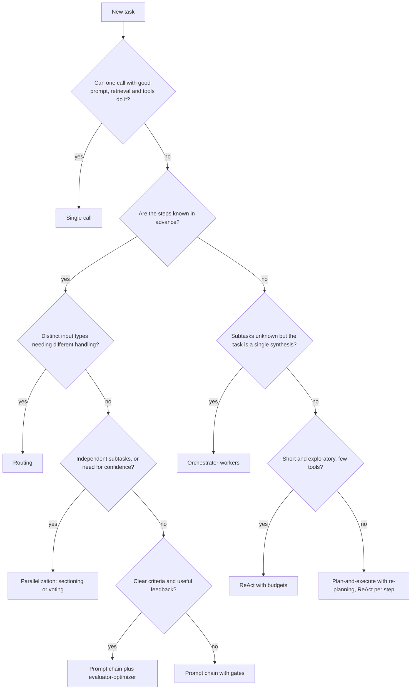

# Agent Design Patterns: ReAct, Plan-and-Execute, Reflection and Routing

> **Level:** Beginner to Advanced · **Study time:** ~90 min · **Prerequisites:** [What Is an AI Agent? Agents vs Workflows](./01-what-is-an-ai-agent.md), [Tool Calling in Depth](./02-tool-calling-in-depth.md), [Structured Outputs, JSON Mode and Function Calling](../05-llms/05-structured-outputs-and-function-calling.md)

## Table of contents

- [Why this matters](#why-this-matters)
- [The four building blocks: tools, state, memory and planning](#the-four-building-blocks-tools-state-memory-and-planning)
- [Workflow patterns vs agent patterns](#workflow-patterns-vs-agent-patterns)
- [Workflow pattern 1: prompt chaining with gates](#workflow-pattern-1-prompt-chaining-with-gates)
- [Workflow pattern 2: routing](#workflow-pattern-2-routing)
- [Workflow pattern 3: parallelization (sectioning and voting)](#workflow-pattern-3-parallelization-sectioning-and-voting)
- [Workflow pattern 4: orchestrator-workers](#workflow-pattern-4-orchestrator-workers)
- [Workflow pattern 5: evaluator-optimizer loops](#workflow-pattern-5-evaluator-optimizer-loops)
- [Agent pattern 1: ReAct (reason and act, interleaved)](#agent-pattern-1-react-reason-and-act-interleaved)
- [Agent pattern 2: plan-and-execute with re-planning](#agent-pattern-2-plan-and-execute-with-re-planning)
- [Agent pattern 3: reflection and self-critique](#agent-pattern-3-reflection-and-self-critique)
- [Agent pattern 4: tree search over actions](#agent-pattern-4-tree-search-over-actions)
- [Agent pattern 5: code-as-action agents](#agent-pattern-5-code-as-action-agents)
- [Agent pattern 6: computer-use and browser agents](#agent-pattern-6-computer-use-and-browser-agents)
- [Choosing a pattern for a task](#choosing-a-pattern-for-a-task)
- [Trade-offs: cost, latency, reliability, debuggability](#trade-offs-cost-latency-reliability-debuggability)
- [Going deeper: running patterns in production](#going-deeper-running-patterns-in-production)
- [Anti-patterns](#anti-patterns)
- [Common mistakes and misconceptions](#common-mistakes-and-misconceptions)
- [Interview questions and model answers](#interview-questions-and-model-answers)
- [Key takeaways](#key-takeaways)
- [Further reading](#further-reading)
- [Next](#next)

## Why this matters

Almost every LLM product that does more than answer one question is built from a small set of recurring shapes: a chain of prompts, a router in front of specialized handlers, a loop that calls tools until it is done, a planner with an executor, a critic that checks a draft. Knowing these shapes by name lets you design faster, explain your design in a few words, and predict how it will fail before you ship it. Interviewers for senior AI roles use questions like "walk me through ReAct" or "when would you not use an agent?" to separate people who have only run a demo from people who have operated these systems. The senior answer is rarely "use the fanciest pattern": it is "use the simplest pattern that meets the reliability bar, and here is how I would measure that".

---

## The four building blocks: tools, state, memory and planning

Before the patterns, we need four words that every pattern is made of. The previous chapters introduced them; here is a compact recap with precise definitions, because the patterns differ mainly in how they arrange these four pieces.

> **Analogy:** Think of a new support employee on their first day. Their **tools** are the order system and the refund button. Their **state** is the sticky note on their desk for the ticket they are working on right now. Their **memory** is the notebook where they wrote down what they learned last week and what this customer said last month. Their **planning** is how they decide what to do next: follow a checklist, or figure it out step by step.

- **Tool:** a function your code exposes to the model, described by a name, a natural-language description and a parameter schema (usually JSON Schema). The model does not run the tool; it emits a structured request ("call `lookup_order` with `order_id="A1234"`"), your code validates and executes it, and the result goes back into the model's context. See [Tool Calling in Depth](./02-tool-calling-in-depth.md).
- **State:** all the data describing *the current run* of your system: the conversation messages, tool results so far, the current plan, a step counter, the remaining budget, flags such as "awaiting human approval". State lives in your **orchestrator** (the ordinary code that runs the loop: it calls the model, executes tools and enforces limits), ideally as a typed object you control, not "in the model". It is created when the run starts and is usually discarded or archived when the run ends. The `RunState` dataclass in the plan-and-execute code later in this chapter is a minimal example.
- **Memory:** information that is *kept beyond what fits or belongs in the current context* (the tokens the model sees in one call, capped by its context window) and selectively brought back in. **Short-term memory** is roughly the working context of this conversation (often summarized or trimmed). **Long-term memory** persists across sessions: user preferences, past tickets, learned facts, typically stored in a database or vector store and retrieved when relevant. See [Memory for AI Agents](./06-agent-memory.md).
- **Planning:** how the system decides the sequence of actions to reach a goal. Planning can be **fixed by the developer** (a workflow), **implicit and step-by-step** (the model picks one next action at a time, as in ReAct), or **explicit** (the model writes a multi-step plan up front, then executes it, and revises it when reality disagrees).

> **Senior insight:** State and memory are often confused. State is "what this run is doing right now" and must be exact (you would checkpoint it to resume a crashed run). Memory is "what we choose to remember and recall": it is lossy by design and needs relevance ranking, expiry and privacy controls. The overlap that causes the confusion: the full message list is part of state, while the trimmed or summarized slice of it that you actually put into the next prompt is short-term memory.

### Our running example

Throughout the chapter we will use **ShopAssist**, a support assistant for a fictional electronics store. Its tools:

| Tool | What it does | Side effect? |
|---|---|---|
| `lookup_order(order_id)` | Returns item, category, delivery date, total | No (read-only) |
| `get_refund_policy(category)` | Returns the return window in days and conditions | No |
| `search_kb(query)` | Searches the help-center articles | No |
| `create_return(order_id, reason)` | Creates a return and emails a label | Yes (irreversible-ish) |
| `db_returns(category, quarter)` | Analytics query: units sold and returned | No |

"Today" in the examples is 2026-10-23. We will also reuse the course's spam-filter example when we talk about voting.

---

## Workflow patterns vs agent patterns

Every LLM system sits somewhere on a spectrum of **autonomy**: how much of the control flow is decided by the model at run time versus written by you in code.

- A **workflow** is a system where LLM calls and tools are orchestrated through **predefined code paths**. You decide the steps and their order; the LLM fills in content at each step.
- An **agent** is a system where the LLM **dynamically decides its own control flow**: which tool to call next, with what arguments, and when it is done, inside a loop that you bound. The sequence of decisions, tool calls and results in one run is called its **trajectory**.

> **Analogy:** A workflow is a recipe card: "chop, then fry, then plate". An agent is a chef given a goal ("make dinner from what is in the fridge") who looks in the fridge, decides, tastes, and adjusts.

```text
 more control in YOUR code                                   more control in the MODEL
 <----------------------------------------------------------------------------------->
 single call | prompt chain | routing | parallel | orchestrator- | evaluator- | ReAct | plan-and- | tree
             |   + gates    |         |  calls   |   workers     | optimizer  | loop  | execute   | search
 \_____________________ workflow patterns ______________________/ \______ agent patterns ______/
```

The boundary is fuzzy (orchestrator-workers and evaluator-optimizer already let the model decide some things), but the principle is crisp:

| Question | Workflow | Agent |
|---|---|---|
| Who decides the next step? | Your code | The model, inside a loop |
| Number of steps known in advance? | Yes, or bounded by a small branch set | No |
| Predictability | High | Lower |
| Cost and latency | Lower and stable | Higher and variable (long tail) |
| Debuggability | Easy: fixed graph, inspect each node | Harder: trajectories differ run to run |
| Best for | Well-understood tasks with known steps | Open-ended tasks where steps depend on what you find |

> **Interview tip:** Say the rule out loud: "Start with a single well-prompted call with retrieval and tools. Move to a workflow when the task decomposes into known steps. Move to an agent only when the steps genuinely cannot be known in advance, and the value justifies the extra cost, latency and risk."

The rest of the chapter goes through five workflow patterns first (they are simpler and more common in production), then the agent patterns.

---

## Workflow pattern 1: prompt chaining with gates

### Intuition

**Prompt chaining** splits a task into a fixed sequence of LLM calls, where each call's output becomes the next call's input. A **gate** is a programmatic check between steps that decides whether to continue, retry, or stop.

> **Analogy:** An assembly line with quality inspectors. Each station does one simple job, and an inspector between stations rejects parts that are out of spec before they waste work downstream.

### Why it works

Each call gets a smaller, more focused prompt, so it is easier for the model to do well and easier for you to test. Gates catch errors early instead of letting them compound. You trade a bit of latency (sequential calls) for accuracy and debuggability.



### Code: a chain with gates

The LLM calls below are stubs so the code runs without an API key. In a real system each `llm_*` function is one call to your model provider with structured output (see [Structured Outputs](../05-llms/05-structured-outputs-and-function-calling.md)).

```python
# Prompt chaining with gates. Python 3.10+, no dependencies.
import json
import re

ORDER_ID = re.compile(r"^[A-Z]\d{4}$")          # our store's order id format, e.g. A1234
FORBIDDEN = ("guarantee", "100%", "lawsuit")      # phrases support must never promise

def llm_extract(email: str) -> str:
    # Stub. Real version: prompt the model to return {"order_id": ..., "intent": ...}
    return '{"order_id": "A1234", "intent": "return"}'

def lookup_order(order_id: str) -> dict:
    return {"order_id": order_id, "item": "wireless headphones", "delivered_on": "2026-10-02"}

def llm_draft(fields: dict, order: dict) -> str:
    # Stub. Real version: prompt with the order data and a style guide.
    return f"Hi! Order {order['order_id']} ({order['item']}) is eligible for a return."

def gate_extract(raw: str) -> dict | None:
    """Gate 1: output must be valid JSON with a well-formed order id and known intent."""
    try:
        data = json.loads(raw)
    except json.JSONDecodeError:
        return None
    if not ORDER_ID.match(str(data.get("order_id", ""))):
        return None
    if data.get("intent") not in {"return", "status", "other"}:
        return None
    return data

def gate_draft(text: str) -> bool:
    """Gate 2: cheap deterministic checks before a human or customer sees the draft."""
    lowered = text.lower()
    return all(p not in lowered for p in FORBIDDEN) and len(text) < 1200

def handle(email: str, max_retries: int = 1) -> str:
    fields = None
    for _ in range(max_retries + 1):
        fields = gate_extract(llm_extract(email))
        if fields:
            break
    if fields is None:
        return "ROUTE_TO_HUMAN: could not extract order details"
    order = lookup_order(fields["order_id"])      # deterministic step, no LLM needed
    draft = llm_draft(fields, order)
    return draft if gate_draft(draft) else "ROUTE_TO_HUMAN: draft failed policy gate"

print(handle("Hi, I want to return the headphones from order A1234"))
# Hi! Order A1234 (wireless headphones) is eligible for a return.
```

Notice that the eligibility check in a real system should also be code, not LLM judgment, if the rule is crisp. A good chain uses the LLM only where language understanding is needed.

> **Common mistake:** Gates that are themselves vague LLM calls ("is this draft good?"). Prefer deterministic gates (schema validation, regex, length, allowed-values checks) first, and use an LLM judge only for properties code cannot check.

---

## Workflow pattern 2: routing

### Intuition

**Routing** classifies an input and sends it to a specialized handler: a different prompt, a different tool set, a different model, or a human.

> **Analogy:** The hospital triage nurse. They do not treat you; they decide whether you go to the emergency room, a general practitioner, or home with advice. A good triage step makes every downstream specialist better, because each one sees only the cases it is good at.

### Why it works

A single prompt that handles refunds, technical support and order tracking must carry every instruction for every case, and improving one case can break another. Separate handlers keep prompts focused, and they let you send easy traffic to a cheap, fast model and hard traffic to a strong one.

### Ways to build a router

| Router type | How it works | Pros | Cons | When to use |
|---|---|---|---|---|
| Rules / keywords | Regex or keyword lists | Free, instant, fully predictable | Brittle, poor coverage of paraphrases | Obvious high-volume cases, safety overrides |
| Embedding similarity | Embed the query, compare to labeled example embeddings per route | Fast, cheap, no generation | Needs good examples; weak on subtle intent | Many routes, stable intents |
| Trained classifier | Small fine-tuned model (e.g. logistic regression on embeddings, or a small encoder) | Fast, calibratable, measurable | Needs labeled data and retraining | High volume, you have logs |
| LLM classifier | Prompt an LLM to output a route label via structured output | Flexible, zero training data | Adds a call (latency, cost); confidence poorly calibrated | Early stage, long-tail intents |

Production routers are often layered: rules first (cheap and safe), then a classifier or LLM, then a fallback to a human or a general handler when confidence is low. Embeddings are covered in [Text Embeddings and Similarity Search](../08-rag/02-text-embeddings-and-similarity-search.md).

### The cost math of model routing

Routing between a small and a large model is one of the highest-leverage cost optimizations. Expected cost per query:

$$
\mathbb{E}[C] = c_{\text{router}} + p \cdot c_{\text{small}} + (1 - p) \cdot c_{\text{large}}
$$

- $\mathbb{E}[C]$: expected cost per query.
- $c_{\text{router}}$: cost of the routing decision itself.
- $p$: fraction of queries routed to the small model.
- $c_{\text{small}}$, $c_{\text{large}}$: average cost of handling one query with each model.

**Worked example (illustrative prices, not real vendor pricing):** $c_{\text{router}} = \$0.0002$, $c_{\text{small}} = \$0.0005$, $c_{\text{large}} = \$0.01$, and the router sends $p = 0.7$ of traffic to the small model.

1. Small share: $0.7 \times 0.0005 = 0.00035$
2. Large share: $0.3 \times 0.01 = 0.003$
3. Total: $0.0002 + 0.00035 + 0.003 = 0.00355$ dollars per query.
4. Versus always-large at $0.01$: savings $= 1 - 0.00355 / 0.01 = 1 - 0.355 = 0.645$, about 64.5%.

The catch: every hard query misrouted to the small model costs you quality, and possibly a retry or an escalation. So you evaluate a router on two axes: cost saved and quality lost, measured on a labeled set.

### Code: layered router with a confidence fallback

```python
# Layered router: rules -> LLM classifier -> human fallback. Runnable with the stub.
ROUTES = {"refund", "order_status", "tech_support"}
RULES = {
    "refund": ("refund", "return", "money back"),
    "order_status": ("where is my order", "tracking", "not arrived"),
}

def rule_router(text: str) -> str | None:
    t = text.lower()
    for route, keywords in RULES.items():
        if any(k in t for k in keywords):
            return route
    return None

def llm_router(text: str) -> dict:
    # Stub. Real version: structured output {"route": one of ROUTES or "other", "confidence": 0..1}
    return {"route": "tech_support", "confidence": 0.62}

def route(text: str, threshold: float = 0.7) -> tuple[str, str]:
    if (r := rule_router(text)) is not None:
        return r, "rule"
    out = llm_router(text)
    if out["route"] in ROUTES and out["confidence"] >= threshold:
        return out["route"], "llm"
    return "human_handoff", "low_confidence"

print(route("I want my money back for order A1234"))   # ('refund', 'rule')
print(route("My headphones keep disconnecting"))        # ('human_handoff', 'low_confidence')
```

> **Senior insight:** A number the LLM writes as "confidence: 0.62" is not a calibrated probability. If you need a reliable threshold, use token log-probabilities of the label (where your provider exposes them), or train a small classifier on logged, labeled traffic and calibrate it. See [Classification Metrics](../01-classical-ml/04-classification-metrics-and-imbalanced-data.md) for how to measure a router (per-route precision and recall, confusion matrix).

---

## Workflow pattern 3: parallelization (sectioning and voting)

**Parallelization** runs several LLM calls at the same time and combines their outputs in code. It comes in two flavors.

### Sectioning: split a task into independent parts

**Sectioning** breaks one task into independent subtasks that run concurrently.

> **Analogy:** Four editors each review a contract for a different thing (payment terms, liability, termination, data privacy) at the same time, and a lead merges their notes.

Typical uses:

- Review a document along several independent criteria, each with a focused prompt.
- Run a **guardrail** check (is this request safe and in scope?) in parallel with generating the answer, then discard the answer if the guardrail fails. This hides the guardrail's latency. See [LLM Safety and Guardrails](../05-llms/13-llm-safety-guardrails-and-responsible-ai.md).
- Fetch several data sources at once (order data, policy, knowledge base).

Latency becomes roughly the **maximum** of the parallel calls instead of their **sum**. With three calls of 1.2 s, 0.8 s and 1.5 s (illustrative): sequential is $1.2 + 0.8 + 1.5 = 3.5$ s; parallel is $\max(1.2, 0.8, 1.5) = 1.5$ s, plus a little merge overhead. Cost does not drop: you still pay for all three calls.

### Voting: run the same task several times and aggregate

**Voting** runs the same (or slightly varied) prompt $n$ times and takes the majority answer. It is the workflow version of **self-consistency** ("Self-Consistency Improves Chain of Thought Reasoning in Language Models", Wang et al., 2022). It helps when single answers are noisy but usually right.

For a yes/no task where each independent run is correct with probability $p$, the probability that the majority of 3 runs is correct is:

$$
P_{\text{maj}}(3) = p^3 + 3p^2(1-p)
$$

- $p^3$: all three runs are correct.
- $3p^2(1-p)$: exactly two of three are correct; the "3" counts which run is the wrong one.

**Worked example with our spam filter.** Suppose one LLM run labels an email correctly with $p = 0.8$.

1. $p^3 = 0.8 \times 0.8 \times 0.8 = 0.512$
2. $p^2 = 0.64$, and $1 - p = 0.2$, so $3 \times 0.64 \times 0.2 = 0.384$
3. $P_{\text{maj}} = 0.512 + 0.384 = 0.896$

Voting lifted accuracy from 80% to about 89.6%, at 3x the cost. Now try $p = 0.4$:

1. $p^3 = 0.064$
2. $3 \times 0.16 \times 0.6 = 0.288$
3. $P_{\text{maj}} = 0.064 + 0.288 = 0.352$, which is *worse* than 0.4.

> **Common mistake:** Assuming voting always helps. The formula assumes runs are **independent**, but samples from the same model with the same prompt make correlated errors (the same misunderstanding repeats). In practice the gain is smaller than the formula says. Voting amplifies a model that is usually right; it does not rescue one that is usually wrong. (For open-ended answers with many possible wrong outputs, plurality voting can still help below 50% because wrong answers scatter while right ones agree, but measure it.)

Voting is also used for **conservative decisions**: flag content as unsafe if *any* of 3 checkers flags it (high recall), or approve a refund only if *all* agree (high precision).

### Code: sectioning and voting with asyncio

```python
# Parallel LLM calls with asyncio. Stubs simulate latency and noisy answers.
import asyncio
import random
from collections import Counter

async def fake_llm(prompt: str, seed: int) -> str:
    rng = random.Random(seed)
    await asyncio.sleep(0.1)                     # pretend network latency
    if prompt.startswith("CLASSIFY"):
        return "spam" if rng.random() < 0.8 else "ham"
    return f"notes for: {prompt[:30]}"

async def sectioning(contract: str) -> dict:
    aspects = ["payment terms", "liability", "termination", "data privacy"]
    calls = [fake_llm(f"Review {a} in: {contract}", seed=i) for i, a in enumerate(aspects)]
    results = await asyncio.gather(*calls)       # all 4 run concurrently
    return dict(zip(aspects, results))

async def vote(email: str, n: int = 5) -> tuple[str, float]:
    labels = await asyncio.gather(*(fake_llm(f"CLASSIFY: {email}", seed=s) for s in range(n)))
    label, count = Counter(labels).most_common(1)[0]
    return label, count / n                       # agreement rate is a useful signal

async def main():
    print(await sectioning("...contract text..."))
    label, agreement = await vote("WIN a FREE prize now!!!")
    print(label, agreement)                      # low agreement -> escalate to a human

asyncio.run(main())
```

The agreement rate is a free uncertainty signal: if only 3 of 5 runs agree, route the item to review.

---

## Workflow pattern 4: orchestrator-workers

### Intuition

In **orchestrator-workers**, a central LLM (the **orchestrator**; here the word means a model call, not the loop-running code from the building-blocks section) looks at the task, decides *at run time* which subtasks are needed, sends each to a **worker** (another LLM call, possibly with its own tools), and then **synthesizes** the results.

> **Analogy:** A newspaper editor gets a breaking story, decides it needs a reporter at the scene, someone checking records, and a photographer, assigns them, and then writes the final piece from their reports.

The difference from sectioning: in sectioning *you* hard-coded the four aspects; here the orchestrator decides how many subtasks there are and what they are, based on the input.



### Design notes

- Make the orchestrator output a **structured task list** (JSON with a task id, instruction and expected output format for each worker), so your code can dispatch, validate and log it.
- Cap the number of workers. An orchestrator can decide to spawn 40 subtasks for a simple question.
- Workers should receive **only the context they need**, not the whole conversation. This keeps them cheap and focused, and it is the main reason this pattern can beat a single long-context call on broad research tasks.
- The synthesis step is where errors hide: a worker's failure ("could not find data") can be smoothed over into a confident sentence. Pass worker status explicitly and tell the synthesizer to report gaps.

Orchestrator-workers is the gateway to multi-agent systems, which have their own costs and coordination problems. See [Multi-Agent Systems](./05-multi-agent-systems.md).

---

## Workflow pattern 5: evaluator-optimizer loops

### Intuition

An **evaluator-optimizer** loop has one LLM call generate a draft (the **optimizer** or generator) and another evaluate it against explicit criteria (the **evaluator**). If the draft fails, the evaluator's feedback goes back to the generator, and the loop repeats until it passes or a round limit is hit.

> **Analogy:** A writer and an editor. The writer drafts, the editor returns specific comments ("the second paragraph promises a refund we do not offer"), the writer revises.

### When it works

It works when two conditions hold:

1. **There are clear evaluation criteria.** "Under 120 words, mentions the return deadline, cites the policy article, no promises" is evaluable. "Make it better" is not.
2. **Feedback actually improves the output.** A human editor's comments would help, so an LLM's targeted comments plausibly help too.

The strongest version uses **external, verifiable signals** in the evaluator: unit tests for code, a SQL query that must execute and return rows, a schema validator, a fact check against retrieved documents. An LLM judge (see [LLM-as-a-Judge](../05-llms/10-llm-evaluation-metrics-and-llm-as-a-judge.md)) is the fallback for properties code cannot check.

```python
# Evaluator-optimizer loop with a round limit and a final status.
def generate(task: str, feedback: str | None) -> str:
    # Stub: the second attempt "fixes" the missing deadline.
    if feedback is None:
        return "You can return your headphones."
    return "You can return your headphones until 2026-11-01 (30-day window, policy article 4.2)."

def evaluate(task: str, draft: str) -> dict:
    # Mix deterministic checks with (in real life) an LLM judge for softer criteria.
    problems = []
    if "2026-" not in draft:
        problems.append("State the exact return deadline date.")
    if len(draft.split()) > 120:
        problems.append("Keep it under 120 words.")
    return {"pass": not problems, "feedback": " ".join(problems)}

def evaluator_optimizer(task: str, max_rounds: int = 3) -> dict:
    feedback, history = None, []
    for round_no in range(1, max_rounds + 1):
        draft = generate(task, feedback)
        verdict = evaluate(task, draft)
        history.append({"round": round_no, "draft": draft, **verdict})
        if verdict["pass"]:
            return {"status": "passed", "output": draft, "rounds": round_no}
        feedback = verdict["feedback"]
    return {"status": "failed_after_max_rounds", "output": draft, "history": history}

print(evaluator_optimizer("Reply to the return request for order A1234"))
# {'status': 'passed', 'output': 'You can return your headphones until 2026-11-01 (30-day window, policy article 4.2).', 'rounds': 2}
```

The date check: delivery on 2026-10-02 plus a 30-day window. October has 31 days, so 29 days after October 2 is October 31, and 30 days after is November 1. Deadline: 2026-11-01.

> **Senior insight:** Always return an explicit status ("passed" vs "failed after max rounds"). A loop that silently returns its last draft hides quality failures from your dashboards.

---

## Agent pattern 1: ReAct (reason and act, interleaved)

Now we hand control flow to the model. The simplest and most widely used agent pattern is ReAct.

### Intuition

**ReAct** ("ReAct: Synergizing Reasoning and Acting in Language Models", Yao et al., 2022) interleaves three things in a loop:

- **Thought:** the model writes a short piece of reasoning about what it knows and what to do next.
- **Action:** the model chooses a tool and its arguments.
- **Observation:** your code runs the tool and appends the result.

The loop repeats until the model produces a final answer instead of an action.

> **Analogy:** A detective. "The window is broken from outside (observation). So the intruder came through the garden (thought). Let me check the garden for footprints (action)." Each clue changes the next move. Neither pure thinking (armchair theorizing) nor pure action (searching randomly) works as well as alternating them.

Why interleave? **Chain-of-thought** reasoning alone ("Chain-of-Thought Prompting Elicits Reasoning in Large Language Models", Wei et al., 2022) cannot check facts, so it can hallucinate. Acting without reasoning picks tools blindly and does not recover from surprises. ReAct grounds reasoning in observations and uses reasoning to choose actions.



### A worked trace

User: *"Can I still return the headphones from order A1234?"* Today is 2026-10-23.

```text
Question: Can I still return the headphones from order A1234?

Thought 1: I need the delivery date and category of order A1234.
Action 1: lookup_order {"order_id": "A1234"}
Observation 1: {"order_id": "A1234", "item": "wireless headphones",
                "category": "electronics", "delivered_on": "2026-10-02", "total": 89.99}

Thought 2: Delivered 2026-10-02. I need the return window for electronics.
Action 2: get_refund_policy {"category": "electronics"}
Observation 2: {"category": "electronics", "window_days": 30,
                "condition": "unopened or defective"}

Thought 3: From 2026-10-02 to 2026-10-23 is 21 days, and 21 < 30, so the order is
           inside the window. The deadline is 2026-10-02 + 30 days = 2026-11-01.
           The condition matters: I should mention it rather than assume.
Final Answer: Yes. Your headphones were delivered on October 2, and electronics can be
              returned within 30 days if unopened or defective, so you have until
              November 1, 2026. Would you like me to start a return?
```

Check the arithmetic: October 23 minus October 2 is $23 - 2 = 21$ days, and $21 < 30$. Note that the agent *asks* before calling `create_return`, because that tool has a side effect. That is a design decision you enforce in code, not something you hope the model does (more in [Making Agents Reliable and Secure](./08-agent-reliability-security-and-prompt-injection.md)).

Notice what made this an agent rather than a workflow: nothing in our code said "first look up the order, then the policy". If the user had asked "what is your return policy for speakers?" the model would have skipped `lookup_order` entirely.

### Code: a minimal ReAct loop from scratch

This version parses the classic text format so you can see the mechanism. A scripted fake LLM replays the trace above, so it runs without an API key.

```python
# Minimal text-format ReAct loop. Python 3.10+, no dependencies.
import json
import re

def lookup_order(order_id: str) -> dict:
    return {"order_id": order_id, "item": "wireless headphones", "category": "electronics",
            "delivered_on": "2026-10-02", "total": 89.99}

def get_refund_policy(category: str) -> dict:
    return {"category": category, "window_days": 30, "condition": "unopened or defective"}

TOOLS = {"lookup_order": lookup_order, "get_refund_policy": get_refund_policy}

SYSTEM = """Answer the question. Use this format exactly:
Thought: <reasoning>
Action: <one of: lookup_order, get_refund_policy>
Action Input: <JSON object of arguments>
...or, when done:
Thought: <reasoning>
Final Answer: <answer>
"""

class ScriptedLLM:
    """Stands in for a real model: returns pre-written outputs in order."""
    def __init__(self, outputs: list[str]):
        self._outputs = iter(outputs)
    def __call__(self, prompt: str, stop: list[str]) -> str:
        return next(self._outputs)

ACTION_RE = re.compile(r"Action:\s*(\w+)\s*\nAction Input:\s*(\{.*\})", re.DOTALL)

def react(question: str, llm, tools: dict, max_steps: int = 6) -> tuple[str, str]:
    transcript = f"Question: {question}\n"
    for _ in range(max_steps):
        # stop=["Observation:"] prevents the model from inventing tool results
        out = llm(SYSTEM + transcript, stop=["Observation:"])
        transcript += out.strip() + "\n"
        if "Final Answer:" in out:
            return out.split("Final Answer:", 1)[1].strip(), transcript
        match = ACTION_RE.search(out)
        if match is None:
            obs = "ERROR: could not parse an Action. Follow the format exactly."
        elif match.group(1) not in tools:
            obs = f"ERROR: unknown tool '{match.group(1)}'. Available: {sorted(tools)}"
        else:
            try:
                obs = json.dumps(tools[match.group(1)](**json.loads(match.group(2))))
            except Exception as e:            # bad JSON, wrong args, tool failure
                obs = f"ERROR: {type(e).__name__}: {e}"
        transcript += f"Observation: {obs}\n"   # errors go back to the model, not up the stack
    return "STOPPED: step budget exhausted", transcript

llm = ScriptedLLM([
    'Thought: I need the delivery date and category.\nAction: lookup_order\n'
    'Action Input: {"order_id": "A1234"}',
    'Thought: I need the electronics return window.\nAction: get_refund_policy\n'
    'Action Input: {"category": "electronics"}',
    "Thought: 21 days since delivery, window is 30.\n"
    "Final Answer: Yes, you can return it until 2026-11-01 if unopened or defective.",
])
answer, trace = react("Can I still return the headphones from order A1234?", llm, TOOLS)
print(answer)
# Yes, you can return it until 2026-11-01 if unopened or defective.
```

Four details in this small loop matter a lot in production:

1. **`max_steps`**: a hard budget. Without it, a confused model loops forever.
2. **Stop sequence on "Observation:"**: a stop sequence is a string at which the provider halts generation. In the text format, a model will happily write its own fake observation and continue. You must cut generation there and insert the real one.
3. **Errors become observations**: a bad tool call is fed back so the model can correct itself, rather than crashing the run.
4. **Explicit terminal status**: "STOPPED: step budget exhausted" is different from an answer, and your code and dashboards must treat it that way.

### The modern form: native tool calling

Today you rarely parse "Action:" text. Providers offer **native tool calling** (function calling): you pass tool schemas, and the model returns structured tool-call objects. The loop is the same ReAct loop; the "Thought" may be visible text, hidden reasoning (in reasoning models, see [Reasoning Models and Test-Time Compute](../05-llms/12-reasoning-models-and-test-time-compute.md)), or absent.

The sketch below uses the OpenAI Python SDK's Chat Completions tool-calling interface (`pip install openai`). SDK details and model names change between versions, so treat it as a realistic shape rather than copy-paste-forever code.

```python
# ReAct with native tool calling. Version-sensitive: check your SDK docs.
import json
from openai import OpenAI

client = OpenAI()   # reads OPENAI_API_KEY from the environment
TOOL_SCHEMAS = [{
    "type": "function",
    "function": {
        "name": "lookup_order",
        "description": "Get item, category and delivery date for an order id like A1234.",
        "parameters": {"type": "object",
                       "properties": {"order_id": {"type": "string"}},
                       "required": ["order_id"]},
    },
}]  # get_refund_policy would be declared the same way

def run_agent(user_msg: str, tools: dict, max_steps: int = 6) -> str:
    messages = [{"role": "system", "content": "You are ShopAssist. Use tools; never guess order data."},
                {"role": "user", "content": user_msg}]
    for _ in range(max_steps):
        resp = client.chat.completions.create(model="gpt-4o-mini",  # example model name
                                              messages=messages, tools=TOOL_SCHEMAS)
        msg = resp.choices[0].message
        if not msg.tool_calls:                    # no tool requested: this is the final answer
            return msg.content
        messages.append(msg)                      # keep the assistant's tool request in history
        for call in msg.tool_calls:               # the model may request several calls at once
            try:
                result = tools[call.function.name](**json.loads(call.function.arguments))
            except Exception as e:
                result = {"error": f"{type(e).__name__}: {e}"}
            messages.append({"role": "tool", "tool_call_id": call.id,
                             "content": json.dumps(result)})
    return "STOPPED: step budget exhausted"
```

### The hidden cost of ReAct: context grows every step

Each ReAct step re-sends the whole history. If the fixed prompt (system prompt, tool schemas, question) is $P$ tokens and each step adds $s$ tokens (thought, action, observation), the input size at step $k$ is $P + (k-1)s$. Total input tokens over $n$ steps:

$$
T_{\text{in}} = \sum_{k=1}^{n} \big(P + (k-1)s\big) = nP + s\,\frac{n(n-1)}{2}
$$

- $T_{\text{in}}$: total input tokens billed across the run.
- $n$: number of steps (LLM calls).
- $P$: fixed prompt size in tokens.
- $s$: tokens added per step.

**Worked example (illustrative sizes):** $P = 2000$, $s = 500$, $n = 6$.

1. $nP = 6 \times 2000 = 12{,}000$
2. $\frac{n(n-1)}{2} = \frac{6 \times 5}{2} = 15$, so $s \times 15 = 500 \times 15 = 7{,}500$
3. $T_{\text{in}} = 12{,}000 + 7{,}500 = 19{,}500$ input tokens, almost 10x the size of the original prompt.

The $n^2$ term is why long agent runs get expensive and slow. Mitigations: keep tool outputs short (return the 5 fields the model needs, not a 4,000-token JSON dump), summarize old steps, and use **prompt caching** so the stable prefix is cheaper to reprocess (see [Speculative Decoding, Prompt Caching and Other Speedups](../06-llm-inference/05-speculative-decoding-caching-and-other-speedups.md)).

### ReAct failure modes

| Failure | What it looks like | Mitigation |
|---|---|---|
| Looping | Same action with the same arguments 3+ times | Detect repeated (tool, args) pairs; inject a hint or stop |
| Hallucinated observation | Model invents a tool result (text format) | Stop sequences; native tool calling |
| Premature final answer | Answers before checking, or guesses missing data | Instructions plus tool-required checks in code |
| Wrong tool / bad arguments | Calls `search_kb` for order data, or malformed ids | Clear tool descriptions, schema validation, error messages that say how to fix |
| Drift on long tasks | Forgets the goal after many steps | Restate goal, keep state compact, or switch to plan-and-execute |
| Distracted by tool output | Follows instructions embedded in a web page or document | Treat tool output as data; prompt-injection defenses ([chapter 8](./08-agent-reliability-security-and-prompt-injection.md)) |

---

## Agent pattern 2: plan-and-execute with re-planning

### Intuition

**Plan-and-execute** separates thinking about the whole task from doing it:

1. A **planner** (an LLM call) writes an explicit multi-step plan up front.
2. An **executor** carries out the steps one by one (each step can be a tool call, a simple LLM call, or even a small ReAct agent).
3. A **re-planner** looks at results so far and either keeps the plan, revises the remaining steps, or declares the task done.

> **Analogy:** Planning a road trip. You map the route before you leave (plan). You drive (execute). When a road is closed, you do not throw away the trip; you re-route from where you are (re-plan).

The idea appears in several papers: "Plan-and-Solve Prompting" (Wang et al., 2023) showed that asking for a plan first improves zero-shot reasoning; "ReWOO" (Xu et al., 2023) plans all tool calls up front with placeholders for their results, so the reasoning model is not re-invoked after every observation; "An LLM Compiler for Parallel Function Calling" (LLMCompiler, Kim et al., 2023) turns the plan into a dependency graph and runs independent steps in parallel.

### Why use it instead of ReAct?

- **Fewer expensive calls**: the strong (expensive) model plans once; cheaper models or plain code execute steps.
- **Parallelism**: independent steps can run at once.
- **Better long-horizon coherence**: the plan is an explicit artifact that keeps the agent on track.
- **Inspectable and approvable**: you can show a plan to a human before execution ("I will query Q3 returns for two categories, then email the ops lead. OK?").

The cost: plans go stale. If step 2 returns something surprising, a rigid executor marches on with a wrong plan. That is why re-planning is essential.

### Running example

Goal: *"Compare Q3 return rates for headphones and speakers, and email a short summary to the ops lead."*

```text
PLAN v1 (from planner)
  1. db_returns(category="headphones", quarter="Q3")
  2. db_returns(category="speakers",   quarter="Q3")      # independent of step 1: run in parallel
  3. compute rates (code, not LLM)                         # depends on 1, 2
  4. draft summary (LLM)                                   # depends on 3
  5. send_email(to="ops lead", body=<4>)                  # side effect: needs approval

EXECUTION
  step 1 -> {"sold": 1200, "returned": 84}
  step 2 -> ERROR: unknown category 'speakers'. Valid: ['headphones', 'speakers_audio']

RE-PLAN (re-planner sees the goal, results so far and the error)
  2'. db_returns(category="speakers_audio", quarter="Q3")
  3-5 unchanged
```

Rates: headphones $84 / 1200 = 0.07 = 7.0\%$; speakers $40 / 800 = 0.05 = 5.0\%$ (using the data in the code below).



### Code: plan-and-execute with a re-plan budget

```python
# Plan-and-execute with re-planning. Planner and re-planner are stubs for LLM calls
# that would return JSON validated against a schema.
from dataclasses import dataclass, field

@dataclass
class Step:
    id: int
    tool: str
    args: dict

@dataclass
class RunState:                       # explicit state: everything about this run
    goal: str
    remaining: list[Step]
    results: dict[int, dict] = field(default_factory=dict)
    replans: int = 0
    log: list[str] = field(default_factory=list)

DATA = {"headphones": (1200, 84), "speakers_audio": (800, 40)}   # (sold, returned), illustrative

def db_returns(category: str, quarter: str) -> dict:
    if category not in DATA:
        raise ValueError(f"unknown category '{category}'. Valid: {sorted(DATA)}")
    sold, returned = DATA[category]
    return {"category": category, "sold": sold, "returned": returned}

TOOLS = {"db_returns": db_returns}

def planner(goal: str) -> list[Step]:
    return [Step(1, "db_returns", {"category": "headphones", "quarter": "Q3"}),
            Step(2, "db_returns", {"category": "speakers", "quarter": "Q3"})]

def replanner(state: RunState, failed: Step, error: str) -> list[Step]:
    # Real version: an LLM sees goal, results, failed step and error, returns new remaining steps.
    return [Step(2, "db_returns", {"category": "speakers_audio", "quarter": "Q3"})] + state.remaining

def run(goal: str, max_replans: int = 2) -> RunState:
    state = RunState(goal=goal, remaining=planner(goal))
    while state.remaining:
        step = state.remaining.pop(0)
        try:
            state.results[step.id] = TOOLS[step.tool](**step.args)
            state.log.append(f"step {step.id} ok")
        except Exception as e:
            state.log.append(f"step {step.id} failed: {e}")
            if state.replans >= max_replans:
                raise RuntimeError("re-plan budget exhausted; escalate to a human") from e
            state.replans += 1
            state.remaining = replanner(state, step, str(e))
    return state

state = run("Compare Q3 return rates for headphones and speakers")
for r in state.results.values():                        # arithmetic in code, not in the LLM
    print(r["category"], f"{r['returned'] / r['sold']:.1%}")
print(state.log)
# headphones 7.0%
# speakers_audio 5.0%
# ['step 1 ok', "step 2 failed: unknown category 'speakers'. Valid: ['headphones', 'speakers_audio']", 'step 2 ok']
```

The email step is omitted from the code on purpose: a side-effecting step should pause for approval, which is easiest with a state machine that can checkpoint and resume. That is the topic of [Orchestrating Agents with LangGraph and State Machines](./04-orchestration-with-langgraph-and-state-machines.md).

### ReAct vs plan-and-execute

| Aspect | ReAct | Plan-and-execute |
|---|---|---|
| Planning | Implicit, one step at a time | Explicit, whole plan up front |
| Adapts to surprises | Naturally, every step | Only via re-planning |
| Strong-model calls | Every step | Plan plus re-plans (executor can be cheap) |
| Parallel tool calls | Limited (several calls per turn at most) | Natural (dependency graph) |
| Long tasks | Drifts, context grows | More coherent, plan acts as an anchor |
| Human approval of intent | Hard (no plan to show) | Easy (show the plan) |
| Best for | Short, exploratory tasks (2-10 steps) | Longer tasks with mostly predictable structure |

> **Interview tip:** A strong answer mentions the hybrid that many production systems use: a planner writes the high-level steps, and each step is executed by a small, bounded ReAct loop with a narrow tool set.

---

## Agent pattern 3: reflection and self-critique

### Intuition

**Reflection** means the system looks at its own output or trajectory, critiques it, and uses that critique to do better: either on the next attempt at the same task, or on future tasks.

> **Analogy:** An athlete watching replay video after a match, writing "I kept overcommitting on the left", and reading that note before the next game.

Two well-known variants:

- **Self-Refine** ("Self-Refine: Iterative Refinement with Self-Feedback", Madaan et al., 2023): generate, critique with the same model, refine, repeat. Within a single task.
- **Reflexion** ("Reflexion: Language Agents with Verbal Reinforcement Learning", Shinn et al., 2023): after a failed attempt (detected by an evaluator signal such as an environment reward, failing unit tests, or a heuristic or LLM evaluator; on the coding tasks the tests were themselves model-generated), the agent writes a short verbal lesson into a memory, then retries with that lesson in context. Across attempts.

How does reflection differ from the evaluator-optimizer workflow? They are close cousins. Evaluator-optimizer is a fixed loop you wire with explicit criteria. Reflection is usually the agent critiquing its own trajectory (including which tools it called and why) and deciding how to change course.

### The crucial caveat: where does the feedback come from?

"Large Language Models Cannot Self-Correct Reasoning Yet" (Huang et al., 2023) found that **intrinsic** self-correction (the model re-reads its own answer with no new information) often fails to improve reasoning and can even turn correct answers into wrong ones. In contrast, "CRITIC" (Gou et al., 2023) showed that critiques grounded in **tool feedback** (running code, searching, calculators) are much more useful.

The practical rule:

| Feedback source | Example | How much to trust |
|---|---|---|
| External, verifiable | Unit tests fail, SQL errors, schema validation, retrieved document contradicts claim | High: use it |
| Separate judge with explicit rubric | Different prompt (or model) scores against criteria | Medium: calibrate against human labels |
| Same model, same context, "check your work" | "Are you sure?" | Low: may help on formatting and omissions, unreliable on reasoning |

> **Senior insight:** Reflection is only as good as the signal that triggers it. In coding agents, the test suite is the signal, and reflection works well. In open-ended writing, there is no ground truth, so reflection mostly polishes style and adds cost.

### Reflection in an agent loop

```text
attempt 1:  ReAct trajectory -> answer -> external check FAILS
reflect:    "I assumed the category was 'speakers'; I should list categories first."
memory:     [lesson 1]
attempt 2:  ReAct trajectory (with lesson 1 in context) -> answer -> check PASSES
```

Cost: with $r$ rounds, a generate-critique-refine loop makes roughly $2r$ to $3r$ LLM calls instead of 1. Use a round limit (2-3 is typical) and stop as soon as the check passes.

---

## Agent pattern 4: tree search over actions

So far each pattern follows *one* path. **Tree search** explores several alternative actions or thoughts at each step, scores the partial paths, and expands the most promising ones, backtracking from dead ends.

> **Analogy:** A chess player who considers three candidate moves, imagines a couple of replies for each, and picks the line that looks best, instead of playing the first move that comes to mind.

- **Tree of Thoughts** ("Tree of Thoughts: Deliberate Problem Solving with Large Language Models", Yao et al., 2023) applies breadth-first or depth-first search over intermediate reasoning steps, with the LLM proposing and evaluating "thoughts".
- **LATS** ("Language Agent Tree Search Unifies Reasoning, Acting and Planning in Language Models", Zhou et al., 2023) applies Monte Carlo Tree Search ideas (repeatedly expand a promising branch, score the outcome, and propagate that score back up the tree to guide where to explore next) to agent actions, using environment feedback and reflection as value signals.

### Why it is rarely used in production

The cost explodes. With **branching factor** $b$ (candidates per step) and **depth** $d$ (steps), a full tree has

$$
N = \sum_{k=1}^{d} b^k = \frac{b(b^d - 1)}{b - 1}
$$

- $N$: number of nodes to generate (each is at least one LLM call, plus evaluation calls).
- $b$: branching factor.
- $d$: depth.

**Worked example:** $b = 3$, $d = 3$.

1. Level by level: $3^1 + 3^2 + 3^3 = 3 + 9 + 27 = 39$.
2. Formula check: $\frac{3 \times (27 - 1)}{3 - 1} = \frac{3 \times 26}{2} = \frac{78}{2} = 39$. Matches.

That is 39 generation calls (plus scoring) versus 3 for a single path. **Beam search** keeps only the best $w$ nodes per level, which cuts this to at most $b + (d-1) \cdot w \cdot b$ generations: with $w = 2$, $3 + 2 \times 2 \times 3 = 15$.

Another real constraint: in agents, many actions **cannot be undone**. You can explore three different chess moves in your head, but you cannot "explore" sending three different refund emails. Tree search over actions needs a simulator, a sandbox, or read-only actions. Today it is mostly used for offline tasks (math, puzzles, code generation with tests as the scorer) and as a research direction. Reasoning models now internalize some of this search during their hidden reasoning; see [Reasoning Models and Test-Time Compute](../05-llms/12-reasoning-models-and-test-time-compute.md).

---

## Agent pattern 5: code-as-action agents

### Intuition

In standard tool calling, each action is a single JSON function call. In a **code-as-action** agent, the model writes a short program (usually Python) as its action, your sandbox executes it, and the printed output or error becomes the observation.

> **Analogy:** Instead of asking a colleague to press one button at a time ("now click lookup, now click policy"), you hand them a short script that does all of it with a loop and an if-statement.

Papers: "PAL: Program-aided Language Models" (Gao et al., 2022) had the model write code for the arithmetic part of reasoning; "Executable Code Actions Elicit Better LLM Agents" (CodeAct, Wang et al., 2024) used Python code as the unified action space for agents and reported advantages over JSON and text actions on their benchmarks. Hugging Face's `smolagents` library offers a `CodeAgent` built on this idea (APIs change; check the current docs).

### Compare the two action styles

JSON tool calls: three round trips through the model (two if the provider lets the model emit both independent `db_returns` calls in one turn).

```json
{"tool": "db_returns", "args": {"category": "headphones", "quarter": "Q3"}}
{"tool": "db_returns", "args": {"category": "speakers_audio", "quarter": "Q3"}}
{"tool": "final_answer", "args": {"text": "headphones 7.0%, speakers 5.0%"}}
```

Code action: one model call writes the whole program, with loops, variables and exact arithmetic. If the program only prints, one more call reads the output and writes the answer; frameworks such as smolagents let the code call a `final_answer(...)` tool directly to finish in a single round trip.

```python
rates = {}
for cat in ["headphones", "speakers_audio"]:
    r = db_returns(category=cat, quarter="Q3")
    rates[cat] = r["returned"] / r["sold"]
print({k: f"{v:.1%}" for k, v in rates.items()})
```

| Aspect | JSON tool calls | Code as action |
|---|---|---|
| Steps per LLM call | One (or a few parallel) | Many (loops, conditionals) |
| Composition | Model must chain via context | Variables pass data directly |
| Exact computation | Model does math in text (error-prone) | Interpreter does math |
| Security | Narrow: only declared tools | Wide: arbitrary code unless sandboxed |
| Validation | Easy: schema per call | Harder: static analysis, allow-lists, sandbox limits |
| Best for | Customer-facing actions, strict permissions | Data analysis, multi-step computation, developer tools |

### The non-negotiable: sandboxing

Running model-written code is running untrusted code. Never `exec()` it in your application process. Use an isolated sandbox: a container or microVM (a lightweight virtual machine) with no network (or an allow-list), no secrets in the environment, CPU, memory and time limits, a read-only filesystem except a scratch directory, and only the tool functions you choose to expose. Prompt injection turns into remote code execution if you skip this. See [Making Agents Reliable and Secure](./08-agent-reliability-security-and-prompt-injection.md).

> **Common mistake:** "We restricted `__builtins__` in `exec`, so it is safe." Python-level restrictions are well known to be bypassable. Isolation must happen at the operating-system or VM level.

---

## Agent pattern 6: computer-use and browser agents

A **computer-use agent** operates a graphical interface the way a person does: it receives a screenshot (and sometimes an accessibility tree or the page's DOM), decides an action such as "click at (412, 230)", "type 'A1234'", "scroll down", and observes the new screen. A **browser agent** is the same idea restricted to a web browser, often using the page's structure instead of raw pixels.

```text
 +-----------+   screenshot / DOM    +-------+   action: click(412,230)   +-------------+
 |  screen   | --------------------> |  LLM  | -------------------------> | executor    |
 | (browser) | <------------------------------------------------------------ (mouse/keys)|
 +-----------+          new state after action                            +-------------+
```

It is ReAct where the "tools" are mouse and keyboard and the observations are screens. Why use it: many business systems have no API, and a UI agent can automate them. Why be careful:

- **Slow and expensive:** each step processes an image or a large DOM; tasks take dozens of steps.
- **Brittle:** layouts change, pop-ups appear, coordinates shift.
- **High-risk:** every web page the agent reads is untrusted input that can contain injected instructions, and clicks can be irreversible (purchases, deletions, sent messages). Production deployments use allow-listed domains, human confirmation for sensitive actions, and isolated browser profiles without the user's real credentials.

Research benchmarks include WebArena (Zhou et al., 2023), Mind2Web (Deng et al., 2023) and OSWorld (Xie et al., 2024). Several vendors offer computer-use or browser-agent APIs as of 2025-2026; capabilities change fast, so focus on the durable design: **prefer an API or structured tool when one exists, and use UI automation as a last resort.**

> **Senior insight:** The interface you give an agent matters as much as the model. "SWE-agent" (Yang et al., 2024) introduced the term **agent-computer interface**: designing compact, agent-friendly commands and outputs (for example a file viewer that shows 100 lines with line numbers) materially improved results. The same applies to your tools: design them for the model, not just reuse your human-facing API.

---

## Choosing a pattern for a task

Walk the decision from simplest to most complex, and stop at the first pattern that meets your quality bar.



Patterns compose. ShopAssist in production might be: a **router** in front; the "order status" route is a **prompt chain**; the "complex return dispute" route is a **plan-and-execute agent** whose steps are small **ReAct** loops; every customer-facing reply passes an **evaluator** gate; a **guardrail** runs in **parallel** with generation.

| Task | Good pattern | Why |
|---|---|---|
| Classify a support ticket and draft a reply | Routing + prompt chain | Known steps, distinct categories |
| Extract fields from 10,000 invoices | Prompt chain with schema gates (batch) | Fixed steps, high volume, needs predictability |
| "Is this email spam?" with high stakes | Voting | Noisy single answers, cheap to repeat |
| Answer "why did my order fail?" using 3-5 lookups | ReAct | Next lookup depends on the previous result |
| Write a market report from many sources | Orchestrator-workers | Subtasks depend on the topic |
| Generate SQL that must run correctly | Evaluator-optimizer with execution feedback | Verifiable signal |
| Fix a bug in a repository | ReAct or plan-and-execute + reflection on test results | Open-ended, tests give a signal |
| Data analysis over CSVs | Code-as-action in a sandbox | Loops, exact math |
| Automate a legacy web portal with no API | Browser agent with human approval | Last resort, high risk |

---

## Trade-offs: cost, latency, reliability, debuggability

Typical relative behavior (qualitative; your numbers depend on models, prompts and tasks):

| Pattern | LLM calls per task | Cost | Latency | Reliability | Debuggability | Main risk |
|---|---|---|---|---|---|---|
| Single call | 1 | Lowest | Lowest | Good on simple tasks | Easiest | Too much in one prompt |
| Prompt chain + gates | Fixed k | Low | Medium (sequential) | High (gates catch errors) | Easy | Errors pass between steps if gates are weak |
| Routing | 1 + handler | Low (can reduce cost) | Low | High if router is accurate | Easy | Misrouting |
| Parallelization (sectioning) | k in parallel | Medium | Low (max, not sum) | High | Easy | Merge step hides failures |
| Parallelization (voting) | n of the same | n x | Low (parallel) | Higher if p > 0.5 and errors independent | Easy | Correlated errors |
| Orchestrator-workers | 2 + dynamic | Medium-high, variable | Medium | Medium | Medium | Over-decomposition, lossy synthesis |
| Evaluator-optimizer | 2 per round | Medium | Medium-high | High with verifiable checks | Medium | Endless polishing, weak judges |
| ReAct | n (dynamic) | Medium, grows ~ n squared in tokens | Variable, long tail | Medium | Hard | Loops, drift, injections |
| Plan-and-execute | 1 plan + steps + re-plans | Medium (cheap executors) | Medium (parallel steps) | Medium-high | Medium (plan is inspectable) | Stale plans |
| Reflection | 2-3 per round | High | High | Higher only with external signal | Medium | Self-confirmation |
| Tree search | Exponential in depth | Very high | Very high | High on searchable problems | Hard | Cost blow-up, irreversible actions |
| Code-as-action | Fewer calls | Low-medium | Medium | High for computation | Medium (code is readable) | Sandbox escape |
| Computer-use | Many, image-heavy | Very high | Very high | Low-medium | Hard | UI brittleness, injection, irreversible clicks |

> **Analogy:** Patterns are like vehicles. A bicycle (single call) is cheap and gets you to the corner shop. A truck (plan-and-execute) moves furniture. Nobody uses a truck to buy milk, and nobody moves house on a bicycle.

---

## Going deeper: running patterns in production

### Reliability compounds multiplicatively

If each step of a run succeeds independently with probability $q$, a run of $n$ steps succeeds with probability

$$
P_{\text{run}} = q^{\,n}
$$

- $q$: per-step success probability.
- $n$: number of steps that must all succeed.

**Worked example:** $q = 0.95$, $n = 10$.

1. $0.95^2 = 0.9025$
2. $0.95^4 = 0.9025^2 = 0.81450625$
3. $0.95^8 = 0.81450625^2 \approx 0.66342$
4. $0.95^{10} = 0.95^8 \times 0.95^2 \approx 0.66342 \times 0.9025 \approx 0.5987$

A step that is "95% reliable" gives a 10-step agent only about a 60% end-to-end success rate. At $q = 0.99$, $0.99^{10} \approx 0.904$. Lessons: shorten trajectories (fewer, better tools), make steps recoverable (errors fed back, retries for transient failures), move deterministic steps into code, and add gates where errors are cheap to catch. Independence is a simplification (steps can also self-correct), but the direction is right and interviewers love this argument.

### Budgets and termination

Every agent loop needs explicit limits, enforced in code:

| Budget | Example (illustrative) | What happens when hit |
|---|---|---|
| Max steps | 8 tool calls | Stop with "budget exhausted" status, return partial result or escalate |
| Max tokens / cost | USD 0.50 per run | Same |
| Wall-clock timeout | 60 s for chat, longer for background jobs | Same, and cancel in-flight calls |
| Repeat detection | Same tool + same args 3 times | Inject "you already tried this" or stop |
| Re-plan / reflection rounds | 2 | Stop and escalate |
| Per-tool rate limits | `create_return` at most once per run | Refuse the call with an explanatory observation |

A run should end in one of a small set of **terminal states**: `answered`, `needs_human`, `budget_exhausted`, `failed`, `refused`. Dashboards track the share of each.

### State, checkpointing and human-in-the-loop

Real runs pause: waiting for a human to approve a refund, waiting for a slow job, surviving a deploy. That requires explicit, serializable state and **checkpointing** after each step, so a run can resume exactly where it stopped. Graph-based orchestrators make this first-class; see [Orchestrating Agents with LangGraph and State Machines](./04-orchestration-with-langgraph-and-state-machines.md).

### Tool-set design and the "giant tool list" problem

Each tool's name, description and schema are tokens in every call, and more tools means more chances to pick the wrong one. Practical guidance:

- Keep each agent's tool set **small and focused** (often under 10-20; the right number depends on the model and how distinct the tools are; measure).
- Use **routing** to choose a tool subset per request, or **tool retrieval**: embed tool descriptions and retrieve the top-k relevant ones per query ("Gorilla", Patil et al., 2023, and "ToolLLM", Qin et al., 2023, both study retrieval for large API sets).
- Merge overlapping tools; give tools distinct, verb-first names and descriptions that say when *not* to use them.
- Return compact, model-friendly outputs and actionable error messages.

Tool ecosystems such as MCP make it easy to attach dozens of tools; that convenience makes this discipline more important. See [The Model Context Protocol](./07-model-context-protocol-and-tool-ecosystems.md).

### Observability and debugging

You cannot debug an agent from its final answer. Log a **trace** per run with a **span** per LLM call and tool call: inputs, outputs, tokens, latency, cost, model version, prompt version, and the terminal state. When something goes wrong, replay the trace and find the first step where the trajectory diverged from what a good run would do. Tools and practices: [LLMOps: Tracing, Prompt Management and Langfuse](../10-mlops/08-llmops-tracing-prompt-management-and-langfuse.md).

Debugging checklist for a misbehaving agent:

1. Is the failure in **routing** (wrong handler), **planning** (wrong steps), **tool selection**, **tool arguments**, **tool execution**, or **synthesis**?
2. Did the model have the information it needed in context at that step?
3. Was a tool description ambiguous, or an error message unhelpful?
4. Would a workflow (fixed step) remove this decision from the model entirely?

### How to evaluate a pattern choice

Evaluate at two levels (details in [Evaluating and Observing Agents](./09-evaluating-and-observing-agents.md)):

- **Outcome metrics:** task success rate on a labeled set, user-facing quality, cost per task, p50 and p95 latency, escalation rate.
- **Trajectory metrics:** number of steps, tool-call accuracy (right tool, valid arguments), redundant calls, policy violations (side-effect tools called without approval).

Run the *same* eval set through candidate designs (single call, chain, ReAct, plan-and-execute) and compare on a quality-cost-latency table. Agents are stochastic, so run each task several times and report the success rate and its spread, not one lucky run.

### What changes at scale

- **Cost and latency tails dominate:** agent latency is a distribution with a long tail (some runs take 15 steps). Set p95 targets, not averages.
- **Caching:** cache tool results (policy lookups) and use prompt caching for the stable prefix (system prompt plus tool schemas).
- **Model mixing:** strong model for planning and hard decisions, small model for routing, extraction and summarizing observations.
- **Concurrency limits and rate limits:** parallel patterns multiply your request rate; a burst of orchestrator-workers runs can hit provider rate limits. Use queues and back-off.
- **Versioning:** prompts, tool schemas and models are all part of the "agent version"; changing any of them can change trajectories. Gate releases on regression evals ([Building an LLM Evaluation Framework](../05-llms/11-building-an-llm-evaluation-framework-and-regression-tests.md)).

---

## Anti-patterns

| Anti-pattern | Why it hurts | Do this instead |
|---|---|---|
| **Agent for a fixed workflow** | You pay for the model to rediscover the same steps every run, with variable cost and occasional wrong paths | Hard-code the steps as a chain; keep LLM calls for language tasks |
| **Unbounded loops** | Runaway cost, stuck sessions, "agent spent 40 dollars on one ticket" incidents | Step, token, time and repeat budgets with explicit terminal states |
| **Giant tool lists** | Wrong tool choices, prompt bloat, higher latency | Small tool sets per route, tool retrieval, merged tools |
| **LLM doing arithmetic or date math** | Plausible but wrong numbers | Compute in code or a calculator tool |
| **Self-critique with no external signal, many rounds** | Cost with little gain; can degrade correct answers | Use verifiable checks; cap rounds at 1-2 |
| **Multi-agent by default** | Coordination overhead, lost context between agents, harder debugging | Single agent with good tools first; split only when measured to help ([chapter 5](./05-multi-agent-systems.md)) |
| **Side-effecting tools with no approval** | Irreversible mistakes, prompt-injection damage | Human-in-the-loop or policy checks in code before execution |
| **Dumping raw tool output into context** | Token blow-up, distraction, injection surface | Trim, structure and summarize observations |
| **No traces** | Cannot explain or fix failures | Trace every step from day one |
| **Framework first** | Abstractions hide prompts and control flow | Prototype the loop in plain code; adopt a framework for checkpointing, streaming and persistence when you need them |

---

## Common mistakes and misconceptions

- **"Agents are always better than workflows."** Agents trade predictability, cost and latency for flexibility. Most production value comes from workflows with a few well-placed agentic steps.
- **"ReAct means the model must write 'Thought:' text."** ReAct is the loop of reasoning, acting and observing. With native tool calling and reasoning models, the reasoning may be hidden or brief; the loop is what matters.
- **"Plan-and-execute does not need re-planning if the planner is good."** The world changes under the plan (missing data, API errors, surprising results). No re-planning means confidently executing a stale plan.
- **"Self-reflection fixes hallucinations."** Without new information (tools, retrieval, tests), a model re-reading its own answer often keeps the same mistake or introduces new ones.
- **"Voting always increases accuracy."** For a binary majority vote, only when single runs are more often right than wrong and errors are not strongly correlated (with many possible answers, plurality voting has a lower bar, but measure it).
- **"Parallelization reduces cost."** It reduces latency. Cost stays the same or rises.
- **"Higher step limits make the agent more capable."** They mostly make failures more expensive. If good runs need 5 steps, a limit of 50 lets bad runs burn 10x the budget.
- **"The router's self-reported confidence is a probability."** It is generated text. Calibrate with log-probabilities or a trained classifier.
- **"Code-as-action is safe if I restrict Python builtins."** Isolation must be at the OS or VM level.
- **"State and memory are the same thing."** State is exact, per-run, and checkpointed; memory is selective, cross-run and lossy.

---

## Interview questions and model answers

<details>
<summary><b>Q1. What are tools, state, memory, and planning in an AI agent?</b></summary>

**Short answer:** Tools are functions the model can request (name, description, JSON schema) and your code executes, which let it read data and take actions. State is the exact data of the current run: messages, tool results, current plan, counters, budgets, approval flags, owned by the orchestrator. Memory is information kept beyond the current context and selectively recalled: short-term (trimmed or summarized conversation) and long-term (user preferences, past interactions, facts in a store). Planning is how the agent decides the sequence of actions: fixed by code (workflow), implicit and step-by-step (ReAct), or explicit with re-planning (plan-and-execute).

**Deeper answer and follow-ups:**
- **Tools:** the model emits a structured call; your code validates arguments, enforces permissions, executes, and returns a compact result or an actionable error. Read-only vs side-effecting tools need different controls (approval, rate limits, and idempotency keys: a unique id per intended action, so a retried call does not create a second return).
- **State vs memory:** state must be exact and serializable so a run can be checkpointed and resumed (for example while waiting for human approval). Memory is lossy by design and needs retrieval, relevance ranking, expiry and privacy handling (for example deleting a user's memories on request).
- **Planning:** implicit planning adapts every step but drifts on long tasks; explicit plans are inspectable, enable parallel execution and human approval of intent, but go stale without re-planning.
- **Example (ShopAssist):** tools `lookup_order`, `get_refund_policy`; state holds the order data fetched and "awaiting approval for create_return"; memory recalls "customer prefers email, had a return last month"; planning decides lookup, then policy, then ask before creating the return.
- **Pitfall:** stuffing everything into the prompt and calling it "memory". Unbounded context growth increases cost roughly quadratically over a run and degrades focus.
- **Failure modes per block:** tools: wrong tool, malformed arguments, injected instructions in tool output. State: lost on a crash if not checkpointed, or corrupted when two workers write to it at once. Memory: stale or wrong facts recalled confidently, one user's memories leaking to another. Planning: stale plans, over-decomposition, loops.
- **How to measure each:** tools: tool-selection accuracy and argument-validity rate on a labeled trajectory set. State: resume-from-checkpoint success and whether a run can be replayed from its trace. Memory: relevance of recalled items, plus task success with memory on vs off (an A/B comparison). Planning: plan validity (every step executable), re-plan rate, and steps per successful task versus a known minimal path.
- **Production:** least-privilege tool permissions with approval for side effects; state in a durable store keyed by run id, with a versioned schema so old runs still resume after a deploy; memory scoped per user or tenant with expiry and deletion on request; planning always bounded by step, cost and re-plan budgets.

</details>

<details>
<summary><b>Q2. What is the difference between a workflow and an agent, and how do you decide which to build?</b></summary>

**Short answer:** In a workflow, my code defines the control flow and LLMs fill in steps; in an agent, the LLM decides the next step in a loop until it decides it is done. I start with the simplest option: one call, then a workflow if the steps are known, and an agent only if the steps truly depend on what is discovered at run time and the value justifies the extra cost, latency and risk.

**Deeper answer and follow-ups:**
- Workflow patterns: prompt chaining with gates, routing, parallelization, orchestrator-workers, evaluator-optimizer. Agent patterns: ReAct, plan-and-execute, reflection, tree search.
- Decision signals: are steps enumerable? How many branches? How costly is a wrong action? Is latency budget tight? Is there a verifiable success signal?
- Reliability math: with per-step success $q$, an $n$-step run succeeds about $q^n$ of the time if failures are independent and unrecovered; $0.95^{10} \approx 0.60$. Error feedback and retries soften this, but fewer model-decided steps still means higher reliability.
- Hybrid is common: a deterministic workflow outside, with one agentic node for the genuinely open-ended part.
- Follow-up "how would you prove the agent is worth it?": run the same labeled eval set through a workflow baseline and the agent, compare success rate, cost per task, p95 latency.

</details>

<details>
<summary><b>Q3. Explain ReAct and walk through a trace. What are its failure modes?</b></summary>

**Short answer:** ReAct (Yao et al., 2022) interleaves Thought, Action and Observation in a loop: the model reasons about what it knows, picks a tool and arguments, my code runs the tool and appends the result, and the loop continues until the model gives a final answer or a budget is hit. Reasoning makes tool choice deliberate; observations ground the reasoning in real data.

**Deeper answer and follow-ups:**
- Trace: "Can I return order A1234?" Thought: need delivery date. Action: `lookup_order`. Observation: delivered 2026-10-02, electronics. Thought: need window. Action: `get_refund_policy`. Observation: 30 days. Thought: 21 days elapsed, inside window, deadline 2026-11-01. Final answer, and ask before `create_return`.
- Failure modes: loops (repeat detection), hallucinated observations in text mode (stop sequences, native tool calling), premature answers, wrong tools or arguments (schema validation, better descriptions, actionable errors), drift on long tasks, prompt injection through tool outputs.
- Cost: context grows each step; total input tokens $nP + s\,n(n-1)/2$. With $P=2000$, $s=500$, $n=6$ that is 19,500 tokens. Mitigate with compact observations, summarization and prompt caching.
- Native tool calling is the modern form; the reasoning may be hidden in reasoning models, but the loop and the controls are the same.

</details>

<details>
<summary><b>Q4. When would you choose plan-and-execute over ReAct?</b></summary>

**Short answer:** When the task is longer, has a mostly predictable structure, benefits from parallel steps, or needs a human to approve the intended actions. The planner (strong model) plans once; cheaper models or code execute; a re-planner revises the remaining steps when a step fails or returns something surprising.

**Deeper answer and follow-ups:**
- Benefits: fewer strong-model calls, parallelism via a dependency graph (LLMCompiler idea), better coherence on long tasks, an inspectable plan for approval and debugging.
- Risk: stale plans. Re-plan on errors and on "surprise" conditions, with a re-plan budget (for example 2) and escalation when exceeded.
- Hybrid: plan high-level steps, run each step as a small bounded ReAct loop with a narrow tool set.
- ReAct stays better for short exploratory tasks where each step depends heavily on the last observation.
- Related work: Plan-and-Solve (Wang et al., 2023), ReWOO (Xu et al., 2023), LLMCompiler (Kim et al., 2023).

</details>

<details>
<summary><b>Q5. Does self-reflection actually improve LLM agents? When does it help and when does it hurt?</b></summary>

**Short answer:** It helps when the critique is grounded in an external signal, such as failing tests, a SQL error, a schema violation or a retrieved document that contradicts a claim. Pure intrinsic self-correction, where the model re-reads its own answer without new information, is unreliable on reasoning and can turn right answers into wrong ones, so I cap it and prefer verifiable checks.

**Deeper answer and follow-ups:**
- Evidence: Huang et al., 2023 ("Large Language Models Cannot Self-Correct Reasoning Yet") on intrinsic self-correction; CRITIC (Gou et al., 2023) on tool-grounded critique; Reflexion (Shinn et al., 2023) stores verbal lessons after externally detected failures.
- Cost: each round adds 2-3 calls; cap rounds (1-3) and stop when the check passes.
- A separate judge prompt with an explicit rubric is better than "are you sure?", and should be calibrated against human labels.
- Good fits: coding agents with tests, text-to-SQL with execution, extraction with schema validation. Weak fits: open-ended writing with no ground truth (mostly style polishing).
- Always return an explicit status ("failed after max rounds") rather than silently shipping the last draft.

</details>

<details>
<summary><b>Q6. How would you design and evaluate a router in front of several LLM handlers?</b></summary>

**Short answer:** Layer it: deterministic rules for obvious and safety-critical cases, then an embedding classifier, trained classifier or LLM classifier with structured output, then a fallback to a general handler or a human when confidence is low. Evaluate on a labeled set with per-route precision and recall and a confusion matrix, and measure the end-to-end effect on quality and cost.

**Deeper answer and follow-ups:**
- Cost model: $\mathbb{E}[C] = c_{\text{router}} + p\,c_{\text{small}} + (1-p)\,c_{\text{large}}$. Illustrative: $0.0002 + 0.7 \times 0.0005 + 0.3 \times 0.01 = 0.00355$ vs 0.01 always-large, about 64.5% saved.
- Misroutes are asymmetric: sending a hard query to a small model costs quality; sending an easy one to the large model only costs money. Tune the threshold on that trade-off.
- LLM-stated confidence is not calibrated; use log-probabilities or a calibrated classifier for thresholds.
- Monitor route distribution drift in production; a new product launch creates intents the router has never seen.
- Keep an "other" route; forcing every input into a known bucket hides novel intents.

</details>

<details>
<summary><b>Q7. How do you stop an agent from looping forever or running up a huge bill?</b></summary>

**Short answer:** Enforce budgets in code, not in the prompt: max steps, max tokens or dollars per run, wall-clock timeout, repeat detection on identical tool calls, and limits on re-plans and reflection rounds. Every run ends in an explicit terminal state such as answered, needs_human or budget_exhausted, and I alert on the share of non-answered states and on cost per run.

**Deeper answer and follow-ups:**
- Set the step limit from data: look at the step counts of successful runs and set the limit a little above the p99 (for example, if p99 is 8 steps, a limit around 10-12 is reasonable; see [Making Agents Reliable and Secure](08-agent-reliability-security-and-prompt-injection.md)). A limit of 50 just makes failures expensive.
- Repeat detection: hash (tool, normalized args); on the second repeat inject "you already called this with these arguments, the result was X"; on the third, stop.
- Keep observations compact to slow the quadratic token growth.
- Per-tool limits for side effects (for example at most one `create_return` per run) and idempotency keys.
- Observability: per-run cost and step count in traces, p95 and p99 dashboards, alerts on outliers.
- Root-cause loops: usually an unhelpful error message, an ambiguous tool description, or missing information the model keeps searching for.

</details>

<details>
<summary><b>Q8. Your agent has 150 tools and keeps picking the wrong one. What do you do?</b></summary>

**Short answer:** Reduce what the model sees per request. Route the request to a domain and expose only that domain's tools, or retrieve the top-k most relevant tools by embedding similarity of their descriptions. Then clean up the tools themselves: merge overlaps, give distinct names and descriptions that include when not to use them, and validate arguments with actionable errors.

**Deeper answer and follow-ups:**
- Large tool lists cost tokens on every call and increase confusion between similar tools.
- Tool retrieval has its own recall problem: if the right tool is not retrieved, the agent cannot use it. Measure tool-retrieval recall@k (the fraction of queries whose correct tool appears in the top k retrieved) on logged queries, and always include a few core tools.
- Hierarchical design: a top-level agent with a handful of "domain" tools, each backed by a sub-agent or workflow with its own small tool set (but watch multi-agent overhead).
- Measure tool-selection accuracy as a trajectory metric before and after the change.
- Related research: Gorilla (Patil et al., 2023), ToolLLM (Qin et al., 2023).

</details>

<details>
<summary><b>Q9. What is a code-as-action agent and what are the risks?</b></summary>

**Short answer:** Instead of one JSON tool call per step, the model writes a short program that can call several tools, loop, branch and compute exactly; a sandbox runs it and the output becomes the observation. It often needs fewer LLM round trips and handles computation well (CodeAct, Wang et al., 2024), but it executes untrusted code, so it requires real OS- or VM-level isolation.

**Deeper answer and follow-ups:**
- Sandbox requirements: no secrets in the environment, network off or allow-listed, CPU, memory and time limits, scratch-only writable filesystem, only the tool functions you expose.
- Validation is harder than with schemas: consider static checks, an allow-list of imports, and approval for side-effecting functions.
- Good fits: data analysis, report generation, developer tooling. Poor fits: customer-facing actions with strict per-action permissions, where narrow JSON tools are easier to audit.
- Prompt injection plus code execution is a severe combination; treat all retrieved content as untrusted.

</details>

---

## Key takeaways

- Tools let the model act, state is the exact data of the current run, memory is what you choose to persist and recall, and planning decides the action sequence (fixed, implicit or explicit).
- Workflows put control flow in your code; agents let the model decide it. Start simple and climb the ladder only when measured quality demands it.
- Prompt chaining with deterministic gates is the workhorse of production LLM systems.
- Routing improves quality (focused handlers) and cost: $c_{\text{router}} + p\,c_{\text{small}} + (1-p)\,c_{\text{large}}$.
- Parallel sectioning cuts latency to about the max of the calls; binary majority voting helps only if single-run accuracy exceeds 50% and errors are not strongly correlated.
- Orchestrator-workers decides subtasks at run time; cap fan-out and make worker failures explicit in synthesis.
- Evaluator-optimizer needs clear criteria and works best with verifiable feedback (tests, execution, schemas).
- ReAct interleaves Thought, Action and Observation; it needs step budgets, stop sequences or native tool calls, errors fed back as observations, and explicit terminal states.
- ReAct context grows every step: total input tokens $nP + s\,n(n-1)/2$; keep observations compact and cache prefixes.
- Plan-and-execute plans once, executes cheaply and in parallel, and must re-plan when reality disagrees.
- Reflection is only as good as its feedback signal; intrinsic self-correction is unreliable for reasoning.
- Tree search costs grow exponentially ($b + b^2 + \dots + b^d$) and needs reversible or simulated actions.
- Code-as-action composes many steps per call but demands OS- or VM-level sandboxing.
- Reliability compounds: $q^n$, so $0.95^{10} \approx 0.60$. Fewer model-decided steps is the strongest reliability lever.
- Anti-patterns: agents for fixed workflows, unbounded loops, giant tool lists, LLM arithmetic, side effects without approval, no traces.

## Further reading

- "ReAct: Synergizing Reasoning and Acting in Language Models", Yao et al., 2022. https://arxiv.org/abs/2210.03629
- "Chain-of-Thought Prompting Elicits Reasoning in Large Language Models", Wei et al., 2022.
- "Self-Consistency Improves Chain of Thought Reasoning in Language Models", Wang et al., 2022.
- "Plan-and-Solve Prompting: Improving Zero-Shot Chain-of-Thought Reasoning by Large Language Models", Wang et al., 2023.
- "ReWOO: Decoupling Reasoning from Observations for Efficient Augmented Language Models", Xu et al., 2023.
- "An LLM Compiler for Parallel Function Calling", Kim et al., 2023.
- "Self-Refine: Iterative Refinement with Self-Feedback", Madaan et al., 2023.
- "Reflexion: Language Agents with Verbal Reinforcement Learning", Shinn et al., 2023.
- "Large Language Models Cannot Self-Correct Reasoning Yet", Huang et al., 2023.
- "CRITIC: Large Language Models Can Self-Correct with Tool-Interactive Critiquing", Gou et al., 2023.
- "Tree of Thoughts: Deliberate Problem Solving with Large Language Models", Yao et al., 2023. https://arxiv.org/abs/2305.10601
- "Language Agent Tree Search Unifies Reasoning, Acting and Planning in Language Models", Zhou et al., 2023.
- "PAL: Program-aided Language Models", Gao et al., 2022.
- "Executable Code Actions Elicit Better LLM Agents", Wang et al., 2024.
- "SWE-agent: Agent-Computer Interfaces Enable Automated Software Engineering", Yang et al., 2024.
- "WebArena: A Realistic Web Environment for Building Autonomous Agents", Zhou et al., 2023; "OSWorld", Xie et al., 2024.
- "Gorilla: Large Language Model Connected with Massive APIs", Patil et al., 2023.
- Lilian Weng, "LLM Powered Autonomous Agents" (blog post, 2023): a clear survey of planning, memory and tool use.
- Chip Huyen, *AI Engineering* (O'Reilly, 2025): the chapter on agents covers planning, tools and failure modes from a production angle.
- Official documentation for your provider's tool-calling API and for the orchestration framework you use (LangGraph, smolagents, and others), since details change between versions.

## Next

- Next chapter: [Orchestrating Agents with LangGraph and State Machines](./04-orchestration-with-langgraph-and-state-machines.md), where these patterns become explicit graphs with checkpointing and human-in-the-loop.
- Related:
  - [What Is an AI Agent? Agents vs Workflows](./01-what-is-an-ai-agent.md)
  - [Tool Calling in Depth](./02-tool-calling-in-depth.md)
  - [Multi-Agent Systems: When They Help and When They Hurt](./05-multi-agent-systems.md)
  - [Memory for AI Agents](./06-agent-memory.md)
  - [Making Agents Reliable and Secure for Production](./08-agent-reliability-security-and-prompt-injection.md)
  - [Evaluating and Observing Agents](./09-evaluating-and-observing-agents.md)
  - [Advanced RAG Patterns (including agentic RAG)](../08-rag/09-advanced-rag-patterns.md)
  - [Coding Exercises: Transformers, LLMs, RAG and Agents](../12-interview-practice/02-coding-exercises-llm-rag-and-agents.md)
