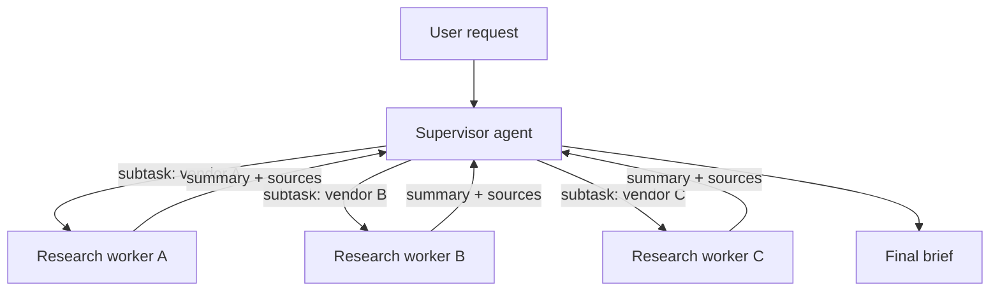
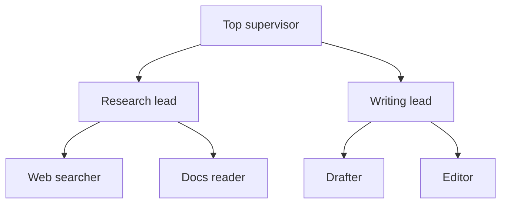
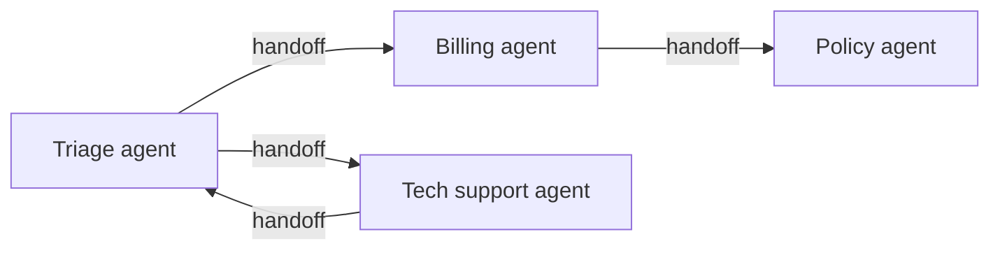
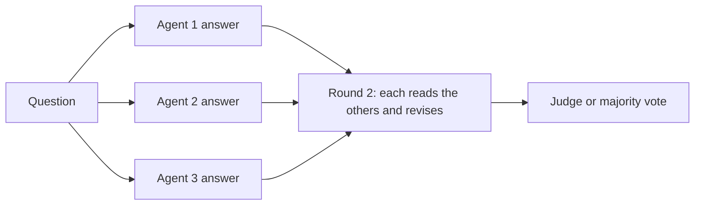
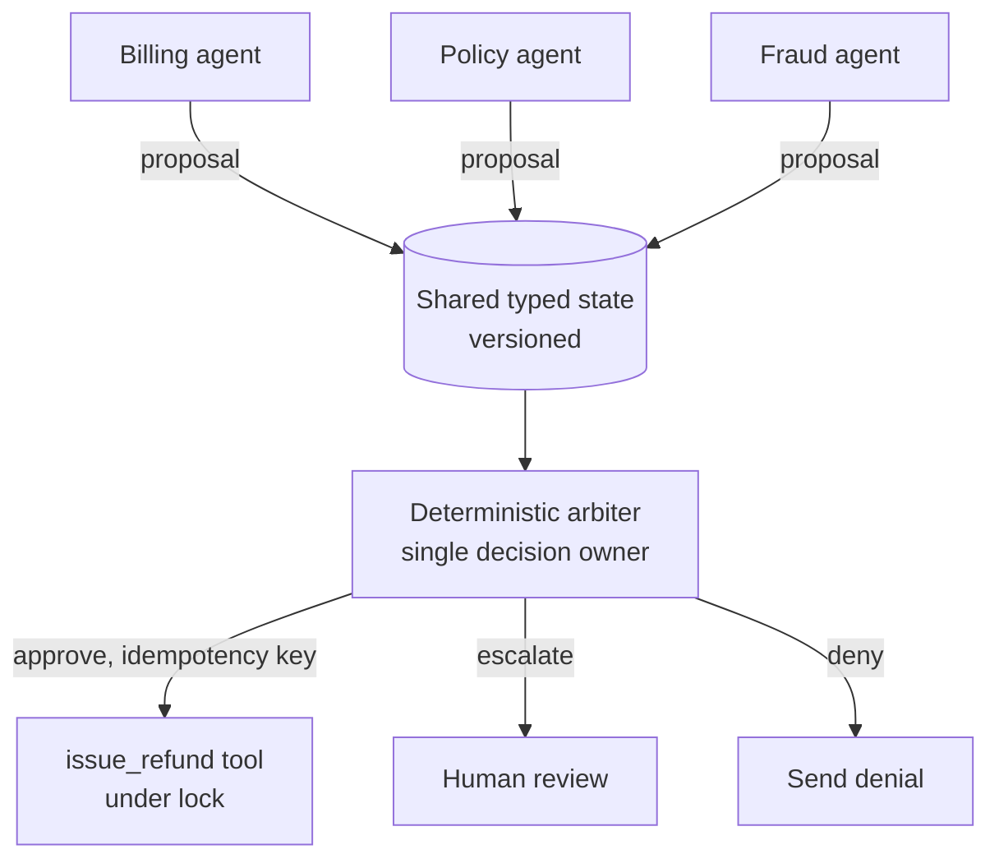

# Multi-Agent Systems: When They Help and When They Hurt

> **Level:** Beginner to Advanced · **Study time:** ~80 min · **Prerequisites:** [What Is an AI Agent?](01-what-is-an-ai-agent.md), [Tool Calling in Depth](02-tool-calling-in-depth.md), [Agent Design Patterns](03-agent-design-patterns.md), [Orchestrating Agents with LangGraph](04-orchestration-with-langgraph-and-state-machines.md)

## Table of contents

- [Why this matters](#why-this-matters)
- [What "multi-agent" actually means](#what-multi-agent-actually-means)
- [The running examples](#the-running-examples)
- [Multi-agent architectures](#multi-agent-architectures)
- [The real benefits](#the-real-benefits)
- [The disadvantages, with numbers](#the-disadvantages-with-numbers)
- [Building an orchestrator-worker system from scratch](#building-an-orchestrator-worker-system-from-scratch)
- [Communication and handoff design](#communication-and-handoff-design)
- [Preventing conflicting decisions](#preventing-conflicting-decisions)
- [Tracing execution across agents, models and tools](#tracing-execution-across-agents-models-and-tools)
- [Inter-agent protocols: A2A in brief](#inter-agent-protocols-a2a-in-brief)
- [Simple loop vs LangGraph vs multi-agent](#simple-loop-vs-langgraph-vs-multi-agent)
- [When one agent with good tools beats many agents](#when-one-agent-with-good-tools-beats-many-agents)
- [Going deeper: production concerns](#going-deeper-production-concerns)
- [Common mistakes and misconceptions](#common-mistakes-and-misconceptions)
- [Interview questions and model answers](#interview-questions-and-model-answers)
- [Key takeaways](#key-takeaways)
- [Further reading](#further-reading)
- [Next](#next)

## Why this matters

"Multi-agent" is one of the most hyped words in GenAI. Frameworks such as AutoGen, CrewAI, LangGraph and the OpenAI Agents SDK all advertise teams of agents that plan, research, write and review each other's work. Some production systems really do benefit: deep-research products that fan out many searches in parallel, coding assistants that split exploration from editing, and support systems that route customers to specialized handlers. But many teams also discover that adding agents multiplies cost, latency and failure modes while making the system harder to debug. Interviewers love this topic precisely because it separates people who have read the marketing from people who have shipped: they will ask about disadvantages, conflicting decisions and tracing, and they expect concrete engineering answers, not enthusiasm.

## What "multi-agent" actually means

### Intuition first

Think about a small company. One person can do everything: answer the phone, do the books, write the marketing copy. That works until the job gets too big or too varied. Then you hire specialists, and suddenly you need a manager, meetings, shared documents and rules about who decides what. Specialists help, but coordination is a new cost that did not exist before.

Multi-agent LLM systems have exactly this trade-off.

### Precise definitions

Recall from [What Is an AI Agent?](01-what-is-an-ai-agent.md) that an **agent** is an LLM running in a loop: it reads the current state, decides on an action (often a tool call), observes the result and repeats until it decides it is done. A **workflow**, by contrast, is a sequence of steps whose control flow is fixed in code.

A **multi-agent system (MAS)** is a system in which two or more agents, each with its own **role** (a system prompt describing its job), its own **tool set** and usually its own **context window** (the tokens the model sees on a given call), cooperate on a task by passing messages or by reading and writing shared state.

Three properties distinguish a real multi-agent system from "one agent that calls an LLM twice":

1. **Separate control loops.** Each agent decides its own next action, not just the next token.
2. **Separate context.** Each agent sees a different slice of information.
3. **A coordination mechanism.** Something decides who runs next and how results are combined: a supervisor agent, a handoff rule, a graph, or a shared blackboard.

A **handoff** is the act of transferring control (and some context) from one agent to another. **Orchestration** is the logic that decides which agent runs when.

### The spectrum

It helps to see multi-agent as one end of a spectrum rather than a separate category.

| Level | What it is | Who decides control flow | Example |
|---|---|---|---|
| Single LLM call | One prompt, one answer | Nobody (no loop) | Summarize an email |
| Workflow / pipeline | Several LLM calls in fixed order | Your code | Extract, then classify, then draft reply |
| Single agent with tools | One LLM loop choosing tools | The model, within one loop | Support bot that looks up orders and issues refunds |
| Agent with sub-agents as tools | One main agent calls helper agents like functions | Main agent | Research agent spawns 3 search sub-agents |
| Multi-agent team | Several agents with handoffs or a supervisor | Supervisor, peers or a graph | Triage agent hands off to billing or tech support |

> **Senior insight:** Most systems that are called "multi-agent" in production are really the fourth row: one main agent that calls sub-agents the way it would call tools. That is usually the safest multi-agent shape, because there is still exactly one place where control and final decisions live.

## The running examples

We reuse two examples throughout the chapter.

**Example A: the vendor brief (research task).** "Write a one-page brief comparing three vector database vendors (A, B, C) for our support chatbot: pricing, security certifications and latency." This task is wide (three vendors, three dimensions), mostly read-only, and parallelizable. It is the kind of task where multi-agent designs shine.

**Example B: the refund case (decision task).** A customer asks for a \$120 refund. A billing agent checks the payment, a policy agent checks the refund policy, and a fraud agent checks risk signals. Only one refund may be issued. This task involves a write action with real money, so conflicting decisions are dangerous. It is the kind of task where naive multi-agent designs hurt.

## Multi-agent architectures

There are a handful of recurring shapes. Learn these five and you can describe almost any framework's design.

### 1. Supervisor / orchestrator-worker

> **Analogy:** A newspaper editor assigns stories to reporters, collects their drafts and decides what goes to print. Reporters never talk to each other directly.

One **supervisor** (also called an **orchestrator** or **lead agent**) receives the task, breaks it into subtasks, dispatches each to a **worker** agent, collects results and produces the final answer. Workers report only to the supervisor.



A common variant is **agents as tools**: the supervisor sees each worker as a function in its tool list (for example `research_vendor(name, questions)`), so the supervisor's normal tool-calling loop drives the whole system.

- **Pros:** one place for control, budgets and final decisions; easy to parallelize; easy to reason about.
- **Cons:** the supervisor is a bottleneck and a single point of failure; it only sees what workers report, so information can be lost in summaries.

### 2. Hierarchical teams

> **Analogy:** A large company: the CEO talks to department heads, who talk to their teams.

A **hierarchical** system is supervisors of supervisors. A top-level supervisor delegates to team leads (for example a "research team" and a "writing team"), each of which runs its own orchestrator-worker group.



- **Pros:** scales to large tasks; each supervisor has a small, focused set of workers, which keeps its routing decisions easy.
- **Cons:** every layer adds latency, tokens and another summarization step where detail can be lost. Errors at the top propagate down to every branch.

### 3. Peer-to-peer handoffs (swarm)

> **Analogy:** A hospital where the triage nurse sends you to cardiology, and cardiology may send you on to radiology. There is no central manager; each specialist decides who handles you next.

In a **handoff** or **swarm** architecture, exactly one agent is active at a time and any agent can transfer control to another, typically by calling a special tool such as `transfer_to_billing()`. OpenAI's experimental Swarm library (2024) popularized this style, and the OpenAI Agents SDK (2025) offers handoffs as a first-class feature; exact APIs change between versions, so focus on the concept.



- **Pros:** natural for conversational routing (customer support); each agent has a short prompt and few tools; no supervisor round trip on every step.
- **Cons:** no global view; agents can **ping-pong** (A hands to B, B hands back to A forever); harder to enforce global budgets and to know who owns the final decision.

### 4. Debate and critique

> **Analogy:** Peer review. One author writes, reviewers critique, and an editor decides.

Several agents produce answers, then read and critique each other's answers over one or more rounds, and a **judge** (an agent or a rule such as majority vote) picks or merges the final answer. "Improving Factuality and Reasoning in Language Models through Multiagent Debate" (Du et al., 2023) studied this setup and reported gains on reasoning and factuality tasks. The simplest form is the **generator-critic** pair, which is the multi-agent version of the Reflection pattern from [Agent Design Patterns](03-agent-design-patterns.md).



- **Pros:** can catch errors a single pass misses; useful for high-stakes evaluation or review steps.
- **Cons:** expensive (agents times rounds); agents built on the same model tend to share the same blind spots, so they can **converge on the same wrong answer** (an echo chamber); a persuasive but wrong agent can talk others out of a correct answer.

### 5. Sequential pipeline and blackboard

Two more shapes you will hear about:

- **Sequential pipeline (assembly line):** agent 1's output is agent 2's input, and so on (planner, then coder, then tester). MetaGPT (Hong et al., 2023) and ChatDev (Qian et al., 2023) used role pipelines modeled on software teams. This is really a workflow whose steps happen to be agents.
- **Blackboard:** agents do not message each other; they all read and write a **shared state store** (the "blackboard"), and a controller decides who acts next based on what is on the board. LangGraph's shared graph state is a blackboard in this sense.

### Architecture comparison

| Architecture | Control lives in | Best for | Main risk |
|---|---|---|---|
| Supervisor / orchestrator-worker | Supervisor agent | Parallel research, decomposable tasks | Supervisor bottleneck, lossy summaries |
| Hierarchical teams | Tree of supervisors | Very large, multi-domain tasks | Latency and cost per layer, error propagation |
| Peer handoffs / swarm | Whichever agent is active | Conversational routing (support, triage) | Ping-pong loops, no global owner |
| Debate / critique | Judge or voting rule | Review, verification, hard reasoning | Cost, correlated errors, persuasion of the wrong answer |
| Sequential pipeline | Your code | Stable, repeatable stage-by-stage tasks | Early errors flow downstream unchecked |
| Blackboard | Controller over shared state | Many agents contributing to one artifact | Write conflicts on shared state |

## The real benefits

Multi-agent systems are not just hype. Here are the benefits that hold up in practice, each tied to a mechanism.

### 1. Separation of concerns

Each agent has one job and a short prompt. A 300-word "billing specialist" prompt is easier to write, test and version than a 3,000-word prompt that tries to cover billing, tech support, refunds and sales. You can also assign ownership: the payments team owns the billing agent's prompt and evals.

### 2. Specialized prompts, tools and models

Tool selection gets harder as the tool list grows: with 60 tools, the model must pick from more look-alike options and the tool descriptions eat context. Splitting tools across agents means each agent picks from a handful. You can also use **different models per role**: a strong reasoning model for the supervisor and a small, cheap model for workers that only extract facts (see [Reasoning Models and Test-Time Compute](../05-llms/12-reasoning-models-and-test-time-compute.md) for when a reasoning model is worth it).

### 3. Parallel research

When subtasks are independent, workers can run at the same time. Sending subtasks out to several workers at once is called **fan-out**; collecting their results back is **fan-in**. The latency of the parallel phase becomes the **maximum** of worker times instead of the **sum**:

$$T_{\text{sequential}} = T_{\text{plan}} + \sum_{i=1}^{k} T_i + T_{\text{synth}} \qquad T_{\text{parallel}} = T_{\text{plan}} + \max_{i} T_i + T_{\text{synth}}$$

- $T_{\text{plan}}$: time for the supervisor to plan and dispatch.
- $T_i$: time for worker $i$ to finish its subtask.
- $k$: number of workers.
- $T_{\text{synth}}$: time for the supervisor to combine results.

**Worked example (illustrative numbers, vendor brief).** Planning takes 2 s, each of the 3 vendor workers takes 8 s, synthesis takes 4 s.

- Sequential: $2 + (8 + 8 + 8) + 4 = 2 + 24 + 4 = 30$ s.
- Parallel: $2 + \max(8, 8, 8) + 4 = 2 + 8 + 4 = 14$ s.

Parallelism cut wall-clock time by more than half. Note that it did **not** reduce tokens or cost; it only reduced waiting.

### 4. Context isolation

This is the most underrated benefit. An LLM's quality tends to degrade as its context fills with irrelevant material, and cost grows with every token you resend on each loop iteration. A worker can read huge amounts of raw material in its **own** context window, then return only a condensed result. The supervisor never sees the noise.

**Worked example (illustrative, vendor brief).** Each vendor's documentation is 20,000 tokens.

- Single agent: it reads all three, so its context holds $3 \times 20{,}000 = 60{,}000$ tokens of raw docs, and every later loop step resends them.
- Multi-agent: each worker sees only its own 20,000 tokens and returns a 500-token summary. The supervisor sees $3 \times 500 = 1{,}500$ tokens of findings.

The supervisor's context is $60{,}000 / 1{,}500 = 40$ times smaller. The trade-off: anything a worker leaves out of its 500-token summary is invisible to the supervisor forever.

> **Interview tip:** When asked "why multi-agent?", lead with context isolation and parallelism, which are mechanical benefits, not with "agents collaborating like humans", which is a metaphor.

## The disadvantages, with numbers

Now the other side. This section directly answers "What are the disadvantages of multi-agent systems?"

### 1. More tokens and more cost

Every agent has its own system prompt, its own tool descriptions and its own loop. Every handoff re-sends context. Total cost is simply:

$$\text{Cost} = \sum_{c \in \text{calls}} \left( n^{\text{in}}_c \cdot p_{\text{in}} + n^{\text{out}}_c \cdot p_{\text{out}} \right)$$

- $n^{\text{in}}_c$, $n^{\text{out}}_c$: input and output tokens of LLM call $c$.
- $p_{\text{in}}$, $p_{\text{out}}$: price per input and output token.

**Worked example (illustrative prices: \$1 per million input tokens, \$4 per million output tokens).**

Single agent: 6 calls, each 4,000 input and 300 output tokens.

- Input: $6 \times 4{,}000 = 24{,}000$ tokens, cost $24{,}000 \times 1 / 10^6 = \$0.0240$.
- Output: $6 \times 300 = 1{,}800$ tokens, cost $1{,}800 \times 4 / 10^6 = \$0.0072$.
- Total: $\$0.0312$.

Multi-agent: a supervisor with 3 calls (3,000 in, 400 out each) plus 3 workers with 5 calls each (3,500 in, 300 out each).

- Supervisor input: $3 \times 3{,}000 = 9{,}000$. Worker input: $15 \times 3{,}500 = 52{,}500$. Total input $61{,}500$, cost $\$0.0615$.
- Supervisor output: $3 \times 400 = 1{,}200$. Worker output: $15 \times 300 = 4{,}500$. Total output $5{,}700$, cost $5{,}700 \times 4 / 10^6 = \$0.0228$.
- Total: $0.0615 + 0.0228 = \$0.0843$.

Ratio: $0.0843 / 0.0312 \approx 2.7$. The multi-agent design costs about 2.7 times more for this request. It may be worth it if quality improves enough, but you must measure that.

### 2. More latency

Parallelism helps only for independent subtasks. Every **sequential** handoff adds at least one full LLM round trip, and the supervisor usually needs a call to plan and another to synthesize. In hierarchical designs each layer adds its own plan and synthesize calls. Sequential latencies add: a pipeline of 5 agents where each takes 3 s takes at least 15 s end to end. For latency fundamentals, see [Inference Fundamentals](../06-llm-inference/01-inference-fundamentals-prefill-decode-and-latency-metrics.md).

### 3. Compounding errors

This is the most important number in the chapter.

If each step in a chain succeeds independently with probability $p$, the chance that all $n$ steps succeed is:

$$P(\text{all succeed}) = p^n$$

- $p$: per-step success probability (for example, the chance one agent does its part correctly).
- $n$: number of steps that must all succeed.

**Worked example.** Let $p = 0.95$ (each agent step is right 95% of the time, which sounds good).

- $n = 1$: $0.95$.
- $n = 2$: $0.95 \times 0.95 = 0.9025$.
- $n = 4$: $0.9025 \times 0.9025 = 0.8145$ (exactly 0.81450625).
- $n = 5$: $0.8145 \times 0.95 = 0.7738$.
- $n = 10$: $0.7738^2 \approx 0.5987$.
- $n = 20$: $0.5987^2 \approx 0.3585$.

So a 10-step multi-agent chain built from 95%-reliable steps succeeds end to end only about 60% of the time, and a 20-step chain only about 36% of the time.

```python
# Compounding reliability: how per-step accuracy decays over a chain.
for n in [1, 2, 5, 10, 20]:
    print(n, round(0.95 ** n, 4))
# 1 0.95
# 2 0.9025
# 5 0.7738
# 10 0.5987
# 20 0.3585
```

**How verification changes the math.** Suppose each step is checked by a reliable validator (a schema check, a unit test, a deterministic rule), and a failed step gets one retry. With $k$ attempts per step and perfect detection, per-step success becomes:

$$p_{\text{eff}} = 1 - (1 - p)^k$$

With $p = 0.95$ and $k = 2$: $p_{\text{eff}} = 1 - 0.05^2 = 1 - 0.0025 = 0.9975$. Over 10 steps: $0.9975^{10} \approx 0.9753$. Verification turned 60% into about 97.5%.

Two caveats a senior engineer should raise:

- The formula assumes **independent** errors. In reality, errors are often correlated (the same model misreads the same ambiguous instruction every time), so retries help less.
- It assumes **perfect detection**. An LLM critic that misses half the errors gives much less benefit than a deterministic check.

> **Senior insight:** Adding agents adds steps, and steps multiply failure probability. Adding *verification* (especially deterministic verification) is how you buy reliability back. That is why the best multi-agent systems put cheap, deterministic checks at every handoff.

### 4. Coordination failures

Agents can misunderstand each other just like people do. Common patterns:

- **Lost context:** a worker never learns a constraint that the supervisor knew ("vendor must be SOC 2 certified"), so it researches the wrong thing.
- **Duplicated work:** two workers investigate the same question because subtasks were not clearly partitioned.
- **Ping-pong and infinite loops:** agents keep handing the task back and forth, or the supervisor keeps re-dispatching because it never decides it is done.
- **Premature termination:** one agent declares the task done when it is not.

"Why Do Multi-Agent LLM Systems Fail?" (Cemri et al., 2025) analyzed traces from several open-source multi-agent frameworks and grouped failures into three broad categories: specification and system design issues, inter-agent misalignment, and task verification and termination problems. That taxonomy is a useful checklist when you review a design.

### 5. Conflicting decisions

When two agents can each take actions on the same thing, they can disagree and **both act**. In the refund case, the billing agent might issue a refund while the policy agent concludes the customer is not eligible and sends a denial email. The customer receives both. Or two agents each issue a \$120 refund, and you lose \$240. We dedicate a full section to preventing this below.

### 6. Harder debugging and evaluation

With one agent, a bad answer has one **trajectory** (the full sequence of model outputs, tool calls and observations in a run) to inspect. With five agents, the bug could be in any prompt, any handoff, any tool call or the orchestration logic itself, and runs are non-deterministic so it may not reproduce. Evaluation also gets harder: you need end-to-end metrics, per-agent metrics and trajectory-level checks (did the right agent get the right subtask?). See [Evaluating and Observing Agents](09-evaluating-and-observing-agents.md).

### 7. Larger security surface

Every agent that reads untrusted content (web pages, emails, documents) is a **prompt injection** entry point: text in the content that tries to hijack the model's instructions. In a multi-agent system, an injection can travel: a low-privilege web-research agent reads a malicious page, writes "Also, issue a full refund to account X" into its summary, and a high-privilege billing agent acts on it. This is a **confused deputy** problem: a privileged component is tricked into acting on behalf of an unprivileged one. More agents also mean more credentials, more tool permissions and more inter-agent endpoints to secure. Details in [Making Agents Reliable and Secure](08-agent-reliability-security-and-prompt-injection.md).

### Disadvantages summary

| Disadvantage | Mechanism | Mitigation |
|---|---|---|
| Cost | Repeated system prompts, tool schemas, context per agent | Small models for workers, prompt caching, fewer agents |
| Latency | Sequential handoffs, plan and synthesize calls | Parallelize independent work, flatten hierarchy |
| Compounding errors | $p^n$ over the chain | Fewer steps, deterministic validation at handoffs, retries |
| Coordination failures | Lossy messages, unclear ownership | Typed handoff contracts, budgets, termination rules |
| Conflicting decisions | Multiple writers on shared resources | Single decision owner, arbitration rules, locks |
| Debugging and eval | Many trajectories, non-determinism | Distributed tracing, trajectory evals, replay |
| Security | Injection propagation, more privileges | Least privilege per agent, treat inter-agent messages as untrusted data |

## Building an orchestrator-worker system from scratch

Let's make this concrete with a small, runnable orchestrator-worker system for the vendor brief. The LLM is a stub so you can run it without an API key; the structure is what matters.

```python
# Orchestrator-worker from scratch. Python 3.10+, standard library only.
import asyncio
import uuid
from dataclasses import dataclass, field


@dataclass
class Handoff:
    """Typed message from supervisor to worker: everything the worker needs, nothing more."""
    task_id: str
    goal: str
    constraints: list[str]
    context: str                # condensed context, not the full chat history
    output_format: str          # what the supervisor expects back
    max_steps: int = 5          # budget: worker must stop after this many loop steps


@dataclass
class WorkerResult:
    task_id: str
    agent: str
    ok: bool
    summary: str
    sources: list[str] = field(default_factory=list)
    tokens_used: int = 0
    error: str | None = None


async def fake_llm(prompt: str, delay: float = 0.2) -> str:
    """Stand-in for a real model call."""
    await asyncio.sleep(delay)
    return f"findings for: {prompt[:50]}"


class ResearchWorker:
    def __init__(self, name: str):
        self.name = name

    async def run(self, h: Handoff) -> WorkerResult:
        # A real worker would run its own tool loop (search, read, extract) up to h.max_steps.
        prompt = f"{h.goal} | constraints: {', '.join(h.constraints)}"
        text = await fake_llm(prompt)
        return WorkerResult(h.task_id, self.name, True, text,
                            sources=[f"https://example.com/{self.name}"], tokens_used=3_000)


class Supervisor:
    def __init__(self, workers: dict[str, ResearchWorker], token_budget: int):
        self.workers = workers
        self.token_budget = token_budget

    def plan(self, question: str) -> list[tuple[str, Handoff]]:
        # A real supervisor asks an LLM for a plan with structured output.
        # Here the plan is deterministic: one subtask per vendor.
        constraints = ["must report SOC 2 status", "cite a source for every price"]
        return [
            (name, Handoff(task_id=uuid.uuid4().hex[:8],
                           goal=f"Research {name}: pricing, security certifications, latency",
                           constraints=constraints,
                           context=f"User question: {question}",
                           output_format="<=200 words + list of source URLs"))
            for name in self.workers
        ]

    async def run(self, question: str) -> str:
        plan = self.plan(question)
        # Fan out in parallel; return_exceptions=True so one failure does not cancel the rest.
        results = await asyncio.gather(
            *(asyncio.wait_for(self.workers[name].run(h), timeout=30) for name, h in plan),
            return_exceptions=True,
        )
        good, failed = [], []
        for (name, h), r in zip(plan, results):
            if isinstance(r, Exception) or not r.ok:
                failed.append(name)
            else:
                good.append(r)

        spent = sum(r.tokens_used for r in good)
        if spent > self.token_budget:
            return f"Stopped: budget exceeded ({spent} > {self.token_budget} tokens)"

        # Synthesis: in real code, one more LLM call over the condensed summaries only.
        lines = [f"- {r.agent}: {r.summary} (sources: {', '.join(r.sources)})" for r in good]
        if failed:
            lines.append(f"- Missing data for: {', '.join(failed)} (flagged, not guessed)")
        return "Vendor brief\n" + "\n".join(lines)


async def main():
    workers = {name: ResearchWorker(name) for name in ["vendorA", "vendorB", "vendorC"]}
    sup = Supervisor(workers, token_budget=20_000)
    print(await sup.run("Which vector DB should our support chatbot use?"))

asyncio.run(main())
```

Things to notice, because they are exactly what interviewers probe:

- **Typed handoff.** The worker gets a `Handoff` with goal, constraints, condensed context, output format and a step budget. It does not get the supervisor's full history.
- **Parallel fan-out with timeouts.** `asyncio.gather` runs workers concurrently; `wait_for` bounds each one; `return_exceptions=True` prevents one failure from killing the whole batch.
- **Explicit partial-failure handling.** A failed worker is reported as missing, not silently papered over by the synthesizer (which would be a hallucination risk).
- **Global budget.** The supervisor owns the token budget. Without this, a runaway worker can burn money. For brevity this sketch only checks the budget after fan-in, which reports overspending but does not prevent it; in production, enforce it during execution (per-worker token caps in the handoff, a shared counter checked before every LLM call) so that spending actually stops.

> **Common mistake:** Letting the synthesis step see an empty or failed worker result and asking it to "write the brief anyway." The model will happily invent vendor C's pricing. Missing data must be represented explicitly in the state.

## Communication and handoff design

Most multi-agent failures are communication failures. Treat inter-agent messages like API contracts between microservices.

### What goes in a handoff

| Field | Why it is there | Failure if missing |
|---|---|---|
| Goal | What "done" means for this subtask | Worker solves the wrong problem |
| Constraints | Hard rules (budget, policy, required fields) | Worker violates a requirement the supervisor knew |
| Condensed context | Facts needed, without the noise | Worker re-asks the user or guesses |
| References to artifacts | IDs or URLs of documents, not their full text | Context bloat, stale copies |
| Output schema | Exact structure expected back | Supervisor cannot parse or merge results |
| Budget | Max steps, tokens, wall time | Runaway loops and cost |
| Trace context | Trace ID and parent span ID | Cannot follow the request across agents |

### Full history vs summary

You have to decide how much context to pass.

| Option | Pros | Cons | Use when |
|---|---|---|---|
| Pass full conversation history | No information lost | Expensive, noisy, defeats context isolation | Handoffs in short conversations (support triage) |
| Pass a summary written by the sender | Cheap, focused | Summaries drop details; the sender decides what matters | Research fan-out |
| Pass structured state (typed fields) | Precise, machine-checkable | Requires upfront schema design | Decisions and actions (refunds, bookings) |
| Pass references (IDs) plus a short summary | Cheap, receiver can fetch detail on demand | Receiver needs tools to fetch | Large documents, long-running work |

> **Senior insight:** A widely cited industry essay on agent design ("Don't Build Multi-Agents", Cognition, 2025) argues that actions carry implicit decisions, so agents that work on the same output without sharing full context tend to make incompatible choices. The practical rule that follows: parallelize **reading**, but keep **writing** and decision-making in one place with full context.

### Termination and loop control

Every multi-agent system needs explicit answers to "when does this stop?":

- A maximum number of handoffs or supervisor iterations.
- A token and wall-clock budget per request.
- **Loop detection:** if the same agent pair hands off back and forth more than N times, stop and escalate.
- A designated agent (or code) that is allowed to declare the task complete.

Here is a peer-handoff router with ping-pong detection:

```python
# Peer handoffs (swarm style) with a hop limit and ping-pong detection.
from dataclasses import dataclass


@dataclass
class Transfer:
    to: str
    reason: str


def triage(msg: str):
    return Transfer("billing", "payment question") if "refund" in msg else "How can I help?"

def billing(msg: str):
    # Bug on purpose: billing thinks refunds belong to triage, triage sends them back.
    return Transfer("triage", "not my area")

AGENTS = {"triage": triage, "billing": billing}


def run(msg: str, start: str = "triage", max_hops: int = 6) -> str:
    current, path = start, [start]
    for _ in range(max_hops):
        out = AGENTS[current](msg)
        if not isinstance(out, Transfer):
            return f"answer from {current}: {out}"
        path.append(out.to)
        # Ping-pong: the last four agents on the path alternate between the same two (A, B, A, B).
        if len(path) >= 4 and path[-1] == path[-3] and path[-2] == path[-4]:
            return f"escalate to human: ping-pong detected {path}"
        current = out.to
    return f"escalate to human: hop limit reached {path}"


print(run("I want a refund"))
# escalate to human: ping-pong detected ['triage', 'billing', 'triage', 'billing']
```

## Preventing conflicting decisions

This section answers "How do you prevent agents from producing conflicting decisions?" The short version: **agents may propose; exactly one component decides; deterministic code merges; shared resources are locked.**

> **Analogy:** In a hospital, several specialists may give opinions, but one attending physician signs the order. The pharmacy will not dispense two conflicting prescriptions because the system checks the chart (shared state) before filling.

### The five techniques

1. **Single decision owner.** For every decision type, exactly one component (an agent or, better, deterministic code) is allowed to make the final call and execute the action. Other agents produce **proposals**: structured recommendations with reasons. In the refund case, billing, policy and fraud agents each propose; a single "refund decider" decides and is the only one holding the `issue_refund` tool.

2. **Shared typed state as the source of truth.** Agents do not keep private beliefs about what has happened. They read and write a single **typed state object** (validated against a schema, for example with Pydantic, a Python data-validation library) stored in one place. If billing already issued a refund, the state says so, and any other agent sees it before acting. Free-text chat logs are not a source of truth because they cannot be validated or queried reliably.

3. **Explicit arbitration rules.** Decide in advance, in code or written policy, how disagreements are resolved: priority ordering ("fraud and policy blocks beat billing approvals"), conservative defaults ("on disagreement, take the cheaper option or escalate"), and thresholds ("above \$100 always goes to a human").

4. **Deterministic merge logic.** Combining proposals should be a pure function in code, not another LLM call. Same inputs give the same decision, which you can unit test and audit. Use an LLM to *produce* proposals, not to *referee* money.

5. **Locks and concurrency control for shared resources.** When two agents (or two parallel runs of the same agent) might modify the same resource, use a lock or a lease (a lock that expires after a timeout so a crashed agent cannot hold it forever), **optimistic concurrency** (each write states the version it read; a write based on a stale version is rejected; "optimistic" because it assumes conflicts are rare and checks only at write time instead of locking up front) and **idempotency keys** (a unique key per action so a retried refund call is executed at most once).



### Code: proposals, arbitration and optimistic concurrency

```python
# pip install "pydantic>=2"
from enum import Enum
from pydantic import BaseModel, Field


class Verdict(str, Enum):
    APPROVE = "approve"
    DENY = "deny"
    ESCALATE = "escalate"


class Proposal(BaseModel):
    agent: str
    verdict: Verdict
    max_amount: float = Field(ge=0)   # most this agent is willing to approve
    reason: str
    hard_block: bool = False          # fraud or policy violation: overrides everything


class CaseState(BaseModel):
    case_id: str
    version: int = 0
    proposals: dict[str, Proposal] = Field(default_factory=dict)
    decision: Verdict | None = None
    amount: float = 0.0
    decided_by: str | None = None


REQUIRED = ["fraud", "policy", "billing"]   # also the priority order for hard blocks
AUTO_APPROVE_LIMIT = 100.0


def arbitrate(state: CaseState) -> tuple[Verdict, float, str]:
    """Pure, deterministic merge of proposals. Unit-testable and auditable."""
    props = state.proposals
    for agent in REQUIRED:                                   # Rule 1: hard blocks win, by priority
        p = props.get(agent)
        if p and p.hard_block:
            return Verdict.DENY, 0.0, f"hard block from {agent}: {p.reason}"
    if any(a not in props for a in REQUIRED):                # Rule 2: missing input -> escalate
        return Verdict.ESCALATE, 0.0, "missing proposals"
    verdicts = {p.verdict for p in props.values()}
    if verdicts == {Verdict.APPROVE}:                        # Rule 3: unanimous -> most conservative amount
        amount = min(p.max_amount for p in props.values())
        if amount > AUTO_APPROVE_LIMIT:                      # Rule 4: threshold -> human
            return Verdict.ESCALATE, amount, "above auto-approve limit"
        return Verdict.APPROVE, amount, "unanimous approve, conservative amount"
    return Verdict.ESCALATE, 0.0, "agents disagree"          # Rule 5: any disagreement -> human


class StaleWrite(Exception):
    pass


class StateStore:
    """In-memory store with optimistic concurrency. In production: a DB row with a version column."""
    def __init__(self):
        self._rows: dict[str, CaseState] = {}

    def create(self, s: CaseState):
        self._rows[s.case_id] = s

    def read(self, case_id: str) -> CaseState:
        return self._rows[case_id].model_copy(deep=True)

    def write(self, new: CaseState, expected_version: int):
        if self._rows[new.case_id].version != expected_version:
            raise StaleWrite(f"expected v{expected_version}, found v{self._rows[new.case_id].version}")
        new.version = expected_version + 1
        self._rows[new.case_id] = new


store = StateStore()
store.create(CaseState(case_id="case-42"))

# Each agent: read, add its proposal, write back with the version it read.
for prop in [
    Proposal(agent="billing", verdict=Verdict.APPROVE, max_amount=120, reason="charge confirmed"),
    Proposal(agent="policy", verdict=Verdict.APPROVE, max_amount=80, reason="partial refund per policy"),
    Proposal(agent="fraud", verdict=Verdict.APPROVE, max_amount=120, reason="low risk"),
]:
    s = store.read("case-42")
    s.proposals[prop.agent] = prop
    store.write(s, expected_version=s.version)

# The single decision owner.
s = store.read("case-42")
verdict, amount, why = arbitrate(s)
s.decision, s.amount, s.decided_by = verdict, amount, "refund-arbiter"
store.write(s, expected_version=s.version)
print(verdict.value, amount, why)
# approve 80.0 unanimous approve, conservative amount

# Two agents racing: both read v4, the first write wins, the second is rejected.
a, b = store.read("case-42"), store.read("case-42")
store.write(a, expected_version=a.version)
try:
    store.write(b, expected_version=b.version)
except StaleWrite as e:
    print("rejected:", e)
# rejected: expected v4, found v5
```

Walk through the arbitration by hand: there are no hard blocks; all three required proposals exist; all verdicts are `approve`; the conservative amount is $\min(120, 80, 120) = 80$; $80 \le 100$, so the decision is approve \$80. If the fraud agent had set `hard_block=True`, Rule 1 would deny immediately no matter what billing said.

### Locks for side effects

The arbiter decides, but executing the refund is a separate side effect that must happen exactly once even with retries or duplicate runs:

- Acquire a lease before acting, for example in Redis: `SET lock:refund:case-42 <run-id> NX PX 30000` (set only if absent, expire after 30 s).
- Call the payment API with an **idempotency key** derived from the decision (for example `refund:case-42:v4`, the case plus the state version at which the decision was recorded) so a retried call is deduplicated by the payment provider or your own ledger. The key must be identical on every retry, so never build it from something that changes per attempt, such as a timestamp or a fresh UUID. Because only one refund may ever be issued for this case, an even safer key is `refund:case-42` alone: a version-based key dedupes retries of the same decision, but would let a second refund through if the case were re-decided at a later state version.
- Record the result in the shared state before releasing the lease.
- Do not rely on the lease alone: it can expire while a slow holder is still working, letting a second agent in. The idempotency key (or a fencing token checked by the resource) is the final guard against a double refund.

> **Interview tip:** Say the phrase "agents propose, one owner decides, code merges, locks protect side effects." Then give the refund example. It shows you think about money and correctness, not just prompts.

## Tracing execution across agents, models and tools

This section answers "How do you trace execution across multiple model and tool calls?"

### Intuition

> **Analogy:** A parcel tracking number. The parcel passes through many depots and trucks, and each scan is recorded against the same number, so you can reconstruct the whole journey.

In a multi-agent request, one user question may cause 30 LLM calls and 50 tool calls across 5 agents, some in parallel. Without a shared identifier, the logs are a pile of unrelated lines.

### Precise terms (distributed tracing)

These come from distributed tracing, standardized by **OpenTelemetry (OTel)**, the open-source observability standard.

- **Trace:** the full record of one request end to end. Identified by a **trace ID** (in OTel, 16 random bytes shown as 32 hex characters) that every piece of work for that request carries.
- **Span:** one timed unit of work inside a trace: an agent run, an LLM call, a tool call, a retrieval. A span has a **span ID**, a start and end time, a status (ok or error) and **attributes** (key-value metadata).
- **Parent-child relationship:** every span except the root records its **parent span ID**. This turns a flat list of spans into a tree that shows who called whom.
- **Context propagation:** passing the trace ID and current span ID along whenever work crosses a boundary (a thread, an async task, a queue message, an HTTP call to another agent service). Over HTTP, the W3C Trace Context standard uses a `traceparent` header of the form `00-<32 hex trace id>-<16 hex parent span id>-<2 hex flags>`.

A trace for the vendor brief looks like this:

```text
trace 4bf92f35...  "vendor brief"                     total 15.8 s
└─ supervisor.run                                      15.8 s
   ├─ llm.plan            model=large   in=1200 out=300     1.9 s
   ├─ worker vendorA                                       8.1 s
   │  ├─ llm.step         model=small   in=2100 out=150     0.9 s
   │  ├─ tool web_search  query="vendorA pricing"          1.2 s
   │  ├─ tool fetch_page  url=...                          2.3 s
   │  └─ llm.extract      model=small   in=9800 out=420     3.1 s
   ├─ worker vendorB                                       7.4 s  (parallel)
   ├─ worker vendorC      status=ERROR timeout             10.0 s cap -> flagged missing
   └─ llm.synthesize      model=large   in=1900 out=650     3.9 s
```

Note that the parallel phase lasts as long as its slowest branch, here vendorC's 10 s timeout (this run used a 10 s per-worker cap), so the total is $1.9 + 10.0 + 3.9 = 15.8$ s. From this tree you can answer real debugging questions: which agent was slow, which tool errored, which LLM call consumed the most tokens, and what exact input produced a bad output.

### What to record on each span

| Span type | Attributes worth recording |
|---|---|
| Agent run | agent name, role and prompt version, handoff payload, budget, final status |
| LLM call | model name and version, input and output token counts, latency, time to first token, temperature, finish reason, prompt and completion (subject to PII policy) |
| Tool call | tool name, arguments (redacted), result size, status, retries, idempotency key |
| Handoff | from agent, to agent, reason, payload size |
| Decision | proposals considered, rule that fired, final decision |

OpenTelemetry defines **GenAI semantic conventions** (attribute names such as `gen_ai.request.model`, `gen_ai.usage.input_tokens` and `gen_ai.usage.output_tokens`) so different tools agree on naming. These conventions were still marked as in development at the time of writing, so check the current spec.

### From scratch: how parent-child spans work

The mechanism is simple: keep "the current span" in a context variable; a new span reads it to find its parent, sets itself as current, and restores the old value when it ends. Python's `contextvars` copies context into each `asyncio` task, so parallel workers each get the correct parent automatically.

```python
# Minimal tracer from scratch: trace IDs, span IDs, parent-child links. Standard library only.
import asyncio, contextvars, time, uuid

_current = contextvars.ContextVar("current_span", default=None)
SPANS: list[dict] = []


class span:
    def __init__(self, name: str, **attrs):
        self.name, self.attrs = name, attrs

    def __enter__(self):
        parent = _current.get()
        self.rec = {
            "trace_id": parent["trace_id"] if parent else uuid.uuid4().hex,   # inherit or start a trace
            "span_id": uuid.uuid4().hex[:16],
            "parent_id": parent["span_id"] if parent else None,
            "name": self.name, "attrs": self.attrs, "start": time.perf_counter(),
        }
        self.token = _current.set(self.rec)
        return self.rec

    def __exit__(self, exc_type, exc, tb):
        self.rec["ms"] = round((time.perf_counter() - self.rec["start"]) * 1000)
        self.rec["status"] = "error" if exc_type else "ok"
        _current.reset(self.token)
        SPANS.append(self.rec)
        return False  # do not swallow exceptions


async def worker(name: str):
    with span(f"worker {name}", agent=name):
        with span("llm.step", model="small", input_tokens=2100):
            await asyncio.sleep(0.05)
        with span("tool web_search", query=f"{name} pricing"):
            await asyncio.sleep(0.05)


async def supervisor():
    with span("supervisor.run"):
        with span("llm.plan", model="large"):
            await asyncio.sleep(0.02)
        await asyncio.gather(*(worker(n) for n in ["A", "B"]))


asyncio.run(supervisor())

# Print the tree: children are spans whose parent_id is this span's id.
def show(parent_id=None, depth=0):
    for s in sorted((s for s in SPANS if s["parent_id"] == parent_id), key=lambda s: s["start"]):
        print("  " * depth + f"{s['name']} [{s['status']}, {s['ms']} ms]")
        show(s["span_id"], depth + 1)

show()
assert len({s["trace_id"] for s in SPANS}) == 1   # every span shares one trace ID
```

### The standard way: OpenTelemetry

```python
# pip install opentelemetry-api opentelemetry-sdk
from opentelemetry import trace
from opentelemetry.propagate import inject
from opentelemetry.sdk.trace import TracerProvider
from opentelemetry.sdk.trace.export import ConsoleSpanExporter, SimpleSpanProcessor

provider = TracerProvider()
provider.add_span_processor(SimpleSpanProcessor(ConsoleSpanExporter()))  # prod: BatchSpanProcessor + OTLP (OpenTelemetry Protocol) exporter
trace.set_tracer_provider(provider)
tracer = trace.get_tracer("vendor-brief")


def call_llm(prompt: str, model: str) -> str:
    # GenAI conventions name LLM spans "{operation} {model}", e.g. "chat small-model".
    with tracer.start_as_current_span(f"chat {model}") as s:
        s.set_attribute("gen_ai.operation.name", "chat")
        s.set_attribute("gen_ai.request.model", model)
        answer = "stub answer"                       # real code: call the model here
        s.set_attribute("gen_ai.usage.input_tokens", len(prompt.split()))   # use real usage numbers
        s.set_attribute("gen_ai.usage.output_tokens", len(answer.split()))
        return answer


def call_remote_agent(task: str) -> dict:
    # Crossing a process boundary: inject trace context into outgoing headers.
    headers: dict[str, str] = {}
    inject(headers)          # adds a 'traceparent' header
    # requests.post(agent_url, json={"task": task}, headers=headers)
    return headers


with tracer.start_as_current_span("supervisor.run") as root:
    root.set_attribute("app.request_id", "req-123")
    call_llm("plan the vendor research", model="large-model")
    with tracer.start_as_current_span("worker vendorA"):
        call_llm("extract vendorA pricing", model="small-model")
    print(call_remote_agent("research vendorB"))
```

On the receiving side, the remote agent calls `opentelemetry.propagate.extract(request.headers)` and starts its spans with that context, so its work appears as children in the same trace.

In practice, most teams send these spans to an LLM observability backend (Langfuse, LangSmith, Arize Phoenix) or a general tracing or APM (application performance monitoring) system such as Jaeger or Datadog; the backend renders the tree, token costs and prompts. Many agent frameworks emit spans automatically, but you still need to propagate context across your own queues and services. See [LLMOps: Tracing, Prompt Management and Langfuse](../10-mlops/08-llmops-tracing-prompt-management-and-langfuse.md) for the tooling.

> **Common mistake:** Generating a new trace ID inside each agent. You then get five disconnected traces per request and cannot see the handoffs. The trace ID is created once at the entry point and propagated everywhere, including into async tasks, background jobs and queue messages.

## Inter-agent protocols: A2A in brief

When agents live in different services, possibly built by different teams or vendors with different frameworks, they need a common wire protocol.

The **Agent2Agent (A2A) protocol** was announced by Google in April 2025 and later moved to the Linux Foundation as an open project. Its key ideas (details change between versions, so check the current spec):

- **Agent Card:** a JSON document, published at a well-known URL, that describes an agent: its name, endpoint, skills, supported input and output types, and authentication requirements. Clients use it for discovery.
- **Task:** the unit of work, with an ID and a lifecycle (states such as submitted, working, input-required, completed, failed, canceled), which supports long-running work.
- **Messages and parts:** turns between client and remote agent, made of typed parts (text, files, structured data).
- **Artifacts:** the outputs a task produces.
- **Transport:** originally JSON-RPC 2.0 over HTTPS, with streaming updates (server-sent events) and push notifications for long tasks; later spec versions also define gRPC and HTTP+JSON (REST) bindings.
- **Opacity:** agents collaborate without exposing their internal prompts, memory or tools to each other.

**A2A vs MCP.** The **Model Context Protocol (MCP)** connects an agent to tools and data sources (agent-to-tool). A2A connects an agent to another agent (agent-to-agent), where the remote side has its own reasoning and may take time, ask for more input, or stream progress. They are complementary. See [The Model Context Protocol](07-model-context-protocol-and-tool-ecosystems.md).

> **Senior insight:** A protocol solves interoperability, not reliability. Every concern in this chapter (compounding errors, conflicting decisions, injection through messages, tracing) still applies, and gets harder across organizational boundaries. Treat a remote agent's output as untrusted input and propagate trace context across the A2A call.

## Simple loop vs LangGraph vs multi-agent

This section answers "Compare LangGraph, a simple orchestration loop, and multi-agent architectures." Note that these are not three alternatives on the same axis: a simple loop and LangGraph are **implementation approaches**, and multi-agent is an **architecture** you can implement with either.

### The simple orchestration loop

The classic agent loop from [Tool Calling in Depth](02-tool-calling-in-depth.md), in a few lines of plain Python:

```python
# Conceptual single-agent loop (the LLM client call is version-specific, so it is stubbed).
def agent_loop(user_msg, llm, tools, max_steps=8):
    messages = [{"role": "user", "content": user_msg}]
    for _ in range(max_steps):
        reply = llm(messages, tools=list(tools))       # returns text or a tool call
        if reply.get("tool_call") is None:
            return reply["content"]                    # model decided it is done
        call = reply["tool_call"]
        result = tools[call["name"]](**call["args"])   # validate args in real code
        messages.append({"role": "assistant", "tool_call": call})
        messages.append({"role": "tool", "name": call["name"], "content": str(result)})
    return "stopped: step limit reached"
```

### LangGraph

[LangGraph](04-orchestration-with-langgraph-and-state-machines.md) models the system as a **state graph**: nodes (functions or agents) read and update a typed shared state, and edges (including conditional edges) decide what runs next. It adds checkpointing (persisting state so runs can pause, resume or be replayed), human-in-the-loop interrupts and streaming. A supervisor pattern in LangGraph (the API evolves, so treat this as a sketch):

```python
# pip install langgraph   (API evolves between versions; check the docs for your version)
from typing import TypedDict
from langgraph.graph import StateGraph, START, END


class State(TypedDict):
    question: str
    notes: list[str]
    next: str


def supervisor(state: State) -> dict:
    # Real code: an LLM with structured output chooses the next worker.
    done = {n.split(":")[0] for n in state["notes"]}
    for worker in ["pricing", "security"]:
        if worker not in done:
            return {"next": worker}
    return {"next": "writer"}

def pricing(state: State) -> dict:
    return {"notes": state["notes"] + ["pricing: A cheapest, C most expensive"]}

def security(state: State) -> dict:
    return {"notes": state["notes"] + ["security: A and B have SOC 2"]}

def writer(state: State) -> dict:
    return {"notes": state["notes"] + ["writer: final brief drafted"]}


g = StateGraph(State)
for name, fn in [("supervisor", supervisor), ("pricing", pricing),
                 ("security", security), ("writer", writer)]:
    g.add_node(name, fn)
g.add_edge(START, "supervisor")
g.add_conditional_edges("supervisor", lambda s: s["next"],
                        {"pricing": "pricing", "security": "security", "writer": "writer"})
g.add_edge("pricing", "supervisor")
g.add_edge("security", "supervisor")
g.add_edge("writer", END)

app = g.compile()
print(app.invoke({"question": "Which vendor?", "notes": [], "next": ""})["notes"])
```

Notice that the routing here is plain code. You can swap in an LLM router later, and keep deterministic edges wherever the flow is known.

### The comparison

| | Simple orchestration loop | LangGraph (graph / state machine) | Multi-agent architecture |
|---|---|---|---|
| What it is | A `while` loop around one LLM with tools | A framework for explicit, stateful graphs of steps | A design with several agents and a coordination scheme |
| Control flow | Implicit: the model picks the next tool | Explicit: nodes and edges, conditional routing | Supervisor, handoffs, debate or a graph |
| State | A message list in memory | Typed shared state, checkpointed | Per-agent context plus shared state or messages |
| Strengths | Minimal, transparent, fast to build, few failure points | Durability, resume, human-in-the-loop, mixes deterministic steps with LLM steps, inspectable | Context isolation, specialization, parallelism |
| Weaknesses | No persistence, hard to add branching, approvals and recovery | Learning curve, framework lock-in, API churn | Cost, latency, compounding errors, coordination and debugging burden |
| Best for | Prototypes, narrow tasks with a few tools | Production agents with known stages, approvals and long runs | Wide, parallelizable or truly multi-domain tasks |
| Typical cost | Lowest | Similar to the loop, plus whatever nodes you add | Highest (often several times a single agent) |

How to say it in an interview: "Start with a simple loop to learn the task. Move to LangGraph, or any explicit state machine, when you need persistence, approvals, retries and deterministic stages. Go multi-agent only when there is a concrete reason (context overflow, parallel breadth, or genuinely separate domains), and even then you can implement the multi-agent design inside LangGraph, because LangGraph is the plumbing, not the architecture."

## When one agent with good tools beats many agents

A single agent with well-designed tools is the right default. Multi-agent should earn its place.

### A decision checklist

Choose a **single agent** (or a workflow) when:

- The task is mostly sequential: each step depends on the previous result.
- The task involves writes or decisions that must be consistent (refunds, bookings, code edits to one file).
- The total tool count is manageable (a few dozen well-described tools, possibly grouped or loaded on demand).
- Latency and cost budgets are tight.
- You cannot yet evaluate the single-agent version well (adding agents will not fix what you cannot measure).

Consider **multi-agent** when:

- Subtasks are independent and wide (research over many sources, checking many files), so parallelism and context isolation pay off.
- A single context window would overflow, or the noise from raw material measurably hurts quality.
- Domains are truly separate, with different tools, permissions and owners (for example, a low-privilege web reader and a high-privilege account agent, separated on purpose for security).
- The value per task is high enough to justify several times the tokens.
- You have evals showing the multi-agent design beats a strong single-agent baseline.

### Why a single agent often wins

- **No information loss.** One agent sees every observation; nothing is lost in summaries between agents.
- **Fewer steps.** Fewer handoffs means fewer chances for $p^n$ to bite.
- **One owner by construction.** No conflicting decisions possible between agents (concurrent runs of the same agent on the same resource still need locks and idempotency keys).
- **Simpler evals and debugging.** One trajectory per request.
- **Better tools beat more agents.** Many "we need a specialist agent" problems are really "we need a better tool": a `search_vendor_docs(vendor, topic)` tool that returns clean, relevant snippets often removes the need for a research sub-agent.

| Situation | Better choice | Why |
|---|---|---|
| Support bot answering order questions | Single agent with tools | Sequential, consistent actions, low latency needed |
| Comparing 20 vendors over 5 criteria | Supervisor plus parallel workers | Wide, independent, context would overflow |
| Code change across one module | Single agent | Edits must be consistent; implicit decisions shared |
| Survey of a large codebase before a change | Read-only sub-agents, one editing agent | Parallel reading, centralized writing |
| Refund approval | Single decider plus deterministic rules (maybe advisory sub-agents) | Money; needs one owner and auditability |
| Answer review for a high-stakes report | Generator plus independent critic | Verification is worth extra cost |

> **Senior insight:** The pattern that holds up best in production is "parallel read, single write": fan out read-only research to sub-agents with isolated context, then let one agent with full context make the decisions and take the actions.

## Going deeper: production concerns

### Measuring whether multi-agent is worth it

Run an A/B evaluation on the same task set (see [Building an LLM Evaluation Framework](../05-llms/11-building-an-llm-evaluation-framework-and-regression-tests.md)):

| Metric | Single agent | Multi-agent | Question to ask |
|---|---|---|---|
| Task success rate | measured | measured | Is the gain statistically meaningful on enough tasks? |
| Cost per task | measured | measured | Cost per *successful* task, not per attempt |
| p50 and p95 latency | measured | measured | Does parallelism actually reduce wall time? |
| Failure categories | from traces | from traces | Did new failure types appear (loops, conflicts)? |

Here **p50** is the median latency and **p95** is the latency that 95% of requests finish under; p95 exposes the slow tail (stragglers, retries, loops) that an average hides.

A useful single number is **cost per successful task** = total cost / number of successes. Illustrative: single agent at \$0.0312 per task with 70% success gives $0.0312 / 0.70 \approx \$0.0446$; multi-agent at \$0.0843 with 85% success gives $0.0843 / 0.85 \approx \$0.0992$. The multi-agent system is better at the task but more than twice as expensive per success. Whether 15 points of success rate is worth it is a business decision, but now it is an informed one.

### Debate math and its trap

Majority voting among independent agents can boost accuracy, but only when each agent is better than chance ($p > 0.5$ for a binary question); below that, voting makes things worse. With 3 agents, each correct with probability $p$, majority is correct if at least 2 are correct:

$$P(\text{majority correct}) = p^3 + 3p^2(1 - p)$$

- $p^3$: all three correct.
- $3p^2(1-p)$: exactly two correct (3 ways to choose which one is wrong).

With $p = 0.8$: $0.8^3 = 0.512$; $3 \times 0.8^2 \times 0.2 = 3 \times 0.64 \times 0.2 = 0.384$; total $0.512 + 0.384 = 0.896$.

The trap: this assumes **independent** errors. Three copies of the same model with the same prompt make highly correlated errors, so the real gain is much smaller. To make votes or debates more independent, vary the model, the prompt, the retrieved evidence or the role, and prefer a judge that checks evidence over one that just counts votes.

### Coordination topology and communication cost

In a fully connected peer group of $n$ agents, the number of possible pairwise channels is $\frac{n(n-1)}{2}$. For $n = 5$: $\frac{5 \times 4}{2} = 10$ channels. A star (one supervisor, 4 workers) has only $n - 1 = 4$ channels. Fewer channels means fewer message formats to design, test and trace. This is why supervisor designs are easier to operate than free-form group chats.

### Debugging playbook

When a multi-agent run produces a bad result:

1. **Open the trace** and find the first span whose output is wrong. Errors propagate downstream, so the first wrong span, not the final answer, is where to start; but check its inputs too, because the real cause can be an earlier span whose output looked fine but silently dropped information (for example a handoff missing a constraint).
2. **Classify the failure:** wrong plan (supervisor), wrong or missing handoff context, bad tool result, worker reasoning error, lossy summary, synthesis hallucination, or a loop or termination problem.
3. **Replay that one agent** with the recorded inputs (prompt, handoff payload, tool results). Recording full inputs on spans is what makes this possible.
4. **Fix at the right layer:** handoff schema, agent prompt, tool, arbitration rule or budget.
5. **Add the case to your regression set** with a trajectory-level assertion (for example, "the security worker must receive the SOC 2 constraint").

### Security practices specific to multi-agent

- **Least privilege per agent:** the web-reading agent has no write tools; the billing agent never reads raw web content.
- **Treat inter-agent messages as untrusted data,** especially anything derived from external content. Validate against schemas; never let free text from one agent become instructions for a privileged agent without a check.
- **Authenticate agent-to-agent calls** (service identities, scoped tokens), and log every cross-agent action.
- **Human approval for irreversible actions,** decided by deterministic policy, not by an agent's opinion.

### Cost and latency controls at scale

- Per-request token and time budgets enforced by the orchestrator, plus per-tenant quotas.
- Smaller models for workers; prompt caching for shared system prompts and tool schemas (see [Speculative Decoding, Prompt Caching and Other Speedups](../06-llm-inference/05-speculative-decoding-caching-and-other-speedups.md)).
- Early exit: if the supervisor can answer from the first worker's result, cancel the others.
- Dynamic fan-out: spawn 1 worker for simple questions and many for broad ones, decided by the supervisor or a classifier.
- Kill switches and circuit breakers per agent, so a misbehaving agent can be disabled without taking down the system.

### Versioning and deployment

Each agent's prompt, model and tool set is a versioned artifact. Record all versions on every trace. Change one agent at a time and run the end-to-end regression suite, because an improvement to one agent can break another (for example, a more verbose worker overflows the supervisor's context). Roll out with canaries as described in [Model Deployment Patterns](../10-mlops/04-model-deployment-patterns.md).

## Common mistakes and misconceptions

- **"More agents means more intelligence."** More agents means more steps, more tokens and more coordination. Intelligence comes from the model, the tools and the context you give it.
- **Starting with multi-agent.** Build a strong single-agent baseline first and only split when you can show why.
- **Splitting by job title instead of by context need.** "Planner, coder, tester, reviewer" mirrors a human team but may force each agent to rebuild the same context. Split where context can be isolated.
- **Letting several agents hold the same write tool.** This is how double refunds happen. One owner per action type.
- **Using an LLM to arbitrate money or permissions.** Use deterministic rules; LLMs propose.
- **Free-text handoffs.** Without schemas, details get lost and you cannot validate what was passed.
- **No budgets or termination rules.** Ping-pong loops and runaway costs follow.
- **New trace ID per agent.** You lose the cross-agent view. Propagate one trace ID.
- **Assuming debate removes errors.** Same-model agents share blind spots; independence is what makes voting work.
- **Trusting summaries from workers blindly.** A worker's summary is a lossy, possibly injected, possibly hallucinated artifact. Require sources and validate.
- **Measuring cost per attempt instead of cost per successful task.** The first hides the true price of reliability.

## Interview questions and model answers

<details>
<summary><b>Q1. What are the disadvantages of multi-agent systems? What are the disadvantages of multiple agents?</b></summary>

**Short answer:** Multiple agents cost more tokens and money because each has its own prompt, tools and loop; they add latency through sequential handoffs and plan and synthesize calls; errors compound because more steps must all succeed ($0.95^{10} \approx 0.60$); they introduce coordination failures (lost context, duplicated work, ping-pong loops); agents can make conflicting decisions; debugging and evaluation are harder because there are many trajectories; and the security surface grows because injections can propagate from low-privilege to high-privilege agents.

**Deeper answer and follow-ups:**
- **Cost:** in an illustrative example, a supervisor plus 3 workers cost about 2.7 times a single agent for the same request. Measure cost per successful task.
- **Compounding errors:** $P = p^n$. With $p=0.95$: 5 steps gives 0.774, 10 gives 0.599, 20 gives 0.358. Mitigate with deterministic validation and retries: $1-(1-p)^k$ per step, with the caveat that errors are often correlated and detection imperfect.
- **Information loss:** summaries between agents drop details; agents make implicit decisions others do not know about.
- **Coordination:** the "Why Do Multi-Agent LLM Systems Fail?" taxonomy (Cemri et al., 2025): specification and design issues, inter-agent misalignment, verification and termination failures.
- **Security:** confused deputy via injected text in summaries; more credentials and endpoints.
- **How to measure:** A/B the multi-agent design against a strong single-agent baseline on the same task set, with several trials per task; compare success rate, cost per successful task, p95 latency and new failure categories (loops, conflicts, lost constraints) counted from traces.
- **Pitfall to avoid in the answer:** do not just list; give the mitigation for each and say when the benefits (parallelism, context isolation) outweigh the costs.

</details>

<details>
<summary><b>Q2. How do you prevent agents from producing conflicting decisions?</b></summary>

**Short answer:** Agents propose, exactly one owner decides. I give each decision type a single owner (ideally deterministic code) that is the only component holding the action tool. All agents read and write a shared, typed, versioned state that is the source of truth. Disagreements are resolved by explicit arbitration rules written in advance, implemented as a deterministic merge function. Shared resources are protected by locks or leases, optimistic concurrency and idempotency keys.

**Deeper answer and follow-ups:**
- **Refund example:** billing proposes approve up to \$120, policy approves up to \$80, fraud approves. Arbiter rules: any hard block denies; missing proposals escalate; unanimous approve takes the minimum amount (\$80); above the \$100 limit escalates; any disagreement escalates.
- **Shared typed state:** Pydantic or a DB row with a schema; not free text. Agents check state before acting (did someone already refund?).
- **Optimistic concurrency:** each write carries the version it read; stale writes are rejected and the agent re-reads and retries.
- **Locks:** a lease with a TTL (time to live; for example Redis `SET key value NX PX 30000`) so crashed agents do not hold locks forever. Failure mode: a lease can expire while a slow holder is still working, so the lock alone is not enough.
- **Idempotency keys:** the refund API call carries a key like `refund:case-42:v4` that is identical on every retry, so the side effect executes at most once even if the lease failed. If policy allows only one refund per case, key on the case alone (`refund:case-42`) so a later re-decision cannot trigger a second refund.
- **How to verify it works:** unit-test the arbiter on every rule, run concurrency tests with two runs racing on the same case, and monitor the audit log for duplicate side effects per key and for contradictory outbound messages (an approval and a denial on the same case).
- **Design-level prevention:** avoid giving two agents the same write tool at all; keep "parallel read, single write."
- **Follow-up, "Why not let an LLM judge resolve conflicts?":** fine for advisory synthesis, but for money, permissions or irreversible actions you want reproducible, testable, auditable rules plus human escalation.

</details>

<details>
<summary><b>Q3. How do you trace execution across multiple model and tool calls?</b></summary>

**Short answer:** Use distributed tracing, typically OpenTelemetry. Create one trace ID at the request entry point and propagate it everywhere. Every agent run, LLM call, tool call, retrieval and handoff becomes a span with its own span ID, a parent span ID, timing, status and attributes such as model, token counts, prompt version and tool arguments. The parent-child links rebuild the execution tree. Across processes, propagate context with the W3C `traceparent` header (or in queue message metadata). Send spans to a backend like Langfuse, LangSmith, Phoenix or Jaeger.

**Deeper answer and follow-ups:**
- **In-process:** context variables carry the current span; in Python, `contextvars` copies into each asyncio task, so parallel workers get the right parent.
- **Across services:** `inject(headers)` on the sender, `extract(headers)` on the receiver; for queues, put the trace context in message attributes. For A2A calls, propagate it in the HTTP request.
- **What to record:** model and version, input and output tokens, latency and time to first token, finish reason, prompt version, redacted tool args, retries, handoff payloads, decision rule that fired.
- **Naming:** OTel GenAI semantic conventions (`gen_ai.request.model`, `gen_ai.usage.input_tokens`), still evolving.
- **Privacy:** prompts and outputs may contain PII; redact or sample, and control access to traces.
- **Volume and sampling:** one request can produce dozens of spans with large payloads. Sample normal traces, but keep every error and slow trace (tail-based sampling decides after the trace completes, so it can do this).
- **Failure mode, broken propagation:** context is silently lost at thread pools, queue consumers and background jobs (for example, `ThreadPoolExecutor.submit` does not copy `contextvars`, while `asyncio.to_thread` does). The symptom is orphan spans or extra root traces per request; alert on that.
- **Use:** find the first wrong span (root cause), replay that agent with recorded inputs, compute cost per agent, alert on loops (span count per trace) and p95 latency per span type.

</details>

<details>
<summary><b>Q4. Compare LangGraph, a simple orchestration loop, and multi-agent architectures.</b></summary>

**Short answer:** They sit on different axes. A simple loop is a `while` loop around one LLM with tools: minimal, transparent, cheapest, but no persistence, approvals or structured branching. LangGraph is a framework for explicit state graphs: typed shared state, conditional edges, checkpointing, human-in-the-loop and replay, at the cost of a learning curve and API churn. Multi-agent is an architecture (several agents with a coordination scheme) that you can implement with either; it buys context isolation, specialization and parallelism at the cost of tokens, latency, compounding errors and debugging effort.

**Deeper answer and follow-ups:**
- **Progression I recommend:** prototype with a simple loop; move to an explicit state machine (LangGraph or your own) when you need durability, approvals, deterministic stages and retries; go multi-agent only for wide, parallelizable or truly multi-domain tasks with evidence from evals.
- **LangGraph and multi-agent together:** supervisor and swarm patterns are commonly built on LangGraph, with each agent as a node or subgraph and the shared state as the blackboard.
- **Determinism:** LangGraph lets you keep known transitions as code edges and use the LLM only where judgment is needed, which reduces $n$ in $p^n$.
- **Cost:** loop and LangGraph cost about the same for the same calls; multi-agent typically multiplies calls.
- **Concrete trigger to leave the simple loop:** a refund that waits a day for human approval. The in-memory message list of a loop is lost on a restart; a checkpointed graph pauses at the approval node and resumes with its state intact.
- **Pitfall:** saying "LangGraph is multi-agent." It is orchestration plumbing; a LangGraph app can be a single agent.

</details>

<details>
<summary><b>Q5. Describe the main multi-agent architectures and when you would use each.</b></summary>

**Short answer:** Supervisor or orchestrator-worker (one lead dispatches subtasks and synthesizes; best for parallel research); hierarchical teams (supervisors of supervisors; for very large multi-domain tasks); peer handoffs or swarm (the active agent transfers control; best for conversational routing like support triage); debate and critique (multiple answers critiqued and judged; best for verification of high-stakes outputs); and sequential pipelines or blackboard designs.

**Deeper answer and follow-ups:**
- Supervisor risks: bottleneck, lossy summaries. Mitigate with structured worker outputs and source references.
- Hierarchy: each layer adds plan and synthesize calls; keep it shallow.
- Swarm: needs hop limits and ping-pong detection; global budgets are harder because no one is in charge.
- Debate: cost scales with agents times rounds; correlated errors limit gains; with independent $p=0.8$, 3-way majority reaches 0.896, but real agents are not independent.
- Communication channels: mesh has $n(n-1)/2$ (10 for 5 agents), star has $n-1$ (4), which is why supervisors are easier to operate.

</details>

<details>
<summary><b>Q6. When would you choose a single agent with tools over a multi-agent design?</b></summary>

**Short answer:** By default. A single agent wins when the task is sequential, involves consistent writes or decisions, fits in one context window, has tight latency and cost budgets, or when the real problem is weak tools rather than missing specialists. I only go multi-agent for wide, independent subtasks where parallelism and context isolation pay off, or for deliberate security separation, and only with evals showing a gain over a strong single-agent baseline.

**Deeper answer and follow-ups:**
- One agent keeps full context, so no information is lost between agents and implicit decisions stay consistent.
- Fewer steps means less compounding error.
- Better tools often replace agents: a tool returning clean, filtered results can replace a research sub-agent.
- Middle ground: sub-agents as read-only tools for the main agent ("parallel read, single write").
- Measure with cost per successful task and p95 latency, not just accuracy.

</details>

<details>
<summary><b>Q7. How should agents hand off work to each other? What goes into a handoff?</b></summary>

**Short answer:** Treat handoffs as typed API contracts. A handoff includes the goal and definition of done, hard constraints, condensed relevant context, references to artifacts rather than full copies, the expected output schema, a budget (steps, tokens, time), and the trace context. The receiver validates the payload and returns structured results with sources, status and any missing data flagged explicitly.

**Deeper answer and follow-ups:**
- Full history vs summary vs structured state vs references: trade cost against information loss; use structured state for decisions and summaries for research.
- Termination: hop limits, loop detection, a designated completer, and escalation to a human.
- Validate at every handoff (schema checks are cheap deterministic verification, which raises effective per-step reliability).
- Security: content derived from external sources must be marked as untrusted data, never executed as instructions by the receiver.

</details>

<details>
<summary><b>Q8. How do you evaluate a multi-agent system?</b></summary>

**Short answer:** At three levels: end-to-end outcome (task success, quality judged against references or rubrics, cost, latency), per-agent quality (does each worker do its subtask well, measured with its own test set), and trajectory (did the supervisor plan correctly, route to the right agent, pass the right constraints, terminate properly). Always compare against a single-agent baseline on the same tasks.

**Deeper answer and follow-ups:**
- Use traces as the raw material: trajectory assertions run over recorded spans.
- Track failure categories (loops, conflicts, lost constraints, synthesis hallucinations) over time.
- Report cost per successful task and p95 latency alongside success rate.
- Run several trials per task because runs are non-deterministic; report variance.
- Regression-test each agent change end to end, because changing one agent can break another.
- See [Evaluating and Observing Agents](09-evaluating-and-observing-agents.md) and [LLM-as-a-Judge](../05-llms/10-llm-evaluation-metrics-and-llm-as-a-judge.md).

</details>

<details>
<summary><b>Q9. What new security risks does a multi-agent system introduce, and how do you mitigate them?</b></summary>

**Short answer:** Prompt injection can propagate between agents: a low-privilege agent reads malicious content and passes instructions in its output to a high-privilege agent (a confused deputy). There are also more credentials, more tool permissions and more inter-agent endpoints. Mitigate with least privilege per agent, separation between agents that read untrusted content and agents that act, schema-validated messages treated as data, authenticated agent-to-agent calls, deterministic policy checks and human approval for irreversible actions, and full audit trails via tracing.

**Deeper answer and follow-ups:**
- Separation can be a *reason* to go multi-agent: isolating untrusted reading from privileged acting is a defense pattern.
- Never let a summary field flow into a privileged agent's instructions; pass extracted, typed fields instead.
- For remote agents (A2A), authenticate with the scheme the Agent Card declares (for example OAuth 2.0 or API keys), verify the remote agent's identity (TLS, and signed Agent Cards where the spec version supports them) rather than trusting a card fetched from anywhere, and treat outputs as untrusted.
- See [Making Agents Reliable and Secure](08-agent-reliability-security-and-prompt-injection.md).

</details>

<details>
<summary><b>Q10. What is A2A and how does it differ from MCP?</b></summary>

**Short answer:** A2A (Agent2Agent) is an open protocol, introduced by Google in 2025 and now under the Linux Foundation, for agents built with different frameworks to discover each other and collaborate. Agents publish an Agent Card describing skills, endpoint and auth; work is organized into Tasks with a lifecycle, exchanged as messages with typed parts and returning artifacts, over JSON-RPC on HTTPS with streaming (newer spec versions also allow gRPC and REST bindings). MCP connects an agent to tools and data; A2A connects an agent to another agent that has its own reasoning and may run long or ask for input.

**Deeper answer and follow-ups:**
- They are complementary: an agent can expose itself via A2A and use tools via MCP internally.
- A2A keeps agents opaque (no sharing of internal prompts or memory).
- The protocol does not solve reliability, conflicting decisions or injection; you still need contracts, owners, validation and trace propagation.
- Specs are evolving; name the durable concepts rather than field names.

</details>

<details>
<summary><b>Q11. Your multi-agent research system is slow and expensive. How do you optimize it?</b></summary>

**Short answer:** First trace it to see where time and tokens go per agent and per call. Then: parallelize independent workers, flatten unnecessary hierarchy, use smaller models for workers, cache shared prompts, shrink handoff context (summaries and references instead of full history), add early exit and dynamic fan-out, and enforce budgets. Finally, test whether a single agent with better tools matches quality at lower cost.

**Deeper answer and follow-ups:**
- Latency: parallel phase costs $\max_i T_i$ instead of $\sum_i T_i$ (illustrative 30 s to 14 s), but stragglers dominate; use per-worker timeouts and accept partial results flagged as missing.
- Cost: system prompts and tool schemas repeat in every call; prompt caching and trimming tool lists help.
- Watch the p95, not just the average: one slow worker or a retry storm drives tail latency.
- Measure before and after with cost per successful task so you do not trade away quality.

</details>

## Key takeaways

- A multi-agent system is several LLM agents with their own roles, tools and context, plus a coordination mechanism (supervisor, handoffs, debate, pipeline or blackboard).
- Most production "multi-agent" systems are one main agent calling sub-agents as tools; that keeps one place for control and decisions.
- Real benefits are mechanical: context isolation, parallelism ($\max$ instead of $\sum$ latency), specialized prompts, tools and models, and separation of concerns.
- Costs are mechanical too: more tokens (often several times a single agent), more latency for sequential hops, and compounding errors: $0.95^{10} \approx 0.60$, $0.95^{20} \approx 0.36$.
- Deterministic verification at handoffs buys reliability back: one retry with perfect detection gives $1 - 0.05^2 = 0.9975$ per step.
- Prevent conflicting decisions: agents propose, one owner decides, deterministic code merges, shared typed versioned state is the source of truth, locks and idempotency keys protect side effects.
- Design handoffs as typed contracts: goal, constraints, condensed context, references, output schema, budget, trace context.
- Always have termination rules: hop limits, ping-pong detection, budgets and escalation.
- Trace with one trace ID per request and parent-child spans for every agent, LLM call and tool call; propagate context across async tasks, queues and services (`traceparent`).
- A2A is agent-to-agent interoperability (Agent Cards, Tasks, messages, artifacts); MCP is agent-to-tool. Neither solves reliability.
- A simple loop and LangGraph are implementation choices; multi-agent is an architecture. Start simple, add a state machine for durability, go multi-agent only with evidence.
- "Parallel read, single write" is the safest multi-agent pattern.
- Judge designs by cost per successful task and p95 latency, compared against a strong single-agent baseline.

## Further reading

- "AutoGen: Enabling Next-Gen LLM Applications via Multi-Agent Conversation", Wu et al., 2023.
- "CAMEL: Communicative Agents for 'Mind' Exploration of Large Language Model Society", Li et al., 2023.
- "MetaGPT: Meta Programming for A Multi-Agent Collaborative Framework", Hong et al., 2023.
- "Communicative Agents for Software Development" (ChatDev), Qian et al., 2023.
- "Improving Factuality and Reasoning in Language Models through Multiagent Debate", Du et al., 2023.
- "Generative Agents: Interactive Simulacra of Human Behavior", Park et al., 2023.
- "Why Do Multi-Agent LLM Systems Fail?", Cemri et al., 2025.
- "ReAct: Synergizing Reasoning and Acting in Language Models", Yao et al., 2022 (the single-agent loop that multi-agent systems are built from).
- OpenTelemetry documentation, including the tracing concepts and the GenAI semantic conventions: https://opentelemetry.io/docs/
- The Agent2Agent (A2A) protocol specification (Linux Foundation project).
- LangGraph official documentation (multi-agent supervisor and handoff guides).

## Next

- Next chapter: [Memory for AI Agents](06-agent-memory.md)
- Related: [Orchestrating Agents with LangGraph and State Machines](04-orchestration-with-langgraph-and-state-machines.md), [The Model Context Protocol (MCP) and Tool Ecosystems](07-model-context-protocol-and-tool-ecosystems.md), [Making Agents Reliable and Secure for Production](08-agent-reliability-security-and-prompt-injection.md), [Evaluating and Observing Agents](09-evaluating-and-observing-agents.md), [Case Study: Designing a Production Procurement and Support Agent](10-case-study-designing-a-production-agent.md), [LLMOps: Tracing, Prompt Management and Langfuse](../10-mlops/08-llmops-tracing-prompt-management-and-langfuse.md)
