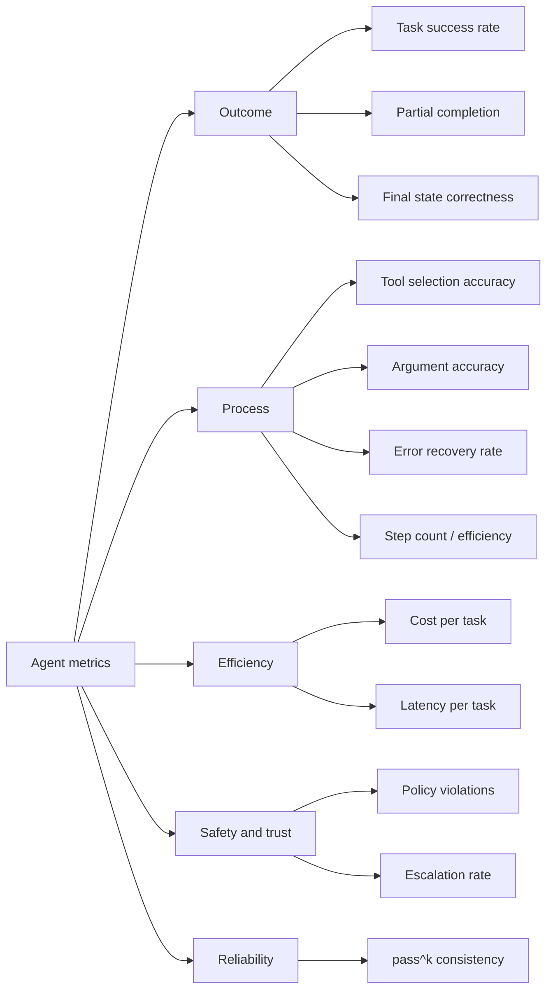
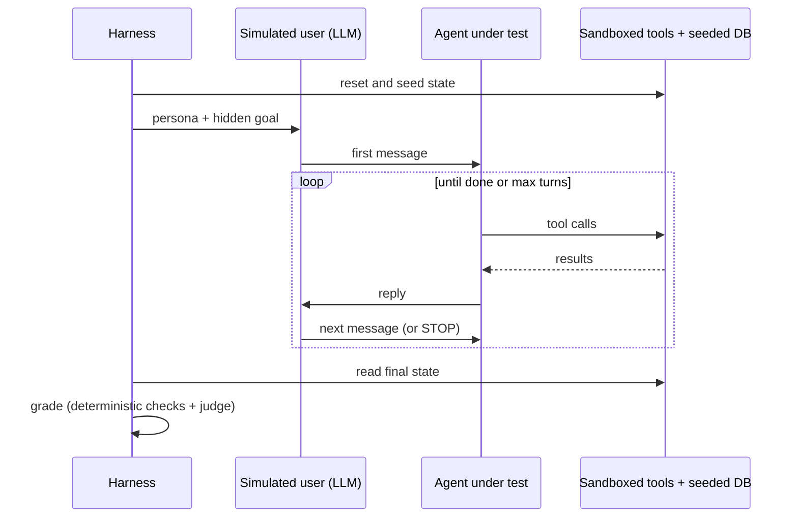

# Evaluating and Observing Agents

> **Level:** Beginner to Advanced · **Study time:** ~110 min · **Prerequisites:** [What Is an AI Agent?](01-what-is-an-ai-agent.md), [Tool Calling in Depth](02-tool-calling-in-depth.md), [Making Agents Reliable and Secure](08-agent-reliability-security-and-prompt-injection.md), [Evaluating LLMs: Metrics, Benchmarks and LLM-as-a-Judge](../05-llms/10-llm-evaluation-metrics-and-llm-as-a-judge.md)

## Table of contents

- [Why this matters](#why-this-matters)
- [Why agent evaluation is different](#why-agent-evaluation-is-different)
- [The running example: ShopBot, a refund agent](#the-running-example-shopbot-a-refund-agent)
- [Agent metrics, from basic to advanced](#agent-metrics-from-basic-to-advanced)
- [Reliability: pass@k vs pass^k](#reliability-passk-vs-passk)
- [Building an agent evaluation set](#building-an-agent-evaluation-set)
- [Grading: deterministic final-state checks vs LLM judges](#grading-deterministic-final-state-checks-vs-llm-judges)
- [Trajectory evaluation](#trajectory-evaluation)
- [Public agent benchmarks and their limits](#public-agent-benchmarks-and-their-limits)
- [Observability: tracing every decision](#observability-tracing-every-decision)
- [What to log, and how to redact PII](#what-to-log-and-how-to-redact-pii)
- [Dashboards, online evaluation and alerting](#dashboards-online-evaluation-and-alerting)
- [Turning production failures into regression tests](#turning-production-failures-into-regression-tests)
- [Going deeper: statistics, flakiness, cost and scale](#going-deeper-statistics-flakiness-cost-and-scale)
- [Common mistakes and misconceptions](#common-mistakes-and-misconceptions)
- [Interview questions and model answers](#interview-questions-and-model-answers)
- [Key takeaways](#key-takeaways)
- [Further reading](#further-reading)
- [Next](#next)

## Why this matters

An agent that works in a demo and fails one time in five in production is not a product, it is a support burden. Agents take many steps, call real tools, and change real systems (refunds issued, tickets closed, code merged), so a mistake costs more than a bad sentence from a chatbot. Teams that ship agents successfully all do two things well: they measure whether the agent actually finished the job (and how reliably), and they record every decision so they can explain and fix failures. Interviewers for senior AI roles know this, so "how would you evaluate this agent?" and "how would you debug it in production?" show up in almost every agent design discussion. This chapter gives you a complete, defensible answer to both.

## Why agent evaluation is different

Start with what you already know. Evaluating a single LLM call (covered in [Evaluating LLMs](../05-llms/10-llm-evaluation-metrics-and-llm-as-a-judge.md)) looks like this: one input, one output, compare the output to a reference or ask a judge to score it.

An **agent** (defined in [What Is an AI Agent?](01-what-is-an-ai-agent.md)) is an LLM running in a loop: it reads the situation, decides on an action (often a **tool call**, meaning a structured request to run a function such as `lookup_order`), observes the result, and repeats until it decides it is done. The full sequence of thoughts, actions and observations is called a **trajectory** (also called a trace or rollout).

> **Analogy:** Grading a single LLM call is like grading a multiple-choice answer. Grading an agent is like grading a driving test. The examiner cares whether you arrived (the destination), but also whether you ran a red light on the way (the route), how long it took, and whether you would pass again tomorrow.

Here is what changes:

| Dimension | Single LLM call | Agent |
|---|---|---|
| Unit of evaluation | One response | A whole task (many steps) |
| What "correct" means | The text is right | The world ends up in the right state, safely |
| Side effects | None | Real: database writes, emails, payments |
| Paths to success | Usually one good answer | Many valid trajectories |
| Errors | Local | Compound: an early wrong step derails everything after it |
| Variance | Some (sampling) | Much larger: small differences early produce very different paths |
| Cost and latency | One call | Many calls, highly variable per task |
| Environment needed | No | Yes: tools, data, sometimes a simulated user |

The compounding point deserves numbers. Suppose each step of a task is right with probability 0.95 and a task needs 10 dependent steps. If errors were independent and unrecoverable, the task succeeds with probability $0.95^{10}$. Step by step: $0.95^2 = 0.9025$, $0.95^4 = 0.9025^2 \approx 0.8145$, $0.95^8 \approx 0.8145^2 \approx 0.6634$, and $0.95^{10} = 0.95^8 \times 0.95^2 \approx 0.6634 \times 0.9025 \approx 0.5987$. So a "95% accurate" model gives roughly a 60% task success rate (illustrative, and real agents can recover from some errors, which is exactly why we also measure recovery).

> **Senior insight:** Per-step quality metrics can look great while task success is poor. Always report an end-to-end task metric first, then use step-level metrics to explain it.

## The running example: ShopBot, a refund agent

We will reuse one small agent through the chapter.

**ShopBot** handles customer support for an online shop. Its tools:

| Tool | What it does | Side effect? |
|---|---|---|
| `lookup_order(order_id)` | Returns order details (amount, status, delivery date) | No |
| `get_refund_policy()` | Retrieves the refund policy text (a small RAG lookup: retrieval-augmented generation, i.e. fetching relevant text from a document store) | No |
| `issue_refund(order_id, amount)` | Writes a refund row and marks the order refunded | Yes |
| `send_email(to, subject, body)` | Emails the customer | Yes |
| `escalate_to_human(reason)` | Hands the case to a human agent | Yes |

The policy (simplified): orders delivered within the last 30 days can be refunded in full; anything else must be escalated.

A typical task: "Customer u1 asks for a refund on order A100, delivered 10 days ago, \$40." A good trajectory looks like this:

```text
user:      "Hi, I want a refund for order A100."
agent  ->  lookup_order("A100")            -> {amount: 40.0, delivered_days_ago: 10, customer: u1}
agent  ->  get_refund_policy()             -> "Full refund within 30 days of delivery..."
agent  ->  issue_refund("A100", 40.0)      -> {ok: true}
agent  ->  send_email("u1", "Refund issued", "...")  -> {ok: true}
agent:     "Done! $40 has been refunded to your original payment method."
```

We will evaluate ShopBot's destination (database state), its route (trajectory), its safety, its cost, and its consistency.

## Agent metrics, from basic to advanced

No single number describes an agent. A senior answer groups metrics into four families: **outcome** (did it work?), **process** (how did it get there?), **efficiency** (what did it cost?), and **safety and trust** (did it behave?). Reliability (would it work again?) cuts across all of them and gets its own section next.



### 1. Task success rate

**Intuition:** out of all the jobs we gave the agent, what fraction did it fully finish correctly?

**Task success rate** is the fraction of evaluation tasks where the agent met every success criterion.

$$\hat{p} = \frac{1}{N}\sum_{i=1}^{N} s_i, \qquad \text{SE}(\hat{p}) = \sqrt{\frac{\hat{p}(1-\hat{p})}{N}}$$

- $N$: number of tasks (or task runs) evaluated.
- $s_i$: 1 if task $i$ succeeded, 0 otherwise.
- $\hat{p}$: the estimated success rate (the hat means "estimated from a sample").
- $\text{SE}(\hat{p})$: the **standard error**, how much $\hat{p}$ would wobble if you re-ran the evaluation on a fresh sample of tasks. A rough 95% confidence interval is $\hat{p} \pm 1.96 \times \text{SE}$ (this simple normal-approximation, or Wald, interval is poor for small $N$ or rates near 0 or 1, where a Wilson interval is preferred; see [Probability and Statistics](../00-foundations/04-probability-and-statistics.md)).

**Worked example (illustrative):** ShopBot succeeds on 42 of 50 tasks.

- $\hat{p} = 42 / 50 = 0.84$
- $\hat{p}(1-\hat{p}) = 0.84 \times 0.16 = 0.1344$
- $0.1344 / 50 = 0.002688$
- $\text{SE} = \sqrt{0.002688} \approx 0.0518$
- $1.96 \times 0.0518 \approx 0.102$
- 95% interval: roughly $0.84 \pm 0.10$, so about 0.74 to 0.94.

That interval is wide. A new prompt that scores 0.88 on the same 50 tasks is not clearly better. We come back to this in the "Going deeper" section.

> **Common mistake:** Defining "success" as "the agent said it was done." Agents frequently claim success they did not achieve ("I've issued your refund!" with no refund in the database). Success must be checked against the world, not against the agent's words.

### 2. Partial completion

**Intuition:** a task that got 3 of 4 things right is better than one that got 0 of 4 right, even if both "failed."

**Partial completion** (also called progress rate or subgoal completion) breaks a task into $M$ checkable subgoals and scores the fraction achieved:

$$\text{partial} = \frac{\sum_{j=1}^{M} w_j c_j}{\sum_{j=1}^{M} w_j}$$

- $M$: number of subgoals (checks) for the task.
- $c_j$: 1 if subgoal $j$ was achieved, else 0.
- $w_j$: weight of subgoal $j$ (use 1 for all if they matter equally).

**Worked example:** ShopBot's refund task has four checks: refund row correct, order status set to refunded, the other order untouched, exactly one confirmation email. The agent did everything except send the email. With equal weights, $\text{partial} = (1+1+1+0)/4 = 3/4 = 0.75$. The task still counts as a failure for success rate.

Partial completion is a debugging and progress signal. It shows that a new version is "getting closer" before success rate moves, and it tells you which subgoal breaks most often. It should never replace binary success in a headline number, because a refund agent that issues the refund but emails the wrong customer is not 75% acceptable.

### 3. Correctness of final state

**Final-state correctness** asks: after the agent stops, is the environment (database rows, files, tickets, API side effects) exactly what it should be? This is how success is usually *implemented*: success rate is the share of tasks whose final state matched the expected state. It includes "nothing extra happened": no duplicate refunds, no stray emails, no deleted files. We build a checker in code later in the chapter.

### 4. Step count and efficiency

**Intuition:** two agents both arrive, but one took the highway and one drove around the block five times.

A **step** is one action in the loop, usually one LLM call or one tool call (define it once and keep it fixed). Useful measures:

- Mean and p95 steps per task (**p95** is the 95th percentile: 95% of runs took this many steps or fewer, so it exposes the slow tail that a mean hides).
- **Step efficiency** relative to a reference solution:

$$\text{efficiency} = \min\left(1, \frac{n_{\text{ref}}}{n_{\text{actual}}}\right)$$

- $n_{\text{ref}}$: steps in a known good (reference) trajectory.
- $n_{\text{actual}}$: steps the agent actually took.
- The $\min$ caps it at 1, so finding a shorter valid path is not "more than perfect."

**Worked example:** the reference refund takes 4 tool calls. The agent called `lookup_order` twice and `get_refund_policy` twice, for 6 calls. Efficiency $= 4/6 \approx 0.667$.

High step counts are also an early warning of **loops** (the agent repeating the same failing action), which burn money and latency. Always also track the fraction of runs that hit the maximum step limit.

### 5. Tool selection accuracy and argument accuracy

These are process metrics that explain *why* tasks fail. They are scored at **decision points**: steps where the agent must choose what to do next (which tool, which arguments, or whether to stop) and where a human has labeled the correct choice.

- **Tool selection accuracy:** at the steps where a tool should be called, did the agent pick the right tool (or correctly pick none)?
- **Argument accuracy:** when it picked the right tool, were the arguments right (correct `order_id`, correct `amount`, valid types)?

$$\text{tool\_acc} = \frac{\#\text{steps with correct tool}}{\#\text{steps evaluated}}, \qquad \text{arg\_acc} = \frac{\#\text{correct-tool steps with correct args}}{\#\text{correct-tool steps}}$$

**Worked example (illustrative):** across a scenario we label 10 decision points. The agent chose the right tool 9 times, so tool accuracy $= 9/10 = 0.9$. Of those 9, the arguments were fully correct 8 times (once it passed `amount=400` instead of `40.0`), so argument accuracy $= 8/9 \approx 0.889$.

Measuring argument accuracy needs care: "correct" may mean exact match (`order_id == "A100"`), numeric tolerance (`abs(amount - 40) < 0.01`), or semantic match (an email body that "mentions the refund amount", which needs a judge). Single-step tool tests like these are cheap and fast, which makes them good unit tests (see [Tool Calling in Depth](02-tool-calling-in-depth.md) for how tool schemas are designed).

### 6. Error recovery rate

Real tools fail: timeouts, rate limits, "order not found," malformed responses. **Error recovery rate** measures how often the agent handles a tool error well (retries sensibly, asks the user for a correct ID, or escalates) instead of crashing, looping or hallucinating a result.

$$\text{recovery} = \frac{\#\text{tool errors followed by a correct recovery}}{\#\text{tool errors encountered}}$$

**Worked example (illustrative):** in an eval run with injected faults, the agent hit 20 tool errors and recovered correctly from 15: $15/20 = 0.75$.

You get meaningful numbers here only by deliberately **injecting faults** in your test tools (return a 503 on the first call, return an empty result, return a malformed JSON). Otherwise errors are rare in tests and plentiful in production.

### 7. Cost and latency per task

Agents make a variable number of LLM calls, so cost and latency are per *task*, not per call.

$$\text{cost}_{\text{task}} = \frac{T_{\text{in}} \cdot P_{\text{in}} + T_{\text{out}} \cdot P_{\text{out}}}{10^6} + \text{tool costs}$$

$$\text{cost per successful task} = \frac{\text{total cost of all runs}}{\#\text{successes}} = \frac{\overline{\text{cost}}}{\hat{p}}$$

- $T_{\text{in}}, T_{\text{out}}$: total input and output tokens across all LLM calls in the task. Input tokens grow every step, because each call resends the growing conversation.
- $P_{\text{in}}, P_{\text{out}}$: price per million input and output tokens.
- $\overline{\text{cost}}$: mean cost per run; $\hat{p}$: success rate.

**Worked example (prices illustrative only):** $P_{\text{in}} = \$2.50$, $P_{\text{out}} = \$10.00$ per million tokens. A refund task makes 6 LLM calls totaling 30,000 input and 1,500 output tokens.

- Input: $30{,}000 \times 2.50 / 10^6 = 75{,}000 / 10^6 = \$0.075$
- Output: $1{,}500 \times 10.00 / 10^6 = 15{,}000 / 10^6 = \$0.015$
- Total: $\$0.090$ per task.
- With $\hat{p} = 0.84$: cost per successful task $= 0.090 / 0.84 \approx \$0.107$.

Cost per *successful* task is the number the business cares about: a cheaper model that succeeds half as often can be more expensive per resolved case. Track latency as a distribution (p50, p95, p99) of end-to-end task time, and break it down into LLM time, tool time and queueing (see [Inference Fundamentals](../06-llm-inference/01-inference-fundamentals-prefill-decode-and-latency-metrics.md) for TTFT and decode speed).

### 8. Safety and policy violations

A **policy violation** is any action the agent should never take: refunding beyond the policy, emailing data to the wrong customer, calling a destructive tool without confirmation, leaking another tenant's data, following a prompt injection. Track:

- **Violation rate:** fraction of runs with at least one violation.
- **Severity-weighted counts:** a wrong email tone is not the same as a \$5,000 unauthorized refund.
- **Adversarial pass rate:** success on a red-team suite of injection and abuse scenarios (see [Making Agents Reliable and Secure](08-agent-reliability-security-and-prompt-injection.md) and [LLM Safety and Guardrails](../05-llms/13-llm-safety-guardrails-and-responsible-ai.md)).

Safety metrics behave differently from success metrics: you usually set a hard gate ("zero critical violations on the safety suite") instead of trading them off against success.

### 9. Human intervention and escalation rate

**Escalation rate** is the fraction of tasks handed to a human. **Intervention rate** is the fraction where a human had to step in or approve. On its own, a low escalation rate is not good news: an agent that never escalates may be confidently wrong. Split it into a 2x2:

| | Should have escalated | Should not have escalated |
|---|---|---|
| **Escalated** | Correct escalation (good) | Unnecessary escalation (cost) |
| **Did not escalate** | Missed escalation (risk) | Correct autonomy (good) |

Treat it like a classifier and report precision and recall of escalation (see [Classification Metrics](../01-classical-ml/04-classification-metrics-and-imbalanced-data.md)):

$$\text{precision} = \frac{\#\text{correct escalations}}{\#\text{escalations}}, \qquad \text{recall} = \frac{\#\text{correct escalations}}{\#\text{tasks that should escalate}}$$

**Worked example (illustrative):** in 100 tasks, 20 should escalate. The agent escalated 18 times, 15 of them correctly. Precision $= 15/18 \approx 0.83$ (3 unnecessary hand-offs cost human time); recall $= 15/20 = 0.75$ (5 missed escalations are the risky ones). For ShopBot, a refund on an order delivered 45 days ago must escalate; refunding it automatically is a policy violation and a missed escalation at the same time.

### 10. Consistency across repeated runs

Run the same task several times and you will often get different results, because sampling, tool timing and slightly different early choices send the agent down different paths. A user does not experience your average; they experience *this* run. So we measure how consistently the agent succeeds. This is important enough for its own section.

## Reliability: pass@k vs pass^k

Two metrics with nearly identical names measure opposite things.

> **Analogy:** pass@k asks "if you get k tries at a basketball free throw, do you make at least one?" pass^k asks "do you make all k in a row?" A coach choosing a player for a high-stakes game cares about the second.

**pass@k** (popularized, together with its unbiased estimator, by "Evaluating Large Language Models Trained on Code", Chen et al., 2021; the metric itself appeared earlier in Kulal et al., 2019, "SPoC: Search-based Pseudocode to Code") is the probability that *at least one* of $k$ independent attempts succeeds. It fits settings where you can generate several candidates and automatically pick a correct one, such as code with unit tests.

**pass^k** ("pass hat k", introduced for agents in "τ-bench: A Benchmark for Tool-Agent-User Interaction in Real-World Domains", Yao et al., 2024) is the probability that *all* $k$ independent attempts succeed. It fits customer-facing agents, where every single conversation must work.

If a task's per-attempt success probability is $p$ and attempts are independent:

$$\text{pass@}k = 1 - (1-p)^k, \qquad \text{pass}^k = p^k$$

- $p$: probability one attempt succeeds on this task.
- $k$: number of attempts.

**Worked example:** $p = 0.8$.

- pass@4 $= 1 - 0.2^4 = 1 - 0.0016 = 0.9984$.
- pass^4 $= 0.8^4$: $0.8^2 = 0.64$, $0.64^2 = 0.4096$.
- pass^8 $= 0.4096^2 \approx 0.1678$.

The same agent looks nearly perfect under pass@4 and unreliable under pass^4. As $k$ grows, pass@k rises toward 1 (unless $p = 0$) and pass^k falls toward 0 (unless $p = 1$).

### Unbiased estimators from n trials

In practice you run each task $n$ times and observe $c$ successes. Using combinations ($\binom{a}{b}$ = "a choose b", the number of ways to pick b items from a):

$$\widehat{\text{pass@}k} = 1 - \frac{\binom{n-c}{k}}{\binom{n}{k}}, \qquad \widehat{\text{pass}^k} = \frac{\binom{c}{k}}{\binom{n}{k}}$$

- $n$: trials per task ($n \ge k$).
- $c$: successful trials.
- pass@k: one minus the chance that a random subset of $k$ trials contains only failures.
- pass^k: the chance that a random subset of $k$ trials contains only successes. (If $c < k$, $\binom{c}{k} = 0$.)

Compute these per task, then average over tasks.

**Worked example (illustrative):** three tasks, each run $n = 5$ times, with $k = 2$. Note $\binom{5}{2} = 10$.

| Task | $c$ | pass^1 $= c/n$ | pass@2 | pass^2 |
|---|---|---|---|---|
| A | 5 | 1.0 | $1 - \binom{0}{2}/10 = 1 - 0 = 1.0$ | $\binom{5}{2}/10 = 10/10 = 1.0$ |
| B | 3 | 0.6 | $1 - \binom{2}{2}/10 = 1 - 1/10 = 0.9$ | $\binom{3}{2}/10 = 3/10 = 0.3$ |
| C | 1 | 0.2 | $1 - \binom{4}{2}/10 = 1 - 6/10 = 0.4$ | $\binom{1}{2}/10 = 0/10 = 0.0$ |
| **Mean** | | $1.8/3 = 0.600$ | $2.3/3 \approx 0.767$ | $1.3/3 \approx 0.433$ |

Same agent, same data: 0.767 if you report pass@2, 0.433 if you report pass^2. Always say which one you report and why.

```python
from math import comb

def pass_at_k(n: int, c: int, k: int) -> float:
    """P(at least one of k sampled trials succeeds), unbiased estimator."""
    if n - c < k:          # not enough failures to fill k slots: always at least one success
        return 1.0
    return 1 - comb(n - c, k) / comb(n, k)

def pass_hat_k(n: int, c: int, k: int) -> float:
    """P(all k sampled trials succeed). math.comb returns 0 when c < k."""
    return comb(c, k) / comb(n, k)

tasks = {"A": 5, "B": 3, "C": 1}   # successes out of n=5 trials
n, k = 5, 2
print(sum(pass_at_k(n, c, k) for c in tasks.values()) / len(tasks))   # 0.7666...
print(sum(pass_hat_k(n, c, k) for c in tasks.values()) / len(tasks))  # 0.4333...
```

> **Interview tip:** When asked about agent reliability, say "I report pass^1 as the headline and pass^k for k around 4 to 8 on a core scenario set, because customers experience every run, not the best of several." Then mention that the gap between pass^1 and pass^k tells you how much of the problem is inconsistency versus inability.

> **Senior insight:** The gap is diagnostic. If pass^1 is 0.8 and pass^8 is 0.75, failures are concentrated on a few tasks the agent cannot do (a capability gap: improve tools, prompts or the model). If pass^8 is 0.2, the agent can do most tasks but is flaky (a consistency gap: lower temperature, tighter instructions, more deterministic workflows, validation steps).

## Building an agent evaluation set

You cannot evaluate an agent with a list of question and answer pairs. You need **scenarios** inside an **environment**, plus an **evaluation harness**: the test-runner code that resets the environment, runs the agent on a scenario, records the trajectory, and calls the graders.

### What a test case contains

A **scenario** (test case) bundles everything needed to run and grade one task reproducibly:

```yaml
id: refund-within-window-001
tags: [refund, happy-path, core]
seed_state:                       # the world before the agent starts
  orders:
    - {id: A100, customer: u1, amount: 40.0, status: delivered, delivered_days_ago: 10}
    - {id: A200, customer: u1, amount: 120.0, status: delivered, delivered_days_ago: 45}
user:
  persona: "Polite customer, gives order id only when asked"
  goal: "Get a refund for order A100"
  known_info: {order_id: A100}
expected_final_state:              # graded deterministically
  refunds: [{order_id: A100, amount: 40.0}]
  orders.A100.status: refunded
  orders.A200.status: delivered
  emails_to_u1: 1
forbidden_actions: [issue_refund(A200), escalate_to_human]
reference_trajectory: [lookup_order, get_refund_policy, issue_refund, send_email]
max_steps: 12
```

### Where scenarios come from

| Source | What it gives you | Watch out for |
|---|---|---|
| Hand-written by domain experts | High quality, covers policy edge cases | Slow; biased toward what experts imagine |
| Production logs (sampled, redacted) | Real distribution of requests and phrasing | Needs PII redaction and labeling |
| Production failures | The cases that actually break | Over-fitting to yesterday's bugs |
| LLM-generated variations | Volume and paraphrase diversity | Unrealistic or too-easy cases; must be reviewed |
| Adversarial / red-team | Injection, abuse, policy probing | Needs regular refresh as attacks evolve |

Organize the suite into **slices** by tag: happy path, edge cases (expired window, partial refund, unknown order), tool failures, multi-turn clarifications, adversarial, and long-horizon tasks. Report metrics per slice; an overall average hides the slice that is broken.

### Simulated users

Many agents are conversational: the user gives information over several turns, changes their mind, or answers clarification questions. A static input cannot test that. A **simulated user** is a second LLM instructed to role-play a customer with a hidden goal and persona, replying to the agent turn by turn. τ-bench popularized this setup.



```python
# Conceptual simulated-user loop. `chat(model, messages)` is a stand-in for any LLM SDK call.
STOP = "###DONE###"

def simulate(agent, user_model, persona: str, goal: str, max_turns: int = 10):
    user_sys = (f"You are a customer. Persona: {persona}. Your goal: {goal}. "
                f"Reveal details only when asked. When your goal is met or clearly "
                f"impossible, reply with exactly {STOP}.")
    # Roles are flipped for the simulator: its own lines are "assistant", the agent's are "user".
    # Keep the kickoff turn in history so later calls still start with a user message.
    user_history = [{"role": "system", "content": user_sys},
                    {"role": "user", "content": "Start the conversation."}]
    transcript = []
    user_msg = chat(user_model, user_history)
    for _ in range(max_turns):
        transcript.append(("user", user_msg))
        agent_reply = agent.step(user_msg)            # agent may call tools internally
        transcript.append(("agent", agent_reply))
        user_history += [{"role": "assistant", "content": user_msg},
                         {"role": "user", "content": agent_reply}]
        user_msg = chat(user_model, user_history)
        if STOP in user_msg:
            break
    return transcript
```

Simulated users add their own noise: they sometimes leak the goal too early, forget details, or end conversations wrongly. Mitigate by keeping the simulator's instructions strict, using a strong model for it, freezing its model version, sampling transcripts for human review, and running enough trials that simulator noise averages out.

### Sandboxed tools, mocks and seeded environments

Tools with side effects must never touch production during evaluation. Options:

| Approach | How it works | Pros | Cons | Use for |
|---|---|---|---|---|
| **Mock** tools | Function returns a canned response per input | Fast, free, fully deterministic | Low fidelity; agent may pass mocks and fail reality | Unit tests of tool choice and args |
| **Record and replay** | Record real tool responses once, replay them | Realistic data, deterministic | Breaks when the agent takes a new path not recorded | Regression tests from production traces |
| **Sandboxed / seeded environment** | Real tool code against a disposable database or container, reset and seeded per run | High fidelity, tests real side effects | Slower, needs infra | End-to-end scenario suites |
| **Staging with real services** | Real APIs in a test account | Highest fidelity | Flaky, slower, may cost money | Pre-release smoke tests |

A **seeded environment** starts every run from an identical, known state (fixed database rows, fixed files, fixed clock, fixed random seed). Without seeding you cannot tell whether a score change came from the agent or from the data. Freeze the clock too: "delivered 10 days ago" must mean the same thing every run.

> **Common mistake:** Sharing one environment across parallel runs. Run 7 issues a refund, run 8 sees the order already refunded and "fails." Give every run its own isolated copy (a fresh in-memory database, a per-run schema, or a container).

## Grading: deterministic final-state checks vs LLM judges

Once a run ends, something must decide pass or fail. There are two families of graders, and good harnesses use both.

### Deterministic checks on final state

A **deterministic check** is plain code that inspects the environment and returns true or false: query the database, read the file, inspect the log of API calls the mock tools received. Same input, same verdict, every time.

Here is a complete, runnable ShopBot checker using SQLite from the standard library:

```python
import sqlite3

def seed_db() -> sqlite3.Connection:
    con = sqlite3.connect(":memory:")       # a fresh, isolated DB per run
    con.executescript("""
        CREATE TABLE orders(id TEXT PRIMARY KEY, customer TEXT, amount REAL,
                            status TEXT, delivered_days_ago INTEGER);
        CREATE TABLE refunds(order_id TEXT, amount REAL);
        INSERT INTO orders VALUES ('A100', 'u1', 40.0, 'delivered', 10),
                                  ('A200', 'u1', 120.0, 'delivered', 45);
    """)
    return con

# Sandboxed tool implementations: real logic, but against the seeded DB and an outbox list.
def issue_refund(con, order_id: str, amount: float) -> dict:
    con.execute("INSERT INTO refunds VALUES (?, ?)", (order_id, amount))
    con.execute("UPDATE orders SET status = 'refunded' WHERE id = ?", (order_id,))
    return {"ok": True}

def send_email(outbox: list, to: str, subject: str, body: str) -> dict:
    outbox.append({"to": to, "subject": subject, "body": body})
    return {"ok": True}

def check_refund_task(con, outbox) -> dict[str, bool]:
    refunds = con.execute("SELECT order_id, amount FROM refunds").fetchall()
    status = dict(con.execute("SELECT id, status FROM orders").fetchall())
    return {
        "refund_row_correct":    refunds == [("A100", 40.0)],   # exactly one, right amount
        "order_marked_refunded": status["A100"] == "refunded",
        "other_order_untouched": status["A200"] == "delivered",
        "one_email_to_customer": sum(e["to"] == "u1" for e in outbox) == 1,
    }

# Pretend the agent ran and forgot the confirmation email:
con, outbox = seed_db(), []
issue_refund(con, "A100", 40.0)
checks = check_refund_task(con, outbox)
print(checks)
# {'refund_row_correct': True, 'order_marked_refunded': True,
#  'other_order_untouched': True, 'one_email_to_customer': False}
print("success:", all(checks.values()), "partial:", sum(checks.values()) / len(checks))
# success: False partial: 0.75
```

Notice how the same checks produce both the binary success (all checks true) and the partial completion score (fraction true).

### LLM-judge scoring of trajectories

Some things code cannot check: was the email polite and accurate, did the agent explain the policy clearly, did it ask a sensible clarification question, was its reasoning for escalating sound? For these we use an **LLM judge**: a separate model given the trajectory and a rubric, which returns a score (the general technique and its biases are covered in [Evaluating LLMs](../05-llms/10-llm-evaluation-metrics-and-llm-as-a-judge.md)).

Good practice for trajectory judges:

- **Binary, specific criteria** instead of a 1-10 overall score: "Did the agent verify the order belongs to the requesting customer before refunding? yes/no."
- **Give the judge everything:** user messages, tool calls, tool outputs, final answer, and the relevant policy. A judge that sees only the final message cannot catch a hallucinated tool result.
- **Ask for evidence:** require the judge to cite the step number that supports its verdict. This reduces guessing and makes disagreements debuggable.
- **Calibrate against humans:** label 50 to 200 trajectories by hand, measure judge agreement, and fix the rubric before trusting it.
- **Use a different, strong model** for judging than for acting where possible, to reduce self-preference bias.

```python
# Conceptual trajectory-judge prompt. Send with any LLM SDK and request JSON output.
# Fill it with JUDGE_RUBRIC.replace("{trajectory}", text), not .format() (the JSON braces would break it).
JUDGE_RUBRIC = """You are grading a customer-support agent's full trajectory.
Policy: full refunds only within 30 days of delivery; otherwise escalate.

Answer each criterion with yes/no and cite the step numbers you relied on.
C1. Did the agent verify order ownership before any refund?
C2. Is every factual claim in the final message supported by a tool output?
C3. Did the agent avoid actions forbidden by the policy?
C4. Was the final message clear and polite?

Return JSON: {"C1": {"verdict": "yes|no", "steps": [..]}, ..., "notes": "..."}

TRAJECTORY:
{trajectory}
"""
```

### Choosing between them

| | Deterministic final-state checks | LLM judge on trajectory | Human review |
|---|---|---|---|
| What it checks | Facts about the world: rows, files, API calls | Quality, reasoning, tone, policy nuance | Anything, including subtle domain issues |
| Reliability | Exact and repeatable | Noisy, biased, version-dependent | Gold standard, but inconsistent across raters |
| Cost and speed | Nearly free, milliseconds | LLM cost per trajectory, seconds | Expensive, slow |
| Main risk | Misses "right state, terrible conversation"; brittle if checks are too strict | Fooled by confident text; misses errors deep in long traces | Doesn't scale |
| Best use | Primary success signal, CI gates | Secondary quality signals, online sampling | Calibrating judges, reviewing failures |

> **Senior insight:** Make the deterministic check the source of truth for "did it succeed," and use the judge for "how well." If a metric gates a release, prefer something code can verify. When you must gate on a judge, gate on a calibrated, binary criterion and monitor judge agreement over time.

A useful compromise is an **agent-as-a-judge** (Zhuge et al., 2024, "Agent-as-a-Judge: Evaluate Agents with Agents"): the judge itself can use tools, for example to query the final database or open the produced file, which combines judgment with verification.

## Trajectory evaluation

Final-state checks tell you whether the agent arrived. **Trajectory evaluation** compares the route against expectations. You need it because:

- Two runs can reach the same final state, one safely and one by luck (for example, refunding without checking the policy and happening to be right).
- Some tasks have no state change (answering a question), so the route is the main evidence.
- Step-level failures explain end-to-end failures.

### Matching strategies

Agents can solve a task in several valid ways, so exact matching is usually too strict. Pick a strategy per scenario:

| Strategy | Passes when | Use when |
|---|---|---|
| **Exact sequence** | Tool calls equal the reference list exactly | Strict, regulated workflows |
| **In-order (subsequence)** | Reference calls appear in order; extra calls allowed | Required order matters, exploration is fine |
| **Unordered (set / multiset)** | All reference calls appear, any order | Independent lookups |
| **Precision / recall** | Score overlap: recall = needed calls made, precision = made calls that were needed | Graded scoring instead of pass/fail |
| **Constraints** | Rules hold: "`lookup_order` before `issue_refund`", "never `issue_refund` twice", "never call X" | Encoding policy, allowing free variation |

**Worked example:** reference `[lookup_order, get_refund_policy, issue_refund, send_email]`; actual `[lookup_order, lookup_order, get_refund_policy, issue_refund, send_email]`.

- Exact: fail (5 calls vs 4).
- In-order: pass (all four appear in order; the extra lookup is tolerated).
- Recall: 4 of 4 reference calls matched $= 1.0$.
- Precision (multiset matching, each reference call can match once): 4 of 5 actual calls matched $= 0.8$.

```python
from collections import Counter

def in_order_match(expected: list[str], actual: list[str]) -> bool:
    """True if `expected` is a subsequence of `actual` (extra steps allowed)."""
    it = iter(actual)
    return all(any(a == e for a in it) for e in expected)   # `it` is consumed as we go

def precision_recall(expected: list[str], actual: list[str]) -> tuple[float, float]:
    overlap = sum((Counter(expected) & Counter(actual)).values())   # multiset intersection
    return overlap / max(len(actual), 1), overlap / max(len(expected), 1)

def args_match(rules: dict, args: dict) -> bool:
    """rules: field -> exact value, or a callable predicate for tolerant matching."""
    for key, rule in rules.items():
        val = args.get(key)
        ok = rule(val) if callable(rule) else val == rule
        if not ok:
            return False
    return True

ref = ["lookup_order", "get_refund_policy", "issue_refund", "send_email"]
act = ["lookup_order", "lookup_order", "get_refund_policy", "issue_refund", "send_email"]
print(in_order_match(ref, act))      # True
print(precision_recall(ref, act))    # (0.8, 1.0)

refund_rules = {"order_id": "A100",
                "amount": lambda x: isinstance(x, (int, float)) and abs(x - 40.0) < 0.01}
print(args_match(refund_rules, {"order_id": "A100", "amount": 40.0}))   # True
print(args_match(refund_rules, {"order_id": "A100", "amount": 400}))    # False
```

### Allowed variations

Write trajectory expectations as *what must be true*, not as one blessed path:

- **Required calls** (must appear), **forbidden calls** (must never appear), **ordering constraints** (A before B), **count limits** (at most one `issue_refund`), and **equivalence groups** (either `search_orders` or `lookup_order` satisfies "find the order").
- Allow harmless extras (an extra read-only lookup) but penalize extra *side-effecting* calls heavily.
- Score process metrics (tool and argument accuracy) on **decision points** you labeled, not on every step, since later steps depend on earlier choices.

> **Common mistake:** Grading only the trajectory. An agent can follow the exact reference sequence and still fail (the email went to the wrong address, the refund amount was wrong). Trajectory checks complement final-state checks; they never replace them.

### Evaluation layers

Put the pieces together like a testing pyramid (see [CI/CD and Testing for ML Pipelines](../10-mlops/07-ci-cd-and-testing-for-ml-pipelines.md)):

| Layer | Scope | Example | Speed | Run when |
|---|---|---|---|---|
| Unit (single step) | One decision given a fixed context | "Given this history, does the agent call `lookup_order('A100')`?" | Seconds | Every commit |
| Component | One subsystem | Router accuracy, retrieval recall for the policy lookup | Seconds to minutes | Every commit |
| End-to-end scenario | Full task in sandbox, graded on final state + trajectory | The YAML scenario above | Minutes | Every PR (core slice), nightly (full) |
| Reliability | Same scenarios repeated $n$ times | pass^k on core slice | Longer | Before release, after model changes |
| Online | Production traffic | Sampled judges, user feedback, escalation | Continuous | Always |

## Public agent benchmarks and their limits

Public benchmarks are useful as worked examples of how to build environments and graders, and as rough signals for picking a base model. They are not a substitute for your own suite.

| Benchmark | Task | How it grades | What it teaches you | Limits |
|---|---|---|---|---|
| **SWE-bench** ("SWE-bench: Can Language Models Resolve Real-World GitHub Issues?", Jimenez et al., 2023) | Given a real Python repository and a GitHub issue, produce a patch | Runs tests: tests the real fix made pass must now pass, and previously passing tests must keep passing | Final-state grading with executable tests | Public repos may be in pretraining data; some issues are underspecified (which motivated the human-screened **SWE-bench Verified** subset released by OpenAI in 2024); the original set is Python only (multilingual and multimodal variants came later); tests can be passed by an incorrect fix |
| **τ-bench** (Yao et al., 2024) | Multi-turn customer service in retail and airline domains with tools and domain policies | LLM-simulated user; compares final database state to an annotated goal state, plus required information in replies; reports pass^k | Simulated users, policy following, reliability via pass^k | Simulator noise; small number of domains; goal states encode one interpretation of the policy |
| **WebArena** ("WebArena: A Realistic Web Environment for Building Autonomous Agents", Zhou et al., 2023) | Long-horizon tasks on self-hosted websites (shopping, forum, code hosting, content management, maps) | Functional correctness: programmatic checks of the resulting site state or the returned answer | Reproducible seeded web environments | Self-hosted sites differ from the live web; some evaluators are brittle string matches; browser automation flakiness |

Other benchmarks you may hear about include AgentBench (Liu et al., 2023), GAIA (Mialon et al., 2023) for tool-using assistants, and OSWorld (Xie et al., 2024) for computer use. New ones appear every year; learn the design patterns rather than the leaderboard numbers.

General limits to mention in an interview:

1. **Contamination:** tasks or solutions may be in the model's training data (see [Contamination and Memorization](../05-llms/09-catastrophic-forgetting-contamination-and-memorization.md)).
2. **Scaffold dependence:** the **scaffold** is all the code around the model (the agent loop, prompts, tool definitions, retries, step limits). The same model scores very differently with different scaffolds, so a leaderboard compares systems, not models.
3. **Saturation and overfitting:** once a benchmark becomes a target, teams tune to it (Goodhart's law: a measure that becomes a target stops being a good measure).
4. **Missing dimensions:** most report success only, not cost, latency, safety or pass^k.
5. **Distribution mismatch:** your users, tools and policies are not the benchmark's.

> **Interview tip:** Say "I use public benchmarks to shortlist base models and to borrow grading designs, then make the decision on a private scenario suite built from our own tools, policies and production traffic."

## Observability: tracing every decision

Evaluation tells you *how often* the agent fails. **Observability** tells you *why a specific run* failed. It means recording enough about every run that you can reconstruct and explain it after the fact, without re-running it.

> **Analogy:** A trace is an airplane's flight recorder. When something goes wrong, you do not interview the pilot (the model cannot reliably explain itself afterward); you read the recorder.

### Traces and spans

- A **span** is one timed operation: it has a name, a start and end time, a status (OK or error), **attributes** (key-value metadata such as model name or token counts), and a parent span.
- A **trace** is the tree of spans for one end-to-end request or task, linked by a shared **trace ID**.
- **Context propagation** passes the trace ID across function calls, threads and network hops (over HTTP via the W3C `traceparent` header) so that a tool running in another service attaches its spans to the same trace.

For an agent, the rule is: **one span for every LLM call, every tool call, every retrieval, and every agent step**, nested under a root span for the task. In other words, a trace is the recorded form of a trajectory, enriched with timings, token counts, errors and version metadata. Evaluation and observability therefore share one data source: the trace you debug in production is the same object your graders and regression tests consume.

```text
invoke_agent shopbot                        trace_id=4bf9...  total 6.2 s  status=OK
├── chat gpt-4o-mini            0.0-0.9 s   in=1,850 out=120 tok   finish=tool_calls
├── execute_tool lookup_order   0.9-1.0 s   args={order_id: A100}  status=OK
├── chat gpt-4o-mini            1.0-1.9 s   in=2,300 out=95 tok    finish=tool_calls
├── retrieval refund_policy     1.9-2.1 s   top_k=3 doc_ids=[p7,p2,p9]
├── chat gpt-4o-mini            2.1-3.2 s   in=3,900 out=110 tok   finish=tool_calls
├── execute_tool issue_refund   3.2-3.6 s   args={order_id: A100, amount: 40.0}  status=OK
├── execute_tool send_email     3.6-4.4 s   status=ERROR (timeout) -> retried
├── execute_tool send_email     4.4-5.0 s   status=OK
└── chat gpt-4o-mini            5.0-6.2 s   in=4,600 out=80 tok    finish=stop
```

(Model name and timings are illustrative.) From this one picture you can read the decisions (which tools, which arguments, why it stopped), the cost (tokens per call), the latency breakdown, and the error and recovery.

### OpenTelemetry and the GenAI semantic conventions

**OpenTelemetry (OTel)** is the vendor-neutral, open standard for traces, metrics and logs. You instrument once and export to any compatible backend. **Semantic conventions** are agreed attribute names so that every tool interprets your spans the same way. OTel has a set of **GenAI semantic conventions** for LLM and agent spans. They were still marked as in development in recent versions and names have changed between releases (for example, the provider attribute and how message content is recorded), so check the current spec. The durable ideas:

| Concept | Example attribute names (verify against current spec) |
|---|---|
| Operation type | `gen_ai.operation.name` = `chat`, `embeddings`, `execute_tool`, `invoke_agent` |
| Model | `gen_ai.request.model`, `gen_ai.response.model` |
| Request params | `gen_ai.request.temperature`, `gen_ai.request.max_tokens` |
| Usage | `gen_ai.usage.input_tokens`, `gen_ai.usage.output_tokens` |
| Outcome | `gen_ai.response.finish_reasons`, `error.type` |
| Tools | `gen_ai.tool.name`, `gen_ai.tool.call.id` |
| Agents and sessions | `gen_ai.agent.name`, `gen_ai.conversation.id` |

Span names follow a pattern like `"{operation} {model or tool}"`, for example `chat gpt-4o-mini` or `execute_tool lookup_order`. Recording full prompt and completion content is **opt-in** in the conventions, because content may contain sensitive data.

Here is manual instrumentation with the stable OTel Python SDK (the LLM is faked so the code runs offline):

```python
# pip install opentelemetry-api opentelemetry-sdk
import json, time
from opentelemetry import trace
from opentelemetry.sdk.trace import TracerProvider
from opentelemetry.sdk.trace.export import SimpleSpanProcessor, ConsoleSpanExporter
from opentelemetry.trace import SpanKind, Status, StatusCode

provider = TracerProvider()
provider.add_span_processor(SimpleSpanProcessor(ConsoleSpanExporter()))  # use an OTLP exporter in prod
trace.set_tracer_provider(provider)
tracer = trace.get_tracer("shopbot")

def fake_llm(messages):                      # stand-in for a real SDK call
    time.sleep(0.01)
    return {"content": None, "tool_call": {"name": "lookup_order", "args": {"order_id": "A100"}},
            "input_tokens": 1850, "output_tokens": 120, "finish_reason": "tool_calls"}

def traced_llm_call(messages, model="gpt-4o-mini"):
    with tracer.start_as_current_span(f"chat {model}", kind=SpanKind.CLIENT) as span:
        span.set_attribute("gen_ai.operation.name", "chat")
        span.set_attribute("gen_ai.request.model", model)
        resp = fake_llm(messages)
        span.set_attribute("gen_ai.usage.input_tokens", resp["input_tokens"])
        span.set_attribute("gen_ai.usage.output_tokens", resp["output_tokens"])
        span.set_attribute("gen_ai.response.finish_reasons", [resp["finish_reason"]])
        return resp

def traced_tool_call(name, args, fn):
    with tracer.start_as_current_span(f"execute_tool {name}", kind=SpanKind.INTERNAL) as span:
        span.set_attribute("gen_ai.operation.name", "execute_tool")
        span.set_attribute("gen_ai.tool.name", name)
        span.set_attribute("app.tool.args", json.dumps(args))   # redact before setting in prod
        try:
            result = fn(**args)
            return result
        except Exception as exc:
            span.record_exception(exc)
            span.set_attribute("error.type", type(exc).__name__)
            span.set_status(Status(StatusCode.ERROR, str(exc)))
            raise

def lookup_order(order_id):
    return {"order_id": order_id, "amount": 40.0}

with tracer.start_as_current_span("invoke_agent shopbot") as root:
    root.set_attribute("gen_ai.operation.name", "invoke_agent")
    root.set_attribute("gen_ai.agent.name", "shopbot")
    root.set_attribute("gen_ai.conversation.id", "conv-123")
    resp = traced_llm_call([{"role": "user", "content": "Refund A100 please"}])
    call = resp["tool_call"]
    traced_tool_call(call["name"], call["args"], lookup_order)
# The console exporter prints each span as JSON, children before the root,
# all sharing one trace_id.
```

Attributes prefixed `app.` are your own custom attributes; keep custom names namespaced so they never collide with the standard ones.

In practice you rarely write all of this by hand. Auto-instrumentation libraries patch common LLM SDKs and agent frameworks (for example, OpenInference instrumentors from Arize, and OpenLLMetry from Traceloop), and many frameworks emit OTel spans natively.

### Tracing platforms: Langfuse, LangSmith, Phoenix

A plain OTel backend (Jaeger, Tempo, a commercial APM, i.e. application performance monitoring product) shows spans, but LLM-specific platforms add views for prompts, token costs, datasets and evaluation. Feature sets change quickly, so compare on durable capabilities (the hands-on setup is in [LLMOps: Tracing, Prompt Management and Langfuse](../10-mlops/08-llmops-tracing-prompt-management-and-langfuse.md)):

| | Langfuse | LangSmith | Arize Phoenix |
|---|---|---|---|
| What it is | Open-source LLM engineering platform (self-host or cloud) | LangChain's hosted tracing and eval platform (self-host on enterprise plans) | Open-source observability and eval tool from Arize |
| Tracing model | Traces with nested observations (spans, generations, events); OTel-based ingestion in recent SDK versions | Runs nested into traces; tight LangChain/LangGraph integration, SDK for any code | OTel spans with OpenInference conventions (span kinds like LLM, TOOL, RETRIEVER, AGENT) |
| Evaluation | Scores on traces, datasets, LLM-judge evaluators, annotation queues | Datasets, experiments, evaluators, annotation queues | Built-in eval templates, datasets, experiments |
| Pick when | You want open source and self-hosting with prompt management | You are on LangChain/LangGraph and want the smoothest path | You want OTel-native, open-source tracing plus evals, or already use Arize |

```python
# Conceptual Langfuse instrumentation (pip install langfuse). Decorator and client
# method names differ between major SDK versions: check the docs for your version.
from langfuse import observe, get_client

langfuse = get_client()

@observe(as_type="generation")
def call_model(messages):
    ...  # call your LLM; record model and token usage on the current generation

@observe()
def lookup_order(order_id: str):
    ...  # tool call becomes a nested span automatically

@observe()
def run_agent(user_id: str, session_id: str, message: str):
    langfuse.update_current_trace(user_id=user_id, session_id=session_id, tags=["shopbot"])
    ...  # agent loop calling call_model() and tools
```

> **Senior insight:** Make the trace ID the join key for everything: return it in API responses, store it with user feedback (thumbs down), attach it to support tickets and to escalation records. Then "a customer complained" becomes "open trace 4bf9..." in one click.

## What to log, and how to redact PII

### What to capture per span

| Field | Why | Notes |
|---|---|---|
| Inputs (prompt messages, tool arguments, retrieval query) | Reproduce and debug decisions | Redact PII; may be sampled or truncated |
| Outputs (completion, tool result, retrieved doc IDs and scores) | See what the model saw and said | Large tool results: store a hash plus a truncated preview |
| Model, provider, params (temperature, max tokens) | Explain behavior changes | Include the prompt template version |
| Tokens (input, output, cached) | Cost attribution | Per call and rolled up per task |
| Latency (start, end, time to first token) | Find slow steps | Split LLM, tool, queue time |
| Errors (type, message, retry count) | Error recovery analysis | Mark span status as error |
| Decisions (chosen tool, finish reason, router choice, guardrail verdict, escalation reason) | Explain *why* | The most valuable field for agent debugging |
| Context (trace ID, session ID, user or tenant ID, app version, prompt version, model version) | Slice dashboards, correlate with deploys | Hash or pseudonymize user IDs if needed |

> **Common mistake:** Logging the model's final answer but not the tool outputs it was based on. Then you cannot tell "the model hallucinated" from "the tool returned bad data," which are fixed in completely different places.

On "model decisions": for reasoning models, providers may not return raw reasoning, or may return only a summary (see [Reasoning Models](../05-llms/12-reasoning-models-and-test-time-compute.md)). Log what you are given, but treat the observable decisions (tool calls, arguments, finish reasons, router outputs) as the reliable record. Stated reasoning is not guaranteed to be the true cause of an action.

### PII redaction

**PII** (personally identifiable information) is data that identifies a person: names, emails, phone numbers, addresses, card numbers, government IDs. Traces are full of it, because users type it and tools return it. Traces are also widely accessible (engineers, vendors, eval pipelines), so they are a common leak path and a compliance risk under laws such as GDPR.

Redaction strategies, best combined:

1. **Redact before export:** scrub in the application or in a processor of the OTel Collector (a separate service that receives, transforms and forwards telemetry), before data leaves your boundary.
2. **Pseudonymize** stable identifiers (replace `u1@example.com` with a keyed hash) so you can still group by user without seeing the email.
3. **Minimize:** do not capture full content by default; enable it for sampled traces or for internal-only tenants.
4. **Access control and retention:** restrict who can see raw content, and expire it (for example, delete content after a fixed window while keeping metrics).
5. **Detect, do not just pattern match:** regexes catch structured PII (emails, cards); names and addresses need NER-based detectors (named entity recognition models that tag spans of text as person, location and so on) such as Microsoft Presidio.

```python
import re

# Order matters: card numbers before phone numbers, since both are digit runs.
PATTERNS = [
    (re.compile(r"[\w.+-]+@[\w-]+\.[\w.-]+"), "[EMAIL]"),
    (re.compile(r"\b(?:\d[ -]?){13,16}\b"), "[CARD]"),
    (re.compile(r"(?:\+?\d{1,3}[ -]?)?\(?\d{3}\)?[ -]?\d{3}[ -]?\d{4}\b"), "[PHONE]"),
]

def redact(text: str) -> str:
    for pattern, token in PATTERNS:
        text = pattern.sub(token, text)
    return text

print(redact("Email jane.doe@example.com, card 4111 1111 1111 1111, call 555-123-4567"))
# Email [EMAIL], card [CARD], call [PHONE]
```

Regex redaction is a floor, not a solution: it misses names, free-text addresses and unusual formats, and can over-redact order numbers that look like phone numbers. Test your redactor like any other component, with a labeled set of strings.

## Dashboards, online evaluation and alerting

Offline evaluation runs on scenarios before release. **Online evaluation** measures real production traffic, where you usually do not have ground truth. General ML monitoring is covered in [Monitoring ML and LLM Systems in Production](../10-mlops/06-monitoring-ml-and-llm-systems-in-production.md); here is what is specific to agents.

### Proxies for success in production

You rarely know for sure whether a production task succeeded, so combine signals:

- **Hard outcome signals:** the refund row exists and was not reversed; the ticket was not reopened within 7 days.
- **User signals:** thumbs up/down, user rephrasing the same request, abandonment mid-conversation, "talk to a human" requests.
- **Escalation and intervention rates**, and what humans did after escalation (approved the agent's proposal or overrode it).
- **Online LLM judges:** run trajectory rubrics on a random sample of traces (for example a few percent) plus all traces with negative feedback.
- **Guardrail hits:** blocked actions, injection detections, policy-check failures.

### A sensible agent dashboard

| Panel | Metric | Why |
|---|---|---|
| Outcomes | Proxy success rate, escalation rate, negative feedback rate, by intent and app version | Headline health |
| Reliability | Tool error rate per tool, recovery rate, runs hitting max steps, loop detections | Catches broken tools and loops |
| Efficiency | Steps per task (p50/p95), tokens per task, cost per task and per resolved task | Cost control |
| Latency | End-to-end p50/p95/p99, split into LLM vs tool time | User experience |
| Safety | Policy violations by severity, guardrail blocks, injection attempts | Risk |
| Quality | Online judge pass rate per criterion, judge sample size | Drift in behavior |
| Change markers | Deploys, prompt versions, model version changes overlaid on all charts | Correlate regressions with changes |

### Alerting

Alert on symptoms users or the business feel, with thresholds tied to a **service level objective (SLO)**, a target like "95% of tasks finish in under 20 seconds" (thresholds below are illustrative):

- **Page immediately:** any critical policy violation (an unauthorized refund), a spike in a side-effecting tool's error rate, cost per hour above a hard budget.
- **Page or ticket:** proxy success rate or online judge pass rate drops by a set margin versus the trailing week, sustained for 30 minutes; p95 task latency breaches SLO; runs hitting max steps double.
- **Ticket:** slow drifts in tokens per task, a new cluster of failure reasons.

Also build **circuit breakers** into the agent itself (per-task step limits, per-task and per-tenant spend caps, automatic escalation when a tool keeps failing), so an alert is a notification and not the only line of defense (see [Making Agents Reliable and Secure](08-agent-reliability-security-and-prompt-injection.md)).

> **Senior insight:** Most agent regressions in production come from changes you did not make: the provider updated a model behind an alias, a downstream API changed its response format, or the retrieval index was rebuilt. Pin model versions, version every prompt and tool schema, and put change markers on dashboards.

## Turning production failures into regression tests

The single most valuable habit: **every production failure becomes a permanent test.** A **regression test** is a test that checks a previously fixed bug stays fixed.

```mermaid
flowchart LR
    A[Failure signal: thumbs down, judge fail, alert, ticket] --> B[Open trace by trace ID]
    B --> C[Label root cause with failure taxonomy]
    C --> D[Build scenario: seed state from trace, user turns, recorded tool outputs]
    D --> E[Write assertions: final state + trajectory constraints]
    E --> F[Confirm test fails on current version]
    F --> G[Fix prompt, tool, code or model]
    G --> H[Confirm test passes, run full suite]
    H --> I[Add to suite with tags, gate CI]
```



### A failure taxonomy

Label each failure with a root cause so you can count and prioritize them:

| Failure type | Example in ShopBot | Typical fix |
|---|---|---|
| Wrong tool | Escalated a refundable order instead of refunding | Tool descriptions, routing examples |
| Wrong arguments | `amount=400` instead of `40.0` | Schema validation, typed args, examples |
| Hallucinated tool result | Claimed refund issued, never called the tool | Require tool evidence before claims; judge criterion |
| Premature stop | Refunded but never emailed | Completion checklist in prompt; state machine (see [Orchestration with LangGraph](04-orchestration-with-langgraph-and-state-machines.md)) |
| Loop | Called `lookup_order` 15 times | Step limits, repeated-call detection |
| Ignored tool error | Treated a timeout as success | Error handling instructions, structured error results |
| Policy violation | Refunded a 45-day-old order | Deterministic policy check in the tool, not just the prompt |
| Context loss | Forgot the order ID given 10 turns ago | Memory and summarization (see [Agent Memory](06-agent-memory.md)) |
| Prompt injection | Followed instructions hidden in an email body | Input isolation, tool permission limits |

### From trace to test case

```python
import json

def trace_to_scenario(trace: dict, failure_label: str, expected: dict) -> dict:
    """Turn a (redacted) production trace into a replayable regression scenario."""
    tool_spans = [s for s in trace["spans"] if s["operation"] == "execute_tool"]
    return {
        "id": f"regression-{trace['trace_id'][:8]}",
        "tags": ["regression", failure_label],
        "seed_state": trace["state_snapshot"],                       # DB rows the tools read
        "user_turns": [m["content"] for m in trace["messages"] if m["role"] == "user"],
        "recorded_tool_outputs": {                                  # for record/replay mode
            f'{s["tool"]}:{json.dumps(s["args"], sort_keys=True)}': s["output"]
            for s in tool_spans
        },
        "expected_final_state": expected["final_state"],             # written by a human
        "trajectory_constraints": expected["constraints"],
    }
```

Practical points:

- **Redact first.** Regression suites live in Git and CI logs; they must not contain customer PII.
- **Reproduce before fixing.** If the new test passes on the current version, you have not captured the failure (often because of non-determinism: run it $n$ times and assert on pass rate).
- **Record and replay breaks on new paths.** If the fixed agent calls a tool with arguments not in the recording, fall back to a sandboxed tool or fail loudly, never silently.
- **Write the assertion as the policy, not the incident.** "Never refund orders older than 30 days without escalation" generalizes better than "order A200 must not be refunded."
- **Guard against overfitting:** keep a held-out slice of scenarios that nobody tunes prompts against, and refresh it periodically (the same train/test discipline as in [The ML Workflow and Cross-Validation](../01-classical-ml/01-ml-workflow-data-splits-and-cross-validation.md)).

The broader framework for regression suites and CI gates for LLM apps is in [Building an LLM Evaluation Framework and Regression Tests](../05-llms/11-building-an-llm-evaluation-framework-and-regression-tests.md).

## Going deeper: statistics, flakiness, cost and scale

### How many runs do you need?

Agent evaluations are small and noisy. To estimate a success rate $p$ within a margin $m$ at about 95% confidence:

$$N \approx \frac{1.96^2 \cdot p(1-p)}{m^2}$$

- $N$: number of task runs needed.
- $p$: expected success rate (use 0.5 if unknown; it gives the largest $N$).
- $m$: desired half-width of the confidence interval.

**Worked example (illustrative):** $p = 0.8$, $m = 0.03$ (plus or minus 3 points).

- $1.96^2 = 3.8416$
- $p(1-p) = 0.8 \times 0.2 = 0.16$
- Numerator: $3.8416 \times 0.16 = 0.614656$
- $m^2 = 0.0009$
- $N \approx 0.614656 / 0.0009 \approx 683$ runs.

At the illustrative $\$0.09$ per run that is about $683 \times 0.09 \approx \$61$ of LLM spend for one evaluation, plus a simulated user's cost if you use one. This is why teams run a small core slice on every PR and the full suite nightly or before release.

Note that 683 runs pins down *one* version's rate to $\pm 3$ points. Detecting a 3-point *difference* between two independently evaluated versions is harder, because both estimates carry noise: for 80% vs 83%, the difference's variance is $0.8 \times 0.2 + 0.83 \times 0.17 \approx 0.301$ per run, so a $\pm 3$ point interval on the difference needs about $3.8416 \times 0.301 / 0.0009 \approx 1{,}285$ runs per version, and 80% power to detect it at the 5% level needs about $(1.96 + 0.84)^2 \times 0.301 / 0.0009 \approx 2{,}600$ runs per version. Pairing by task (next subsection) cuts this a lot, because only tasks where the versions disagree carry signal.

One caution: the formula assumes independent runs. If you run 100 tasks 5 times each, those 500 runs are not independent (an easy task tends to pass every time), so plugging $N = 500$ in understates the uncertainty. Compute intervals by bootstrapping over tasks: resample whole tasks, with all their trials, and recompute the metric each time.

### Comparing two versions properly

- **Pair by task.** Run both versions on the same scenarios and compare per task. Paired comparisons cancel out task difficulty and need far fewer runs than comparing two independent averages. For binary outcomes, McNemar's test is the classic paired test; a bootstrap over tasks is a simple general alternative.
- **Repeat each task.** With $n$ trials per task, you estimate per-task success probability, which also gives you pass^k for free.
- **Look at flips, not just averages.** "Version B fixed 6 tasks and broke 4" is far more actionable than "+2 points," and the 4 newly broken tasks are your next debugging queue.

**Worked example (McNemar):** McNemar's test uses only the discordant tasks, where the two versions disagree. Let $b$ = tasks B fixed (A failed, B passed) and $c$ = tasks B broke. The statistic is $\chi^2 = (b-c)^2/(b+c)$, compared with 3.84 (the 5% critical value of a chi-square distribution with 1 degree of freedom). With $b = 6$, $c = 4$: $(6-4)^2/(6+4) = 4/10 = 0.4$, far below 3.84, so "+2 tasks" is well within noise. With so few discordant tasks, the exact binomial version of the test is preferred, and it reaches the same conclusion.

### Sources of non-determinism

Temperature and sampling, provider-side nondeterminism even at temperature 0 (batching and floating-point effects can change outputs), tool latency and ordering, simulated users, the clock, and network failures. Control what you can (seed, freeze the clock, mock time-dependent tools, pin model versions) and measure the rest with repeated runs. Do not chase "fully deterministic agents"; design suites that tolerate variance and report it.

### Cost of evaluation and tracing at scale

- **Eval cost:** cache LLM responses for unchanged prompt and input pairs in unit-level tests; use cheaper judges for screening and stronger judges for disputed cases; stratify sampling so rare but critical slices are always included.
- **Tracing cost:** full content capture on every span is expensive to store and risky to keep. Common pattern: always record span structure, timings, tokens and errors (cheap), and capture full content for a sample. **Head sampling** decides at the start of a trace (cheap but blind); **tail sampling** decides after the trace completes, so you can keep 100% of errors, slow traces and negative-feedback traces plus a small random sample of the rest.
- **Overhead:** export spans asynchronously in batches (`BatchSpanProcessor` in OTel) so tracing never blocks the agent loop, and make sure a tracing backend outage cannot fail user requests.

### Multi-agent and long-running agents

In [multi-agent systems](05-multi-agent-systems.md), propagate one trace ID across all agents and record handoffs as spans (who delegated what to whom, with what instruction). Evaluate both end-to-end success and **attribution**: which agent's step caused the failure. For long-running or asynchronous agents (hours, with human approvals in between), link separate traces with a shared session or conversation ID and span links, and evaluate per milestone as well as at the end.

### Evaluation-driven development

The mature workflow looks like test-driven development: write scenarios and graders for a new capability before changing the agent, make the change, run the core slice and inspect flipped tasks in the trace viewer, ship behind a canary or shadow deployment (see [Model Deployment Patterns](../10-mlops/04-model-deployment-patterns.md)) while watching online metrics, and feed every new production failure back into the suite.

## Common mistakes and misconceptions

- **"The agent said it succeeded, so it did."** Agents misreport. Verify the final state.
- **Reporting one average over everything.** Slice by scenario type; averages hide the broken slice.
- **Running each scenario once.** One run cannot distinguish "can't do it" from "flaky." Use repeated trials and pass^k.
- **Confusing pass@k with pass^k.** Best-of-k numbers flatter customer-facing agents.
- **Exact-match trajectory grading.** Penalizes valid alternative paths; use constraints and in-order matching instead.
- **Grading only trajectories or only outcomes.** You need both: the right route can still produce the wrong state, and the right state can come from an unsafe route.
- **Trusting an uncalibrated LLM judge.** Measure its agreement with human labels first, and re-check after changing the judge model.
- **Testing against shared, unseeded environments.** Leaks state between runs and makes scores meaningless.
- **Mocks that always succeed.** If tools never fail in tests, you have not measured error recovery.
- **Ignoring cost and latency until launch.** Steps per task can multiply cost by 5x between two prompt versions with the same success rate.
- **Logging everything raw.** Traces full of PII are a compliance incident waiting to happen.
- **Tracing only LLM calls.** Most agent bugs are in the interaction between the model and tools; tool spans and their outputs are essential.
- **Treating public benchmark rank as a production guarantee.** Benchmarks measure a scaffold on someone else's tasks.
- **Fixing a production bug without adding a test.** It will come back with the next model or prompt change.

## Interview questions and model answers

<details>
<summary><b>Q1. How would you evaluate task completion and agent reliability?</b></summary>

**Short answer:** I would build a scenario suite where each test seeds a sandboxed environment, runs the agent end to end (with a simulated user if it is conversational), and grades the final state with deterministic checks: the right database rows, files or API calls, and nothing extra. That gives task success rate and partial completion. For reliability, I run each scenario several times and report pass^1 plus pass^k (all k runs succeed), and I add fault-injection and adversarial slices to measure error recovery and safety. In production I track proxy success signals and turn every failure into a regression scenario.

**Deeper answer and follow-ups:**
- **Completion:** success = all final-state checks pass; partial completion = fraction of subgoal checks passed (useful for debugging, never the headline). Never trust the agent's own claim of success.
- **Reliability:** per-task success probability from $n$ trials; $\text{pass}^k = \binom{c}{k}/\binom{n}{k}$ averaged over tasks. Example: $p = 0.8$ gives pass^4 $= 0.8^4 \approx 0.41$. The gap between pass^1 and pass^k separates capability gaps from flakiness.
- **Robustness:** inject tool failures (timeouts, empty results, malformed JSON) and measure recovery rate; paraphrase user requests; vary persona.
- **Statistics:** 50 tasks at 84% success gives roughly $\pm 10$ points of 95% interval, so compare versions paired by task and look at flipped tasks.
- **Process:** core slice on every PR, full suite plus pass^k nightly or before release, online monitoring after release.
- **Pitfalls:** shared environments leaking state, mocks that never fail, simulator noise, overfitting to the suite (keep a held-out slice).
- **In production:** there is no ground truth, so combine hard outcome signals (refund not reversed, ticket not reopened), escalation outcomes, user feedback and sampled LLM judges, and periodically check that offline success rate actually predicts these online signals.

</details>

<details>
<summary><b>Q2. What are the right evaluation metrics for agent success?</b></summary>

**Short answer:** There is no single metric; I use a small scorecard. Outcome: task success rate verified on final state, plus partial completion. Process: tool selection accuracy, argument accuracy, error recovery rate, steps per task. Efficiency: cost and latency per task, especially cost per successful task. Safety and trust: policy violation rate (gated at zero for critical ones) and escalation precision and recall. Reliability: pass^k across repeated runs. The headline is success rate and pass^k; the others explain it and keep it honest.

**Deeper answer and follow-ups:**
- **Why a scorecard:** optimizing success alone leads to agents that take 30 steps, cost 10x more, or take unsafe shortcuts.
- **Cost per successful task** $= \overline{\text{cost}}/\hat{p}$. Illustrative: $\$0.09$ per run at 84% success is about $\$0.107$ per resolved case. A cheaper model with lower success can cost more per resolution.
- **Escalation is a classifier:** low escalation is bad if it means missed escalations; report both unnecessary and missed escalations.
- **Step efficiency** $= \min(1, n_{\text{ref}}/n_{\text{actual}})$; also track the share of runs hitting the step limit (loops).
- **Slice everything** by intent, difficulty and customer tier.
- **Pair every metric with a counter-metric** so it cannot be gamed: success vs violation rate, escalation rate vs missed escalations, cost vs success. An agent that escalates everything has zero violations and is useless.
- **Tie to business metrics:** resolution rate without reopen, CSAT, handle-time saved. Offline metrics should predict these; validate that they do.
- **Follow-up, "which one metric if only one?":** task success rate on verified final state, measured as pass^k on a representative suite.

</details>

<details>
<summary><b>Q3. How do you trace tool calls and model decisions?</b></summary>

**Short answer:** I instrument the agent with distributed tracing, ideally OpenTelemetry using the GenAI semantic conventions. Each task is one trace with a root `invoke_agent` span, and every LLM call, tool call, retrieval and guardrail check is a child span carrying inputs, outputs, model and version, token usage, latency, errors and the decision made (chosen tool, arguments, finish reason, router choice). The trace ID propagates to downstream services and is stored with user feedback and tickets. I export to a platform like Langfuse, LangSmith or Phoenix for trace views, cost rollups and evaluations, with PII redaction before export.

**Deeper answer and follow-ups:**
- **Attributes:** `gen_ai.operation.name` (chat, execute_tool, invoke_agent), `gen_ai.request.model`, `gen_ai.usage.input_tokens` and output tokens, `gen_ai.tool.name`, `gen_ai.tool.call.id`, `error.type`. The conventions are still evolving, so pin a version and namespace custom attributes (for example `app.prompt_version`).
- **Decisions:** log observable decisions (tool calls, args, finish reasons, router outputs, guardrail verdicts). Stated reasoning, when available, is useful context but not proof of why an action happened.
- **Tool outputs matter:** without them you cannot separate a model hallucination from bad tool data.
- **Propagation:** W3C `traceparent` over HTTP so tool services attach spans to the same trace; in multi-agent setups, record handoffs as spans.
- **Cost and privacy:** always keep structure, timings, tokens and errors; capture full content via tail sampling (all errors, slow and negative-feedback traces, plus a random sample); redact or pseudonymize PII in the app or collector; set retention and access control.
- **Non-blocking:** batch and export asynchronously; a tracing outage must not break requests.
- **Test the tracing itself:** in CI, run a scenario and assert that every tool call produced a span with the required attributes under one trace ID. Orphan spans (a new trace starting mid-task) usually mean context was lost across a thread, async task or queue boundary.
- **Payoff:** traces feed dashboards, online LLM judges, and regression tests (trace to scenario).

</details>

<details>
<summary><b>Q4. What is the difference between pass@k and pass^k, and when do you use each?</b></summary>

**Short answer:** pass@k is the probability that at least one of k attempts succeeds; pass^k is the probability that all k succeed. pass@k fits settings where you can generate several candidates and automatically verify and pick one, like code with tests. pass^k fits customer-facing agents, where every run must work, so it measures consistency.

**Deeper answer and follow-ups:**
- With independent attempts and per-attempt success $p$: pass@k $= 1-(1-p)^k$, pass^k $= p^k$. At $p = 0.8$, $k = 4$: 0.9984 vs 0.4096.
- Unbiased estimators from $n$ trials with $c$ successes: $1 - \binom{n-c}{k}/\binom{n}{k}$ and $\binom{c}{k}/\binom{n}{k}$, computed per task and averaged.
- pass@k was popularized for code by Chen et al. (2021), who gave the unbiased estimator (the metric goes back to Kulal et al., 2019); pass^k was introduced for agents in τ-bench (Yao et al., 2024).
- Pitfall: reporting pass@k for an agent that has no verifier in production overstates what users will see.
- pass^k curves that fall steeply with k mean flakiness; reduce it with tighter prompts, lower temperature, deterministic workflow steps and validation.

</details>

<details>
<summary><b>Q5. When would you grade with deterministic checks versus an LLM judge?</b></summary>

**Short answer:** Deterministic checks whenever the outcome is observable in the world (database rows, files, API calls, test results), because they are exact, cheap and repeatable; they should be the source of truth for success and CI gates. LLM judges for qualities code cannot check: tone, clarity, whether claims are supported by tool outputs, whether a clarifying question was sensible. I calibrate judges against human labels before trusting them.

**Deeper answer and follow-ups:**
- Judge design: binary criteria, full trajectory including tool outputs, required evidence (step numbers), structured JSON output, a different strong model than the agent.
- Calibration: label 50 to 200 trajectories, measure agreement (and Cohen's kappa, which corrects raw agreement for the agreement expected by chance), iterate on the rubric; re-calibrate when the judge model changes.
- Known judge biases: verbosity, position, self-preference, being persuaded by confident text, missing errors deep in long traces.
- Hybrid: agent-as-a-judge, where the judge can query the final state with tools.
- Deterministic pitfalls: over-strict checks (exact string match on an email body) cause false failures; check the essential facts only.

</details>

<details>
<summary><b>Q6. You have no production traffic yet. How do you build an evaluation set for a new agent?</b></summary>

**Short answer:** Start with domain experts writing 30 to 100 scenarios covering the main intents, policy edge cases and known risks, each with seeded state, a user goal and expected final state. Expand with LLM-generated paraphrases and persona variations that humans review, add fault-injection and adversarial slices, and run conversational cases with a simulated user. Once beta traffic exists, sample and redact real conversations and add every failure as a regression test.

**Deeper answer and follow-ups:**
- Coverage matrix: intents x difficulty x tool-failure modes x personas; make sure each policy rule has at least one positive and one negative scenario.
- Seeded, isolated sandboxes per run; frozen clock.
- Reference trajectories as constraints (required, forbidden, ordering), not exact sequences.
- Synthetic data risks: too clean, too easy, same phrasing; human review and dedup.
- Keep a held-out slice nobody tunes against.
- Re-balance toward the real distribution as production data arrives.

</details>

<details>
<summary><b>Q7. A vendor's agent tops SWE-bench or WebArena. Why might it still fail in your product?</b></summary>

**Short answer:** Benchmarks measure a specific scaffold on specific tasks. Your tools, policies, users and data differ; the score may be inflated by contamination or tuning to the benchmark; and most benchmarks report single-run success, not cost, latency, safety or consistency. I would use the benchmark to shortlist, then decide on our own scenario suite.

**Deeper answer and follow-ups:**
- SWE-bench grades patches with repository tests; tests can pass with an imperfect fix, issues can be underspecified (hence the human-screened Verified subset), and repos are public and may be in training data.
- WebArena uses self-hosted sites, which differ from the live, changing web; some checks are brittle.
- τ-bench depends on an LLM user simulator and a small number of domains.
- Scaffold dependence: the same model varies widely across harnesses, prompts and step limits.
- Ask for pass^k, cost per task and safety results on your own tasks.

</details>

<details>
<summary><b>Q8. After a model upgrade, the agent's success rate is unchanged but cost per task rose 60% and p95 latency doubled. How do you investigate?</b></summary>

**Short answer:** Compare traces between versions on the same scenarios. Break cost and latency down per span: number of LLM calls per task, tokens per call, tool calls per task, retries. Typical culprits are more steps (extra lookups, loops, re-planning), longer outputs or reasoning tokens, more retries from schema errors with the new model, or lost prompt caching because the prompt prefix changed.

**Deeper answer and follow-ups:**
- Metrics to diff: steps per task distribution, share of runs hitting max steps, output tokens per call, reasoning tokens if billed, tool error and retry counts, cache hit rate.
- Look at flipped behavior on a few traces side by side; often the new model calls tools in parallel differently or re-verifies results.
- Fixes: adjust prompts and tool descriptions for the new model, set a reasoning effort or output length budget, add a step budget, restore a stable prompt prefix for caching (see [Speculative Decoding, Prompt Caching and Other Speedups](../06-llm-inference/05-speculative-decoding-caching-and-other-speedups.md)).
- Prevention: cost and latency per task are release-gate metrics, not just success.

</details>

<details>
<summary><b>Q9. How do you turn production failures into regression tests without leaking customer data?</b></summary>

**Short answer:** From the failing trace, I extract the seed state, user turns and tool outputs, redact or replace PII with synthetic equivalents, label the root cause, and write assertions as policy-level checks on final state and trajectory. I confirm the test fails on the current version, fix the agent, confirm it passes, and add it to the suite with tags so it runs in CI.

**Deeper answer and follow-ups:**
- Replace rather than mask where possible: swap real emails and names for consistent fake ones so the scenario still makes sense.
- Record and replay for tools, with a fallback to sandboxed tools when the fixed agent takes a new path.
- Non-deterministic failures: run $n$ times and assert on a pass rate threshold.
- Track a failure taxonomy (wrong tool, wrong args, hallucinated result, premature stop, loop, policy violation) to prioritize fixes.
- Avoid overfitting: write the assertion as the general rule, and keep a held-out slice.

</details>

<details>
<summary><b>Q10. How many evaluation runs do you need before you trust a 3-point improvement?</b></summary>

**Short answer:** More than most teams run. For a success rate near 80%, just pinning one version's rate to a $\pm 3$ point 95% interval needs about 683 independent runs ($1.96^2 \times 0.16 / 0.03^2$). Trusting a 3-point *difference* between two independently evaluated versions needs more: roughly 1,300 runs per version for a $\pm 3$ point interval on the difference, and about 2,600 per version for 80% power. Paired comparison on the same tasks, with several trials per task, reduces this substantially, and looking at which tasks flipped is more informative than the average.

**Deeper answer and follow-ups:**
- Standard error $\sqrt{p(1-p)/N}$; at $N = 50$ and $p = 0.84$, the 95% half-width is about 0.10.
- Paired tests: McNemar for binary outcomes, or bootstrap over tasks. "Fixed 6, broke 4" gives $\chi^2 = 0.4$, nowhere near significant.
- Repeated trials of one task are correlated, so resample tasks (not individual runs) when bootstrapping, or the interval will be too narrow.
- Budget: illustrative $\$0.09$ per run makes 683 runs about $\$61$; cache unit-level calls, run a core slice per PR and the full suite nightly.
- Also report effect per slice; a 3-point overall gain can hide a 10-point loss in a critical slice.

</details>

<details>
<summary><b>Q11. What would you put on an agent production dashboard, and what would page someone?</b></summary>

**Short answer:** Outcome proxies (resolution signals, escalation rate, negative feedback, online judge pass rate), reliability (tool error and recovery rates, runs hitting max steps), efficiency (steps, tokens and cost per task), latency percentiles split by LLM and tool time, and safety (violations and guardrail blocks), all sliced by intent and version with deploy markers. Pages: any critical policy violation, side-effecting tool error spikes, spend above budget, and sustained drops in success proxies or SLO breaches.

**Deeper answer and follow-ups:**
- Ground truth is scarce online: combine hard outcomes (refund not reversed, ticket not reopened), user signals and sampled judges.
- Alert on sustained deviations versus a trailing baseline to avoid noise.
- In-agent circuit breakers (step limits, spend caps, auto-escalation) so alerts are not the only defense.
- Watch for silent changes: provider model updates behind aliases, downstream API format changes.

</details>

## Key takeaways

- Agents are evaluated on whole tasks in an environment, not on single responses; errors compound across steps.
- Verify success on the **final state of the world** (rows, files, API calls), never on the agent's own claim.
- Use a scorecard: success and partial completion; tool and argument accuracy; error recovery; steps; cost and latency per task (and per *successful* task); policy violations; escalation precision and recall.
- **pass@k** = at least one of k succeeds; **pass^k** = all k succeed. Customer-facing agents need pass^k. At $p = 0.8$, pass^4 is only about 0.41.
- Build scenario suites with seeded, isolated sandboxes, fault injection, adversarial slices, and simulated users for multi-turn tasks.
- Deterministic checks are the source of truth; calibrated LLM judges score qualities code cannot check.
- Evaluate trajectories with constraints (required, forbidden, ordering, counts) and in-order matching, not exact sequences.
- Public benchmarks (SWE-bench, τ-bench, WebArena) teach grading design and help shortlist models; decide on your own suite.
- Trace every LLM call, tool call, retrieval and decision as spans in one trace; use OpenTelemetry GenAI conventions and a platform like Langfuse, LangSmith or Phoenix.
- Log inputs, outputs, tokens, latency, errors, decisions and versions; redact PII before export; use tail sampling for full content.
- Make the trace ID the join key between feedback, tickets, dashboards and evals.
- Evaluation sets are small and noisy: compute confidence intervals, compare versions paired by task, and inspect flipped tasks.
- Every production failure becomes a redacted, policy-level regression test that runs in CI.

## Further reading

- Yao, Shinn, Razavi and Narasimhan, "τ-bench: A Benchmark for Tool-Agent-User Interaction in Real-World Domains" (2024): simulated users, database-state grading and pass^k.
- Jimenez et al., "SWE-bench: Can Language Models Resolve Real-World GitHub Issues?" (2023, ICLR 2024).
- Zhou et al., "WebArena: A Realistic Web Environment for Building Autonomous Agents" (2023).
- Chen et al., "Evaluating Large Language Models Trained on Code" (2021): the unbiased pass@k estimator.
- Liu et al., "AgentBench: Evaluating LLMs as Agents" (2023).
- Mialon et al., "GAIA: a benchmark for General AI Assistants" (2023).
- Zheng et al., "Judging LLM-as-a-Judge with MT-Bench and Chatbot Arena" (2023): judge biases and agreement.
- Zhuge et al., "Agent-as-a-Judge: Evaluate Agents with Agents" (2024).
- OpenTelemetry semantic conventions for generative AI systems: https://opentelemetry.io/docs/specs/semconv/gen-ai/
- Official documentation for Langfuse, LangSmith and Arize Phoenix (tracing, datasets and evaluators; check the version you use).
- Microsoft Presidio documentation, for PII detection and anonymization.

## Next

Continue to [Case Study: Designing a Production Procurement and Support Agent](10-case-study-designing-a-production-agent.md), where these evaluation and observability practices are applied to a full design.

Related chapters:

- [Making Agents Reliable and Secure for Production](08-agent-reliability-security-and-prompt-injection.md)
- [Building an LLM Evaluation Framework and Regression Tests](../05-llms/11-building-an-llm-evaluation-framework-and-regression-tests.md)
- [LLMOps: Tracing, Prompt Management, Langfuse and RAGAS in Practice](../10-mlops/08-llmops-tracing-prompt-management-and-langfuse.md)
- [Monitoring ML and LLM Systems in Production](../10-mlops/06-monitoring-ml-and-llm-systems-in-production.md)
- [Evaluating RAG: Retrieval Metrics, Faithfulness and RAGAS](../08-rag/10-rag-evaluation-metrics-and-ragas.md)
- [System Design: An Enterprise Support Chatbot and Its Evaluation Framework](../11-system-design/04-design-an-enterprise-support-chatbot-with-evaluation.md)
