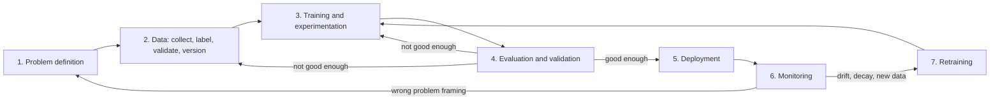
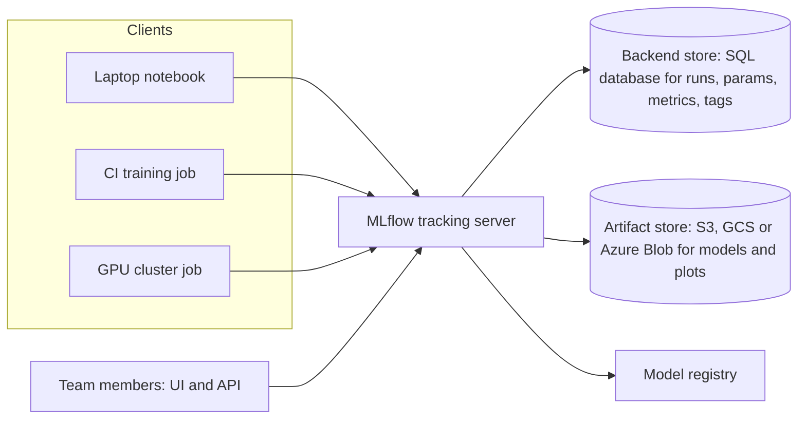

# The ML Lifecycle, MLOps and Experiment Tracking

> **Level:** Beginner to Advanced · **Study time:** ~75 min · **Prerequisites:** [The ML Workflow, Train/Validation/Test Splits and Cross-Validation](../01-classical-ml/01-ml-workflow-data-splits-and-cross-validation.md), [Classification Metrics and Imbalanced Data](../01-classical-ml/04-classification-metrics-and-imbalanced-data.md), [Python Tooling for ML](../00-foundations/06-python-numpy-pandas-pytorch-essentials.md)

## Table of contents

- [Why this matters](#why-this-matters)
- [Why ML is different from traditional software](#why-ml-is-different-from-traditional-software)
- [The ML lifecycle, stage by stage](#the-ml-lifecycle-stage-by-stage)
- [What MLOps is](#what-mlops-is)
- [MLOps maturity levels](#mlops-maturity-levels)
- [Experiment tracking: the problem it solves](#experiment-tracking-the-problem-it-solves)
- [What to log in every run](#what-to-log-in-every-run)
- [Building a tiny tracker from scratch](#building-a-tiny-tracker-from-scratch)
- [Experiment tracking with MLflow](#experiment-tracking-with-mlflow)
- [Experiment tracking with Weights and Biases](#experiment-tracking-with-weights-and-biases)
- [Comparing runs honestly](#comparing-runs-honestly)
- [Naming conventions and organizing runs](#naming-conventions-and-organizing-runs)
- [Team practices: reviewable, reproducible experiments](#team-practices-reviewable-reproducible-experiments)
- [Going deeper: experiment tracking in production teams](#going-deeper-experiment-tracking-in-production-teams)
- [Going deeper: tracking LLM experiments](#going-deeper-tracking-llm-experiments)
- [Common mistakes and misconceptions](#common-mistakes-and-misconceptions)
- [Interview questions and model answers](#interview-questions-and-model-answers)
- [Key takeaways](#key-takeaways)
- [Further reading](#further-reading)
- [Next](#next)

## Why this matters

Training a model that scores well in a notebook is the easy 10 percent. The hard part is everything around it: knowing exactly which data, code and settings produced the model, proving it is better than what runs in production today, shipping it safely, noticing when it silently degrades, and retraining it without heroics. Teams that skip this discipline end up with "the good model" living on someone's laptop, results nobody can reproduce, and production incidents nobody can explain. That is why senior AI/ML interviews almost always include questions like "walk me through the lifecycle of a model you shipped", "how do you version experiments?" and "how mature is your MLOps setup?" (**MLOps** is the engineering discipline of running ML reliably in production, defined properly below). This chapter gives you the vocabulary and the habits: the full ML lifecycle, the MLOps maturity ladder, and experiment tracking done the way strong teams do it, with MLflow and Weights and Biases examples you can run.

## Why ML is different from traditional software

> **Analogy:** Traditional software is a recipe you wrote yourself: if the cake is wrong, you read the recipe and find the mistake. An ML model is a recipe your oven wrote by tasting thousands of cakes. To know why the cake is wrong, you need the recipe, the ingredients it tasted, the oven settings, and which oven it was.

In **traditional software**, a programmer writes explicit rules ("if the sender is in the contacts list, deliver to inbox"). The behavior of the program is fully determined by its **code** (and its configuration).

In **machine learning (ML)**, the programmer writes a *learning procedure*, and the rules are learned from **data**. The output of training is a **model**: a file of learned numbers (called **parameters** or **weights**) plus the code that uses them to make **predictions**. Behavior now depends on three things at once:

```text
Traditional software:     behavior = f(code, config)

Machine learning:         behavior = f(code, config, DATA, training randomness, environment)
                                                     ^ the big new ingredient
```

This single change has consequences everywhere:

| Aspect | Traditional software | ML system |
|---|---|---|
| What defines behavior | Code you can read | Code + data + **hyperparameters** (settings you choose before training, like learning rate) + **random seed** (the starting value of the random number generator, which fixes data shuffling and initial weights) |
| How it fails | Usually loudly: exceptions, crashes, wrong output on a known input | Often silently: accuracy slowly drops, no error in the logs |
| Testing | Deterministic assertions (`assert add(2, 2) == 4`) | Statistical thresholds ("F1 on the test set is at least 0.90") plus classic tests |
| Development style | Mostly linear: design, build, test | Highly experimental: dozens or hundreds of runs, most of them discarded |
| What you must version | Code | Code, data, configs, environment, model files, and the experiments that link them |
| Does it decay? | Not by itself (only if dependencies or environment change) | Yes: the world changes, the data drifts, the model goes stale |
| Monitoring | Latency, errors, CPU, memory | All of that plus input data quality, prediction distributions and real-world accuracy |
| Team | Software engineers | Data scientists, data engineers, ML engineers, software engineers, domain experts |

The paper that made this famous is "Hidden Technical Debt in Machine Learning Systems" (Sculley et al., NeurIPS 2015). Two of its ideas are worth quoting in interviews in your own words:

- **The ML code is a small box in a big system.** The model training code is surrounded by much larger infrastructure: data collection, data verification, feature extraction, serving, monitoring, configuration.
- **CACE: "Changing Anything Changes Everything".** In ML, inputs are entangled. Change one feature's preprocessing, the sampling of the training set, or a single hyperparameter, and the whole model's behavior may shift in ways no code diff reveals.

> **Senior insight:** The core reason MLOps exists is that ML has *two* sources of change (code and data), and the data side has no compiler, no type checker and no stack traces. Everything in this chapter is a way of adding that missing visibility.

## The ML lifecycle, stage by stage

The **ML lifecycle** is the sequence of stages a model goes through from "we have a business problem" to "the model is running, watched and refreshed". It is a loop, not a line, because monitoring feeds back into data and retraining.



An older but still useful name for a similar loop is **CRISP-DM** (Cross-Industry Standard Process for Data Mining, published around 2000), which has six phases: business understanding, data understanding, data preparation, modeling, evaluation and deployment. The modern lifecycle adds monitoring and retraining as first-class stages.

We will walk through every stage with one running example: **a spam filter for an email product**.

### 1. Problem definition

> **Analogy:** Before building a bridge, you ask where people need to cross, how many cars, and what happens if it fails. Skipping this step builds a beautiful bridge to nowhere.

This is where many failed ML projects actually fail (solving the wrong problem, or optimizing a metric the business does not care about). You decide:

- **The business goal:** fewer spam emails reach the inbox, without hiding real emails.
- **The ML framing:** **binary classification** (predict one of two classes: spam or not spam, often called "ham").
- **The success metric:** here, a **false positive** (a real email sent to the spam folder) is far worse than a **false negative** (one spam email in the inbox). So you care about **precision** (of the emails we flag, what fraction really are spam) at an acceptable **recall** (of all spam, what fraction we catch). **F1** is the harmonic mean of precision and recall, a single number that balances both. These metrics are taught in [Classification Metrics and Imbalanced Data](../01-classical-ml/04-classification-metrics-and-imbalanced-data.md).
- **Constraints:** latency budget per email (for example, under 50 ms, illustrative), cost, privacy (emails are personal data), explainability needs.
- **A baseline:** the simplest thing that could work, such as keyword rules. If ML cannot beat the rules, you do not need ML.

> **Interview tip:** When asked to "design an ML system", always start here: goal, metric, constraints, baseline. Interviewers mark candidates down for jumping straight to "I would use a transformer".

### 2. Data

You **collect** data (emails plus labels), **label** it (here, users clicking "Report spam" or "Not spam" gives labels for free, but those labels are noisy), **validate** it (schema checks, missing values, duplicates, label sanity), **split** it into train, validation and test sets (see [the ML workflow chapter](../01-classical-ml/01-ml-workflow-data-splits-and-cross-validation.md)), and **version** it so you can later say exactly which data trained which model.

For a spam filter, split **by time** (train on January to August, test on September), not randomly. Spam changes over time, and a random split would leak "future" spam patterns into training, which inflates your scores. That kind of contamination is covered in [Overfitting, Regularization and Data Leakage](../01-classical-ml/03-overfitting-regularization-and-data-leakage.md).

### 3. Training and experimentation

You turn raw data into **features** (numeric inputs the model can use, for example word counts or TF-IDF weights, see [Feature Engineering](../01-classical-ml/07-feature-engineering-missing-values-and-encoding.md)), pick a model family, and run many **experiments**. An **experiment run** (or just **run**) is one execution of training with one specific combination of code, data, and hyperparameters. This is the stage where experiment tracking lives, and the bulk of this chapter is about it.

### 4. Evaluation and validation

You measure the candidate model on held-out data and ask:

- Does it beat the baseline and the current production model on the primary metric?
- Does it hold up on **slices** (subsets of the data, such as non-English emails, new users, mobile clients)? An overall improvement can hide a regression on an important slice.
- Does it meet non-functional requirements: latency, memory, model size, fairness, robustness?

Evaluation is **offline** (on stored data) at this stage. **Online** evaluation comes after deployment: **A/B tests** (randomly split live users between the old and new model and compare business outcomes) and **canaries** (send a small share of traffic, say 5 percent, to the new model first and widen only if it behaves).

### 5. Deployment

You package the model and put it where predictions are needed: as an online API scoring each incoming email, or as a **batch** job scoring a backlog. Safe rollout patterns (shadow, canary, rollback) are covered in [Model Deployment Patterns](04-model-deployment-patterns.md), and serving infrastructure in [Building a Scalable Inference API](05-building-a-scalable-inference-api.md).

### 6. Monitoring

Once live, you watch system health (latency, errors) and model health: input distributions, prediction distributions, and true accuracy when labels arrive. Spammers adapt, so the data **drifts** (its distribution changes over time). Monitoring is covered in [Monitoring ML and LLM Systems in Production](06-monitoring-ml-and-llm-systems-in-production.md) and drift in [Data Drift, Concept Drift and When to Retrain](../01-classical-ml/08-data-drift-concept-drift-and-retraining.md).

### 7. Retraining

You retrain on fresh data, either on a schedule (every week), on a trigger (drift alarm, accuracy drop), or continuously. The retrained model goes back through evaluation before replacing the old one. Automating this loop is exactly what the MLOps maturity levels below measure.

> **Common mistake:** Treating deployment as the finish line. In ML, deployment is the *middle* of the lifecycle. A model that is not monitored and retrained is a model that is quietly getting worse.

### A hidden trap: feedback loops

In our spam filter, emails the model sends to the spam folder are rarely opened, so users rarely click "Not spam" on them. The model's own decisions shape the labels it will be retrained on. This is a **feedback loop**, and it can lock in mistakes. Mitigations include holding out a small random fraction of traffic from the model's decisions, or sampling some filtered emails for human review.

## What MLOps is

**MLOps** (machine learning operations) is the set of practices, tools and team habits for building, deploying, monitoring and improving ML systems reliably and repeatably. It borrows from **DevOps** (the software practice of automating build, test and release, with **CI**, continuous integration, and **CD**, continuous delivery or deployment) and adds what ML needs on top:

| DevOps concept | MLOps extension |
|---|---|
| Version control for code | Version control for code **and** data, configs, models and experiments |
| CI: test the code on every change | CI also tests data (schema, distributions) and models (quality thresholds) |
| CD: release a binary | CD releases a *training pipeline* and/or a *trained model* |
| (none) | **CT, continuous training**: automatically retrain models when new data or triggers arrive |
| Monitoring: uptime, latency | Also monitor data drift, prediction drift, and model quality |

Key building blocks you will meet throughout this module:

- **Experiment tracker:** records every run (this chapter).
- **Data versioning:** snapshots or hashes of datasets ([next chapter](02-data-and-model-versioning-and-model-registry.md)).
- **Model registry:** a catalog of trained models with versions and stages or aliases such as "staging" and "production" (MLflow deprecated fixed stages in favor of aliases in version 2.9) ([next chapter](02-data-and-model-versioning-and-model-registry.md)).
- **Pipeline orchestrator:** runs multi-step workflows (ingest, validate, train, evaluate, register) automatically, for example Airflow, Kubeflow Pipelines, Prefect, Dagster or a cloud provider's pipeline service.
- **Feature store:** a shared system that computes and serves features consistently for training and serving, which helps avoid **training-serving skew** (features computed differently in training and in production, so the live model sees inputs unlike those it learned from; see [Reproducible Training and Training-Serving Skew](03-reproducibility-and-training-serving-skew.md)).
- **Serving and monitoring stack** (later chapters in this module).

## MLOps maturity levels

> **Analogy:** Think of a bakery. Level 0: the head baker makes each cake by hand from memory. Level 1: there is a machine that bakes cakes automatically from a written recipe whenever fresh flour arrives. Level 2: when someone improves the recipe, it is tested and loaded into the machine automatically, and the machine itself is rebuilt and tested safely.

The most cited framework is Google Cloud's article "MLOps: Continuous delivery and automation pipelines in machine learning", which defines three levels. Microsoft publishes a similar Azure MLOps maturity model with five levels (0 to 4) that splits the same journey more finely. The names differ, the idea is the same: **how much of the lifecycle is automated, tested and reproducible**.

### Level 0: manual process

- Data scientists train models in notebooks, by hand.
- The model file is handed to engineers ("here is `model_final_v3_REAL.pkl`"), who wrap it in a service.
- Releases are rare (a few times a year), no CI/CD, little or no monitoring.
- Experiment tracking, if any, is a spreadsheet.

**Typical pain:** nobody can reproduce last quarter's model, and retraining takes weeks.

### Level 1: ML pipeline automation (continuous training)

- The steps (data extraction, validation, preparation, training, evaluation, registration) are code in an **automated pipeline**.
- What gets deployed to production is the **pipeline**, which then retrains the model automatically on new data (on a schedule or a trigger). This is **continuous training (CT)**.
- Automated data validation and model validation gate each new model.
- Experiment tracking, a model registry and metadata about every pipeline run are standard.
- The pipeline itself is still built and deployed manually.

### Level 2: CI/CD pipeline automation

- Changes to pipeline code (new features, new model architecture) go through **CI**: unit tests, data tests, a small training run, model quality checks.
- **CD** automatically deploys the new pipeline to staging and production.
- The pipeline then does CT, producing models that are deployed with safe rollout (canary, shadow) and monitored, with automatic or semi-automatic rollback.

```mermaid
flowchart TB
    subgraph L0[Level 0: manual]
        n1[Notebook] --> n2[model.pkl] --> n3[Handoff to engineers] --> n4[Manual deploy]
    end
    subgraph L1[Level 1: automated training pipeline]
        p1[New data or schedule] --> p2[Pipeline: validate, train, evaluate] --> p3[Registry] --> p4[Deploy model]
    end
    subgraph L2[Level 2: CI/CD plus CT]
        c1[Code change] --> c2[CI: tests and small training run] --> c3[CD: deploy pipeline] --> c4[Pipeline does CT] --> c5[Safe rollout and monitoring]
    end
```



| Level | What is automated | Release frequency (typical) | Good fit for | Main risk |
|---|---|---|---|---|
| 0: manual | Nothing, or ad hoc scripts | Rare | First model, proof of concept, models that almost never change | Irreproducible models, slow fixes, silent decay |
| 1: CT pipeline | Training, validation and model registration | Model refresh frequent; pipeline changes rare | Data changes often but the modeling approach is stable | Pipeline changes are slow and manual, so improvements ship slowly |
| 2: CI/CD + CT | Pipeline build, test, deploy, plus training and rollout | Both code and models change frequently | Many models, many contributors, fast-changing environments | Higher upfront engineering cost and platform complexity |

> **Senior insight:** Maturity is not a goal in itself. A model retrained once a year on stable data may be fine at level 0 with good experiment tracking. A fraud model facing adaptive attackers needs level 1 at least. Match investment to how fast the data and the model change, how costly errors are, and how many models the team runs. A good interview answer names the *next* bottleneck, not the fanciest level.

> **Interview tip:** Experiment tracking and versioning are the cheapest first steps out of level 0, and they are prerequisites for everything else. You cannot automate a pipeline whose inputs you cannot even name.

## Experiment tracking: the problem it solves

> **Analogy:** A chemist keeps a lab notebook: date, ingredients and quantities, temperature, what happened. Without it, a great result found on Tuesday cannot be repeated on Friday. **Experiment tracking** is the lab notebook for ML, filled in automatically.

**Experiment tracking** is the practice (and the tooling) of recording, for every training run, everything needed to understand, compare and reproduce it: inputs (code, data, config, environment) and outputs (metrics, plots, model files).

Here is what happens without it. Three weeks into the spam project, you have:

```text
notebooks/
  spam_v2.ipynb
  spam_v2_fixed.ipynb
  spam_final.ipynb
  spam_final_new_features_DONT_USE.ipynb
models/
  model.pkl
  model_best.pkl
  model_best_0.93.pkl        <- 0.93 of what? on which data? with which code?
```

Your manager asks: "Which model is in production, what data was it trained on, and why did we choose it over the gradient boosting one?" Nobody can answer with confidence. Experiment tracking turns those questions into a lookup.

The core vocabulary (shared by MLflow, Weights and Biases and most other tools):

| Term | Meaning | Spam example |
|---|---|---|
| **Project / experiment** | A named group of runs that answer one question | `spam-filter/tfidf-logreg` |
| **Run** | One execution of training or evaluation | Logistic regression, C=1.0, bigrams, seed 42 |
| **Parameters (params)** | Inputs that configure the run: hyperparameters, feature flags | `C=1.0`, `ngram_max=2` |
| **Metrics** | Numbers measured during or after the run, possibly per step | `val_f1=0.94`, `train_loss` per epoch |
| **Artifacts** | Files produced or consumed: model files, plots, confusion matrices, predictions | `model.pkl`, `confusion_matrix.png` |
| **Tags** | Free-form labels for search and organization | `owner=ana`, `purpose=baseline` |
| **Lineage** | Links between data, code, runs and models: what produced what | Model v7 came from run `a1b2c3` on dataset `spam-v12` |

**What "versioning an experiment" means.** Code has git commits; an experiment has no single file to commit. Instead, each run gets an immutable **run ID**, and every input is recorded by an **immutable reference**: a commit hash (not a branch name), a dataset version or content hash (not "latest"), an image digest (not a tag), plus the full config and seeds. The run's identity is that tuple of references, so two runs with identical references should agree within seed noise, and any unexplained difference must come from something you forgot to record.

## What to log in every run

The guiding rule: **log enough that a teammate, a year from now, can explain and reproduce the result without asking you.** That means capturing every input that could change the output, plus the outputs themselves.

| Category | What exactly | Why it matters | How (typical) |
|---|---|---|---|
| **Code version** | Git commit hash, branch, and a "dirty" flag (uncommitted changes), ideally the diff | The same config with different code is a different experiment | Most trackers capture git info automatically; refuse or flag dirty runs for important results |
| **Config and hyperparameters** | Every setting: model type, learning rate, regularization, feature flags, preprocessing options, the full resolved config file | Lets you compare runs and re-run exactly | `log_params` plus the full config as an artifact (YAML/JSON) |
| **Data version** | Dataset name and version, or a content hash; the split definition (date ranges, split seed); row counts and label balance | "Same code, different data" is the most common unexplained difference | Data versioning tool reference (DVC, lakeFS, table snapshot ID), or a SHA-256 hash of the files |
| **Environment** | Python version, library versions (lock file), OS, container image digest, hardware (GPU type and count), CUDA/driver version | Results can change across library versions and hardware | Lock file or `pip freeze` artifact, Docker image digest as a tag |
| **Randomness** | All seeds (Python, NumPy, framework), and whether deterministic algorithms were enabled | Needed for exact or statistical reproduction | Log as params |
| **Metrics** | Primary and secondary metrics on validation (and test only for final candidates), per-slice metrics, training curves (loss per step), system metrics (time, memory, throughput) | Comparison, debugging, catching overfitting | `log_metric(name, value, step)` |
| **Artifacts** | Model file, preprocessing objects (vectorizer, tokenizer, scaler), evaluation plots, sample predictions, error analysis tables | The model alone is useless without its preprocessing; plots make runs reviewable | `log_artifact` / `log_model` |
| **Model metadata** | Input/output schema (signature), model size, inference latency on a reference machine | Needed for deployment decisions | Signature, tags, metrics |
| **Context** | Owner, ticket or hypothesis, purpose (baseline, ablation, sweep, candidate), notes | Turns a pile of runs into a story | Tags and a description field |

A few terms from that table:

- A **hash** is a short fingerprint computed from content. **SHA-256** is a common hash function: if even one byte of a file changes, its SHA-256 hash changes completely. Logging a data hash proves which exact data was used.
- An **ablation** is a run that removes or changes one component to measure its contribution ("what if we drop the bigram features?").
- A **lock file** pins exact versions of every dependency, so the environment can be rebuilt.
- A model **signature** describes the expected input and output columns and types.
- A **container image digest** (for example `sha256:9e1f...`) is the content hash of a Docker image. Unlike a tag such as `latest`, which can be moved to a new image, a digest always names the exact same environment.

> **Common mistake:** Logging the model file but not the preprocessing. For the spam filter, a logistic regression model is meaningless without the exact fitted TF-IDF vocabulary it expects. Log the whole pipeline as one artifact.

> **Senior insight:** Distinguish *inputs you must log to reproduce* (code, data, config, environment, seeds) from *outputs you log to compare and debug* (metrics, plots, predictions). If any input is missing, the run is not reproducible, no matter how many plots you saved.

## Building a tiny tracker from scratch

To see that there is no magic, let us build a minimal tracker with only the standard library. Every real tracker is a polished, multi-user, server-backed version of this.

First, a small shared module that creates a synthetic spam dataset so every example in this chapter is runnable without downloads.

```python
# spam_data.py: a tiny synthetic spam dataset shared by all examples in this chapter
import csv
import random

import pandas as pd
from sklearn.model_selection import train_test_split

SPAM_WORDS = ["free", "winner", "prize", "cash", "click", "offer", "urgent", "loan"]
HAM_WORDS = ["meeting", "lunch", "project", "report", "family", "tomorrow", "invoice", "team"]


def make_spam_csv(path: str = "spam.csv", n: int = 400, seed: int = 0) -> None:
    """Write n fake messages; about 30% are spam. Some words overlap, but the classes
    are still easy to separate (a toy dataset for demonstrating tracking, not modeling)."""
    rng = random.Random(seed)
    rows = []
    for _ in range(n):
        is_spam = rng.random() < 0.3
        main, other = (SPAM_WORDS, HAM_WORDS) if is_spam else (HAM_WORDS, SPAM_WORDS)
        words = rng.choices(main, k=5) + rng.choices(other, k=2)
        rng.shuffle(words)
        rows.append((" ".join(words), int(is_spam)))
    with open(path, "w", newline="") as f:
        writer = csv.writer(f)
        writer.writerow(["text", "label"])
        writer.writerows(rows)


def load_split(path: str, seed: int):
    """Return X_train, X_val, y_train, y_val with a stratified 80/20 split."""
    df = pd.read_csv(path)
    return train_test_split(df["text"], df["label"], test_size=0.2,
                            random_state=seed, stratify=df["label"])
```

Now the tracker itself. It creates one folder per run and records code version, data hash, environment, params and metrics.

```python
# tiny_tracker.py: a from-scratch experiment tracker (standard library only)
import hashlib
import json
import platform
import subprocess
import sys
import time
import uuid
from importlib import metadata
from pathlib import Path

RUNS_DIR = Path("runs")


def _git(*args: str) -> str | None:
    """Run a git command; return None if git is missing or this is not a repo."""
    try:
        return subprocess.check_output(["git", *args], text=True,
                                       stderr=subprocess.DEVNULL).strip()
    except (subprocess.CalledProcessError, FileNotFoundError):
        return None


def file_sha256(path: str | Path) -> str:
    """Content fingerprint of a data file: any changed byte changes the hash."""
    h = hashlib.sha256()
    with open(path, "rb") as f:
        for chunk in iter(lambda: f.read(1 << 20), b""):  # read 1 MiB at a time
            h.update(chunk)
    return h.hexdigest()


def _pkg(name: str) -> str | None:
    try:
        return metadata.version(name)
    except metadata.PackageNotFoundError:
        return None


class Run:
    def __init__(self, experiment: str, name: str, params: dict,
                 data_path: str, tags: dict | None = None):
        self.id = uuid.uuid4().hex[:8]
        self.dir = RUNS_DIR / experiment / f"{name}-{self.id}"
        self.dir.mkdir(parents=True, exist_ok=True)
        # "" means a clean working tree. Untracked files count as dirty too, so add
        # generated files such as runs/ and spam.csv to .gitignore.
        status = _git("status", "--porcelain")
        meta = {
            "run_id": self.id, "experiment": experiment, "name": name,
            "started_at": time.strftime("%Y-%m-%dT%H:%M:%S"),
            "git_commit": _git("rev-parse", "HEAD"),
            "git_dirty": (status != "") if status is not None else None,
            "data_path": str(data_path), "data_sha256": file_sha256(data_path),
            "python": sys.version.split()[0], "platform": platform.platform(),
            "packages": {p: _pkg(p) for p in ["numpy", "pandas", "scikit-learn"]},
            "tags": tags or {},
        }
        self._write("meta.json", meta)
        self._write("params.json", params)
        self.summary: dict[str, float] = {}

    def _write(self, filename: str, obj) -> None:
        (self.dir / filename).write_text(json.dumps(obj, indent=2))

    def log_metric(self, key: str, value: float, step: int | None = None) -> None:
        # Append-only log: one JSON line per measurement, like real trackers' time series.
        with open(self.dir / "metrics.jsonl", "a") as f:
            f.write(json.dumps({"key": key, "value": float(value), "step": step,
                                "ts": time.time()}) + "\n")
        self.summary[key] = float(value)             # latest value per metric

    def finish(self) -> None:
        self._write("summary.json", self.summary)


def compare_runs(experiment: str, metric: str) -> list[dict]:
    """Load every finished run in an experiment and sort by a metric (best first)."""
    rows = []
    for run_dir in (RUNS_DIR / experiment).iterdir():
        summary_file = run_dir / "summary.json"
        if not summary_file.exists():
            continue                                 # unfinished or crashed run
        meta = json.loads((run_dir / "meta.json").read_text())
        params = json.loads((run_dir / "params.json").read_text())
        summary = json.loads(summary_file.read_text())
        rows.append({"run": meta["name"], "commit": (meta["git_commit"] or "none")[:7],
                     "data": meta["data_sha256"][:8], **params,
                     metric: summary.get(metric)})
    return sorted(rows, key=lambda r: r[metric] or 0.0, reverse=True)
```

Using it for a small hyperparameter comparison on the spam filter:

```python
# train_tiny.py
# pip install scikit-learn pandas
from sklearn.feature_extraction.text import TfidfVectorizer
from sklearn.linear_model import LogisticRegression
from sklearn.metrics import f1_score
from sklearn.pipeline import make_pipeline

from spam_data import load_split, make_spam_csv
from tiny_tracker import Run, compare_runs

make_spam_csv("spam.csv")

for C in [0.1, 1.0, 10.0]:                 # C = inverse regularization strength
    for ngram_max in [1, 2]:
        params = {"C": C, "ngram_max": ngram_max, "seed": 42}
        run = Run("spam-tfidf-logreg", f"logreg-C{C}-ng{ngram_max}", params,
                  data_path="spam.csv", tags={"purpose": "sweep"})
        X_tr, X_val, y_tr, y_val = load_split("spam.csv", seed=params["seed"])
        model = make_pipeline(TfidfVectorizer(ngram_range=(1, ngram_max)),
                              LogisticRegression(C=C, max_iter=1000))
        model.fit(X_tr, y_tr)
        run.log_metric("val_f1", f1_score(y_val, model.predict(X_val)))
        run.finish()

for row in compare_runs("spam-tfidf-logreg", "val_f1"):
    print(row)
```

On this easy synthetic data, the runs with `C=1.0` and `C=10.0` typically reach `val_f1` of 1.0, while the strongly regularized `C=0.1` runs score far lower (roughly 0 to 0.2), because they predict almost everything as the majority class "ham". Exact numbers can vary slightly across library versions.

What this toy already gives you: every result is tied to a commit, a data fingerprint, an environment and a full parameter set, and comparing runs is a function call instead of an archaeology project.

What it is missing, and what real tools add:

- A **server** and database so a whole team writes to one place (with authentication and access control).
- A **UI** for charts, run comparison, filtering and search.
- **Artifact storage** in object storage (S3, GCS, Azure Blob) for large model files.
- **Model registry** integration, **sweeps** (automated hyperparameter search), **reports**, alerts.
- Robustness: crash handling, offline buffering, distributed training support.

## Experiment tracking with MLflow

**MLflow** is an open-source platform (originally from Databricks, first released in 2018) with several components: **Tracking** (runs, params, metrics, artifacts), **Models** (a standard packaging format with "flavors" for scikit-learn, PyTorch, Hugging Face and more), the **Model Registry**, and, in recent versions, features for evaluating and tracing LLM applications. You can run it locally, self-host a tracking server, or use a managed version from several cloud vendors.

> **Version note:** The MLflow core tracking API (`set_experiment`, `start_run`, `log_param(s)`, `log_metric(s)`, `log_artifact`, `search_runs`) has been stable for years. Some details changed in MLflow 3.x (for example, `log_model` prefers `name=` over the older `artifact_path=`). Check the docs for the version you use.

```python
# train_mlflow.py
# pip install mlflow scikit-learn pandas
import mlflow
import mlflow.data
import mlflow.sklearn
import pandas as pd
from sklearn.feature_extraction.text import TfidfVectorizer
from sklearn.linear_model import LogisticRegression
from sklearn.metrics import f1_score, precision_score, recall_score
from sklearn.pipeline import make_pipeline

from spam_data import load_split, make_spam_csv

# A local SQLite file works for one person; a team points this at a shared server,
# for example "http://mlflow.internal:5000".
mlflow.set_tracking_uri("sqlite:///mlflow.db")
mlflow.set_experiment("spam-filter/tfidf-logreg")

params = {"C": 1.0, "ngram_max": 2, "min_df": 1, "seed": 42}
make_spam_csv("spam.csv")
X_tr, X_val, y_tr, y_val = load_split("spam.csv", seed=params["seed"])

with mlflow.start_run(run_name=f"logreg-C{params['C']}-ng{params['ngram_max']}"):
    # Context: who, why, which ticket. Searchable later.
    mlflow.set_tags({"owner": "ana", "purpose": "baseline", "ticket": "SPAM-123"})

    # Inputs: hyperparameters, plus the full config as a file for exact re-runs.
    mlflow.log_params(params)
    mlflow.log_dict(params, "config.json")

    # Data lineage: records the dataset name, source and a content digest.
    df = pd.read_csv("spam.csv")
    dataset = mlflow.data.from_pandas(df, source="spam.csv", name="spam-v1", targets="label")
    mlflow.log_input(dataset, context="training")

    # Train the WHOLE pipeline (vectorizer + classifier) so preprocessing ships with the model.
    model = make_pipeline(
        TfidfVectorizer(ngram_range=(1, params["ngram_max"]), min_df=params["min_df"]),
        LogisticRegression(C=params["C"], max_iter=1000),
    )
    model.fit(X_tr, y_tr)

    # Outputs: metrics...
    pred = model.predict(X_val)
    mlflow.log_metrics({
        "val_f1": f1_score(y_val, pred),
        "val_precision": precision_score(y_val, pred),
        "val_recall": recall_score(y_val, pred),
    })

    # ...and the model artifact. On MLflow 2.x use artifact_path="model" instead of name=.
    mlflow.sklearn.log_model(sk_model=model, name="model")
```

Then start the UI and open it in a browser (by default at `http://127.0.0.1:5000`):

```bash
mlflow ui --backend-store-uri sqlite:///mlflow.db
```

Notes on what MLflow does for you:

- When the script runs inside a git repository, MLflow records the source file name and (when it can detect the repo) the git commit as **system tags**. Logging the commit explicitly as a tag is harmless and makes it robust in containers where `.git` is absent.
- For deep learning, log a metric per training step to get learning curves: `mlflow.log_metric("train_loss", loss, step=epoch)`.
- **Autologging** (`mlflow.sklearn.autolog()`, `mlflow.pytorch.autolog()` (which targets PyTorch Lightning, not plain PyTorch training loops) and others) captures params, metrics and the model automatically for supported libraries. It is a great default, but you still need to log data versions and context yourself (recent sklearn autologging can record a digest of the in-memory training data, but not the upstream dataset version, the split definition or why the run exists).
- For hyperparameter sweeps, use **nested runs**: a parent run for the sweep, with `mlflow.start_run(nested=True)` for each trial.

### Comparing runs programmatically

The UI is great for exploring, but programmatic comparison makes decisions reproducible. `mlflow.search_runs` returns a pandas DataFrame:

```python
import mlflow

mlflow.set_tracking_uri("sqlite:///mlflow.db")
runs = mlflow.search_runs(
    experiment_names=["spam-filter/tfidf-logreg"],
    filter_string="metrics.val_precision > 0.9 AND tags.purpose != 'debug'",
    order_by=["metrics.val_f1 DESC"],
)
print(runs[["run_id", "tags.mlflow.runName", "params.C", "params.ngram_max",
            "metrics.val_f1", "metrics.val_precision"]].head())
```

Column names follow the pattern `params.<name>`, `metrics.<name>` and `tags.<name>`. Note that **params are stored as strings**, so `params.C` comes back as `"1.0"`, not the float `1.0`. Cast before doing math on them.

### How a team MLflow deployment looks



The split between a **backend store** (small structured metadata in a SQL database such as PostgreSQL or MySQL) and an **artifact store** (large files in object storage) is the key design point. Metadata queries must be fast; model files must be cheap to store.

## Experiment tracking with Weights and Biases

**Weights and Biases (W&B)** is a hosted experiment tracking platform (with a self-hosted option for enterprises) known for rich interactive charts, **sweeps** (hyperparameter search), **Artifacts** (versioned datasets and models with lineage) and **Reports** (shareable documents that embed live charts). It is especially popular for deep learning and LLM training.

> **Version note:** The core API below (`wandb.init`, `run.log`, `run.config`, `run.summary`, `wandb.Artifact`, `run.log_artifact`, `run.use_artifact`, `wandb.sweep`, `wandb.agent`) has been stable for years, but check current docs for details. To try it without an account, set `mode="offline"` in `wandb.init` (or the environment variable `WANDB_MODE=offline`) and sync later with `wandb sync`. Offline mode covers basic logging only: `run.use_artifact(...)` and sweeps need a connection to a W&B server, so the full example below needs an account (or a self-hosted server).

```python
# train_wandb.py
# pip install wandb scikit-learn pandas
import wandb
from sklearn.feature_extraction.text import TfidfVectorizer
from sklearn.linear_model import LogisticRegression
from sklearn.metrics import f1_score, precision_score, recall_score
from sklearn.pipeline import make_pipeline

from spam_data import load_split, make_spam_csv

# Step A (normally a separate "data prep" job): version the dataset as an Artifact.
make_spam_csv("spam.csv")
with wandb.init(project="spam-filter", job_type="data-prep") as prep_run:
    data_art = wandb.Artifact("spam-dataset", type="dataset",
                              description="Synthetic spam data, 400 rows")
    data_art.add_file("spam.csv")
    prep_run.log_artifact(data_art)               # spam-dataset:v0, v1, ... (a new version
                                                  # only when the content digest changes)


def train(config: dict | None = None) -> None:
    with wandb.init(project="spam-filter", job_type="train", group="tfidf-logreg",
                    tags=["baseline"], config=config) as run:
        cfg = run.config                          # in a sweep, values come from the sweep
        run.name = f"logreg-C{cfg.C}-ng{cfg.ngram_max}"

        # Lineage: this run CONSUMED this exact dataset version. W&B resolves the
        # "latest" alias and records the concrete version (e.g. v3); pin
        # "spam-dataset:v3" when you need an exact re-run.
        data_dir = run.use_artifact("spam-dataset:latest").download()
        X_tr, X_val, y_tr, y_val = load_split(f"{data_dir}/spam.csv", seed=cfg.seed)

        model = make_pipeline(TfidfVectorizer(ngram_range=(1, cfg.ngram_max)),
                              LogisticRegression(C=cfg.C, max_iter=1000))
        model.fit(X_tr, y_tr)
        pred = model.predict(X_val)
        run.log({"val_f1": f1_score(y_val, pred),
                 "val_precision": precision_score(y_val, pred),
                 "val_recall": recall_score(y_val, pred)})
        # For neural nets you would call run.log({"train_loss": loss}) every step.


train({"C": 1.0, "ngram_max": 2, "seed": 42})
```

Notes:

- `wandb.init` records the git commit, the command, the Python environment and system metrics (CPU, GPU, memory) by default; saving the source code itself is configurable.
- `run.config` holds hyperparameters; `run.log` writes time series; `run.summary` holds final or best values shown in the runs table (by default, the last logged value of each metric).
- `job_type` and `group` organize runs: for example, all folds of a cross-validation or all workers of a distributed job share one `group`.
- Artifacts give **lineage**: in the UI you can see that model artifact `spam-model:v4` was produced by run X, which used `spam-dataset:v2`, which was produced by run Y.

A sweep (automated hyperparameter search) is a small config plus an agent that calls your `train` function:

```python
sweep_config = {
    "method": "random",                           # also "grid" (every combination) or
                                                  # "bayes" (uses past results to pick next configs)
    "metric": {"name": "val_f1", "goal": "maximize"},
    "parameters": {
        "C": {"values": [0.1, 1.0, 10.0]},
        "ngram_max": {"values": [1, 2]},
        "seed": {"value": 42},
    },
}
sweep_id = wandb.sweep(sweep_config, project="spam-filter")
wandb.agent(sweep_id, function=train, count=6)    # runs train() 6 times with sampled configs
                                                  # (random sampling can repeat a combination;
                                                  # "grid" would cover all 6 exactly once)
```

### MLflow vs W&B vs others

| Tool | What it is | Strengths | Weaknesses | When to choose |
|---|---|---|---|---|
| **MLflow** | Open-source tracking, model format and registry | Free, self-hostable, vendor-neutral, built-in registry and model packaging, widely supported | UI less rich than SaaS tools; you operate the server (unless managed) | Data must stay in-house, you want open source, or you already use a platform that bundles it |
| **Weights and Biases** | Hosted tracking platform (self-hosting available) | Excellent visualizations, sweeps, artifacts with lineage graphs, reports for collaboration | Commercial pricing at scale; SaaS data residency questions | Deep learning and LLM training teams that value collaboration and visualization |
| **TensorBoard** | Local visualization of training logs | Zero setup, great for curves of one or a few runs | Not a full tracker: weak search, no registry, no team metadata | Quick local debugging of training curves |
| **ClearML, Comet, Aim and others** | Open-source or hosted trackers, some with orchestration | Various: ClearML adds pipelines and task queues; Aim is open source and lightweight | Smaller ecosystems; feature sets change over time | Evaluate against your needs; check current status and pricing |
| **DVC experiments** | Git-based data versioning plus experiment tracking | Experiments live next to code in git; strong data versioning | Less suited to huge numbers of runs or rich dashboards | Git-centric teams that want data and experiments versioned together |

> **Interview tip:** Interviewers rarely care which tool you picked. They care that you can name what must be logged, how lineage is preserved, and how the tracker connects to the model registry and CI. Say "we used MLflow, but the principle is..." and move to the principle.

## Comparing runs honestly

Your tracker shows two runs: baseline `val_f1 = 0.912`, new feature `val_f1 = 0.914`. Is the new feature better? Not necessarily. Training has randomness (data shuffling, initialization, the split itself), so the same configuration with a different **random seed** gives a slightly different score. A difference smaller than that natural wobble is noise.

> **Analogy:** If you weigh yourself three times in a row and get 70.1, 70.4 and 69.9 kg, a reading of 70.2 tomorrow does not mean you gained weight. You need to know how much the scale wobbles before you can trust a difference.

The fix: run each configuration with several seeds and compare means relative to their uncertainty.

**Mean** of $n$ scores:

$$\bar{x} = \frac{1}{n}\sum_{i=1}^{n} x_i$$

**Sample standard deviation** (how much scores wobble between seeds):

$$s = \sqrt{\frac{1}{n-1}\sum_{i=1}^{n}\left(x_i - \bar{x}\right)^2}$$

**Standard error of the mean** (how uncertain the mean itself is):

$$SE = \frac{s}{\sqrt{n}}$$

**Standard error of the difference** between two independent configurations A and B:

$$SE_{\text{diff}} = \sqrt{SE_A^2 + SE_B^2}$$

Where:

- $x_i$ is the metric (here, validation F1) from seed number $i$.
- $n$ is the number of seeds (runs) for that configuration.
- $\bar{x}$ is the average score.
- $s$ measures the spread across seeds; dividing by $n-1$ instead of $n$ (Bessel's correction) corrects the tendency of small samples to underestimate spread; it makes $s^2$ unbiased, though $s$ itself still slightly underestimates the true spread when $n$ is tiny (see [Probability and Statistics](../00-foundations/04-probability-and-statistics.md)).
- $SE$ is the uncertainty of the average; it shrinks as you add seeds.
- $SE_A$, $SE_B$ are the standard errors of configurations A and B; $SE_{\text{diff}}$ is the uncertainty of $\bar{x}_B - \bar{x}_A$.

A rough rule of thumb: a difference smaller than about 2 times $SE_{\text{diff}}$ is not convincing. (With very few seeds this rule is optimistic; a proper test such as **Welch's t-test** accounts for small samples.)

**Worked example (illustrative numbers).** Three seeds each:

- Baseline A: 0.910, 0.914, 0.912
- New feature B: 0.921, 0.905, 0.916

Step 1, means:

- $\bar{x}_A = (0.910 + 0.914 + 0.912) / 3 = 2.736 / 3 = 0.912$
- $\bar{x}_B = (0.921 + 0.905 + 0.916) / 3 = 2.742 / 3 = 0.914$

Step 2, standard deviations:

- A: deviations are $-0.002, +0.002, 0.000$. Squares: $0.000004, 0.000004, 0$. Sum $= 0.000008$. Divide by $n - 1 = 2$: $0.000004$. Square root: $s_A = 0.002$.
- B: deviations are $+0.007, -0.009, +0.002$. Squares: $0.000049, 0.000081, 0.000004$. Sum $= 0.000134$. Divide by 2: $0.000067$. Square root: $s_B \approx 0.00819$.

Step 3, standard errors ($\sqrt{3} \approx 1.732$):

- $SE_A = 0.002 / 1.732 \approx 0.00115$, so $SE_A^2 = 0.000004 / 3 \approx 0.00000133$
- $SE_B = 0.00819 / 1.732 \approx 0.00473$, so $SE_B^2 = 0.000067 / 3 \approx 0.00002233$

Step 4, uncertainty of the difference:

- $SE_{\text{diff}} = \sqrt{0.00000133 + 0.00002233} = \sqrt{0.00002367} \approx 0.00487$

Step 5, compare:

- Difference $= 0.914 - 0.912 = 0.002$
- Ratio $= 0.002 / 0.00487 \approx 0.41$, far below 2.

**Conclusion:** the "improvement" is well within seed noise. Notice also that B is much less stable ($s_B$ is about 4 times $s_A$), which is itself worth investigating. If you had only logged one lucky seed of B (0.921), you would have shipped noise.

```python
# compare_seeds.py: the same calculation with NumPy and SciPy
# pip install numpy scipy
import numpy as np
from scipy import stats

a = np.array([0.910, 0.914, 0.912])
b = np.array([0.921, 0.905, 0.916])

se_a = a.std(ddof=1) / np.sqrt(len(a))       # ddof=1 gives the n-1 denominator
se_b = b.std(ddof=1) / np.sqrt(len(b))
se_diff = np.sqrt(se_a**2 + se_b**2)
print(f"diff={b.mean() - a.mean():.4f}  se_diff={se_diff:.5f}  "
      f"ratio={(b.mean() - a.mean()) / se_diff:.2f}")
# Prints: diff=0.0020  se_diff=0.00486  ratio=0.41
print(stats.ttest_ind(b, a, equal_var=False))  # Welch's t-test
# Prints t of about 0.41 with about 2.2 degrees of freedom and p of about 0.72: no evidence of a difference.
```

Other honest-comparison habits:

- **Seed variance is not the only noise.** A small validation set has sampling noise too. A **bootstrap** (resample the validation set with replacement many times and recompute the metric) gives a confidence interval for one model's score; a **paired** comparison (both models scored on the same examples) is more sensitive than comparing two separate numbers.
- **Beware of "best of N" selection.** If you try 200 configurations and pick the top validation score, that score is optimistically biased: some of the win is luck. This is why the **test set** is touched only once, for the final candidate.
- **Compare on the metric that matters**, plus guardrail metrics (latency, slice metrics), not whichever metric happened to improve.
- **Compare like with like:** same data version, same split, same evaluation code. Your tracker should make it obvious when two runs used different data hashes.

> **Interview tip:** "How do you know the new model is actually better?" is a favorite senior question. Mention seeds, confidence intervals or a significance test, the same evaluation data, slice metrics, and finally an online A/B test because offline gains do not always transfer.

## Naming conventions and organizing runs

Good organization is what makes a tracker with 10,000 runs still usable. A common hierarchy:

```text
project (product or model)           spam-filter
  experiment (one question)          spam-filter/tfidf-vs-embeddings
    run (one execution)              2026-10-21-logreg-C1.0-ng2-a1b2c3d
      child runs (trials, folds)     fold-0, fold-1, ... or trial-017
```

**Experiment names** should describe the *question*, not the person: `spam-filter/tfidf-vs-embeddings` rather than `ana-test-2`.

**Run names** should be scannable in a table. A practical template:

```text
<date>-<model>-<key changes>-<short git sha>
2026-10-21-logreg-C1.0-ng2-a1b2c3d
2026-10-22-lgbm-depth8-newfeat-urlcount-9f8e7d6
```

Do not cram everything into the name; the name is for humans scanning a list, and the **params and tags are for machines**. The full truth always lives in logged params.

**Standard tags** worth enforcing across a team:

| Tag | Example values | Purpose |
|---|---|---|
| `owner` | `ana` | Who to ask |
| `purpose` | `baseline`, `ablation`, `sweep`, `candidate`, `debug` | Filter out noise; find candidates fast |
| `ticket` | `SPAM-123` | Link to the decision and discussion |
| `data_version` | `spam-v12` or a hash | Compare like with like |
| `image` | container image digest | Environment reproducibility |
| `status` | `promoted`, `rejected` | Record the decision on the run itself |

> **Senior insight:** Enforce conventions in code, not in a wiki. Give the team a small wrapper (`start_tracked_run(config)`) that sets the experiment name from the config, adds required tags, logs the git commit and data version, and refuses to start a `candidate` run from a dirty working tree. Conventions that rely on memory decay within weeks.

## Team practices: reviewable, reproducible experiments

Experiment tracking is a tool; the real value comes from team habits around it.

### 1. Write the hypothesis before the run

Before a significant experiment, write down (in the ticket or the run description):

- **Hypothesis:** "Adding URL-count features improves precision on phishing-style spam."
- **Metric and decision rule:** "Ship if val precision improves by at least 0.5 points (beyond 2 standard errors across 5 seeds) without recall dropping more than 0.2 points."
- **Expected cost:** compute hours, time.

Deciding the rule *before* seeing results protects against moving the goalposts after the fact.

### 2. Make experiments reviewable like code

- Training code and configs live in git and change through pull requests.
- A pull request that changes the model links to the tracked runs that justify it (baseline vs candidate, same data version).
- Reviewers check the comparison: same evaluation data? enough seeds? slice metrics? leakage risk?
- **No screenshots as evidence.** A screenshot cannot be filtered, re-plotted or traced to code. Link the run.

### 3. Write reports for decisions

A short **experiment report** (a W&B Report, a notebook rendered from tracked runs, or a doc with links) summarizes: question, setup, runs compared, results with uncertainty, decision, and follow-ups. Over time, these reports become the team's institutional memory: why the model looks the way it does. For models that ship, a **model card** ("Model Cards for Model Reporting", Mitchell et al., 2019) documents intended use, evaluation results across groups, and limitations; **datasheets** ("Datasheets for Datasets", Gebru et al., 2018) do the same for datasets.

### 4. Make reproducibility a default, not an effort

**Reproducibility** means someone else can re-create your result from what you recorded. There are useful levels:

| Level | Meaning | Typical requirement |
|---|---|---|
| Re-runnable | The run can be executed again from logged code, data and config | Commit, data version, config, environment |
| Statistically reproducible | Re-running gives results within the known seed variance | Above, plus seeds and multiple runs to know the variance |
| Bitwise reproducible | Re-running gives identical numbers | Above, plus deterministic algorithms, same hardware and library versions; often costly on GPUs |

Most teams aim for statistically reproducible. The techniques (seeding, deterministic GPU ops, environment pinning) and the related problem of training-serving skew are covered in [Reproducible Training and Training-Serving Skew](03-reproducibility-and-training-serving-skew.md).

### 5. Promote through the registry, never from a laptop

The path to production should be: tracked run, then registered model version (linked to that run), then automated validation, then deployment. A model that did not come from a tracked run should not be able to reach production. This link from experiment to registry is the subject of the [next chapter](02-data-and-model-versioning-and-model-registry.md).

### 6. Clean up

Archive or delete `debug` runs, set artifact retention policies, and keep a short list of "golden" baseline runs that every new experiment is compared against.

## Going deeper: experiment tracking in production teams

### What changes at scale

At small scale, tracking is "log some numbers". At scale, it is a data system with its own engineering problems.

**Metric volume.** Suppose (illustrative numbers) a team logs 20 metrics every step, for 100,000 steps per run, across 500 runs per month:

- Points per run: $20 \times 100{,}000 = 2{,}000{,}000$
- Points per month: $2{,}000{,}000 \times 500 = 1{,}000{,}000{,}000$

One billion points a month will make UIs slow and some backends struggle. Common fixes: log training loss every N steps (for example every 50 steps) rather than every step, log expensive evaluation metrics every few thousand steps, and aggregate on the client side.

**Artifact volume.** Logging a checkpoint of a 7B-parameter model (about 14 GB for the weights alone in 16-bit precision, since each parameter takes 2 bytes, see [Number Formats and Model Memory](../07-model-compression/01-number-formats-and-model-memory.md); a resumable checkpoint that also stores FP32 master weights and Adam optimizer state is several times larger, roughly 12 to 16 bytes per parameter, so on the order of 100 GB) every 1,000 steps across many runs adds up to terabytes quickly. Keep the best and the last few checkpoints, store them in object storage with lifecycle rules, and log *references* (URIs) to checkpoints rather than copying them.

**Distributed training.** With many GPUs (see [Distributed Training](../02-deep-learning/10-distributed-training-and-training-memory.md)), only **rank 0** (the main process) should log metrics and artifacts, or you get duplicate runs and race conditions. Aggregate metrics across workers before logging. Group the workers' system metrics under one run or one group.

**Reliability.** Training jobs on preemptible or spot machines (discounted cloud machines the provider can reclaim at short notice) get killed. Use run **resumption** (both MLflow and W&B support continuing an existing run ID), log checkpoints with the step they belong to, and make the tracker client non-blocking so a tracking server outage does not crash a 3-day training job. Many clients buffer locally and retry.

### Lineage: connecting everything

The real goal is a **lineage graph** you can traverse in both directions:

```text
raw data snapshot (2026-10-01)  --->  dataset spam-v12 (hash 3fa9...)
                                              |
git commit a1b2c3d  ---------------------->   |
config.yaml (C=1.0, ngram=2)  ------------>  RUN 7c41  ---> metrics, plots
docker image sha256:9e1f...  ------------>    |
                                              v
                                   model artifact (run 7c41/model)
                                              |
                                              v
                                   registry: spam-filter v7 (production)
                                              |
                                              v
                                   deployment 2026-10-23, canary 5%
```

Forward question: "this dataset had a labeling bug; which production models were trained on it?" Backward question: "production model v7 misbehaves; what exact code, data and config made it?" If your tooling can answer both in minutes, your lineage is good.

### Security and compliance

- **Never log secrets.** Dumping the full environment or config can leak API keys and database passwords into a tracker readable by the whole company. Use an allowlist of what to log, and scrub secrets.
- **Personal data.** Sample predictions and error-analysis tables for a spam filter contain users' emails. Apply the same access controls and retention rules as the source data, or log only IDs.
- **Access control and audit.** Regulated industries need to show who trained a model, on which data, and who approved it. The tracker plus the registry is your audit trail.

### Cost attribution

Tag runs with team, project and compute cost (GPU hours times the hourly rate). This lets you answer "how much did this 0.3-point improvement cost?", which matters a great deal for large training runs.

### Tracking inside automated pipelines

At maturity level 1 and above, most runs are launched by pipelines, not humans. Each pipeline step logs to the tracker with tags like `pipeline_run_id` and `trigger` (`schedule`, `drift_alert`, `manual`). The evaluation step queries the tracker or registry for the current production model's metrics and refuses to register a new model that does not beat it. Testing these pipelines is covered in [CI/CD and Testing for ML Pipelines](07-ci-cd-and-testing-for-ml-pipelines.md).

## Going deeper: tracking LLM experiments

Experiments with large language models follow the same principles, but the "inputs" are different, and more of them are easy to forget.

### Fine-tuning runs

Say you fine-tune a 7B model with LoRA (a method that trains small added matrices instead of all weights, see [Fine-Tuning LLMs](../05-llms/07-fine-tuning-full-lora-and-qlora.md)). On top of the usual items, log:

| Item | Example | Why |
|---|---|---|
| Base model ID **and exact revision** | model name plus a commit hash on the model hub | "Same name" checkpoints get updated; the revision pins the exact weights |
| Tokenizer and chat template version | revision hash, template file as artifact | A changed template silently changes training data formatting |
| Adapter config | rank, alpha, target modules, dropout | Core hyperparameters for LoRA |
| Training data version | dataset hash, mixture ratios, filtering rules | Data quality dominates fine-tuning results |
| Precision and quantization | BF16, 4-bit base for QLoRA | Affects quality and memory |
| Hardware and parallelism | GPU type and count, parallelism strategy | Affects speed, cost and sometimes numerics |
| Eval suite version | eval dataset hash, judge model and judge prompt version | Changing the eval silently changes the meaning of the score |
| Throughput and cost | tokens per second, GPU hours | Cost decisions |

### Prompt and RAG experiments

Many LLM application "experiments" involve no training at all: you change a prompt, a retrieval setting, or the model provider. These still need tracking:

- **Prompt version** (the template text, stored and versioned, not pasted into code).
- **Model name and version** of the provider API, plus decoding settings (temperature, max tokens).
- **Retrieval config** for RAG: embedding model, chunk size, top-k, reranker.
- **Evaluation dataset version and scores**, including LLM-as-a-judge scores and their judge configuration (see [Evaluating LLMs](../05-llms/10-llm-evaluation-metrics-and-llm-as-a-judge.md) and [Building an LLM Evaluation Framework](../05-llms/11-building-an-llm-evaluation-framework-and-regression-tests.md)).
- **Per-example outputs**, not just averages, so reviewers can read what changed.

Hosted model APIs add a twist: the provider may update a model behind the same name, so log the most specific version identifier the provider offers, and re-run your baseline when comparing over long periods. Dedicated LLMOps tooling for prompt versioning and tracing (for example Langfuse, or MLflow's newer GenAI features) is covered in [LLMOps: Tracing, Prompt Management, Langfuse and RAGAS in Practice](08-llmops-tracing-prompt-management-and-langfuse.md).

> **Senior insight:** For LLM work, the evaluation set is part of the experiment's identity. A score of 82 on eval-set v3 and 85 on eval-set v4 are not comparable. Version the eval set like code and record its version in every run.

## Common mistakes and misconceptions

- **"Deployment is the end of the project."** It is the middle. Without monitoring and retraining, the model decays silently.
- **"MLOps means buying a platform."** MLOps is practices first. A small team with disciplined tracking, versioned data and a simple scheduled pipeline is more mature than a team with an expensive platform and notebooks emailed around.
- **Logging metrics but not inputs.** A beautiful dashboard of F1 scores is useless if you cannot say which data and code produced each one.
- **Not logging the data version.** "Same code, same params, different score" is usually different data. Always log a dataset version or content hash, plus the split definition.
- **Running important experiments from a dirty working tree.** The logged commit then does not match the code that ran. Flag or block it for candidate runs.
- **Trusting a single seed.** Differences smaller than the seed-to-seed wobble are noise.
- **Tuning on the test set.** Repeatedly checking test scores while choosing models turns the test set into a validation set and inflates the final number.
- **Logging the model without its preprocessing.** The vectorizer, tokenizer or scaler is part of the model.
- **Inconsistent metric names.** `val_f1`, `valF1` and `f1_val` across runs make comparison impossible. Standardize names in a shared wrapper.
- **Logging secrets or personal data** in configs, environment dumps or sample predictions.
- **Treating the tracker as optional for "quick" experiments.** Quick experiments are the ones that become production models by accident.
- **Assuming hosted LLM model names are fixed versions.** Pin the most specific version available and re-run baselines.

## Interview questions and model answers

<details>
<summary><b>Q1. How do you version models, data, and experiments? (focus: experiments)</b></summary>

**Short answer:** I treat every training run as a recorded experiment in a tracker such as MLflow or W&B. Each run logs its inputs (git commit, full resolved config and hyperparameters, data version or content hash plus split definition, environment such as lock file and container digest, seeds) and its outputs (metrics including per-slice metrics and training curves, plots, and the model with its preprocessing). Runs are organized by project and experiment with standard tags, and the model that ships is registered from a specific run, so lineage goes from production model back to run, code, data and config.

**Deeper answer and follow-ups:**

- **Experiments:** a tracker with a shared server (SQL backend for metadata, object storage for artifacts). A thin team wrapper enforces naming, required tags (`owner`, `purpose`, `ticket`, `data_version`), logs the commit and refuses candidate runs from a dirty tree.
- **Data:** versioned by a data versioning tool (DVC, lakeFS) or table snapshots, at minimum a content hash recorded on every run. Details in the [data and model versioning chapter](02-data-and-model-versioning-and-model-registry.md).
- **Models:** a model registry with immutable versions, each linked to the run that produced it, with stages or aliases (staging, production) and approval history.
- **Why all three:** behavior = f(code, data, config, environment, seed). If any one is unversioned, the model is not reproducible.
- **Comparison discipline:** multiple seeds, same data version and eval code, test set used once.
- **LLM twist:** also version prompts, base model revisions, tokenizer and chat template, and the eval set (plus judge prompt).
- **Pitfall:** logging only metrics; or logging a dataset *name* ("latest") instead of an immutable version.
- **Trade-offs:** log every input but cap output volume (metric frequency, checkpoint retention). Autologging misses upstream data versions, split definitions and context, so the wrapper adds them. A content hash proves *which* data was used but cannot restore it; only a versioned snapshot can.
- **Failure modes:** dirty-tree runs, unrecorded changes to evaluation code, config defaults that shift after a library upgrade, and a tracker outage that crashes training (use a non-blocking, buffering client).
- **How to measure it:** pick a random production model and time how long it takes to name its commit, data version, config and image (target: minutes). Track the share of registered models with complete lineage, and periodically re-run a golden baseline to confirm it reproduces within seed variance.
- **Production:** pipeline runs carry `pipeline_run_id` and `trigger` tags, and the registry only accepts models that point to a tracked run.

</details>

<details>
<summary><b>Q2. How does the ML lifecycle differ from the traditional software lifecycle?</b></summary>

**Short answer:** In software, behavior is defined by code; in ML it is defined by code plus data plus hyperparameters plus randomness. So development is experimental rather than linear, failures are often silent statistical degradation rather than crashes, testing uses thresholds rather than exact assertions, models decay as the world drifts, and the lifecycle is a loop with monitoring and retraining built in.

**Deeper answer and follow-ups:**

- Stages: problem definition, data, training and experimentation, evaluation, deployment, monitoring, retraining, looping back.
- Versioning expands from code to code, data, configs, environments, models and experiments.
- CI tests data and model quality as well as code; CD may ship a pipeline rather than a binary; CT is new.
- Sculley et al. (2015): ML code is a small part of the system; CACE (changing anything changes everything); entanglement and hidden feedback loops.
- Example: the spam filter's own decisions shape future labels (users rarely open the spam folder), a feedback loop with no software equivalent.

</details>

<details>
<summary><b>Q3. Describe the MLOps maturity levels. A team is at level 0; what would you do first?</b></summary>

**Short answer:** Level 0 is manual: notebooks, hand-off of model files, rare releases. Level 1 automates the training pipeline so the pipeline is deployed and retrains models continuously (CT) with automated data and model validation. Level 2 adds CI/CD for the pipeline itself, so code changes are tested and deployed automatically. From level 0, I would start with experiment tracking, data versioning and a model registry, then turn the notebook into a scripted, parameterized pipeline, then add scheduled retraining with validation gates, and add monitoring early.

**Deeper answer and follow-ups:**

- Prioritize by pain: if nobody can reproduce models, tracking and versioning first; if models decay fast, CT and monitoring; if many contributors break things, CI.
- Microsoft's model has five levels (0 to 4) splitting the same path more finely.
- Not every model needs level 2. Match investment to change frequency, error cost and number of models.
- Pitfall: buying a platform before establishing practices; automating a pipeline whose inputs are not versioned.
- Measure progress: time from idea to production, time to retrain, ability to answer "which data trained the production model?" in minutes.

</details>

<details>
<summary><b>Q4. What exactly do you log for each training run, and why?</b></summary>

**Short answer:** Everything that could change the result, plus everything needed to judge it. Inputs: git commit and dirty flag, full config and hyperparameters, data version and split definition, environment (lock file, container digest, hardware, driver versions), seeds. Outputs: primary, secondary and slice metrics, learning curves, system metrics, the model with preprocessing and signature, evaluation plots and sample predictions. Context: owner, purpose, ticket, notes.

**Deeper answer and follow-ups:**

- Inputs make it reproducible; outputs make it comparable and debuggable; context makes it understandable later.
- Log the full resolved config as a file, not just selected params, because defaults change between library versions.
- Log per-step metrics at a sensible frequency to control volume.
- Do not log secrets or raw personal data.
- For deep learning: gradient norms, learning rate per step, throughput, GPU memory help debugging (see [Regularization and Debugging Neural Network Training](../02-deep-learning/06-regularization-and-debugging-neural-network-training.md)).

</details>

<details>
<summary><b>Q5. A colleague says a new model beats production by 0.4 F1 points offline. What do you check before believing it?</b></summary>

**Short answer:** That the comparison is like for like (same data version, same split, same evaluation code), that the difference exceeds seed and sampling noise (multiple seeds, a confidence interval or significance test), that there is no leakage, that important slices did not regress, and that guardrails such as latency hold. Then I would confirm with a shadow deployment or A/B test, because offline gains do not always transfer.

**Deeper answer and follow-ups:**

- Noise: in this chapter's worked example (seed standard errors of about 0.0012 and 0.0047), a 0.002 difference is only about 0.4 times $SE_{\text{diff}}$, which is noise; a 0.004 gap would still be under 1 times $SE_{\text{diff}}$ with those seeds. Use $SE_{\text{diff}} = \sqrt{SE_A^2 + SE_B^2}$, Welch's t-test, or a paired bootstrap on the same examples (McNemar's test is a classic paired option for two fixed classifiers). Also confirm the production number was computed on the same evaluation set today, not copied from an old report on older data.
- Selection bias: was this the best of 100 configs? Then the validation score is optimistic; check on the untouched test set once.
- Leakage: time-based split for time-dependent data; features that use future information.
- Also check calibration, latency, model size and cost.
- Use the tracker to verify all of this: data hashes match, commits are clean, seeds are logged.

</details>

<details>
<summary><b>Q6. How would you set up experiment tracking for a 20-person ML team? Self-hosted MLflow or a SaaS like W&B?</b></summary>

**Short answer:** Either works; the decision is about data governance, cost, operations and workflow. Self-hosted MLflow (SQL backend plus object storage, behind SSO) keeps data in-house and is free to license but costs engineering time to operate. W&B (or another SaaS) gives richer visualization, sweeps and reports with little operational burden but adds license cost and data residency questions. Whichever we pick, I would add a thin internal wrapper that enforces conventions and connects tracking to the model registry and CI.

**Deeper answer and follow-ups:**

- Requirements to gather: data sensitivity (can metrics and sample predictions leave our network?), scale (runs per month, metric points, artifact size), deep learning versus tabular, existing platform (some managed ML platforms bundle MLflow).
- Architecture: tracking server, backend database, artifact store with lifecycle policies, authentication, backups.
- Conventions: experiment naming by question, standard tags, metric name registry, rank 0 logging in distributed jobs.
- Integration: pipelines tag runs with `pipeline_run_id`; registry versions link to runs; PRs link to runs.
- Avoid lock-in by wrapping the tracker API so switching later is feasible.

</details>

<details>
<summary><b>Q7. A model trained three months ago cannot be reproduced: retraining gives noticeably worse results. How do you debug it, and how do you prevent it?</b></summary>

**Short answer:** Diff everything that defines the run: code commit, config (including defaults), data version, environment and hardware, seeds. Re-run the old commit in the old environment on the old data to see whether the original result is reproducible at all, then change one factor at a time to find the culprit. To prevent it, log all inputs on every run, pin environments in containers, version data immutably, and keep a golden baseline that CI re-runs periodically.

**Deeper answer and follow-ups:**

- Most common culprits: different data (an upstream table was backfilled or relabeled), library upgrades changing defaults, unlogged config overrides, a dirty working tree at training time.
- Check whether the original result was a lucky seed: if only one seed was logged, the "worse" result may simply be normal variance.
- Bisect: like `git bisect`, swap one input at a time (old data with new code, new data with old code).
- Bitwise reproduction on GPUs may require deterministic algorithms; statistical reproduction is usually the right goal. See [Reproducible Training and Training-Serving Skew](03-reproducibility-and-training-serving-skew.md).

</details>

<details>
<summary><b>Q8. What is different about tracking LLM experiments compared to classic model training?</b></summary>

**Short answer:** More of the inputs live outside your code: base model revision, tokenizer and chat template, prompt templates, provider model versions, retrieval settings, and the evaluation set and judge configuration. Many experiments involve no training at all (prompt or RAG changes), so you track prompt and config versions with per-example outputs and eval scores. Artifacts are also much larger, so checkpoint retention matters.

**Deeper answer and follow-ups:**

- Pin model revisions by hash; hosted APIs may change behind the same name, so re-run baselines.
- Version eval sets and judge prompts; scores on different eval versions are not comparable.
- Log per-example outputs for review, not just averages; LLM metrics are noisy, so use enough examples and report uncertainty.
- Fine-tuning: log LoRA config, data mixture, precision, tokens per second and GPU hours.
- Connect offline experiment tracking to production tracing (LLMOps) so failures found in production become new eval examples.

</details>

<details>
<summary><b>Q9. What is continuous training (CT), and how do you decide what triggers retraining?</b></summary>

**Short answer:** CT means a deployed pipeline automatically retrains, validates and registers new models as new data arrives, instead of a person doing it by hand. Triggers can be a schedule, a data volume threshold, a drift alert, or a measured performance drop. Every retrained model must pass automated validation against the current production model before being promoted.

**Deeper answer and follow-ups:**

- Schedule: simple and predictable; good when the data changes steadily.
- Drift or performance triggers: retrain when needed, but need reliable monitoring and careful thresholds to avoid alert fatigue (see [Data Drift, Concept Drift and When to Retrain](../01-classical-ml/08-data-drift-concept-drift-and-retraining.md)).
- Label delay: performance triggers need ground-truth labels, which often arrive late (for fraud, chargebacks can take weeks). Drift triggers fire earlier but are only proxies, since input drift does not always hurt accuracy. Many teams combine a schedule with drift and performance alerts.
- Safety gates: data validation, minimum quality thresholds, comparison to production, slice checks, then canary rollout.
- Every automatic run is still a tracked experiment, tagged with the trigger, so you can audit why each model exists.
- Pitfall: automatically retraining on corrupted or feedback-loop data and promoting a worse model.

</details>

## Key takeaways

- ML behavior depends on code, data, config, environment and randomness; MLOps exists to make all of these visible and versioned.
- The ML lifecycle is a loop: problem definition, data, training, evaluation, deployment, monitoring, retraining.
- Many projects fail at problem definition: define goal, metric, constraints and a baseline first.
- ML systems fail silently and decay over time; deployment is the middle of the lifecycle, not the end.
- MLOps maturity: level 0 manual, level 1 automated training pipeline with CT, level 2 CI/CD for the pipeline plus CT. Match the level to how fast things change.
- Experiment tracking is the lab notebook for ML: one run equals one execution with its inputs, outputs and context.
- Always log: git commit (and dirty flag), full config, data version or hash plus split, environment, seeds, metrics, model with preprocessing, plots and context tags.
- Real trackers split metadata (SQL backend) from large files (object storage) and add UI, search, registry and collaboration.
- Compare runs honestly: multiple seeds, $SE_{\text{diff}} = \sqrt{SE_A^2 + SE_B^2}$, same data and eval code, test set used once.
- Names are for humans, params and tags are for machines; enforce conventions with a shared wrapper.
- Team practice: hypothesis and decision rule before running, link runs in PRs, no screenshots, write reports, promote only via the registry.
- At scale: control metric and checkpoint volume, log from rank 0 only, support resumption, never log secrets or raw personal data.
- For LLMs, also version base model revisions, tokenizer and chat template, prompts, retrieval config and the eval set.

## Further reading

- "Hidden Technical Debt in Machine Learning Systems", D. Sculley et al., NeurIPS 2015.
- "The ML Test Score: A Rubric for ML Production Readiness and Technical Debt Reduction", Eric Breck et al., IEEE Big Data 2017.
- "Model Cards for Model Reporting", Margaret Mitchell et al., FAT* 2019.
- "Datasheets for Datasets", Timnit Gebru et al., 2018 (later in Communications of the ACM, 2021).
- Google Cloud architecture article: "MLOps: Continuous delivery and automation pipelines in machine learning".
- Microsoft Azure documentation: "Machine Learning operations maturity model".
- "Rules of Machine Learning: Best Practices for ML Engineering", Martin Zinkevich (Google).
- *Designing Machine Learning Systems*, Chip Huyen (O'Reilly, 2022).
- *Reliable Machine Learning*, Cathy Chen, Niall Richard Murphy, Kranti Parisa, D. Sculley and Todd Underwood (O'Reilly, 2022).
- *Introducing MLOps*, Mark Treveil et al. (O'Reilly, 2020).
- MLflow documentation: https://mlflow.org/docs/latest/
- Weights and Biases documentation: https://docs.wandb.ai/

## Next

- **Next chapter:** [Data Versioning, Model Versioning and the Model Registry](02-data-and-model-versioning-and-model-registry.md) completes the versioning story: data and model versions, and how tracked runs become registered, promotable models.
- **Related:**
  - [Reproducible Training and Training-Serving Skew](03-reproducibility-and-training-serving-skew.md)
  - [CI/CD and Testing for ML Pipelines](07-ci-cd-and-testing-for-ml-pipelines.md)
  - [Monitoring ML and LLM Systems in Production](06-monitoring-ml-and-llm-systems-in-production.md)
  - [Data Drift, Concept Drift and When to Retrain](../01-classical-ml/08-data-drift-concept-drift-and-retraining.md)
  - [LLMOps: Tracing, Prompt Management, Langfuse and RAGAS in Practice](08-llmops-tracing-prompt-management-and-langfuse.md)
  - [Building an LLM Evaluation Framework and Regression Tests](../05-llms/11-building-an-llm-evaluation-framework-and-regression-tests.md)
