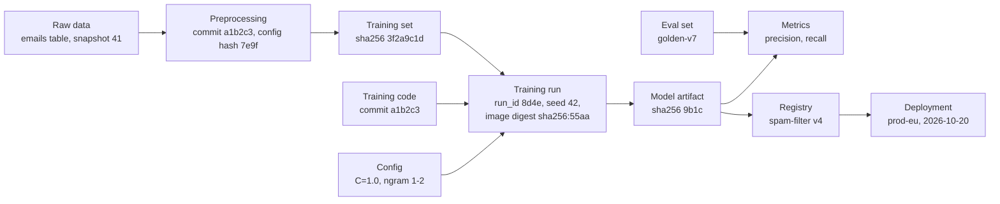
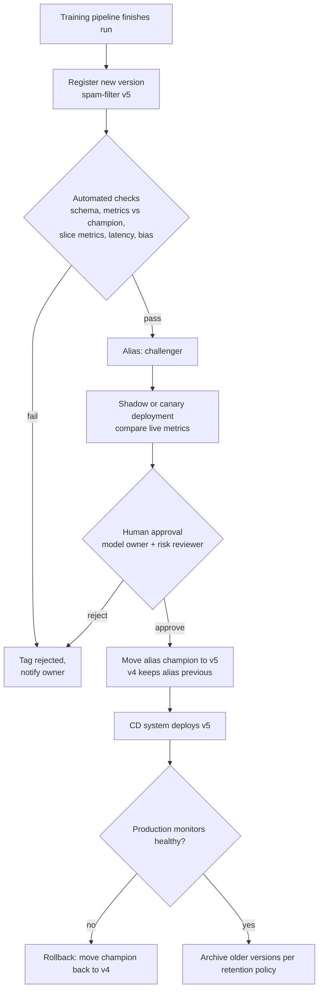
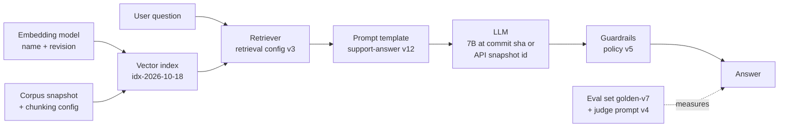

# Data Versioning, Model Versioning and the Model Registry

> **Level:** Beginner to Advanced · **Study time:** ~110 min · **Prerequisites:** [The ML Lifecycle, MLOps and Experiment Tracking](./01-ml-lifecycle-and-experiment-tracking.md), [Feature Engineering](../01-classical-ml/07-feature-engineering-missing-values-and-encoding.md), basic Git

## Table of contents

- [Why this matters](#why-this-matters)
- [The core problem: "which model is this, and where did it come from?"](#the-core-problem-which-model-is-this-and-where-did-it-come-from)
- [What a version really is: content hashes and immutable snapshots](#what-a-version-really-is-content-hashes-and-immutable-snapshots)
- [Data versioning tools: DVC, lakeFS, Delta Lake and Apache Iceberg](#data-versioning-tools-dvc-lakefs-delta-lake-and-apache-iceberg)
- [Versioning preprocessing code and feature definitions together with data](#versioning-preprocessing-code-and-feature-definitions-together-with-data)
- [Model versioning and lineage](#model-versioning-and-lineage)
- [The model registry](#the-model-registry)
- [Hands-on: the MLflow Model Registry](#hands-on-the-mlflow-model-registry)
- [Versioning LLM applications](#versioning-llm-applications)
- [Going deeper: versioning in production at scale](#going-deeper-versioning-in-production-at-scale)
- [Going deeper: debugging an incident with lineage](#going-deeper-debugging-an-incident-with-lineage)
- [Common mistakes and misconceptions](#common-mistakes-and-misconceptions)
- [Interview questions and model answers](#interview-questions-and-model-answers)
- [Key takeaways](#key-takeaways)
- [Further reading](#further-reading)
- [Next](#next)

## Why this matters

A model in production is the output of a recipe with three ingredients: data, code and configuration. If you cannot say exactly which version of each ingredient produced the model that is serving traffic right now, you cannot reproduce it, you cannot explain its behavior to an auditor, you cannot debug a regression, and you cannot roll back with confidence. Software engineers solved this for code decades ago with Git, but ML adds two things Git handles badly: large binary data and trained model files. LLM applications add even more moving parts (prompts, provider model snapshots, embedding models, vector indexes, evaluation sets). Interviewers ask "how do you version models, data and experiments?" and "what is the role of a model registry?" because the answers quickly reveal whether you have shipped and operated real ML systems or only trained models in notebooks.

## The core problem: "which model is this, and where did it come from?"

### A running example: the spam filter that got worse

You run a spam filter for an email product. Last month, `spam-filter` version 3 caught 95% of spam (illustrative). This morning someone retrained and deployed version 4, and users are complaining that real emails land in the spam folder.

Your manager asks three questions:

1. What changed between version 3 and version 4?
2. Can we go back to version 3 right now?
3. Can we rebuild version 3 exactly, so we can study it?

Without versioning, the honest answers are "we are not sure", "maybe, if someone kept the file" and "probably not". With versioning, the answers are "the training data changed from snapshot A to snapshot B; the code and config were identical", "yes, one command" and "yes".

> **Analogy:** A restaurant dish tastes different today. A good kitchen can tell you which supplier batch the tomatoes came from (data), which recipe card version the chef used (code), and what oven temperature was set (config). A bad kitchen just shrugs.

### Key terms

- **Version:** an immutable, uniquely identified state of something (a dataset, a file, a model). "Immutable" means once version 7 exists, it never changes; any change creates version 8.
- **Artifact:** any file produced or consumed by an ML pipeline: a dataset, a trained model file, a tokenizer, a metrics report.
- **Reproducibility:** the ability to re-run the same pipeline on the same inputs and get the same (or statistically equivalent) result. Covered in depth in [Reproducible Training and Training-Serving Skew](./03-reproducibility-and-training-serving-skew.md).
- **Lineage** (also called **provenance**): the recorded chain of "what was produced from what". For a model: which data versions, code commit, configuration and environment produced it, and which deployments use it.
- **Auditability:** the ability for someone else (a reviewer, regulator, or future you) to verify how a decision-making system was built and changed over time.
- **Rollback:** returning a system to a previous known-good version.

### Why version data, specifically

Code is already versioned in Git almost everywhere. Data is where teams usually fail, so it deserves its own list.

| Reason | What goes wrong without it | What data versioning gives you |
|---|---|---|
| Reproducibility | Retraining "the same model" gives different results because the table changed underneath you | Re-run training on exactly the snapshot used before |
| Auditability | You cannot prove which customer records trained the credit model | A permanent record: model v4 was trained on snapshot `3f2a9c1d` |
| Debugging | A model regresses and you cannot tell if data, code or config caused it | Diff two snapshots; find the bad batch of labels |
| Rollback | A bad data load corrupts the feature table and every retrain inherits it | Restore the table to yesterday's version |
| Fair comparison | Model A and model B were evaluated on different test sets, so the comparison is meaningless | Pin the evaluation set version and compare apples to apples |
| Collaboration | Two people say "the training set" but mean different files | One ID everybody can reference |

> **Interview tip:** When asked "why version data?", name at least reproducibility, auditability, debugging and rollback, and give a one-line example for each. Then mention that the evaluation set needs versioning too, which many candidates forget.

### What exactly has to be versioned

A trained model is a function of several inputs. Think of it as:

$$
\text{model} = \text{Train}(\text{data}, \text{code}, \text{config}, \text{environment}, \text{seed})
$$

- $\text{data}$: the exact raw dataset snapshot and labels.
- $\text{code}$: the preprocessing and training source code (a Git commit).
- $\text{config}$: hyperparameters and settings (learning rate, number of trees, feature list).
- $\text{environment}$: library versions, container image (pinned by its **digest**, a content hash of the image manifest, which in turn references its layers by hash), hardware type (GPU type can change numerical results).
- $\text{seed}$: the random seed(s) that control shuffling, initialization and sampling.

If any input changes, you have a different model, even if the file name is the same. Versioning is the discipline of giving every one of these inputs an ID and recording which IDs went into which output.

## What a version really is: content hashes and immutable snapshots

### Naming by content, not by date

Many teams start with folders like `data/emails_final_v2_REAL.csv`. The name is chosen by a human and says nothing reliable about the contents. Two people can create two different files with the same name.

A better idea is to derive the name from the content itself. This is called **content addressing**: the identifier of a file is computed from its bytes, so the same bytes always get the same ID, and different bytes (almost certainly) get different IDs.

> **Analogy:** A fingerprint identifies a person no matter what name they give you. A content hash is a fingerprint for a file.

### Hash functions

A **hash function** $H$ takes input of any length and returns a fixed-length output called a **hash** or **digest**. A **cryptographic hash function** such as **SHA-256** (Secure Hash Algorithm, 256-bit output) adds strong guarantees: it is practically impossible to find two different inputs with the same output (a **collision**), and a one-byte change in the input changes the output completely.

$$
\text{id}(\text{file}) = H(\text{bytes of the file})
$$

To see the mechanism, here is a deliberately weak **toy hash** you can compute by hand. Real systems never use this; it only shows the idea.

$$
h(s) = \left(\sum_{i=1}^{n} i \cdot c_i\right) \bmod 101
$$

- $s$: the input string, with characters $s_1, s_2, \dots, s_n$.
- $n$: the number of characters.
- $i$: the position of a character (1, 2, 3, ...). Multiplying by the position makes order matter.
- $c_i$: the character code of $s_i$ (in ASCII, `a` = 97, `b` = 98).
- $\bmod 101$: the remainder after dividing by 101, so the output is always between 0 and 100.

Worked example: hash `"ab"` and `"ba"`.

- `"ab"`: $1 \cdot 97 + 2 \cdot 98 = 97 + 196 = 293$. Then $293 \bmod 101$: $101 \cdot 2 = 202$, $293 - 202 = 91$. So $h(\text{"ab"}) = 91$.
- `"ba"`: $1 \cdot 98 + 2 \cdot 97 = 98 + 194 = 292$. Then $292 - 202 = 90$. So $h(\text{"ba"}) = 90$.

Same letters, different order, different IDs. A real hash like SHA-256 behaves like this but with $2^{256}$ possible outputs instead of 101, and with outputs that look random.

```python
import hashlib

def toy_hash(s: str) -> int:
    """Position-weighted character sum mod 101. Illustration only, never use for real."""
    return sum((i + 1) * ord(ch) for i, ch in enumerate(s)) % 101

print(toy_hash("ab"), toy_hash("ba"))           # 91 90

# The real thing: SHA-256 from the standard library
print(hashlib.sha256(b"abc").hexdigest()[:16])  # ba7816bf8f01cfea
print(hashlib.sha256(b"abd").hexdigest()[:16])  # completely different digest
```

### How safe is "same hash means same content"?

A collision would mean two different datasets get the same ID, which would be a disaster for versioning. How likely is it? The **birthday bound** approximates the probability that any two of $n$ items collide when the hash has $N$ possible outputs:

$$
p \approx 1 - e^{-\frac{n(n-1)}{2N}}
$$

- $p$: the probability that at least one pair of items shares a hash.
- $n$: the number of distinct items you hash.
- $N$: the number of possible hash values. For a $b$-bit hash, $N = 2^b$.
- $e$: Euler's number, about 2.718.

Worked example 1, a tiny 8-bit hash ($N = 2^8 = 256$) and $n = 20$ files:

- $n(n-1) = 20 \cdot 19 = 380$.
- $2N = 512$.
- Exponent: $380 / 512 \approx 0.742$.
- $e^{-0.742} \approx 0.476$.
- $p \approx 1 - 0.476 = 0.524$.

More than a 50% chance of a collision with only 20 files. Tiny hashes are useless for identity.

Worked example 2, SHA-256 ($N = 2^{256} \approx 1.158 \times 10^{77}$) and one trillion files ($n = 10^{12}$). When $p$ is tiny, $1 - e^{-x} \approx x$, so:

- $n(n-1) \approx n^2 = 10^{24}$.
- $2N \approx 2.316 \times 10^{77}$.
- $p \approx 10^{24} / (2.316 \times 10^{77}) \approx 4.3 \times 10^{-54}$.

That is far smaller than the chance of a hardware fault corrupting your disk. In practice, a cryptographic content hash is a safe identity.

> **Senior insight:** Some tools (DVC, for example) use **MD5**, which is cryptographically broken: an attacker can deliberately craft two files with the same MD5. For accidental collisions in versioning, MD5 is still fine. If you need tamper evidence (an adversary might forge data), use SHA-256.

### Immutable snapshots and manifests

A dataset is usually many files. To version the whole thing:

1. Hash every file.
2. Write a **manifest**: a sorted list of (relative path, hash, size).
3. Hash the manifest. That single hash is the **dataset version ID**.

If any file changes, its hash changes, so the manifest changes, so the dataset ID changes. This is the same idea as a **Merkle tree** (a tree where every node's hash is computed from its children's hashes), which Git itself uses.

```python
import hashlib
import json
from pathlib import Path

def file_sha256(path: Path, chunk_size: int = 1 << 20) -> str:
    """Hash a file in 1 MiB chunks so huge files do not fill memory."""
    h = hashlib.sha256()
    with path.open("rb") as f:
        for chunk in iter(lambda: f.read(chunk_size), b""):
            h.update(chunk)
    return h.hexdigest()

def build_manifest(root: str) -> dict:
    root_path = Path(root)
    files = sorted(p for p in root_path.rglob("*") if p.is_file())
    entries = {
        p.relative_to(root_path).as_posix(): {"sha256": file_sha256(p), "bytes": p.stat().st_size}
        for p in files
    }
    # Canonical JSON (sorted keys, no spaces) so the same content always serializes identically
    canonical = json.dumps(entries, sort_keys=True, separators=(",", ":")).encode()
    return {"dataset_version": hashlib.sha256(canonical).hexdigest()[:12], "files": entries}

if __name__ == "__main__":
    data = Path("emails_snapshot")
    data.mkdir(exist_ok=True)
    (data / "part-000.csv").write_text("text,label\nwin cash now,1\nlunch at noon?,0\n")
    v1 = build_manifest("emails_snapshot")["dataset_version"]

    # Fix one label: the dataset ID must change
    (data / "part-000.csv").write_text("text,label\nwin cash now,1\nlunch at noon?,1\n")
    v2 = build_manifest("emails_snapshot")["dataset_version"]
    print(v1 != v2)  # True
```

**Immutable** is the key property. You never edit snapshot `3f2a9c1d`; you create a new one. Storage systems that support this cheaply use **deduplication**: if two versions share a file with the same hash, the file is stored once.

### Storage cost: why content addressing is cheap

$$
S_{\text{full}} = k \cdot D \qquad S_{\text{dedup}} \approx D + \sum_{j=1}^{k-1} \Delta_j
$$

- $S_{\text{full}}$: storage used if you copy the whole dataset for every version.
- $S_{\text{dedup}}$: storage used with content-addressed deduplication.
- $k$: number of versions kept.
- $D$: size of the dataset.
- $\Delta_j$: size of the files that changed in update $j$.

Worked example (illustrative): a 100 GB email dataset, updated daily for 30 days, with 1 GB of files changing each day. That is $k = 31$ versions (the original plus 30 updates).

- Full copies: $31 \times 100 = 3{,}100$ GB.
- Deduplicated: $100 + 30 \times 1 = 130$ GB.
- Ratio: $3{,}100 / 130 \approx 23.8$ times less storage.

> **Common mistake:** Deduplication works at the granularity of files (or chunks). If your pipeline rewrites one giant 100 GB Parquet (a columnar file format common in data lakes) file every day even though only 1% of rows changed, every version is a "new" 100 GB file and you get no savings. Partition data (for example by date) so unchanged partitions keep identical bytes.

## Data versioning tools: DVC, lakeFS, Delta Lake and Apache Iceberg

You rarely hand-roll manifests in production. Four families of tools dominate. They solve overlapping but different problems.

### DVC (Data Version Control)

**DVC** is an open-source tool that extends Git to large files. The idea: keep small pointer files in Git, and the actual data in cheap storage (S3, GCS, Azure Blob, a shared drive).

> **Analogy:** Git holds the library catalog card ("book with fingerprint 3f2a... is on shelf S3"); the warehouse holds the actual books.

How it works:

1. `dvc add data/emails` hashes the folder, moves the content into a local **cache** keyed by hash, and writes a tiny `data/emails.dvc` file containing the hash.
2. You commit the `.dvc` file to Git. Git now versions the pointer.
3. `dvc push` uploads the cached content to a **remote** (object storage).
4. Anyone who checks out that Git commit runs `dvc pull` (or `dvc checkout` if the cache is local) to get exactly that data.

```bash
pip install "dvc[s3]"

git init && dvc init
dvc remote add -d storage s3://my-ml-bucket/dvc-store   # where data blobs live

dvc add data/emails                  # hash + cache the dataset, writes data/emails.dvc
git add data/emails.dvc data/.gitignore
git commit -m "Add email dataset snapshot"
git tag data-2026-10-01
dvc push                             # upload blobs to S3

# Months later: get the exact data that went with that tag
git checkout data-2026-10-01
dvc pull
```

The pointer file is human-readable YAML. Values below are illustrative:

```yaml
outs:
- md5: 3f2a9c1d8e7b6a5f4e3d2c1b0a9f8e7d.dir   # hash of the directory manifest
  size: 104857600
  nfiles: 12000
  hash: md5
  path: emails
```

DVC also versions **pipelines**. A `dvc.yaml` declares each stage's command, inputs (`deps`), parameters and outputs; `dvc repro` re-runs only stages whose inputs changed, and `dvc.lock` records the hash of every input and output of the last run. That lock file is a lineage record you get for free.

```yaml
# dvc.yaml
stages:
  preprocess:
    cmd: python src/preprocess.py
    deps: [src/preprocess.py, data/emails]
    params: [preprocess.lowercase, preprocess.min_df]
    outs: [data/features]
  train:
    cmd: python src/train.py
    deps: [src/train.py, data/features]
    params: [train.C]
    outs: [models/spam.joblib]
    metrics: [metrics.json]
```

**Strengths:** works with Git workflows you already know; ties data, code and params in one commit; no server required. **Weaknesses:** file-level, so it is awkward for tables that change row by row; many-terabyte data lakes with many concurrent writers are not its sweet spot.

### lakeFS

**lakeFS** is an open-source layer that sits in front of object storage (such as S3) and gives it Git-like operations: branches, commits, merges, reverts and hooks. Branching is **zero-copy**: a new branch just points at the same underlying objects until something changes.

> **Analogy:** DVC is Git for a project's data folder. lakeFS is Git for the whole data lake that many teams and jobs read and write.

Typical use:

```bash
# Illustrative lakectl commands; check the lakeFS docs for your version
lakectl branch create lakefs://emails-repo/fix-labels --source lakefs://emails-repo/main
# ... jobs write corrected labels to s3://emails-repo/fix-labels/... via the S3-compatible gateway
lakectl commit lakefs://emails-repo/fix-labels -m "Relabel 4,000 phishing emails"
lakectl merge lakefs://emails-repo/fix-labels lakefs://emails-repo/main
```

A training job then records the lakeFS **commit ID** it read from. **Pre-merge hooks** can run data quality checks (schema, null rates, label distribution) before bad data reaches `main`, much like CI for code.

**Strengths:** works at data-lake scale, any file format, isolation for experiments, atomic multi-table commits. **Weaknesses:** another service to operate; versions files, not rows, so it does not give you SQL row-level queries by itself.

### Table formats with time travel: Delta Lake and Apache Iceberg

A **table format** is a specification for storing a database-like table as many data files (usually Parquet) plus metadata that tracks which files make up the table at each point in time. **Delta Lake** and **Apache Iceberg** (and also Apache Hudi) are the main open table formats.

Every write creates a new **snapshot** (Iceberg's term) or **table version** (Delta's term) recorded in a transaction log or metadata tree. Old snapshots remain readable, which enables **time travel**: querying the table as it was at a past version or timestamp. They also give **ACID transactions** (Atomicity, Consistency, Isolation, Durability: a write either fully happens or does not, and readers never see half-written data).

```sql
-- Delta Lake (Spark SQL)
DESCRIBE HISTORY emails;                                   -- list versions
SELECT * FROM emails VERSION AS OF 12;                     -- exact version
SELECT * FROM emails TIMESTAMP AS OF '2026-10-01';         -- as of a time

-- Apache Iceberg (Spark SQL, Spark 3.3+); syntax varies by engine
SELECT * FROM prod.db.emails.snapshots;                    -- list snapshots
SELECT * FROM prod.db.emails VERSION AS OF 10963874102873; -- snapshot id
SELECT * FROM prod.db.emails TIMESTAMP AS OF '2026-10-01 00:00:00';
```

You can do the same from plain Python with the `deltalake` package (the delta-rs project), no Spark needed. Run this in an empty folder (the first write fails if the table already exists):

```python
# pip install deltalake pandas pyarrow   (recent deltalake releases make pyarrow optional, but to_pandas() needs it)
import pandas as pd
from deltalake import DeltaTable, write_deltalake

path = "lake/emails"
write_deltalake(path, pd.DataFrame({"text": ["win cash now", "lunch at noon?"], "label": [1, 0]}))     # version 0
write_deltalake(path, pd.DataFrame({"text": ["free prize inside"], "label": [1]}), mode="append")    # version 1

dt = DeltaTable(path)
print(dt.version())                                   # 1
print(len(DeltaTable(path, version=0).to_pandas()))   # 2 rows: the table as it was
print(len(dt.to_pandas()))                            # 3 rows: the latest table
```

Your training job then logs `table=emails, version=1` as its data version.

> **Common mistake:** Assuming time travel is forever. Old data files are physically deleted by maintenance jobs: `VACUUM` in Delta Lake (default retention threshold 7 days) and `expire_snapshots` in Iceberg. Delta also cleans up old transaction-log entries after `delta.logRetentionDuration` (default 30 days), after which those versions can no longer be addressed even if the data files survive. If an auditor asks for the data behind a model trained 8 months ago, time travel alone may not have it. For models that matter, either pin the snapshot (tag it or exempt it from expiry) or export an immutable copy and record its hash.

### Comparison

| Approach | What it versions | Best for | Pros | Cons |
|---|---|---|---|---|
| Manual immutable snapshots + manifest | Folders of files, by content hash | Small teams, simple pipelines, eval sets | Simple, no tools, total control | You build tooling, GC and access yourself |
| Git LFS | Large files in a Git repo | A few large files (models, small datasets) | Familiar Git UX | Hosting quotas, poor for many-GB datasets, no pipeline lineage |
| DVC | Files and directories, plus pipeline stages | ML projects where data is "project input" | Ties data, code, params in one Git commit; pipeline caching | File-level; awkward for constantly changing tables; many concurrent writers is hard |
| lakeFS | Whole object-store repositories (any format) | Data lakes shared by many teams and jobs | Zero-copy branches, atomic commits, hooks | Extra service to run; not row-level |
| Delta Lake / Iceberg | Tables, at snapshot level with row-level operations | Warehouse/lakehouse tables, feature tables, streaming ingestion | Time travel in SQL, ACID, schema evolution, scales to petabytes | Retention limits; time travel is per table, not across a whole pipeline |
| Feature store (for example Feast) | Feature definitions and point-in-time feature values | Many models sharing features, online + offline serving | Consistent features train and serve, point-in-time joins | Platform cost and complexity |

> **Senior insight:** These tools combine rather than compete. A common setup: raw events land in Iceberg or Delta tables (time travel per table); a training job reads specific snapshot IDs, writes a frozen training set to object storage, and records that file's hash plus the source snapshot IDs in the experiment tracker. lakeFS or DVC is added when you need cross-table, branch-and-merge workflows.

## Versioning preprocessing code and feature definitions together with data

### The hidden fourth ingredient

Suppose two engineers train on the same raw snapshot `3f2a9c1d`. One lowercases text before computing features, the other does not. They get different models. The raw data version alone did not determine the training set: the **preprocessing** (all the transformations from raw data to model inputs: cleaning, tokenizing, encoding, scaling, feature computation) did too.

So the version of the data the model actually sees is a function of three things:

$$
v_{\text{train}} = H\left(v_{\text{raw}} \,\|\, c_{\text{code}} \,\|\, H(\text{config}_{\text{prep}})\right)
$$

- $v_{\text{train}}$: the identity of the processed training set.
- $v_{\text{raw}}$: the raw data version (a hash, a DVC/lakeFS commit or a table snapshot ID).
- $c_{\text{code}}$: the Git commit of the preprocessing code.
- $\text{config}_{\text{prep}}$: preprocessing settings (lowercase on or off, minimum token frequency, which columns).
- $\|$: concatenation (gluing strings together).
- $H$: a hash function.

Tiny worked example with the toy hash from earlier, using the 4-character string "raw version + code commit". Let raw = `d1` and code commit `c7` versus `c8`. Character codes: `d` = 100, `1` = 49, `c` = 99, `7` = 55, `8` = 56.

- $h(\text{"d1c7"}) = 1 \cdot 100 + 2 \cdot 49 + 3 \cdot 99 + 4 \cdot 55 = 100 + 98 + 297 + 220 = 715$. Then $715 - 7 \cdot 101 = 715 - 707 = 8$.
- $h(\text{"d1c8"}) = 100 + 98 + 297 + 4 \cdot 56 = 100 + 98 + 297 + 224 = 719$. Then $719 - 707 = 12$.

Same raw data, one-character change in the code commit, different training-set ID (8 versus 12). That is exactly the behavior you want: preprocessing changes are data changes.

### Practical rules

1. **Preprocessing is code, so it lives in Git.** Never preprocess by hand in a notebook and save the output as "the dataset".
2. **Package preprocessing with the model when possible.** In scikit-learn, put transformations inside a `Pipeline` so the fitted vectorizer, scaler or encoder is saved with the model. Then the model artifact cannot be separated from its preprocessing.
3. **Fitted preprocessing state is an artifact.** A vocabulary, a scaler's mean and standard deviation, a category-to-index map, a tokenizer: these are learned from training data and must be versioned with the model, not recomputed at serving time.
4. **Feature definitions are versioned code.** A **feature store** is a system that holds feature definitions and serves the same computed feature values to training (offline) and to live prediction (online). In a feature store such as Feast, features are declared in Python files that live in Git. Changing a feature's logic should create a new feature (or a new version), not silently change an existing one that other models depend on.
5. **Schemas are versioned too.** A **schema** (column names, types, allowed ranges) or **data contract** (an agreed schema between data producers and consumers) catches upstream changes before they reach training.
6. **Record all three IDs in every training run:** raw data version, code commit, config hash.

Here is the spam filter with preprocessing packaged inside the model and lineage recorded alongside it:

```python
# pip install scikit-learn joblib
import hashlib
import json
import subprocess
import joblib
from sklearn.feature_extraction.text import TfidfVectorizer
from sklearn.linear_model import LogisticRegression
from sklearn.pipeline import Pipeline

texts = ["win cash now", "free prize inside", "claim your reward",
         "lunch at noon?", "meeting moved to 3pm", "see notes attached"]
labels = [1, 1, 1, 0, 0, 0]

prep_config = {"lowercase": True, "ngram_range": [1, 2]}
train_config = {"C": 1.0, "max_iter": 1000}

# Preprocessing (TF-IDF) lives INSIDE the model artifact, so it is versioned with it
pipe = Pipeline([
    ("tfidf", TfidfVectorizer(lowercase=prep_config["lowercase"],
                              ngram_range=tuple(prep_config["ngram_range"]))),
    ("clf", LogisticRegression(**train_config)),
])
pipe.fit(texts, labels)
joblib.dump(pipe, "spam_model.joblib")

def config_hash(cfg: dict) -> str:
    return hashlib.sha256(json.dumps(cfg, sort_keys=True).encode()).hexdigest()[:12]

def git_commit() -> str:
    try:
        return subprocess.check_output(["git", "rev-parse", "HEAD"], text=True).strip()
    except Exception:
        return "unknown"   # in real pipelines, refuse to train from an uncommitted tree

lineage = {
    "raw_data_version": "emails@3f2a9c1d",   # illustrative: DVC hash, lakeFS commit or Delta version
    "code_commit": git_commit(),
    "prep_config_hash": config_hash(prep_config),
    "train_config_hash": config_hash(train_config),
    "model_sha256": hashlib.sha256(open("spam_model.joblib", "rb").read()).hexdigest()[:12],
}
print(json.dumps(lineage, indent=2))
```

> **Common mistake:** Versioning the raw data and the model but not the fitted preprocessing state. Example: the serving service recomputes a TF-IDF vocabulary or a min-max scaler from recent data. The model was trained on different scaling, so predictions silently shift. This is a classic source of **training-serving skew** (the model receives inputs in production that were computed differently from its training inputs), covered in [chapter 3](./03-reproducibility-and-training-serving-skew.md).

> **Senior insight:** For NLP and LLM work, the **tokenizer** is preprocessing. A tokenizer with a different vocabulary turns the same text into different token IDs. Always version and ship the tokenizer files with the model (Hugging Face stores them together in the model repo for this reason). See [Tokenization](../04-transformers/01-tokenization.md).

## Model versioning and lineage

### What a model version is

A **model version** is one immutable trained artifact plus its metadata. Retraining with new data, new code or new hyperparameters produces a new version, never an overwrite.

Three common ID schemes, often used together:

| Scheme | Example | Good for | Weakness |
|---|---|---|---|
| Incrementing integer in a registry | `spam-filter` v4 | Humans, dashboards, promotion workflows | Means nothing outside that registry |
| Content hash of the artifact | `sha256:9b1c...` | Proving the bytes deployed are the bytes approved | Not human-friendly |
| Semantic version | `2.1.0` | Signalling API/schema compatibility to consumers | Requires discipline to bump correctly |

A useful rule: **semantic version for the interface, registry version for the release, hash for the bytes**. For example, a major version bump means the input schema changed and callers must update.

### Lineage: the model's family tree

The relationship between experiments and models was introduced in [chapter 1](./01-ml-lifecycle-and-experiment-tracking.md): an **experiment** groups **runs**, and each run logs parameters, metrics and artifacts. Model lineage connects that run to everything upstream (data, code, environment) and downstream (registry version, deployments).



What a complete lineage record contains:

| Field | Example | Why it matters |
|---|---|---|
| Training data version(s) | `emails@snapshot-41`, training set `sha256:3f2a9c1d` | Reproduce and audit |
| Evaluation data version | `golden-v7` | Metrics are only comparable on the same eval set |
| Code commit | `a1b2c3` (and "dirty tree: false") | Exact logic |
| Config / hyperparameters | `C=1.0`, `ngram_range=(1,2)` | Exact settings |
| Environment | Container image digest, `requirements.lock` hash, GPU type | Library or hardware changes alter results |
| Seeds | `42` | Reduce run-to-run variance |
| Parent model | Base model `Mistral-7B-Instruct-v0.3` at commit `<sha>` | Fine-tunes and distilled models inherit behavior |
| Metrics | Precision 0.97, recall 0.91 (illustrative) | Promotion decisions |
| Who and when | `alice`, 2026-10-19 | Accountability |
| Downstream | Registry version, deployments, dependent models | Impact analysis when something is wrong |

> **Interview tip:** Say "upstream and downstream lineage". Upstream answers "what made this model?" (debugging, reproducibility). Downstream answers "what is affected if this dataset was bad?" (impact analysis: which models trained on the poisoned snapshot, and where are they deployed?). Many candidates only mention upstream.

### Recording lineage automatically

Lineage that depends on people remembering to type tags will be incomplete. Make it automatic:

- The training entry point refuses to run from a Git tree with uncommitted changes (or records the diff as an artifact).
- Data is read only through a loader that resolves and logs the snapshot ID.
- The container image is referenced by **digest** (an immutable content hash like `sha256:...`), not by a mutable tag like `latest`.
- The tracker (MLflow, Weights & Biases, and similar) logs params, metrics, data inputs and the Git commit automatically.
- For organization-wide lineage across many tools, the **OpenLineage** open standard defines events that jobs emit ("job X read dataset A and wrote dataset B") so a lineage service can build the graph.

## The model registry

### What it is

> **Analogy:** Think of an app store's release management. Developers upload builds (versions). Each build has release notes, test results and an approval status. The store decides which build is "live" for users, and if a build crashes phones, the store reverts to the previous one. A model registry is that, for models.

A **model registry** is a central, versioned catalog of trained models that acts as the hand-off point between training and deployment. It stores (or points to) model artifacts and, for each version, the metadata, lineage, evaluation results, approval state and deployment status.

Two levels of object:

- **Registered model:** a named entry representing one logical model or use case, for example `spam-filter`.
- **Model version:** one immutable trained artifact under that name: `spam-filter` v1, v2, v3, v4.

### Why have a registry at all?

Without a registry, "the production model" is whatever file someone copied to a bucket. A registry answers, in one place:

1. **What models exist and who owns them?** (discovery, ownership)
2. **Which version is in production right now, and which was before it?** (state, rollback target)
3. **How was each version produced?** (lineage back to runs, data and code)
4. **Was it approved, by whom, against what checks?** (governance, audit trail)
5. **How do deployment systems get the right artifact?** (a stable reference like `spam-filter@champion` instead of a file path)

> **Interview tip:** A crisp one-liner: "The experiment tracker records everything we tried; the registry records what we decided to ship, with the evidence and approvals behind that decision, and gives deployment a stable pointer to it."

### Stages versus aliases

Registries need a way to say "this version is the production one". There are two designs.

**Stages** are a fixed set of lifecycle states, classically `None`, `Staging`, `Production`, `Archived`. A version moves between them.

**Aliases** are named, movable pointers to a version, chosen by you: `champion`, `challenger`, `prod-eu`, `shadow`. By convention the **champion** is the version currently serving production and a **challenger** is a candidate being compared against it. An alias points to exactly one version at a time; a version can carry several aliases. **Tags** are free-form key-value labels (for example `validation_status=passed`).

> **Analogy:** Stages are like fixed parking spots labeled "Staging" and "Production". Aliases are like sticky notes you can put on any car and move in one second.

| Aspect | Fixed stages | Aliases + tags |
|---|---|---|
| Flexibility | One "Production" slot per model | Any number of named pointers (`prod-us`, `prod-eu`, `canary`) |
| Multi-environment | Awkward | Natural |
| A/B or champion/challenger | Needs workarounds | Built in: `champion` and `challenger` aliases |
| Rollback | Transition old version back | Move the alias back to the previous version |
| Where you see it | Older MLflow, many tutorials | MLflow since 2.9 (stages deprecated), Unity Catalog, most modern registries |

In MLflow, fixed stages were deprecated in version 2.9 (late 2023) in favor of aliases and tags. You will still meet stages in older codebases and interview questions, so know both. Separately, many organizations keep **separate registries or workspaces per environment** (dev, staging, prod) and promote by copying a version across, which gives stronger access isolation.

### The promotion workflow

**Promotion** is moving a model version toward production through gates. A **gate** is a check that must pass before the next step. Two online gates appear below: in a **shadow** deployment the candidate receives a copy of live traffic but its predictions are only logged, never shown to users; in a **canary** deployment a small fraction of real traffic (say 1 to 5%) is served by the candidate while you watch its metrics. Both are covered in [deployment patterns](./04-model-deployment-patterns.md).



Typical gates and what they check:

| Gate | Example check | Automated? |
|---|---|---|
| Artifact sanity | Model loads, input/output signature matches the serving contract | Yes |
| Offline quality | Precision and recall on the pinned eval set at least as good as champion, within tolerance | Yes |
| Slice quality | No regression above a threshold on key segments (language, region, new users) | Yes |
| Performance | p95 latency and memory within budget on target hardware | Yes |
| Fairness / safety | Bias metrics, safety tests (for LLMs, red-team and guardrail suites) | Mostly |
| Online validation | Shadow or canary metrics match expectations (see [deployment patterns](./04-model-deployment-patterns.md)) | Mostly |
| Human approval | Owner sign-off; for regulated domains, an independent reviewer | No |

> **Senior insight:** Use **separation of duties**: the person who trains a model should not be the only one who can approve it into production in high-risk domains (credit, health, hiring). Registries implement this with permissions: data scientists can register versions and set `challenger`; only a release role or an automated pipeline after approval can move `champion`.

### Metadata and model cards

Each registry version should carry rich metadata: description, owner, lineage fields from the table above, metrics, signature (input and output schema), tags, and links to the run and to evaluation reports.

A **model card** is a short structured document describing a model for its users and reviewers. The idea comes from "Model Cards for Model Reporting" (Mitchell et al., 2019). The paper's suggested sections:

- **Model details:** who built it, when, version, type, license.
- **Intended use:** primary use cases, out-of-scope uses.
- **Factors:** groups, environments or conditions that may affect performance.
- **Metrics:** which metrics and why, decision thresholds.
- **Evaluation data** and **training data:** what was used and why.
- **Quantitative analyses:** results overall and per factor (per slice).
- **Ethical considerations** and **caveats and recommendations.**

The companion idea for datasets is "Datasheets for Datasets" (Gebru et al., 2018 preprint, published 2021): document why a dataset was created, how it was collected and labeled, and what it should not be used for.

> **Senior insight:** Generate the model card from registry metadata in the pipeline (metrics, lineage, eval slices) and let humans write only the judgment sections (intended use, limitations). Hand-written cards drift out of date within weeks.

### Access control and audit

A registry is a security boundary:

- **Who can read** model artifacts? Models can leak training data (see [memorization](../05-llms/09-catastrophic-forgetting-contamination-and-memorization.md)) and are valuable intellectual property.
- **Who can register, alias, approve, delete?** Role-based access control (RBAC) per registered model.
- **Audit log:** every alias move and approval is recorded with who, when and why. This is what you show an auditor.
- **Integrity:** store the artifact hash; the deployment verifies it; optionally sign artifacts.
- **Deletion policy:** versions that were ever in production are usually retained (not hard-deleted) for audit.

### Linking the registry to deployment

The registry should be the **only** source the deployment system pulls models from. Two patterns:

| Pattern | How it works | Pros | Cons |
|---|---|---|---|
| Push (event-driven) | Moving the `champion` alias fires a webhook or CI/CD job that builds and deploys | Fast, explicit, auditable deploy events | Needs integration work |
| Pull (reconciler) | A deploy controller periodically checks "what does `champion` point to?" and converges | Simple, self-healing | Deploy timing less explicit |

Important practices:

- **Resolve the alias once, at deploy time**, and pin the resolved version (and hash) in the deployment manifest. Do not resolve `@champion` on every request or on every pod restart, or different replicas may silently run different versions after an alias move.
- **Expose the model version in responses and logs** (for example a `model_version` field or header), so every prediction can be traced to a version. Monitoring dashboards are split by version (see [monitoring](./06-monitoring-ml-and-llm-systems-in-production.md)).
- **Rollback = repoint the alias to the previous version and redeploy.** Rehearse it. Rollback only works if the previous version's artifact and its serving dependencies still exist.

## Hands-on: the MLflow Model Registry

**MLflow** is a widely used open-source platform for experiment tracking, model packaging and a model registry. The example below trains the spam filter, logs lineage, registers a version, assigns aliases, loads by alias and rolls back.

> MLflow's APIs evolve. This code targets MLflow 3.x; the comments show the MLflow 2.x difference. Check the docs for your installed version.

```python
# pip install "mlflow>=3" scikit-learn pandas
import mlflow
import pandas as pd
from mlflow import MlflowClient
from mlflow.models import infer_signature
from sklearn.feature_extraction.text import TfidfVectorizer
from sklearn.linear_model import LogisticRegression
from sklearn.pipeline import Pipeline

# Use a database-backed store for the registry (the recommended backend); SQLite is fine locally
mlflow.set_tracking_uri("sqlite:///mlflow.db")
mlflow.set_experiment("spam-filter")
MODEL_NAME = "spam-filter"

df = pd.DataFrame({
    "text": ["win cash now", "free prize inside", "claim your reward",
             "lunch at noon?", "meeting moved to 3pm", "see notes attached"],
    "label": [1, 1, 1, 0, 0, 0],
})
DATA_VERSION = "emails@3f2a9c1d"   # illustrative: your DVC hash, lakeFS commit or Delta version

pipe = Pipeline([
    ("tfidf", TfidfVectorizer(lowercase=True, ngram_range=(1, 2))),
    ("clf", LogisticRegression(C=1.0, max_iter=1000)),
])

with mlflow.start_run(run_name="tfidf-logreg") as run:
    pipe.fit(df["text"], df["label"])

    # Lineage: params, data version, dataset fingerprint
    mlflow.log_params({"C": 1.0, "ngram_range": "1-2", "lowercase": True})
    mlflow.set_tags({"data_version": DATA_VERSION, "owner": "spam-team"})
    mlflow.log_input(mlflow.data.from_pandas(df, name="emails", targets="label"), context="training")
    # When a script runs from a Git repo (and GitPython is installed), MLflow records the source commit
    # automatically as the mlflow.source.git.commit tag; it does not record uncommitted changes

    signature = infer_signature(df["text"], pipe.predict(df["text"]))
    model_info = mlflow.sklearn.log_model(pipe, name="model", signature=signature)
    # MLflow 2.x: mlflow.sklearn.log_model(pipe, artifact_path="model", signature=signature)

# 1) Register the logged model as a new version under a named model
mv = mlflow.register_model(model_info.model_uri, MODEL_NAME)
client = MlflowClient()

# 2) Metadata on the version
client.update_model_version(MODEL_NAME, mv.version,
                            description=f"TF-IDF + logistic regression on {DATA_VERSION}")
client.set_model_version_tag(MODEL_NAME, mv.version, "validation_status", "pending")

# 3) After automated checks pass: mark as challenger
client.set_model_version_tag(MODEL_NAME, mv.version, "validation_status", "passed")
client.set_registered_model_alias(MODEL_NAME, "challenger", mv.version)

# 4) After approval: promote. Remember who was champion before, for rollback
try:
    previous = client.get_model_version_by_alias(MODEL_NAME, "champion").version
except Exception:
    previous = None   # first ever champion
client.set_registered_model_alias(MODEL_NAME, "champion", mv.version)
if previous is not None:
    client.set_registered_model_alias(MODEL_NAME, "previous", previous)

# 5) Deployment resolves the alias ONCE and pins the concrete version
champion = client.get_model_version_by_alias(MODEL_NAME, "champion")
print("deploying version", champion.version, "from run", champion.run_id)
model = mlflow.sklearn.load_model(f"models:/{MODEL_NAME}/{champion.version}")
print(model.predict(["claim your free cash prize"]))   # most likely [1] on this toy data

# 6) Rollback is just moving the alias back
if previous is not None:
    client.set_registered_model_alias(MODEL_NAME, "champion", previous)
```

What to notice:

- **Two URI forms:** `models:/spam-filter/4` (a fixed version, use in deployment manifests) and `models:/spam-filter@champion` (a movable alias, use in promotion logic and dev tools).
- **The model artifact contains the preprocessing** (the TF-IDF vectorizer is inside the pipeline), so the registry version is self-contained.
- **The version links back to its run**, and the run holds params, data inputs and the commit. That chain is your lineage.
- **Rollback is a metadata operation.** No retraining, no file copying.

> **Common mistake:** Treating the registry as a file dump. If versions have no description, no data version, no eval results and no owner, the registry gives you storage but none of the governance value.

Other registries follow the same concepts with different names: Databricks Unity Catalog (MLflow models governed by catalog permissions, aliases), Amazon SageMaker Model Registry (model package groups, versions, approval status), Google Vertex AI Model Registry (versions and aliases), Azure Machine Learning registries, and the Weights & Biases registry. Feature sets change by vendor and year; the durable ideas are versions, movable pointers, metadata, approvals, access control and an audit trail.

## Versioning LLM applications

### "The model" is now a system

For a classic model, the trained weights are most of the behavior. For an LLM application, behavior depends on many separately changing parts. Running example: an internal support assistant over a 4-document corpus (refund policy, shipping policy, warranty terms, contact page), answering with a 7B open-weights model plus retrieval.



Any one of these can change the answers. Each needs its own version, and the combination needs a version too.

| Component | Why it changes | How to version it |
|---|---|---|
| Prompt templates | Constant iteration, bug fixes, new instructions | Immutable prompt versions in Git or a prompt registry; labels like `production` point to a version |
| LLM (API) | Providers update models behind floating names | Pin a dated **snapshot** ID (for example OpenAI's `gpt-4o-2024-08-06` rather than `gpt-4o`); log the model ID returned in each response |
| LLM (open weights) | New releases, re-uploads, your own fine-tunes | Pin the hub **revision** (a commit hash), record weight file hashes, quantization method and serving engine version |
| Fine-tuned adapters ([LoRA](../05-llms/07-fine-tuning-full-lora-and-qlora.md): small trainable weights added to a frozen base model) | Retraining | Version the adapter and record the exact base-model revision it was trained on |
| Decoding parameters | Temperature, max tokens, stop sequences | Part of the prompt or release config |
| Embedding model | Better models appear | Name + revision + dimension + normalization; changing it means re-embedding everything |
| Corpus + chunking | Documents added, edited, deleted; chunk size tuned | Corpus snapshot ID + chunking config hash |
| Vector index | Rebuilt for new data or new index parameters | Index ID derived from corpus, chunking, embedding model and index params (for example HNSW settings) |
| Retrieval config | top-k, hybrid weights, reranker model, filters, thresholds | Versioned config file |
| Tools / function schemas (agents) | Tools added or changed | Version tool definitions with the prompt |
| Guardrail policies | New risks, false positives | Versioned rules and classifier models |
| Evaluation datasets and judges | Eval sets grow; judge prompts change | Versioned golden sets; a score is only comparable with the same eval set version and judge version |

### Prompts are code (and data)

A prompt change can change behavior as much as a retrain. Treat prompts as versioned artifacts:

- Store them outside application code, in Git or a **prompt registry** (Langfuse, MLflow's prompt registry, added in MLflow 2.21 and part of MLflow 3, and similar tools), with immutable versions and movable labels such as `production` and `staging`. This mirrors model aliases exactly.
- Log the prompt version on every trace, so a bad answer can be tied to the exact template.
- Run the regression eval suite before moving the `production` label.

Prompt management tooling is covered in [LLMOps: Tracing, Prompt Management, Langfuse and RAGAS in Practice](./08-llmops-tracing-prompt-management-and-langfuse.md), and prompt design in [Prompt Engineering for Production](../05-llms/04-prompt-engineering-for-production.md).

### Model API versions and open-weights revisions

Hosted LLM providers typically offer two kinds of names: a floating alias that is upgraded over time, and dated snapshots that stay fixed until deprecated. If you call the floating alias, your application's behavior can change with no change on your side. Production systems should:

- Pin a snapshot ID in config and treat changing it as a release (eval suite, canary, approval).
- Log the model identifier from each response (some APIs also return a backend fingerprint field) so you can detect provider-side changes.
- Track provider deprecation schedules; snapshots are eventually retired, so plan migrations rather than discovering them during an outage. Exact naming and deprecation policies vary by provider and change over time.

For open weights from the Hugging Face Hub, pin the commit:

```python
# pip install transformers
from transformers import AutoModelForCausalLM, AutoTokenizer

MODEL_ID = "mistralai/Mistral-7B-Instruct-v0.3"
REVISION = "<full 40-character commit sha from the model repo>"   # never rely on the default branch

tokenizer = AutoTokenizer.from_pretrained(MODEL_ID, revision=REVISION)
model = AutoModelForCausalLM.from_pretrained(MODEL_ID, revision=REVISION)
```

Better still for production: mirror the weights into your own artifact store, record their hashes, and register the model (including quantization details, see [LLM quantization](../07-model-compression/04-llm-quantization-gptq-awq-and-outliers.md)) in your own registry.

### Embedding models and vector indexes

This is the most commonly missed LLM versioning trap.

An **embedding model** maps text to a vector (see [Text Embeddings and Similarity Search](../08-rag/02-text-embeddings-and-similarity-search.md)). Vectors from two different embedding models live in **different, incompatible spaces**, even if they have the same dimension. If you upgrade the query-side embedding model but the index still holds vectors from the old model, similarity scores become meaningless and retrieval quietly degrades. Nothing crashes.

Rules:

1. **Every index records its embedding model** (name, revision, dimension, normalization, any instruction prefix) and its chunking config and corpus snapshot.
2. **The query encoder must match the index.** The serving config should read the embedding model ID from the index metadata, or fail fast on mismatch.
3. **Changing the embedding model means re-embedding the whole corpus into a new index**, then switching over. Do it **blue/green**: build `idx-v2` next to `idx-v1`, evaluate retrieval on the golden set, then flip an alias. Many vector databases and search engines support collection or index aliases (for example Qdrant, Milvus, Elasticsearch and OpenSearch), which makes the switch atomic and the rollback instant.
4. **Re-embedding cost is real.** Plan it like a migration. See [Production Ingestion Pipelines](../08-rag/12-production-ingestion-pipelines-at-scale.md) for re-embedding at scale.

### The release manifest: one ID for the whole system

Bring it together with a **release manifest** (sometimes called a bill of materials): one file that pins every component. Its hash is the version of the LLM application.

```yaml
# release/support-assistant.yaml  (illustrative values)
release: support-assistant
llm:
  provider: self-hosted
  model: mistralai/Mistral-7B-Instruct-v0.3
  revision: "<commit sha>"
  quantization: awq-int4
  serving_engine: vllm==<pinned version>
  decoding: {temperature: 0.2, max_tokens: 512}
prompts:
  system: support-system@v12
  answer: support-answer@v12
retrieval:
  index: idx-2026-10-18
  embedding_model: "<embedding model name>@<revision>"
  chunking: {size_tokens: 400, overlap_tokens: 50}
  top_k: 5
  reranker: "<reranker name>@<revision>"
guardrails: policy-v5
evaluation:
  golden_set: golden-v7
  judge: judge-prompt-v4
```

```python
import hashlib
import yaml   # pip install pyyaml

with open("release/support-assistant.yaml") as f:
    manifest = yaml.safe_load(f)

# Canonical serialization so key order or whitespace does not change the ID
release_id = hashlib.sha256(yaml.safe_dump(manifest, sort_keys=True).encode()).hexdigest()[:12]
print("release id:", release_id)   # log this on every request and trace
```

Change any line (a prompt version, `top_k`, the index), and the release ID changes. Your evaluation results, canary metrics and incident reports all reference that one ID. The manifest itself goes through the same promotion workflow as a classic model in the registry.

> **Senior insight:** Store evaluation results keyed by (release ID, eval set version, judge version). A score of 0.86 on `golden-v7` and 0.81 on `golden-v8` does not mean the system got worse; the test got harder. Comparisons are valid only on the same eval set and judge. See [Building an LLM Evaluation Framework](../05-llms/11-building-an-llm-evaluation-framework-and-regression-tests.md).

## Going deeper: versioning in production at scale

### How reproducible is "reproducible"?

| Level | Meaning | Achievable when |
|---|---|---|
| Traceable | You know exactly which inputs produced the model | Always; this is the minimum bar |
| Rebuildable | You can rerun the pipeline from recorded inputs | Data snapshots retained, environment pinned |
| Statistically equivalent | Rerun gives metrics within noise | Seeds fixed; small nondeterminism allowed |
| Bit-exact | Rerun gives identical weights | Deterministic algorithms, same hardware and library versions; often impractical on GPUs |

Most teams target "rebuildable and statistically equivalent" and keep the original artifact forever for the cases where exact behavior matters. [Chapter 3](./03-reproducibility-and-training-serving-skew.md) covers GPU nondeterminism and environment pinning.

### Point-in-time correctness

Versioning is also how you avoid **data leakage** across time (see [Overfitting, Regularization and Data Leakage](../01-classical-ml/03-overfitting-regularization-and-data-leakage.md)). When building a training row for an event on 1 March, features must be computed from data as it was known on 1 March, not as corrected later. Table time travel and feature stores with **point-in-time joins** (joining each label to the latest feature value with a timestamp at or before the label's timestamp) provide this. Without it, offline metrics look great and production disappoints.

### Retention, storage cost and garbage collection

Keeping everything forever is expensive. A sensible policy:

- **Keep forever** (or for the regulatory period): data snapshots, artifacts and lineage for any model version that served production.
- **Keep for N days:** experiment runs that were never registered, intermediate pipeline outputs.
- **Garbage collect** unreferenced blobs (DVC `gc`, lakeFS garbage collection, Delta `VACUUM`, Iceberg `expire_snapshots`), but only after checking references from the registry.
- **Tier storage:** move old snapshots to cold, cheaper storage classes.

### The deletion paradox: immutability versus "right to be forgotten"

Privacy laws such as the EU GDPR give people a right to have their personal data erased. But versioning promises old snapshots never change. How do you reconcile them?

- **Separate identity from content:** keep personal identifiers in a separate, mutable store and use pseudonymous keys in training data, so deleting the mapping removes the link.
- **Rewrite history deliberately:** table formats support row deletes; you then expire the old snapshots that still contain the row. Record the erasure in the lineage log (an erasure is itself a versioned event).
- **Crypto-shredding:** encrypt each user's data with a per-user key; deleting the key makes all copies unreadable, including those in old snapshots and backups.
- **Models trained on deleted data:** decide by policy whether to retrain on the next cycle; **machine unlearning** research exists but is not a dependable replacement for retraining. This is a legal and policy question; involve your privacy team.

> **Interview tip:** If you raise this tension yourself when discussing immutable data versioning, it signals senior-level experience. Most candidates present immutability as purely good.

### Organization-wide lineage and governance

- **Lineage across tools:** OpenLineage events from orchestrators (Airflow, Spark, dbt) plus run metadata from the tracker give an end-to-end graph from source tables to deployed models.
- **Data catalogs** register datasets with owners, schemas and access policies; the registry links models to catalog entries.
- **Regulation:** frameworks such as the EU AI Act require technical documentation, record-keeping and traceability for high-risk AI systems. Lineage, model cards and registry audit logs are how you produce that evidence without heroic effort.

### Cost and latency implications

- **Registry lookups belong in deployment, not in the request path.** Load the model at startup from a pinned version, cache it, and never query the registry per prediction.
- **Big LLM weights:** pulling a 7B model in FP16 means roughly 14 GB per replica (7 billion parameters times 2 bytes). Cold starts are dominated by download time, so cache weights on local disk or a nearby object-store mirror keyed by content hash. See [Number Formats and Model Memory](../07-model-compression/01-number-formats-and-model-memory.md).
- **Index rebuilds:** re-embedding a large corpus costs GPU or API spend and hours of time; versioning lets you build the new index in the background without touching live traffic.

### Multi-model and multi-tenant setups

- **Model dependencies:** a ranking model may consume another model's output as a feature. Record that dependency in lineage; retraining the upstream model is effectively a data change for the downstream one.
- **Per-tenant or per-region versions:** use aliases like `champion-eu` and `champion-us`, or per-tenant LoRA adapters registered as versions tied to one base-model revision.

## Going deeper: debugging an incident with lineage

Back to the spam filter. Version 4 was promoted yesterday and false positives (real email flagged as spam) jumped. Here is the playbook versioning makes possible.

**Step 1: Stop the bleeding.** Move the `champion` alias back to v3 and redeploy. Because v3's artifact, image digest and lineage are retained, this takes minutes. Debugging happens after users are safe.

**Step 2: Diff the lineage records.**

| Field | v3 | v4 | Changed? |
|---|---|---|---|
| Raw data version | `emails@snapshot-38` | `emails@snapshot-41` | Yes |
| Preprocessing commit | `a1b2c3` | `a1b2c3` | No |
| Training config hash | `7e9f01` | `7e9f01` | No |
| Container image digest | `sha256:55aa...` | `sha256:55aa...` | No |
| Eval set | `golden-v7` | `golden-v7` | No |
| Offline precision (illustrative) | 0.97 | 0.96 | Small drop |

Only the data changed. That eliminates code, config and environment in one glance.

**Step 3: Diff the data.** With Delta or Iceberg, compare snapshot 38 and 41: which partitions were added? You find a new batch of 4,000 emails labeled by a new vendor, where newsletters were labeled as spam.

**Step 4: Check the evaluation.** Why did offline precision barely move? Because `golden-v7` has few newsletters. The eval set did not cover the slice that broke, so add a newsletter slice to create `golden-v8` and make slice metrics a promotion gate.

**Step 5: Downstream impact.** Query lineage: which other models trained on snapshot 41? A "priority inbox" model did too; flag it for review.

**Step 6: Fix and re-promote.** Relabel on a lakeFS branch or in a new table version, retrain (v5), pass the new gates, canary, approve, promote.

> **Senior insight:** Notice that every step depended on something recorded before the incident. Versioning is cheap insurance you buy in advance; you cannot add it retroactively to the model that is failing right now.

## Common mistakes and misconceptions

- **"We version code in Git, so we are reproducible."** Code is one of five inputs. Data, config, environment and seeds matter just as much.
- **Overwriting files in place** (`s3://bucket/training_data.parquet` rewritten nightly). Any model trained before last night is now unreproducible.
- **Naming versions by date or by hand** (`final_v2_REAL`). Use content hashes or tool-generated IDs, and record them automatically.
- **Versioning raw data but not preprocessing or fitted transformers.** The same raw data with different preprocessing is a different training set.
- **Forgetting the evaluation set.** If the test set changes between models, metric comparisons are invalid.
- **Assuming time travel is permanent.** `VACUUM` and snapshot expiry delete old data files. Pin or export what you need for audit.
- **Using `latest` image tags or floating model names** (Docker `latest`, a floating LLM alias, a Hub model without `revision`). Pin digests, snapshots and commits.
- **Treating the registry as just storage.** Without metadata, lineage, approvals and access control, it is a bucket with extra steps.
- **Resolving the production alias at request time.** Replicas can drift onto different versions; resolve once at deploy time and pin.
- **Upgrading the embedding model without re-indexing.** Query and document vectors become incompatible; retrieval quietly degrades with no error.
- **Comparing LLM eval scores across different eval set or judge versions.** A different test is not a regression.
- **"Rollback is easy" without rehearsing it.** If the old artifact, its serving image or its feature pipeline no longer exists, you cannot roll back.

## Interview questions and model answers

<details>
<summary><b>Q1. How do you version models, data, and experiments?</b></summary>

**Short answer:** I treat a model as the output of data, code, config, environment and seed, and give each an immutable ID. Code lives in Git; data is versioned with content-hashed snapshots (DVC or lakeFS for files, Delta Lake or Iceberg snapshot IDs for tables); experiments are tracked as runs in a tracker like MLflow that logs params, metrics, the Git commit, the data version and the environment. Models that we might ship are registered as immutable versions in a model registry that links back to the run. Everything is recorded automatically by the pipeline, not by hand.

**Deeper answer and follow-ups:**
- **Data:** immutable snapshots identified by content hash. Files: DVC pointer files in Git plus blobs in object storage, or lakeFS commits. Tables: Delta/Iceberg version or snapshot ID, pinned or exported if it must outlive retention.
- **Experiments:** each run logs hyperparameters, metrics, artifacts, the code commit (and refuses dirty trees), the data version, the container image digest and seeds. Runs are cheap and numerous; most are never registered.
- **Models:** registry version (human-friendly integer), artifact hash (proves the deployed bytes are the approved bytes), and optionally a semantic version for schema compatibility.
- **The link between them:** registry version -> run ID -> data version + commit + config. That chain is lineage, both upstream (what made this?) and downstream (what used this?).
- **Pitfalls:** overwritten tables, unversioned eval sets, `latest` tags, preprocessing state recomputed at serving time.
- **Trade-off:** snapshotting every intermediate artifact forever is expensive. Retain everything behind production versions; let unregistered runs and intermediates expire under a retention policy.
- **How to measure it:** lineage completeness (share of registered versions with every required field filled) and a periodic reproducibility drill: pick a production version, rebuild it from its recorded IDs, and check that metrics land within noise of the original.
- **LLM twist:** add prompts, model snapshot or revision, embedding model, index, retrieval config and eval sets, pinned together in a release manifest.

</details>

<details>
<summary><b>Q2. What is the role of a model registry?</b></summary>

**Short answer:** A model registry is the system of record for models we intend to ship, and the hand-off point between training and deployment. It stores immutable model versions with their metadata and lineage, tracks which version is in which state (via stages or aliases like `champion` and `challenger`), records approvals and who promoted what, enforces access control, and gives deployment a stable reference so promotion and rollback are metadata operations.

**Deeper answer and follow-ups:**
- **Tracker versus registry:** the tracker records everything tried (thousands of runs); the registry records the curated few candidates and production versions, with governance.
- **Stages versus aliases:** fixed stages (Staging/Production/Archived) are the older design; aliases are flexible pointers that support multiple environments and champion/challenger. MLflow deprecated stages in 2.9 in favor of aliases and tags.
- **Promotion workflow:** register -> automated gates (signature, metrics vs champion, slices, latency, fairness) -> challenger -> shadow or canary -> human approval -> champion; previous version kept as rollback target.
- **Metadata:** description, owner, lineage, metrics per slice, signature, model card, approval history.
- **Access control:** RBAC so trainers can register but only approved roles or pipelines can promote (separation of duties); audit log of every alias move.
- **Deployment link:** webhook or reconciler deploys on alias change; resolve once and pin the concrete version; expose `model_version` in every response.
- **Failure modes:** the registry becomes a runtime dependency of serving (avoid it: load and cache the pinned artifact at startup); an alias moves but some replicas keep the old version; old artifacts are garbage-collected so rollback fails; teams bypass the registry and deploy straight from a bucket.
- **How to measure it:** share of production deployments sourced from the registry (target 100%), time to roll back, share of versions with complete metadata, and whether every alias move in the audit log has a recorded approver.
- **Pitfall:** a registry with no metadata is just a bucket.

</details>

<details>
<summary><b>Q3. How do you version datasets and preprocessing?</b></summary>

**Short answer:** Datasets get immutable, content-addressed versions: DVC or lakeFS for file-based data, table snapshot IDs with time travel for Delta Lake or Iceberg tables. Preprocessing is code in Git, its settings are a versioned config, and fitted preprocessing state (vocabularies, scalers, encoders, tokenizers) is saved inside or alongside the model artifact. The processed training set's identity is effectively a hash of the raw data version, the preprocessing commit and the config, and all three are logged on every run.

**Deeper answer and follow-ups:**
- **Formula:** $v_{\text{train}} = H(v_{\text{raw}} \| c_{\text{code}} \| H(\text{config}_{\text{prep}}))$. Change any input and the training-set ID changes.
- **Package preprocessing with the model:** scikit-learn `Pipeline`, a saved tokenizer, or a feature store so training and serving use one definition (prevents training-serving skew).
- **Feature definitions as code:** features declared in Git (for example Feast), new logic means a new feature or version rather than a silent change.
- **Schemas and data contracts:** versioned, validated in CI or in lakeFS pre-merge hooks.
- **Point-in-time correctness:** time travel or point-in-time joins so features reflect what was known at label time.
- **Storage:** content addressing deduplicates unchanged files; partition data so small changes do not rewrite huge files.
- **Trade-off, materialize or recompute:** writing the processed training set to storage and hashing it costs storage but guarantees exact reuse; recomputing it from raw version + code + config is cheaper but only works if preprocessing is deterministic and its environment is pinned. A common compromise: materialize for production models, recompute for experiments.
- **How to measure it:** rebuild the training set from the recorded IDs and check that its hash matches; for skew, compute features through both the training path and the serving path for a sample of the same inputs and compare.
- **Pitfalls:** time-travel retention (VACUUM, snapshot expiry); recomputing scalers at serving time; versioning raw data but not the eval set.

</details>

<details>
<summary><b>Q4. DVC, lakeFS, Delta Lake and Iceberg all "version data". How do you choose?</b></summary>

**Short answer:** It depends on the shape of the data and who writes it. DVC suits project-level datasets that change in batches and fit a Git workflow. lakeFS suits a shared data lake where many jobs need branch, commit and merge isolation across many files and tables. Delta Lake and Iceberg suit large, continuously updated tables where you want SQL time travel and ACID writes. They are often combined.

**Deeper answer and follow-ups:**
- **DVC:** pointer files in Git, blobs in object storage, pipeline stages with `dvc.lock` hashes. Great reproducibility for a repo; weaker for many concurrent writers and row-level updates.
- **lakeFS:** zero-copy branches over S3-style storage, atomic multi-object commits, hooks for quality gates. Extra service to operate.
- **Delta/Iceberg:** snapshot per write, `VERSION AS OF`, schema evolution, petabyte scale. Versions are per table, retention-limited.
- **Combination:** tables in Iceberg/Delta, training reads pinned snapshot IDs, frozen training set written and hashed, IDs logged in the tracker.
- **Follow-up "why not Git LFS?":** fine for a handful of large files; poor for large datasets and gives no pipeline lineage.

</details>

<details>
<summary><b>Q5. A newly promoted model is performing worse in production. Walk me through how versioning helps you respond.</b></summary>

**Short answer:** First roll back by moving the production alias to the previous version and redeploying, which is fast because the old artifact and environment are retained. Then diff the lineage of the two versions (data version, code commit, config, image digest, eval set) to isolate what changed, diff the relevant inputs, fix, and add a gate so it cannot recur.

**Deeper answer and follow-ups:**
- **Mitigate before investigating.** Rollback should be rehearsed and one action.
- **Confirm the new version is the cause.** Check that the regression starts at the promotion and that the previous version recovers on current traffic. If both versions degrade, the cause is upstream (input drift, a broken feature pipeline, an upstream schema change), and rollback alone will not fix it.
- **Lineage diff** usually narrows the cause to one of data, code, config or environment immediately.
- **If data changed:** compare snapshots (new partitions, label distribution, schema, null rates); find the bad batch.
- **Why offline evaluation missed it:** often the eval set lacked the failing slice; create a new eval set version and add slice gates.
- **Downstream impact:** which other models used the bad data snapshot? Lineage answers this.
- **Monitoring by version:** dashboards split by `model_version` show the regression started exactly at the promotion. See [monitoring](./06-monitoring-ml-and-llm-systems-in-production.md).

</details>

<details>
<summary><b>Q6. How do you version an LLM or RAG application? What happens when you change the embedding model?</b></summary>

**Short answer:** The "model" is a system: LLM snapshot or weights revision, prompts, decoding params, tools, embedding model, corpus snapshot and chunking, vector index, retrieval config, guardrails, and the eval set and judge. I version each one and pin them together in a release manifest whose hash is the release ID, which goes through the same promotion workflow as a classic model. Changing the embedding model invalidates the index: old vectors and new query vectors are in incompatible spaces, so you re-embed the corpus into a new index, evaluate it, and switch with an alias (blue/green).

**Deeper answer and follow-ups:**
- **Hosted LLMs:** pin dated snapshot IDs instead of floating aliases; log the model ID returned per response; track deprecations.
- **Open weights:** pin the Hub commit (`revision=`), mirror weights, record quantization and serving engine version; adapters record their base-model revision.
- **Prompts:** immutable versions with movable labels (`production`), logged on every trace.
- **Index metadata:** embedding model name, revision, dimension, normalization, chunking config, corpus snapshot; serving fails fast on mismatch.
- **Evaluation:** scores are comparable only on the same eval set and judge versions.
- **Pitfall:** upgrading the query encoder alone produces no errors, just quietly worse retrieval.

</details>

<details>
<summary><b>Q7. Design a promotion workflow with approvals for a high-risk model, for example credit scoring.</b></summary>

**Short answer:** Every candidate is registered with full lineage and a generated model card. Automated gates check signature, overall and per-slice metrics against the champion, fairness metrics, latency and stability. Passing versions get a `challenger` alias and run in shadow mode. An independent reviewer (not the model's author) approves based on the evidence; only a release role or the pipeline after approval can move `champion`. Every alias move is audited, and the previous champion stays as an instant rollback target.

**Deeper answer and follow-ups:**
- **Separation of duties** enforced by registry permissions.
- **Evidence package:** lineage, data datasheet, model card, slice and fairness results, shadow comparison, known limitations.
- **Retention:** versions that served decisions are kept for the regulatory period with their data snapshots (pinned beyond normal time-travel retention).
- **Environments:** often separate registries for dev and prod, with promotion by copying an approved version, which isolates prod credentials.
- **Explainability for audits:** for any past decision, you can identify the model version from logs and reconstruct its inputs.
- **Regulation:** regimes like the EU AI Act require documentation and record-keeping for high-risk systems; this workflow produces that evidence by default.

</details>

<details>
<summary><b>Q8. Immutable data versions versus a user's right to have their data deleted. How do you handle it?</b></summary>

**Short answer:** Design for it upfront. Keep personal identifiers separate from training data (pseudonymous keys), delete rows in the table format and then expire the snapshots that still contain them, or use per-user encryption keys so deleting the key makes every copy unreadable (crypto-shredding). Record the erasure as an event in lineage, and decide by policy when affected models are retrained.

**Deeper answer and follow-ups:**
- **Trade-off:** reproducibility of old models versus compliance; you accept that some old snapshots become non-reproducible after erasure.
- **Backups and caches** (DVC caches, exported training sets) must be covered too, or deletion is incomplete.
- **Models:** retraining on the next cycle is the dependable route; machine unlearning is an active research area, not a guaranteed substitute.
- **Involve legal and privacy teams;** the right policy depends on jurisdiction and data type.

</details>

<details>
<summary><b>Q9. What metadata would you require on every registered model version?</b></summary>

**Short answer:** Enough to reproduce, judge and operate it: owner and description, training and eval data versions, code commit, config, environment (image digest), seeds, parent model, overall and per-slice metrics, input/output signature, artifact hash, approval status and approver, and a model card with intended use and limitations.

**Deeper answer and follow-ups:**
- **Reproduce:** data versions, commit, config, image digest, seeds.
- **Judge:** metrics on a named eval set version, slice metrics, comparison to champion, fairness and latency results.
- **Operate:** signature (serving contract), resource needs, owner on call, dependencies (feature views, upstream models), deployment history.
- **Govern:** approval record, model card (Mitchell et al., 2019 structure), data datasheet link, license of base models and data.
- **Enforce it:** the registration step fails if required fields are missing; most of it is filled automatically from the run.

</details>

## Key takeaways

- A model is the output of data, code, config, environment and seed. Version all five, or you cannot reproduce, audit, debug or roll back.
- Version data with immutable, content-addressed snapshots. SHA-256 collisions are negligible in practice (about $4 \times 10^{-54}$ for a trillion files); tiny hashes are not safe.
- Deduplication makes many versions cheap, but only if data is partitioned so unchanged files keep identical bytes.
- DVC = Git for project data and pipelines; lakeFS = Git for a whole data lake; Delta Lake and Iceberg = tables with snapshots, ACID and SQL time travel. They combine well.
- Time travel is not permanent: `VACUUM` and snapshot expiry delete old files. Pin or export what audits need.
- The processed training set's identity depends on raw data version, preprocessing commit and preprocessing config. Ship fitted preprocessing (and tokenizers) inside or with the model.
- Lineage has two directions: upstream (what made this model) for debugging, downstream (what used this data or model) for impact analysis.
- The model registry is the system of record and the hand-off from training to deployment: versions, aliases, metadata, model cards, approvals, access control, audit log.
- Prefer aliases (`champion`, `challenger`) over fixed stages; MLflow deprecated stages in 2.9.
- Promotion passes automated gates, online validation and (for high-risk models) independent human approval. Rollback means moving the alias back and redeploying.
- Resolve aliases once at deploy time and pin the concrete version; tag every prediction with its model version.
- For LLM apps, version prompts, model snapshots or weight revisions, embedding models, indexes, retrieval configs, guardrails and eval sets, and pin them in one release manifest.
- Changing the embedding model requires re-embedding into a new index and a blue/green switch; mismatched encoders fail silently.
- Eval scores are comparable only on the same eval set version and judge version.

## Further reading

- DVC documentation: https://dvc.org/doc
- lakeFS documentation: https://docs.lakefs.io
- Delta Lake documentation: https://delta.io, and the paper "Delta Lake: High-Performance ACID Table Storage over Cloud Object Stores" (Armbrust et al., VLDB 2020)
- Apache Iceberg documentation: https://iceberg.apache.org
- MLflow documentation, Model Registry section: https://mlflow.org/docs/latest/
- OpenLineage specification: https://openlineage.io
- "Model Cards for Model Reporting" (Mitchell et al., FAT* 2019)
- "Datasheets for Datasets" (Gebru et al., arXiv 2018; Communications of the ACM 2021)
- "Hidden Technical Debt in Machine Learning Systems" (Sculley et al., NeurIPS 2015)
- *Designing Machine Learning Systems* by Chip Huyen (O'Reilly, 2022), chapters on data and deployment
- *Reliable Machine Learning* by Cathy Chen, Niall Richard Murphy, Kranti Parisa, D. Sculley and Todd Underwood (O'Reilly, 2022)

## Next

Continue with [Reproducible Training and Training-Serving Skew](./03-reproducibility-and-training-serving-skew.md), which builds on versioning to make training runs repeatable and keep training and serving consistent.

Related chapters:

- [The ML Lifecycle, MLOps and Experiment Tracking](./01-ml-lifecycle-and-experiment-tracking.md)
- [Model Deployment Patterns: Batch, Online, Canary, Shadow and Rollback](./04-model-deployment-patterns.md)
- [CI/CD and Testing for ML Pipelines](./07-ci-cd-and-testing-for-ml-pipelines.md)
- [LLMOps: Tracing, Prompt Management, Langfuse and RAGAS in Practice](./08-llmops-tracing-prompt-management-and-langfuse.md)
- [Production Ingestion Pipelines: Idempotency, Updates, Deletions and Re-Embedding](../08-rag/12-production-ingestion-pipelines-at-scale.md)
- [Data Drift, Concept Drift and When to Retrain](../01-classical-ml/08-data-drift-concept-drift-and-retraining.md)
