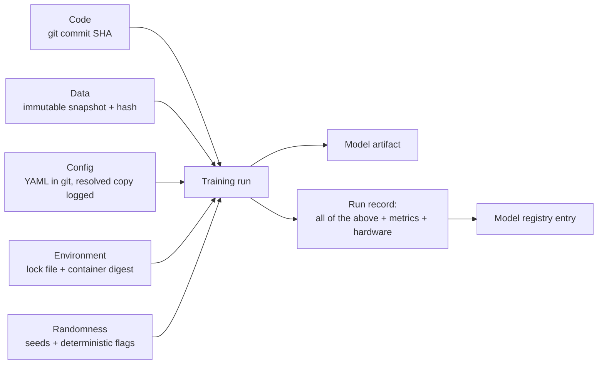
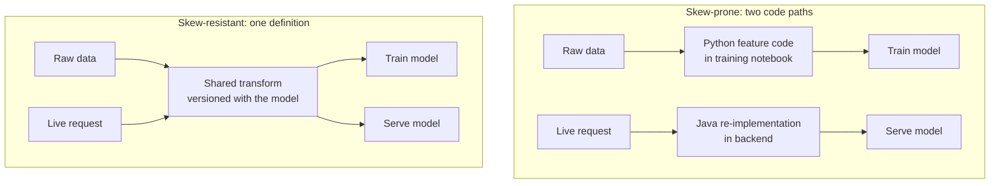
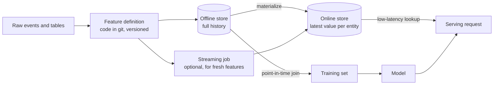
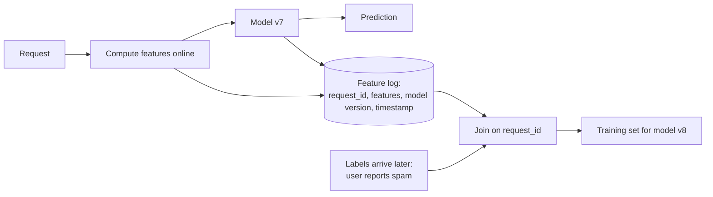

# Reproducible Training and Training-Serving Skew

> **Level:** Beginner to Advanced · **Study time:** ~90 min · **Prerequisites:** [The ML Lifecycle, MLOps and Experiment Tracking](01-ml-lifecycle-and-experiment-tracking.md), [Data Versioning, Model Versioning and the Model Registry](02-data-and-model-versioning-and-model-registry.md), [Feature Engineering: Missing Values, Categorical Encoding and Scaling](../01-classical-ml/07-feature-engineering-missing-values-and-encoding.md), [Data Drift, Concept Drift and When to Retrain](../01-classical-ml/08-data-drift-concept-drift-and-retraining.md)

## Table of contents

- [Why this matters](#why-this-matters)
- [Two problems, one theme: "same inputs, same outputs"](#two-problems-one-theme-same-inputs-same-outputs)
- [What reproducibility means (and the three levels of it)](#what-reproducibility-means-and-the-three-levels-of-it)
- [Sources of non-reproducibility](#sources-of-non-reproducibility)
- [Making training reproducible: the recipe](#making-training-reproducible-the-recipe)
- [Seed variance: is my improvement real or just luck?](#seed-variance-is-my-improvement-real-or-just-luck)
- [Training-serving skew: what it is](#training-serving-skew-what-it-is)
- [Concrete examples of training-serving skew](#concrete-examples-of-training-serving-skew)
- [Preventing skew](#preventing-skew)
- [Point-in-time correct joins](#point-in-time-correct-joins)
- [Detecting skew](#detecting-skew)
- [Going deeper: skew and reproducibility in LLM and RAG systems](#going-deeper-skew-and-reproducibility-in-llm-and-rag-systems)
- [Going deeper: production practice at scale](#going-deeper-production-practice-at-scale)
- [Common mistakes and misconceptions](#common-mistakes-and-misconceptions)
- [Interview questions and model answers](#interview-questions-and-model-answers)
- [Key takeaways](#key-takeaways)
- [Further reading](#further-reading)
- [Next](#next)

## Why this matters

Two of the most expensive failures in production ML are boring ones. The first: a model that worked last month cannot be rebuilt, so nobody can tell whether a regression came from the code, the data or the environment. The second: a model that scores beautifully offline performs badly online, not because the world changed, but because the features it sees in production are computed differently from the features it was trained on. Both failures are silent: nothing crashes, the dashboards stay green, and the business slowly loses money. Interviewers ask "how do you make training reproducible?" and "how do you prevent training-serving skew?" because the answers reveal whether you have actually shipped and maintained models, not just trained them in a notebook. By the end of this chapter you will be able to name every source of non-reproducibility, build a training run that can be rebuilt on demand, and design a pipeline where training and serving cannot quietly disagree.

## Two problems, one theme: "same inputs, same outputs"

Both topics in this chapter come down to a single promise: **if the inputs are the same, the outputs should be the same.**

- **Reproducibility** is that promise across *time*: train today, train again next month with the same code, data and config, and get the same model (or an equivalent one).
- **Training-serving skew** is that promise across *environments*: the same raw example should become the same feature vector whether it passes through the training pipeline or the live serving path.

> **Analogy:** A bakery has a famous cake. Reproducibility is "can we bake the same cake next year?" You need the exact recipe, the same brand of flour, the same oven temperature, and a note saying which batch of eggs you used. Training-serving skew is "the test kitchen and the shop kitchen follow two different handwritten copies of the recipe." One says "a cup of sugar," the other says "a cup of sugar, packed." Each kitchen thinks it is following the recipe. Customers notice before the bakers do.

We will use one running example throughout: a **spam filter** for an email service. It uses:

- text features from the email body (tokenized words, URL count),
- a numeric feature `sender_reputation` that is updated every few hours by a separate batch job,
- a numeric feature `account_age_days`, which is sometimes missing.

Occasionally we will also borrow the **house prices** model (a regression on size and location) and a **7B-parameter LLM** that is fine-tuned and then served.

## What reproducibility means (and the three levels of it)

**Reproducibility** in ML means that you can re-run a training (or evaluation) process and obtain the same result, given the same declared inputs. The "declared inputs" are the key phrase: code, data, configuration, environment and randomness. If any of them is undeclared (for example "whatever was in the table that morning"), you cannot reproduce the run.

There are three useful levels. Being precise about which one you need is a senior-level move, because each level costs more than the one before it.

| Level | What it means | Typical use | Cost |
|---|---|---|---|
| **Re-derivable** (lineage) | You know exactly which code, data, config and environment produced an artifact, and can rebuild something equivalent | Audits, compliance, debugging "what changed?" | Low: mostly logging and versioning |
| **Statistically reproducible** | Re-running gives metrics within normal seed-to-seed noise | Research claims, model comparisons, A/B decisions | Medium: multiple seeds, careful evaluation |
| **Bitwise reproducible** (deterministic) | Re-running gives identical weights and identical predictions, bit for bit | Debugging, regression tests in CI, regulated domains | High: deterministic kernels (slower), pinned hardware and software |

- **Lineage** is the recorded chain of "this model came from this data, this code and this config." It is the foundation for the other two levels.
- **Deterministic** means "no randomness left": the same inputs always produce exactly the same bits.

> **Senior insight:** Most teams need lineage always, statistical reproducibility for every comparison they make, and bitwise determinism only for small, targeted cases (CI tests, debugging a numerical bug, regulated models). Demanding bitwise determinism for every 1,000-GPU pretraining run is usually not worth the speed cost.

## Sources of non-reproducibility

Let us list everything that can make two "identical" runs disagree. It helps to group them, from the obvious to the subtle.

```text
                 Why did run B differ from run A?
                               |
    +-----------+-------------+-------------+-------------+-----------+
    |           |             |             |             |           |
 Random      GPU kernel    Data order    Software      Hardware    Upstream
 seeds       nondeter-     and           versions      differ-     data
             minism        sharding      (libs,        ences       changed
                                         CUDA, driver)
```

### 1. Random seeds

Training is full of deliberate randomness: weight initialization, data shuffling, dropout masks, data augmentation (random crops and flips), train/validation splits, negative sampling, and sampling in tree ensembles.

A **pseudo-random number generator (PRNG)** is an algorithm that produces a sequence of numbers that looks random but is completely determined by a starting value called the **seed**. Same seed, same sequence.

The trap: a typical Python training job has *several independent PRNGs*, and each must be seeded:

| PRNG | Used by | How to seed |
|---|---|---|
| Python `random` | your own code, some libraries | `random.seed(s)` |
| NumPy global RNG | pandas sampling, scikit-learn when `random_state=None`, augmentation libs | `np.random.seed(s)` (or pass a `np.random.default_rng(s)` explicitly) |
| PyTorch CPU and CUDA RNGs | weight init, dropout, `torch.randperm` | `torch.manual_seed(s)` (seeds all devices) |
| DataLoader worker processes | augmentation inside `Dataset.__getitem__` | `worker_init_fn` plus a seeded `generator` |
| Python hash randomization | iteration order of `set` of strings | `PYTHONHASHSEED` env var, set *before* the interpreter starts |
| Library-specific seeds | XGBoost, LightGBM, scikit-learn estimators, Hugging Face `Trainer` | their own `seed` / `random_state` arguments |

> **Common mistake:** Seeding NumPy but not PyTorch, or seeding the main process but not the DataLoader workers. Each worker is a separate process with its own RNG state. Recent PyTorch versions (1.9 and later) derive a per-worker seed for torch, Python `random` and NumPy's global RNG from a base seed drawn from the main process's generator, so those are reproducible once the main process is seeded. But RNGs PyTorch does not know about (a `np.random.default_rng` or a library RNG created in `Dataset.__init__` and copied into every worker, or third-party augmentation libraries) are copied with identical state or left unseeded, so augmentations can repeat across workers or differ between runs even when "everything is seeded." On older PyTorch versions NumPy was not reseeded per worker at all.

### 2. Nondeterministic GPU kernels

Even with every seed fixed, GPU training can give slightly different numbers each run. To see why, you need one fact about computer arithmetic.

**Floating-point addition is not associative.** "Associative" means the grouping does not matter: $(a+b)+c = a+(b+c)$. That is true for real numbers, but computers store numbers with limited precision (see [Number Formats and Model Memory](../07-model-compression/01-number-formats-and-model-memory.md)), so every addition rounds, and different groupings round differently.

Worked example in 64-bit floats (Python's default):

- $(0.1 + 0.2) + 0.3$: first $0.1 + 0.2 = 0.30000000000000004$ (rounding error), then adding $0.3$ gives $0.6000000000000001$.
- $0.1 + (0.2 + 0.3)$: first $0.2 + 0.3 = 0.5$ (exact), then $0.1 + 0.5 = 0.6$.

A more dramatic example in 32-bit floats. FP32 has 24 bits of precision, so above $2^{24} = 16{,}777{,}216$ not every integer can be stored. Near $10^8$ the gap between representable numbers is 8.

- $(10^8 + 1) - 10^8$: $10^8 + 1$ rounds back to $10^8$ (nearest representable value), then $10^8 - 10^8 = 0$.
- $(10^8 - 10^8) + 1 = 0 + 1 = 1$.

Same three numbers, answers 0 and 1.

```python
# pip install numpy
import numpy as np

print((0.1 + 0.2) + 0.3)   # 0.6000000000000001
print(0.1 + (0.2 + 0.3))   # 0.6

big, one = np.float32(1e8), np.float32(1)
print((big + one) - big)   # 0.0
print((big - big) + one)   # 1.0
```

Now connect this to GPUs. A GPU sums thousands of numbers in parallel. Some kernels (a **kernel** is a function that runs on the GPU) use **atomic adds**: many threads add into the same memory location, and whichever thread finishes first adds first. The order changes from run to run, so the rounding changes, so the result changes in the last few bits. Common culprits:

- backward passes of `scatter_add`, `index_add`, embedding lookups and some interpolation (upsampling) ops,
- **cuDNN autotuning** (cuDNN is NVIDIA's library of tuned GPU kernels for neural-network ops such as convolutions; autotuning is enabled by `torch.backends.cudnn.benchmark = True`), which benchmarks several convolution algorithms at startup and picks the fastest; timing noise can make it pick a different algorithm on a different run,
- matrix multiplications that split the reduction dimension across thread blocks ("split-K"),
- multi-GPU **all-reduce** (summing gradients across GPUs; see [Distributed Training](../02-deep-learning/10-distributed-training-and-training-memory.md)), whose reduction order depends on the communication topology.

Tiny differences in the last bits sound harmless, but training is a chaotic process: a difference of $10^{-7}$ in step 1 can become a visibly different loss curve after 10,000 steps.

### 3. Data order and sharding

The order in which examples arrive changes the gradient at every step, so it changes the final model.

- **Shuffling** depends on the DataLoader's RNG.
- **Number of workers** can change the order in which samples are produced if your loading code is not careful (for example iterable datasets that split a stream between workers).
- **Sharding**: in distributed training each GPU gets a slice ("shard") of the data. `DistributedSampler` shuffles using its seed plus the epoch number, so you must call `sampler.set_epoch(epoch)` each epoch, and changing the number of GPUs changes which examples share a batch.
- **Effective batch size** changes when you change GPU count without adjusting gradient accumulation, which changes the optimization itself.
- **File listing order**: `os.listdir` and many object-store listings do not guarantee order. Always sort.

### 4. Library and driver versions

A new version of PyTorch, cuDNN, scikit-learn or XGBoost can change default hyperparameters, kernel selection, or numerical behavior. Examples of the *kind* of change that happens (details vary by version, so check release notes):

- default values change (for example a library changes a default solver or a default tolerance),
- a faster kernel is introduced that sums in a different order,
- precision defaults change, such as whether FP32 matrix multiplications are allowed to use the lower-precision **TF32** format on NVIDIA Ampere and newer GPUs (in PyTorch this has been controlled by `torch.backends.cuda.matmul.allow_tf32` and `torch.set_float32_matmul_precision`; recent releases add a newer `fp32_precision` setting and are deprecating the older flags, which is exactly the kind of change to watch for).

Also remember the layers *below* Python: the CUDA toolkit, cuDNN, NCCL (the multi-GPU communication library), and the NVIDIA driver.

### 5. Hardware differences

Different GPU generations (for example an A100 versus an H100) have different instruction sets and different tuned kernels, so the same code sums in different orders. Different CPU types can pick different SIMD code paths (vectorized instructions such as AVX-512) in math libraries like MKL or OpenBLAS. Bitwise reproducibility across different hardware is generally *not* achievable in practice; aim for statistical reproducibility there.

### 6. Changing upstream data

This is the most common cause in industry, and the most overlooked. Your training query says `SELECT * FROM emails WHERE date < '2026-09-01'`. Run it today and run it next month: are the rows identical?

Usually not, because of:

- **late-arriving data** (events that land in the table days after they happened),
- **backfills** (an upstream team recomputes history after fixing a bug),
- **deletions** (privacy requests under laws such as GDPR remove users' rows),
- **label updates** (a user marks an old email as spam, changing its label),
- **schema changes** (a column changes meaning or units).

A query is not a dataset. A **data snapshot**, an immutable copy or versioned reference of the exact rows used, is.

### Summary table

| Source | Symptom | Fix | Cost of the fix |
|---|---|---|---|
| Unseeded PRNGs | Large run-to-run differences | Seed every PRNG | Almost free |
| Nondeterministic GPU kernels | Tiny differences that grow over training | Deterministic flags | Slower training, some ops unsupported |
| Data order and sharding | Different curves when GPU count or workers change | Seeded samplers, sorted file lists, fixed world size | Low to medium |
| Library and driver versions | "It worked on my machine" | Lock files, containers | Low, plus upkeep |
| Hardware | Small differences across GPU types | Pin hardware type for exact repro, otherwise accept | Scheduling constraints |
| Upstream data | Different row counts or label rates | Immutable snapshots, versioned data | Storage |

## Making training reproducible: the recipe

Here is the recipe, ordered roughly from the cheapest and most important to the most expensive.



### Step 1: Seed every PRNG

```python
# pip install torch numpy
import os
import random

import numpy as np
import torch


def seed_everything(seed: int, deterministic: bool = False) -> None:
    """Seed every PRNG we know about; optionally force deterministic kernels."""
    random.seed(seed)
    np.random.seed(seed)
    torch.manual_seed(seed)  # seeds CPU and all CUDA devices

    if deterministic:
        # Required by cuBLAS (NVIDIA's GPU matrix-multiplication library)
        # for deterministic matmuls on CUDA 10.2+.
        # Must be set before the first CUDA call to take effect.
        os.environ.setdefault("CUBLAS_WORKSPACE_CONFIG", ":4096:8")
        torch.backends.cudnn.benchmark = False      # no autotuning roulette
        torch.backends.cudnn.deterministic = True   # deterministic conv algorithms
        # Raise an error if an op has no deterministic implementation.
        # warn_only=True logs a warning instead of raising.
        torch.use_deterministic_algorithms(True)


def seed_worker(worker_id: int) -> None:
    """Give each DataLoader worker a seed derived from the main seed."""
    worker_seed = torch.initial_seed() % 2**32
    np.random.seed(worker_seed)
    random.seed(worker_seed)


seed_everything(42, deterministic=True)

g = torch.Generator()
g.manual_seed(42)

dataset = torch.utils.data.TensorDataset(torch.randn(100, 8), torch.randint(0, 2, (100,)))
loader = torch.utils.data.DataLoader(
    dataset,
    batch_size=16,
    shuffle=True,
    num_workers=2,
    worker_init_fn=seed_worker,  # seeds numpy/random inside each worker
    generator=g,                 # controls the shuffle order
)
```

Notes:

- `PYTHONHASHSEED` is not in the function on purpose: setting it inside a running Python process does not change that process's hashing. Set it in the launcher, Dockerfile or job spec (`PYTHONHASHSEED=0 python train.py`).
- Hugging Face Transformers has `transformers.set_seed(seed)` and `TrainingArguments(seed=..., data_seed=..., full_determinism=...)`. Check the docs for your version.
- scikit-learn: pass `random_state=` to every estimator, splitter and `train_test_split` explicitly. Relying on the global NumPy seed is fragile because it depends on the order of calls.
- Gradient-boosting libraries have their own seed parameters, and multithreaded training can still introduce tiny differences. LightGBM, for example, exposes a `deterministic` option for CPU training. Check your library's docs.
- TensorFlow has an equivalent switch (`tf.config.experimental.enable_op_determinism()` in recent 2.x versions).

### Step 2: Understand the cost of deterministic flags

Deterministic mode is not free:

- **Speed:** deterministic algorithms avoid atomics and autotuning, so they can be slower. The size of the slowdown depends heavily on the model and ops: often small for plain transformer training, potentially large for models dominated by scatter or upsampling ops. Measure it on your workload; do not trust a rule of thumb.
- **Coverage:** some ops have no deterministic GPU implementation. With `torch.use_deterministic_algorithms(True)` they raise a `RuntimeError`, which is actually useful: it tells you exactly where nondeterminism comes from.
- **Scope:** determinism holds for the same hardware, the same software versions and the same parallel configuration. Change the GPU type or the number of GPUs and the bits change anyway.

> **Interview tip:** When asked "how do you make training reproducible?", always mention the trade-off. "I seed everything and log everything by default, which is free. I turn on deterministic kernels in CI and when debugging, because they cost throughput, and I accept statistical reproducibility for large multi-GPU runs."

### Step 3: Pin dependencies with lock files

A `requirements.txt` with `torch>=2.0` is a wish, not a specification. Next month it installs a different version.

- **Lock file:** a machine-generated file listing the exact version (and ideally the cryptographic hash) of every package, including transitive dependencies (the dependencies of your dependencies). Examples: `uv.lock` (uv), `poetry.lock` (Poetry), `requirements.txt` produced by `pip-compile --generate-hashes` (pip-tools), and `conda-lock` files.
- A **hash** here is a fingerprint of the package file; installing with `pip install --require-hashes -r requirements.txt` refuses any file whose fingerprint differs, which protects against both silent changes and supply-chain tampering.

```bash
# Option A: uv (fast, generates uv.lock from pyproject.toml)
uv lock
uv sync --frozen        # install exactly what the lock file says

# Option B: pip-tools
pip install pip-tools
pip-compile --generate-hashes requirements.in -o requirements.txt
pip install --require-hashes -r requirements.txt
```

### Step 4: Use containers, and know their limits

A **container** (for example a Docker image) packages the OS libraries, Python, your locked packages, CUDA runtime libraries and your code into one immutable image.

- Reference images by **digest** (`my-train@sha256:3f2a...`), not by a mutable tag like `latest`, because tags can be moved to point at a different image.
- Start from an official CUDA or framework base image so CUDA, cuDNN and NCCL versions are fixed.

> **Senior insight:** The NVIDIA *driver* is not inside the container. It lives on the host machine and is exposed to the container by the NVIDIA container toolkit. Two "identical" containers on two nodes with different drivers can behave differently. Log the driver version in every run, and pin node images in your cluster.

### Step 5: Snapshot the data

Train on an **immutable, versioned snapshot**, never on "the table as it is right now."

Options (covered in depth in [Data Versioning, Model Versioning and the Model Registry](02-data-and-model-versioning-and-model-registry.md)):

- Table formats with **time travel**, such as Delta Lake and Apache Iceberg, let you read a table "as of version 1,234" or "as of timestamp X." Caveat: old versions are only kept until maintenance removes them (Delta `VACUUM`, Iceberg snapshot expiry), so time travel alone is not a long-term archive; retain or copy the snapshots that back production models.
- Tools like **DVC** and **lakeFS** version files and directories with git-like commits.
- At minimum: write the training set to object storage under a unique path, never overwrite it, and record a **content hash** of it.

A content hash is a fingerprint computed from the bytes of the data. If even one byte changes, the hash changes, so it proves "this is exactly the data we trained on."

```python
import hashlib
from pathlib import Path


def dataset_fingerprint(root: str) -> str:
    """SHA-256 over all files under root, in sorted order (order matters!)."""
    h = hashlib.sha256()
    for path in sorted(Path(root).rglob("*")):
        if path.is_file():
            # include the file name; as_posix() so Windows and Linux give the same hash
            h.update(path.relative_to(root).as_posix().encode())
            with open(path, "rb") as f:
                for chunk in iter(lambda: f.read(1 << 20), b""):  # 1 MiB chunks
                    h.update(chunk)
    return h.hexdigest()

# print(dataset_fingerprint("data/spam_snapshot_2026_09_01"))
```

Note the `sorted(...)`: without it, the hash would depend on file listing order, which is itself a reproducibility bug.

### Step 6: Config as code

**Config as code** means every knob of a run (hyperparameters, feature list, data snapshot ID, model architecture) lives in a version-controlled file, not in someone's shell history or notebook cell.

```yaml
# configs/spam_v7.yaml
seed: 42
deterministic: false
data:
  snapshot: s3://ml-data/spam/snapshots/2026-09-01/   # immutable path
  sha256: 9c1e...                                      # expected fingerprint
features:
  tokenizer: spam-tokenizer-v3
  lowercase: true
  max_tokens: 256
  numeric: [sender_reputation, account_age_days, url_count]
model:
  type: logistic_regression
  C: 1.0
train:
  batch_size: 256
  epochs: 5
```

Tools like Hydra and OmegaConf let you compose configs and override values from the command line. Whatever tool you use, **log the fully resolved config** (after overrides and defaults are applied), because "the YAML plus three command-line overrides" is not reproducible unless the overrides are recorded too. The training script should also verify the data fingerprint against `sha256` and refuse to train on a mismatch.

### Step 7: Log everything

The run record is what makes a model re-derivable. Log it to your experiment tracker (see [The ML Lifecycle, MLOps and Experiment Tracking](01-ml-lifecycle-and-experiment-tracking.md)) and attach it to the registered model.

| Category | What to log |
|---|---|
| Code | git commit SHA, and whether the working tree was **dirty** (had uncommitted changes) |
| Data | snapshot ID or path, content hash, row counts, label distribution |
| Config | fully resolved config |
| Environment | lock file, container image digest, Python, framework, CUDA, cuDNN and driver versions |
| Hardware | GPU model and count, CPU type |
| Randomness | seeds, deterministic flag |
| Outputs | metrics, model artifact hash, evaluation set version |
| Preprocessing | fitted preprocessing artifacts (scalers, vocabularies, tokenizer files) and their hashes |

```python
# pip install mlflow torch
import json
import platform
import subprocess
import sys

import torch


def run_manifest(seed: int, data_sha: str) -> dict:
    git_sha = subprocess.check_output(["git", "rev-parse", "HEAD"], text=True).strip()
    dirty = bool(subprocess.check_output(["git", "status", "--porcelain"], text=True).strip())
    return {
        "git_sha": git_sha,
        "git_dirty": dirty,
        "data_sha256": data_sha,
        "seed": seed,
        "python": sys.version.split()[0],
        "platform": platform.platform(),
        "torch": torch.__version__,
        "cuda": torch.version.cuda,                      # None on CPU-only builds
        "cudnn": torch.backends.cudnn.version(),
        "gpu": torch.cuda.get_device_name(0) if torch.cuda.is_available() else None,
        "pip_freeze": subprocess.check_output(
            [sys.executable, "-m", "pip", "freeze"], text=True
        ).splitlines(),
    }

# import mlflow
# with mlflow.start_run():
#     manifest = run_manifest(seed=42, data_sha="9c1e...")
#     mlflow.log_dict(manifest, "run_manifest.json")
#     if manifest["git_dirty"]:
#         mlflow.set_tag("warning", "trained from uncommitted code")
```

> **Common mistake:** Training from a dirty working tree. The git SHA then points at code that is *not* what actually ran. Many teams make the production training pipeline refuse to run when `git_dirty` is true.

### Step 8: Make checkpoints resumable

Long runs get interrupted (preemptible or spot instances, node failures). To resume and get the same result as an uninterrupted run, a checkpoint must contain more than the weights:

- model weights,
- optimizer state (for Adam, the running averages of gradients; see [Optimizers](../02-deep-learning/03-optimizers-sgd-momentum-adam-and-learning-rate-schedules.md)),
- learning-rate scheduler state,
- gradient scaler state if using mixed precision (see [Mixed-Precision Training](../02-deep-learning/09-mixed-precision-training.md)),
- the global step and epoch,
- all RNG states (`random.getstate()`, `np.random.get_state()`, `torch.get_rng_state()`, `torch.cuda.get_rng_state_all()`),
- the data loader position (which samples of this epoch were already consumed).

If you save only the weights, "resume" silently restarts the learning-rate schedule and replays data the model already saw.

## Seed variance: is my improvement real or just luck?

Even a perfectly reproducible pipeline has a deeper question: if I change only the seed, how much does the metric move? This is **seed variance**, and ignoring it is how teams ship "improvements" that are pure noise.

The standard tool is the **standard error of the mean**:

$$
\bar{x} = \frac{1}{n}\sum_{i=1}^{n} x_i,
\qquad
s = \sqrt{\frac{1}{n-1}\sum_{i=1}^{n}(x_i - \bar{x})^2},
\qquad
\text{SE} = \frac{s}{\sqrt{n}}
$$

- $n$: number of runs (each with a different seed).
- $x_i$: the metric (for example accuracy) of run $i$.
- $\bar{x}$: the mean metric across runs.
- $s$: the sample standard deviation, how much runs typically differ from the mean. The $n-1$ ("Bessel's correction") gives an unbiased variance estimate from a sample; see [Probability and Statistics for ML](../00-foundations/04-probability-and-statistics.md).
- $\text{SE}$: how uncertain our estimate of the *mean* is. It shrinks as you add more seeds.

**Worked example (illustrative numbers).** The spam filter is trained with 5 seeds, giving accuracies 0.912, 0.905, 0.918, 0.909, 0.911.

1. Sum: $0.912 + 0.905 = 1.817$; $1.817 + 0.918 = 2.735$; $2.735 + 0.909 = 3.644$; $3.644 + 0.911 = 4.555$.
2. Mean: $\bar{x} = 4.555 / 5 = 0.911$.
3. Deviations from the mean: $0.001, -0.006, 0.007, -0.002, 0.000$.
4. Squared deviations: $0.000001, 0.000036, 0.000049, 0.000004, 0$. Sum $= 0.000090$.
5. Sample variance: $0.000090 / (5 - 1) = 0.0000225$.
6. Standard deviation: $s = \sqrt{0.0000225} \approx 0.00474$.
7. Standard error: $\text{SE} = 0.00474 / \sqrt{5} = 0.00474 / 2.236 \approx 0.00212$.

Now a colleague trains one run of a "new feature" variant and gets 0.914, a gain of 0.003 over the mean. That gain is about $0.003 / 0.00474 \approx 0.6$ standard deviations of a single run: completely inside normal seed noise. One seed proves nothing. To claim the improvement, train the variant with several seeds too and compare the two means (for example with a two-sample t-test, or a paired test if both variants share seeds and data splits).

```python
import numpy as np

acc = np.array([0.912, 0.905, 0.918, 0.909, 0.911])
mean = acc.mean()
s = acc.std(ddof=1)          # ddof=1 -> divide by n-1 (sample std)
se = s / np.sqrt(len(acc))
print(f"mean={mean:.4f} std={s:.5f} se={se:.5f}")
# mean=0.9110 std=0.00474 se=0.00212
```

> **Senior insight:** Determinism and seed variance are different things. Determinism makes *one* seed repeatable; it does not make the result *representative*. A deterministic pipeline can still give you a lucky seed. For important decisions, report the mean and spread over several seeds.

## Training-serving skew: what it is

**Training-serving skew** is any difference between the data or computation a model sees during training and what it sees when serving predictions in production, *caused by the pipelines themselves* rather than by the world changing. The model's performance online is worse than offline evaluation predicted, even though the model file is identical.

> **Analogy:** You learn to drive in a car where the speedometer shows miles per hour. On test day you get a car that shows kilometers per hour, and nobody tells you. You drive "at 50" with perfect skill, and you are wrong every time. You did not get worse at driving; your inputs changed meaning.

It is important to separate skew from two neighbors:

| Problem | What differs | Cause | Example | Fix |
|---|---|---|---|---|
| **Training-serving skew** | Training pipeline vs serving pipeline, *at the same time* | Engineering: two code paths, stale features, version mismatch | Training lowercases text; serving does not | Fix the pipeline |
| **Data drift** | Data distribution *over time* | The world changed | New spam campaign uses new vocabulary | Retrain, monitor (see [Data Drift, Concept Drift and When to Retrain](../01-classical-ml/08-data-drift-concept-drift-and-retraining.md)) |
| **Data leakage** | Training used information unavailable at prediction time | Engineering in the *training* pipeline | Using a feature computed after the label was known | Fix training data generation (see [Overfitting, Bias-Variance, Regularization and Data Leakage](../01-classical-ml/03-overfitting-regularization-and-data-leakage.md)) |

Leakage and skew are close cousins: leakage is often "training sees the future," and skew is often "serving sees something different from training." Point-in-time correct joins, covered below, fix the time-related forms of both (future values leaking into training, and freshness mismatches when the join uses the time a value became available to serving).

A useful vocabulary (used, for example, by TensorFlow Data Validation, a validation library from Google's TFX platform):

- **Schema skew:** training and serving data do not even have the same shape: a missing column, a different type (string vs integer), a different set of allowed category values.
- **Feature skew:** the same example has different feature *values* in training and serving (for example `account_age_days = 400` offline, `0` online).
- **Distribution skew:** the overall distribution of a feature differs between the training set and serving traffic, which can be caused by skew bugs or by sampling (for example training on a non-representative sample).

## Concrete examples of training-serving skew

These are the patterns that show up again and again in real systems. Learn them as a checklist.

### Example 1: Two implementations of the "same" preprocessing (Python vs Java)

The data scientist writes feature code in Python with pandas. The production backend is in Java, so an engineer re-implements the features in Java "from the spec." Each line looks the same. The numbers are not.

A tiny but real trap: the **standard deviation**, used to standardize (z-score) a feature. pandas and NumPy use *different defaults*:

- `pandas.Series.std()` divides by $n - 1$ (sample standard deviation, `ddof=1`).
- `numpy.std()` divides by $n$ (population standard deviation, `ddof=0`).

Worked example with the values $[1, 2, 3, 4]$:

1. Mean: $(1+2+3+4)/4 = 10/4 = 2.5$.
2. Squared deviations: $(1-2.5)^2 = 2.25$, $(2-2.5)^2 = 0.25$, $(3-2.5)^2 = 0.25$, $(4-2.5)^2 = 2.25$. Sum $= 5$.
3. pandas: $\sqrt{5/3} = \sqrt{1.6667} \approx 1.291$.
4. NumPy: $\sqrt{5/4} = \sqrt{1.25} \approx 1.118$.

If training standardized with one and serving with the other, every standardized value is off by a factor of $1.291 / 1.118 \approx 1.155$, about 15%. With large $n$ the difference becomes tiny, but the same class of bug appears in many forms: `log` vs `log1p`, integer vs float division, rounding modes, different regular expressions, different Unicode normalization, different handling of time zones.

```python
import numpy as np
import pandas as pd

x = [1, 2, 3, 4]
print(pd.Series(x).std())  # 1.2909944487358056  (ddof=1)
print(np.std(x))           # 1.118033988749895   (ddof=0)
```

### Example 2: Feature freshness

`sender_reputation` is computed by a batch job. In the **training** data, built after the fact from complete history, each email gets the reputation value as of the moment it arrived (if the join is done correctly). In **serving**, the online store is refreshed every 6 hours, so at prediction time the model sees a value up to 6 hours old. Spammers burn through new sender accounts in minutes, so the fresh value (used in training) is far more predictive than the stale value (seen in serving). The offline evaluation overstates real performance.

The general rule: **a feature in training must reflect only what would have been available at serving time, with the same delay.** If serving sees values that are 6 hours stale, training should simulate a 6-hour staleness too.

### Example 3: Missing-value handling

`account_age_days` is missing for some accounts.

- Training pipeline: pandas reads the missing value as `NaN`, then a scikit-learn `SimpleImputer(strategy="median")` fills it with the training median, say 380 days.
- Serving pipeline: the Java service's JSON parser turns the missing field into `0`.

To the model, `0` means "brand-new account," which is a strong spam signal. Every legitimate user with a missing age now looks like a fresh spam account. Other variants: `""` vs `null` vs `"NA"` for categorical features, `-1` sentinel values in one path and `NaN` in another, and tree models (such as XGBoost) that learn a special "missing" direction at each split, which only works if serving sends a true missing value. (For imputation strategies themselves, see [Feature Engineering](../01-classical-ml/07-feature-engineering-missing-values-and-encoding.md).)

### Example 4: Tokenizer version mismatch

The spam model was trained with `spam-tokenizer-v3`, which lowercases and splits URLs into parts. A later deploy pins `v4` for a different model, and the spam service picks it up by accident. Token IDs now map to different words, or the vocabulary changes size. The model receives sequences of valid-looking integers that mean something else. No error is raised.

The LLM version of this is very common: a fine-tuned 7B model served with a different **chat template** (the special formatting tokens that mark system, user and assistant turns) than it was trained with, or with the beginning-of-sequence (BOS) token added twice (once by the template, once by the tokenizer). Outputs degrade in subtle ways. (Tokenizers are explained in [Tokenization](../04-transformers/01-tokenization.md).)

### Example 5: Different image resize libraries

A vision model was trained with images loaded and resized by Pillow (PIL). The serving team uses OpenCV because it is faster. Differences that bite:

- **Channel order:** OpenCV loads images as BGR (blue, green, red), Pillow as RGB. A model trained on RGB that receives BGR sees swapped colors.
- **Resize algorithm:** "bilinear" in Pillow and "bilinear" in OpenCV do not produce identical pixels; in particular, Pillow's resize applies antialiasing when downscaling, while OpenCV's `INTER_LINEAR` does not. PyTorch's `torchvision` resize has its own `antialias` behavior that has changed across versions.
- **JPEG decoding:** different decoder libraries can produce slightly different pixel values from the same file.
- **Normalization:** training divides by 255 and subtracts the ImageNet mean; the serving path forgets one of the two.

The difference per pixel can be small, but neural networks can be surprisingly sensitive to such systematic shifts. (More in [Computer Vision in Production](../03-computer-vision/04-computer-vision-in-production.md).)

### More patterns worth knowing

| Pattern | Training side | Serving side |
|---|---|---|
| Units | timestamps in seconds | timestamps in milliseconds |
| Time zones | UTC in the warehouse | local time in the app server |
| Category vocabulary | `{"gmail": 0, "yahoo": 1}` fitted on training data | rebuilt at serving time in a different order |
| Unknown categories | rare values bucketed into "other" | unseen values crash or map to index 0 |
| Aggregation windows | "last 7 days" computed with full days | "last 7 days" as a rolling 168 hours |
| Text cleaning | HTML stripped by BeautifulSoup | HTML stripped by a regex |
| Label definition | spam = user reported within 30 days | (online metric) spam = reported within 1 day |
| Precision | FP32 model evaluated offline | INT8 quantized model served (see [Post-Training Quantization vs Quantization-Aware Training](../07-model-compression/03-ptq-vs-qat-and-calibration.md)) |

## Preventing skew

The root cause of almost all skew is the same: **there are two of something** (two code paths, two data sources, two versions, two definitions) and they drift apart. Every prevention technique is a way to have only one.



### Technique 1: Single shared transformation code

Write feature logic **once** and use the same artifact in both training and serving.

Ways to do it:

- **Bundle preprocessing with the model.** In scikit-learn, a `Pipeline` holds the imputer, scaler, encoder and model together and is saved as one artifact. In PyTorch, put normalization inside the model's `forward` or export the whole thing (preprocessing plus model) to a format like ONNX or TorchScript (serialized model formats that can run outside the Python training code, for example from C++ or a dedicated inference runtime). For Hugging Face models, call `tokenizer.save_pretrained(...)` into the same directory as `model.save_pretrained(...)` (the model's method alone does not save the tokenizer; `Trainer` does it for you when given the tokenizer), so serving loads the exact tokenizer and chat template.
- **Serve in the same language as training.** If serving is a Python service that imports the same feature module, there is no re-implementation to drift. If the backend must be Java or Go, call a model server that contains the preprocessing, rather than porting the code.
- **Graph-based transforms.** TensorFlow Transform (part of TFX) computes full-pass statistics (means, vocabularies) in a batch job and emits a transform graph that is attached to the serving model.

```python
# pip install scikit-learn pandas joblib
import joblib
import numpy as np
import pandas as pd
from sklearn.compose import ColumnTransformer
from sklearn.impute import SimpleImputer
from sklearn.linear_model import LogisticRegression
from sklearn.pipeline import Pipeline
from sklearn.preprocessing import StandardScaler

train = pd.DataFrame({
    "account_age_days": [400, np.nan, 5, 1200, 2, 30],
    "url_count":        [0,   1,      7, 0,    9, 3],
    "is_spam":          [0,   0,      1, 0,    1, 1],
})
numeric = ["account_age_days", "url_count"]

pipe = Pipeline([
    ("prep", ColumnTransformer([
        ("num", Pipeline([
            ("impute", SimpleImputer(strategy="median")),  # median learned from TRAINING data
            ("scale", StandardScaler()),                   # mean/std learned from TRAINING data
        ]), numeric),
    ])),
    ("clf", LogisticRegression(random_state=0)),
])
pipe.fit(train[numeric], train["is_spam"])

# ONE artifact holds imputation values, scaling stats and the model.
joblib.dump(pipe, "spam_pipeline_v7.joblib")

# --- serving process (same Python package versions, loaded from the registry) ---
served = joblib.load("spam_pipeline_v7.joblib")
request = pd.DataFrame([{"account_age_days": None, "url_count": 4}])  # missing stays missing
print(served.predict_proba(request[numeric])[:, 1])
```

The serving side never re-implements "fill missing with the median" or "standardize": it calls the same fitted objects. Note the serving code passes a true missing value (`None`, which becomes `NaN` when the imputer converts the column to floats), not `0`.

> **Common mistake:** Pickled or joblib artifacts are tied to library versions. Loading a scikit-learn pipeline saved with one version in a different version can warn, fail, or behave differently. Serve with the same lock file you trained with, which is one more reason the environment belongs in the run record. (Also, only load pickle files you trust: unpickling can execute arbitrary code.)

### Technique 2: Feature stores with consistent online and offline definitions

A **feature store** is a system that manages feature definitions and serves feature values in two ways. (An **entity** is the thing a feature describes: a user, a sender, a house.)

- an **offline store** (a data warehouse or lake) holding the full history of feature values, used to build training sets,
- an **online store** (a low-latency key-value database such as Redis or DynamoDB) holding the latest value per entity, used at serving time,
- a single **feature definition** that populates both, plus a **materialization** job that copies fresh values from the offline computation into the online store.



Popular options include Feast (open source), Tecton, and the feature stores built into cloud ML platforms (Databricks, Vertex AI, SageMaker). The APIs change across versions, so treat this Feast-style snippet as conceptual:

```python
# pip install feast   (API is version-dependent; check the docs for your release)
from datetime import timedelta

from feast import Entity, FeatureStore, FeatureView, Field, FileSource
from feast.types import Float32, Int64

sender = Entity(name="sender_id", join_keys=["sender_id"])

sender_stats_source = FileSource(
    path="data/sender_stats.parquet",
    timestamp_field="event_timestamp",   # when the value became true
)

sender_stats = FeatureView(
    name="sender_stats",
    entities=[sender],
    ttl=timedelta(days=2),               # values older than this are treated as missing
    schema=[
        Field(name="sender_reputation", dtype=Float32),
        Field(name="emails_sent_24h", dtype=Int64),
    ],
    source=sender_stats_source,
)

store = FeatureStore(repo_path=".")

# Training: point-in-time correct join against labeled events (entity_df has
# sender_id + event_timestamp + label).
# training_df = store.get_historical_features(
#     entity_df=labeled_emails,
#     features=["sender_stats:sender_reputation", "sender_stats:emails_sent_24h"],
# ).to_df()

# Serving: same feature names, same definition, latest values.
# online = store.get_online_features(
#     features=["sender_stats:sender_reputation", "sender_stats:emails_sent_24h"],
#     entity_rows=[{"sender_id": "s_123"}],
# ).to_dict()
```

What a feature store guarantees and what it does not:

| Guarantees (if used properly) | Does not guarantee |
|---|---|
| One named, versioned definition per feature | That request-time features computed in your app (outside the store) match |
| Point-in-time correct training sets | Identical freshness: the online value may lag the offline value |
| The same feature names and types online and offline | That a streaming computation matches the batch computation numerically |
| Feature reuse across teams | That the model's own preprocessing (tokenizers, image resizing) matches |

> **Senior insight:** A feature store reduces skew in *feature computation and retrieval*. It does not remove skew in *freshness* (online values are only as fresh as the last materialization or stream update), and it does not cover features computed inside the request handler. Many stores support "on-demand" or request-time transformations so that even those are defined once.

### Technique 3: Log serving features and train on them

The most robust technique of all, recommended in Google's "Rules of Machine Learning" (Zinkevich): **save the exact feature vector the model used at serving time, and build future training sets from those logs.**



Why it works: by construction, training features are *exactly* serving features, including staleness, missing-value quirks and bugs. If serving has a bug, the next model learns to live with it, which is far better than learning on clean data and meeting buggy data in production.

Trade-offs:

| Pros | Cons |
|---|---|
| Eliminates feature skew by construction | **Log-and-wait:** a brand-new feature has no history; you must log it for weeks before you can train on it (or backfill offline, reintroducing skew risk) |
| Captures real freshness and real missingness | Storage cost and privacy obligations (feature logs may contain personal data) |
| Simple to reason about | Logs only cover requests the current system served, which can bias the data (for example items a recommender never showed have no logged features) |
| Doubles as the data source for skew detection and replay tests | Bugs get "baked in" and must be fixed carefully, with a retrain |

In practice, mature systems combine techniques: a feature store for definitions, point-in-time joins for backfilling new features, and feature logging both for training and for continuous skew checks.

### Technique 4: Version and pin everything the model depends on

- Store tokenizers, vocabularies, category mappings, scaler statistics, chat templates and image preprocessing configs **as artifacts next to the model** in the registry, not as "whatever version the service has."
- Serving loads the model *and its preprocessing* by the same version ID.
- Fail fast: on startup, the serving container checks that the hashes of its preprocessing artifacts match those recorded at training time.

This is the practical answer to "how do you version datasets and preprocessing?": the dataset version, the preprocessing code version (git SHA) and the fitted preprocessing artifacts are all recorded in the model's registry entry, and serving refuses to run a mismatched combination.

### Choosing among prevention techniques

| Technique | What it prevents | When to use | Main cost |
|---|---|---|---|
| Shared transformation code / bundled pipeline | Logic differences between code paths | Always; the default | Serving must run the training language or an exported graph |
| Feature store | Inconsistent definitions, non-point-in-time training data, duplicated feature work | Many models share entity features; real-time features | Platform complexity and cost |
| Log-and-train | All feature skew, including freshness | High-traffic systems with fast label feedback (ads, ranking, fraud, spam) | Waiting for logs; storage; privacy |
| Artifact versioning and hash checks | Tokenizer, vocabulary and config mismatches | Always | Small engineering effort |

## Point-in-time correct joins

This is the single most important technique for building training data that matches serving, and a favorite interview topic.

### The intuition

At serving time, when an email arrives at 13:00, the model can only see the `sender_reputation` value that existed *at 13:00*. When you build training data months later, the warehouse contains the reputation history, including values computed *after* 13:00. If your training join grabs "the latest value," you are giving the model information from the future.

> **Analogy:** Testing a stock-picking strategy on historical data using today's company ratings. Of course it "predicts" well: the ratings already reflect what happened.

A **point-in-time correct join** (also called an **as-of join**) attaches to each training example the feature value that was the most recent *as of* the example's timestamp, and never a later one.

### A worked example

Feature history for sender `s1` (reputation recomputed periodically):

| feature_time | sender_reputation |
|---|---|
| 09:00 | 0.9 |
| 12:00 | 0.4 |
| 15:00 | 0.1 |

Labeled emails from `s1`:

| event_time | is_spam |
|---|---|
| 11:00 | 0 |
| 13:00 | 1 |
| 16:00 | 1 |

```text
time:     09:00     11:00     12:00     13:00     15:00     16:00
feature:  0.9 ------------->  0.4 ------------->  0.1 ---------->
emails:             e1(0)               e2(1)               e3(1)
as-of:              0.9                 0.4                 0.1
naive "latest":     0.1                 0.1                 0.1   <- leaks the future
```

The naive join assigns 0.1 to the 11:00 email, a value computed 4 hours later when the sender had already been flagged. The model learns "low reputation means spam" from data where reputation was low *because of* the spam. Offline accuracy looks great; online, at 11:00, the real value is 0.9 and the model misses the spam.

```python
# pip install pandas
import pandas as pd

features = pd.DataFrame({
    "sender_id": ["s1", "s1", "s1"],
    "feature_time": pd.to_datetime(["2026-09-01 09:00", "2026-09-01 12:00", "2026-09-01 15:00"]),
    "sender_reputation": [0.9, 0.4, 0.1],
})
events = pd.DataFrame({
    "sender_id": ["s1", "s1", "s1"],
    "event_time": pd.to_datetime(["2026-09-01 11:00", "2026-09-01 13:00", "2026-09-01 16:00"]),
    "is_spam": [0, 1, 1],
})

# merge_asof requires both frames sorted by the time key.
train = pd.merge_asof(
    events.sort_values("event_time"),
    features.sort_values("feature_time"),
    left_on="event_time",
    right_on="feature_time",
    by="sender_id",           # match within the same sender
    direction="backward",     # only values at or before the event time
)
print(train[["event_time", "sender_reputation", "is_spam"]])
#            event_time  sender_reputation  is_spam
# 0 2026-09-01 11:00:00                0.9        0
# 1 2026-09-01 13:00:00                0.4        1
# 2 2026-09-01 16:00:00                0.1        1
```

### Two refinements that matter in production

1. **Availability lag.** The 12:00 value may be *computed for* 12:00 but only *written to the online store* at 12:30. At 12:15 serving still sees 0.9. A correct join uses the time the value became *available*, not the time it describes. Either store an `available_at` timestamp and join on it, or shift the event time back by the known lag.
2. **Time to live (TTL).** If the latest value is very old, serving may treat it as missing (the Feast `ttl` above). Training should apply the same rule. In `merge_asof` this is the `tolerance=` argument.

> **Interview tip:** If you say "feature store" in an interview, be ready for "what does it actually do for skew?" The crisp answer: "one definition for online and offline, and point-in-time correct historical retrieval so training sees exactly what serving would have seen, with the same freshness."

## Detecting skew

Prevention reduces skew; detection catches what slips through. There are three complementary checks, from most direct to most general.

### Check 1: Feature parity (row-level comparison)

Take a sample of real serving requests from the feature log. For each, recompute the features with the **offline** pipeline as of the request time. Compare value by value.

$$
\text{mismatch rate}_f = \frac{1}{N}\sum_{j=1}^{N} \mathbb{1}\left[\,\left|x^{\text{online}}_{j,f} - x^{\text{offline}}_{j,f}\right| > \tau_f\,\right]
$$

- $f$: the feature being checked (for example `account_age_days`).
- $N$: number of sampled requests.
- $x^{\text{online}}_{j,f}$: the value the serving system logged for request $j$.
- $x^{\text{offline}}_{j,f}$: the value the training pipeline computes for the same request and timestamp.
- $\tau_f$: a tolerance (for example $10^{-6}$ for exact features, larger for features with known legitimate lag).
- $\mathbb{1}[\cdot]$: the **indicator function**, 1 if the condition is true, 0 otherwise.

**Worked example (illustrative).** You sample $N = 1{,}000$ requests. For `account_age_days`, 37 rows differ by more than the tolerance. Mismatch rate $= 37 / 1000 = 0.037$, so 3.7%. You inspect those 37 rows: all have `account_age_days = 0` online and `NaN` offline. Root cause found: the missing-value bug from Example 3. For categorical features, use exact equality instead of a tolerance; for missing values, treat "missing vs present" as a mismatch.

This check is the gold standard because it compares the *same example* through both paths, so it cannot be confused with drift.

### Check 2: Distribution comparison

When you cannot recompute offline features per request, compare **distributions**: the training-set distribution of each feature versus the distribution in recent serving logs. Drift statistics such as the Population Stability Index (PSI), the Kolmogorov-Smirnov test and Jensen-Shannon divergence are taught in [Data Drift, Concept Drift and When to Retrain](../01-classical-ml/08-data-drift-concept-drift-and-retraining.md). Quick recap of PSI:

$$
\text{PSI} = \sum_{i=1}^{B} (a_i - e_i)\,\ln\!\left(\frac{a_i}{e_i}\right)
$$

- $B$: number of bins (buckets) for the feature.
- $e_i$: fraction of *training* values in bin $i$ (the "expected" distribution).
- $a_i$: fraction of *serving* values in bin $i$ (the "actual" distribution).
- $\ln$: natural logarithm.

**Worked example (illustrative).** `account_age_days` binned into three buckets: "under 30 days", "30 to 365 days", "over 365 days". Training fractions $e = (0.2, 0.3, 0.5)$. Serving fractions $a = (0.4, 0.3, 0.3)$, because the bug pushes users with missing age into "under 30."

1. Bin 1: $(0.4 - 0.2)\ln(0.4/0.2) = 0.2 \times \ln 2 = 0.2 \times 0.6931 = 0.1386$.
2. Bin 2: $(0.3 - 0.3)\ln(1) = 0$.
3. Bin 3: $(0.3 - 0.5)\ln(0.3/0.5) = (-0.2) \times \ln 0.6 = (-0.2) \times (-0.5108) = 0.1022$.
4. PSI $= 0.1386 + 0 + 0.1022 = 0.2408$.

A common rule of thumb reads PSI between 0.1 and 0.25 as a moderate shift worth investigating, and above 0.25 as significant. 0.24 right after a deploy is a strong hint.

How to tell skew from drift with distributions: **skew appears as a step change at a deploy or a pipeline change**, often immediately and in a single feature, while drift usually builds gradually or follows real-world events. Comparing against the *previous day's* serving data (not just training data) separates the two: a sudden jump between yesterday and today points at your system.

```python
import numpy as np


def psi(expected_frac: np.ndarray, actual_frac: np.ndarray, eps: float = 1e-6) -> float:
    e = np.clip(expected_frac, eps, None)   # avoid log(0) and division by zero
    a = np.clip(actual_frac, eps, None)
    return float(np.sum((a - e) * np.log(a / e)))

print(round(psi(np.array([0.2, 0.3, 0.5]), np.array([0.4, 0.3, 0.3])), 4))  # 0.2408
```

### Check 3: Prediction comparison and replay tests

Features can match one by one and the model can still behave differently (wrong model version, different precision, different preprocessing inside the model server). So compare **predictions**:

- **Online vs offline scoring:** for a sample of logged requests, score the logged features with the offline model and compare to the logged online prediction. They should match to within numerical tolerance.
- **Prediction distribution monitoring:** the mean predicted spam probability and the fraction flagged should not jump at a deploy (see [Monitoring ML and LLM Systems in Production](06-monitoring-ml-and-llm-systems-in-production.md)).
- **Replay test:** a **replay test** sends a fixed, versioned set of recorded production requests (a **golden set**) through the actual serving stack (the container, the API, the feature retrieval) and through the offline pipeline, and asserts the predictions agree. It runs in CI before every deploy (see [CI/CD and Testing for ML Pipelines](07-ci-cd-and-testing-for-ml-pipelines.md)).

```python
# pip install pytest numpy pandas requests
# test_replay.py: conceptual replay test run in CI against a staging container.
import json

import numpy as np
import pandas as pd
import requests

GOLDEN = "tests/golden/spam_requests_2026_09.jsonl"   # versioned recorded requests
STAGING_URL = "http://localhost:8080/predict"           # serving container under test
TOL = 1e-5                                              # FP32 end to end; loosen for quantized models


def offline_score(raw: dict) -> float:
    """Score with the TRAINING pipeline artifact (same one in the registry)."""
    import joblib
    pipe = joblib.load("artifacts/spam_pipeline_v7.joblib")
    X = pd.DataFrame([raw])[["account_age_days", "url_count"]]
    return float(pipe.predict_proba(X)[0, 1])


def test_online_matches_offline():
    with open(GOLDEN) as f:
        cases = [json.loads(line) for line in f]
    diffs = []
    for case in cases:
        online = requests.post(STAGING_URL, json=case["request"], timeout=5).json()["spam_prob"]
        offline = offline_score(case["request"])
        diffs.append(abs(online - offline))
    diffs = np.array(diffs)
    worst = int(diffs.argmax())
    assert diffs.max() <= TOL, f"max diff {diffs.max():.2e} on case {cases[worst]['id']}"
```

Golden sets should deliberately include edge cases: missing fields, unknown categories, empty text, very long text, Unicode, extreme values, the oldest and newest timestamps.

### Shadow mode

Before switching traffic, run a new model or new feature pipeline in **shadow mode**: it receives a copy of live traffic and logs predictions, but its outputs are not used. Comparing shadow features and predictions with the current production path catches skew with real traffic and zero user impact. Deployment mechanics are covered in [Model Deployment Patterns](04-model-deployment-patterns.md).

### A skew-debugging playbook

When a model is great offline and poor online:

1. **Confirm the model identity.** Is the served artifact the one you evaluated (registry version, hash)?
2. **Confirm the environment.** Same library versions, same precision, same tokenizer and preprocessing artifacts?
3. **Feature parity.** Recompute offline features for logged requests; find the features with the highest mismatch rate.
4. **Prediction parity.** Score logged features offline; compare to logged predictions. If features match but predictions differ, the problem is inside the model server.
5. **Distribution check over time.** Step change at a deploy suggests skew; gradual change suggests drift.
6. **Check training data generation.** Were features joined point-in-time? Is there leakage that made offline numbers too good? Sometimes "online is bad" really means "offline was wrong."
7. **Check label and metric definitions.** Is the online metric measuring the same thing as the offline metric?

## Going deeper: skew and reproducibility in LLM and RAG systems

The same ideas apply to GenAI systems, with new places for "two of something" to hide.

### LLM training-serving skew

| Source | Training / evaluation side | Serving side |
|---|---|---|
| Chat template | Fine-tuned with one template (role markers, special tokens) | Server applies a different or default template |
| Special tokens | BOS added once | BOS added by template *and* tokenizer, so twice |
| Tokenizer | Tokenizer files saved with the checkpoint | Server downloads "latest" tokenizer from a hub |
| System prompt | Evaluated with prompt v12 | Production still on prompt v11 (see [LLMOps: Tracing, Prompt Management, Langfuse and RAGAS in Practice](08-llmops-tracing-prompt-management-and-langfuse.md)) |
| Precision | Evaluated in BF16 | Served as an INT4 quantized model |
| Decoding | Evaluated greedy, max 512 tokens | Served with temperature 0.7, max 256 tokens |
| Context length | Evaluated with full context | Server truncates long prompts (left vs right truncation) |

Prevention is the same principle: ship the tokenizer, chat template, generation config and prompt version *with* the model, evaluate the exact serving configuration (including the quantized weights), and run replay tests through the real serving engine.

```python
# pip install transformers
# Use the tokenizer's own chat template, saved with the fine-tuned checkpoint,
# both when building fine-tuning data and at serving time.
from transformers import AutoTokenizer

tok = AutoTokenizer.from_pretrained("path/to/my-finetuned-7b")  # local, versioned artifact
messages = [
    {"role": "system", "content": "You classify emails as spam or not spam."},
    {"role": "user", "content": "WIN A FREE PHONE!!! click here"},
]
prompt = tok.apply_chat_template(messages, tokenize=False, add_generation_prompt=True)
# When tokenizing this string afterwards, avoid adding special tokens twice:
ids = tok(prompt, add_special_tokens=False)["input_ids"]
```

### RAG skew: the embedding model version

In a RAG system (see [What Is RAG and Why It Matters](../08-rag/01-what-is-rag-and-why-it-matters.md)), documents are embedded at **indexing time** and queries are embedded at **query time**. If the two use different embedding models, or different versions, or even different text normalization, the vectors live in different spaces and similarity search quietly returns poor results. This is training-serving skew in another form. Store the embedding model ID and version with the index, check it at query time, and re-embed everything when the model changes (see [Production Ingestion Pipelines](../08-rag/12-production-ingestion-pipelines-at-scale.md)).

### Nondeterminism in LLM inference

Many people are surprised that an LLM served with temperature 0 (greedy decoding) can return different outputs for the same prompt. One major reason is the floating-point non-associativity from earlier: with batching (see [Batching, Continuous Batching and PagedAttention](../06-llm-inference/04-batching-continuous-batching-and-paged-attention.md)), the same request is processed together with different other requests at different times, and many kernels' reduction order depends on the batch shape. Tiny logit differences can flip the choice between two nearly tied tokens, and after one token differs the rest of the generation diverges. Achieving bitwise-identical outputs under dynamic batching requires "batch-invariant" kernels (whose result for one request does not depend on what else is in the batch), which some serving stacks have started to offer as an option at some speed cost; the alternative, disabling batching, is usually far too expensive. For evaluation, this means: run LLM evals with enough samples to average over this noise, and pin the serving engine version as part of the evaluated configuration (see [Building an LLM Evaluation Framework and Regression Tests](../05-llms/11-building-an-llm-evaluation-framework-and-regression-tests.md)).

## Going deeper: production practice at scale

### Reproducibility as a pipeline property, not a person's discipline

At scale, reproducibility cannot rely on people remembering to log things. Production training runs through an orchestrated pipeline (Airflow, Kubeflow Pipelines, Vertex AI Pipelines, SageMaker Pipelines, Dagster and similar) where:

- each step runs in a pinned container,
- inputs and outputs are versioned artifacts with hashes,
- the pipeline records lineage automatically (this model came from that dataset version, produced by that feature job version),
- steps are **idempotent**: re-running a step with the same inputs produces the same outputs and does not duplicate data,
- **caching** skips steps whose inputs have not changed, which is only safe if the steps are truly deterministic functions of their declared inputs.

```mermaid
flowchart LR
    S[Snapshot data<br/>v2026-09-01, sha 9c1e] --> F[Feature job<br/>image@sha256:ab12]
    F --> T[Train<br/>image@sha256:cd34<br/>config spam_v7]
    T --> E[Evaluate<br/>golden + holdout]
    E --> R[Registry: spam v7<br/>lineage + manifest]
    R --> D[Deploy + replay test]
```

### Distributed training reproducibility

With many GPUs, bitwise determinism becomes expensive or impossible: collective operations, overlapping communication and computation, and elastic training (where the number of workers changes after failures) all change reduction orders. Practical targets:

- **Fixed world size and fixed data order** for any run you might need to resume or compare closely.
- **Checkpoint everything** (see Step 8) so resuming after preemption is equivalent to not stopping.
- **Statistical reproducibility** for large runs: track the loss curve against reference runs and alert if it diverges beyond normal noise.
- For LLM pretraining, record the exact data mixture, data order (for example the shuffled index of every sample) and tokenizer version. Being able to say "which documents did the model see between step 10,000 and 11,000?" is essential for debugging loss spikes.

### The cost side

- **Storage:** snapshots and feature logs cost money. Use table formats with incremental snapshots (Delta, Iceberg) rather than full copies, apply retention policies, and keep full snapshots only for models that reach production.
- **Compute:** deterministic kernels and multiple seeds cost GPU hours. Spend them where decisions are made: on the final candidate comparison, not on every exploratory run.
- **Latency:** shared preprocessing in the serving path must be fast. If a Python preprocessing step is too slow, export it into the model graph (ONNX, TorchScript) or compute it in the feature store, rather than re-implementing it by hand in another language.

### Governance and audits

In regulated domains (credit, insurance, healthcare), you may be asked years later to explain a specific prediction. That requires: the exact model version, the exact feature values used for that request (feature logs), the training data snapshot, and the code. Reproducibility and skew prevention are the same infrastructure seen from two angles.

## Common mistakes and misconceptions

| Mistake | Why it is wrong | What to do instead |
|---|---|---|
| "I set `torch.manual_seed`, so training is reproducible." | Python, NumPy, DataLoader workers, cuDNN autotuning and atomics remain | Seed all PRNGs, seed workers, enable deterministic flags when needed |
| Setting `PYTHONHASHSEED` inside the script | Hash randomization is fixed when the interpreter starts | Set it in the launcher, Dockerfile or job spec |
| Training on a SQL query instead of a snapshot | Upstream tables change: late data, backfills, deletions | Immutable snapshots with content hashes |
| `requirements.txt` with ranges | Installs different versions over time | Lock files with hashes, container digests |
| Assuming containers pin the GPU stack | The NVIDIA driver is on the host | Log and pin driver versions on nodes |
| Comparing models with one seed each | Seed noise can be larger than the "improvement" | Multiple seeds, mean and standard error |
| Re-implementing features in the serving language | Two code paths almost inevitably drift apart over time | Shared code, bundled pipelines, exported graphs |
| Joining features with "latest value" | Leaks the future into training | Point-in-time (as-of) joins with availability lag |
| "We have a feature store, so no skew." | Freshness differs; request-time and model-internal preprocessing are outside it | Feature logging, parity checks, replay tests |
| Calling any online drop "drift" | Many drops are skew bugs introduced by deploys | Check for step changes at deploys; run feature parity |
| Evaluating FP16 but serving INT4, or evaluating one prompt and serving another | The served system was never evaluated | Evaluate the exact serving configuration |
| Different embedding models for documents and queries | Vectors in different spaces | Store and check embedding model version with the index |

## Interview questions and model answers

<details>
<summary><b>Q1. How do you make ML training reproducible?</b></summary>

**Short answer:** I make every input to a training run explicit and versioned: code by git SHA (and refuse dirty trees), data by an immutable snapshot with a content hash, config as code with the resolved config logged, environment by a lock file and a container image digest, and randomness by seeding every RNG including data loader workers. I log all of that, plus hardware and driver versions, in the experiment tracker and attach it to the model in the registry. For bitwise determinism I additionally turn on deterministic kernels, but only where it is worth the speed cost, such as CI and debugging.

**Deeper answer and follow-ups:**
- Distinguish levels: lineage (always), statistical reproducibility (for comparisons, using several seeds), bitwise determinism (targeted).
- PRNGs: Python `random`, NumPy, `torch.manual_seed`, `worker_init_fn` plus a seeded `generator` for the DataLoader, `PYTHONHASHSEED` set before launch, library `random_state` arguments.
- GPU: `cudnn.benchmark=False`, `cudnn.deterministic=True`, `torch.use_deterministic_algorithms(True)`, `CUBLAS_WORKSPACE_CONFIG`. Cost: slower, some ops unsupported. Only valid on the same hardware, software and GPU count.
- Data: snapshots via Delta/Iceberg time travel, DVC or lakeFS; never "the table as of now," because of late data, backfills and deletions.
- Resumability: checkpoints include optimizer, scheduler, scaler, RNG states and data position.
- Pitfall: a container does not include the NVIDIA driver, and cross-hardware bitwise reproduction is generally not achievable.
- How I verify it rather than assume it: a CI job trains a tiny model twice in deterministic mode and asserts identical weights; for real runs, a rebuild from the registry manifest must land within the reference metric's seed noise (for example within two standard deviations of the multi-seed mean).

</details>

<details>
<summary><b>Q2. How do you prevent training-serving skew?</b></summary>

**Short answer:** Make sure there is only one of everything. Use a single shared transformation implementation (a bundled pipeline or preprocessing exported inside the model graph) instead of re-implementing features for serving; use a feature store so each feature has one definition feeding both offline and online stores, with point-in-time correct joins for training; log the features actually used at serving time and train future models on those logs; and version tokenizers, vocabularies and preprocessing configs as artifacts with the model. Then verify with feature parity checks, distribution monitoring and replay tests in CI.

**Deeper answer and follow-ups:**
- Typical causes: Python vs Java re-implementation (for example pandas `std` uses $n-1$, NumPy uses $n$), stale online features vs fresh training features, `NaN` vs `0` for missing values, tokenizer or chat-template mismatch, Pillow vs OpenCV (RGB vs BGR, antialiasing), unit and time-zone differences, FP16 evaluated but INT4 served.
- Freshness: training must simulate the serving delay; join on availability time, apply the same TTL.
- Log-and-train is the strongest guarantee but has a cold-start ("log and wait") cost for new features, privacy obligations, and selection bias.
- A feature store does not fix model-internal preprocessing or freshness differences on its own.
- Detection: row-level parity (mismatch rate per feature), distribution comparison (PSI), prediction parity, golden-set replay tests, shadow deployments.
- When a second implementation is unavoidable (an on-device model, a strict-latency C++ path), treat the training code as the reference spec, gate every deploy on a cross-language parity test over the golden set, and alert in production when a feature's mismatch rate crosses a threshold.

</details>

<details>
<summary><b>Q3. How do you version datasets and preprocessing?</b></summary>

**Short answer:** Datasets are versioned as immutable snapshots (Delta Lake or Iceberg table versions, DVC or lakeFS commits, or write-once object storage paths) identified by a content hash. Preprocessing has two parts and both are versioned: the code (in git, referenced by commit SHA and packaged in a pinned container) and the fitted state (imputation values, scaler statistics, vocabularies, tokenizer files, chat templates), saved as artifacts next to the model. The model registry entry links the model version to the data snapshot, the code SHA, the config and the preprocessing artifact hashes, and serving loads the model and its preprocessing by the same version ID.

**Deeper answer and follow-ups:**
- Why fitted state matters: re-fitting a scaler on new data is a different preprocessing even with identical code.
- Version the split and the label definition too: assign rows to train, validation and test by a deterministic hash of the entity ID (so one user never lands in two splits and assignments stay stable as data grows), and record the labeling rule and time window. Changing either changes the dataset even when the raw rows are identical.
- Feature store features are versioned too: changing a feature's definition should create a new feature (or version) rather than silently changing history.
- Startup checks: the serving container verifies preprocessing hashes match the training record and refuses mismatches.
- For LLMs: version the tokenizer, chat template, generation config and system prompt with the model; for RAG, version the embedding model with the index.
- Storage trade-off: incremental snapshots and retention policies, keeping full lineage for production models. More detail in [Data Versioning, Model Versioning and the Model Registry](02-data-and-model-versioning-and-model-registry.md).

</details>

<details>
<summary><b>Q4. You re-ran a training job with the same seed and got a different validation metric. How do you debug it?</b></summary>

**Short answer:** First establish what changed: diff the run manifests (git SHA and dirty flag, data hash, resolved config, package versions, CUDA/cuDNN/driver, GPU type and count). If they are identical, the difference is in randomness or nondeterministic kernels: I rerun twice on the same machine with deterministic mode on. If that fixes it, the cause was GPU nondeterminism; if not, some RNG is unseeded or data order is unstable.

**Deeper answer and follow-ups:**
- Check data first: row counts and hash. Changing upstream data is the most common cause in practice.
- `torch.use_deterministic_algorithms(True)` raises an error at the first nondeterministic op, which pinpoints it.
- Compare at step 0: are initial weights identical? Then compare the first batch indices, then the first-step loss. The first point of divergence names the culprit (init RNG, data order, augmentation RNG in workers, or kernels).
- Unsorted file listings and `set` iteration order are classic hidden sources.
- Then ask whether the difference even matters: if it is within seed-to-seed standard deviation, the real issue may be expectations, not a bug.

</details>

<details>
<summary><b>Q5. Offline AUC is 0.92 but the model performs much worse in production. How do you tell skew, drift and leakage apart?</b></summary>

**Short answer:** Skew is a pipeline difference: it shows up as a step change at a deploy and as row-level mismatches between online-logged and offline-recomputed features for the same requests. Drift is the world changing: features match row by row, but the serving distribution moves away from training, usually gradually. Leakage means offline was never real: the online numbers are "correct," and the offline evaluation was inflated by future information, which I find by auditing feature timestamps and re-running evaluation with point-in-time joins on a time-based split.

**Deeper answer and follow-ups:**
- Step 1: confirm the served model and preprocessing artifacts are the ones evaluated.
- Step 2: feature parity on a sample of logged requests; rank features by mismatch rate.
- Step 3: prediction parity (offline scoring of logged features vs logged predictions) isolates model-server problems.
- Step 4: PSI or KS over time against both training data and the previous days of serving data.
- Step 5: re-evaluate with a time-based split and as-of joins; if offline AUC drops toward the online value, it was leakage.
- Also check label and metric definitions, which often differ between offline and online.
- Caveat on drift: concept drift (the relationship between features and label changes, for example spammers adapting to the model) can hurt performance with no visible shift in input distributions, so PSI and KS can look clean. It shows up only in labeled performance tracked over time, which is why delayed labels still need to be collected and monitored.
- (AUC, the area under the ROC curve, is a ranking metric; see [Classification Metrics and Imbalanced Data](../01-classical-ml/04-classification-metrics-and-imbalanced-data.md).)

</details>

<details>
<summary><b>Q6. What is a point-in-time correct join, and why is it needed?</b></summary>

**Short answer:** For each training example with timestamp $t$, it attaches the most recent feature value that was available at or before $t$, never a later one. Without it, a naive join attaches the latest value, leaking future information into training; the model looks great offline and fails online, where only past values exist.

**Deeper answer and follow-ups:**
- Implementation: `pandas.merge_asof(direction="backward", by=entity)`, SQL window functions or `ASOF JOIN` where supported, or the feature store's historical retrieval API.
- Use the time a value became *available* in the online store, not the time it describes, to account for pipeline lag.
- Apply the same TTL as serving (values that are too old become missing).
- Example: sender reputation 0.9 at 09:00, 0.4 at 12:00, 0.1 at 15:00; an email at 11:00 must get 0.9, not 0.1.
- Done on availability time with the serving TTL, it fixes temporal leakage and freshness skew at once. It does not fix other leakage (for example a feature that is itself derived from the label) or logic differences between the offline and online feature code.

</details>

<details>
<summary><b>Q7. Does a feature store eliminate training-serving skew?</b></summary>

**Short answer:** No, it removes the biggest class of it (inconsistent feature definitions and non-point-in-time training data) but not all of it. Online values are only as fresh as the latest materialization or stream update, streaming and batch computations can differ, and anything computed outside the store, such as request-time features, tokenization or image preprocessing inside the model server, can still diverge.

**Deeper answer and follow-ups:**
- Mitigations: on-demand (request-time) transformations defined in the store, training with the same staleness as serving, feature logging, parity checks.
- Costs: platform complexity, operational burden of the online store, materialization compute. Worth it when many models share entity features or real-time features matter; overkill for a single batch model.
- Interview signal: mention both offline and online stores, materialization, point-in-time retrieval, and the limits.

</details>

<details>
<summary><b>Q8. Is full GPU determinism worth its cost? When would you enable it?</b></summary>

**Short answer:** Usually not for every run. I enable it for CI regression tests (so a changed number means a changed behavior), when debugging a numerical issue, for small models where the slowdown is negligible, and in regulated settings that demand exact rebuilds. For large distributed runs I accept statistical reproducibility, rely on lineage, and compare against reference loss curves.

**Deeper answer and follow-ups:**
- Costs: slower kernels (size depends on the ops; measure it), unsupported ops, and determinism only holds on identical hardware, software and parallel layout.
- Even full determinism does not tell you whether a result is representative; use multiple seeds for decisions.
- Middle ground: `warn_only=True` to discover nondeterministic ops without failing, deterministic mode only for evaluation and inference tests.

</details>

<details>
<summary><b>Q9. How do you avoid training-serving skew in an LLM or RAG application?</b></summary>

**Short answer:** Treat everything around the weights as part of the model: the tokenizer, chat template, special-token handling, generation config, system prompt version, quantization format and serving engine version. Version them together, evaluate the exact serving configuration (including the quantized weights), and run replay tests through the real serving engine. For RAG, store the embedding model and version with the index and verify them at query time.

**Deeper answer and follow-ups:**
- Classic bugs: different chat template at serving, double BOS token, left vs right truncation, prompt v11 in production while v12 was evaluated, evaluating BF16 but serving INT4.
- Temperature-0 outputs can still vary because batching changes floating-point reduction order; evaluate with enough samples and pin the engine version.
- Embedding upgrade requires re-embedding the corpus; mixing versions in one index is a skew bug.

</details>

<details>
<summary><b>Q10. A training job on spot instances gets preempted daily. How do you make resume reproducible?</b></summary>

**Short answer:** Checkpoint the full training state frequently: weights, optimizer state, LR scheduler, gradient scaler, global step and epoch, all RNG states (Python, NumPy, torch CPU and CUDA), and the data loader position, written atomically to durable storage. On restart, restore all of it and keep the same world size and data order, so resuming is equivalent to never stopping.

**Deeper answer and follow-ups:**
- Atomic writes: write to a temporary path, then rename, so a preemption mid-write does not corrupt the latest checkpoint.
- Data position: use a sampler that can skip already-consumed indices for the current epoch, or a stateful data loader.
- If the cluster gives a different GPU count after restart, the batch composition changes; adjust gradient accumulation to keep the global batch size and accept statistical (not bitwise) equivalence.
- Test it: in CI, run $N$ steps straight vs $N/2$ steps, kill, resume, $N/2$ steps, and compare.

</details>

## Key takeaways

- Reproducibility and skew are one promise: same inputs, same outputs, across time and across environments.
- Know three levels: lineage (always), statistical reproducibility (for every comparison), bitwise determinism (targeted, it costs speed).
- Sources of non-reproducibility: unseeded PRNGs, nondeterministic GPU kernels (floating-point addition is not associative), data order and sharding, library and driver versions, hardware, and changing upstream data (the most common).
- The recipe: seed every RNG (including DataLoader workers and `PYTHONHASHSEED` at launch), deterministic flags when needed, lock files, container digests, immutable data snapshots with hashes, config as code, and a logged run manifest.
- Containers do not pin the GPU driver; log it.
- Checkpoints for resumption must include optimizer, scheduler, RNG states and data position.
- One seed proves nothing: compare means over several seeds using the standard error.
- Training-serving skew is a pipeline difference, not a world change; drift and leakage are its neighbors and need different fixes.
- Classic skew bugs: re-implemented preprocessing, stale online features, `NaN` vs `0`, tokenizer or chat-template mismatch, Pillow vs OpenCV, units and time zones, evaluated precision differing from served precision.
- Prevention is "only one of everything": shared transforms bundled with the model, feature stores with one definition, log-and-train, versioned preprocessing artifacts with hash checks.
- Point-in-time (as-of) joins, using availability time and the same TTL as serving, prevent both temporal leakage and freshness skew.
- Detection: row-level feature parity, distribution comparison (PSI, KS), prediction parity, golden-set replay tests in CI, and shadow deployments. Skew shows up as a step change at a deploy.
- In LLM and RAG systems, the tokenizer, template, prompt, quantization, serving engine and embedding model are all part of "the model."

## Further reading

- D. Sculley et al., "Hidden Technical Debt in Machine Learning Systems," NeurIPS 2015. The classic paper on pipeline debt, including the risks of duplicated feature code.
- Martin Zinkevich, "Rules of Machine Learning: Best Practices for ML Engineering" (Google). See the rules on training-serving skew and logging serving features.
- Denis Baylor et al., "TFX: A TensorFlow-Based Production-Scale Machine Learning Platform," KDD 2017. Describes data validation and shared transforms in a production platform.
- Eric Breck et al., "Data Validation for Machine Learning," SysML 2019. Covers schema and skew detection between training and serving data.
- Eric Breck et al., "The ML Test Score: A Rubric for ML Production Readiness and Technical Debt Reduction," IEEE Big Data 2017.
- Chip Huyen, *Designing Machine Learning Systems* (O'Reilly, 2022). Chapters on feature engineering, data distribution shifts and deployment.
- PyTorch documentation, "Reproducibility" notes page, and the `torch.use_deterministic_algorithms` API reference.
- Feast documentation (feature views, point-in-time joins, online and offline stores).
- NVIDIA cuDNN and cuBLAS documentation sections on reproducibility and determinism.

## Next

Continue with [Model Deployment Patterns: Batch, Online, Canary, Shadow and Rollback](04-model-deployment-patterns.md), where shadow and canary deployments become your first line of defense against skew in live traffic.

Related chapters:

- [Data Versioning, Model Versioning and the Model Registry](02-data-and-model-versioning-and-model-registry.md)
- [Monitoring ML and LLM Systems in Production](06-monitoring-ml-and-llm-systems-in-production.md)
- [CI/CD and Testing for ML Pipelines](07-ci-cd-and-testing-for-ml-pipelines.md)
- [Data Drift, Concept Drift and When to Retrain](../01-classical-ml/08-data-drift-concept-drift-and-retraining.md)
- [Overfitting, Bias-Variance, Regularization and Data Leakage](../01-classical-ml/03-overfitting-regularization-and-data-leakage.md)
- [System Design: A Classic ML System (Real-Time Fraud Detection)](../11-system-design/05-design-a-real-time-fraud-detection-system.md)
