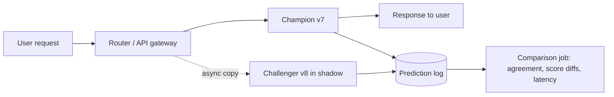
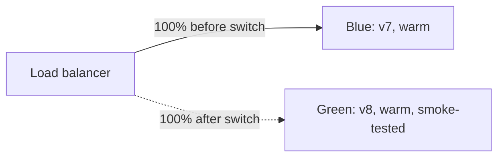
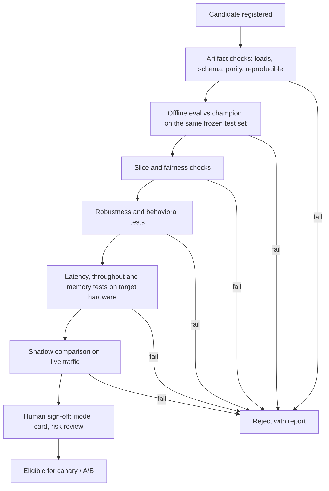
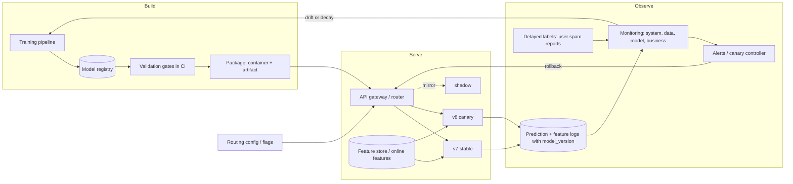

# Model Deployment Patterns: Batch, Online, Canary, Shadow and Rollback

> **Level:** Beginner to Advanced · **Study time:** ~130 min · **Prerequisites:** [The ML Lifecycle, MLOps and Experiment Tracking](./01-ml-lifecycle-and-experiment-tracking.md), [Data Versioning, Model Versioning and the Model Registry](./02-data-and-model-versioning-and-model-registry.md), [Reproducible Training and Training-Serving Skew](./03-reproducibility-and-training-serving-skew.md), [Probability and Statistics for Machine Learning](../00-foundations/04-probability-and-statistics.md)

## Table of contents

- [Why this matters](#why-this-matters)
- [From a trained model to predictions people use](#from-a-trained-model-to-predictions-people-use)
- [Inference modes: batch, online, streaming and edge](#inference-modes-batch-online-streaming-and-edge)
- [Packaging a model: artifacts, formats and containers](#packaging-a-model-artifacts-formats-and-containers)
- [Serving options: from FastAPI to model servers and managed endpoints](#serving-options-from-fastapi-to-model-servers-and-managed-endpoints)
- [Release strategies: an overview](#release-strategies-an-overview)
- [Shadow deployment](#shadow-deployment)
- [Canary releases, metric gates and automated rollback](#canary-releases-metric-gates-and-automated-rollback)
- [Blue-green deployment](#blue-green-deployment)
- [A/B testing with statistical significance](#ab-testing-with-statistical-significance)
- [Going deeper: bandits vs A/B tests](#going-deeper-bandits-vs-ab-tests)
- [Feature flags](#feature-flags)
- [Validating a candidate model before promotion](#validating-a-candidate-model-before-promotion)
- [Implementing rollback](#implementing-rollback)
- [Deploying and monitoring a production model end to end](#deploying-and-monitoring-a-production-model-end-to-end)
- [Going deeper: LLM-specific rollouts](#going-deeper-llm-specific-rollouts)
- [Going deeper: senior-level trade-offs and failure modes](#going-deeper-senior-level-trade-offs-and-failure-modes)
- [Common mistakes and misconceptions](#common-mistakes-and-misconceptions)
- [Interview questions and model answers](#interview-questions-and-model-answers)
- [Key takeaways](#key-takeaways)
- [Further reading](#further-reading)
- [Next](#next)

## Why this matters

A model that scores well in a notebook creates zero value until it serves predictions to real users, and the moment it does, it can also cause real damage: blocked legitimate emails, mispriced houses, or a chatbot that suddenly answers in the wrong tone. Many production ML incidents are caused not by bad math but by how a model was shipped: no comparison against the current model, no gradual rollout, no fast way back. Companies such as Google, Netflix, Uber and Meta have written extensively about canaries, shadow traffic and online experiments precisely because "deploy and pray" does not survive at scale. In a Senior AI/ML interview you will almost certainly be asked some version of "how do you deploy, validate, monitor and roll back a model?", and the interviewer is listening for a disciplined, risk-managed process, not a list of tool names.

## From a trained model to predictions people use

Let us start with the vocabulary, because interviewers notice when candidates mix these terms up.

> **Analogy:** Think of a restaurant introducing a new recipe. **Deploying** is getting the new dish into the kitchen: ingredients bought, cooks trained, the dish can be made. **Releasing** is putting it on the menu so customers actually receive it. A careful restaurant first gives the new dish to the staff (shadow), then to one table (canary), then to everyone.

- **Inference** (also called **prediction** or **serving**): running a trained model on new inputs to produce outputs. Training learns the weights; inference uses them.
- **Deployment**: putting a model version and its serving code onto infrastructure where it *can* receive traffic.
- **Release**: actually routing real user traffic to that deployed version. Separating the two is the single most important idea in this chapter: you can deploy at 10:00 and release gradually over a week.
- **Champion** (or **production model**): the model version currently serving users.
- **Challenger** (or **candidate model**): a new version that wants to replace the champion.
- **Promotion**: making the challenger the new champion.
- **Rollback**: returning traffic to the previous known-good version after a problem.
- **Model registry**: a catalog of model versions with metadata (metrics, lineage, approval status). Covered in detail in [Data Versioning, Model Versioning and the Model Registry](./02-data-and-model-versioning-and-model-registry.md).

We will reuse three running examples throughout:

1. **Spam filter**: a logistic regression or gradient-boosted classifier that scores each incoming email. Version 7 is the champion, version 8 is the challenger.
2. **House price model**: a regression model used by a real-estate site, scored nightly for all listings and on demand when a user edits a listing.
3. **Support assistant on a 7B LLM**: an open-weights 7-billion-parameter model behind a chat UI, where we change either the prompt or the model.

```mermaid
flowchart LR
    A[Train and evaluate] --> B[Register version in model registry]
    B --> C[Validate candidate: offline gates]
    C --> D[Package: artifact + container]
    D --> E[Deploy to infrastructure]
    E --> F[Shadow: mirror traffic, no user impact]
    F --> G[Canary: 1% then 5% then 25%]
    G --> H[Full release: 100%]
    H --> I[Monitor continuously]
    I -- regression detected --> J[Rollback to previous version]
    I -- drift or new data --> A
```



Everything in this chapter is a box or an arrow in that diagram.

## Inference modes: batch, online, streaming and edge

Before choosing tools or release strategies, decide *when* and *where* predictions are computed. This choice drives cost, latency and how releases work.

> **Analogy:** A bakery can bake all bread at 4 a.m. for the day (batch), bake to order when a customer walks in (online), bake continuously as orders flow in on a conveyor belt (streaming), or sell a bread machine so customers bake at home (edge).

### Batch inference

**Batch inference** (also **offline inference**) computes predictions for many inputs at once on a schedule (hourly, nightly) and stores them in a table or cache. Applications then *look up* the precomputed prediction.

- House prices: every night, score all 2 million listings and write `estimated_price` to the database.
- Use when inputs are known in advance, freshness of hours is acceptable, and you want cheap, high-throughput compute (often on spot instances, which are discounted cloud machines that can be reclaimed at short notice, or a Spark cluster).
- Downside: predictions can be stale, and you waste compute on items nobody looks at.

```python
# batch_score.py: nightly batch scoring for the house price model
# pip install pandas joblib scikit-learn pyarrow
import joblib
import pandas as pd

MODEL_URI = "models/house_price_v12.joblib"   # in practice: resolved from the registry

def score_in_chunks(input_path: str, output_path: str, chunk_size: int = 100_000) -> None:
    model = joblib.load(MODEL_URI)
    df = pd.read_parquet(input_path)
    results = []
    # Chunking bounds the memory of each predict call; the full table is still loaded,
    # so for inputs larger than RAM read row-group batches (pyarrow) or use Spark.
    for start in range(0, len(df), chunk_size):
        chunk = df.iloc[start:start + chunk_size]
        preds = model.predict(chunk[["sqft", "bedrooms", "age_years"]])
        results.append(pd.DataFrame({
            "listing_id": chunk["listing_id"].values,
            "estimated_price": preds,
            "model_version": "house_price_v12",          # always stamp the version
        }))
    pd.concat(results).to_parquet(output_path, index=False)

if __name__ == "__main__":
    score_in_chunks("listings_2026-10-23.parquet", "predictions_2026-10-23.parquet")
```

Notice the `model_version` column. Every prediction you store should say which model produced it, otherwise debugging and rollback become guesswork.

### Online (real-time) inference

**Online inference** (also **real-time inference**) computes a prediction on demand when a request arrives, typically through an HTTP or gRPC API, and returns it within a **latency budget** (the maximum time the caller can wait, for example 50 ms).

- Spam filter: each email must be scored as it arrives, before it lands in the inbox.
- House prices: a seller edits the square footage and wants an updated estimate instantly.
- Use when inputs are only known at request time or freshness matters.
- Downside: you pay for always-on capacity, must hit latency targets at **p95** or **p99** (the latency below which 95% or 99% of requests fall), and need to handle traffic spikes.

### Streaming inference

**Streaming inference** consumes events from a message log such as Kafka or Kinesis, scores each event (or small windows of events) as it flows through, and emits results to another stream. There is no user waiting on an HTTP response, but results are produced within seconds.

- Fraud detection that scores card transactions as events and raises alerts; see [System Design: A Classic ML System (Real-Time Fraud Detection)](../11-system-design/05-design-a-real-time-fraud-detection-system.md).
- Use when data arrives continuously, you need near-real-time results, and the consumer is another system rather than a person.
- Downside: operational complexity: event ordering, **exactly-once semantics** (each event affects the output once even after crashes and retries) and **backpressure** (slowing intake when the consumer falls behind).

### Edge (on-device) inference

**Edge inference** runs the model on the user's device (phone, browser, car, camera, factory gateway) rather than in your data center.

- A phone keyboard predicting the next word, a camera detecting defects on a production line with no reliable network, a small quantized LLM running locally.
- Use for privacy, offline operation, very low latency, or to avoid per-request server cost.
- Downside: limited memory and compute, so models usually need compression (see [Quantization Fundamentals](../07-model-compression/02-quantization-fundamentals-scale-and-zero-point.md) and [Knowledge Distillation Fundamentals](../07-model-compression/05-knowledge-distillation-fundamentals.md)); rollouts are slow because you depend on app updates; you have weak visibility into how the model behaves.

### Comparison

| Mode | What it is | Typical latency | When to use | Pros | Cons |
|---|---|---|---|---|---|
| Batch | Score many inputs on a schedule, store results | Minutes to hours (results are precomputed) | Nightly recommendations, price estimates, churn scores | Cheapest per prediction, simple, easy to validate before publishing | Stale; wastes compute on unused rows; cannot handle brand-new inputs |
| Online | Score per request via API | Milliseconds to a few seconds | Spam check, search ranking, chat assistant | Fresh, handles any input | Always-on cost, tail latency, scaling work |
| Streaming | Score events from a message log | Sub-second to seconds | Fraud alerts, IoT anomaly detection | Near-real-time without a user waiting | Hard to operate; ordering and state issues |
| Edge | Model runs on device | Very low, no network | Keyboards, offline vision, privacy-sensitive apps | Privacy, offline, no server cost | Tight resource limits, slow rollouts, little observability |

> **Senior insight:** Many real systems are hybrids. A recommender may precompute candidates in batch and re-rank them online. A house price site may serve the nightly batch value and recompute online only when a listing changes. In an interview, say "I would start with the simplest mode that meets the freshness requirement" and justify any move toward online or streaming.

The release strategies later in this chapter apply to all modes, but they look different. In batch you "canary" by scoring with both models and publishing the new one for a subset of rows. In online you split live requests. On edge you roll out to a percentage of devices through the app store or a remote config.

## Packaging a model: artifacts, formats and containers

A model in memory inside your training notebook is not deployable. You need to turn it into a portable, versioned **artifact** (a file or directory that contains the weights, plus everything needed to run it).

> **Analogy:** Packaging a model is like shipping furniture. You can ship it fully assembled in a truck (a full container image), flat-packed with instructions (an exchange format like ONNX), or as raw lumber plus a note saying "you know how to build this" (a pickle file that only works with the exact same code). The more self-contained the package, the fewer surprises at the destination.

### What an artifact must contain

A deployable model package should include:

1. **Weights** (the learned parameters).
2. **Preprocessing** logic: tokenizer, scaler, encoders, feature definitions. Forgetting this is a classic cause of training-serving skew; see [Reproducible Training and Training-Serving Skew](./03-reproducibility-and-training-serving-skew.md).
3. **Signature**: the input and output schema (names, types, shapes).
4. **Environment**: library versions (a lock file), Python version, hardware assumptions (CPU or GPU, CUDA version).
5. **Metadata**: version, training data snapshot, git commit, evaluation results, owner.

### Serialization formats

**Serialization** means converting an in-memory object into bytes on disk so it can be loaded elsewhere.

| Format | What it is | When to use | Pros | Cons |
|---|---|---|---|---|
| pickle / joblib | Python's native object serialization | scikit-learn and XGBoost models inside Python services | Trivial to use | Tied to exact library versions; loading an untrusted pickle can execute arbitrary code |
| safetensors | A simple, safe file format for tensors (popularized by Hugging Face) | Storing neural network weights, especially LLMs | Safe to load (no code execution), fast, memory-mappable | Stores tensors only, you still need the model code |
| ONNX | **Open Neural Network Exchange**: a framework-neutral graph format with standard operators | Cross-framework serving, CPU inference with ONNX Runtime, conversion to TensorRT | Portable, many optimized runtimes | Not every custom operator converts; must check numerical parity |
| TorchScript | Older PyTorch format that captures a model as a static graph via tracing or scripting | Legacy PyTorch deployments | Runs without Python source in C++ | In maintenance mode; PyTorch now recommends `torch.export` |
| `torch.export` | PyTorch 2.x API that captures a full graph as an `ExportedProgram` | New PyTorch deployments, input to compilers and runtimes | Sound graph capture, the forward-looking path | API still evolving; dynamic shapes need declaring |
| Framework-specific | TensorFlow SavedModel, XGBoost JSON, LightGBM text, GGUF for llama.cpp | When serving inside that ecosystem | Native and well supported | Lock-in to that ecosystem |

> **Common mistake:** Exporting to ONNX or another format and never checking that the exported model produces the same outputs as the original. Always run a **parity test**: same inputs through both, compare outputs within a tolerance.

Here is a small PyTorch house-price model exported to ONNX and `torch.export`, with a parity test. The `torch.onnx.export` options have changed across PyTorch 2.x releases (newer versions default to a different exporter and prefer `dynamic_shapes` over `dynamic_axes`), so treat the exact arguments as version-dependent. Note that `torch.export` specializes every dimension to the example input unless you declare it dynamic: without `dynamic_shapes`, the exported program below would reject the batch of 16 used in the parity test.

```python
# export_and_parity.py
# pip install torch onnx onnxscript onnxruntime numpy   (onnxscript: needed by the newer ONNX exporter)
import numpy as np
import torch
import onnxruntime as ort

torch.manual_seed(0)
# Tiny house-price regressor: 3 features (sqft, bedrooms, age) -> price
model = torch.nn.Sequential(
    torch.nn.Linear(3, 8), torch.nn.ReLU(), torch.nn.Linear(8, 1)
).eval()
example = torch.randn(4, 3)

# 1) ONNX export (arguments vary across PyTorch versions; check your version's docs)
torch.onnx.export(
    model, (example,), "house_price.onnx",
    input_names=["features"], output_names=["price"],
    dynamic_axes={"features": {0: "batch"}, "price": {0: "batch"}},
)

# 2) torch.export: capture the graph as an ExportedProgram and save it.
#    Declare the batch dimension dynamic ("input" is nn.Sequential's forward argument name).
batch = torch.export.Dim("batch")
exported = torch.export.export(model, (example,), dynamic_shapes={"input": {0: batch}})
torch.export.save(exported, "house_price.pt2")

# 3) Parity test: original vs ONNX Runtime vs reloaded ExportedProgram
x = torch.randn(16, 3)
with torch.no_grad():
    ref = model(x).numpy()

sess = ort.InferenceSession("house_price.onnx", providers=["CPUExecutionProvider"])
onnx_out = sess.run(None, {"features": x.numpy()})[0]

reloaded = torch.export.load("house_price.pt2").module()
with torch.no_grad():
    export_out = reloaded(x).numpy()

np.testing.assert_allclose(ref, onnx_out, rtol=1e-4, atol=1e-5)
np.testing.assert_allclose(ref, export_out, rtol=1e-4, atol=1e-5)
print("parity OK")
```

### Containers

A **container** is a lightweight, isolated package of an application plus its operating-system libraries and dependencies, built from a **container image** (typically with Docker). Containers solve "it works on my machine": the image that passed tests is byte-for-byte the image that runs in production, provided you deploy it by its immutable digest (`image@sha256:...`) rather than a tag that can be re-pushed.

A typical ML serving image contains:

```text
+--------------------------------------------------+
| Container image: spam-filter-server:v8           |
|  - Base OS + Python 3.11 (or CUDA base for GPU)  |
|  - Pinned dependencies (requirements lock file)  |
|  - Serving code (FastAPI app or model server)    |
|  - Model artifact baked in OR fetched at startup |
|    from the registry by version/alias            |
+--------------------------------------------------+
```

Two packaging styles:

| Style | What it is | Pros | Cons |
|---|---|---|---|
| Model baked into image | Weights copied into the image at build time | Fully immutable, one tag = one model; simple rollback (redeploy old image) | Large images for big models; rebuild for every model change |
| Model fetched at startup | Generic server image loads weights from registry or object storage by version | Small image, swap models without rebuilds, decouples code and model releases | Startup depends on storage; must pin exact versions to stay reproducible |

For LLMs with tens of gigabytes of weights, fetching at startup (often from a local cache or a shared volume) is the norm because baking 14 GB of weights into every image is slow to build and pull.

### Model servers

A **model server** is software specialized for serving models: it loads artifacts, exposes standard inference APIs, and handles performance features such as **dynamic batching** (grouping concurrent requests into one batch to use the hardware efficiently), multiple model versions, and metrics. You can write your own with a web framework or use a dedicated server. The next section compares options.

## Serving options: from FastAPI to model servers and managed endpoints

Tool names change every year; the categories do not. Learn the categories, then map tools onto them.

### Option 1: a custom web service (for example FastAPI)

**FastAPI** is a Python web framework for building HTTP APIs with type-checked request and response models. For a small scikit-learn or gradient-boosting model, a FastAPI service in a container is often the right answer.

```python
# serve.py: minimal online serving for the spam filter
# pip install fastapi uvicorn joblib scikit-learn pydantic
# run: uvicorn serve:app --host 0.0.0.0 --port 8000
from contextlib import asynccontextmanager
import os

import joblib
from fastapi import FastAPI, Response
from pydantic import BaseModel

MODEL_VERSION = os.environ.get("MODEL_VERSION", "spam-filter-v7")
STATE: dict = {}

@asynccontextmanager
async def lifespan(app: FastAPI):
    # Load once at startup, not per request (loading per request is a classic latency bug)
    STATE["model"] = joblib.load(f"/models/{MODEL_VERSION}.joblib")  # a Pipeline incl. vectorizer
    yield
    STATE.clear()

app = FastAPI(lifespan=lifespan)

class Email(BaseModel):
    subject: str
    body: str

class Verdict(BaseModel):
    spam_probability: float
    is_spam: bool
    model_version: str

@app.get("/healthz")           # liveness: the process is up
def healthz():
    return {"status": "ok"}

@app.get("/readyz")            # readiness: the model is loaded and can serve
def readyz(response: Response):
    ready = "model" in STATE
    if not ready:
        response.status_code = 503   # probes read the HTTP status code, not the body
    return {"ready": ready, "model_version": MODEL_VERSION}

@app.post("/predict", response_model=Verdict)
def predict(email: Email) -> Verdict:
    text = f"{email.subject}\n{email.body}"
    p = float(STATE["model"].predict_proba([text])[0, 1])
    return Verdict(spam_probability=p, is_spam=p >= 0.9, model_version=MODEL_VERSION)
```

Three habits shown here matter in every deployment: load the model once at startup, expose separate **liveness** and **readiness** probes (orchestrators such as Kubernetes only send traffic once readiness passes; see [Kubernetes in five minutes](#kubernetes-in-five-minutes-for-ml-engineers) below), and return the `model_version` with every response. Scaling such a service (workers, batching, autoscaling, backpressure) is covered in [Building a Scalable Inference API](./05-building-a-scalable-inference-api.md).

### Option 2: dedicated model servers and serving frameworks

| Option | What it is | When to use | Pros | Cons |
|---|---|---|---|---|
| FastAPI (custom) | Your own Python web service | Small models, custom logic, small teams | Full control, simple, easy to debug | You build batching, versioning, metrics yourself |
| NVIDIA Triton Inference Server | High-performance server supporting several backends (TensorRT, ONNX Runtime, PyTorch, TensorFlow, Python) | GPU serving of many models, high throughput | Dynamic batching, concurrent model execution, model repository with versions, ensembles | Steeper learning curve; config-heavy |
| KServe | Kubernetes-native serving layer defined by an `InferenceService` resource | Teams already on Kubernetes wanting a standard platform | Built-in canary traffic splitting, autoscaling (including scale to zero), pluggable runtimes | Requires Kubernetes expertise and its ecosystem |
| BentoML | Python-first framework that packages models plus code into deployable units and builds containers | Python teams wanting fast path from notebook to container | Good developer experience, adaptive batching, multi-model services | Another abstraction layer to learn |
| Ray Serve | Serving library on the Ray distributed runtime | Composing multiple models or steps in Python, scaling across a cluster | Python-native composition, autoscaling, fractional GPUs | Operating a Ray cluster adds complexity |
| LLM servers (vLLM, SGLang, TGI, TensorRT-LLM) | Servers specialized for autoregressive generation | Serving LLMs | Continuous batching, KV cache management | LLM-specific; see [LLM Serving Frameworks](../06-llm-inference/06-serving-frameworks-vllm-sglang-tgi-tensorrt-llm-and-ollama.md) |
| Managed cloud endpoints | A cloud provider hosts the model behind an endpoint (for example SageMaker, Vertex AI, Azure ML endpoints) | Teams wanting minimal infrastructure work | Autoscaling, traffic splitting between versions, monitoring hooks out of the box | Cost premium, less control, vendor lock-in; features differ by provider and change over time |
| Hosted model APIs | You call a provider's model (for example OpenAI or Google Gemini APIs) | LLM features without hosting weights | No infrastructure; access to frontier models | You do not control model updates; per-token cost; data governance |

> **Interview tip:** When asked "which serving stack would you use?", answer with requirements first: model type and size, latency target, throughput, team skills, existing platform (is the company on Kubernetes?), and cost. Then pick. "FastAPI in a container behind a load balancer" is a perfectly senior answer for a 20 MB gradient-boosted model at 200 requests per second.

### Kubernetes in five minutes (for ML engineers)

Containers package one server; something still has to decide which machine runs each container, restart it when it crashes, route traffic to it and add copies under load. At most companies that something is **Kubernetes** (often written **K8s**), an open-source **container orchestrator**. You describe the **desired state** in YAML ("two replicas of this image, one GPU each, reachable under this name"), and Kubernetes keeps comparing the real cluster with that description and correcting the difference. The autoscaling, cold-start and GPU-scheduling discussions in this course and in interviews assume the vocabulary below.

> **Analogy:** Kubernetes is a thermostat for software. You set the target ("2 healthy replicas"), and a control loop keeps measuring and correcting. You do not start or stop containers yourself; you change the target.

```text
 clients
    |
    v
 Ingress or cloud load balancer    HTTP routing and TLS at the edge of the cluster
    |
    v
 Service "chat-llm"                stable name; forwards only to READY pods
    |
    +-------------------------------+
    |                               |
+---|-------------------------------|-----------------------------+
|   v                               v                             |
|  Node 1: VM with 1 GPU           Node 2: VM with 1 GPU          |
|  [Pod: chat-llm replica 1]       [Pod: chat-llm replica 2]      |
|  GPU node pool (tainted: only pods that tolerate it land here)  |
+-----------------------------------------------------------------+
+-----------------------------------------------------------------+
|  [Pod: Prometheus]   [Pod: log shipper]   [Pod: web frontend]   |
|  CPU node pool (cheaper VMs)                                    |
+-----------------------------------------------------------------+

 Deployment "chat-llm"     pod template + replica count; replaces dead pods, rolls out images
 HorizontalPodAutoscaler   sets the replica count from a metric (queue depth, KV-cache usage)
 Cluster autoscaler        adds GPU nodes when pods are Pending; removes idle nodes
```

**Where things run**

- **Cluster**: a set of machines managed together, plus the **control plane**: the API server that stores the desired state, the **scheduler** that decides which machine each pod runs on, and **controllers** that keep correcting reality toward the desired state.
- **Node**: one machine in the cluster, usually a cloud VM. An agent on each node, the **kubelet**, starts containers and runs their health probes.
- **Node pool** (a "node group" on some clouds): a set of identical nodes that scales as a unit, for example a cheap CPU pool for web services and monitoring, and a GPU pool of A100 or H100 VMs.
- **Taints and tolerations**: a **taint** on a node repels pods; only pods with a matching **toleration** may be scheduled there. Tainting the GPU pool (for example `nvidia.com/gpu=present:NoSchedule`; some managed clouds add such a taint automatically) stops a log shipper from occupying a machine that costs several dollars an hour. A toleration only *permits* a pod onto those nodes; what *places* it there is requesting a GPU (only GPU nodes advertise one) or a node selector.

**What runs**

- **Pod**: the smallest unit Kubernetes schedules: one or more containers that share a network address and storage volumes and always run together on one node. A model server replica is usually one pod. Pods are disposable: a dead pod is replaced by a new one with a new IP address, never repaired.
- **Deployment**: a pod template (image, arguments, resources, probes) plus a replica count; it keeps that many pods running. Changing the template, for example to a new image digest, triggers a **rolling update**: new pods start and old ones stop in small steps, bounded by `maxSurge` (extra pods allowed above the replica count) and `maxUnavailable` (pods allowed to be missing). `kubectl rollout undo` goes back to the previous template. A rolling update only waits for probes, never for model metrics, which is why model releases use canary controllers such as Argo Rollouts or Flagger instead (see the [canary section](#canary-releases-metric-gates-and-automated-rollback)).

**How traffic reaches it**

- **Service**: a stable virtual IP and DNS name in front of a changing set of pods selected by label. It forwards only to pods whose readiness probe passes. The default implementation balances per connection, not per request, and knows nothing about queue depth or KV cache, which is why LLM platforms add smarter routers (see [Load balancing](./05-building-a-scalable-inference-api.md#load-balancing)).
- **Ingress** (and its successor, the **Gateway API**): rules that route HTTP traffic from outside the cluster (by hostname and path, with TLS) to Services, implemented by an ingress or gateway controller that is often backed by a cloud load balancer. A Service of type `LoadBalancer` is the simpler way to give one Service an external address.

**Resources: requests, limits and GPUs**

- A **request** is what the scheduler reserves: a pod is placed only on a node with that much unreserved CPU, memory or GPU. A **limit** is the ceiling enforced at run time: a container that exceeds its CPU limit is throttled, and one that exceeds its memory limit is killed (`OOMKilled`).
- GPUs are an **extended resource** named `nvidia.com/gpu`, advertised by the NVIDIA **device plugin** (often installed by the NVIDIA GPU Operator, which also manages drivers). They come in whole units, cannot be overcommitted, and are set under `limits` (a request, if given, must equal the limit). Unless GPU sharing is configured (see below), a pod with `nvidia.com/gpu: 1` gets one physical GPU to itself.

**Probes: liveness, readiness and startup**

| Probe | Question it answers | On failure | Model-serving use |
|---|---|---|---|
| Liveness | Is the process hung? | The kubelet restarts the container | Catch a deadlocked server; use generous timeouts so a merely busy server is not killed |
| Readiness | Can this pod take traffic right now? | The pod is removed from the Service's endpoints (no restart) | Pass only after weights are loaded and the engine is warm; fail while draining |
| Startup | Has the application finished starting? | Liveness and readiness checks wait until it succeeds; if it keeps failing past its budget, the container is restarted | Give model loading (minutes for an LLM) its own long budget |

Why the startup probe matters for models: a 7B server may need a few minutes (say 4, illustrative) to fetch 14 GB of weights, copy them to the GPU and capture CUDA graphs. A liveness probe that checks every 10 seconds and tolerates 3 failures gives up after about 30 seconds and restarts the container, which starts loading from scratch and is killed again; the pod ends up in `CrashLoopBackOff` and never serves. A startup probe with `periodSeconds: 10` and `failureThreshold: 60` allows $60 \times 10 = 600$ seconds (10 minutes) to come up, after which the fast liveness and readiness probes take over.

A minimal GPU model server (an OpenAI-compatible LLM server exposing `/health`, like vLLM) as a Deployment and a Service:

```yaml
# chat-llm.yaml: one GPU model server behind a Service (illustrative; adapt names and values)
apiVersion: apps/v1
kind: Deployment
metadata:
  name: chat-llm
spec:
  replicas: 2
  selector:
    matchLabels: {app: chat-llm}
  strategy:
    rollingUpdate: {maxSurge: 1, maxUnavailable: 0}   # needs one spare GPU during a rollout
  template:
    metadata:
      labels: {app: chat-llm}
    spec:
      tolerations:                                    # allowed onto the tainted GPU pool
        - {key: nvidia.com/gpu, operator: Exists, effect: NoSchedule}
      containers:
        - name: server
          image: registry.example.com/llm-server@sha256:<digest>   # pin by digest
          args: ["--model", "/models/support-7b-v3", "--port", "8000"]  # weights volume omitted
          ports:
            - containerPort: 8000
          resources:
            requests: {cpu: "4", memory: 32Gi}
            limits: {memory: 32Gi, nvidia.com/gpu: 1}  # whole GPUs, set under limits
          startupProbe:                                # up to 60 x 10 s = 10 min to load weights
            httpGet: {path: /health, port: 8000}
            periodSeconds: 10
            failureThreshold: 60
          readinessProbe:                              # Service sends traffic only while this passes
            httpGet: {path: /health, port: 8000}
            periodSeconds: 5
            failureThreshold: 2
          livenessProbe:                               # restart only a hung server, not a busy one
            httpGet: {path: /health, port: 8000}
            periodSeconds: 15
            timeoutSeconds: 5
            failureThreshold: 4
---
apiVersion: v1
kind: Service
metadata:
  name: chat-llm
spec:
  selector: {app: chat-llm}
  ports:
    - {port: 80, targetPort: 8000}
```

With scarce GPUs, `maxSurge: 1` can stall a rollout because the extra pod has nowhere to run; the alternative, `maxSurge: 0` with `maxUnavailable: 1`, replaces pods in place and accepts a temporary dip in capacity.

**Autoscaling: pods first, then nodes**

- The **HorizontalPodAutoscaler (HPA)** periodically sets a Deployment's replica count from a metric, using $\lceil \text{current replicas} \times \text{current metric} / \text{target} \rceil$ (worked through in [Autoscaling and cold starts](./05-building-a-scalable-inference-api.md#autoscaling-and-cold-starts)). Out of the box it scales on CPU and memory, which is the wrong signal for a GPU server: the CPU idles while the GPU is saturated. Scale on **custom metrics** instead: requests waiting in the engine's queue (vLLM exports `vllm:num_requests_waiting`), KV-cache utilization, or in-flight requests per replica. Exact metric names vary by engine and version. Two common ways to feed them to the HPA:
  - **Prometheus Adapter**: Prometheus scrapes each pod's `/metrics` endpoint, and the adapter republishes chosen series through the Kubernetes custom metrics API, where the HPA reads them.
  - **KEDA** (Kubernetes Event-Driven Autoscaling): you declare a `ScaledObject` with a trigger such as a Prometheus query or a Kafka or SQS queue length; KEDA creates and drives the HPA for you and can also scale to and from zero (fine for batch workers, painful for interactive LLMs).
- The **cluster autoscaler** (or Karpenter) handles nodes. The HPA only raises the replica count, so more pods are created; if no node has a free GPU, they stay `Pending`. The cluster autoscaler notices unschedulable pods and adds nodes to a matching node pool, and removes nodes that stay underused. GPU nodes are slow: provisioning the VM, loading drivers, pulling a multi-GB image and loading weights often adds up to 5 to 15 minutes (a rough, illustrative range; measure your own), and a cloud region may have no GPUs to give you at all.

```yaml
# HPA on queue depth, read through Prometheus Adapter (metric name depends on your adapter rules)
apiVersion: autoscaling/v2
kind: HorizontalPodAutoscaler
metadata:
  name: chat-llm
spec:
  scaleTargetRef: {apiVersion: apps/v1, kind: Deployment, name: chat-llm}
  minReplicas: 2                                    # keep warm capacity; never zero for chat
  maxReplicas: 16
  metrics:
    - type: Pods
      pods:
        metric: {name: vllm_num_requests_waiting}
        target: {type: AverageValue, averageValue: "4"}
  behavior:
    scaleDown: {stabilizationWindowSeconds: 900}     # scale down slowly: a cold start costs minutes
```

**Worked example.** The Deployment above runs 2 replicas, each on its own 1-GPU node, and the HPA targets an average of 4 waiting requests per pod. A morning spike pushes the average to 10, so the HPA asks for $\lceil 2 \times 10 / 4 \rceil = \lceil 5 \rceil = 5$ replicas. Three new pods are created but stay `Pending` because both GPU nodes are full. The cluster autoscaler requests three GPU VMs, and the new pods start serving only after node provisioning, image pull, weight loading and the startup probe, typically several minutes later. Until then the request queue and any warm headroom must absorb the spike, which is why teams keep minimum replicas, pre-pull images, cache weights on local disk, and run low-priority **placeholder pods** that hold spare GPU nodes and are evicted the moment a real replica needs the space.

**Sharing one GPU among small models**

A small embedding model or classifier wastes most of an 80 GB GPU if each pod gets a whole one. Two common options:

- **MIG (Multi-Instance GPU)**: on supported data-center GPUs such as the A100 and H100, the hardware splits one GPU into up to seven isolated instances, each with its own memory and compute slice. The device plugin exposes them as resources such as `nvidia.com/mig-1g.10gb` (names depend on the GPU model and plugin configuration). Strong isolation and predictable latency, but partition sizes are fixed and configured per node.
- **Time-slicing**: the device plugin advertises one GPU as several (for example 4), and the pods take turns on it. Easy and needs no special hardware support, but there is no memory or fault isolation: one pod can exhaust the memory the others need, and latency gets noisy. Fine for development and low-traffic models.

> **Senior insight:** Higher-level platforms (KServe, Ray clusters via KubeRay, llm-d) generate these objects for you, but debugging still comes down to them. `Pending` with "Insufficient nvidia.com/gpu" is a capacity problem, `CrashLoopBackOff` during model load is usually a probe budget problem, and `OOMKilled` means a memory limit below what loading needs. Liveness should detect only what a restart fixes; a liveness probe that times out under load turns a traffic spike into a wave of cold starts.

## Release strategies: an overview

Now the heart of the chapter. A **release strategy** decides how traffic moves from the champion to the challenger. They differ in what they protect you from and in their **blast radius**: how many users a bad version can hurt before you notice and react.

| Strategy | What it is | Users see new model? | Main question answered | Pros | Cons |
|---|---|---|---|---|---|
| Big bang (recreate) | Replace old with new all at once | 100% immediately | None, you hope | Simplest | Maximum blast radius, often downtime |
| Shadow | New model gets a copy of live traffic; its outputs are logged, not used | No | "Does it work on real traffic and how do outputs differ?" | Zero user risk, real inputs | Costs extra compute; cannot measure user-facing outcomes |
| Canary | Small, growing % of real traffic goes to the new model with automatic checks | Yes, a small slice | "Is it safe (errors, latency, obvious quality)?" | Limits blast radius, automated rollback | Small samples make subtle regressions hard to see |
| Blue-green | Two full environments; switch all traffic from blue to green at once | Yes, all at switch time | "Can I switch and switch back instantly?" | Instant cutover and rollback | Double capacity during the switch; still all-at-once exposure |
| A/B test | Split users randomly between versions for a fixed duration and compare outcome metrics statistically | Yes, typically 50/50 or similar | "Is it *better* for the business?" | Causal evidence of impact | Needs lots of traffic and time; statistical pitfalls |
| Feature flag | Runtime switch that chooses behavior per user or segment without redeploying | Depends on targeting | "Who should get it, and can I turn it off instantly?" | Decouples release from deploy; kill switch | Flag debt; combinatorial complexity |
| Interleaving (ranking) | Mix results from two rankers in one list and see which items users choose | Yes | "Which ranker do users prefer?" | Far more sensitive than A/B for ranking | Only for ranking and recommendation |

These are not mutually exclusive. A mature rollout typically chains them: **offline validation, then shadow, then canary, then A/B test (if a business metric must be proven), then full release, all behind a flag with a pre-tested rollback.**

```text
 Risk to users:   none ---------> small ---------> measured -------> full
                  [shadow]        [canary 1-25%]   [A/B 50/50]       [100%]
 What you learn:  correctness,    safety:          causal impact     ongoing
                  output diffs,   errors, latency, on business       monitoring
                  latency         quality guards   metrics
```

## Shadow deployment

> **Analogy:** A trainee pilot sits in the cockpit with a disconnected set of controls. They "fly" every real flight, and an instructor compares their inputs to the captain's afterward. Passengers are never affected.

**Shadow deployment** (also **shadow mode**, **dark launch** or **traffic mirroring**) sends a copy of each production request to the challenger. The champion's response is returned to the user; the challenger's response is only logged for comparison.



What you measure in shadow:

- **Operational health**: errors, timeouts, p95/p99 latency, memory, CPU/GPU utilization under real load.
- **Prediction agreement**: how often v7 and v8 make the same decision; distribution of score differences.
- **Disagreement analysis**: sample the cases where they disagree and inspect them (or label them). This is where you discover that v8 flags every email containing a URL shortener.
- **Delayed-label accuracy**: when ground truth arrives later (a user marks an email as spam), compute both models' accuracy on the same requests.

A minimal shadow implementation in FastAPI uses a background task so the user never waits for the challenger:

```python
# shadow.py: champion answers, challenger runs after the response is sent
# pip install fastapi uvicorn joblib scikit-learn
import json, logging, time
import joblib
from fastapi import BackgroundTasks, FastAPI
from pydantic import BaseModel

log = logging.getLogger("shadow")
champion = joblib.load("/models/spam-filter-v7.joblib")
challenger = joblib.load("/models/spam-filter-v8.joblib")
app = FastAPI()

class Email(BaseModel):
    request_id: str
    text: str

def run_shadow(req: Email, champion_p: float) -> None:
    try:
        t0 = time.perf_counter()
        shadow_p = float(challenger.predict_proba([req.text])[0, 1])
        latency_ms = (time.perf_counter() - t0) * 1000
        log.info(json.dumps({
            "request_id": req.request_id, "champion_p": champion_p,
            "shadow_p": shadow_p, "shadow_latency_ms": round(latency_ms, 2),
            "agree": (champion_p >= 0.9) == (shadow_p >= 0.9),
        }))
    except Exception:                       # shadow failures must never affect users
        log.exception("shadow failure for %s", req.request_id)

@app.post("/predict")
def predict(req: Email, background: BackgroundTasks):
    p = float(champion.predict_proba([req.text])[0, 1])
    background.add_task(run_shadow, req, p)   # runs after the response is returned
    return {"spam_probability": p, "model_version": "v7"}
```

> **Senior insight:** In-process shadowing (as above) is fine for small models, but it competes for the same CPU and can slow the champion. At scale, mirror traffic at the API gateway or **service mesh** layer (a layer of network proxies, such as Istio, that routes traffic between services; many such proxies support request mirroring), or replay logged requests against the challenger offline. For expensive models such as LLMs, shadow a *sample* (say 5%) rather than 100% to control cost.

Shadow pitfalls:

- **Side effects**: the shadow model must never send emails, write to the production database, charge cards, or call tools with real effects. For agents, stub all write-capable tools.
- **No feedback loop**: shadow cannot measure how users *react* to the new model (click-through, complaints), because users never see its outputs.
- **Capacity**: shadowing 100% of traffic doubles inference cost for the shadow period.

## Canary releases, metric gates and automated rollback

> **Analogy:** Coal miners once carried canaries into mines. If toxic gas was present, the canary showed distress first and the miners got out. A canary release exposes a small slice of real traffic first so a bad version "shows distress" before it reaches everyone.

A **canary release** routes a small percentage of live traffic to the new version, watches health and quality metrics, and either increases the percentage step by step or rolls back automatically.

### Traffic percentages and steps

A typical schedule (illustrative; tune it to your traffic and risk):

```text
step  traffic to v8   minimum bake time   gate checked before next step
 1         1%            30 min           errors, latency, crash loops
 2         5%            1 hour           + prediction distribution, business guardrails
 3        25%            4 hours          + segment-level checks
 4        50%            24 hours         + daily-cycle effects
 5       100%            (done)           v7 kept warm for fast rollback
```

**Bake time** is how long the canary must run at a step before the gate is evaluated. It must be long enough to collect a meaningful number of requests and to cover periodic effects (peak hours, nightly jobs).

### How traffic is split: random vs sticky routing

- **Per-request random routing**: each request independently goes to v8 with probability $p$. Simple, but one user may bounce between versions, which feels inconsistent (an email marked spam on one refresh and not on the next).
- **Sticky (consistent) routing**: hash a stable key such as `user_id` into one of 100 buckets and send buckets $0$ to $k-1$ to the canary. The same user always gets the same version, and increasing $k$ only *adds* users to the canary.

The bucket rule is:

$$
\text{bucket}(u) = H(\text{salt} \,\|\, u) \bmod 100, \qquad \text{route}(u) = \begin{cases} \text{canary} & \text{if bucket}(u) < k \\ \text{champion} & \text{otherwise} \end{cases}
$$

- $u$: the stable routing key (user ID, account ID, or session ID).
- $H$: a hash function that spreads keys uniformly (for example SHA-256 interpreted as an integer).
- $\text{salt}$: a string specific to this rollout, so different experiments get independent bucket assignments.
- $\|$: string concatenation (the code below inserts a `:` separator, so the hashed string looks like `"spam-v8:alice"`).
- $\bmod 100$: the remainder after dividing by 100, giving a bucket from 0 to 99.
- $k$: the canary percentage (for example $k = 5$ means 5%).

Tiny example: suppose the hash of `"spam-v8:alice"` is the integer 1,234,567. Then $1{,}234{,}567 \bmod 100 = 67$ (because $1{,}234{,}567 = 12{,}345 \times 100 + 67$). With $k=5$, bucket 67 is not below 5, so Alice stays on v7. When we raise $k$ to 75, Alice joins the canary, and every user who was already in the canary at $k=5$ stays in it.

```python
# router.py: sticky, config-driven canary routing
import hashlib

def bucket(key: str, salt: str) -> int:
    digest = hashlib.sha256(f"{salt}:{key}".encode()).hexdigest()
    return int(digest[:8], 16) % 100          # first 32 bits -> 0..99

def choose_version(user_id: str, config: dict) -> str:
    """config comes from a config service or flag system, not hard-coded."""
    if bucket(user_id, config["salt"]) < config["canary_percent"]:
        return config["canary_version"]
    return config["stable_version"]

config = {"salt": "spam-v8", "stable_version": "v7",
          "canary_version": "v8", "canary_percent": 5}
counts = {"v7": 0, "v8": 0}
for i in range(100_000):
    counts[choose_version(f"user-{i}", config)] += 1
print(counts)   # roughly 95% v7 and 5% v8; exact numbers depend on the hashes
```

### Metric gates

A **metric gate** is an automated pass/fail rule evaluated at each step. Gates fall into layers:

| Gate layer | Example metrics | Example rule (illustrative) |
|---|---|---|
| System health | HTTP 5xx rate, timeouts, crashes, restarts | Canary 5xx rate not significantly higher than stable, and below 0.5% absolute |
| Latency and resources | p50, p95, p99 latency; memory; GPU utilization | Canary p99 at most 10% above stable |
| Prediction sanity | Score distribution, positive rate, null outputs | Spam positive rate within 20% relative of stable |
| Quality proxies | Agreement with champion, user overrides ("not spam" clicks), thumbs-down rate | Override rate not significantly higher |
| Business guardrails | Conversion, revenue per session, complaint rate | No significant drop |

A key design choice: compare the canary to the **stable version running at the same time**, not to last week's numbers. Both see the same traffic mix, time of day and upstream incidents, so the comparison isolates the effect of the model. Tools such as Argo Rollouts, Flagger and Spinnaker's Kayenta support this "canary analysis" pattern (with Argo Rollouts and Flagger, whether the comparison is against concurrent stable traffic depends on the metric queries you write). A refinement used with Kayenta: compare the canary against a freshly deployed **baseline** of the old version of the same size, so both sides have equally cold caches and similar replica counts.

### Worked example: is the canary's error rate really worse?

Illustrative numbers: total traffic is 200 requests per second, the canary gets 5%, so 10 requests per second. After 30 minutes the canary has served $10 \times 1800 = 18{,}000$ requests. To keep the arithmetic simple, we take a same-sized random sample of 18,000 stable requests from the same period (the test works with unequal group sizes too, and using all stable requests gives slightly more power).

- Stable: 90 errors out of 18,000, so $90 / 18{,}000 = 0.005 = 0.5\%$.
- Canary: 180 errors out of 18,000, so $180 / 18{,}000 = 0.01 = 1.0\%$.

Is the difference real or noise? Use a two-proportion z-test (explained fully in the [A/B testing section](#ab-testing-with-statistical-significance)):

1. Pooled error rate: $\hat p = (90 + 180) / (18{,}000 + 18{,}000) = 270 / 36{,}000 = 0.0075$.
2. Standard error: $\sqrt{0.0075 \times 0.9925 \times (1/18{,}000 + 1/18{,}000)}$. First $0.0075 \times 0.9925 = 0.00744375$. Then $1/18{,}000 + 1/18{,}000 = 0.000111111$. Product: $0.00744375 \times 0.000111111 = 0.000000827083$. Square root: $\approx 0.000909$.
3. z-score: $(0.010 - 0.005) / 0.000909 \approx 5.50$.

A z of 5.5 is far beyond the usual threshold of about 2 (or about 3 for a stricter alarm), so the gate fails and the canary rolls back. Note how *time* buys statistical power: after only 3 minutes we would have had 1,800 canary requests, with about 9 vs 18 expected errors, and the same rates would give only $z \approx 5.5/\sqrt{10} \approx 1.74$ (z scales with the square root of the sample size), which would cross neither threshold.

> **Senior insight:** For catastrophic signals (crash loops, 100% errors, out-of-memory), do not wait for statistics: use hard thresholds that trigger immediate rollback. Use statistical comparison for subtle signals. And because you check gates repeatedly at each step, use conservative thresholds or **sequential tests** (tests designed to stay valid when checked repeatedly; see "peeking" in the A/B section) to avoid false alarms from repeated looks.

### Automated rollback

Automated rollback means the controller, not a human at 3 a.m., moves traffic back to the stable version when a gate fails.

```python
# canary_controller.py: the decision logic behind an automated canary
from dataclasses import dataclass
from math import sqrt

@dataclass
class Stats:
    requests: int
    errors: int
    p99_ms: float

def z_two_proportions(x1: int, n1: int, x2: int, n2: int) -> float:
    p_pool = (x1 + x2) / (n1 + n2)
    se = sqrt(p_pool * (1 - p_pool) * (1 / n1 + 1 / n2))
    return 0.0 if se == 0 else (x2 / n2 - x1 / n1) / se

def evaluate_step(stable: Stats, canary: Stats, min_requests: int = 5_000) -> str:
    """Returns 'rollback', 'wait' or 'promote_step'."""
    # Hard guardrails first: catastrophic failures roll back immediately
    if canary.requests > 100 and canary.errors / canary.requests > 0.05:
        return "rollback"
    if canary.requests < min_requests:
        return "wait"                                   # not enough evidence yet
    if z_two_proportions(stable.errors, stable.requests,
                         canary.errors, canary.requests) > 3.0:
        return "rollback"                               # significantly more errors
    if canary.p99_ms > 1.10 * stable.p99_ms:
        return "rollback"                               # latency regression > 10%
    return "promote_step"

print(evaluate_step(Stats(18_000, 90, 120.0), Stats(18_000, 180, 125.0)))  # rollback
```

In Kubernetes environments you usually express the steps declaratively and let a rollout controller run them. An Argo Rollouts-style canary looks like this (illustrative, check your controller's schema):

```yaml
strategy:
  canary:
    steps:
      - setWeight: 5
      - pause: {duration: 30m}
      - analysis:
          templates:
            - templateName: error-rate-and-latency   # queries metrics, fails -> abort
      - setWeight: 25
      - pause: {duration: 4h}
      - setWeight: 50
      - pause: {duration: 24h}
```

KServe offers a similar idea directly on a model resource through a `canaryTrafficPercent` field, and managed cloud endpoints typically let you assign traffic weights to deployed model versions.

## Blue-green deployment

> **Analogy:** A theater has two identical stages. The current show runs on the blue stage while the crew fully builds the next show on the green stage. At curtain time they rotate the audience to green. If green's set collapses, they rotate back to blue.

**Blue-green deployment** keeps two complete production environments. **Blue** serves all traffic; **green** gets the new version, is warmed up and tested with synthetic or mirrored traffic, then a router (load balancer, DNS, or service selector) switches 100% of traffic to green. Blue stays up, idle but warm, for instant rollback.



| Aspect | Blue-green | Canary |
|---|---|---|
| Exposure | All users at once at switch time | Gradual |
| Rollback speed | Instant (flip router back) | Fast (set weight to 0) |
| Capacity needed | 2x during the switch window | 1x plus the canary slice |
| Detects subtle issues | Poorly (no gradual comparison) | Better (side-by-side metrics) |
| Best for | Infrastructure changes, schema-compatible upgrades, when mixed versions cannot coexist | Model changes where you want evidence before full exposure |

> **Senior insight:** For a 7B LLM in FP16 the weights alone take about 14 GB ($7 \times 10^9$ parameters $\times$ 2 bytes), plus KV cache memory (cached attention keys and values for in-flight requests; see [The KV Cache](../06-llm-inference/02-kv-cache-explained.md)). Blue-green means provisioning a second full fleet of GPUs during the switch, which can be expensive or simply unavailable. Canary with gradual scale-up of the new fleet and scale-down of the old one is often more practical for large GPU models.

Blue-green is also useful when two versions cannot safely run at the same time, for example when the new model requires a new feature store schema that the old model cannot read. More on that in the [senior section](#going-deeper-senior-level-trade-offs-and-failure-modes).

## A/B testing with statistical significance

Canaries answer "is it safe?". **A/B tests** answer "is it better?". They randomly assign users to the control (A, champion) or the treatment (B, challenger), keep the split fixed for a pre-planned duration, and compare an outcome metric with a statistical test.

> **Analogy:** A clinical trial. You do not just give the new drug to a few patients and see if they feel fine (that is a canary for side effects). You randomize many patients, decide in advance how many you need, and only then compare outcomes.

### Why offline metrics are not enough

The spam filter v8 may have a higher AUC offline (area under the ROC curve, a threshold-free measure of how well scores rank positives above negatives), but users care about a different thing: fewer missed spam emails *and* fewer real emails in the spam folder. A recommender with better offline accuracy can reduce engagement because it recommends "obvious" items. Only an online experiment measures the real causal effect on user behavior.

### Choosing metrics

- **Primary metric** (also **overall evaluation criterion**): the one metric that decides the test. For the spam filter: rate of "not spam" rescues per 1,000 emails (lower is better), or for a shop, conversion rate.
- **Guardrail metrics**: metrics that must not get worse even if the primary improves: latency, error rate, unsubscribe rate, revenue.
- **Unit of randomization**: usually the user, so each user has a consistent experience. Sticky hashing from the canary section works here too.

### The two-proportion z-test

Suppose the metric is a proportion (conversion rate, click rate). We test whether B's rate differs from A's.

$$
z = \frac{\hat p_B - \hat p_A}{\sqrt{\hat p (1 - \hat p)\left(\frac{1}{n_A} + \frac{1}{n_B}\right)}}, \qquad \hat p = \frac{x_A + x_B}{n_A + n_B}
$$

- $x_A, x_B$: number of successes (for example conversions) in groups A and B.
- $n_A, n_B$: number of users in each group.
- $\hat p_A = x_A / n_A$ and $\hat p_B = x_B / n_B$: observed rates.
- $\hat p$: the **pooled** rate, our best estimate of the common rate if there were no difference (the **null hypothesis**).
- The denominator is the **standard error** of the difference: how much the difference would bounce around by chance alone.
- $z$: how many standard errors the observed difference is from zero.

The **p-value** is the probability of seeing a difference at least this large if there were truly no effect. We call a result **statistically significant** if the p-value is below a pre-chosen **significance level** $\alpha$ (often 0.05). For a two-sided test at $\alpha = 0.05$, that means $|z| > 1.96$. Refresh these ideas in [Probability and Statistics for Machine Learning](../00-foundations/04-probability-and-statistics.md).

**Worked example (illustrative numbers).** A shop tests a new recommendation model.

- A (v7): $n_A = 10{,}000$ users, $x_A = 500$ purchases, so $\hat p_A = 500/10{,}000 = 0.050$.
- B (v8): $n_B = 10{,}000$ users, $x_B = 560$ purchases, so $\hat p_B = 560/10{,}000 = 0.056$.

Step by step:

1. Pooled rate: $\hat p = (500 + 560) / 20{,}000 = 1{,}060 / 20{,}000 = 0.053$.
2. $\hat p (1 - \hat p) = 0.053 \times 0.947 = 0.050191$.
3. $1/n_A + 1/n_B = 0.0001 + 0.0001 = 0.0002$.
4. Product: $0.050191 \times 0.0002 = 0.0000100382$.
5. Standard error: $\sqrt{0.0000100382} \approx 0.003168$.
6. Difference: $0.056 - 0.050 = 0.006$.
7. $z = 0.006 / 0.003168 \approx 1.894$.

Since $1.894 < 1.96$, the two-sided p-value is about 0.058, which is above 0.05. **Not significant.** A 12% relative lift ($0.006/0.050 = 0.12$) looks impressive, but with this sample size it could plausibly be noise.

### How many users do you need? (power and sample size)

**Statistical power** is the probability of detecting an effect of a given size if it really exists (commonly 80%). The **minimum detectable effect (MDE)** is the smallest effect you care to detect. A standard approximation for the users needed *per group* is:

$$
n \approx \frac{\left(z_{1-\alpha/2} + z_{1-\beta}\right)^2 \left[p_A(1-p_A) + p_B(1-p_B)\right]}{(p_B - p_A)^2}
$$

- $z_{1-\alpha/2}$: the z value for the significance level; $1.96$ for $\alpha = 0.05$ two-sided.
- $z_{1-\beta}$: the z value for the power; $0.8416$ for 80% power ($\beta = 0.2$ is the chance of missing a real effect).
- $p_A$: baseline rate; $p_B$: the rate you hope to detect.

**Worked example.** Detect a lift from 5.0% to 5.6%:

1. $(1.96 + 0.8416)^2 = 2.8016^2 \approx 7.849$.
2. $p_A(1-p_A) = 0.05 \times 0.95 = 0.0475$.
3. $p_B(1-p_B) = 0.056 \times 0.944 = 0.052864$.
4. Sum: $0.0475 + 0.052864 = 0.100364$.
5. Numerator: $7.849 \times 0.100364 \approx 0.78776$.
6. Denominator: $0.006^2 = 0.000036$.
7. $n \approx 0.78776 / 0.000036 \approx 21{,}882$ users **per group**.

So our 10,000-per-group test was underpowered for a 0.6 percentage-point effect: at 10,000 per group its power was only about 47%, roughly a coin flip. That explains the inconclusive result. The right move is to compute the sample size *before* launch and run to that planned horizon (about 21,900 per group), not to declare victory or defeat at 10,000. Extending a test only because the result came out close is itself a form of peeking unless you use a sequential design built for it.

```python
# ab_test.py
# pip install scipy statsmodels
from math import sqrt
from scipy.stats import norm
from statsmodels.stats.proportion import proportions_ztest

# From scratch
xA, nA, xB, nB = 500, 10_000, 560, 10_000
p_pool = (xA + xB) / (nA + nB)
se = sqrt(p_pool * (1 - p_pool) * (1 / nA + 1 / nB))
z = (xB / nB - xA / nA) / se
p_value = 2 * (1 - norm.cdf(abs(z)))
print(f"z={z:.3f}, p={p_value:.3f}")          # z=1.894, p=0.058

# Library version (pooled variance by default); sign follows the order of groups
z_lib, p_lib = proportions_ztest(count=[xB, xA], nobs=[nB, nA])
print(f"z={z_lib:.3f}, p={p_lib:.3f}")        # same values

def sample_size_per_group(pA: float, pB: float, alpha=0.05, power=0.8) -> int:
    za, zb = norm.ppf(1 - alpha / 2), norm.ppf(power)
    return int(((za + zb) ** 2 * (pA * (1 - pA) + pB * (1 - pB))) / (pB - pA) ** 2) + 1

print(sample_size_per_group(0.05, 0.056))     # about 21,900
```

### A/B testing pitfalls a senior engineer must know

- **Peeking**: checking the p-value every day and stopping as soon as it dips below 0.05 inflates the false positive rate well above 5%. Either fix the sample size in advance or use **sequential testing** methods designed for continuous monitoring.
- **Sample ratio mismatch (SRM)**: if you planned 50/50 but got 10,200 vs 9,800 users, something is wrong with assignment or logging. A chi-square check: expected 10,000 each, so $\chi^2 = (10{,}200-10{,}000)^2/10{,}000 + (9{,}800-10{,}000)^2/10{,}000 = 4 + 4 = 8$. With 1 degree of freedom, the p-value is about 0.005, so the split is suspicious: investigate assignment and logging before trusting the results. (Many experimentation platforms alarm on SRM at a stricter threshold such as $p < 0.001$, because the check runs on every experiment and false alarms add up; a p-value of 0.005 still deserves a look.)
- **Multiple metrics and segments**: testing 20 metrics at $\alpha = 0.05$ will make about one look "significant" by chance. Pre-register the primary metric; correct for multiple comparisons when slicing.
- **Novelty and learning effects**: users may click more on anything new for a week, or need time to adapt. Run for at least one or two full weekly cycles.
- **Interference**: in marketplaces or social networks, treatment users affect control users (shared inventory, shared feeds), violating independence. Use cluster- or region-level randomization or **switchback designs** (alternating a whole market between A and B over time windows).
- **Feedback loops**: a model trained on data produced by its own recommendations can look better simply because it shaped the data.
- **Variance reduction**: techniques such as CUPED (using pre-experiment behavior as a covariate, Deng et al., 2013) can shrink the required sample size substantially.

## Going deeper: bandits vs A/B tests

An A/B test is built to **measure**: it holds a fixed split until the planned sample size, so half the users keep getting the worse variant for the whole test. A **multi-armed bandit** is built to **earn while it learns**: it shifts traffic toward whichever variant looks better as evidence accumulates. Senior interviewers ask "A/B test or bandit?" for prompt and model variant selection, LLM routing and recommendations, and the right answer depends on whether you need a defensible estimate or the most reward along the way.

> **Analogy:** A row of slot machines (old slang: "one-armed bandits") with unknown payout rates. Every coin spent testing a machine you suspect is bad is a coin not spent on the best one you know of, but if you never test the others you may miss a better one.

### Explore, exploit and regret

- **Arm**: one option you can choose, for example a prompt variant, a model or a page layout. For each request the policy **pulls** one arm and observes a **reward** (1 if the user converted or the ticket was resolved, 0 otherwise).
- **Exploration**: choosing an arm to learn more about it. **Exploitation**: choosing the arm that currently looks best. Every algorithm below is a rule for balancing the two.
- **Regret**: the expected reward lost by not always playing the best arm (which nobody knows in advance):

$$
\text{Regret}(T) = \sum_{t=1}^{T} \left(\mu^* - \mu_{a_t}\right)
$$

- $T$: number of decisions (users or requests) so far.
- $a_t$: the arm chosen at step $t$, and $\mu_{a_t}$ its true mean reward.
- $\mu^*$: the true mean reward of the best arm.

**Worked example.** The A/B test above (5.0% vs 5.6% conversion) needs about 21,900 users per group. If B really is better, each user in group A loses $0.056 - 0.050 = 0.006$ expected conversions, so the test's regret is about $21{,}900 \times 0.006 \approx 131$ conversions. That is the price of a clean measurement. A bandit sends fewer users to A once A starts to look worse, which lowers regret but leaves a less precise estimate of the difference.

### Three classic algorithms

Use one shared state to compare them. After some traffic:

| Arm | Pulls $n_a$ | Successes $s_a$ | Observed rate $\hat\mu_a = s_a / n_a$ |
|---|---|---|---|
| A (prompt v1) | 1,000 | 60 | 0.060 |
| B (prompt v2) | 100 | 4 | 0.040 |

B looks worse but has only a tenth as much data. Each algorithm treats that uncertainty differently.

**Epsilon-greedy.** With probability $\varepsilon$ pick an arm uniformly at random (explore); otherwise pick the arm with the highest observed rate (exploit):

$$
a_t = \begin{cases} \text{a uniformly random arm} & \text{with probability } \varepsilon \\ \arg\max_a \hat\mu_a & \text{with probability } 1 - \varepsilon \end{cases}
$$

With $\varepsilon = 0.1$ and 2 arms: $P(A) = (1 - 0.1) + 0.1/2 = 0.95$ and $P(B) = 0.1/2 = 0.05$. It is simple and its selection probabilities are known exactly, but a constant $\varepsilon$ keeps spending 5% of traffic on a clearly bad arm forever (regret grows linearly with $T$), and its exploration is blind: a hopeless arm gets as much as a promising one. Decaying $\varepsilon$ over time helps.

**UCB1** (Upper Confidence Bound; Auer, Cesa-Bianchi and Fischer, 2002). Be optimistic under uncertainty: score each arm by its observed rate plus a bonus that is large when the arm has few pulls, and play the highest score:

$$
\text{UCB}_a(t) = \hat\mu_a + \sqrt{\frac{2 \ln t}{n_a}}
$$

- $t$: total pulls so far across all arms; $\ln$ is the natural logarithm.
- $n_a$: pulls of arm $a$. The bonus shrinks like $1/\sqrt{n_a}$, so well-measured arms get a small one.

With $t = 1{,}100$: $2 \ln 1{,}100 = 2 \times 7.003 = 14.006$.

1. A: bonus $= \sqrt{14.006 / 1{,}000} = \sqrt{0.014006} \approx 0.118$, so $\text{UCB}_A \approx 0.060 + 0.118 = 0.178$.
2. B: bonus $= \sqrt{14.006 / 100} = \sqrt{0.14006} \approx 0.374$, so $\text{UCB}_B \approx 0.040 + 0.374 = 0.414$.

UCB1 plays B, deterministically, because B *might* still be much better. Two caveats: being deterministic, it gives no selection probabilities to log (they are 0 or 1), and its bonus assumes rewards spread over the whole range 0 to 1, so with 5% conversion rates a bonus of 0.37 dwarfs a 0.02 gap and plain UCB1 over-explores (variants such as KL-UCB use tighter bounds).

**Thompson sampling** (Beta-Bernoulli). Keep a probability distribution over each arm's unknown rate, draw one plausible rate per arm, and play the arm with the highest draw. For 0/1 rewards the convenient distribution is the **Beta distribution**: starting from the uniform prior $\text{Beta}(1, 1)$, after $s_a$ successes and $f_a = n_a - s_a$ failures the **posterior** (the updated belief) is

$$
\theta_a \sim \text{Beta}(1 + s_a,\ 1 + f_a), \qquad a_t = \arg\max_a \theta_a
$$

- $\theta_a$: one random draw of a plausible conversion rate for arm $a$.
- The posterior mean is $(1 + s_a)/(2 + n_a)$, and the distribution narrows as $n_a$ grows.

For our arms, A $\sim \text{Beta}(61, 941)$ with mean $61/1{,}002 \approx 0.061$ and a 95% interval of about 0.047 to 0.076, while B $\sim \text{Beta}(5, 97)$ with mean $5/102 \approx 0.049$ and a 95% interval of about 0.016 to 0.098. B's wide posterior still overlaps A's: the probability that B's draw beats A's is about 0.27 (by numerical integration), so the next request goes to B with probability about 0.27. That sits between epsilon-greedy's 0.05 and UCB1's 1. This **probability matching** (play each arm with the probability that it is the best) explores in proportion to real uncertainty and is a strong practical default for 0/1 rewards.

### Simulation: cumulative regret of a 50/50 A/B test vs bandits

```python
# bandit_vs_ab.py: cumulative regret of a fixed 50/50 A/B test vs three bandits
# pip install numpy
import numpy as np

P = np.array([0.05, 0.06])        # true conversion rates of variants A and B (unknown to the policies)
T, RUNS = 20_000, 500             # users per run, independent simulated runs
rng = np.random.default_rng(0)

def simulate(policy: str) -> float:
    n = np.ones((RUNS, 2))                                  # show each variant once to start
    s = (rng.random((RUNS, 2)) < P).astype(float)           # successes per variant
    regret, rows = np.full(RUNS, P.max() - P.min()), np.arange(RUNS)
    for t in range(3, T + 1):
        if policy == "A/B 50/50":
            a = np.full(RUNS, t % 2)                         # alternate: a fixed 50/50 split
        elif policy == "epsilon-greedy":
            explore = rng.random(RUNS) < 0.1                 # epsilon = 0.1
            a = np.where(explore, rng.integers(0, 2, RUNS), np.argmax(s / n, axis=1))
        elif policy == "UCB1":
            a = np.argmax(s / n + np.sqrt(2 * np.log(t) / n), axis=1)
        else:                                                # Thompson sampling, Beta(1, 1) priors
            a = np.argmax(rng.beta(1 + s, 1 + n - s), axis=1)
        n[rows, a] += 1
        s[rows, a] += rng.random(RUNS) < P[a]
        regret += P.max() - P[a]                             # expected reward lost this step
    return regret.mean()

for policy in ["A/B 50/50", "epsilon-greedy", "UCB1", "Thompson"]:
    print(f"{policy:15s} cumulative regret after {T:,} users: {simulate(policy):6.1f}")
```

Output with this seed (other seeds give similar numbers):

```text
A/B 50/50       cumulative regret after 20,000 users:  100.0
epsilon-greedy  cumulative regret after 20,000 users:   47.9
UCB1            cumulative regret after 20,000 users:   77.8
Thompson        cumulative regret after 20,000 users:   25.8
```

Reading it:

- The A/B test's regret is exactly $10{,}000 \times (0.06 - 0.05) = 100$: half of the 20,000 users get the worse variant.
- Thompson sampling loses about a quarter of that. It gave the worse variant only about 2,600 of the 20,000 users on average (regret $25.8 / 0.01 \approx 2{,}580$ pulls; the median run gave it about 1,800).
- UCB1 does poorly here for the reason above: its bonus is sized for rewards spread over 0 to 1, not 5% rates.
- Epsilon-greedy wastes 5% of traffic on exploration forever, and in about 15% of runs it locked on to the worse variant for long stretches (it served the worse variant more often than the better one).
- The flip side: the A/B test ends with 10,000 users per variant and a clean estimate of the gap, while Thompson sampling's estimate of the worse variant's rate is roughly three times noisier (across runs its standard deviation is about 0.0076, versus about 0.0022 for the A/B test), because that variant got so little traffic.

### When to use which

| Situation | Prefer | Why |
|---|---|---|
| A decision you must defend (launching a model, a pricing or policy change) with an unbiased effect size and confidence interval | A/B test | Fixed randomization gives unbiased estimates and valid p-values; easy to audit |
| Several metrics, guardrails and long-term effects matter | A/B test | A bandit optimizes one reward signal; guardrails and long-term outcomes need a measured comparison |
| Many variants (prompts, headlines, creatives) or short-lived content (news, promotions) where the test would outlast the content | Bandit | Regret matters more than precise estimates, and there is nothing to "launch" afterward |
| Ongoing optimization with a fast, reliable reward (clicks, thumbs up) | Bandit, usually Thompson sampling | Keeps adapting as variants come and go |
| The best choice depends on the request (topic, language, customer tier) | Contextual bandit | Learns a per-context policy instead of one global winner |

A common hybrid: let a bandit prune many variants quickly, then run a clean A/B test between the winner and the champion to measure the effect you report.

### Contextual bandits: routing by request features

A **contextual bandit** sees a **context** vector $x_t$ (features of the request such as topic, length, language, customer tier or a difficulty score) before choosing an arm, and learns which arm is best *for that context*. Classic algorithms are **LinUCB** (a linear reward model per arm plus a UCB-style bonus; Li, Chu, Langford and Schapire, 2010, used for news recommendation) and Thompson sampling over a Bayesian linear or logistic reward model. For LLM systems this is model or prompt routing that learns from production feedback: the arms are, for example, "7B model" and "70B model", and the reward can combine quality and cost, such as $r = \text{resolved} - \lambda \cdot \text{cost}$, where $\lambda$ is how much one unit of cost is worth to you in resolutions. See [Model routing and cascades](../06-llm-inference/05-speculative-decoding-caching-and-other-speedups.md#model-routing-and-cascades) for the router itself; a contextual bandit is one way to train it and keep it updated.

### Pitfalls

- **Non-stationarity**: true rates drift (seasonality, product changes, an upstream model update). A posterior built from 50,000 old pulls is so confident that the bandit barely reacts. Decay old counts (multiply successes and failures by a factor slightly below 1 at each update) or use a sliding window, and keep a minimum exploration share per arm.
- **Delayed rewards**: "resolved without escalation" may arrive hours later. Update in batches as rewards mature, and treat a missing reward as unknown, not as 0. Thompson sampling copes with batched, delayed updates better than deterministic UCB, which would send an entire batch to the same arm (Chapelle and Li, 2011).
- **Novelty effects**: a new variant's early boost from curiosity pulls traffic toward it, and the bandit is slow to move traffic back once the novelty wears off. Where novelty is likely, an A/B test over full weekly cycles is safer.
- **Biased estimates**: because allocation depends on past rewards, per-arm averages from bandit logs are biased, and the assumptions behind the two-proportion z-test do not hold. Do not run the z-test on bandit data and call it an A/B result.
- **Not logging propensities**: for every decision, log the context, the chosen arm, its **propensity** (the probability the policy gave that arm at that moment) and, later, the reward. Without propensities you cannot evaluate a different policy offline. Epsilon-greedy's propensities are exact; Thompson sampling's can be estimated at decision time by drawing from the posteriors many times and counting how often each arm wins; deterministic UCB's are 0 or 1, which rules out evaluating most other policies from its logs.

### Offline evaluation with inverse propensity scoring (IPS)

The question is "would a new policy $\pi$ have done better than the one that produced these logs?" Averaging logged rewards does not answer it, because the logs mostly contain arms the old policy liked. **Inverse propensity scoring** keeps the logged decisions where the new policy agrees with the logged arm and weights each by one over the probability the logging policy had of making it:

$$
\hat V_{\text{IPS}}(\pi) = \frac{1}{N} \sum_{i=1}^{N} \frac{\pi(a_i \mid x_i)}{p_i}\, r_i
$$

- $N$: number of logged decisions.
- $x_i$, $a_i$, $r_i$: the context, the logged arm and the reward of decision $i$.
- $p_i$: the logged propensity, the probability the *logging* policy gave arm $a_i$.
- $\pi(a_i \mid x_i)$: the probability the *new* policy would choose the same arm (1 or 0 for a deterministic policy).

Intuition: a decision the old policy made with probability 0.1 stands in for $1 / 0.1 = 10$ similar requests where it chose something else.

**Worked example (illustrative numbers).** A support bot logged 2,000 conversations from an epsilon-greedy router with $\varepsilon = 0.2$ over two prompts, where A was the greedy choice everywhere, so $p = 0.8 + 0.2/2 = 0.9$ for A and $0.2/2 = 0.1$ for B:

| Context | Logged arm | Conversations | Resolved | Propensity |
|---|---|---|---|---|
| billing | A | 900 | 630 | 0.9 |
| billing | B | 100 | 60 | 0.1 |
| technical | A | 900 | 540 | 0.9 |
| technical | B | 100 | 75 | 0.1 |

Evaluate the new policy "A for billing, B for technical". Only the rows where it agrees with the logged arm contribute:

1. Billing with A: $630 / 0.9 = 700$.
2. Technical with B: $75 / 0.1 = 750$.
3. $\hat V_{\text{IPS}} = (700 + 750) / 2{,}000 = 0.725$.

For comparison, "always A" gives $(630 / 0.9 + 540 / 0.9) / 2{,}000 = (700 + 600) / 2{,}000 = 0.65$, and the logged average was $1{,}305 / 2{,}000 \approx 0.653$. The contextual policy looks 7.5 points better than always using A, but half of its estimate rests on just 100 technical conversations multiplied by 10. Small propensities make IPS high-variance, so in practice teams clip large weights, use **self-normalized IPS** (SNIPS: divide by the sum of the weights instead of $N$) or **doubly robust** estimators that combine IPS with a learned reward model (Dudík, Langford and Li, 2011). Two hard limits: IPS can only evaluate choices the logging policy made with non-zero probability (it cannot score a brand-new prompt that was never shown; use the offline eval suite for that), and the propensities must be logged at decision time. The [fraud detection design](../11-system-design/05-design-a-real-time-fraud-detection-system.md) applies the same inverse propensity weighting to its exploration slice.

## Feature flags

> **Analogy:** A feature flag is a light switch wired into the code you already shipped. The new lamp is installed (deployed), but you decide when to turn it on, for whom, and you can turn it off without calling the electrician.

A **feature flag** (also **feature toggle**) is a runtime configuration value that selects a code path or model version, evaluated per request, often with **targeting rules** (internal employees first, then 1% of free-tier users in Canada, and so on). Flags are stored in a flag service or config store (commercial products, open-source tools, or the vendor-neutral OpenFeature API) and can change without redeploying.

```python
# Flag-driven model selection (pseudo-API; real flag SDKs differ)
def get_model_version(user: dict, flags) -> str:
    # Kill switch first: one click forces everyone back to the stable model
    if flags.get_bool("spam_v8_kill_switch", default=False):
        return "v7"
    if user["is_employee"]:
        return "v8"                                           # dogfood first
    pct = flags.get_int("spam_v8_rollout_percent", default=0)
    return "v8" if bucket(user["id"], "spam-v8") < pct else "v7"
```

Types of flags you will meet:

| Flag type | Purpose | Lifetime |
|---|---|---|
| Release flag | Gradually expose a new model or feature | Days to weeks, then delete |
| Experiment flag | Assign A/B variants | Length of the experiment |
| Ops flag / kill switch | Disable an expensive or risky path instantly (for example fall back from LLM to a rules engine) | Long-lived |
| Permission flag | Enable for specific customers or tiers | Long-lived |

> **Common mistake:** Never cleaning up flags. Every stale flag doubles the number of code paths someone has to reason about. Give each release flag an owner and an expiry date.

Flags are the glue between the strategies above: canary percentages, A/B assignments, kill switches and LLM prompt versions can all be driven by the same config, and rollback becomes "change a value" instead of "redeploy".

## Validating a candidate model before promotion

Release strategies limit damage, but the cheapest place to catch a bad model is *before* it touches traffic. **Promotion gates** are automated (plus some human) checks the challenger must pass. Think of them as a pipeline of increasingly expensive tests.



### 1. Artifact and contract checks

- The artifact loads in the *serving* image, not just the training environment.
- Input and output **schema** match the serving contract (feature names, types, ranges, output shape).
- Exported formats pass the parity test shown earlier.
- Lineage is recorded: data snapshot, code commit, hyperparameters, so the model is reproducible.

### 2. Offline evaluation against the current production model

The rule: **compare challenger and champion on the same, frozen, held-out evaluation set that neither was trained on**, using the metrics that matter for the product.

- Use a time-based holdout (the most recent weeks) for anything with temporal drift, since that is closest to what the model will see; see [The ML Workflow, Train/Validation/Test Splits and Cross-Validation](../01-classical-ml/01-ml-workflow-data-splits-and-cross-validation.md).
- Use product-aligned metrics: for the spam filter, recall at a fixed false positive rate (legitimate mail in the spam folder is very costly), not just accuracy. See [Classification Metrics and Imbalanced Data](../01-classical-ml/04-classification-metrics-and-imbalanced-data.md).
- Require "better by a margin" or at least "not worse beyond a tolerance", and check that the difference is larger than run-to-run noise. A **paired bootstrap** does this: resample the test examples with replacement many times (say 1,000), recompute "candidate metric minus champion metric" on each resample using the *same* examples for both models, and require the 95% interval of those differences to sit above zero (or above the tolerance).
- Check **calibration** (whether a predicted probability of 0.9 really means about 90% of such cases are positive) if downstream logic uses probabilities as thresholds: a new model whose scores are shifted can silently change the effective threshold.

### 3. Slice and fairness checks

An aggregate improvement can hide a regression on an important segment. **Slices** are subsets of data defined by a feature: language, country, device, new vs returning users, email client.

Illustrative spam filter results (recall of spam at 0.1% false positive rate):

| Slice | Share of traffic | v7 recall | v8 recall | Change |
|---|---|---|---|---|
| English | 70% | 0.92 | 0.95 | +0.03 |
| Spanish | 20% | 0.90 | 0.91 | +0.01 |
| Arabic | 10% | 0.88 | 0.79 | -0.09 |
| Overall (weighted) | 100% | 0.912 | 0.926 | +0.014 |

How the overall row is computed (a traffic-weighted average):

- v7: $0.7 \times 0.92 = 0.644$, $0.2 \times 0.90 = 0.180$, $0.1 \times 0.88 = 0.088$; sum $= 0.912$.
- v8: $0.7 \times 0.95 = 0.665$, $0.2 \times 0.91 = 0.182$, $0.1 \times 0.79 = 0.079$; sum $= 0.926$.

So the overall metric improves by $0.926 - 0.912 = 0.014$ while Arabic-language users lose 9 points ($0.88 - 0.79 = 0.09$). A gate such as "no slice with at least 5% of traffic regresses by more than 2 points" blocks this model.

**Fairness checks** are slice checks over sensitive or protected attributes (where legally and ethically appropriate to measure), using metrics such as differences in false positive rates or true positive rates between groups. Which fairness definition applies is a product and legal decision, and several common definitions cannot all be satisfied at once. For LLM-specific safety evaluation, see [LLM Safety, Guardrails and Responsible AI](../05-llms/13-llm-safety-guardrails-and-responsible-ai.md).

### 4. Robustness and behavioral tests

- **Invariance tests**: changing irrelevant details should not change the prediction (replacing a sender name should not flip spam status).
- **Directional tests**: adding "click here to claim your prize" should not *decrease* spam probability.
- **Edge cases and known incidents**: a curated "golden set" of past bugs and tricky cases that must pass forever (a regression test suite for models). This style of testing was popularized by "Beyond Accuracy: Behavioral Testing of NLP Models with CheckList" (Ribeiro et al., 2020).
- **Missing or malformed inputs**: the model or its wrapper must fail gracefully.

### 5. Latency, throughput and memory tests

Run a load test on the *target hardware* with realistic payload sizes and concurrency.

- p50, p95, p99 latency at expected and peak load.
- Throughput (requests per second) per instance, which drives cost.
- Peak memory, including for long inputs (long emails, long prompts). A model that fits on average but runs out of memory on the 99.9th percentile input will crash in production.
- Cold-start time (how long until a new replica is ready), which affects autoscaling and rollback speed.

### 6. Shadow comparison

As described earlier: real traffic, no user impact, compare agreement, score distributions and operational metrics. Investigate a sample of disagreements.

### 7. Sign-off

A human approval step, recorded in the registry, for models with meaningful risk. The approver sees a **model card** (a short document describing intended use, training data, evaluation results, slice results and known limitations; "Model Cards for Model Reporting", Mitchell et al., 2019) and the gate report. In regulated domains (credit, health, hiring) this step is often mandatory and audited.

### A promotion gate in code

```python
# promotion_gate.py: compare candidate vs champion; return a decision and reasons
from dataclasses import dataclass, field

@dataclass
class EvalReport:
    overall_recall: float
    slice_recall: dict[str, float]          # slice -> recall
    slice_share: dict[str, float]           # slice -> share of traffic
    p99_latency_ms: float
    peak_memory_mb: float
    golden_set_pass_rate: float

@dataclass
class GateResult:
    passed: bool
    reasons: list[str] = field(default_factory=list)

def promotion_gate(champ: EvalReport, cand: EvalReport,
                   min_gain=0.0, max_slice_drop=0.02, min_slice_share=0.05,
                   max_latency_ratio=1.10, memory_budget_mb=2048) -> GateResult:
    reasons = []
    if cand.overall_recall < champ.overall_recall + min_gain:
        reasons.append(f"overall recall {cand.overall_recall:.3f} below required "
                       f"{champ.overall_recall + min_gain:.3f} (champion + min_gain)")
    for s, share in cand.slice_share.items():
        if share >= min_slice_share:
            drop = champ.slice_recall[s] - cand.slice_recall[s]
            if drop > max_slice_drop:
                reasons.append(f"slice '{s}' regressed by {drop:.3f}")
    if cand.p99_latency_ms > max_latency_ratio * champ.p99_latency_ms:
        reasons.append("p99 latency regression")
    if cand.peak_memory_mb > memory_budget_mb:
        reasons.append("exceeds memory budget")
    if cand.golden_set_pass_rate < 1.0:
        reasons.append("golden set failures")
    return GateResult(passed=not reasons, reasons=reasons)

shares = {"en": 0.7, "es": 0.2, "ar": 0.1}
v7 = EvalReport(0.912, {"en": 0.92, "es": 0.90, "ar": 0.88}, shares, 40.0, 900, 1.0)
v8 = EvalReport(0.926, {"en": 0.95, "es": 0.91, "ar": 0.79}, shares, 42.0, 950, 1.0)
print(promotion_gate(v7, v8))
# GateResult(passed=False, reasons=["slice 'ar' regressed by 0.090"])
```

> **Interview tip:** When asked how you validate a candidate, structure your answer as layers that get progressively closer to production: artifact checks, offline comparison on the same data, slices and fairness, behavioral tests, performance tests, shadow, sign-off, then a guarded canary. Emphasize "compared to the current production model", not just "meets a threshold".

These gates should run automatically in CI/CD; see [CI/CD and Testing for ML Pipelines](./07-ci-cd-and-testing-for-ml-pipelines.md).

## Implementing rollback

A rollback plan you have never exercised is a hope, not a plan. Good rollback has three properties: it is **fast** (seconds to minutes), **simple** (one command or one config change, no rebuilds) and **safe** (the previous version still works with today's data).

> **Analogy:** Rollback is a spare tire. It is only useful if it is inflated (the old version is warm), you know where the jack is (a single, documented command), and it fits the car (the old model is still compatible with current data and schemas).

### Technique 1: registry aliases

A **model alias** is a named, mutable pointer in the model registry (for example `champion`, `challenger`, `previous`) that refers to a specific immutable version number. Serving code loads "whatever `champion` points to"; promotion and rollback just move the pointer. Recent MLflow versions support this directly (older MLflow "stages" such as Staging and Production are deprecated in favor of aliases; check your version).

```python
# registry_rollback.py
# pip install mlflow
import mlflow
from mlflow import MlflowClient

client = MlflowClient()
NAME = "spam-filter"

def promote(new_version: int) -> None:
    current = client.get_model_version_by_alias(NAME, "champion")
    client.set_registered_model_alias(NAME, "previous", current.version)  # remember it
    client.set_registered_model_alias(NAME, "champion", new_version)

def rollback() -> None:
    prev = client.get_model_version_by_alias(NAME, "previous")
    client.set_registered_model_alias(NAME, "champion", prev.version)

# Serving side: resolve the alias at startup or on a reload signal
model = mlflow.pyfunc.load_model(f"models:/{NAME}@champion")
```

> **Common mistake:** Moving the alias and assuming production changed. Serving replicas that loaded the model at startup keep using the old one until they reload. Your design must define *how* replicas pick up a new alias (restart, periodic poll, or a reload endpoint) and must log which version each replica actually serves.

### Technique 2: keep the previous version warm

After reaching 100%, do not immediately delete the old deployment. Keep v7 running with a small number of replicas (or scaled to a minimum but not zero) for a **soak period**, so rollback is a routing change rather than a cold start. This matters enormously for large models: a 7B LLM may take minutes to pull weights and load onto GPUs, and scale-from-zero during an incident is exactly when GPUs are hardest to obtain.

### Technique 3: config-driven routing

Make the version choice a piece of configuration (router weights, flag values, alias) rather than code. Then rollback is:

```yaml
# routing.yaml, watched by the router; applied within seconds
spam_filter:
  stable_version: v7
  canary_version: v8
  canary_percent: 0      # was 25; set to 0 to roll back instantly
  kill_switch: false
```

Keep the config in version control so every change is reviewed and auditable, and so "what was serving at 14:32 yesterday?" has an answer.

### What rollback cannot undo

- **Data written by the bad model**: wrong predictions stored in databases, emails already moved to spam, decisions already sent to customers. Plan **remediation**: identify affected requests (this is why you log `model_version` per prediction) and re-score or notify.
- **Schema and feature changes**: if v8 required a new feature and you removed the old one, v7 cannot run anymore. Use **expand-contract** (also called backward-compatible) changes: add the new feature alongside the old, deploy v8, wait until rollback is no longer needed, then remove the old feature.
- **Retrained downstream models**: if another model was retrained on v8's outputs, rolling v8 back may break it. Track these dependencies.
- **Online learning state**: models that update continuously need checkpoints you can restore.

### Rollback runbook (keep this short and rehearsed)

```text
1. Trigger: automated gate failure, or on-call judgment (do not debate; roll back first)
2. Action: set canary_percent=0 or move alias champion -> previous
3. Verify: dashboards show traffic on previous version; error/latency back to baseline;
           check per-replica served version
4. Contain: identify affected requests by model_version and time window; remediate
5. Learn: incident review; add a gate or test that would have caught it
```

> **Senior insight:** "Roll back first, debug later" is the right default. The cost of a few hours of the older model is usually far lower than the cost of debugging while users are harmed. Rehearse rollback during calm periods (game days) so you know it works and how long it takes.

## Deploying and monitoring a production model end to end

Let us assemble everything into one story for the spam filter, which is also the shape of a great interview answer.



The **feature store** in the diagram is a shared service that computes features once and serves the same values to training and to online inference, which reduces training-serving skew.

**Step 1: Build and register.** A reproducible training pipeline produces v8 and registers it with lineage, metrics and a model card.

**Step 2: Validate.** CI runs the promotion gates: artifact and schema checks, offline comparison vs v7 on a frozen recent holdout, slices, golden set, load test.

**Step 3: Package and deploy.** Build an immutable container image (or a generic server plus a pinned artifact), deploy v8 alongside v7 with zero traffic. Readiness probes confirm it loaded.

**Step 4: Shadow.** Mirror traffic for a day; compare agreement, score distribution, latency and memory; review a sample of disagreements.

**Step 5: Canary.** 1% then 5% then 25% then 50%, each with bake time and automated gates comparing to concurrent v7 traffic; automatic rollback on failure.

**Step 6: Optional A/B test.** If the change must be proven on a business metric (fewer user spam rescues), run a properly powered experiment.

**Step 7: Full release.** 100% on v8; v7 stays warm through a soak period; alias `previous` points to v7.

**Step 8: Monitor continuously.** Four layers:

| Layer | What to watch | Example signals |
|---|---|---|
| System | Is the service healthy? | Request rate, error rate, p95/p99 latency, saturation (CPU, GPU, memory), replica restarts |
| Data | Are inputs what the model expects? | Schema violations, null rates, feature distribution drift (for example PSI, the Population Stability Index, which compares a feature's binned distribution now against a reference window), new categories |
| Model | Are outputs sensible and accurate? | Prediction distribution, positive rate, confidence, accuracy once delayed labels arrive |
| Business | Is it delivering value? | Spam reports, rescues from spam folder, user complaints, revenue |

Monitoring details (drift statistics, alert design, dashboards, LLM tracing) live in [Monitoring ML and LLM Systems in Production](./06-monitoring-ml-and-llm-systems-in-production.md), and drift theory plus retraining triggers in [Data Drift, Concept Drift and When to Retrain](../01-classical-ml/08-data-drift-concept-drift-and-retraining.md).

**Step 9: Close the loop.** Alerts lead to rollback (fast path) or retraining (slow path). Every incident adds a test or gate.

## Going deeper: LLM-specific rollouts

LLM applications change in more ways than classical models, and most of those changes are *not* weight changes. Each one deserves the same release discipline.

### What counts as a "release" in an LLM system

| Change | Example | Why it is risky |
|---|---|---|
| Prompt version | Rewording the system prompt for the support assistant | Small wording changes can shift tone, refusal rate, format compliance |
| Model version | Moving from one 7B checkpoint to a newer one, or switching hosted model snapshots | Different behaviors, tokenizers, context limits, cost and latency |
| Decoding parameters | Temperature, max tokens | Affects variability, length and cost |
| Retrieval configuration | New embedding model, chunk size, top-k | Changes grounding and answer quality; a new embedding model usually requires re-indexing |
| Tools and schemas | New tool definition or JSON schema | Can break function-calling reliability |
| Guardrail and safety filters | New moderation threshold | Over- or under-blocking |
| Quantized or distilled variant | INT4 version of the 7B model for cost | Subtle quality loss on specific tasks |

### Version everything as one bundle

Treat the combination as a single versioned **release bundle**, so a response can be traced back to exactly what produced it:

```yaml
# support_assistant_release.yaml (illustrative)
release: support-assistant-2026-10-23.1
model:
  provider: self-hosted
  name: our-org/support-7b-instruct
  revision: "a1b2c3d"          # pin an exact checkpoint or snapshot, never "latest"
  quantization: none
prompt:
  system_prompt_id: support-system
  version: 14
decoding: {temperature: 0.2, max_tokens: 512}
retrieval: {index: kb-index-v9, top_k: 6, reranker: rerank-v3}
tools_schema_version: 5
eval_report: evals/2026-10-23.1.json
```

> **Common mistake:** Pointing production at a hosted model alias that the provider silently updates (for example a "latest" name). Pin dated or versioned model snapshots where the provider offers them, and treat provider-side upgrades or deprecations as releases that go through your eval gates.

### Prompt and model changes behind flags

Prompt templates are often stored in a **prompt registry** (a versioned store for prompts, sometimes part of an LLMOps platform such as Langfuse; see [LLMOps: Tracing, Prompt Management, Langfuse and RAGAS in Practice](./08-llmops-tracing-prompt-management-and-langfuse.md)). The application fetches the prompt version chosen by a flag, so you can canary prompt v14 to 5% of conversations and roll back to v13 instantly without a deploy.

```python
# Choosing the prompt and model per conversation via flags (conceptual)
def build_llm_call(conversation_id: str, flags, prompt_store) -> dict:
    variant = "candidate" if bucket(conversation_id, "support-2026-10-23") < \
        flags.get_int("support_candidate_percent", default=0) else "stable"
    cfg = flags.get_json(f"support_{variant}_config")   # {"prompt_version": 14, "model": "...", "temperature": 0.2}
    return {
        "model": cfg["model"],
        "system_prompt": prompt_store.get("support-system", version=cfg["prompt_version"]),
        "temperature": cfg["temperature"],
        "trace_tags": {"release_variant": variant, "prompt_version": cfg["prompt_version"]},
    }
```

Route by **conversation or user**, not per message, so a single conversation does not switch models mid-way.

### Eval gates for LLM releases

Because outputs are free text, the offline gate is an **evaluation suite** rather than a single metric. Covered in depth in [Building an LLM Evaluation Framework and Regression Tests](../05-llms/11-building-an-llm-evaluation-framework-and-regression-tests.md) and [Evaluating LLMs: Metrics, Benchmarks and LLM-as-a-Judge](../05-llms/10-llm-evaluation-metrics-and-llm-as-a-judge.md). A typical gate:

- **Golden dataset**: a few hundred to a few thousand representative and adversarial prompts with reference answers or rubrics.
- **Automatic checks**: format validity (JSON parses, schema matches), tool-call correctness, refusal rate on benign prompts, safety violation rate on red-team prompts.
- **Quality scoring**: task-specific metrics plus LLM-as-a-judge with a calibrated rubric, compared pairwise against the current release.
- **RAG metrics** when retrieval changes: faithfulness and context recall; see [Evaluating RAG: Retrieval Metrics, Faithfulness and RAGAS](../08-rag/10-rag-evaluation-metrics-and-ragas.md).
- **Cost and latency**: tokens per response, time to first token and total latency, because a "better" prompt that doubles output length doubles cost.
- **Pass rule**: for example "no category drops by more than X points versus the current release, safety violations do not increase, and p95 latency stays within budget" (thresholds are product decisions).

### Online rollout signals for LLMs

During shadow and canary, LLMs need extra signals because there is no single ground-truth label:

- User feedback (thumbs up/down, regenerate rate, escalation to a human agent).
- Online LLM-as-a-judge scoring on a sample of traffic.
- Guardrail trigger rate, refusal rate, average output tokens, tool error rate.
- Conversation-level outcomes such as resolution rate or ticket deflection.

Shadowing an LLM doubles GPU or API cost, so shadow a sample, and for agents make sure the shadow path never executes write tools. Also expect **non-determinism**: with temperature above 0 the same prompt can produce different outputs (and even at temperature 0, batching and floating-point effects in serving engines can change outputs between runs), so compare distributions of scores, not individual strings.

## Going deeper: senior-level trade-offs and failure modes

### Choosing a strategy: a decision guide

| Situation | Recommended approach | Why |
|---|---|---|
| Low-risk retrain of the same architecture on fresh data | Offline gates + short canary | Behavior should be similar; canary catches surprises cheaply |
| New architecture or new features | Gates + shadow + staged canary | Real-traffic correctness and performance need confirming before exposure |
| Change meant to move a business metric | Gates + canary for safety + A/B test for impact | Only randomized experiments establish causal improvement |
| Very low traffic (B2B tool, 500 requests a day) | Gates + longer shadow + manual review of disagreements; canary by customer | Statistical canaries take too long to reach significance |
| Infrastructure-only change (new GPU type, new server version) | Blue-green or canary with output parity checks | Predictions should be identical or within numeric tolerance |
| Batch scoring job | Score with both versions, diff outputs, publish new results for a subset or after approval | No live traffic to split; the "canary" is a diff on the output table |
| Edge model | Staged rollout through app release or remote config, on-device telemetry, remote kill switch | Slow update cycle; you must be able to disable remotely |
| Many prompt or content variants, or short-lived content | Offline eval to prune, then a bandit; an A/B test on the winner if an effect size must be reported | A long many-arm A/B test costs too much regret; see [bandits vs A/B tests](#going-deeper-bandits-vs-ab-tests) |

### Delayed labels and the "looks fine, isn't fine" problem

Canary gates on errors and latency pass within an hour, but true quality may only be visible days later (fraud chargebacks arrive after weeks; spam reports trickle in). Mitigations:

- Use **proxy metrics** that react quickly (override rates, score distribution shift, complaint rate).
- Keep the canary at an intermediate percentage long enough for labels to arrive on canary traffic.
- Keep the previous version warm and the `previous` alias set for longer than the label delay.
- Log `model_version` per prediction so you can compute per-version accuracy retroactively.

### Schema evolution and expand-contract

When a new model needs a new input feature:

```text
Phase 1 (expand):   pipelines produce BOTH old features and new feature
Phase 2 (migrate):  roll out v8 (uses new feature); v7 still works (uses old)
Phase 3 (soak):     wait until rollback window and label delay have passed
Phase 4 (contract): stop producing the old features; retire v7
```

The same principle applies to API responses: add fields, never remove or rename fields while any client or rollback target still depends on them.

### Capacity, cost and warm-up

- Shadow doubles inference cost for its duration; blue-green doubles capacity during the switch; keeping old versions warm costs idle replicas. Budget for it, especially on GPUs.
- New replicas may be slow for their first requests (JIT compilation, cache warm-up, CUDA graph capture). Send **warm-up requests** before marking a replica ready, or the canary's p99 will look worse for reasons unrelated to the model.
- Autoscaling interacts with canaries: if the canary gets 5% of traffic but has one replica while stable has twenty, per-replica load and latency differ. Compare like for like or account for it.

### Multi-model pipelines

Real systems chain models: a retrieval model feeds a ranker, an embedding model feeds a vector index, a classifier routes to an LLM. Changing one component can change the input distribution of the next. Release one component at a time when possible, test end-to-end metrics, and remember that changing an embedding model usually means re-embedding the corpus, which is itself a migration with its own blue-green (build the new index alongside the old, then switch); see [Production Ingestion Pipelines](../08-rag/12-production-ingestion-pipelines-at-scale.md).

### Feedback loops

A model influences the data it is later trained on. A spam filter that hides certain emails gets fewer user reports about them; a recommender only learns about items it shows. Keep a small **holdout** or exploration slice served by a baseline or randomized policy so you retain unbiased data for evaluation.

### Governance and auditability

For regulated or high-stakes systems, the deployment process itself is evidence: who approved the release, which gates ran with what results, what was serving when. Store gate reports with the registry version, keep routing config in version control, and retain prediction logs per policy.

## Common mistakes and misconceptions

- **"Deploying and releasing are the same."** Deploy with zero traffic, release gradually. Coupling them makes every deploy a risky event.
- **Comparing the canary against historical baselines** instead of concurrent stable traffic, so time-of-day effects or upstream incidents get blamed on (or hidden by) the model.
- **Calling a canary an A/B test.** A canary at 5% for an hour is a safety check, usually far too small and short to prove a business improvement.
- **Peeking at A/B results and stopping early** when the p-value first dips below 0.05.
- **Ignoring sample ratio mismatch**, which signals broken assignment or logging.
- **Evaluating challenger and champion on different datasets** (or on data the challenger was trained on), making the comparison meaningless.
- **Only checking aggregate metrics**, missing a severe regression on a slice.
- **Shadow models with side effects**, such as sending notifications or calling write tools.
- **Assuming rollback is free.** Old versions may not work with new schemas, may need minutes to load, or may not undo predictions already acted on.
- **Not logging the model version with each prediction**, making incident scoping impossible.
- **Per-request random routing for user-facing features**, causing inconsistent experiences; use sticky hashing.
- **Treating prompt edits as "just config"** that skip evaluation, or pointing production at a floating "latest" model name.
- **Giving a model server only a liveness probe**, so Kubernetes kills it while it is still loading weights and the pod loops in `CrashLoopBackOff`; add a startup probe sized to the worst-case load time.
- **Autoscaling a GPU server on CPU utilization**, which stays low while the GPU queue overflows; scale on queue depth, concurrency or KV-cache usage.
- **Running the A/B z-test on bandit logs**, or running a bandit without logging propensities, which makes unbiased offline evaluation of other policies impossible later.

## Interview questions and model answers

<details>
<summary><b>Q1. How do you deploy and monitor a production ML model?</b></summary>

**Short answer:** I separate deployment from release. The model is trained by a reproducible pipeline and registered with lineage; CI runs promotion gates comparing it with the current production model; I package it as an immutable container (or pinned artifact on a standard server), deploy it with zero traffic, shadow it on live traffic, then canary it in steps with automated metric gates and rollback, and optionally run an A/B test for business impact. After full release I keep the old version warm and monitor four layers: system health, input data, model outputs and quality, and business metrics, with alerts wired to rollback or retraining.

**Deeper answer and follow-ups:**

- **Serving mode first:** batch if hours of staleness are fine (cheapest), online API if predictions depend on request-time inputs, streaming for event pipelines, edge for privacy or offline needs.
- **Packaging:** artifact includes preprocessing, signature, pinned environment; parity test after any export (ONNX, `torch.export`); version stamped on every prediction.
- **Serving stack:** chosen by requirements (FastAPI for a small model; Triton/KServe/Ray Serve/BentoML for multi-model or GPU serving; vLLM-class servers for LLMs; managed endpoints if the team wants less ops).
- **Monitoring layers:** system (error rate, p95/p99 latency, saturation), data (schema checks, null rates, drift such as PSI), model (prediction distribution, accuracy once delayed labels arrive, calibration), business (the KPI the model exists for).
- **Logging:** request ID, features (or a hash), prediction, `model_version`, latency; join with labels later to compute per-version accuracy.
- **Closing the loop:** fast path is rollback via alias or routing config; slow path is retraining triggered by drift or decayed performance, then the same gated rollout.
- **Alerting design:** tie pages to service-level objectives (for example p99 latency and error-rate targets) and actionable symptoms; input drift alone is usually a ticket, not a page, unless quality proxies move too. Also compare logged online features with an offline recomputation for the same entities to catch training-serving skew.
- **Pitfalls to mention:** delayed labels hide quality regressions, so use proxy metrics; monitoring only infra metrics misses silent model failures.

</details>

<details>
<summary><b>Q2. How do you implement canary deployments and rollback?</b></summary>

**Short answer:** Deploy the new version next to the stable one and route a small, sticky slice of traffic to it (hash the user ID into 100 buckets), then step up, for example 1%, 5%, 25%, 50%, 100%, with a bake time at each step. At each step a controller compares canary metrics with concurrent stable traffic: errors, latency, prediction distribution and quality proxies. Hard failures roll back immediately; subtle differences are judged statistically. Rollback is a config change: set canary weight to zero or move the registry alias back to the previous version, which I keep warm.

**Deeper answer and follow-ups:**

- **Routing:** `bucket = hash(salt + user_id) mod 100`, canary if `bucket < k`. Sticky, consistent experience; raising $k$ only adds users. Use a per-rollout salt so experiments are independent.
- **Gates:** layered (system health, latency/resources, prediction sanity, quality proxies, business guardrails). Compare to stable *during the same window*.
- **Statistics:** two-proportion z-test on error rates; for example 90/18,000 vs 180/18,000 errors gives $z \approx 5.5$, a clear failure. Low traffic means longer bake times; repeated checks call for conservative thresholds or sequential tests.
- **Automation:** Argo Rollouts, Flagger, KServe `canaryTrafficPercent`, managed endpoint traffic weights, or a custom controller reading metrics.
- **Rollback mechanics:** registry aliases (`champion`, `previous`), config-driven routing in version control, previous version kept warm for a soak period longer than the label delay; verify which version each replica actually serves.
- **What rollback cannot fix:** predictions already acted on (remediate using per-prediction version logs), schema changes (use expand-contract), downstream models trained on new outputs.
- **Pitfalls:** canary replicas with different load or cold caches skew latency; per-request routing causes flip-flopping; a canary is not an A/B test.
- **Measuring the process itself:** time to detect, time to roll back (measured in rehearsed game days) and the false-abort rate of gates; noisy gates get overridden, which defeats them. Smaller steps and longer bakes are safer but slower, so size them to traffic volume and risk.

</details>

<details>
<summary><b>Q3. How do you validate a candidate model before promotion?</b></summary>

**Short answer:** Through layered gates that get progressively closer to production, always relative to the current champion: the artifact loads in the serving image with the right schema and passes parity tests; offline metrics on the same frozen, recent holdout are better (or not worse beyond a tolerance) with confidence intervals; no important slice or fairness group regresses; behavioral and golden-set tests pass; latency, throughput and memory meet budgets on target hardware; a shadow run on real traffic shows sane agreement and no operational issues; and a human signs off with a model card. Only then does it enter a canary.

**Deeper answer and follow-ups:**

- **Same data, same metrics:** both models evaluated on an identical held-out, time-based test set neither saw in training; product-aligned metrics (recall at a fixed false positive rate for spam, not accuracy).
- **Significance:** paired bootstrap confidence intervals on the metric difference, or paired tests such as McNemar's test (which looks only at examples where the two classifiers disagree), to make sure gains exceed noise.
- **Slices:** an aggregate gain (for example 0.912 to 0.926) can hide a 9-point drop for a 10% language slice; gate on per-slice regressions above a minimum share.
- **Calibration:** check if downstream thresholds depend on probabilities.
- **Behavioral tests:** invariance, directional, edge cases, past-incident regression set (CheckList-style).
- **Performance:** p95/p99 at peak load, worst-case input memory, cold-start time.
- **Shadow:** prediction agreement, distribution of score diffs, manual review of disagreements, delayed-label accuracy where possible.
- **For LLMs:** eval suite with golden prompts, format and tool-call checks, safety and refusal rates, LLM-as-a-judge pairwise vs current release, cost and latency per response.
- **Automation:** gates run in CI and write a report attached to the registry version; failures block promotion with reasons.
- **Failure modes and trade-offs:** a stale holdout, or one overlapping the candidate's training window, inflates gains; gates that are too strict block every retrain and teams start bypassing them, while loose gates let regressions through, so tune thresholds by replaying past releases. Offline wins do not guarantee online wins (proxy metrics, feedback loops), which is why a canary and, when a business claim is made, an A/B test still follow.

</details>

<details>
<summary><b>Q4. When would you use shadow deployment vs canary vs an A/B test?</b></summary>

**Short answer:** Shadow when I want to see real-traffic behavior with zero user risk (new architecture, new features, performance unknowns). Canary when I am ready to expose real users but want to limit blast radius and catch safety regressions automatically. A/B test when I need causal proof that the new model improves a business metric. They are usually chained: shadow, then canary, then A/B if needed.

**Deeper answer and follow-ups:**

- Shadow cannot measure user reactions and costs extra compute; must have no side effects.
- Canary uses small samples for a short time, so it detects large regressions, not small improvements.
- A/B needs a pre-planned sample size: detecting 5.0% to 5.6% conversion needs about 21,900 users per group at 80% power and $\alpha = 0.05$.
- For ranking, interleaving is usually much more sensitive than A/B (needs far fewer users), but it measures user preference between rankers, not business metrics such as revenue, so a confirmatory A/B test often follows.
- For low traffic, rely more on shadow, offline replay and per-customer canaries.

</details>

<details>
<summary><b>Q5. An A/B test shows the new model lifts conversion by 12% relative. Do you ship it?</b></summary>

**Short answer:** Not on the lift alone. I check statistical significance and power, whether the sample size was fixed in advance, sample ratio mismatch, guardrail metrics, test duration relative to weekly cycles and novelty effects, and whether the lift holds across key segments. Only if those hold do I ship.

**Deeper answer and follow-ups:**

- Example: 500/10,000 vs 560/10,000 is a 12% relative lift but $z \approx 1.89$, $p \approx 0.058$: not significant, and the test was underpowered (needed about 21,900 per group).
- Report the confidence interval, not just the point estimate: here the 95% interval for the difference is about $0.006 \pm 1.96 \times 0.00317$, roughly $-0.02$ to $+1.22$ percentage points, so the data are consistent with no effect and with a large one. Also ask whether the plausible lift is worth the model's extra cost or complexity (practical significance).
- SRM: planned 50/50 but got 10,200 vs 9,800 gives $\chi^2 = 8$, $p \approx 0.005$: investigate assignment before trusting anything.
- Peeking inflates false positives; use fixed horizons or sequential methods.
- Multiple metrics and slices need correction; pre-register the primary metric.
- Check guardrails (latency, complaints, revenue) and long-term effects (holdouts).

</details>

<details>
<summary><b>Q6. How would you roll out a new prompt or a new LLM version for a production assistant?</b></summary>

**Short answer:** Treat it like a model release. Version the full bundle (model snapshot, prompt version, decoding parameters, retrieval config, tool schemas), run the offline eval suite against the current release, then put the change behind a flag and shadow or canary it by conversation, watching user feedback, judge scores, guardrail and refusal rates, cost and latency, with instant rollback by flipping the flag back.

**Deeper answer and follow-ups:**

- Pin exact model snapshots; never point production at a floating "latest" alias; treat provider deprecations as releases.
- Eval gate: golden prompts, format and tool-call validity, safety red-team set, pairwise LLM-as-a-judge vs current, tokens and latency.
- Route per conversation, not per message, to avoid mid-conversation switches.
- Shadow a sample only (cost), and never execute write tools in shadow.
- Non-determinism: compare score distributions, not single outputs.
- Embedding model changes require re-indexing: build the new index in parallel, then switch (blue-green for data).

</details>

<details>
<summary><b>Q7. The new model needs a feature the old one does not use. How do you keep rollback possible?</b></summary>

**Short answer:** Use expand-contract. First make pipelines produce both the old and the new features, then roll out the new model, keep the old one runnable through a soak window longer than the label delay, and only then remove the old features. Never ship a change where the old model can no longer run.

**Deeper answer and follow-ups:**

- Same principle for API responses: add fields, do not remove or rename while consumers or rollback targets depend on them.
- Verify in a pre-production test that the previous version still loads and serves against the current feature schema (a "rollback test").
- Blue-green is the fallback when versions truly cannot coexist, at the cost of all-at-once exposure.
- Log feature versions alongside model versions for debugging.

</details>

<details>
<summary><b>Q8. How do you canary a 70B-parameter LLM when GPUs are scarce?</b></summary>

**Short answer:** Avoid blue-green's double fleet. Bring up a small number of new-version replicas, route a sticky small percentage to them, and shift capacity gradually: scale the new deployment up and the old one down step by step as gates pass, keeping a minimal warm footprint of the old version for rollback.

**Deeper answer and follow-ups:**

- Weights alone are about 140 GB in FP16 ($70 \times 10^9 \times 2$ bytes), so on 80 GB GPUs each replica spans multiple GPUs (tensor parallelism) before even counting the KV cache; cold starts take minutes, which is why scaling the old version to zero during the soak period is risky.
- Pre-validate offline with an eval suite and a load test to reduce how much you learn in production.
- Shadow only a sample of traffic to control cost.
- Compare time to first token (TTFT), inter-token latency and throughput like for like (same batch load per replica).
- Quantized variants (FP8, INT4) can reduce cost but must pass the same eval gates; see [Practical LLM Quantization](../07-model-compression/04-llm-quantization-gptq-awq-and-outliers.md).

</details>

<details>
<summary><b>Q9. Your canary passed every gate, but a week after full rollout the business metric dropped. What happened and how would you prevent it?</b></summary>

**Short answer:** Most likely the gates only covered fast operational signals while true quality depends on delayed labels or slow user behavior, or the regression hit a segment too small to see in the canary. I would roll back (the previous version should still be warm), scope impact via per-prediction version logs, and then add slower quality gates, longer intermediate canary stages, segment-level monitoring and proxy metrics.

**Deeper answer and follow-ups:**

- Other causes: novelty effects wearing off, a concurrent change (upstream data or another experiment), seasonality, feedback loops.
- Check whether the drop correlates with the rollout time and with the treated population; compare against a long-term holdout if you have one.
- Prevention: keep `previous` alias and warm capacity longer than the label delay; holdout groups; per-version accuracy dashboards once labels arrive.

</details>

<details>
<summary><b>Q10. Your GPU model server on Kubernetes keeps restarting during startup, and during traffic spikes new replicas take about ten minutes to help. What is going on and how do you fix it?</b></summary>

**Short answer:** The restarts are almost always a liveness probe killing the container while it is still loading weights: loading takes minutes, the probe gives up after tens of seconds, the container restarts and loads again, and the pod ends up in `CrashLoopBackOff`. I add a startup probe whose budget exceeds the worst-case load time and keep a separate readiness probe so traffic arrives only after warm-up. The slow scale-up is the chain HPA, then `Pending` pods, then the cluster autoscaler provisioning a GPU VM, then image pull, weight loading and warm-up. I attack it by scaling on a leading signal (queue depth through Prometheus Adapter or KEDA, not CPU), keeping minimum replicas and warm headroom (placeholder pods on spare GPU nodes), pre-pulling images and caching weights on local disk.

**Deeper answer and follow-ups:**

- **Read the pod state first:** `kubectl describe pod` and `kubectl get events` tell you which problem you have. `Pending` with "Insufficient nvidia.com/gpu" means no free GPU (capacity or node autoscaling); `CrashLoopBackOff` with "Liveness probe failed" means probe budgets; `OOMKilled` means a memory limit below what loading needs.
- **Probe budgets:** startup `failureThreshold` times `periodSeconds` above the measured worst-case load (for example $60 \times 10$ s = 10 minutes); liveness with generous timeouts, because a liveness probe that times out under load turns a spike into a wave of cold starts.
- **Scheduling mistakes:** a pod that does not request `nvidia.com/gpu` is allocated no GPU, so the server usually fails to find CUDA (with some node runtime setups it can instead see GPUs it was never allocated, which is worse because the scheduler's accounting no longer matches reality); a GPU pod without the toleration stays `Pending` on a tainted pool (unless the platform adds the toleration automatically).
- **Rollouts with scarce GPUs:** `maxSurge: 1` needs a spare GPU or the rollout stalls; `maxSurge: 0, maxUnavailable: 1` works in place at the cost of a temporary capacity dip.
- **Cost trade-off:** minimum replicas and placeholder pods cost idle GPU hours; put that next to the cost of SLO violations during a 10-minute cold start.
- **Small models:** use MIG or time-slicing instead of a whole GPU per pod.
- **Scale-down:** a long stabilization window and graceful draining so in-flight streams finish.

</details>

<details>
<summary><b>Q11. You have 6 prompt variants for a support bot. A/B test or bandit, and how do you evaluate offline?</b></summary>

**Short answer:** First prune offline: run all six through the eval suite (golden set, safety, format checks, LLM-as-a-judge against the current prompt) and drop any that fail a gate. For the survivors I would usually run a Thompson sampling bandit on a reward such as "resolved without escalation", because a fixed six-way A/B test needs a lot of traffic and keeps sending users to losing variants. I assign per conversation, keep a minimum exploration share per arm and log propensities. If the business needs a defensible effect size, I finish with a clean A/B test between the bandit's winner and the current prompt. Offline, I evaluate new routing policies on the logs with inverse propensity scoring (or its self-normalized or doubly robust variants), and use the eval suite for any variant the logs never tried.

**Deeper answer and follow-ups:**

- **Why not a six-way A/B test:** with the earlier 5.0% to 5.6% example, a Bonferroni correction for 5 comparisons against the control ($\alpha = 0.05 / 5 = 0.01$) raises the requirement to about 32,600 users per arm, roughly 195,000 in total versus about 43,800 for a two-arm test, and the users on the five non-best arms all pay regret for the whole test.
- **Reward design:** resolution without human escalation, thumbs up, or a judge score; subtract a cost term if variants differ in token usage. Treat safety and policy violations as hard guardrails that remove an arm, not as penalties the bandit can trade off.
- **Delayed rewards:** resolution arrives hours later, so update the posteriors in batches; Thompson sampling tolerates batched updates better than UCB.
- **Non-stationarity:** product or model changes shift the rates; decay old counts or use a window, and restart the comparison when the underlying model changes.
- **Context:** if the best prompt depends on topic, language or customer tier, use a contextual bandit, or simply separate bandits per segment when there are only a few segments.
- **Offline evaluation:** log the context, arm, propensity, reward and prompt version for every conversation; estimate a new policy with $\hat V_{\text{IPS}} = \frac{1}{N}\sum_i \frac{\pi(a_i \mid x_i)}{p_i} r_i$; clip large weights or use SNIPS or doubly robust estimators to control variance. IPS cannot score a prompt that was never shown, so a new seventh variant goes through the offline eval suite first.
- **Do not** run a z-test on bandit logs as if it were an A/B result: adaptive allocation biases the per-arm estimates.

</details>

## Key takeaways

- **Deploy is not release**: put the model on infrastructure with zero traffic, then release gradually and reversibly.
- Pick the **inference mode** by freshness and input availability: batch (cheap, stale), online (fresh, always-on), streaming (event-driven), edge (private, constrained).
- A deployable **artifact** includes weights, preprocessing, signature, pinned environment and metadata; run a **parity test** after any format conversion (ONNX, `torch.export`).
- Choose a serving stack from requirements; FastAPI is fine for small models, dedicated servers add batching and multi-model management, LLMs need specialized servers.
- On **Kubernetes**, pods run on nodes grouped into CPU and GPU node pools, a Deployment keeps N replicas and rolls out images, and a Service routes only to ready pods. For model servers: request GPUs with `nvidia.com/gpu`, size a **startup probe** to the model load time, autoscale on queue depth or KV-cache usage (Prometheus Adapter or KEDA), and remember the cluster autoscaler needs minutes to add GPU nodes.
- **Shadow** = real traffic, no user impact; **canary** = small, growing, gated exposure with automated rollback; **blue-green** = instant full switch with 2x capacity; **A/B** = causal proof of business impact; **flags** = runtime control and kill switches.
- Route canaries and experiments with **sticky hashing** of a stable key, and compare against **concurrent** stable traffic.
- A/B tests need pre-planned **sample sizes** (5.0% to 5.6% needs about 21,900 users per group at 80% power), no peeking, and SRM checks.
- **A/B test or bandit:** A/B tests give unbiased, defensible effect estimates; bandits (Thompson sampling is a strong default) reduce regret when there are many variants or short-lived content; contextual bandits route by request features. Always log propensities so new policies can be evaluated offline with **inverse propensity scoring**.
- **Validate before promotion** relative to the champion: same frozen data, slices and fairness, behavioral tests, performance on target hardware, shadow, sign-off.
- **Rollback** should be one config change: registry aliases or routing weights, previous version kept warm, rehearsed runbook.
- Rollback cannot undo actions already taken or incompatible schemas: log `model_version` per prediction and use **expand-contract** changes.
- Monitor four layers: system, data, model, business; delayed labels demand proxy metrics and longer soak periods.
- For LLMs, version the full **release bundle** (model snapshot, prompt, decoding, retrieval, tools), gate with an eval suite, and roll out behind flags per conversation.

## Further reading

- "Hidden Technical Debt in Machine Learning Systems", Sculley et al., NeurIPS 2015.
- "The ML Test Score: A Rubric for ML Production Readiness and Technical Debt Reduction", Breck et al., 2017.
- "Trustworthy Online Controlled Experiments: A Practical Guide to A/B Testing", Kohavi, Tang and Xu, Cambridge University Press, 2020.
- "Improving the Sensitivity of Online Controlled Experiments by Utilizing Pre-Experiment Data" (CUPED), Deng, Xu, Kohavi and Walker, WSDM 2013.
- "Finite-time Analysis of the Multiarmed Bandit Problem" (UCB1), Auer, Cesa-Bianchi and Fischer, Machine Learning, 2002.
- "An Empirical Evaluation of Thompson Sampling", Chapelle and Li, NeurIPS 2011.
- "A Contextual-Bandit Approach to Personalized News Article Recommendation" (LinUCB), Li, Chu, Langford and Schapire, WWW 2010.
- "Doubly Robust Policy Evaluation and Learning", Dudík, Langford and Li, ICML 2011.
- "Bandit Algorithms", Lattimore and Szepesvári, Cambridge University Press, 2020.
- "Beyond Accuracy: Behavioral Testing of NLP Models with CheckList", Ribeiro, Wu, Guestrin and Singh, ACL 2020.
- "Model Cards for Model Reporting", Mitchell et al., FAT* 2019.
- "Site Reliability Engineering" and "The Site Reliability Workbook" (Google), especially the Workbook chapter "Canarying Releases".
- "Designing Machine Learning Systems", Chip Huyen, O'Reilly, 2022 (chapters on deployment and continual learning).
- Martin Fowler's articles "BlueGreenDeployment" and "Feature Toggles (aka Feature Flags)" (the latter by Pete Hodgson) on martinfowler.com.
- Official documentation: MLflow Model Registry (aliases), KServe, NVIDIA Triton Inference Server, BentoML, Ray Serve, ONNX Runtime, PyTorch `torch.export`, Argo Rollouts.
- Kubernetes documentation ("Configure Liveness, Readiness and Startup Probes", "Horizontal Pod Autoscaling", "Schedule GPUs"), plus the KEDA and NVIDIA GPU Operator documentation.

## Next

- Next chapter: [Building a Scalable Inference API](./05-building-a-scalable-inference-api.md)
- Related:
  - [Data Versioning, Model Versioning and the Model Registry](./02-data-and-model-versioning-and-model-registry.md)
  - [Monitoring ML and LLM Systems in Production](./06-monitoring-ml-and-llm-systems-in-production.md)
  - [CI/CD and Testing for ML Pipelines](./07-ci-cd-and-testing-for-ml-pipelines.md)
  - [LLMOps: Tracing, Prompt Management, Langfuse and RAGAS in Practice](./08-llmops-tracing-prompt-management-and-langfuse.md)
  - [Building an LLM Evaluation Framework and Regression Tests](../05-llms/11-building-an-llm-evaluation-framework-and-regression-tests.md)
  - [System Design: A Classic ML System (Real-Time Fraud Detection)](../11-system-design/05-design-a-real-time-fraud-detection-system.md)
