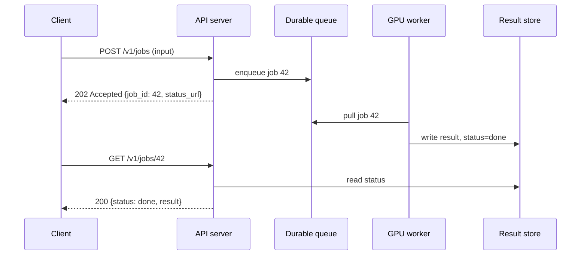
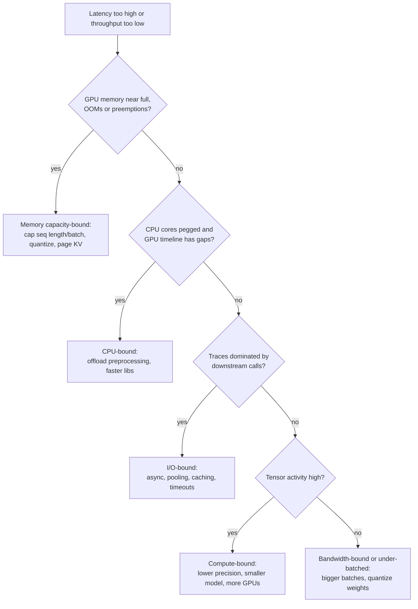
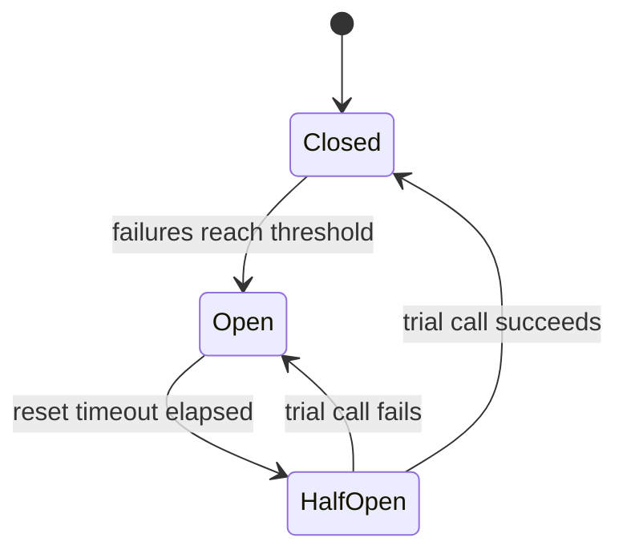
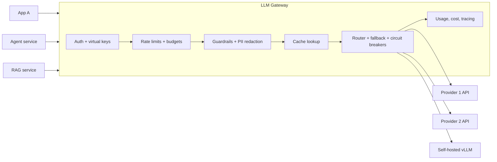
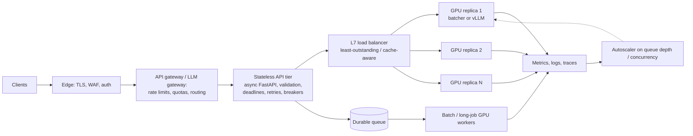

# Building a Scalable Inference API

> **Level:** Beginner to Advanced · **Study time:** ~120 min · **Prerequisites:** [Model Deployment Patterns](04-model-deployment-patterns.md), [LLM Inference Fundamentals](../06-llm-inference/01-inference-fundamentals-prefill-decode-and-latency-metrics.md), [Batching, Continuous Batching and PagedAttention](../06-llm-inference/04-batching-continuous-batching-and-paged-attention.md)

## Table of contents

- [Why this matters](#why-this-matters)
- [The vocabulary of serving: latency, throughput, percentiles and Little's Law](#the-vocabulary-of-serving-latency-throughput-percentiles-and-littles-law)
- [API design choices: synchronous, asynchronous jobs and streaming](#api-design-choices-synchronous-asynchronous-jobs-and-streaming)
- [A minimal FastAPI service: load once, health and readiness](#a-minimal-fastapi-service-load-once-health-and-readiness)
- [Concurrency models: async I/O, threads, processes and the GIL](#concurrency-models-async-io-threads-processes-and-the-gil)
- [Server-side dynamic batching](#server-side-dynamic-batching)
- [GPU memory limits, admission control and backpressure](#gpu-memory-limits-admission-control-and-backpressure)
- [CPU-bound, memory-bound or GPU-bound: diagnosing the bottleneck](#cpu-bound-memory-bound-or-gpu-bound-diagnosing-the-bottleneck)
- [Timeouts and deadline propagation](#timeouts-and-deadline-propagation)
- [Retries: backoff, jitter, idempotency and retry budgets](#retries-backoff-jitter-idempotency-and-retry-budgets)
- [Circuit breakers](#circuit-breakers)
- [Rate limiting and quotas](#rate-limiting-and-quotas)
- [Autoscaling and cold starts](#autoscaling-and-cold-starts)
- [Load balancing](#load-balancing)
- [Monitoring: p95 latency, throughput, errors, saturation and cost](#monitoring-p95-latency-throughput-errors-saturation-and-cost)
- [The LLM gateway pattern](#the-llm-gateway-pattern)
- [Going deeper: production concerns at scale](#going-deeper-production-concerns-at-scale)
- [Common mistakes and misconceptions](#common-mistakes-and-misconceptions)
- [Interview questions and model answers](#interview-questions-and-model-answers)
- [Key takeaways](#key-takeaways)
- [Further reading](#further-reading)
- [Next](#next)

## Why this matters

A trained model is worth nothing until other software can call it reliably, quickly and cheaply. The inference API is the layer that turns a `.pt` file or a 7B-parameter LLM into a service that survives traffic spikes, slow GPUs, flaky downstream providers and impatient users. Many production incidents in AI systems are not "the model is wrong" but "the service fell over": queues that grow without bound, retries that multiply load, GPUs that run out of memory, and autoscalers that react too late. Senior AI/ML interviews often include a question like "how would you serve this model to 1,000 requests per second?", and the interviewer is listening for batching, backpressure, timeouts, autoscaling signals and cost per request, not just "put it behind FastAPI". This chapter gives you that vocabulary and the reasoning behind it.

Two running examples appear throughout:

- **The spam filter**: a small text classifier (milliseconds per request, runs on CPU or a small GPU). It represents classic ML and encoder models such as embedding models and rerankers.
- **The 7B chat model**: a 7-billion-parameter decoder-only LLM served on one GPU. Responses take seconds and are streamed token by token.

## The vocabulary of serving: latency, throughput, percentiles and Little's Law

> **Analogy:** a coffee shop. **Latency** is how long one customer waits from ordering to getting their coffee. **Throughput** is how many coffees the shop hands out per hour. **Concurrency** is how many customers are inside waiting at the same moment. A shop can have great throughput and terrible latency (a huge queue moving fast), so you must measure both.

Precise definitions:

- **Latency**: time from when a request arrives to when its response is complete. For streaming LLMs we split it into **TTFT** (time to first token) and **TPOT** (time per output token), defined in [Inference Fundamentals](../06-llm-inference/01-inference-fundamentals-prefill-decode-and-latency-metrics.md).
- **Throughput**: completed work per unit time, for example requests per second (**RPS**) or output tokens per second.
- **Concurrency** (or **in-flight requests**): the number of requests that have arrived but not finished.
- **Replica**: one running copy of the service behind the load balancer. In Kubernetes a replica is a **pod** (the smallest deployable unit, wrapping one or more containers); for GPU models each replica usually owns its own GPU. Scaling out means adding replicas.
- **Percentile latency**: **p50** (the median) is the latency that 50% of requests beat; **p95** is the latency that 95% of requests beat, so 1 in 20 requests is slower. **p99** means 1 in 100 is slower. The slow end is called the **tail**.
- **SLO** (service level objective): an internal target such as "p95 latency under 300 ms and error rate under 0.1%, measured over 30 days". An **SLA** is a contractual promise to customers, usually looser than the SLO. The **error budget** is the failure the SLO allows: a 99.9% success target permits 1 failed request in 1,000, or about 43 minutes of full outage per 30 days ($0.001 \times 43{,}200$ minutes).
- **Saturation**: how "full" a resource is (queue depth, GPU memory used, concurrency versus its limit). Saturation predicts trouble before latency explodes.

### Why percentiles and not the average

Here are 20 latencies (ms) from the spam filter, sorted (illustrative):

```text
110 115 120 120 125 130 130 135 140 140 145 150 155 160 170 180 200 250 900 1500
```

- Sum: $5075$, so the **mean** is $5075 / 20 = 253.75$ ms.
- **p50** with the nearest-rank method: rank $= \lceil 0.50 \times 20 \rceil = 10$, so the 10th value, **140 ms**.
- **p95**: rank $= \lceil 0.95 \times 20 \rceil = 19$, so the 19th value, **900 ms**.

The mean (254 ms) describes nobody: most users saw about 140 ms, and the unlucky 5% saw 900 ms or worse. The two outliers dragged the mean up but the mean still hides how bad they are. That is why SLOs are written on percentiles.

> **Common mistake:** different tools compute percentiles differently. NumPy's default linear interpolation gives p95 = 930 ms for the same data (it interpolates between 900 and 1500). Both are "correct"; just be consistent and know which one your dashboard uses.

### Little's Law: the one formula of capacity planning

$$L = \lambda \times W$$

- $L$: average number of requests in the system (concurrency).
- $\lambda$ (lambda): average arrival rate (requests per second).
- $W$: average time each request spends in the system (seconds).

It holds for any stable system regardless of the arrival pattern (Little, 1961).

**Worked example 1 (spam filter):** $\lambda = 50$ RPS, $W = 0.4$ s. Then $L = 50 \times 0.4 = 20$ requests in flight on average.

**Worked example 2 (7B chat model):** $\lambda = 2$ new chats per second, each streaming for $W = 8$ s. Then $L = 2 \times 8 = 16$ concurrent streams. If one GPU replica can hold 16 concurrent streams within its latency target (illustrative), you need at least 1 replica at the average, and more for peaks and headroom.

> **Senior insight:** Little's Law turns "how many replicas?" into arithmetic. Measure how much concurrency one replica sustains at your SLO (by load testing), compute peak $L$, divide, and add headroom.

## API design choices: synchronous, asynchronous jobs and streaming

There are three basic shapes of inference API. Choosing the right one is the first design decision.

> **Analogy:** a **synchronous** call is a takeaway counter: you wait at the counter until your order is ready. An **asynchronous job** is a dry cleaner: you get a ticket and come back later. **Streaming** is a sushi conveyor: items arrive one by one while you are still at the table.

### 1. Synchronous request/response

The client sends an HTTP request and holds the connection open until the full result is returned.

```text
Client ── POST /v1/predict {"text": "win a free prize"} ──> Server
Client <── 200 {"spam_probability": 0.93} ──────────────── Server   (~20 ms later)
```

Best for fast work (under a few seconds): classifiers, embeddings, rerankers, short LLM completions.

### 2. Asynchronous jobs with a queue

For long tasks (transcribing a 1-hour audio file, summarizing a 300-page PDF, batch-scoring a million rows) holding an HTTP connection open is fragile: proxies time out, clients disconnect, and a server restart loses the work. Instead:



- **202 Accepted** is the HTTP status meaning "I received it and will process it later".
- The client **polls** the status URL or registers a **webhook** (a URL the server calls when the job finishes).
- A **durable queue** (for example Amazon SQS, RabbitMQ, Kafka, Redis Streams, or Celery on top of a broker) survives restarts. Workers acknowledge a job only after finishing, so a crashed worker's job becomes visible again and is retried. Jobs that keep failing go to a **dead-letter queue (DLQ)** for inspection.
- Because a job may run twice (worker crashed after doing the work but before acknowledging), workers must be **idempotent**: running the same job twice gives the same result and no double side effects. Writing the result keyed by `job_id` achieves this.

### 3. Streaming with server-sent events (SSE)

An LLM generating 500 tokens at 30 ms per token takes 15 seconds. Making the user stare at a spinner for 15 s feels broken, but showing the first word after 300 ms feels fast. **Server-sent events (SSE)** is a simple HTTP standard where the server keeps the response open and pushes text events, each formatted as `data: <payload>` followed by a blank line. Most LLM provider APIs stream this way.

```text
HTTP/1.1 200 OK
Content-Type: text/event-stream

data: {"token": "The"}

data: {"token": " answer"}

data: [DONE]
```

### Comparison

| Style | What it is | Use when | Pros | Cons |
|---|---|---|---|---|
| Synchronous | One request, one full response | Work finishes in milliseconds to a few seconds | Simplest for clients; easy to retry and cache | Long tasks hit proxy timeouts; one slow call ties up a connection |
| Async job + queue | Submit, get job ID, poll or webhook | Minutes-long or batch work; bursty loads | Survives restarts; queue absorbs bursts; workers scale independently | More moving parts (queue, store, status API); clients must poll |
| Streaming (SSE) | One request, many incremental events | LLM chat, any long generation shown to a human | Low perceived latency (TTFT); user can cancel early | Long-lived connections complicate load balancing and deploys; harder to retry mid-stream |

Two neighbors worth knowing: **WebSockets** give a two-way channel (useful for voice agents where the client also streams audio), and **gRPC streaming** is common between internal services. SSE wins for browser-facing LLM output because it is plain HTTP and works through most proxies.

> **Interview tip:** say the rule out loud: "sync if it finishes within a few seconds, streaming if a human is watching tokens appear, async jobs if it takes minutes or the client does not need to wait".

## A minimal FastAPI service: load once, health and readiness

**FastAPI** is a popular Python web framework built on **ASGI** (Asynchronous Server Gateway Interface, the async successor to WSGI, the older synchronous Python web standard). It runs under an ASGI server such as **Uvicorn**.

The three rules of a model server:

1. **Load the model once at startup**, never per request. Loading the spam filter takes about a second; loading a 7B model takes tens of seconds. Doing it per request would make every request that slow.
2. **Expose a liveness endpoint** (`/healthz`): "is the process alive and not stuck?" If it fails, the orchestrator (for example Kubernetes) restarts the container.
3. **Expose a readiness endpoint** (`/readyz`): "can I serve traffic right now?" If it fails, the load balancer stops sending requests, but the container is not killed. A server is alive but not ready while it is still loading weights or warming up.

> **Common mistake:** pointing the liveness probe at an endpoint that runs the model. Under heavy load, inference slows, the liveness probe times out, Kubernetes kills healthy-but-busy pods, the remaining pods get even more load, and the whole fleet restarts in a cascade. Liveness should be cheap and only check the process; readiness can check the model.

```python
# pip install fastapi "uvicorn[standard]" scikit-learn
# Run: uvicorn app:app --host 0.0.0.0 --port 8000
import asyncio
from contextlib import asynccontextmanager

from fastapi import FastAPI, HTTPException
from pydantic import BaseModel
from sklearn.feature_extraction.text import TfidfVectorizer
from sklearn.linear_model import LogisticRegression
from sklearn.pipeline import make_pipeline

MODEL_VERSION = "spam-v1"


def load_model():
    """Stand-in for joblib.load(...) or AutoModel.from_pretrained(...)."""
    texts = ["win a free prize now", "cheap meds click here",
             "meeting moved to 3pm", "can you review my PR"]
    labels = [1, 1, 0, 0]  # 1 = spam
    model = make_pipeline(TfidfVectorizer(), LogisticRegression())
    model.fit(texts, labels)
    return model


@asynccontextmanager
async def lifespan(app: FastAPI):
    # Runs once when the server starts. Load in the background so /healthz
    # answers immediately while /readyz reports "not ready" until loaded.
    app.state.model = None

    async def _load():
        model = await asyncio.to_thread(load_model)       # slow, blocking work
        await asyncio.to_thread(model.predict_proba, ["warm up"])  # warm-up call
        app.state.model = model                            # now ready

    app.state.load_task = asyncio.create_task(_load())
    yield
    # Code after `yield` runs at shutdown: release GPU memory, close clients.
    app.state.model = None


app = FastAPI(lifespan=lifespan)


class PredictRequest(BaseModel):
    text: str


class PredictResponse(BaseModel):
    spam_probability: float
    model_version: str


@app.get("/healthz")
async def healthz():
    task = app.state.load_task
    if task.done() and not task.cancelled() and task.exception() is not None:
        raise HTTPException(500, "model load failed")  # restart me
    return {"status": "alive"}


@app.get("/readyz")
async def readyz():
    if app.state.model is None:
        raise HTTPException(503, "model not loaded yet")
    return {"status": "ready", "model_version": MODEL_VERSION}


@app.post("/v1/predict", response_model=PredictResponse)
def predict(req: PredictRequest):
    # A plain `def` endpoint: FastAPI runs it in a thread pool, so the
    # blocking model call does not freeze the event loop.
    model = app.state.model
    if model is None:
        raise HTTPException(503, "not ready")
    prob = float(model.predict_proba([req.text])[0, 1])
    return PredictResponse(spam_probability=prob, model_version=MODEL_VERSION)
```

Points worth noticing:

- **Warm-up**: the first inference is often much slower than later ones (lazy initialization, CUDA kernel selection, JIT compilation, memory allocation). Run a dummy request before declaring ready.
- **Model version in the response**: invaluable for debugging canaries and rollbacks (see [Model Deployment Patterns](04-model-deployment-patterns.md)).
- **Request validation** with Pydantic: reject bad input with a 422 before it reaches the model. In production add limits such as maximum text length.
- In Kubernetes, a **startup probe** gives slow-loading containers (big LLMs) extra time before liveness checks begin.

### A streaming endpoint (SSE)

```python
import json
from fastapi import Request
from fastapi.responses import StreamingResponse


async def fake_generate(prompt: str):
    """Stand-in for a real token generator (e.g. a vLLM or TGI client)."""
    for token in ["Spam", " is", " unwanted", " email", "."]:
        await asyncio.sleep(0.05)  # pretend each decode step takes 50 ms
        yield token


@app.post("/v1/chat/stream")
async def chat_stream(req: PredictRequest, request: Request):
    async def event_source():
        try:
            async for token in fake_generate(req.text):
                if await request.is_disconnected():
                    break  # user closed the tab: stop generating, free the GPU slot
                yield f"data: {json.dumps({'token': token})}\n\n"
            yield "data: [DONE]\n\n"
        finally:
            pass  # release per-request resources (KV cache slot, semaphore) here

    return StreamingResponse(
        event_source(),
        media_type="text/event-stream",
        headers={"Cache-Control": "no-cache", "X-Accel-Buffering": "no"},
    )
```

`X-Accel-Buffering: no` tells NGINX not to buffer the response; a buffering proxy silently turns your stream back into one big response at the end.

> **Senior insight:** cancellation on disconnect matters for cost. If 20% of users abandon a chat mid-answer and you keep generating, you burn 20% of your decode capacity on text nobody reads.

An asynchronous job endpoint has the same shape as the sequence diagram earlier: `POST /v1/jobs` enqueues the input and returns 202 with a `job_id` (or 503 if the queue is full), `GET /v1/jobs/{job_id}` reads the status from a store, and a background worker pulls from the queue, runs the model and writes the result. An in-memory `asyncio.Queue` plus a dict is fine for learning, but it loses jobs on restart, which is exactly why production uses a durable broker and a database for job state.

## Concurrency models: async I/O, threads, processes and the GIL

**Concurrency** means making progress on several requests during the same period of time. **Parallelism** means literally executing several at the same instant on different cores. Python gives you three tools, and choosing wrongly is the most common performance bug in model servers.

> **Analogy:** a waiter (the **event loop**) can serve 50 tables because most of the time each table is just waiting for food. But if the waiter starts cooking a steak himself, all 50 tables wait. Waiting is cheap to share; cooking is not.

### The building blocks

- **Async I/O (asyncio)**: one thread runs an **event loop**. When a coroutine hits `await` on network I/O (calling a vector DB, an LLM provider), it yields so other requests can run. Excellent for thousands of concurrent requests that mostly wait. Terrible if any code blocks without `await`: one blocking call freezes every request on that loop.
- **Threads**: multiple OS threads in one process share memory. In standard CPython, the **GIL** (Global Interpreter Lock) lets only one thread execute Python bytecode at a time. But many heavy libraries (NumPy, PyTorch, most C/Rust extensions) **release the GIL** while doing their native work, so threads can overlap model computation with other Python work.
- **Processes**: separate Python interpreters with separate memory and separate GILs. True parallelism for pure-Python CPU work (tokenizing in Python, image decoding, feature engineering), at the cost of memory duplication and inter-process communication.

> **Version note:** Python 3.13 introduced an optional, experimental free-threaded build without the GIL (PEP 703), and Python 3.14 made that build officially supported (though still optional, not the default). As of 2026 library support still varies, so production inference services still generally assume the GIL exists.

### The GPU is a shared resource, not a thread pool

A GPU is not like a CPU with many independent cores you can give to different requests. It runs **kernels** (functions compiled to execute on the GPU, such as one matrix multiply) launched from processes, and each process gets its own **CUDA context** (its private GPU state and memory). If 4 Uvicorn worker processes each load the 7B model, you get 4 copies of 14 GB of weights (most GPUs cannot fit that) and 4 CUDA contexts that time-slice the GPU instead of cooperating. The GPU is most efficient when **one process owns it and feeds it large batches**.

```text
BAD: 4 processes each own a model copy           GOOD: one GPU owner, batched
 worker1 ─ model copy ─┐                          worker1 ─┐
 worker2 ─ model copy ─┼─> GPU (OOM or            worker2 ─┼─> queue ─> batcher ─> GPU
 worker3 ─ model copy ─┤    time-slicing)         worker3 ─┘   (one model copy,
 worker4 ─ model copy ─┘                                         big batches)
```

(NVIDIA offers ways to share one physical GPU across processes, such as **MIG**, Multi-Instance GPU, which partitions supported data-center GPUs into isolated slices, and **MPS**, the Multi-Process Service. They are useful for many small models, not for squeezing more out of one big model.)

### Choosing the model

| Pattern | What it is | Use when | Pros | Cons |
|---|---|---|---|---|
| Async endpoints + `await` remote calls | Event loop, all I/O awaited | Gateway or orchestration layer calling models over the network (RAG, LLM APIs) | Thousands of concurrent requests per process | Any blocking call stalls everything |
| `def` endpoints (thread pool) | Framework runs each request in a worker thread | Small CPU models whose libraries release the GIL | Simple; blocking code is safe | Thread pool limit caps concurrency (Starlette's default is 40 threads); pure-Python work does not parallelize |
| Multiple worker processes (`uvicorn --workers N`, Gunicorn) | N copies of the app | CPU models with Python-heavy pre/post-processing | Real CPU parallelism | N model copies in RAM; never do this with one big GPU model |
| Single GPU-owner process + async front end + batcher | Async API enqueues, one loop batches onto the GPU | Any GPU model | One model copy; high GPU efficiency | You must build the batcher (or use a server that has one) |
| Separate inference server | API tier calls Triton, TorchServe, vLLM, TGI or SGLang over HTTP/gRPC | Production GPU serving, especially LLMs | Battle-tested batching and memory management; scale API and GPU tiers separately | Extra network hop; another system to operate |

The bug to recognize instantly:

```python
@app.post("/bad")
async def bad(req: PredictRequest):
    # `async def` + blocking call = the event loop is frozen for the whole inference.
    return {"p": app.state.model.predict_proba([req.text])[0, 1]}

@app.post("/good")
async def good(req: PredictRequest):
    # Move blocking work to a thread (or make the endpoint a plain `def`).
    p = await asyncio.to_thread(app.state.model.predict_proba, [req.text])
    return {"p": float(p[0, 1])}
```

> **Interview tip:** "I keep the HTTP layer async and I/O-bound, push CPU-heavy preprocessing to a process pool, and give the GPU to a single owner that batches. For LLMs I don't hand-roll this: I put vLLM, SGLang or TGI behind the API."

## Server-side dynamic batching

GPUs do the same arithmetic on many inputs almost as fast as on one, because a forward pass for one input leaves most of the chip idle and must still read all the weights from memory. **Batching** groups several requests into one forward pass. (Why this works at the hardware level is covered in [GPU Fundamentals](../06-llm-inference/03-gpu-fundamentals-compute-bound-vs-memory-bound.md).)

But in an online API, requests arrive one at a time at random moments. **Dynamic batching** (also called adaptive or server-side batching) solves this: the server holds arriving requests in a queue for a short time and runs them together.

> **Analogy:** an elevator. It does not leave the moment the first person steps in; it waits a few seconds or until it is full, whichever comes first. Two knobs control it: **max batch size** (elevator capacity) and **max wait time** (how long the doors stay open).

### The trade-off in numbers

Illustrative timings for the spam filter on a GPU: a batch of 1 takes 20 ms, a batch of 16 takes 40 ms.

- **No batching**: max throughput $= 1 / 0.020 = 50$ requests/s.
- **Batches of 16**: max throughput $= 16 / 0.040 = 400$ requests/s, an 8x gain.
- **Cost in latency**: with the GPU free, the worst case for a single request is waiting the full max wait (10 ms) plus the batch compute (40 ms) $= 50$ ms, versus 20 ms alone. Under load a request can also wait for the batch ahead of it to finish (up to another 40 ms), so measure queue wait separately.

So batching trades a little latency for a lot of throughput. At low traffic the timer fires with small batches (low latency); at high traffic batches fill instantly (high throughput). That self-adjusting behavior is the point.

### A dynamic batcher from scratch

```python
import asyncio
import time


class Overloaded(Exception):
    """Raised when the queue is full: the API layer turns this into HTTP 503."""


class DynamicBatcher:
    def __init__(self, predict_batch, max_batch_size=16, max_wait_ms=10.0, max_queue=256):
        self.predict_batch = predict_batch        # sync fn: list[input] -> list[output]
        self.max_batch_size = max_batch_size
        self.max_wait = max_wait_ms / 1000.0
        self.queue: asyncio.Queue = asyncio.Queue(maxsize=max_queue)

    async def submit(self, item):
        """Called once per HTTP request. Waits until its own result is ready."""
        fut = asyncio.get_running_loop().create_future()
        try:
            self.queue.put_nowait((item, fut))    # never block: reject instead
        except asyncio.QueueFull:
            raise Overloaded("inference queue is full")
        return await fut

    async def run(self):
        """Background loop: collect a batch, run it, hand results back."""
        while True:
            first = await self.queue.get()        # sleep until there is work
            batch = [first]
            deadline = time.monotonic() + self.max_wait
            # Fill the batch until it is full or the wait budget is spent.
            while len(batch) < self.max_batch_size:
                if not self.queue.empty():
                    batch.append(self.queue.get_nowait())
                    continue
                remaining = deadline - time.monotonic()
                if remaining <= 0:
                    break
                await asyncio.sleep(min(remaining, 0.0005))  # short poll

            # Drop requests whose caller already gave up (timeout, disconnect).
            batch = [(x, f) for x, f in batch if not f.done()]
            if not batch:
                continue
            inputs = [x for x, _ in batch]
            try:
                # Run the blocking model call off the event loop.
                outputs = await asyncio.to_thread(self.predict_batch, inputs)
                for (_, fut), out in zip(batch, outputs):
                    if not fut.done():
                        fut.set_result(out)
            except Exception as exc:              # one bad batch must not kill the loop
                for _, fut in batch:
                    if not fut.done():
                        fut.set_exception(exc)


# --- tiny demo with a fake "model" -------------------------------------------
def fake_predict_batch(texts):
    print("batch size:", len(texts))
    time.sleep(0.02)                              # pretend GPU work: 20 ms per batch
    return [len(t) for t in texts]


async def main():
    batcher = DynamicBatcher(fake_predict_batch, max_batch_size=16, max_wait_ms=10)
    runner = asyncio.create_task(batcher.run())
    results = await asyncio.gather(*(batcher.submit(f"msg {i}") for i in range(20)))
    print(results[:3])
    runner.cancel()

asyncio.run(main())
# batch size: 16
# batch size: 4
# [5, 5, 5]
```

How it works: 20 requests arrive at once. The first batch fills to 16 immediately; the remaining 4 wait up to 10 ms for company, none arrives, so they run as a batch of 4. Because the loop awaits each batch before collecting the next, the GPU only ever runs one batch at a time, which is what we want.

In a FastAPI app you create the batcher in `lifespan`, start `batcher.run()` as a task, and the endpoint does `await batcher.submit(text)`, mapping `Overloaded` to a 503.

### Production details the sketch skips

- **Padding waste**: batching texts of 5 and 500 tokens pads the short one to 500. Group by similar length (**bucketing**) or cap the sequence length.
- **Batch-size-dependent shapes**: some compiled engines (TensorRT, CUDA graphs) are built for fixed batch sizes; servers pad up to the nearest supported size.
- **Off-the-shelf batchers**: NVIDIA Triton Inference Server's dynamic batcher, Ray Serve's `@serve.batch`, TorchServe batching. Use them unless you have a reason not to.
- **LLMs are different**: generation length varies per request, so static or dynamic batching wastes the GPU when short answers finish and wait for long ones. LLM servers use **continuous batching** (adding and removing requests at every decode step) with paged KV-cache memory. Never hand-roll this; see [Batching, Continuous Batching and PagedAttention](../06-llm-inference/04-batching-continuous-batching-and-paged-attention.md) and [Serving Frameworks](../06-llm-inference/06-serving-frameworks-vllm-sglang-tgi-tensorrt-llm-and-ollama.md).

> **Senior insight:** tune `max_wait` against your latency SLO, not throughput alone. A good starting point is a max wait that is a small fraction of the p95 budget, then load test while raising batch size until p95 or GPU memory says stop.

## GPU memory limits, admission control and backpressure

A GPU has a fixed amount of memory. If the server accepts more work than fits, the process crashes with an out-of-memory (OOM) error and every in-flight request fails. So the server must decide **what to admit** and **what to refuse**.

> **Analogy:** a restaurant with 40 seats. A good host keeps a short waiting list and, when the list is full, tells new arrivals "we're full, try again in 30 minutes". A bad host lets everyone in until the fire marshal shuts the place down.

### Where GPU memory goes (7B model recap)

The details live in [The KV Cache](../06-llm-inference/02-kv-cache-explained.md) and [Number Formats and Model Memory](../07-model-compression/01-number-formats-and-model-memory.md); here is the budget arithmetic you need for admission control.

- **Weights**: $7 \times 10^9$ parameters $\times$ 2 bytes (FP16/BF16) $\approx 14$ GB.
- **KV cache per token**: the **KV cache** stores the attention Key and Value vectors of every token a request has seen so far (prompt plus generated tokens), so each new token does not recompute them. It grows by one entry per token per in-flight request and is freed when the request ends, which makes it the variable part of the memory budget. For a Llama-2-7B-style model (32 layers, 32 KV heads, head dimension 128) in FP16:

$$\text{bytes per token} = 2 \times n_{\text{layers}} \times n_{\text{kv heads}} \times d_{\text{head}} \times b$$

- $2$: one Key and one Value vector.
- $n_{\text{layers}} = 32$, $n_{\text{kv heads}} = 32$, $d_{\text{head}} = 128$.
- $b = 2$ bytes per number (FP16).

$2 \times 32 = 64$; $64 \times 32 = 2048$; $2048 \times 128 = 262{,}144$; $262{,}144 \times 2 = 524{,}288$ bytes, exactly 0.5 MiB (about 0.52 MB) per token.

On an 80 GB GPU, after 14 GB of weights and (illustratively) 6 GB for activations and runtime overhead, about 60 GB remains for the KV cache:

$$\frac{60 \times 10^9}{524{,}288} \approx 114{,}441 \text{ tokens}$$

With a maximum sequence length of 4,096 tokens, that is $114{,}441 / 4{,}096 \approx 27.9$, so only **27 worst-case requests** fit at once. If typical requests use about 1,000 tokens, about 114 fit. That gap is why admission must reason in tokens, not request counts.

### The levers

| Lever | What it does | Effect |
|---|---|---|
| **Max batch size** | Caps how many requests run together | Bounds activation memory and per-step latency |
| **Max sequence length** (input + output) | Rejects or truncates over-long prompts; caps `max_tokens` | Bounds the worst-case KV cache per request; also prevents abuse |
| **Max input payload** | Rejects huge images or texts at the API layer (413 Payload Too Large) | Protects CPU preprocessing and memory |
| **Admission control** | Admits a request only if its estimated memory fits the remaining budget | Prevents OOM; LLM servers do this with a KV block budget |
| **Bounded queue** | Waiting room with a fixed size | Bounds waiting time and server memory |
| **Load shedding** | Rejects new work early when saturated | Keeps latency good for admitted requests |

**Backpressure** is the general principle: when a downstream stage is full, the signal "slow down" travels back upstream (to the queue, the API, the load balancer and eventually the client) instead of work piling up silently. An unbounded queue is the absence of backpressure: latency grows without limit, every request eventually times out, and the server does lots of work for clients who already left.

> **Analogy for the queue limit:** if a request will wait 30 seconds in a queue but the client times out after 10 seconds, the server spends GPU time on an answer nobody will receive. Rejecting it immediately is kinder and cheaper.

### Which status code: 429 vs 503

| Code | Meaning | When the server returns it | Client should |
|---|---|---|---|
| **429 Too Many Requests** | *You* (this client/tenant) exceeded your rate limit or quota | Per-client limit hit, even if the server has spare capacity | Back off; honor `Retry-After` |
| **503 Service Unavailable** | *The service* is overloaded or not ready | Queue full, admission control refused, still loading | Retry later with backoff, or fail over to another region/provider |
| **504 Gateway Timeout** | An upstream did not answer in time | A proxy or gateway gave up waiting | Retry only if idempotent and the budget allows |
| **413 Payload Too Large** (named "Content Too Large" in RFC 9110) | Input exceeds limits | Prompt or file too big | Fix the request; do not retry as is |

Always send a **`Retry-After`** header on 429 and 503 so well-behaved clients know how long to wait.

### Admission control by token budget (sketch)

```python
class TokenBudget:
    """Admit a request only if its worst-case KV cache fits in what is left."""

    def __init__(self, total_tokens: int):
        self.total = total_tokens
        self.in_use = 0

    def try_admit(self, prompt_tokens: int, max_new_tokens: int) -> bool:
        need = prompt_tokens + max_new_tokens  # worst case for this request
        if self.in_use + need > self.total:
            return False                       # caller returns 503 + Retry-After
        self.in_use += need
        return True

    def release(self, prompt_tokens: int, max_new_tokens: int) -> None:
        self.in_use -= prompt_tokens + max_new_tokens


budget = TokenBudget(total_tokens=114_000)
print(budget.try_admit(3_000, 1_000))  # True, 4,000 of 114,000 now reserved
```

Reserving the worst case is safe but wasteful. Engines like vLLM instead allocate KV blocks on demand and **preempt** (pause and later resume or recompute) a request if memory runs out mid-generation, which is more efficient but adds tail latency under pressure.

## CPU-bound, memory-bound or GPU-bound: diagnosing the bottleneck

When a service is slow, the first question is *which resource is the limit?* Adding GPUs to a CPU-bound service wastes money; optimizing kernels in an I/O-bound service changes nothing.

> **Analogy:** a sandwich shop that is slow because the cashier is slow (CPU-bound), because the counter is too small to lay out ingredients (memory capacity), because the fridge is far away and every ingredient takes a trip (memory bandwidth), or because the one chef is genuinely busy cooking (GPU compute-bound). Hiring another chef only helps in the last case.

Definitions:

- **CPU-bound**: time is dominated by work on the CPU: tokenization, JSON parsing of big payloads, image decoding and resizing, feature computation, Python overhead around the model, post-processing. In an async server the telltale metric is **event loop lag**: how late the event loop runs a callback that was scheduled to run now (near zero when healthy; tens of milliseconds means something is blocking the loop).
- **Memory-bound** has two meanings; say which one you mean:
  - **Capacity-bound**: you run out of memory (GPU memory full of KV cache, host RAM exhausted). Symptoms are OOM errors, preemptions, small forced batch sizes, swapping.
  - **Bandwidth-bound**: the processor waits on moving bytes from memory. LLM **decode** (generating output tokens one at a time, after **prefill** has processed the whole prompt in one parallel pass) is the classic case: every step reads all 14 GB of weights to produce one token per sequence. See [GPU Fundamentals: Compute-Bound vs Memory-Bound](../06-llm-inference/03-gpu-fundamentals-compute-bound-vs-memory-bound.md).
- **GPU-bound (compute-bound)**: the GPU's arithmetic units (its **SMs**, streaming multiprocessors, and the **tensor cores** inside them, specialized matrix-multiply units) are genuinely busy, for example large-batch prefill of long prompts, big CNNs on high-resolution images, diffusion models.
- **I/O-bound** (the fourth option interviewers love): waiting on the network or disk: downstream LLM APIs, vector databases, loading images from object storage.

### A back-of-the-envelope test: arithmetic intensity

**Arithmetic intensity** is the number of FLOPs (floating-point operations) a workload performs per byte it moves from memory. A GPU kernel can only be compute-bound if its intensity exceeds the GPU's **ridge point**: peak FLOP/s divided by memory bandwidth in bytes/s (the "roofline" model).

- An A100 80 GB offers about 312 TFLOP/s (dense FP16/BF16 tensor cores) and about 2 TB/s of bandwidth, so its ridge point is $312 \times 10^{12} / (2 \times 10^{12}) \approx 156$ FLOPs per byte.
- In decode at batch size 1, each FP16 weight (2 bytes) is read once and used for one multiply and one add (2 FLOPs): about **1 FLOP per byte**, far below 156. Decode is bandwidth-bound.
- At batch size $B$, one weight read serves $B$ sequences, so intensity rises to roughly $B$ FLOPs per byte. That is why bigger batches raise decode throughput almost for free. In practice decode stays bandwidth-bound even longer, because each sequence also reads its own KV cache, which batching does not amortize.
- Prefill of a 1,000-token prompt reuses each weight across 1,000 tokens, putting it far above the ridge point: compute-bound.

### Metrics and fixes

| Bottleneck | Telltale metrics | Typical fixes |
|---|---|---|
| CPU-bound | One or more CPU cores at 100% (often one core: the GIL); GPU utilization low and spiky; **event loop lag** high; profiler (py-spy) shows time in tokenizer, `json`, PIL, pandas | Move preprocessing to a process pool or separate service; use fast native libraries (Rust "fast" tokenizers, GPU image decoding such as NVIDIA DALI or nvJPEG); send binary formats instead of giant JSON arrays; more CPU cores per GPU; batch the preprocessing too |
| Memory capacity-bound | GPU memory near 100%; OOM errors; vLLM-style KV-cache usage near 100% with waiting requests and preemptions; host RSS growing (also check for leaks) | Lower max sequence length or max batch; quantize weights or KV cache ([Model Compression](../07-model-compression/01-number-formats-and-model-memory.md)); paged KV cache; prefix caching; shard across more GPUs |
| Memory bandwidth-bound | GPU "utilization" high but tensor-core activity low and memory (DRAM) activity high; per-token latency roughly constant as batch size grows from small values | Increase batch size (amortize each weight read across more sequences); weight quantization (fewer bytes per step); speculative decoding; GQA/MQA models (several query heads share one K/V head, shrinking the KV cache) |
| GPU compute-bound | High SM activity and tensor-core activity; latency grows roughly linearly with batch size; throughput plateaus as batch grows | Lower precision (FP8/INT8 tensor cores); FlashAttention; compiled engines (TensorRT); smaller or distilled model; shorter prompts (prefill is compute-heavy); more GPUs |
| I/O-bound | Low CPU and GPU utilization but high latency; spans in traces dominated by downstream calls | Async I/O, connection pooling, parallel downstream calls, caching, co-locating services, timeouts |

### A note on "GPU utilization"

The `GPU-Util` number shown by `nvidia-smi` is the **percentage of time at least one kernel was running** during the sample period. A tiny kernel running continuously shows 100% while most of the chip sits idle. For real answers, use NVIDIA DCGM (Data Center GPU Manager) profiling metrics, commonly exported to Prometheus via `dcgm-exporter`, such as `DCGM_FI_PROF_SM_ACTIVE` (fraction of time SMs are busy), `DCGM_FI_PROF_PIPE_TENSOR_ACTIVE` (tensor core activity), `DCGM_FI_PROF_DRAM_ACTIVE` (memory bandwidth activity) and `DCGM_FI_DEV_FB_USED` (memory used). For a single request, NVIDIA Nsight Systems or the PyTorch profiler shows whether the GPU timeline has gaps (CPU starving the GPU) or is packed.

### A diagnosis flow



> **Interview tip:** the strongest experimental technique is **load-ramp testing**: increase load step by step and watch which resource saturates first and where latency bends upward. Then change one thing (double the batch size, halve the preprocessing cost) and see whether the bottleneck moves. That is how you prove, not guess, the bottleneck.

A real debugging case built around this is [Rising p95 Latency and Memory Usage](../11-system-design/08-debugging-case-rising-p95-latency-and-memory.md).

## Timeouts and deadline propagation

Every network call can hang. Without a **timeout**, a hung call holds a connection, a thread, a queue slot or a GPU slot forever, and enough hung calls exhaust the service.

> **Analogy:** you give yourself 60 minutes to get to the airport. If the taxi takes 50 minutes, you cannot spend another 30 at the coffee shop. Every step must know how much of the *total* time is left.

### Per-call timeouts are not enough

Suppose a RAG endpoint calls an embedding service, a vector DB and an LLM, each with a 5-second timeout. Worst case: $5 + 5 + 5 = 15$ s, but the client gave up after 3 s. The server keeps working for 12 seconds on a dead request.

The fix is an **end-to-end deadline** (or **budget**): the edge sets a deadline, every hop computes the **remaining** time, and each downstream call gets a timeout no larger than what remains (minus a little reserve for its own work). This is called **deadline propagation**. gRPC does it natively (the client's deadline travels in the `grpc-timeout` header as a relative duration); over HTTP you pass a header such as `X-Request-Timeout-Ms` carrying the remaining budget.

> **Senior insight:** propagate a *relative* remaining time, not an absolute timestamp. Absolute timestamps break when server clocks disagree (clock skew).

### Worked example: a 1,000 ms budget

| Step | Time spent | Remaining after step | Timeout given to the call |
|---|---|---|---|
| Gateway receives request | 0 | 1,000 ms | |
| Auth and validation | 20 ms | 980 ms | |
| Embedding call | 60 ms | 920 ms | min(150, 980) = 150 ms |
| Vector search | 40 ms | 880 ms | min(200, 920) = 200 ms |
| Reranker | 120 ms | 760 ms | min(300, 880) = 300 ms |
| LLM call | | | 760 ms minus 50 ms reserve for response formatting = **710 ms** |

Each call has its own cap, but never more than what is left of the whole budget.

```python
import asyncio
import time


class Deadline:
    def __init__(self, budget_s: float):
        self.end = time.monotonic() + budget_s

    def remaining(self) -> float:
        return max(0.0, self.end - time.monotonic())

    def timeout_for(self, cap_s: float, reserve_s: float = 0.0) -> float:
        """Timeout for one downstream call: its own cap, but never past the deadline."""
        return max(0.0, min(cap_s, self.remaining() - reserve_s))


async def handle(query: str, deadline: Deadline):
    if deadline.remaining() <= 0:
        raise TimeoutError("budget already spent")  # fail fast, do no work
    emb = await asyncio.wait_for(embed(query), timeout=deadline.timeout_for(0.15))
    docs = await asyncio.wait_for(search(emb), timeout=deadline.timeout_for(0.20))
    return await asyncio.wait_for(
        call_llm(query, docs, timeout_ms=int(deadline.remaining() * 1000)),  # tell downstream too
        timeout=deadline.timeout_for(cap_s=30.0, reserve_s=0.05),
    )
```

(`embed`, `search` and `call_llm` are placeholders for your clients.) Rules of thumb:

- The server-side budget should be slightly **shorter** than the client's timeout, so the server gives up first and returns a clean error.
- Check the deadline **before** expensive work, including when a request is dequeued: if its deadline already passed, skip it (the batcher above drops requests whose future is already done).
- For streaming, use two timeouts: one for **time to first token**, and an **idle timeout** between tokens, rather than one giant total.

## Retries: backoff, jitter, idempotency and retry budgets

Many failures are transient: a pod restarting, a brief network blip, a provider returning 503. A **retry** sends the request again. Retries are powerful and also the most common cause of self-inflicted outages.

### When it is safe to retry

- **Idempotent** operations: doing them twice has the same effect as once. Pure inference ("classify this text") is naturally idempotent. Operations with side effects (charge a card, send an email, create a ticket from an agent tool call) are not, unless you make them idempotent with an **idempotency key**: a unique ID the client sends with the request, which the server stores so that a repeated key returns the original result instead of acting twice.
- **Retryable errors**: timeouts, connection resets, 429, 502, 503, 504. **Not** retryable: 400, 401, 403, 404, 413, 422 (the request itself is wrong; retrying gives the same answer).
- **Note on LLM cost**: a retried LLM call is billed again. A retry after a timeout may mean you pay for two full generations.

### Exponential backoff with jitter

If 1,000 clients all fail at the same moment and all retry after exactly 1 second, they all hit the recovering server at the same instant again (a **thundering herd**). Two fixes:

- **Exponential backoff**: wait longer after each failure.
- **Jitter**: randomize the wait so clients spread out.

The widely used "full jitter" formula (popularized by Marc Brooker's AWS Architecture Blog post "Exponential Backoff and Jitter", 2015):

$$\text{delay}_n = \text{uniform}\big(0,\ \min(\text{cap},\ \text{base} \times 2^{n})\big)$$

- $n$: retry number, starting at 0 for the first retry.
- $\text{base}$: the starting delay (for example 0.1 s).
- $\text{cap}$: the maximum delay (for example 2 s), so waits do not grow forever.
- $\text{uniform}(0, x)$: a random number between 0 and $x$.

Worked example with base 0.1 s and cap 2 s, showing the upper bound of the random range:

| Retry $n$ | $\text{base} \times 2^n$ | After cap | Actual wait |
|---|---|---|---|
| 0 | $0.1 \times 1 = 0.1$ s | 0.1 s | random in [0, 0.1] |
| 1 | $0.1 \times 2 = 0.2$ s | 0.2 s | random in [0, 0.2] |
| 2 | $0.1 \times 4 = 0.4$ s | 0.4 s | random in [0, 0.4] |
| 3 | $0.1 \times 8 = 0.8$ s | 0.8 s | random in [0, 0.8] |
| 4 | $0.1 \times 16 = 1.6$ s | 1.6 s | random in [0, 1.6] |
| 5 | $0.1 \times 32 = 3.2$ s | 2.0 s | random in [0, 2.0] |

If the server sent `Retry-After`, wait at least that long.

### Retry storms and amplification

Retries multiply load exactly when the system is weakest. Consider three layers (client, API, model service) where each layer tries a call up to 3 times (1 attempt + 2 retries). If the bottom layer is down, one user request can produce

$$3 \times 3 \times 3 = 3^3 = 27$$

attempts at the bottom layer. A service that was struggling at 100 RPS suddenly receives 2,700 RPS of retries and never recovers. This is a **retry storm**.

Defenses:

1. **Retry at one layer only**, usually the one closest to the failure or the edge, not at every layer.
2. **Retry budgets**: allow retries only while they are a small fraction of traffic, for example at most 10% extra. When the budget is exhausted, fail fast. gRPC's retry throttling and Finagle's retry budgets implement this idea.
3. **Respect the deadline**: never retry if the backoff wait would exceed the remaining budget.
4. **Circuit breakers** (next section) stop calls to a dependency that is clearly down.

```python
import asyncio
import random


class RetryableError(Exception):
    def __init__(self, msg: str, retry_after: float | None = None):
        super().__init__(msg)
        self.retry_after = retry_after


class RetryBudget:
    """Each request earns `ratio` retry tokens; each retry spends 1. Caps retries
    at roughly `ratio` of traffic (0.1 = at most ~10% extra load)."""

    def __init__(self, ratio: float = 0.1, max_tokens: float = 10.0):
        self.ratio, self.max_tokens, self.tokens = ratio, max_tokens, max_tokens

    def on_request(self) -> None:
        self.tokens = min(self.max_tokens, self.tokens + self.ratio)

    def try_spend(self) -> bool:
        if self.tokens >= 1.0:
            self.tokens -= 1.0
            return True
        return False


async def call_with_retries(fn, deadline, budget: RetryBudget,
                            max_attempts: int = 3, base: float = 0.1, cap: float = 2.0):
    budget.on_request()
    for attempt in range(max_attempts):
        try:
            return await asyncio.wait_for(fn(), timeout=deadline.remaining())
        except (RetryableError, asyncio.TimeoutError) as exc:
            last_try = attempt == max_attempts - 1
            if last_try or not budget.try_spend():
                raise                                        # give up, fail fast
            delay = random.uniform(0, min(cap, base * 2 ** attempt))  # full jitter
            retry_after = getattr(exc, "retry_after", None)
            if retry_after:
                delay = max(delay, retry_after)
            if delay >= deadline.remaining():
                raise                                        # no time left to retry
            await asyncio.sleep(delay)
```

> **Senior insight:** **hedged requests** are a cousin of retries: send a second copy of a slow request to another replica after, say, the p95 latency has passed, and take whichever answers first ("The Tail at Scale", Dean and Barroso, 2013). They cut tail latency for cheap idempotent calls but are expensive for GPU inference, so use them sparingly and only with a budget.

## Circuit breakers

> **Analogy:** the electrical breaker in your house. When a circuit draws dangerous current, the breaker trips and cuts power instantly, instead of letting the wires overheat. After a while you try flipping it back on.

A **circuit breaker** wraps calls to a dependency (an LLM provider, a vector DB, a model service). When the dependency keeps failing, the breaker **trips** and further calls fail immediately without even trying. This protects both sides: your service stops wasting threads and deadline budget on calls that will fail, and the struggling dependency gets breathing room to recover. The pattern was popularized by Michael Nygard's book *Release It!* (2007).

Three states:

- **Closed** (normal): calls go through. Failures are counted.
- **Open** (tripped): calls fail immediately with a "circuit open" error (or go to a fallback). Stays open for a **reset timeout**.
- **Half-open** (testing): after the reset timeout, a small number of trial calls are let through. If they succeed, close the circuit; if one fails, open it again.



### Example timeline

Threshold: 5 consecutive failures. Reset timeout: 30 s. The LLM provider has an outage from t = 0 to t = 60 s.

| Time | Event | State |
|---|---|---|
| t = 0 to 10 s | 5 calls time out (each wastes up to its timeout) | Closed, failure count 1 to 5 |
| t = 10 s | 5th failure hits the threshold | **Open** |
| t = 10 to 40 s | All calls fail instantly in microseconds; gateway uses a fallback provider | Open |
| t = 40 s | Reset timeout elapsed; one trial call is allowed | **Half-open** |
| t = 40 s | Trial fails (provider still down) | **Open** again until t = 70 s |
| t = 70 s | Trial call succeeds (provider recovered at t = 60 s) | **Closed**, count reset |

```python
import time


class CircuitOpenError(Exception):
    pass


class CircuitBreaker:
    def __init__(self, failure_threshold: int = 5, reset_timeout: float = 30.0):
        self.failure_threshold = failure_threshold
        self.reset_timeout = reset_timeout
        self.state = "closed"
        self.failures = 0
        self.opened_at = 0.0
        self.trial_in_flight = False

    def _before_call(self) -> None:
        if self.state == "open":
            if time.monotonic() - self.opened_at < self.reset_timeout:
                raise CircuitOpenError("failing fast")
            self.state = "half_open"            # time to test the waters
            self.trial_in_flight = False
        if self.state == "half_open":
            if self.trial_in_flight:            # allow only one trial at a time
                raise CircuitOpenError("trial in progress")
            self.trial_in_flight = True

    def _on_success(self) -> None:
        self.state, self.failures, self.trial_in_flight = "closed", 0, False

    def _on_failure(self) -> None:
        self.failures += 1
        if self.state == "half_open" or self.failures >= self.failure_threshold:
            self.state, self.opened_at, self.trial_in_flight = "open", time.monotonic(), False

    async def call(self, fn):
        self._before_call()
        try:
            result = await fn()
        except Exception:                       # in practice: only timeouts/5xx count
            self._on_failure()
            raise
        except BaseException:                   # e.g. CancelledError: caller gave up,
            self.trial_in_flight = False        # not the dependency's fault; free the
            raise                               # trial slot or half-open sticks forever
        self._on_success()
        return result
```

Production refinements:

- Trip on a **failure rate over a sliding window** with a minimum request volume (for example "over 50% failures among at least 20 calls in the last 10 s"), not on raw consecutive counts.
- Count only failures that indicate the dependency is unhealthy (timeouts, 5xx, connection errors), never 4xx caused by bad input.
- Keep one breaker **per dependency** (and per region or model for LLM providers), so one bad provider does not block the others.
- Pair it with a **fallback**: a secondary provider, a smaller local model, a cached answer, or a graceful "try again shortly" message.
- Add **bulkheads** (named after a ship's watertight compartments): give each dependency its own bounded connection pool or semaphore, so one *slow* dependency cannot tie up every worker. Breakers stop calls to a dead dependency; bulkheads contain a slow one.
- Libraries and meshes provide this: for example Envoy and Istio have outlier detection and circuit breaking; in Python there are small libraries such as `pybreaker`.

## Rate limiting and quotas

**Rate limiting** caps how fast a client can send requests (per second or per minute). **Quotas** cap total consumption over a long period (per day or month), often tied to billing. Both protect the service from one noisy or abusive client (the **noisy neighbor** problem) and protect your budget.

### The token bucket

> **Analogy:** a bucket that is refilled with tokens at a steady drip. Each request takes one token. If the bucket is empty, the request is refused. The bucket's size allows short bursts; the drip rate sets the long-run average.

$$\text{tokens} \leftarrow \min\big(C,\ \text{tokens} + r \times \Delta t\big)$$

- $C$: bucket capacity (maximum burst).
- $r$: refill rate (tokens per second).
- $\Delta t$: seconds since the last update.

A request costing $k$ tokens is allowed if $\text{tokens} \ge k$, and then $\text{tokens} \leftarrow \text{tokens} - k$.

**Worked example:** $C = 10$, $r = 5$ per second, bucket full at $t = 0$.

- At $t = 0$ the client fires 12 requests. The first 10 take the 10 tokens; requests 11 and 12 are refused (429).
- At $t = 1$ s: $\text{tokens} = \min(10,\ 0 + 5 \times 1) = 5$. One request arrives and is allowed, leaving 4.

```python
import time


class TokenBucket:
    def __init__(self, rate: float, capacity: float):
        self.rate, self.capacity = rate, capacity
        self.tokens = float(capacity)
        self.last = time.monotonic()

    def allow(self, cost: float = 1.0) -> bool:
        now = time.monotonic()
        self.tokens = min(self.capacity, self.tokens + (now - self.last) * self.rate)
        self.last = now
        if self.tokens >= cost:
            self.tokens -= cost
            return True
        return False


bucket = TokenBucket(rate=5, capacity=10)
print(sum(bucket.allow() for _ in range(12)))  # 10 (the last 2 are refused)
```

### Algorithms compared

| Algorithm | How it works | Pros | Cons |
|---|---|---|---|
| Fixed window | Count requests per clock minute | Trivial | Allows 2x bursts at window edges |
| Sliding window | Count over the last 60 s (exact log or weighted approximation) | Smooth, fair | More state or approximation |
| Token bucket | Refill at rate $r$, burst up to $C$ | Allows controlled bursts; cheap | Two parameters to tune |
| Leaky bucket (as a queue) | Requests drain at a fixed rate | Smooths output perfectly | Adds queueing delay |
| Concurrency limit | Max in-flight requests per client | Directly bounds resource use; ideal for long LLM streams | Does not limit short fast requests by rate |

### LLM-specific rate limiting

For LLMs, one request can cost 10 tokens or 100,000 tokens, so request-count limits are not enough. Providers typically limit both **RPM** (requests per minute) and **TPM** (tokens per minute). In your own platform:

- Charge the bucket an **estimate** before the call (prompt tokens + `max_tokens`) and **reconcile** with actual usage afterward.
- Combine a token rate limit with a **concurrency limit** per tenant, since long streams hold GPU memory for many seconds.
- Enforce **budgets in money** per team or tenant (daily spend caps with alerts at 50%, 80% and 100%).
- With many API replicas, the counters must be shared: typically a Redis-backed limiter (atomic Lua script or similar) or the limiter in your API gateway or service mesh. Local per-replica limiters are an acceptable approximation if you divide the limit by the replica count.

## Autoscaling and cold starts

**Autoscaling** adds replicas when load rises and removes them when it falls. In Kubernetes, the **Horizontal Pod Autoscaler (HPA)** computes:

$$\text{desiredReplicas} = \left\lceil \text{currentReplicas} \times \frac{\text{currentMetric}}{\text{targetMetric}} \right\rceil$$

- $\lceil \cdot \rceil$: round up to the next integer.
- $\text{currentMetric}$: the average of the chosen metric across pods.
- $\text{targetMetric}$: the value you want each pod to sit at.

**Worked example:** 4 replicas, average queue depth per replica is 30, target is 10. Desired $= \lceil 4 \times 30 / 10 \rceil = \lceil 12 \rceil = 12$ replicas.

### Which signal to scale on

| Signal | Good for | Watch out for |
|---|---|---|
| CPU utilization (the default) | CPU-only models | Nearly useless for GPU services: the CPU can be idle while the GPU is saturated |
| GPU utilization | Rough signal for GPU services | `nvidia-smi` utilization saturates at "100%" well before throughput does (see above); slow to fall |
| **Queue depth** (requests waiting) | Batch and async-job workers; GPU services | Needs a custom or external metrics pipeline (for example KEDA, or Prometheus Adapter) |
| **Concurrency / in-flight requests per replica** | Online APIs, LLM streaming | Must know the per-replica concurrency at which the SLO breaks (load test) |
| LLM engine metrics (requests waiting, KV-cache usage) | LLM serving | Metric names are engine- and version-specific |
| Latency (p95) | Last line of defense | Lagging indicator: by the time p95 rises, users already suffer |

Knative's concurrency-based autoscaling and KEDA's queue-based scaling (including scale-to-zero) are common choices. The durable rule: **scale on a leading indicator of saturation (queue depth or concurrency), alert on latency.**

### Cold starts: why GPU autoscaling is slow

A new GPU replica is not ready in seconds. Illustrative breakdown for the 7B model:

| Phase | What happens | Illustrative time |
|---|---|---|
| Node provisioning | Cloud allocates a new GPU VM (if no spare node) | 1 to several minutes, sometimes longer when GPUs are scarce |
| Image pull | Pull a multi-GB container image with CUDA libraries | Tens of seconds to minutes |
| Weight loading | Read 14 GB of weights; at an illustrative 500 MB/s that is $14{,}000 / 500 = 28$ s | Seconds to minutes |
| Warm-up | CUDA graph capture, compilation, first inference | Seconds to a minute |

Mitigations:

- **Minimum replicas** sized for baseline traffic plus a buffer; avoid scaling a latency-sensitive LLM service to zero (the first request after idle would pay the full cold start).
- **Scale up early and fast, scale down slowly** (a stabilization window of several minutes) to avoid flapping.
- **Overprovisioned headroom**: keep warm spare capacity (or low-priority placeholder pods that get evicted) so a new replica lands on an existing node.
- **Faster loading**: pre-pull images onto nodes, cache weights on local NVMe, use formats that load fast (safetensors with memory-mapping), keep smaller images.
- **Predictive or scheduled scaling** for known daily peaks.
- Use the **queue** to absorb the spike while new replicas start, which is another reason to have backpressure instead of crashing.

> **Senior insight:** the minimum replica count is a cost-versus-latency decision you can quantify: idle GPUs at night cost money, but cold starts during a morning spike cost SLO violations. Put both numbers in front of the decision-maker.

## Load balancing

A **load balancer** spreads requests across replicas. **Layer 4 (L4)** balancers route TCP connections without understanding HTTP; **Layer 7 (L7)** balancers understand HTTP/gRPC and can route each request individually.

| Strategy | How it picks a replica | Use when | Weakness |
|---|---|---|---|
| Round robin | Next in turn | Requests are uniform and short | Inference costs vary wildly (5 tokens vs 5,000), so some replicas get swamped |
| Least connections / least outstanding requests | Fewest in-flight requests | Variable-cost inference | Needs per-request (L7) visibility |
| Power of two choices | Pick 2 replicas at random, send to the less loaded | Large fleets, many balancers | Slightly less optimal than global least-loaded, but no global coordination (Mitzenmacher, 2001) |
| Session or prefix affinity (consistent hashing) | Same user or same prompt prefix to same replica | LLMs with prefix (KV) caching; multi-turn chat | Can create hot spots; must fall back when the target is overloaded |
| Load- and cache-aware routing | Combines queue depth, KV-cache usage and prefix hits | Large LLM fleets | More complex; often provided by the LLM serving stack |

Gotchas specific to inference:

- **Long-lived connections**: HTTP/2 and gRPC multiplex many requests over one connection. An L4 balancer pins that whole connection to one backend, so all of a client's requests go to one replica. Use L7 (per-request) balancing or client-side balancing.
- **Streaming responses** last seconds to minutes; "connections" is a better load signal than "requests per second".
- **Prefix caching** (reusing the KV cache of a shared system prompt, see [Speculative Decoding, Prompt Caching and Other Speedups](../06-llm-inference/05-speculative-decoding-caching-and-other-speedups.md)) only pays off if requests sharing a prefix land on the same replica, which pushes LLM routing toward cache-aware strategies.

## Monitoring: p95 latency, throughput, errors, saturation and cost

Monitoring an inference API means answering "are users happy, and how close are we to trouble?" Google's SRE book names the **four golden signals**: **latency, traffic (throughput), errors and saturation**. For AI systems add a fifth: **cost per request** (or per token). Model-quality monitoring (drift, accuracy, LLM evaluation) is covered in [Monitoring ML and LLM Systems in Production](06-monitoring-ml-and-llm-systems-in-production.md); here we focus on the service.

### What to measure

| Signal | Metrics | Notes |
|---|---|---|
| Latency | p50, p95, p99 end-to-end; for LLMs TTFT and TPOT percentiles; queue wait time separately from compute time | Separate successful and failed requests (fast errors make latency look good) |
| Throughput | RPS; output tokens/s; batch size distribution | Batch-size histograms reveal whether batching works |
| Errors | 5xx rate; timeout rate; 429/503 shed rate tracked **separately**; per-dependency error rates | Deliberate shedding is not the same as a bug |
| Saturation | Queue depth, in-flight vs limit, GPU memory and KV-cache usage, DCGM SM/tensor activity, CPU, event loop lag | The early warning signals |
| Cost | GPU-hours, cost per request, cost per 1M tokens, per tenant/feature | Needs request counts joined with infrastructure cost |

### Percentiles need histograms

You **cannot average percentiles**. If replica A has p95 = 100 ms and replica B has p95 = 900 ms, the fleet p95 is not 500 ms; it depends on how many requests each served and on their full distributions. The right approach is to record a **histogram** (counts of requests per latency bucket) on every replica, sum the buckets across replicas, and compute the percentile from the merged histogram. Prometheus does exactly this. One caveat: `histogram_quantile` assumes requests are spread evenly inside a bucket and interpolates, so a p95 that lands in the 0.25 to 0.5 s bucket is only an estimate within that range. Put bucket boundaries close to your SLO threshold.

```python
# pip install prometheus-client
import time
from fastapi import Request
from prometheus_client import Counter, Gauge, Histogram, make_asgi_app

LATENCY = Histogram(
    "inference_request_seconds", "End-to-end request latency",
    ["route", "model_version"],
    buckets=(0.01, 0.025, 0.05, 0.1, 0.25, 0.5, 1, 2.5, 5, 10, 30),
)
REQUESTS = Counter("inference_requests", "Requests by outcome",
                   ["route", "model_version", "status"])
QUEUE_DEPTH = Gauge("inference_queue_depth", "Requests waiting for the GPU")

app.mount("/metrics", make_asgi_app())  # Prometheus scrapes this endpoint


@app.middleware("http")
async def record_metrics(request: Request, call_next):
    start = time.perf_counter()
    response = await call_next(request)
    # Label by route template (/v1/jobs/{job_id}), never the raw path:
    # /v1/jobs/42, /v1/jobs/43, ... would each create a new time series.
    route = getattr(request.scope.get("route"), "path", "unmatched")
    LATENCY.labels(route, MODEL_VERSION).observe(time.perf_counter() - start)
    REQUESTS.labels(route, MODEL_VERSION, str(response.status_code)).inc()
    return response
```

(For streaming responses this middleware measures time until headers are sent, roughly TTFT-related, not the full stream. Record full stream duration and token counts inside the generator.)

Typical PromQL queries:

```text
# p95 latency over 5 minutes, across all replicas
histogram_quantile(0.95, sum by (le) (rate(inference_request_seconds_bucket[5m])))

# Throughput (requests per second)
sum(rate(inference_requests_total[5m]))

# Error rate (5xx except 503; 429/503 shedding tracked separately)
sum(rate(inference_requests_total{status=~"5..", status!="503"}[5m]))
  / sum(rate(inference_requests_total[5m]))
```

Keep label cardinality low: never use user IDs or raw prompts as metric labels (that explodes the number of time series). Put per-request detail in logs and traces instead; tracing for LLM apps is covered in [LLMOps: Tracing, Prompt Management and Langfuse](08-llmops-tracing-prompt-management-and-langfuse.md).

### Cost per request

$$\text{cost per request} = \frac{\text{replicas} \times \text{price per replica-hour}}{\text{requests served per hour}}$$

**Worked example** (illustrative price of \$2.50 per GPU-hour, one GPU per replica):

- 4 replicas cost $4 \times 2.50 = \$10$ per hour.
- At 10 RPS: $10 \times 3{,}600 = 36{,}000$ requests per hour. Cost per request $= 10 / 36{,}000 \approx \$0.000278$, about **\$0.28 per 1,000 requests**.
- If each request produces 500 output tokens: $36{,}000 \times 500 = 18{,}000{,}000$ tokens per hour, so cost $= 10 / 18 \approx \$0.56$ per million output tokens.
- At night traffic falls to 2 RPS but minimum replicas keep 4 GPUs running: $10 / 7{,}200 \approx \$0.00139$ per request, **5 times** more expensive per request.

The lesson: cost per request is dominated by **utilization**. Batching, right-sized minimum replicas and autoscaling move this number far more than haggling over GPU prices. For API-based LLMs, cost is per token from the provider's price list, so log input and output tokens per request and attribute them to a tenant and feature. Deeper LLM cost optimization lives in [Optimizing and Benchmarking LLM Latency and Cost](../06-llm-inference/07-optimizing-and-benchmarking-llm-latency-and-cost.md).

### Alerting on SLOs

Alert on symptoms users feel (p95 above SLO, error rate above SLO) and on fast **error budget burn** (the SLO's allowed failures being consumed too quickly), not on every CPU spike. Use saturation metrics for dashboards and capacity planning.

**Burn rate** is how fast you are spending the error budget: observed error rate divided by allowed error rate. **Worked example:** SLO 99.9% (0.1% allowed), current error rate 1.44%. Burn rate $= 1.44 / 0.1 = 14.4$, so a 30-day budget would be gone in $30 / 14.4 \approx 2.1$ days; equivalently, one hour at this rate spends $14.4 / 720 = 2\%$ of the monthly budget (30 days = 720 hours). Google's *Site Reliability Workbook* suggests paging on a fast burn like this, checked over a long and a short window so the alert also clears quickly, and opening a ticket for slow burns.

Latency SLOs use the same machinery once phrased as a ratio of good requests: "99% of requests finish within 250 ms" becomes `sum(rate(inference_request_seconds_bucket{le="0.25"}[5m])) / sum(rate(inference_request_seconds_count[5m]))`, which is exact at a bucket boundary, unlike an interpolated percentile.

## The LLM gateway pattern

When many teams call many LLMs (hosted providers such as OpenAI, Google or Mistral, plus self-hosted open-weight models on vLLM), every team re-implements keys, retries, fallbacks, logging and cost tracking, badly and differently. An **LLM gateway** is a central proxy that all LLM traffic goes through.

> **Analogy:** a company travel desk. Employees do not each negotiate with airlines, store corporate card numbers and track budgets. They ask the travel desk, which picks the airline, rebooks when a flight is cancelled, enforces the travel policy and reports spend per department.



### Responsibilities

| Capability | What it does | Notes |
|---|---|---|
| Unified API | One request format (often OpenAI-compatible) for all models | Swapping models becomes a config change |
| **Routing** | Choose a model per request by task, cost, latency, tenant tier, data residency | E.g. cheap small model for classification, big model for hard reasoning |
| **Fallback** | On 429, 5xx, timeout or open circuit, try the next provider or model | Fallback models may differ in quality and output format: evaluate them |
| **Caching** | Exact-match cache keyed by a hash of (model, model version, prompt template version, normalized messages, parameters, tenant) | Safe mostly for deterministic settings; include tenant in the key to avoid cross-tenant leaks |
| Semantic caching | Return a cached answer for a *similar* prompt (embedding similarity above a threshold) | Risky: "cancel my order" and "don't cancel my order" can be close in embedding space |
| **Key management** | Provider keys stored in a secret manager; teams get **virtual keys** mapped to budgets and permissions; rotation without app changes | Provider keys never ship to clients or app code |
| Quotas and budgets | Per-team TPM, RPM, concurrency and dollar caps | Uses the token-bucket ideas above |
| Guardrails | PII redaction, prompt-injection and content filters | See [LLM Safety and Guardrails](../05-llms/13-llm-safety-guardrails-and-responsible-ai.md) |
| Observability | Log tokens, latency, cost, model, prompt version per request; distributed tracing | Basis for cost attribution and debugging |

Examples in this space include LiteLLM, Portkey, Kong's and Envoy's AI gateway features, and cloud vendors' managed gateways. Product names and features change quickly (as of 2026); the durable concept is the list of responsibilities above.

### Fallback with deadlines and breakers (sketch)

```python
# Conceptual: `call_provider` stands in for your provider SDK or HTTP client
# (these SDKs are version-fragile, so the gateway wraps them behind one function).
PROVIDERS = ["primary-large", "secondary-large", "self-hosted-7b"]
BREAKERS = {name: CircuitBreaker(failure_threshold=5, reset_timeout=30) for name in PROVIDERS}


async def complete(request: dict, deadline: Deadline) -> dict:
    last_error = None
    for name in PROVIDERS:
        if deadline.remaining() < 0.2:          # not enough time for another attempt
            break
        try:
            return await BREAKERS[name].call(
                lambda n=name: asyncio.wait_for(
                    call_provider(n, request),
                    timeout=deadline.timeout_for(cap_s=20.0)))
        except (CircuitOpenError, RetryableError, asyncio.TimeoutError) as exc:
            last_error = exc                      # log it, then try the next provider
    raise RuntimeError(f"all providers failed: {last_error!r}")
```

Notice how the pieces compose: the **deadline** bounds total time, the **circuit breaker** skips a provider that is down without waiting for its timeout, and the **fallback chain** replaces blind retries against the same failing provider.

> **Senior insight:** the gateway is itself a critical single point of failure. Run it stateless and horizontally scaled across zones, keep it thin (no heavy computation in the hot path), and make caching and logging fail open (if the cache is down, call the model; if logging is down, still serve the request, but buffer usage records for billing).

## Going deeper: production concerns at scale

### A reference architecture



Separating the cheap, CPU-only API tier from the expensive GPU tier lets each scale on its own signal, and lets you deploy API changes without reloading model weights.

### Graceful shutdown and deploys

When Kubernetes stops a pod it marks it terminating, runs any `preStop` hook, then sends SIGTERM, and kills it with SIGKILL when the grace period (which includes the `preStop` time) runs out. In parallel, and asynchronously, the pod is removed from service endpoints, so load balancers can keep sending it traffic for a few seconds. For inference:

1. Add a short `preStop` delay (a sleep of a few seconds) so the load balancer stops routing to the pod before it stops accepting connections.
2. Stop accepting new work, let in-flight requests and streams finish (Uvicorn waits for in-flight requests on graceful shutdown).
3. Set the termination grace period longer than your longest allowed generation, or long LLM streams get cut mid-sentence on every deploy.
4. For async job workers: stop pulling new jobs, finish or release (un-acknowledge) the current one.

Rolling out new model versions safely (canary, shadow, rollback) is covered in [Model Deployment Patterns](04-model-deployment-patterns.md).

### Load testing and capacity planning

- Use tools such as Locust, k6 or vendor LLM benchmark scripts, with **realistic input distributions** (prompt and output lengths drawn from production logs, not one fixed prompt).
- Prefer an **open-loop** load generator (sends requests at a fixed arrival rate regardless of responses). A closed-loop generator (each virtual user waits for a response before sending the next) slows down when the server slows down, hiding the very latency you want to measure; this is the **coordinated omission** problem.
- Find the **knee**: the throughput at which p95 starts climbing steeply. Run production at a comfortable margin below it (queueing theory says latency explodes as utilization approaches 100%).
- Capacity: peak concurrency from Little's Law, divided by safe concurrency per replica, plus headroom for a zone failure.

### Fairness, priority and many models

A single tenant sending 10,000 batch requests should not starve interactive users: use separate queues with **priority scheduling**, **per-tenant fair queuing** (round-robin across tenant queues) and per-tenant concurrency caps. When you have many small models (one fine-tuned variant per customer), pack several per GPU or, for LLMs, serve many **LoRA adapters** on one shared base model (see [Fine-Tuning: LoRA and QLoRA](../05-llms/07-fine-tuning-full-lora-and-qlora.md)).

## Common mistakes and misconceptions

- **Loading the model inside the request handler.** Every request pays the load time. Load once at startup.
- **Blocking calls inside `async def` endpoints.** One synchronous model call freezes every request on that event loop.
- **Running `uvicorn --workers 4` on one GPU with a big model.** Four copies of the weights, OOM or GPU time-slicing. Use one GPU owner process.
- **Unbounded queues.** They turn overload into infinite latency and wasted work for clients who already left. Bound them and shed load with 503 + `Retry-After`.
- **Liveness probes that run inference.** They kill busy-but-healthy pods and start restart cascades.
- **Retrying at every layer.** Multiplies load ($3^3 = 27$x with three layers) exactly during outages. Retry at one layer, with jitter and a budget.
- **Retrying non-idempotent operations** (agent tool calls that send emails or create orders) without idempotency keys.
- **Timeouts without deadline propagation.** Downstream services keep working on requests the client abandoned long ago.
- **Autoscaling a GPU service on CPU utilization.** The CPU looks idle while the GPU queue overflows.
- **Trusting `nvidia-smi` "100% utilization"** as proof the GPU is maxed out. It measures kernel activity time, not how much of the chip is busy.
- **Averaging percentiles across replicas** or reporting mean latency. Merge histograms; report p50, p95, p99.
- **High-cardinality metric labels** (user IDs, prompts, raw paths containing job IDs). Each distinct value is a new time series; label by route template.
- **Counting 429/503 load shedding as bugs** in the same error-rate metric as crashes, which hides one or the other.
- **Semantic caching without tenant isolation or a strict threshold.** It can return another user's answer or a wrong answer to a subtly different question.
- **Hand-rolling LLM batching.** Use a serving engine with continuous batching and paged KV memory.

## Interview questions and model answers

<details>
<summary><b>Q1. How do you build a scalable inference API?</b></summary>

**Short answer:** I pick the API shape from the latency profile (sync for fast calls, SSE streaming for LLM output, async jobs with a durable queue for long tasks). I put a stateless async API tier in front of a separate GPU tier where each GPU is owned by one process that loads the model once and batches requests (dynamic batching for classic models, a serving engine with continuous batching such as vLLM for LLMs). I bound everything: max input size, max sequence length, bounded queues with 503 and Retry-After, per-tenant rate limits. Calls carry end-to-end deadlines, retries are limited and jittered, dependencies sit behind circuit breakers. I autoscale on queue depth or concurrency with a minimum replica floor, balance with least-outstanding-requests, and monitor latency percentiles, throughput, errors, saturation and cost per request.

**Deeper answer and follow-ups:**
- **Start from requirements:** ask for peak RPS, payload and output sizes, the latency SLO and the budget before choosing anything; those numbers decide sync vs async, CPU vs GPU, and the replica count.
- **Separation of tiers:** CPU-only API (auth, validation, routing, deadlines) scales cheaply; the GPU tier scales on its own signal and changes less often.
- **Health:** cheap liveness, readiness that is true only after weights are loaded and warmed up; startup probe for slow loads.
- **Capacity:** Little's Law $L = \lambda W$. Example: 2 chats/s $\times$ 8 s each $= 16$ concurrent streams; load test to find the safe concurrency per replica, divide and add headroom.
- **Failure handling:** load shedding instead of unbounded queues; fallbacks (smaller model, second provider, cached answer) when a circuit opens.
- **Deploys:** graceful shutdown that drains streams, canary rollouts with model version in every response and metric.
- **Pitfall to mention:** multiple worker processes each loading the model onto one GPU.

</details>

<details>
<summary><b>Q2. How do you handle concurrency, batching, and GPU memory limits?</b></summary>

**Short answer:** Concurrency: the HTTP layer is async so thousands of mostly-waiting requests are cheap; blocking model calls run off the event loop; one process owns each GPU. Batching: requests go into a queue and a batcher runs them together, bounded by a max batch size and a max wait time (for LLMs, continuous batching in vLLM/SGLang/TGI). Memory: I bound max batch size and max sequence length, admit requests only if their worst-case memory (mostly KV cache for LLMs) fits, cap the queue, and return 503 with Retry-After when full so overload becomes backpressure instead of an OOM crash.

**Deeper answer and follow-ups:**
- **GIL:** pure-Python CPU work does not parallelize across threads; NumPy/PyTorch release the GIL in native code. CPU-heavy preprocessing goes to a process pool.
- **Batching trade-off (illustrative):** batch of 1 in 20 ms gives 50 req/s; batch of 16 in 40 ms gives 400 req/s, at the cost of up to max wait (10 ms) extra latency.
- **KV arithmetic for a 7B model (FP16, 32 layers, 32 KV heads, head dim 128):** $2 \times 32 \times 32 \times 128 \times 2 = 524{,}288$ bytes per token. About 60 GB free holds about 114k tokens, so only 27 requests at a 4,096-token maximum. Hence admit by tokens, not by request count.
- **Preemption vs reservation:** reserving worst case is safe but wasteful; paged engines allocate on demand and preempt under pressure (adds tail latency).
- **429 vs 503:** 429 for a client over its own limit, 503 for server-wide overload.
- **Padding:** bucket by sequence length so one long input does not pad the whole batch.
- **How to measure:** batch-size histogram (are batches actually forming?), queue wait vs compute time, KV-cache usage and preemption count, and peak GPU memory during a worst-case load test (longest prompts at max concurrency).
- **Failure mode:** memory fragmentation can trigger OOM even when reported usage is below 100%, so keep a safety margin rather than budgeting to the last gigabyte.

</details>

<details>
<summary><b>Q3. How do you distinguish CPU-bound, memory-bound, and GPU-bound workloads?</b></summary>

**Short answer:** I look at which resource saturates first as load increases. CPU-bound: CPU cores pegged (often one core because of the GIL), GPU timeline full of gaps, high event-loop lag, profiler time in tokenization or image decoding. Memory-bound comes in two flavors: capacity (GPU memory or KV cache full, OOMs, preemptions) and bandwidth (high DRAM activity, low tensor-core activity, per-token latency flat as batch grows, typical of LLM decode). GPU compute-bound: high SM and tensor-core activity and latency growing roughly linearly with batch size. I confirm by changing one variable and seeing whether the bottleneck moves.

**Deeper answer and follow-ups:**
- **Tools:** `py-spy` for Python CPU profiles; PyTorch profiler or Nsight Systems for GPU timelines; DCGM metrics (`SM_ACTIVE`, `PIPE_TENSOR_ACTIVE`, `DRAM_ACTIVE`, `FB_USED`) instead of `nvidia-smi` utilization, which only measures time with any kernel running.
- **Fixes:** CPU-bound: process pool, Rust tokenizers, GPU image decoding, binary payloads. Capacity-bound: cap sequence length/batch, quantize weights or KV cache, paged KV. Bandwidth-bound: bigger batches, weight quantization, speculative decoding. Compute-bound: lower precision tensor cores, FlashAttention, TensorRT, smaller or distilled model.
- **Prefill vs decode:** in one LLM service, prefill of long prompts is compute-heavy while decode is bandwidth-heavy, so the answer can differ by phase.
- **Roofline check:** decode at batch 1 is about 1 FLOP per byte, far below an A100's ridge point of about 156, so it is bandwidth-bound; batch $B$ raises intensity to roughly $B$. Empirically: if throughput grows almost linearly with batch while step latency barely moves, you are under-batched; once step latency grows linearly with batch, you are compute-bound.
- **Don't forget I/O-bound:** low CPU and GPU usage but high latency means you are waiting on downstream calls; traces show it.
- **Classic trap:** adding GPUs to a CPU-bound service changes nothing but the bill.

</details>

<details>
<summary><b>Q4. How do you implement timeouts, retries, and circuit breakers?</b></summary>

**Short answer:** Timeouts: an end-to-end deadline set at the edge and propagated as remaining budget; every downstream call gets min(its own cap, remaining time minus a reserve), and work is skipped if the deadline already passed. Retries: only for idempotent requests (or with idempotency keys) and transient errors (timeouts, 429, 502, 503, 504), with exponential backoff and full jitter, honoring Retry-After, at a single layer, under a retry budget of roughly 10% extra traffic. Circuit breakers per dependency: closed counts failures, open fails fast for a reset timeout, half-open lets a trial through and closes on success or reopens on failure, ideally paired with a fallback.

**Deeper answer and follow-ups:**
- **Backoff formula:** $\text{delay}_n = \text{uniform}(0, \min(\text{cap}, \text{base} \times 2^n))$; with base 0.1 s and cap 2 s the upper bounds are 0.1, 0.2, 0.4, 0.8, 1.6, 2.0 s.
- **Retry amplification:** 3 layers with 3 attempts each gives $3^3 = 27$ attempts at the bottom per user request; that is how retry storms start.
- **Breaker tuning:** trip on failure rate over a sliding window with a minimum volume; count only timeouts/5xx, not 4xx; one breaker per provider/region/model.
- **Example:** 5 consecutive timeouts open the circuit at t = 10 s; calls fail instantly and go to a fallback provider; at t = 40 s a trial call fails, reopen; at t = 70 s a trial succeeds, close.
- **Streaming timeouts:** separate TTFT timeout and inter-token idle timeout.
- **LLM cost note:** a retry after a timeout may bill you for two generations; cancel the first request if possible.
- **Hidden retries:** many HTTP clients and LLM SDKs retry automatically by default, which stacks on top of your own retry layer; check and align them.
- **Choosing values:** set each per-call cap a little above that dependency's measured p99 so you cut only genuine hangs, and derive the edge deadline from the product SLO, not from defaults.
- **Bulkheads:** a bounded pool or semaphore per dependency, so a slow (not yet failing) dependency cannot exhaust every worker before the breaker trips.
- **Observe it:** export breaker state per dependency, timeouts per hop and the retry ratio (retries / first attempts); a rising retry ratio is the early warning of a retry storm.

</details>

<details>
<summary><b>Q5. How do you monitor p95 latency, throughput, and cost?</b></summary>

**Short answer:** Each replica records latency as a histogram (Prometheus), labeled by route and model version, plus counters by status and gauges for queue depth and in-flight requests. p95 comes from merged histograms (`histogram_quantile` over summed bucket rates), never from averaging per-replica percentiles. Throughput is request rate and, for LLMs, output tokens per second. Cost per request is replica-hours times price divided by requests served, and for LLM APIs it is logged tokens times price, attributed per tenant and feature. I alert on SLO burn (p95 and error rate), and use saturation metrics (queue depth, KV-cache usage, DCGM activity) for early warning and capacity planning.

**Deeper answer and follow-ups:**
- **Why percentiles:** illustrative 20 latencies with mean 253.75 ms, p50 140 ms, p95 900 ms: the mean describes nobody.
- **LLM specifics:** TTFT and TPOT percentiles, queue wait separately from compute, tokens in/out per request, batch size distribution.
- **Errors:** separate 5xx from intentional 429/503 shedding; per-dependency error rates.
- **Cost example (illustrative \$2.50/GPU-hour):** 4 replicas = \$10/h; at 10 RPS (36,000 req/h) that is about \$0.28 per 1,000 requests; at 2 RPS the same fleet costs 5x more per request, so utilization dominates.
- **Cardinality:** no user IDs, prompts or raw paths (`/v1/jobs/42`) as metric labels; label by route template and put per-request detail in traces and logs.
- **Streaming caveat:** HTTP middleware measures time to headers, not full stream duration; instrument inside the generator.
- **Goodput:** throughput counting only requests that met their latency SLO. Under overload raw throughput can stay flat while goodput collapses, so track both.
- **Burn-rate alerts:** with a 99.9% SLO, a 1.44% error rate is a burn rate of 14.4 (2% of a 30-day budget per hour): page. Express latency SLOs as a good-request ratio from the histogram bucket at the threshold, since `histogram_quantile` interpolates within buckets.

</details>

<details>
<summary><b>Q6. When would you choose a synchronous API, an asynchronous job API, or streaming?</b></summary>

**Short answer:** Synchronous when the work finishes in milliseconds to a few seconds and the caller needs the answer now (classification, embeddings, reranking). Streaming (SSE) when a human watches long generated output, because it cuts perceived latency to the TTFT and allows early cancellation. Asynchronous jobs with a durable queue when work takes minutes, arrives in bursts, or must survive restarts (document processing, batch scoring, long agent runs).

**Deeper answer and follow-ups:**
- Async jobs: 202 Accepted plus job ID, polling or webhook, idempotent workers, ack after completion, dead-letter queue, job TTLs.
- Streaming costs: long-lived connections complicate load balancing and deploys (drain time), proxies may buffer (disable buffering), retries mid-stream are hard.
- Hybrid: an agent API might stream progress events over SSE while the heavy work runs as a background job.
- Structured outputs are often better delivered non-streamed, or streamed and validated at the end (see [Structured Outputs](../05-llms/05-structured-outputs-and-function-calling.md)).

</details>

<details>
<summary><b>Q7. What is backpressure, and when do you return 429 versus 503?</b></summary>

**Short answer:** Backpressure is the "slow down" signal flowing upstream when a stage is full, achieved with bounded queues, concurrency limits and explicit rejections instead of silently piling up work. I return 429 when a specific client exceeds its own rate limit or quota, and 503 when the service as a whole is overloaded or not ready. Both carry Retry-After.

**Deeper answer and follow-ups:**
- Without backpressure, queue wait grows until every request times out and the server does work nobody receives.
- Size the queue from the latency budget: if service takes about 50 ms per batch of 16 and the budget allows 500 ms of waiting, a queue of more than about $16 \times (500/50) = 160$ requests is pointless.
- Check deadlines at dequeue time and drop already-expired requests.
- Load shedding can be priority-aware: shed batch traffic before interactive traffic.
- Track shedding separately from errors in dashboards.

</details>

<details>
<summary><b>Q8. Why is CPU utilization a poor autoscaling signal for a GPU inference service, and how do you handle cold starts?</b></summary>

**Short answer:** In a GPU service the CPU can sit at 20% while the GPU is saturated and the queue is exploding, so CPU-based scaling never triggers. I scale on queue depth or in-flight requests per replica (or LLM engine metrics like requests waiting and KV-cache usage), with targets found by load testing. Cold starts for GPU replicas take minutes (node provisioning, image pull, weight loading, warm-up), so I keep a minimum replica floor, scale up aggressively and down slowly, keep warm headroom, pre-pull images and cache weights locally.

**Deeper answer and follow-ups:**
- HPA formula: $\lceil \text{current} \times \text{metric}/\text{target} \rceil$; 4 replicas at queue depth 30 with target 10 gives 12.
- Weight loading example: 14 GB at an illustrative 500 MB/s takes 28 s, before any compilation or warm-up.
- Latency is a lagging signal: alert on it, but scale on leading indicators.
- Scale-to-zero suits rare, latency-tolerant workloads (internal batch, dev environments), not interactive LLM chat.
- The queue absorbs the spike while new replicas start; that only works if the queue is bounded and deadlines are enforced.

</details>

<details>
<summary><b>Q9. Design an LLM gateway for a company with many teams and several model providers.</b></summary>

**Short answer:** A stateless, horizontally scaled proxy that exposes one (usually OpenAI-compatible) API. It authenticates teams with virtual keys, enforces per-team RPM/TPM/concurrency and dollar budgets, applies guardrails and PII redaction, checks an exact-match cache, routes to a model by task, cost, latency and data-residency policy, falls back across providers using deadlines and per-provider circuit breakers, and logs tokens, latency and cost per request for attribution and tracing. Provider keys live in a secret manager and never reach application code.

**Deeper answer and follow-ups:**
- Cache key must include model and version, prompt template version, parameters and tenant; semantic caching needs strict thresholds and per-tenant isolation (see [Secure Multi-Tenant RAG](../08-rag/13-secure-multi-tenant-rag.md)).
- Fallback models differ in quality, context window and tool-calling format: evaluate the fallback path, not just the primary.
- Token-based limits: estimate before (prompt + max_tokens), reconcile after.
- Fail open for cache and logging, fail closed for auth and budgets.
- The gateway becomes a single point of failure: multi-zone, thin hot path, no heavy work inline.
- Scaling the self-hosted side behind the gateway is the topic of [Design a Multi-Tenant LLM Inference Platform](../11-system-design/03-design-a-multi-tenant-llm-inference-platform.md).

</details>

<details>
<summary><b>Q10. GPU utilization shows 30%, but p95 latency is high. What do you check?</b></summary>

**Short answer:** Low GPU usage with high latency means the GPU is starved or requests wait elsewhere. I check event-loop lag and CPU usage (CPU-bound preprocessing or a blocking call in an async handler), batch-size distribution (batching not working, so the GPU runs batches of 1), queue wait versus compute time, downstream call latency in traces (I/O-bound), and whether a lock or single-threaded stage serializes requests.

**Deeper answer and follow-ups:**
- Profile with `py-spy dump` on a live process to see where threads are stuck.
- GPU timeline gaps in Nsight Systems confirm the CPU is not feeding the GPU fast enough.
- Common culprits: Python tokenization, PIL resizing, JSON encoding of large tensors, synchronous logging, a thread pool limit (for example Starlette's default of 40 threads).
- Also check load-balancer imbalance: fleet-average GPU utilization of 30% can hide one hot replica at 100%.
- Fix and re-measure: the bottleneck should move to the GPU.

</details>

<details>
<summary><b>Q11. You need to serve a 7B chat model at a peak of 5 new conversations per second, each streaming for about 10 seconds. How many replicas?</b></summary>

**Short answer:** By Little's Law, peak concurrency $L = 5 \times 10 = 50$ streams. If a load test shows one GPU replica sustains 16 concurrent streams within the TTFT and TPOT SLOs (illustrative), I need $\lceil 50 / 16 \rceil = 4$ replicas at peak, plus headroom (for example one extra per zone, or 30%), so about 5 to 6, with autoscaling between a minimum floor and that peak.

**Deeper answer and follow-ups:**
- The per-replica number must come from a realistic load test (real prompt and output length distributions, open-loop load).
- Check the memory side: 16 streams times average tokens per stream must fit in the KV-cache budget.
- Headroom for a zone failure: if replicas span 2 zones and one fails, the survivors must carry peak.
- Cost: compute cost per request at average traffic, not just at peak, to show the impact of the minimum replica floor.
- Levers to need fewer replicas: quantization, prefix caching, shorter outputs, routing easy requests to a smaller model.

</details>

## Key takeaways

- Pick the API shape by latency profile: **sync** for fast calls, **SSE streaming** for LLM output a human watches, **async jobs on a durable queue** for long or bursty work.
- **Load the model once** at startup, warm it up, and separate **liveness** (process alive, cheap) from **readiness** (model loaded and able to serve).
- Keep the HTTP layer **async**, never block the event loop, push CPU-heavy work to processes, and let **one process own each GPU**.
- **Dynamic batching** (max batch size + max wait) trades a few milliseconds of latency for large throughput gains; for LLMs use **continuous batching** in a serving engine.
- GPU memory is a hard wall: bound batch size and sequence length, **admit by token budget**, bound the queue, and turn overload into **backpressure** (503 + Retry-After) instead of OOM.
- **429** = this client exceeded its limit; **503** = the service is overloaded or not ready.
- Diagnose bottlenecks by which resource saturates first: **CPU-bound**, **memory capacity- or bandwidth-bound**, **GPU compute-bound**, or **I/O-bound**. `nvidia-smi` utilization is not proof the GPU is busy. Arithmetic intensity versus the GPU's ridge point explains why LLM decode is bandwidth-bound and why batching helps it.
- Use **end-to-end deadlines** propagated as remaining budget; each call gets min(its cap, remaining time).
- **Retry** only idempotent requests on transient errors, with **exponential backoff and full jitter**, at one layer, under a **retry budget**. Three layers of 3 attempts = 27x amplification.
- **Circuit breakers** (closed, open, half-open) fail fast on a broken dependency and pair naturally with fallbacks.
- Rate-limit with **token buckets**; for LLMs limit tokens per minute and concurrency, not just requests.
- **Autoscale on queue depth or concurrency**, not CPU; GPU cold starts take minutes, so keep a minimum replica floor and scale down slowly.
- Use **least-outstanding-requests** or cache-aware load balancing; beware long-lived HTTP/2/gRPC connections behind L4 balancers.
- Monitor the golden signals plus cost: **p95/p99 from merged histograms**, throughput, errors (shedding tracked separately), saturation, and **cost per request**, which is dominated by utilization. Alert on **error-budget burn rate**, not on raw resource spikes.
- An **LLM gateway** centralizes routing, fallback, caching, key management, quotas, guardrails and cost attribution.

## Further reading

- Betsy Beyer, Chris Jones, Jennifer Petoff and Niall Richard Murphy (eds.), *Site Reliability Engineering: How Google Runs Production Systems* (O'Reilly, 2016), especially the chapters on monitoring (the four golden signals), handling overload and addressing cascading failures. Free online at https://sre.google/books/
- Betsy Beyer, Niall Richard Murphy, David K. Rensin, Kent Kawahara and Stephen Thorne (eds.), *The Site Reliability Workbook* (O'Reilly, 2018), chapter "Alerting on SLOs" (error budgets, burn rates, multiwindow alerts). Free online at the same site.
- Samuel Williams, Andrew Waterman and David Patterson, "Roofline: An Insightful Visual Performance Model for Multicore Architectures", *Communications of the ACM*, 2009 (arithmetic intensity and ridge points).
- Jeffrey Dean and Luiz André Barroso, "The Tail at Scale", *Communications of the ACM*, 2013 (tail latency, hedged requests).
- Michael T. Nygard, *Release It! Design and Deploy Production-Ready Software* (Pragmatic Bookshelf, 2007; 2nd edition 2018) (circuit breakers, timeouts, bulkheads).
- Marc Brooker, "Exponential Backoff and Jitter", AWS Architecture Blog, 2015.
- John D. C. Little, "A Proof for the Queuing Formula: L = λW", *Operations Research*, 1961.
- Michael Mitzenmacher, "The Power of Two Choices in Randomized Load Balancing", *IEEE Transactions on Parallel and Distributed Systems*, 2001.
- Daniel Crankshaw et al., "Clipper: A Low-Latency Online Prediction Serving System", NSDI 2017 (adaptive batching for model serving).
- Gyeong-In Yu et al., "Orca: A Distributed Serving System for Transformer-Based Generative Models", OSDI 2022 (iteration-level, continuous batching).
- Woosuk Kwon et al., "Efficient Memory Management for Large Language Model Serving with PagedAttention", SOSP 2023 (vLLM).
- Official documentation: FastAPI (lifespan events, concurrency and `async def`), NVIDIA Triton Inference Server (dynamic batcher), Kubernetes (Horizontal Pod Autoscaler, liveness/readiness/startup probes), Prometheus (histograms and `histogram_quantile`), NVIDIA DCGM.

## Next

Continue with [Monitoring ML and LLM Systems in Production](06-monitoring-ml-and-llm-systems-in-production.md), which extends the service metrics here to model quality, drift and LLM-specific monitoring.

Related chapters:

- [Model Deployment Patterns: Batch, Online, Canary, Shadow and Rollback](04-model-deployment-patterns.md)
- [Batching, Continuous Batching and PagedAttention](../06-llm-inference/04-batching-continuous-batching-and-paged-attention.md)
- [LLM Serving Frameworks: vLLM, SGLang, TGI, TensorRT-LLM, llama.cpp and Ollama](../06-llm-inference/06-serving-frameworks-vllm-sglang-tgi-tensorrt-llm-and-ollama.md)
- [Optimizing and Benchmarking LLM Latency and Cost](../06-llm-inference/07-optimizing-and-benchmarking-llm-latency-and-cost.md)
- [System Design: A Multi-Tenant LLM Inference Platform](../11-system-design/03-design-a-multi-tenant-llm-inference-platform.md)
- [Debugging Case: Rising p95 Latency and Memory Usage in an Inference Service](../11-system-design/08-debugging-case-rising-p95-latency-and-memory.md)
