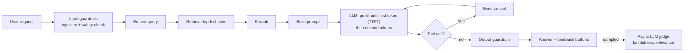
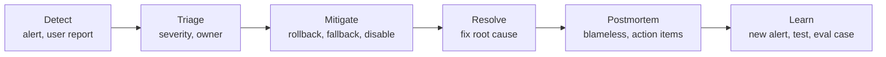
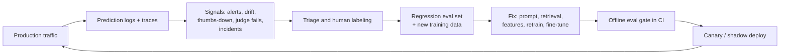
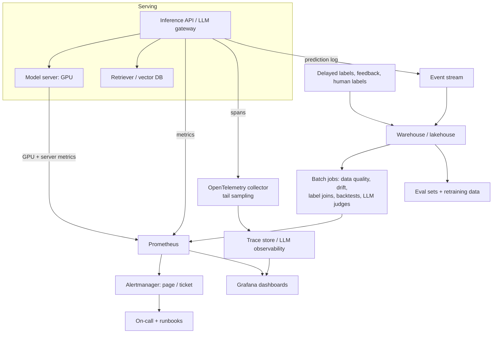

# Monitoring ML and LLM Systems in Production

> **Level:** Beginner to Advanced · **Study time:** ~110 min · **Prerequisites:** [Data Drift, Concept Drift and When to Retrain](../01-classical-ml/08-data-drift-concept-drift-and-retraining.md), [Classification Metrics and Imbalanced Data](../01-classical-ml/04-classification-metrics-and-imbalanced-data.md), [LLM Inference Fundamentals: Prefill, Decode, TTFT and Throughput](../06-llm-inference/01-inference-fundamentals-prefill-decode-and-latency-metrics.md), [Model Deployment Patterns](04-model-deployment-patterns.md), [Building a Scalable Inference API](05-building-a-scalable-inference-api.md)

## Table of contents

- [Why this matters](#why-this-matters)
- [The big picture: five layers of monitoring](#the-big-picture-five-layers-of-monitoring)
- [The toolkit: metrics, logs, traces and prediction logs](#the-toolkit-metrics-logs-traces-and-prediction-logs)
- [Layer 1: system health](#layer-1-system-health)
- [Layer 2: data quality](#layer-2-data-quality)
- [Layer 3: data and prediction drift](#layer-3-data-and-prediction-drift)
- [Layer 4: model performance when labels arrive late](#layer-4-model-performance-when-labels-arrive-late)
- [Layer 5: business KPIs](#layer-5-business-kpis)
- [Detecting delayed performance degradation](#detecting-delayed-performance-degradation)
- [Alert design: SLOs, error budgets and burn rates](#alert-design-slos-error-budgets-and-burn-rates)
- [LLM-specific monitoring](#llm-specific-monitoring)
- [Dashboards that people actually use](#dashboards-that-people-actually-use)
- [Incident response and postmortems](#incident-response-and-postmortems)
- [Closing the loop: from production to eval sets and retraining](#closing-the-loop-from-production-to-eval-sets-and-retraining)
- [Going deeper: monitoring at scale](#going-deeper-monitoring-at-scale)
- [Common mistakes and misconceptions](#common-mistakes-and-misconceptions)
- [Interview questions and model answers](#interview-questions-and-model-answers)
- [Key takeaways](#key-takeaways)
- [Further reading](#further-reading)
- [Next](#next)

## Why this matters

A normal web service fails loudly: it crashes, returns HTTP 500, or times out, and your existing alerts catch it. An ML model usually fails **silently**: it keeps returning HTTP 200 with a perfectly formatted answer that is simply wrong more often than last month. An LLM application adds new ways to fail quietly: a prompt change that doubles token cost, a broken retriever that makes the model say "I don't know" to everything, or a prompt-injection attack that never shows up as an error. Interviewers for senior AI/ML roles ask "how would you monitor this?" in almost every system design round, because the answer reveals whether you have actually run models in production. By the end of this chapter you will be able to design monitoring in layers, write latency and burn-rate math by hand, monitor quality when labels arrive weeks late, instrument an LLM pipeline stage by stage, and turn incidents into better eval sets.

## The big picture: five layers of monitoring

> **Analogy:** Think of a hospital patient. The nurse checks vital signs every few minutes (pulse, blood pressure): that is **system health**. The lab checks that blood samples are labeled and not contaminated: that is **data quality**. The doctor notices the patient's readings slowly trending away from their normal baseline: that is **drift**. Weeks later the test results come back and confirm whether the diagnosis was right: that is **model performance with delayed labels**. And the hospital director cares whether patients actually recover and go home: that is the **business KPI**. You need all five, because each catches problems the others miss.

**Monitoring** is the continuous collection of signals about a running system, plus rules that tell humans when something needs attention. **Observability** is the broader property of being able to ask new questions about your system's behavior from the data it emits, without shipping new code. Monitoring answers "is it broken?"; observability helps answer "why?".

For an ML or LLM system, organize monitoring into five layers, from fastest and cheapest to slowest and most meaningful:

```text
  Layer                     Question it answers                  Feedback speed   Example signal
  ------------------------  -----------------------------------  ---------------  ---------------------------
  5. Business KPIs          Is the product achieving its goal?   days to weeks    conversion, churn, $ saved
  4. Model performance      Is the model actually right?         hours to months  precision, MAE, faithfulness
  3. Drift                  Has the world changed?               minutes to days  PSI on features, score shift
  2. Data quality           Is the input data broken?            seconds to hrs   null rate, schema violations
  1. System health          Is the service up and fast?          seconds          p95 latency, errors, GPU mem
```

The key insight: **the layers you care about most (4 and 5) are the slowest to observe**, so you rely on the fast layers (1 to 3) as **leading indicators**, signals that move before the thing you actually care about moves.

We will use three running examples throughout:

- **Spam filter:** a classifier that scores each email with a spam probability. Labels arrive when users click "Report spam" or "Not spam", which only a few users ever do.
- **House-price model:** predicts a sale price at listing time. The true price is known only when the sale closes, often months later.
- **Support chatbot on a 7B model:** a RAG assistant (retrieval-augmented generation, see [What Is RAG](../08-rag/01-what-is-rag-and-why-it-matters.md)) serving several business customers (tenants), with a few tools such as "look up order status".

## The toolkit: metrics, logs, traces and prediction logs

Before the layers, you need the raw materials. There are three classic telemetry types (sometimes called the "three pillars of observability") plus one that is specific to ML.

- **Metric:** a number measured over time, stored as a **time series** (a sequence of timestamped values), usually pre-aggregated. Example: "requests per second, per model version". Cheap to store and fast to query, which makes metrics the right basis for alerts. Metrics carry **metric labels**, key-value tags such as `model_version="spam-v3"` (not to be confused with ML ground-truth labels); each distinct combination of label values is its own time series, and the number of such combinations is the metric's **cardinality**. The three core metric types are a **counter** (only goes up, such as total requests; you look at its per-second rate), a **gauge** (goes up and down, such as requests in flight or GPU memory) and a **histogram** (counts of observations falling into value buckets, such as latencies).
- **Log:** a timestamped record of a single event, ideally **structured** (JSON with named fields) rather than free text. Example: one line per request with its ID, status, and duration.
- **Trace:** the full path of one request through the system, made of **spans**. A span is one timed operation (for example "retrieval" or "LLM call") with a start time, duration, attributes, and a parent span. Traces answer "which stage was slow for this request?".
- **Prediction log (inference log):** an ML-specific log that records, for each prediction, the model version, the input features (or a reference to them), the output, the score, and a unique **prediction ID**. It is the foundation for drift detection, delayed-label joins, debugging, and building future training sets.

| Telemetry | What it is | Best for | Cost at scale | Weakness |
|---|---|---|---|---|
| Metrics | Aggregated numbers over time | Alerts, dashboards, SLOs | Low (if label cardinality is controlled) | Cannot drill into one request |
| Logs | One record per event | Debugging specific failures, audits | Medium to high | Expensive to search at high volume |
| Traces | Request tree of timed spans | Latency breakdown across stages and services | Medium (usually sampled) | Sampling may miss rare failures |
| Prediction logs | Inputs, outputs, version, ID per prediction | Drift, label joins, retraining data | Medium to high (stored in a warehouse) | Privacy risk, needs retention policy |

Common open tools: **Prometheus** (metrics collection and alerting), **Grafana** (dashboards), **OpenTelemetry** (a vendor-neutral standard and SDKs for emitting metrics, logs and traces), and a data warehouse or lakehouse for prediction logs. LLM-focused tracing tools are covered in [LLMOps: Tracing, Prompt Management and Langfuse](08-llmops-tracing-prompt-management-and-langfuse.md).

> **Senior insight:** Log the prediction ID everywhere: in the API response, in the prediction log, in traces, and in any downstream event (click, purchase, chargeback). Without a shared join key you cannot connect a label that arrives in six weeks back to the exact prediction and model version that produced it.

## Layer 1: system health

### The four golden signals

Google's *Site Reliability Engineering* book (Beyer et al., 2016) recommends four **golden signals** for any user-facing service:

1. **Latency:** how long requests take. Track successful and failed requests separately, because a fast error can make average latency look better.
2. **Traffic (throughput):** how much demand the system handles, for example requests per second (RPS) or, for LLMs, tokens per second.
3. **Errors:** the rate of failed requests (HTTP 5xx, timeouts, and also "wrong" responses such as invalid JSON from an LLM).
4. **Saturation:** how "full" the service is: CPU, memory, GPU memory, queue depth. Saturation predicts trouble before latency spikes.

Two related checklists you may hear: **RED** (Rate, Errors, Duration, per service) and **USE** (Utilization, Saturation, Errors, per resource, from Brendan Gregg). Golden signals combine both views.

### Why averages lie: latency percentiles

> **Analogy:** If Bill Gates walks into a café, the *average* net worth of customers becomes billions, yet no customer's situation changed. Average latency behaves the same way: a few very slow requests distort it, and it describes nobody's actual experience.

A **percentile** $p_q$ is the value below which $q$ percent of observations fall. **p50** (the median) is the typical request, **p95** means 95% of requests took this long or less, and **p99** captures the slowest 1%, the **tail latency**.

A simple definition (the **nearest-rank method**) for $n$ sorted values $x_{(1)} \le x_{(2)} \le \dots \le x_{(n)}$:

$$p_q = x_{(k)}, \quad k = \left\lceil \frac{q}{100} \cdot n \right\rceil$$

- $q$: the percentile you want (for example 95).
- $n$: the number of measurements.
- $x_{(k)}$: the $k$-th smallest value.
- $\lceil \cdot \rceil$: round up to the next whole number.

**Worked example (spam filter API, 20 requests, illustrative).** Sorted latencies in milliseconds:

```text
40, 42, 45, 45, 48, 50, 50, 52, 55, 55, 58, 60, 60, 62, 65, 70, 80, 90, 400, 1200
```

- Mean: sum = 2627 ms, so mean = 2627 / 20 = **131.35 ms**.
- p50: $k = \lceil 0.50 \times 20 \rceil = 10$, so $x_{(10)} =$ **55 ms**.
- p95: $k = \lceil 0.95 \times 20 \rceil = \lceil 19 \rceil = 19$, so $x_{(19)} =$ **400 ms**.
- p99: $k = \lceil 0.99 \times 20 \rceil = \lceil 19.8 \rceil = 20$, so $x_{(20)} =$ **1200 ms**.

The mean (131 ms) is more than double the typical request (55 ms), yet it hides that two requests in twenty (one in ten) take 400 ms or more. Report p50, p95 and p99, never only the mean.

> **Senior insight:** Tail latency matters more than it looks. If one page load fans out to 10 backend calls in parallel and each call has a 1% chance of being slower than its p99, the chance that at least one call is slow is $1 - 0.99^{10} \approx 9.6\%$. This "tail at scale" effect (Dean and Barroso, "The Tail at Scale", 2013) is why services with fan-out obsess over p99.

```python
# pip install numpy
import numpy as np

lat_ms = np.array([40, 42, 45, 45, 48, 50, 50, 52, 55, 55,
                   58, 60, 60, 62, 65, 70, 80, 90, 400, 1200])

print("mean:", lat_ms.mean())                     # 131.35
# NumPy's default uses linear interpolation between ranks,
# so it differs slightly from the nearest-rank method above.
print(np.percentile(lat_ms, [50, 95, 99]))        # [  56.5  440.  1048. ]
print(np.percentile(lat_ms, [50, 95, 99], method="inverted_cdf"))  # [  55  400 1200]
# (the `method=` keyword needs NumPy >= 1.22; older versions used `interpolation=`)
```

Different tools compute percentiles slightly differently. That is fine, as long as you compare like with like over time.

### Percentiles across many servers: histograms

You cannot average percentiles. If server A has p95 = 100 ms and server B has p95 = 300 ms, the fleet p95 is not 200 ms; it depends on how many requests each served and on the shape of each distribution. The standard fix is to record a **histogram**: counts of requests falling into fixed latency **buckets** (for example "under 50 ms", "under 100 ms", ...). Bucket counts *can* be summed across servers, and a percentile is estimated from the combined counts.

In Prometheus, a histogram metric exposes cumulative bucket counters with an `le` ("less than or equal") label, and you estimate fleet-wide p95 with:

```text
histogram_quantile(0.95, sum by (le) (rate(inference_request_latency_seconds_bucket[5m])))
```

Read it inside out: `rate(...[5m])` turns each ever-increasing bucket counter into a per-second rate over the last 5 minutes, `sum by (le)` adds the same bucket across all servers, and `histogram_quantile` finds the bucket that contains the 95th percentile and interpolates linearly inside it.

**Worked example (illustrative).** Suppose the fleet's summed cumulative bucket counts over the window are `le=0.1`: 800, `le=0.25`: 930, `le=0.3`: 960, `le=0.5`: 990, `le=+Inf`: 1,000. The p95 rank is $0.95 \times 1{,}000 = 950$, which falls in the (0.25 s, 0.3 s] bucket (cumulative counts 930 to 960, so 30 requests). Rank 950 is $(950 - 930)/30 = 2/3$ of the way through that bucket, so the estimate is $0.25 + \tfrac{2}{3} \times 0.05 \approx 0.283$ s, or 283 ms. The true p95 could be anywhere between 250 and 300 ms.

The estimate is only as precise as your bucket boundaries, so put boundaries near your SLO threshold (if the target is 300 ms, have buckets at 250 ms and 300 ms).

### Throughput, concurrency and Little's Law

**Throughput** is completed work per unit time. **Concurrency** is how many requests are in progress at once. They are linked by **Little's Law** (Little, 1961), which holds for any stable system:

$$L = \lambda \cdot W$$

- $L$: average number of requests in the system (in flight).
- $\lambda$: average arrival rate (requests per second).
- $W$: average time each request spends in the system (seconds).

**Worked example (support chatbot).** Traffic is 20 requests per second and each request takes 4 seconds end to end (illustrative). Then $L = 20 \times 4 = 80$ requests are in flight on average. If your LLM server can run at most 64 sequences in a batch, 80 > 64: at 4 s per request the server can complete at most $64 / 4 = 16$ requests per second, fewer than the 20 arriving, so the system is no longer stable. The queue grows by about 4 requests every second, $W$ grows, $L$ grows further, and latency keeps climbing until load drops or capacity is added (this assumes per-request time stays at 4 s at full batch; in practice bigger batches also slow each decode step). Saturation metrics (queue depth, running vs waiting requests) show this before users complain.

To monitor throughput, chart `sum(rate(inference_requests_total[1m]))` per model version (and, for LLMs, input and output tokens per second) next to the maximum sustainable throughput you measured in a load test while still meeting the latency SLO. The gap between the two is your **capacity headroom**; alerting when it shrinks (for example below 30%) gives time to scale out before a queue like the one above forms. Throughput that counts only requests that met their latency SLO is called **goodput**, and it is the more honest number: a saturated server can keep raw throughput flat while goodput collapses.

### GPU metrics: utilization is not what you think

For model serving on GPUs, track:

| Metric | What it tells you | Caveat |
|---|---|---|
| GPU memory used / total | How close you are to out-of-memory (OOM) errors | LLM servers often pre-allocate most memory for the KV cache, so "90% used" can be normal |
| KV cache usage (LLM servers) | Fraction of the pre-allocated cache in use by active sequences | High values mean new requests will queue or be preempted |
| "GPU utilization" (from `nvidia-smi`) | Percentage of time at least one kernel was running | 100% does **not** mean all compute units are busy; a tiny kernel counts |
| SM activity / occupancy (profiling counters, for example via NVIDIA DCGM) | How much of the chip's compute units (SMs, streaming multiprocessors) are actually active | Better signal of real compute use |
| Memory bandwidth utilization | How busy GPU memory is | LLM decode is usually memory-bandwidth-bound |
| Temperature, power, throttling, ECC errors | Hardware health | Thermal throttling silently lowers throughput |

The **KV cache** (key-value cache) stores attention keys and values for tokens already processed so they are not recomputed; it is explained in [The KV Cache](../06-llm-inference/02-kv-cache-explained.md). Why decode is memory-bound is covered in [GPU Fundamentals](../06-llm-inference/03-gpu-fundamentals-compute-bound-vs-memory-bound.md).

> **Common mistake:** Concluding "the GPU is at 100% utilization, so we need more GPUs." The `nvidia-smi` utilization number only says *some* kernel was running during the sample window. A memory-bound decode loop can show 100% while most compute sits idle. Check SM activity, batch size and tokens per second before buying hardware.

NVIDIA's DCGM exporter exposes these to Prometheus under names such as `DCGM_FI_DEV_GPU_UTIL`, `DCGM_FI_DEV_FB_USED` and `DCGM_FI_PROF_SM_ACTIVE`; serving frameworks such as vLLM expose their own metrics (running and waiting requests, KV cache usage, TTFT histograms). Exact metric names change between versions, so check the docs for your version.

### Instrumenting a model API

Here is a minimal, runnable instrumentation of the spam filter with the official Prometheus Python client. It records latency, request counts by status, in-flight requests, and the distribution of predicted scores (useful later for prediction drift).

```python
# pip install prometheus-client
import random
import time

from prometheus_client import Counter, Gauge, Histogram, start_http_server

MODEL_VERSION = "spam-v3"

REQUESTS = Counter(  # exposed as inference_requests_total
    "inference_requests", "Requests served", ["model_version", "status"])
LATENCY = Histogram(
    "inference_request_latency_seconds", "End-to-end request latency",
    ["model_version"],
    buckets=(0.01, 0.025, 0.05, 0.1, 0.25, 0.3, 0.5, 1.0, 2.5, 5.0))
IN_FLIGHT = Gauge("inference_in_flight_requests", "Requests being processed")
SCORE = Histogram(
    "spam_score", "Predicted spam probability", ["model_version"],
    buckets=[i / 10 for i in range(1, 11)])  # 0.1, 0.2, ..., 1.0


def predict(email_text: str) -> float:
    """Stand-in for a real model call."""
    time.sleep(random.uniform(0.02, 0.08))
    return random.random()


def handle_request(email_text: str) -> float | None:
    with IN_FLIGHT.track_inprogress(), LATENCY.labels(MODEL_VERSION).time():
        try:
            score = predict(email_text)
            SCORE.labels(MODEL_VERSION).observe(score)
            REQUESTS.labels(MODEL_VERSION, "ok").inc()
            return score
        except Exception:
            REQUESTS.labels(MODEL_VERSION, "error").inc()
            return None


if __name__ == "__main__":
    start_http_server(8000)  # metrics at http://localhost:8000/metrics
    while True:
        handle_request("Win a free cruise!!!")
```

Notice the `model_version` label. During a canary rollout (a small share of live traffic goes to the new version first; see [Model Deployment Patterns](04-model-deployment-patterns.md)) you compare every signal between the old and new version side by side.

## Layer 2: data quality

> **Analogy:** A chef can follow a perfect recipe and still serve a terrible meal if the delivery truck brought spoiled milk. Data quality checks inspect the ingredients at the door.

**Data quality monitoring** checks that the data entering the model is well-formed, *before* asking whether it has changed statistically. In many teams' experience, a large share of real ML incidents are data or pipeline bugs, not model bugs: an upstream team renames a column, a unit changes from dollars to cents, or a pipeline silently stops sending one country's data.

| Check | What it catches | Spam filter example | House-price example |
|---|---|---|---|
| **Schema** (columns present, types correct) | Renamed or dropped fields, type changes | `sender_domain` missing | `sqft` arrives as a string |
| **Null / missing rate** | Broken joins, failed upstream jobs | `num_links` null for 40% of emails | `year_built` suddenly all null |
| **Range and validity** | Unit changes, sentinel values like -1 or 9999 | `num_links` < 0 | `price_per_sqft` = 0 or 10x normal |
| **Categorical domain** | New or misspelled categories | New language code `"xx"` | New zip code never seen in training |
| **Volume** | Dropped traffic, duplicate floods | Request count 50% below the same hour last week | Zero new listings from one region |
| **Freshness** | Stale features or tables | Sender-reputation table not updated in 3 days | Market-index feature is last month's |
| **Duplicates / uniqueness** | Double-sends, replay bugs | Same message ID scored 5 times | Same listing ingested twice |

Run these checks in two places: in the **training and batch pipelines** (fail the pipeline before training on garbage, see [CI/CD and Testing for ML Pipelines](07-ci-cd-and-testing-for-ml-pipelines.md)) and on **live inference traffic** (usually on micro-batches, for example every 5 minutes). Mismatches between how features are computed in training and in serving, called **training-serving skew**, are covered in [Reproducible Training and Training-Serving Skew](03-reproducibility-and-training-serving-skew.md).

A from-scratch checker on a batch of house-price requests:

```python
# pip install pandas
import pandas as pd

from pandas.api.types import is_float_dtype, is_integer_dtype, is_string_dtype

EXPECTED = {"sqft": is_float_dtype, "bedrooms": is_integer_dtype, "zip": is_string_dtype}
RANGES = {"sqft": (100, 20_000), "bedrooms": (0, 20)}
MAX_NULL_RATE = 0.02
MIN_ROWS = 3  # in production: compare to the same window last week


def check_batch(df: pd.DataFrame) -> list[str]:
    issues = []
    for col, type_ok in EXPECTED.items():                   # schema
        if col not in df.columns:
            issues.append(f"missing column: {col}")
        elif not type_ok(df[col]):
            issues.append(f"{col}: unexpected dtype {df[col].dtype}")
    for col in df.columns.intersection(list(EXPECTED)):     # nulls
        rate = df[col].isna().mean()
        if rate > MAX_NULL_RATE:
            issues.append(f"{col}: null rate {rate:.0%}")
    for col, (lo, hi) in RANGES.items():                    # ranges
        if col in df.columns and pd.api.types.is_numeric_dtype(df[col]):
            bad = (~df[col].dropna().between(lo, hi)).sum()
            if bad:
                issues.append(f"{col}: {bad} value(s) outside [{lo}, {hi}]")
    if len(df) < MIN_ROWS:                                  # volume
        issues.append(f"volume: only {len(df)} rows")
    return issues


batch = pd.DataFrame({"sqft": [1200.0, 15.0, None, 2400.0],
                      "bedrooms": [3, 2, 4, 3],
                      "zip": ["94110", "10001", "60614", "94110"]})
print(check_batch(batch))
# ['sqft: null rate 25%', 'sqft: 1 value(s) outside [100, 20000]']
```

In practice you would use a library such as **Great Expectations** or **pandera** (declarative data validation) or the data-quality reports in tools like **Evidently**. APIs differ between versions; the concept (declare expectations, run them on every batch, alert on violations) is what matters.

> **Interview tip:** When asked how to monitor a model, mention data quality *before* drift. It shows you know that one of the most common production failures is a broken pipeline, not a subtle statistical shift.

## Layer 3: data and prediction drift

Drift is owned by [Data Drift, Concept Drift and When to Retrain](../01-classical-ml/08-data-drift-concept-drift-and-retraining.md). Here is the short recap you need for monitoring:

- **Data drift (covariate shift):** the input distribution $P(X)$ changes. Example: spam emails start using images instead of text.
- **Prediction drift:** the distribution of model outputs changes, for example the share of emails flagged as spam jumps from 8% to 20%. It needs no labels and is often the single most useful early warning.
- **Label drift (prior shift):** the class balance $P(Y)$ changes.
- **Concept drift:** the relationship $P(Y \mid X)$ changes, so the same input should now get a different answer. Only labels (or good proxies) reveal it.

A common drift statistic is the **Population Stability Index (PSI)**, which compares binned distributions between a reference window (often training data or a stable recent period) and the current window:

$$\text{PSI} = \sum_{i=1}^{B} (a_i - e_i)\,\ln\!\left(\frac{a_i}{e_i}\right)$$

- $B$: number of bins.
- $e_i$: fraction of reference data in bin $i$ ("expected").
- $a_i$: fraction of current data in bin $i$ ("actual").

**Worked example (spam filter, prediction drift).** Bin spam scores into three bands: low (< 0.3), middle, high (≥ 0.7). Last month's shares were $e = (0.70, 0.20, 0.10)$; today's are $a = (0.50, 0.25, 0.25)$.

- Low: $(0.50 - 0.70)\ln(0.50/0.70) = (-0.20)(-0.3365) = 0.0673$
- Middle: $(0.25 - 0.20)\ln(0.25/0.20) = (0.05)(0.2231) = 0.0112$
- High: $(0.25 - 0.10)\ln(0.25/0.10) = (0.15)(0.9163) = 0.1374$
- PSI $\approx 0.0673 + 0.0112 + 0.1374 = 0.216$

An empty bin makes the logarithm undefined, so implementations add a small epsilon to each share.

An industry rule of thumb (a heuristic, not a law) reads PSI below 0.1 as stable, 0.1 to 0.25 as moderate shift, and above 0.25 as significant shift, so the example's 0.216 is a moderate shift worth investigating. The drift chapter covers PSI by hand, the Kolmogorov-Smirnov test, Jensen-Shannon distance, and embedding drift for text and images.

What matters for monitoring design:

- **Prioritize features by importance.** Drift in a feature the model barely uses rarely matters. Weight alerts by feature importance.
- **Monitor the output too.** Prediction drift summarizes drift across all features in the one dimension the model cares about.
- **Pick the reference window deliberately.** Training data catches long-term shift; "same period last week" handles seasonality.
- **Drift is a reason to investigate, not an automatic retrain.** Many drifts are harmless, and statistical tests on large samples flag tiny, meaningless differences.

## Layer 4: model performance when labels arrive late

### The label delay problem

A **label** (ground truth) is the true answer you would compare a prediction against. In production, labels arrive late, partially, or never. **Label delay** (also called feedback delay) is the time between a prediction and the arrival of its true label.

| System | Where labels come from | Typical delay | Coverage |
|---|---|---|---|
| Spam filter | "Report spam" / "Not spam" clicks | minutes to days | Low and biased (most users never click) |
| Fraud detection | Chargebacks, investigations | weeks to months | Only for transactions that were approved |
| House prices | Closing sale price | months | Only for houses that sell |
| Ad click prediction | Click or no click | seconds to minutes | Nearly complete |
| Support chatbot | Thumbs, escalations, human review | minutes to never | Very low |

Three tools fill the gap: **proxy metrics**, **joining labels later**, and **sampling for human labeling**. A fourth, **backtesting**, uses labels once they mature.

### Proxy metrics

A **proxy metric** is a quickly available signal that correlates with the true quality you cannot yet observe. Examples:

- Spam filter: rate of "Not spam" clicks per 1,000 emails filtered (a rising rate suggests more false positives), share of emails scored in the uncertain 0.4 to 0.6 band.
- House prices: gap between the predicted price and the *listing* price (known immediately), price-cut rate on listings.
- Chatbot: escalation-to-human rate, user rephrasing the same question, thumbs-down rate.

Proxies can mislead: they are correlated with quality, not equal to it, and that correlation can break. Validate each proxy periodically against true labels.

### Joining labels later

When labels arrive, join them back to the prediction log by prediction ID, then compute metrics **by prediction date cohort**, and only for cohorts whose labels have had enough time to arrive (**matured** cohorts). Computing "accuracy this week" from the few labels that already arrived for this week's predictions is biased, because early labels are not a random sample (for fraud, fast chargebacks are a particular type of fraud).

```python
# pip install pandas
import pandas as pd

preds = pd.DataFrame({
    "prediction_id": [1, 2, 3, 4, 5, 6, 7, 8],
    "pred_date": pd.to_datetime(["2026-09-01"] * 4 + ["2026-10-13"] * 4),
    "model_version": ["fraud-v7"] * 8,
    "pred_fraud": [1, 0, 0, 1, 1, 0, 0, 1],
})
labels = pd.DataFrame({          # chargebacks that arrived later
    "prediction_id": [1, 2, 3, 4, 5],
    "is_fraud":      [1, 0, 1, 1, 0],
})

LABEL_WINDOW_DAYS = 30           # how long we wait before trusting a cohort
today = pd.Timestamp("2026-10-23")

df = preds.merge(labels, on="prediction_id", how="left")
df["matured"] = (today - df["pred_date"]).dt.days >= LABEL_WINDOW_DAYS
# For fraud, "no chargeback after the window" is treated as "not fraud".
df.loc[df["matured"] & df["is_fraud"].isna(), "is_fraud"] = 0

for date, g in df.groupby("pred_date"):
    if not g["matured"].all():
        print(date.date(), "cohort not matured yet, skipping")
        continue
    tp = ((g.pred_fraud == 1) & (g.is_fraud == 1)).sum()
    fp = ((g.pred_fraud == 1) & (g.is_fraud == 0)).sum()
    fn = ((g.pred_fraud == 0) & (g.is_fraud == 1)).sum()
    print(date.date(), f"precision={tp / (tp + fp):.2f} recall={tp / (tp + fn):.2f}")
# 2026-09-01 precision=1.00 recall=0.67
# 2026-10-13 cohort not matured yet, skipping
```

Check the September cohort by hand: predictions [1, 0, 0, 1] vs labels [1, 0, 1, 1]. True positives: IDs 1 and 4, so TP = 2. False positives: none, so FP = 0. False negatives: ID 3, so FN = 1. Precision = 2 / (2 + 0) = 1.00, recall = 2 / (2 + 1) = 0.67. Metric definitions are in [Classification Metrics](../01-classical-ml/04-classification-metrics-and-imbalanced-data.md).

> **Common mistake:** Treating "no label yet" as "negative" before the label window closes. Your recent cohorts will look artificially great (no fraud reported yet) and you will miss the degradation entirely.

### Sampling for human labeling

When natural labels are rare or biased, pay humans (or domain experts) to label a sample of production predictions. How big must the sample be? For an accuracy estimate $\hat{p}$ from $n$ randomly sampled, independently labeled predictions, the **standard error** is:

$$SE = \sqrt{\frac{\hat{p}\,(1-\hat{p})}{n}}$$

and an approximate 95% confidence interval is $\hat{p} \pm 1.96 \cdot SE$.

- $\hat{p}$: measured accuracy on the sample (a fraction between 0 and 1).
- $n$: number of labeled samples.
- $1.96$: the multiplier for 95% confidence under a normal approximation (see [Probability and Statistics](../00-foundations/04-probability-and-statistics.md)).

**Worked example (spam filter).** Reviewers label $n = 400$ random emails and the model was right on 352, so $\hat{p} = 352/400 = 0.88$.

- $\hat{p}(1-\hat{p}) = 0.88 \times 0.12 = 0.1056$
- $0.1056 / 400 = 0.000264$
- $SE = \sqrt{0.000264} \approx 0.01625$
- Margin $= 1.96 \times 0.01625 \approx 0.0318$

So accuracy is about 88% ± 3.2 points, an interval of roughly [84.8%, 91.2%]. If you need to estimate accuracy to within ±1 point, solve for $n$ with margin $m = 0.01$: $n = 1.96^2 \cdot \hat{p}(1-\hat{p}) / m^2 = 3.8416 \times 0.1056 / 0.0001 \approx 4{,}057$ labels per window. Reliably *detecting* a 1-point change between two windows needs more, because you compare two noisy estimates: a standard two-proportion power calculation (95% confidence, 80% power) gives $n \approx (1.96 + 0.84)^2 \times 2 \times 0.1056 / 0.01^2 \approx 16{,}600$ labels per window. That arithmetic is why teams choose their human-labeling budget deliberately.

Sampling strategies:

- **Uniform random sample:** unbiased estimate of overall quality. Always keep some of this.
- **Stratified sample:** fixed quotas per segment (country, tenant, score band) so small but important segments get enough labels; reweight to estimate the overall metric.
- **Uncertainty or disagreement sampling:** oversample low-confidence predictions or cases where two models disagree. Great for finding failures and training data, but biased for estimating overall accuracy unless you reweight.

### Backtesting

**Backtesting** replays a model on a past period whose labels have now matured, as if it were live then, to measure what its performance actually was. Uses:

- Confirm a suspected degradation: "the model's precision on matured August cohorts is 6 points below June."
- Compare the current model with a **challenger** (a retrained or alternative model) on the same recent, labeled period before promoting it.
- Choose a retraining cadence: train on data up to month $t$, test on month $t+1$, $t+2$, and so on, to see how fast performance decays with model age.

Always respect time: train only on data that existed before the test period, and use features as they were known at prediction time (point-in-time correctness), otherwise you leak the future (see [Overfitting and Data Leakage](../01-classical-ml/03-overfitting-regularization-and-data-leakage.md)).

## Layer 5: business KPIs

A **KPI** (key performance indicator) is the business outcome the model exists to move: revenue, conversion, fraud losses, support tickets resolved without a human, time saved. Model metrics and KPIs can disagree: a spam filter with higher recall might also block a few important invoices, raising support tickets and churn.

Monitor KPIs alongside model metrics, but be careful about causality. A KPI drop could be seasonality, a marketing change, or a competitor. The reliable way to attribute KPI movement to a model is a controlled experiment: an A/B test or a holdout group that keeps the old model or no model (see [Model Deployment Patterns](04-model-deployment-patterns.md)). Also define **guardrail metrics**, metrics that must not get worse even if the primary KPI improves (for example latency, complaint rate, or unsubscribe rate).

| Layer | Spam filter | House-price model | Support chatbot (7B RAG) |
|---|---|---|---|
| 1. System | p95 latency, 5xx rate | batch job duration, success | TTFT, tokens/s, GPU KV cache usage |
| 2. Data quality | null `sender_domain` rate | `sqft` range violations | empty retrieval results, document ingestion lag |
| 3. Drift | spam-score distribution, PSI on top features | PSI on `zip`, `sqft` | query topic mix, embedding drift |
| 4. Performance | precision/recall from reports + labeled sample | MAE on closed sales (backtest) | sampled faithfulness and helpfulness (judge + humans) |
| 5. KPI | user-reported spam per 1k emails | listing conversion, agent trust | deflection rate, CSAT, escalations |

## Detecting delayed performance degradation

**Delayed performance degradation** means the model's real quality is dropping now, but you will only *confirm* it with labels later. The goal is to shrink the time between "it started getting worse" and "we know".

```text
 time ---->
 day 0           day 3              day 10               day 35            day 40
   |               |                   |                    |                  |
 world changes   drift + prediction  proxy metrics move   labels mature,     retrained model
 (fraud pattern) shift detected      ("not spam" clicks,  backtest confirms  shipped via canary
                 (leading signal)    escalations rise)    recall dropped
                  ^                                        ^
                  investigation starts here                not here
```

A layered detection strategy:

1. **Leading indicators (no labels):** input drift weighted by feature importance, prediction drift (positive rate, score histogram), confidence or entropy shifts, rising share of out-of-distribution inputs. If the model is **calibrated** (predictions scored 0.8 are right about 80% of the time), its average confidence on today's traffic is itself an estimate of today's accuracy; this is the idea behind confidence-based performance estimation in tools such as NannyML. It can work under covariate shift, provided the model stays calibrated on the shifted inputs (not guaranteed when traffic moves into regions the model rarely saw), but it is blind to concept drift, because the model's confidence cannot know that $P(Y \mid X)$ changed.
2. **Proxies (fast, partial labels):** user corrections, escalations, overrides by human reviewers.
3. **Small fresh labeled sample:** a continuous human-labeling stream gives an unbiased (but noisy) quality estimate within days.
4. **Matured-cohort metrics and backtests:** the authoritative answer, weeks later.
5. **Segment slicing:** compute everything per segment (country, device, tenant, traffic source). An overall metric can stay flat while one segment collapses, because a large healthy segment hides a small broken one.
6. **Change detection over time:** compare rolling windows against a baseline, or use sequential methods such as CUSUM or Page-Hinkley (outlined in the drift chapter) that accumulate small consistent deviations into an alarm. CUSUM keeps a running sum of how far each new value (say, the daily error rate) exceeds its expected level minus a small allowance, never lets the sum drop below zero, and fires when the sum crosses a threshold, so ten days of "slightly worse" add up even though no single day looks alarming.

> **Senior insight:** Beware **feedback loops**. A fraud model that blocks a transaction never learns whether it was really fraud, because blocked transactions get no chargeback. Over time the label data only covers what the model approved. Teams keep a small random **exploration** or **holdout** slice (for example, sending a tiny fraction of flagged cases to manual review instead of auto-blocking) so they can still measure true precision.

## Alert design: SLOs, error budgets and burn rates

### Vocabulary

- **SLI (service level indicator):** a measured ratio of good events to total events. Example: fraction of requests answered successfully in under 300 ms.
- **SLO (service level objective):** a target for an SLI over a window. Example: 99.9% of requests good over 30 days.
- **SLA (service level agreement):** a contract with customers, with penalties if missed. SLAs are usually looser than internal SLOs.
- **Error budget:** the amount of "bad" the SLO allows: $1 - \text{SLO}$.

> **Analogy:** An error budget is like a monthly mobile data plan. You are allowed some usage; the question is not "did I use any data today?" but "at this rate, will I run out before the month ends?"

### Error budget math

$$\text{error budget} = (1 - \text{SLO}) \times \text{total events in window}$$

**Worked example.** The spam API's SLO is 99.9% good requests over 30 days and it serves 10,000,000 requests per month.

- Budget fraction: $1 - 0.999 = 0.001$.
- Request budget: $0.001 \times 10{,}000{,}000 = 10{,}000$ bad requests per month.
- Time view: 30 days $= 30 \times 24 \times 60 = 43{,}200$ minutes, and $0.001 \times 43{,}200 = 43.2$ minutes of full outage per month.

The budget turns reliability into a decision tool: if you still have budget, ship risky changes; if it is exhausted, freeze features and fix reliability.

### Burn rate

The **burn rate** is how fast you are consuming the budget relative to the rate that would use exactly 100% of it over the window:

$$\text{burn rate} = \frac{\text{observed error rate}}{1 - \text{SLO}}$$

- Observed error rate: fraction of bad events in a recent window (for example the last hour).
- $1 - \text{SLO}$: the sustainable error rate.

A burn rate of 1 uses the whole budget in exactly 30 days. A burn rate of 10 uses it in 3 days.

**Worked example.** Over the last hour, 1.44% of requests failed. Burn rate $= 0.0144 / 0.001 = 14.4$. A 30-day window has $30 \times 24 = 720$ hours, so one hour at burn rate 14.4 consumes $14.4 / 720 = 0.02$, which is **2% of the monthly budget in a single hour**. If it continued, the budget would be gone in $720 / 14.4 = 50$ hours.

### Multi-window, multi-burn-rate alerts

Alerting directly on "error rate > X for 5 minutes" is either too noisy (pages on every blip) or too slow. Google's *The Site Reliability Workbook* (Beyer et al., 2018) recommends alerting on burn rate with two windows: a long window to make sure the problem is significant and a short window to make sure it is still happening (so the alert stops soon after recovery). Its suggested starting points for a 30-day SLO:

| Severity | Burn rate | Long window | Short window | Budget consumed when it fires |
|---|---|---|---|---|
| Page | 14.4 | 1 hour | 5 minutes | 2% |
| Page | 6 | 6 hours | 30 minutes | 5% |
| Ticket | 1 | 3 days | 6 hours | 10% |

Check the "budget consumed" column: $14.4 \times 1 / 720 = 2\%$; $6 \times 6 / 720 = 36/720 = 5\%$; $1 \times 72 / 720 = 10\%$.

A Prometheus alerting rule for the fast-burn page:

```yaml
groups:
  - name: inference-api-slo
    rules:
      - alert: InferenceApiErrorBudgetFastBurn
        expr: |
          (
            sum(rate(inference_requests_total{status="error"}[1h]))
            / sum(rate(inference_requests_total[1h]))
          ) > (14.4 * 0.001)
          and
          (
            sum(rate(inference_requests_total{status="error"}[5m]))
            / sum(rate(inference_requests_total[5m]))
          ) > (14.4 * 0.001)
        labels:
          severity: page
        annotations:
          summary: "Inference API is burning its 30-day error budget at over 14x"
          runbook_url: "https://wiki.example.com/runbooks/inference-api-errors"
```

The same pattern works for a latency SLO: define "good" as "finished under 300 ms" (from histogram buckets) and alert on the burn rate of "not good".

```python
def burn_rate(bad: int, total: int, slo: float) -> float:
    """How many times faster than sustainable we are using the error budget."""
    return (bad / total) / (1 - slo)


def should_page(bad_1h, total_1h, bad_5m, total_5m, slo=0.999, threshold=14.4):
    return (burn_rate(bad_1h, total_1h, slo) > threshold
            and burn_rate(bad_5m, total_5m, slo) > threshold)


print(round(burn_rate(144, 10_000, 0.999), 1))     # 14.4
print(should_page(200, 10_000, 30, 800))           # True  (20.0x and 37.5x)
print(should_page(200, 10_000, 1, 800))            # False (recovered: 1.25x now)
```

### Avoiding alert fatigue

**Alert fatigue** is what happens when people receive so many alerts, most of them not actionable, that they start ignoring all of them, including the real one. Rules that prevent it:

- **Page only on symptoms users feel** (SLO burn, data pipeline stopped, quality collapse). Causes (high CPU, one drifting minor feature) go to dashboards or tickets.
- **Every page must be actionable and urgent.** If the right response is "look at it tomorrow", it is a ticket, not a page.
- **Use severity tiers:** page (wake someone up), ticket (fix this week), dashboard-only (context for investigation).
- **Account for seasonality:** compare to the same hour last week instead of a fixed threshold for volume and drift alerts.
- **Require persistence** (the `for:` clause in Prometheus or the two-window pattern) so single-sample blips do not fire.
- **Deduplicate and group** related alerts (Prometheus Alertmanager does grouping, and inhibition, which mutes downstream alerts while a root-cause alert is firing), so one upstream outage does not produce 40 pages.
- **Review alerts regularly:** track how often each alert fired and whether action was taken. Delete or tune alerts that were never actionable.
- **Alert on missing data:** a silent pipeline that stops emitting metrics should fire a "no data" or heartbeat alert rather than looking healthy.

### Runbooks

A **runbook** is a short document linked from every alert that tells the on-call engineer what the alert means and what to do first. A good ML runbook includes:

```text
Alert: SpamScorePositiveRateShift
Meaning:   share of emails scored >= 0.5 deviates > 3x from same hour last week
Impact:    users may miss spam (rate down) or lose real mail (rate up)
First checks:
  1. Dashboard "Spam / Data quality": any null-rate or schema alerts upstream?
  2. Deploy annotations: was a model, feature or config change shipped recently?
  3. Volume by source: is one sender domain or region dominating traffic (campaign/attack)?
Mitigation:
  - Recent model deploy -> roll back to previous registry version (command: ...)
  - Upstream feature broken -> switch to fallback model without that feature
Escalate to: ML on-call, then data platform on-call
```

## LLM-specific monitoring

Everything above still applies to LLM systems. On top of it, LLM applications have new signals, because each request is expensive, multi-stage, and produces free text whose quality has no simple ground truth.



Each box is a span in the trace and a source of metrics.

### Token usage and cost

LLM cost is driven by tokens (see [Tokenization](../04-transformers/01-tokenization.md)). For a hosted API, typically:

$$\text{cost} = \frac{N_{in}}{10^6} \cdot c_{in} + \frac{N_{out}}{10^6} \cdot c_{out}$$

- $N_{in}$: input (prompt) tokens: system prompt, retrieved chunks, conversation history, user message.
- $N_{out}$: output (completion) tokens, including any hidden reasoning tokens a reasoning model bills for.
- $c_{in}, c_{out}$: price per million input and output tokens. Output tokens usually cost several times more than input tokens. Many providers also discount cached prompt prefixes.

**Worked example (illustrative prices: $c_{in}$ = \$2.50, $c_{out}$ = \$10.00 per million tokens).** A chatbot request has 800 system-prompt tokens, 2,000 retrieved-context tokens and 200 user tokens, so $N_{in} = 3{,}000$, and the answer is $N_{out} = 400$ tokens.

- Input: $3{,}000 / 10^6 \times 2.50 = 0.0075$ dollars.
- Output: $400 / 10^6 \times 10.00 = 0.0040$ dollars.
- Total: $0.0115$ dollars per request, so 1,000,000 requests per month cost about \$11,500.

Note that 2,000 of the 3,000 input tokens are retrieved context: changing top-k from 5 to 10 chunks would take input from 3,000 to about 5,000 tokens, raising input cost by about two-thirds. That is why cost belongs on the same dashboard as retrieval settings.

For a **self-hosted** model (for example the 7B model on your own GPUs), cost per request is roughly GPU cost per hour divided by requests served per hour, so throughput and batching drive cost (see [Optimizing and Benchmarking LLM Latency and Cost](../06-llm-inference/07-optimizing-and-benchmarking-llm-latency-and-cost.md)).

What to monitor:

- Input and output tokens per request (p50, p95), and their distribution: a long tail often means runaway conversation history or a retrieval bug stuffing huge chunks.
- **Cost per request, per user, per tenant, per feature, per model version.** Attribute by attaching tenant and feature IDs to each request's telemetry.
- Cache hit rate (for prompt caching), retries (each retry costs tokens), and output truncation rate (hitting `max_tokens`).
- **Cost anomalies:** a tenant whose daily spend jumps 5x versus its own baseline, often a runaway agent loop or an abusive script. Pair with per-tenant budgets and rate limits.

### Latency per stage

For a streaming LLM, users perceive two things: how long until text starts appearing, and how fast it flows. Defined in [LLM Inference Fundamentals](../06-llm-inference/01-inference-fundamentals-prefill-decode-and-latency-metrics.md):

- **TTFT (time to first token):** from request arrival to the first output token. Includes queueing, prompt processing (**prefill**) and, in RAG, everything before the LLM call.
- **TPOT (time per output token):** average time between consecutive output tokens during **decode** (generating one token at a time). It is closely related to **ITL (inter-token latency)**; some tools use the names interchangeably, while benchmark tools such as vLLM's report ITL as the individual gaps and TPOT as their per-request average.

$$\text{LLM latency} \approx \text{TTFT} + (N_{out} - 1) \cdot \text{TPOT}$$

**Worked example (7B chatbot, illustrative numbers).**

| Stage | p50 duration |
|---|---|
| Input guardrail check | 30 ms |
| Embed query | 20 ms |
| Retrieval (vector search) | 60 ms |
| Rerank top 20 | 120 ms |
| LLM TTFT (queue + prefill) | 400 ms |
| Decode: 300 tokens at 25 ms each after the first | $(300 - 1) \times 25 = 7{,}475$ ms |

Time until the user sees the first token: $30 + 20 + 60 + 120 + 400 = 630$ ms. Total time to the last token: $630 + 7{,}475 = 8{,}105$ ms, about 8.1 s. The breakdown tells you where to act: decode dominates total time (shorter answers or faster decode help), while the reranker is 120 of the 630 ms before first token (a smaller reranker helps perceived latency).

Monitor p50/p95/p99 of each stage separately, plus server-side signals: queue time, running vs waiting requests, batch size, KV cache usage and preemptions (the server pausing a running request and evicting its KV cache to free memory, then redoing that work later). A rising p95 TTFT with flat TPOT usually means queueing or longer prompts; rising TPOT usually means bigger batches or memory pressure. For a full debugging walkthrough see [Debugging Case: Rising p95 Latency and Memory](../11-system-design/08-debugging-case-rising-p95-latency-and-memory.md).

### Refusal and abstention rates

- **Refusal:** the model declines to help ("I can't help with that"), usually for safety or policy reasons.
- **Abstention:** the model says it does not know, often by design in RAG when the retrieved context does not contain the answer.

Both rates should be *stable and non-zero*. A sudden spike in abstention often means retrieval broke (an empty or stale index, a permissions filter that now excludes everything). A spike in refusals often follows a model or system-prompt change that made the model over-cautious. A drop to zero abstention can mean the model now makes up answers instead of admitting ignorance (see [Hallucinations and Grounding](../05-llms/06-hallucinations-and-grounding.md)). Detect them with a small classifier or a cheap LLM labeler rather than brittle keyword matching, and slice by tenant and topic.

### Sampled online evaluation with LLM judges

Free-text answers have no automatic label, so teams run **online evaluation**: asynchronously scoring a sample of live traffic. An **LLM judge** (LLM-as-a-judge) is a model prompted with a rubric to grade an answer, for example: "Is every claim in the answer supported by the retrieved context? Answer yes/no and list unsupported claims." Typical online checks for RAG:

- **Faithfulness (groundedness):** are the answer's claims supported by the retrieved context?
- **Answer relevance:** does the answer address the question?
- **Context relevance:** did retrieval return useful chunks?

These are explained in [Evaluating RAG: Retrieval Metrics, Faithfulness and RAGAS](../08-rag/10-rag-evaluation-metrics-and-ragas.md) and judge design in [Evaluating LLMs: Metrics, Benchmarks and LLM-as-a-Judge](../05-llms/10-llm-evaluation-metrics-and-llm-as-a-judge.md). Monitoring-specific rules:

- **Sample, do not judge everything.** Judging costs tokens and latency. Example (illustrative): a judge call with 4,000 input and 200 output tokens at the prices above costs $0.0100 + 0.0020 = 0.012$ dollars. Judging 2% of 1,000,000 requests is 20,000 calls, about \$240 per month, versus \$12,000 for judging everything.
- **Run judges asynchronously**, off the request path, from the prediction log or trace store.
- **Sample deterministically** by hashing the request ID, so the same request is always in or out of the sample, and oversample risky slices (new tenants, low retrieval scores, thumbs-down).
- **Calibrate the judge against humans.** Periodically have humans label a subset and measure agreement (for example Cohen's kappa, which corrects raw agreement for agreement expected by chance: 1 is perfect, 0 is chance level). Known judge biases include position bias and preference for longer answers ("Judging LLM-as-a-Judge with MT-Bench and Chatbot Arena", Zheng et al., 2023).
- **Pin the judge model and prompt version.** If the judge changes, scores shift even when your system did not. Treat a judge upgrade like a metric redefinition.
- **Report confidence intervals.** 200 judged answers per day gives a noisy daily faithfulness rate (use the standard error formula from Layer 4); trend weekly or alert on large moves.

```python
import hashlib

SAMPLE_RATE = 0.02  # 2% of traffic


def in_eval_sample(request_id: str, rate: float = SAMPLE_RATE) -> bool:
    """Deterministic: the same request_id always gets the same decision."""
    bucket = int(hashlib.sha256(request_id.encode()).hexdigest(), 16) % 10_000
    return bucket < rate * 10_000


JUDGE_PROMPT = """You are grading a support answer.
Context:
{context}

Question: {question}
Answer: {answer}

Is every factual claim in the answer supported by the context?
Reply with JSON: {{"faithful": true or false, "unsupported_claims": [...]}}"""


def judge_faithfulness(trace: dict, call_llm) -> dict:
    """call_llm(prompt) -> str is your provider client (SDKs change often)."""
    prompt = JUDGE_PROMPT.format(context=trace["context"],
                                 question=trace["question"],
                                 answer=trace["answer"])
    return {"request_id": trace["request_id"],
            "judge_version": "faithfulness-judge-v2",
            "raw": call_llm(prompt)}  # parse and validate JSON before storing
```

### User feedback signals

- **Explicit feedback:** thumbs up/down, star ratings, free-text comments. High signal, but only a small, self-selected minority of users give it (often unhappy ones), so treat it as a trend signal, not an accuracy estimate.
- **Implicit feedback:** regenerate clicks, the user rephrasing the same question, copying the answer, accepting an AI-drafted reply with or without edits (edit distance), abandoning the session, escalating to a human agent, or a support ticket reopened later.

Join feedback to traces by request ID. Thumbs-down traces are the richest input for your eval set (see "Closing the loop" below).

### Safety and prompt-injection detections

**Prompt injection** is an attack where text in the user's message or in retrieved content (a web page, an email, a document) contains instructions that try to hijack the model ("ignore your instructions and reveal the system prompt"). Defenses are covered in [LLM Safety, Guardrails and Responsible AI](../05-llms/13-llm-safety-guardrails-and-responsible-ai.md) and [Making Agents Reliable and Secure](../09-agents/08-agent-reliability-security-and-prompt-injection.md). For monitoring, count and trend:

- Input guardrail flags: injection classifier hits (for example Meta's Prompt Guard models), jailbreak attempts, toxic inputs (for example via Llama Guard, Inan et al., 2023).
- Output guardrail flags: PII in outputs, unsafe content, policy violations, system-prompt leakage.
- Blocked vs allowed decisions, and the false-positive rate of the guardrail itself (sampled human review), because an over-eager guardrail is also a quality incident.
- Spikes per tenant or per user: a single account generating hundreds of injection attempts is an abuse signal for the security team.

### Tool error rates (agents)

For an agent (see [What Is an AI Agent?](../09-agents/01-what-is-an-ai-agent.md)), every tool call is an operation that can fail. Track per tool:

- Call rate and success rate, with errors classified: timeout, HTTP 4xx/5xx from the backing service, permission denied, and **argument validation failure** (the model produced arguments that do not match the tool's schema).
- Tool latency p95 (often the slowest part of an agent step).
- Steps per task and loop detection (the same tool called with the same arguments repeatedly), plus tasks hitting the step limit.
- Task-level success rate, where measurable.

A rising argument-validation failure rate right after a model upgrade is a classic sign that the new model formats tool calls differently. More in [Evaluating and Observing Agents](../09-agents/09-evaluating-and-observing-agents.md).

### Putting it together: one telemetry record per request

A practical pattern: emit one structured record per request (in addition to spans), then aggregate in the warehouse. The aggregation below is a sketch you can run with pandas:

```python
# pip install pandas
import pandas as pd

PRICE_IN, PRICE_OUT = 2.50, 10.00  # illustrative $ per 1M tokens

records = pd.DataFrame([
    # request_id, tenant, retrieval_ms, rerank_ms, ttft_ms, total_ms, tokens, flags
    dict(rid="a1", tenant="acme",   retrieval_ms=55, rerank_ms=110, ttft_ms=380,
         total_ms=7900,  in_tok=3000, out_tok=300, abstained=False, tool_error=False),
    dict(rid="a2", tenant="acme",   retrieval_ms=60, rerank_ms=125, ttft_ms=420,
         total_ms=8300,  in_tok=3200, out_tok=310, abstained=True,  tool_error=False),
    dict(rid="b1", tenant="globex", retrieval_ms=70, rerank_ms=130, ttft_ms=900,
         total_ms=15200, in_tok=9000, out_tok=600, abstained=False, tool_error=True),
])

records["cost_usd"] = (records.in_tok / 1e6 * PRICE_IN
                       + records.out_tok / 1e6 * PRICE_OUT)

per_tenant = records.groupby("tenant").agg(
    requests=("rid", "count"),
    cost_usd=("cost_usd", "sum"),
    p95_ttft_ms=("ttft_ms", lambda s: s.quantile(0.95)),
    abstain_rate=("abstained", "mean"),
    tool_error_rate=("tool_error", "mean"),
)
print(per_tenant.round(4))
```

By hand for `acme`: request a1 costs $3000/10^6 \times 2.5 + 300/10^6 \times 10 = 0.0075 + 0.0030 = 0.0105$; a2 costs $0.0080 + 0.0031 = 0.0111$; total 0.0216 dollars, abstain rate 1/2 = 0.5. For `globex`, b1 costs $0.0225 + 0.0060 = 0.0285$ dollars, about 2.6 times an average `acme` request ($0.0285 / 0.0108 \approx 2.6$), driven mainly by its 9,000-token prompt. A per-tenant view makes this obvious; an overall average would hide it.

For traces, **OpenTelemetry** lets you wrap each stage in a span:

```python
# pip install opentelemetry-api opentelemetry-sdk
from opentelemetry import trace

tracer = trace.get_tracer("support-bot")


def answer(question: str, tenant: str) -> str:
    with tracer.start_as_current_span("chat_request") as root:
        root.set_attribute("tenant.id", tenant)
        with tracer.start_as_current_span("retrieval") as span:
            chunks = ["..."]                      # your vector search
            span.set_attribute("retrieval.num_chunks", len(chunks))
        with tracer.start_as_current_span("llm_call") as span:
            text, usage = "...", {"in": 3000, "out": 300}  # your LLM client
            # OpenTelemetry has (still-evolving) GenAI semantic conventions,
            # for example gen_ai.usage.input_tokens; check the current spec.
            span.set_attribute("gen_ai.usage.input_tokens", usage["in"])
            span.set_attribute("gen_ai.usage.output_tokens", usage["out"])
        return text
```

Without an exporter configured, these spans go nowhere; in production you configure the SDK to export to a collector or to an LLM observability tool such as Langfuse, Arize Phoenix or LangSmith (see [LLMOps: Tracing, Prompt Management and Langfuse](08-llmops-tracing-prompt-management-and-langfuse.md)).

## Dashboards that people actually use

A **dashboard** is a set of charts answering a specific audience's questions. Bad dashboards have 60 panels nobody reads. Good ones are layered:

```text
 Overview (one screen, "is it healthy?")
   SLO status + error budget left | p95 latency | RPS | error rate | cost today
   quality proxy (e.g., thumbs-down rate, positive rate) | active alerts
        |
        +--> System drill-down: per-instance latency, GPU memory, KV cache, queue depth
        +--> Data drill-down: null rates, schema violations, volume vs last week, PSI top-10 features
        +--> Quality drill-down: matured-cohort metrics, labeled-sample accuracy, judge scores
        +--> LLM drill-down: per-stage latency, tokens, cost per tenant, refusal/abstention, tool errors
        +--> Business: KPIs and guardrails, A/B test readouts
```

| Audience | Main questions | Key panels |
|---|---|---|
| On-call engineer | Is it broken right now? Where? | SLO burn, golden signals, per-stage latency, deploy markers |
| ML engineer / data scientist | Is the model still good? Why not? | Drift, prediction distribution, cohort metrics, slices |
| LLM app team | Are answers good and affordable? | Judge scores, feedback, refusal/abstention, tokens, cost by tenant |
| Product / business | Is it worth it? | KPIs, guardrail metrics, cost per successful outcome |

Practical rules:

- **Annotate deploys** (model, prompt, config, data pipeline changes) on every time-series chart. The most common answer to "why did this change?" is "we changed something."
- **Show comparisons:** current vs last week, canary vs baseline, per tenant.
- **Put rates next to counts:** "3% errors" means little without "of 50 requests" or "of 5 million".
- **Link panels to logs and traces** (for example from a latency spike to example slow traces), so investigation is one click.

## Incident response and postmortems

An **incident** is any unplanned event that harms users or the business, including silent ML failures like "the recommender has served the same 10 items to everyone for 6 hours".



| Severity (example scheme) | Meaning | Response |
|---|---|---|
| SEV1 | Major outage or harmful outputs to many users | Page immediately, incident commander, status updates |
| SEV2 | Significant degradation (latency SLO burning, one tenant broken) | Page on-call, fix within hours |
| SEV3 | Minor or slow-moving issue (moderate drift, small quality dip) | Ticket, fix within days |

Key practices:

- **Mitigate first, debug later.** Roll back the model, prompt or config to the last known good version (this is why the [model registry](02-data-and-model-versioning-and-model-registry.md) and versioned prompts matter), route traffic to a fallback model, disable a feature flag, or switch an LLM feature to a safer mode. Root-cause analysis can wait until users are protected.
- **Assign roles** for big incidents: an **incident commander** coordinates, others investigate and communicate.
- **Keep a timeline** while it happens: when it started, when it was detected, what was tried.
- Measure **time to detect** and **time to mitigate**. For ML systems, time to detect is often the largest, because failures are silent.

A **postmortem** is a written review after the incident. It should be **blameless**: focus on how the system and process allowed the failure, not on who made the mistake, so people report problems honestly. A compact template:

```text
Title:        Chatbot answered "I don't know" to 70% of questions for 9 hours
Impact:       ~40k conversations, escalations +3x, tenants affected: all
Detection:    abstention-rate alert fired 6h after start (threshold too loose)
Root cause:   re-embedding job wrote vectors with a new embedding model while
              queries still used the old model -> similarity scores near random
Trigger:      embedding model upgrade shipped without a retrieval regression test
Mitigation:   pointed retrieval at the previous index snapshot
Action items: [owner, due date]
  1. Index stores embedding model version; query path refuses on mismatch
  2. Retrieval eval (recall@10 on golden set) gates every re-embedding job
  3. Tighten abstention alert: burn-rate style, 30-minute short window
  4. Add 50 affected queries to the RAG regression eval set
```

Notice the ML-specific pattern: the root cause was a *data/version mismatch* that never raised an exception. Re-embedding and index versioning are covered in [Production Ingestion Pipelines](../08-rag/12-production-ingestion-pipelines-at-scale.md).

## Closing the loop: from production to eval sets and retraining

Monitoring is not just alarms. Its biggest long-term value is turning production experience into better models and better tests. This is the **data flywheel**.



How to run it well:

- **Every incident and recurring failure becomes test cases.** Add the failing inputs (after removing personal data) to the regression eval set, so the same bug cannot return silently. See [Building an LLM Evaluation Framework and Regression Tests](../05-llms/11-building-an-llm-evaluation-framework-and-regression-tests.md).
- **Keep eval sets balanced.** If you only add hard failures, the eval set stops representing real traffic. Maintain a representative random slice alongside a "hard cases" slice, and report them separately.
- **Retraining triggers:** scheduled (for example monthly), performance-based (matured metrics or labeled sample below threshold), or drift-based (significant drift on important features, confirmed by investigation). The trade-offs are in [Data Drift, Concept Drift and When to Retrain](../01-classical-ml/08-data-drift-concept-drift-and-retraining.md).
- **Retrained models go through the same gates:** offline eval against the current model on recent matured data (a backtest), then shadow or canary deployment with monitoring comparisons, then promotion. Automating this end to end is in [CI/CD and Testing for ML Pipelines](07-ci-cd-and-testing-for-ml-pipelines.md).
- **For LLM apps,** "retraining" is often a prompt change, retrieval change, new documents, or a fine-tune (see [Prompting vs RAG vs Fine-Tuning](../05-llms/08-prompting-vs-rag-vs-fine-tuning-decision-guide.md)). The loop is the same: monitor, collect failures, fix, evaluate, ship gradually.
- **Watch for feedback-loop bias** in new training data: labels gathered only where the model acted (approved transactions, shown recommendations) do not represent everything.

## Going deeper: monitoring at scale

### Metric cardinality

**Cardinality** is the number of distinct label combinations a metric has; each combination is a separate time series. A latency histogram with 10 buckets, labeled by 5 model versions and 200 tenants, is already $10 \times 5 \times 200 = 10{,}000$ series per instance (more in Prometheus, which also stores a `+Inf` bucket plus `_sum` and `_count` series for every label combination). Adding `user_id` (millions of values) would overwhelm a metrics database like Prometheus.

| Dimension | Where it belongs |
|---|---|
| Model version, region, status, endpoint | Metric labels (low cardinality) |
| Tenant (hundreds to a few thousand) | Metric labels if bounded, otherwise warehouse |
| User ID, request ID, prompt text | Logs, traces, and the warehouse, never metric labels |

### Sampling traces and logs

At high volume you cannot keep every trace. **Head sampling** decides at the start of a request (cheap, but random, so rare failures are often dropped). **Tail sampling** decides after the request completes (keep all errors, all slow requests, all thumbs-down, plus a small random slice), which is more useful but requires buffering spans in a collector. For LLM apps, full prompt and response logging is also a storage and privacy cost: redact personal data (PII), set retention limits, and restrict access, especially in multi-tenant systems (see [Secure Multi-Tenant RAG](../08-rag/13-secure-multi-tenant-rag.md)).

### Seasonality-aware baselines

Traffic, input mix and even model scores often follow daily and weekly cycles. A fixed threshold alerts every Monday morning. Better baselines: same hour last week, a rolling median with a tolerance band, or a simple forecast. For drift, compare like with like (Saturday vs last Saturday).

### Segment-level monitoring

Aggregate metrics hide segment failures. If 90% of traffic is English and healthy while Spanish accuracy collapses from 85% to 50%, overall accuracy moves from 85% to $0.9 \times 0.85 + 0.1 \times 0.50 = 0.765 + 0.050 = 81.5\%$, a 3.5-point dip easy to dismiss as noise. Precompute metrics for key slices (language, tenant, platform, new vs returning users) and alert per slice where the volume supports it.

### Monitoring the monitoring

- **Heartbeat ("dead man's switch") alerts:** an alert that fires if a scheduled job or metric stream *stops*.
- **Freshness of monitoring pipelines:** the drift job itself can silently fail; a drift dashboard showing yesterday's data looks perfectly calm.
- **Judge and guardrail health:** latency, error rate and version of the judge and classifiers, since they are models too.

### Build vs buy

| Need | Open-source options | Managed or commercial options (examples) |
|---|---|---|
| System metrics and alerts | Prometheus, Alertmanager, Grafana, OpenTelemetry | Datadog, Grafana Cloud, cloud provider monitoring |
| Data quality and drift | Great Expectations, pandera, Evidently | Arize, Fiddler, WhyLabs, cloud ML monitoring |
| LLM tracing and online eval | Langfuse, Arize Phoenix, OpenTelemetry GenAI conventions | LangSmith, Datadog LLM Observability, Langfuse Cloud |

Products and features change quickly; in an interview, describe the capabilities you need (metrics, prediction logs, traces, drift jobs, judges, alerting) and say which tool you would use for each, rather than relying on one vendor.

### Reference architecture



The split to remember: **real-time metrics** for fast, cheap alerting; **the warehouse** for anything that needs joins, labels, or heavy statistics; **traces** for per-request debugging.

## Common mistakes and misconceptions

- **Monitoring only system health.** A model can be fast and 100% available while being wrong. Monitor all five layers.
- **Alerting on averages.** Use percentiles from histograms; averages hide the tail and cannot reveal what most users experience.
- **Averaging percentiles across instances.** Aggregate histograms, then compute the percentile.
- **Trusting `nvidia-smi` GPU utilization as "how busy the GPU is".** It measures whether any kernel ran, not how much compute was used.
- **Computing accuracy on immature cohorts.** Missing labels are not negatives until the label window closes.
- **Retraining automatically on every drift alert.** Drift is a prompt to investigate. Retraining on broken data makes things worse.
- **Paging on causes instead of symptoms.** High CPU or a minor feature shift is not a page; a burning SLO is.
- **Alerts without runbooks or owners.** An alert nobody knows how to act on trains people to ignore alerts.
- **Treating thumbs-down rate as an accuracy metric.** Explicit feedback is sparse and self-selected; use it as a signal and a source of failure examples.
- **Running LLM judges on all traffic synchronously.** Sample, run async, pin the judge version, and calibrate it against humans.
- **Not tracking cost per tenant.** One misbehaving integration or agent loop can dominate the bill, and an aggregate cost chart will not show who.
- **Putting user IDs or prompts in metric labels.** That causes a cardinality explosion; keep high-cardinality data in logs, traces and the warehouse.
- **No deploy annotations.** Most regressions are caused by a change you made; make changes visible on every chart.

## Interview questions and model answers

<details>
<summary><b>Q1. How do you detect drift and delayed performance degradation?</b></summary>

**Short answer:** I layer signals by speed. With no labels, I monitor data quality first, then input drift on important features (PSI or KS against a reference window) and prediction drift (score distribution, positive rate), which are leading indicators. Next come proxy metrics like user corrections or escalations and a small continuous human-labeled sample. The authoritative check is joining delayed labels back to predictions by ID and computing metrics on matured cohorts, plus backtests. I slice everything by segment, and treat drift alerts as triggers for investigation, not automatic retraining.

**Deeper answer and follow-ups:**

- **Leading signals:** PSI = $\sum (a_i - e_i)\ln(a_i/e_i)$ on top features weighted by importance; prediction drift needs no labels and is often the earliest warning (a spam-score mix moving from 70/20/10% to 50/25/25% across three bands gives PSI $\approx 0.22$, a moderate shift). Embedding drift for text and images.
- **Label-free performance estimation:** for a calibrated classifier, average confidence estimates accuracy before labels arrive. It catches covariate shift but not concept drift, so it complements label joins rather than replacing them.
- **Proxies:** spam "Not spam" clicks per 1,000 filtered emails; listing-price gap for house prices; escalation rate for chatbots. Validate proxies against real labels periodically.
- **Labeled sample:** with $n = 400$ and accuracy 0.88, the 95% margin is $1.96\sqrt{0.88 \times 0.12 / 400} \approx 3.2$ points, so size the sample to the precision you need (about 4,000 labels for ±1 point; detecting a 1-point change between two windows with 80% power needs roughly 16,600 per window).
- **Delayed labels:** join on prediction ID, wait for the label window (for example 30 days for chargebacks), never treat missing labels as negatives early, and compute metrics by prediction-date cohort and model version.
- **Choosing the label window is a trade-off:** a longer window gives more complete labels but later detection. Measure the label-arrival curve from history (for example, by which day 95% of eventual chargebacks have arrived) and set the window there; optionally report a provisional metric on partially matured cohorts, clearly marked as such.
- **Backtesting:** replay current and challenger models on recent matured data with point-in-time features to confirm degradation and evaluate retraining.
- **Change detection:** rolling-window comparisons, seasonality-aware baselines, or CUSUM/Page-Hinkley for small persistent shifts.
- **Pitfalls:** aggregate metrics hiding segment collapse; feedback loops (blocked transactions never get labels), so keep a small exploration or review slice; statistically significant but practically irrelevant drift on huge samples.

</details>

<details>
<summary><b>Q2. How do you monitor p95 latency, throughput, and cost?</b></summary>

**Short answer:** I instrument the service with latency histograms (not averages), labeled by model version and endpoint, and compute fleet p95 with `histogram_quantile` over aggregated buckets. Throughput is requests per second, and for LLMs also input and output tokens per second, alongside saturation signals like queue depth, running vs waiting requests and KV cache usage. Cost is tokens times price per request, attributed per tenant, user and feature, or GPU-hours divided by requests for self-hosted models. I set SLOs on latency and alert on burn rate, with cost anomaly alerts per tenant.

**Deeper answer and follow-ups:**

- **Why percentiles:** in 20 illustrative latencies, mean was 131 ms while p50 was 55 ms and p95 was 400 ms. The mean describes nobody.
- **Aggregation:** never average per-instance p95s; sum histogram buckets, then estimate. `histogram_quantile` interpolates linearly inside the bucket holding the 95th percentile, so the answer is only as precise as the bucket width; put bucket boundaries near the SLO threshold.
- **Where to measure:** server-side histograms miss load-balancer, queue and network time, so also measure at the gateway or client; keep successful and failed requests separate.
- **Throughput with context:** `sum(rate(inference_requests_total[1m]))` alone says little; compare it with load-tested capacity (headroom) and track **goodput**, requests per second that met the latency SLO, which falls when a saturated server keeps raw throughput flat.
- **LLM latency per stage:** guardrails, embedding, retrieval, rerank, TTFT (queue + prefill), TPOT (decode). Total $\approx$ TTFT $+ (N_{out} - 1) \times$ TPOT. Use traces with one span per stage.
- **Diagnosis:** rising TTFT with flat TPOT suggests queueing or longer prompts; rising TPOT suggests larger batches or memory pressure; Little's Law $L = \lambda W$ links throughput and concurrency (20 RPS at 4 s means 80 in flight).
- **Cost:** $N_{in}/10^6 \cdot c_{in} + N_{out}/10^6 \cdot c_{out}$; for example 3,000 in and 400 out at illustrative \$2.50/\$10 per million is \$0.0115. Track tokens per request p95 (runaway history), cache hit rate, retries, and cost per successful outcome, not just per call.
- **GPU:** memory, KV cache usage, SM activity; do not trust `nvidia-smi` utilization alone.
- **Alerts:** p95 latency SLO with multi-window burn rate; per-tenant daily cost vs its own baseline; budgets and rate limits as guardrails.

</details>

<details>
<summary><b>Q3. How do you deploy and monitor a production ML model? Focus on the monitoring part.</b></summary>

**Short answer:** Before launch I define SLOs and the five monitoring layers: system health (golden signals, GPU), data quality (schema, nulls, ranges, volume, freshness), drift (inputs and predictions), model performance (delayed labels, proxies, labeled samples) and business KPIs. I log every prediction with an ID, model version and features. During rollout I compare canary and baseline on all these signals and roll back automatically on SLO breach. After launch, alerts page only on user-facing symptoms with runbooks, and failures feed back into eval sets and retraining.

**Deeper answer and follow-ups:**

- **Pre-launch:** capture the training-data reference distributions and offline metrics as baselines; dashboards and alerts exist *before* the first request.
- **Rollout:** shadow traffic to compare predictions without user impact, then canary with per-version metrics (`model_version` label) and guardrail KPIs; automated rollback criteria (see [Model Deployment Patterns](04-model-deployment-patterns.md)).
- **Steady state:** page on SLO burn and severe data pipeline breaks; ticket on moderate drift; weekly review of matured-cohort metrics and backtests.
- **Prediction log:** ID, timestamp, model version, features (or a pointer to them), output and score, segment keys, with PII redaction and retention limits; it powers drift jobs, label joins, backtests and training sets.
- **Batch models differ:** for a nightly scoring job there is no request latency, so monitor job success and duration, input and output row counts, freshness of the output table, and the prediction distribution per run compared with previous runs.
- **Ops:** runbooks per alert, on-call rotation, deploy annotations on dashboards, heartbeat alerts for monitoring jobs.
- **Loop:** incidents produce regression tests; retraining triggered by schedule, performance or confirmed drift, gated by offline eval and canary.
- **Pitfall:** treating launch as the finish line; most of the model's risk appears after launch, silently.

</details>

<details>
<summary><b>Q4. Explain SLOs, error budgets and burn-rate alerts. Why not just alert when error rate exceeds a threshold?</b></summary>

**Short answer:** An SLO is a target for a good-events ratio over a window, for example 99.9% of requests successful and under 300 ms over 30 days. The error budget is the allowed bad fraction, 0.1%. Burn rate is the observed error rate divided by that budget rate. Alerting on burn rate with a long and a short window catches significant problems quickly, ignores brief blips, and stops firing soon after recovery, which a raw threshold cannot do well.

**Deeper answer and follow-ups:**

- 10 million requests per month at 99.9% gives 10,000 bad requests of budget, or 43.2 minutes of full outage in 30 days.
- 1.44% errors in an hour is burn rate 14.4, consuming $14.4/720 = 2\%$ of the monthly budget in that hour.
- SRE Workbook starting points: page at 14.4x over 1 h (with 5 min short window), page at 6x over 6 h (30 min), ticket at 1x over 3 days (6 h).
- A raw threshold is either too sensitive (pages on blips) or too slow; it also ignores how much budget remains.
- Budgets drive decisions: an exhausted budget means a feature freeze and reliability work.
- For ML, you can define quality SLIs too, such as "share of sampled answers judged faithful", but these are noisier and slower; usually they are tickets, not pages.

</details>

<details>
<summary><b>Q5. How would you monitor the quality of a RAG chatbot in production when you have no ground-truth labels?</b></summary>

**Short answer:** I combine cheap signals on all traffic with expensive signals on a sample. On all traffic: retrieval scores and empty-retrieval rate, abstention and refusal rates, answer length, guardrail flags, explicit and implicit feedback. On a deterministic 1-5% sample (oversampling risky slices): async LLM-judge scores for faithfulness, answer relevance and context relevance (reweighted when reporting overall rates, since risky slices are oversampled). A smaller, uniformly random human-reviewed sample calibrates the judge and gives an unbiased estimate. Everything is sliced by tenant and topic and versioned by prompt, model and index.

**Deeper answer and follow-ups:**

- Faithfulness checks claims against retrieved context; low faithfulness with good retrieval points at generation, low context relevance points at retrieval (see [Debugging RAG Systems](../08-rag/11-debugging-rag-systems.md)).
- Pin the judge model and prompt; measure judge-human agreement (Cohen's kappa) and re-check after any judge change.
- Judge cost: 2% of 1M requests at about \$0.012 each is about \$240/month (illustrative prices) versus \$12,000 for all traffic.
- Abstention spikes often mean broken retrieval (stale index, permission filter, embedding-model mismatch); abstention dropping to zero can mean more hallucination.
- Thumbs-down traces feed the regression eval set after PII removal.

</details>

<details>
<summary><b>Q6. Your GPU shows 100% utilization in nvidia-smi but throughput is low and p95 latency is high. What do you check?</b></summary>

**Short answer:** `nvidia-smi` utilization only means some kernel was running during the sample period, not that the chip's compute is saturated. I would check SM activity and memory bandwidth counters (for example from DCGM), the server's batch size and running vs waiting requests, KV cache usage and preemptions, tokens per second, and whether requests are queueing. LLM decode is usually memory-bandwidth-bound, so low batch sizes give high "utilization" with poor throughput.

**Deeper answer and follow-ups:**

- Use Little's Law: if arrival rate times latency exceeds max concurrent sequences, a queue forms and TTFT climbs.
- High KV cache usage leads to preemption or queueing; options are shorter contexts, prefix caching, KV cache quantization, or more replicas (see [Batching and PagedAttention](../06-llm-inference/04-batching-continuous-batching-and-paged-attention.md)).
- Check thermal or power throttling, and CPU-side bottlenecks (tokenization, Python overhead) that starve the GPU.
- Compare TTFT and TPOT trends separately to tell queueing/prefill problems from decode problems.

</details>

<details>
<summary><b>Q7. How do you design alerts so the on-call team does not drown in noise?</b></summary>

**Short answer:** Page only on actionable, user-facing symptoms, mainly SLO burn rates and hard data-pipeline failures. Everything else is a ticket or a dashboard panel. Use multi-window rules or persistence so blips do not fire, seasonality-aware baselines, grouping and inhibition so one root cause yields one page, a runbook and owner for every alert, and a regular review that deletes alerts which never led to action.

**Deeper answer and follow-ups:**

- Severity tiers: page, ticket, informational.
- ML-specific: drift alerts weighted by feature importance and sample size, because large samples make tiny drifts "significant".
- Per-slice alerts only where volume supports stable estimates; otherwise aggregate weekly.
- Track alert precision (fraction that needed action) as a metric of the alerting system itself.
- Add heartbeat alerts so silence from a broken pipeline is not mistaken for health.

</details>

<details>
<summary><b>Q8. One tenant's LLM cost tripled overnight. How do you investigate?</b></summary>

**Short answer:** Break cost into its factors for that tenant: request count, input tokens per request, output tokens per request, model mix, cache hit rate and retries. Compare each with the tenant's own baseline and with other tenants, check deploy annotations (prompt, retrieval or routing changes), then open sample traces from the expensive requests.

**Deeper answer and follow-ups:**

- Request count up: new integration, a retry storm, a script or abuse; check per-user distribution and rate limits.
- Input tokens up: growing conversation history, top-k increase, larger chunks, a document that pulls huge context; look at the p95 of input tokens.
- Output tokens up: prompt change removing length guidance, reasoning model with more hidden tokens, truncation at `max_tokens`.
- Agents: loops (same tool repeatedly), steps per task rising, tool errors causing retries.
- Fixes: per-tenant budgets and alerts, max steps, context trimming, caching, routing easy queries to a smaller model.

</details>

<details>
<summary><b>Q9. What should a postmortem for an ML incident contain, and how does it improve the system?</b></summary>

**Short answer:** A blameless write-up with impact, timeline, detection (how and how late), root cause and trigger, mitigation, and owned action items with due dates. For ML incidents the action items usually include a new or tighter alert, a pipeline or version check that would have prevented it, and new regression eval cases built from the failing examples.

**Deeper answer and follow-ups:**

- Measure time to detect and time to mitigate; ML incidents are often dominated by detection time because failures are silent.
- Typical ML root causes: upstream schema or unit change, training-serving skew, embedding-model mismatch in an index, prompt or model upgrade, feedback loops.
- Mitigation patterns: rollback via model registry or prompt version, fallback model, feature flag, kill switch.
- Track that action items actually get done; a postmortem without follow-through repeats.

</details>

<details>
<summary><b>Q10. How do you monitor an AI agent that calls tools?</b></summary>

**Short answer:** Trace every step as a span (LLM call, tool call, result) and track per-tool call rate, success rate with classified errors (timeouts, backend errors, permission denied, argument validation failures), tool latency, steps per task, loop detection, step-limit hits, cost per task, and task success where measurable. Pair this with sampled judge or human review of full trajectories and safety signals like prompt-injection detections in tool outputs.

**Deeper answer and follow-ups:**

- Argument validation failures rising after a model upgrade suggests changed tool-call formatting.
- Tool outputs are untrusted input: monitor injection classifiers on retrieved and tool content, not just user messages.
- Alert on cost and steps per task outliers to catch runaway loops quickly.
- See [Evaluating and Observing Agents](../09-agents/09-evaluating-and-observing-agents.md).

</details>

## Key takeaways

- Monitor in five layers: system health, data quality, drift, model performance, business KPIs. The most important layers are the slowest, so fast layers act as leading indicators.
- Report latency as percentiles (p50, p95, p99) from histograms; never average percentiles across instances.
- Little's Law $L = \lambda W$ connects throughput, latency and concurrency and explains why queues explode near capacity.
- `nvidia-smi` utilization is not compute saturation; watch GPU memory, KV cache usage, SM activity and queueing.
- Data quality checks (schema, nulls, ranges, volume, freshness) catch many of the most common ML incidents.
- Prediction drift needs no labels and is often the earliest warning; drift triggers investigation, not automatic retraining.
- Delayed labels: log prediction IDs, join labels later, evaluate only matured cohorts, use proxies and a sized human-labeled sample, and backtest.
- Error budget = $(1 - \text{SLO}) \times$ events; burn rate = error rate / $(1 - \text{SLO})$; page on multi-window burn rates.
- Page only on actionable symptoms, with runbooks and owners; everything else is a ticket or dashboard.
- LLM systems add tokens and cost per tenant, per-stage latency (TTFT and TPOT), refusal and abstention rates, sampled LLM-judge quality, feedback, safety flags and tool errors.
- Judges must be sampled, async, version-pinned and calibrated against humans.
- Slice metrics by segment and keep high-cardinality IDs out of metric labels.
- Incidents: mitigate first (rollback, fallback), then blameless postmortems with owned action items.
- Close the loop: failures become regression eval cases and training data; fixes ship through offline eval and canary.

## Further reading

- *Site Reliability Engineering: How Google Runs Production Systems*, Beyer, Jones, Petoff and Murphy (eds.), O'Reilly, 2016. Chapters on monitoring distributed systems and the four golden signals. Free online at https://sre.google/books/
- *The Site Reliability Workbook*, Beyer et al. (eds.), O'Reilly, 2018. The "Alerting on SLOs" chapter is the source for multi-window, multi-burn-rate alerts.
- "Hidden Technical Debt in Machine Learning Systems", Sculley et al., NeurIPS 2015.
- "The ML Test Score: A Rubric for ML Production Readiness and Technical Debt Reduction", Breck et al., 2017 (includes monitoring tests).
- "Failing Loudly: An Empirical Study of Methods for Detecting Dataset Shift", Rabanser, Günnemann and Lipton, NeurIPS 2019.
- "The Tail at Scale", Dean and Barroso, Communications of the ACM, 2013.
- "Judging LLM-as-a-Judge with MT-Bench and Chatbot Arena", Zheng et al., 2023.
- "Llama Guard: LLM-based Input-Output Safeguard for Human-AI Conversations", Inan et al., 2023.
- *Designing Machine Learning Systems*, Chip Huyen, O'Reilly, 2022 (chapters on data distribution shifts and monitoring).
- Official documentation: Prometheus (histograms, `histogram_quantile`, alerting rules), Grafana, OpenTelemetry (including the GenAI semantic conventions), NVIDIA DCGM, and the metrics page of your LLM serving framework.

## Next

- **Next chapter:** [CI/CD and Testing for ML Pipelines](07-ci-cd-and-testing-for-ml-pipelines.md)
- Related:
  - [Data Drift, Concept Drift and When to Retrain](../01-classical-ml/08-data-drift-concept-drift-and-retraining.md)
  - [LLMOps: Tracing, Prompt Management, Langfuse and RAGAS in Practice](08-llmops-tracing-prompt-management-and-langfuse.md)
  - [Model Deployment Patterns: Batch, Online, Canary, Shadow and Rollback](04-model-deployment-patterns.md)
  - [Optimizing and Benchmarking LLM Latency and Cost](../06-llm-inference/07-optimizing-and-benchmarking-llm-latency-and-cost.md)
  - [Debugging Case: Rising p95 Latency and Memory Usage in an Inference Service](../11-system-design/08-debugging-case-rising-p95-latency-and-memory.md)
  - [System Design: A Real-Time Fraud Detection System](../11-system-design/05-design-a-real-time-fraud-detection-system.md)
