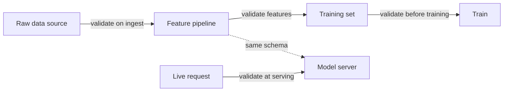
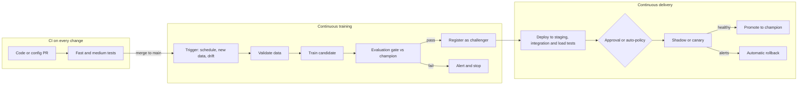
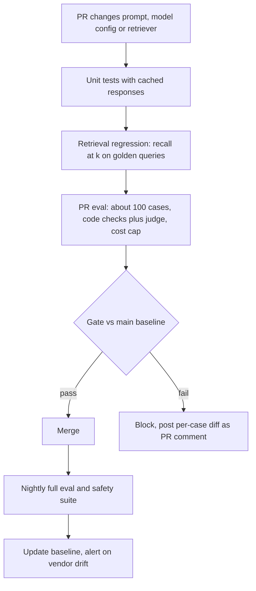

# CI/CD and Testing for ML Pipelines

> **Level:** Beginner to Advanced · **Study time:** ~110 min · **Prerequisites:** [The ML Lifecycle, MLOps and Experiment Tracking](01-ml-lifecycle-and-experiment-tracking.md), [Data Versioning, Model Versioning and the Model Registry](02-data-and-model-versioning-and-model-registry.md), [Model Deployment Patterns](04-model-deployment-patterns.md), helpful: [Classification Metrics and Imbalanced Data](../01-classical-ml/04-classification-metrics-and-imbalanced-data.md), [Building an LLM Evaluation Framework and Regression Tests](../05-llms/11-building-an-llm-evaluation-framework-and-regression-tests.md)

## Table of contents

- [Why this matters](#why-this-matters)
- [Why ML needs more than code tests](#why-ml-needs-more-than-code-tests)
- [The ML testing pyramid](#the-ml-testing-pyramid)
- [Layer 1: Unit tests for transformations and feature code](#layer-1-unit-tests-for-transformations-and-feature-code)
- [Layer 2: Data validation with schemas and expectations](#layer-2-data-validation-with-schemas-and-expectations)
- [Layer 3: Model behavior tests](#layer-3-model-behavior-tests)
- [Layer 4: Training pipeline smoke tests on tiny data](#layer-4-training-pipeline-smoke-tests-on-tiny-data)
- [Layer 5: Evaluation gates against the production model](#layer-5-evaluation-gates-against-the-production-model)
- [Layer 6: Performance and latency tests](#layer-6-performance-and-latency-tests)
- [Layer 7: Integration tests of the serving API](#layer-7-integration-tests-of-the-serving-api)
- [CI for ML: a GitHub Actions pipeline](#ci-for-ml-a-github-actions-pipeline)
- [Continuous delivery and continuous training](#continuous-delivery-and-continuous-training)
- [Pipeline orchestration: Airflow, Kubeflow Pipelines, Prefect and Dagster](#pipeline-orchestration-airflow-kubeflow-pipelines-prefect-and-dagster)
- [Infrastructure as code for ML](#infrastructure-as-code-for-ml)
- [CI for LLM applications](#ci-for-llm-applications)
- [Going deeper: running ML CI in production](#going-deeper-running-ml-ci-in-production)
- [Common mistakes and misconceptions](#common-mistakes-and-misconceptions)
- [Interview questions and model answers](#interview-questions-and-model-answers)
- [Key takeaways](#key-takeaways)
- [Further reading](#further-reading)
- [Next](#next)

## Why this matters

Most ML failures in production are not exotic research problems. They are a column that started arriving in cents instead of dollars, a retrained model that got worse on one customer segment, a prompt edit that broke JSON output, or a serving container that loads a different tokenizer than training used. None of these throw an exception, so ordinary software tests do not catch them. Mature teams treat testing and automation as the backbone of their ML platform: every change to code, data, model or prompt flows through a pipeline that checks it before it reaches users. In interviews, "How do you test ML pipelines in CI/CD?" and "How do you validate a candidate model before promotion?" are standard senior questions, and a strong answer shows a layered strategy, concrete gates and an awareness of cost and flakiness.

## Why ML needs more than code tests

### The intuition

> **Analogy:** A traditional program is a vending machine: same button, same snack, every time. If the wiring is right today, it is right tomorrow. An ML system is a restaurant kitchen. The recipe (code) might be perfect, but if the supplier delivers spoiled tomatoes (bad data) or a new chef interprets the recipe differently (a retrained model), the dish changes. You need to inspect the recipe, the ingredients and the dish.

### The precise picture

In ordinary software, behavior is determined by **code**. In ML, behavior is determined by three things that change independently:

| What changes | Example | Can a unit test catch it? |
|---|---|---|
| **Code** | A refactor of the feature function | Yes, classic tests work |
| **Data** | Upstream team renames `price_usd` to `price`; a new country appears; labels drift | No, the code is unchanged |
| **Model** | Retraining on new data, a new hyperparameter, a new base LLM version | No, the code is unchanged |

On top of that, ML systems have properties that make classic testing insufficient:

- **Silent failure.** A broken model still returns a number. A spam filter that labels everything "not spam" has no stack trace.
- **Statistical correctness.** A model is almost never right on every input. "Correct" means "good enough on average and on the slices that matter", which needs metrics and thresholds, not `assert f(x) == y`.
- **Nondeterminism.** Training with different random seeds, GPU kernels or LLM sampling gives slightly different results each run.
- **Expensive steps.** A full training run may take hours on GPUs, so you cannot run it on every commit.

This is the core message of the paper "Hidden Technical Debt in Machine Learning Systems" (Sculley et al., 2015): the model code is a small box surrounded by much larger infrastructure for data collection, verification, feature extraction, serving and monitoring, and every box needs its own safeguards.

### CI, CD and CT

Three acronyms anchor this chapter.

- **Continuous integration (CI):** every change merged into the shared branch is automatically built and tested. In ML, "tested" includes data and model checks, not only code.
- **Continuous delivery (CD):** every change that passes CI produces a releasable artifact (a container image, a registered model) that can be deployed with one approved click. **Continuous deployment** goes one step further and deploys automatically without a human click.
- **Continuous training (CT):** an ML-specific addition. The training pipeline itself is deployed and re-runs automatically (on a schedule, on new data or on a drift alert), producing new candidate models that pass through the same gates.

A **pipeline** here means an ordered set of automated steps (ingest, validate, train, evaluate, register, deploy). You test the pipeline, not just the model it happens to produce today.

> **Senior insight:** In ML you ship two products: the model and the pipeline that makes models. CI tests the pipeline code; CT runs the pipeline; evaluation gates test each model it produces. Interviewers want to hear that distinction.

## The ML testing pyramid

The classic **testing pyramid** says: write many small, fast, cheap tests at the bottom and a few slow, expensive, end-to-end tests at the top. ML keeps the shape but adds layers for data and models.

```text
                     /\
                    /  \      Online checks: canary, shadow, A/B, monitoring
                   /----\     (see deployment and monitoring chapters)
                  /  7   \    Integration tests of the serving API
                 /--------\
                /    6     \  Performance and latency tests
               /------------\
              /      5       \  Evaluation gates vs the production model
             /----------------\
            /        4         \  Training pipeline smoke tests (tiny data)
           /--------------------\
          /          3           \  Model behavior tests (MFT, INV, DIR)
         /------------------------\
        /            2             \  Data validation (schemas, expectations)
       /----------------------------\
      /              1               \  Unit tests for transformations and features
     /--------------------------------\
      many, fast, cheap   ...   few, slow, expensive
```

| Layer | What it catches | Typical runtime | When it runs |
|---|---|---|---|
| 1. Unit tests | Bugs in feature code, preprocessing, post-processing | Seconds | Every push |
| 2. Data validation | Schema breaks, nulls, out-of-range values, distribution shifts | Seconds to minutes | Every push (on sample data) and every pipeline run (on real data) |
| 3. Behavior tests | Model ignores obvious signals, reacts to irrelevant changes | Seconds to minutes | Every pipeline run; on PRs with a small model |
| 4. Smoke training | Pipeline crashes, loss does not decrease, artifacts missing | 1 to 10 minutes | Every PR touching training code |
| 5. Evaluation gate | Candidate worse than production overall or on a slice (a subgroup such as one country) | Minutes to hours | Every candidate model before registration or promotion |
| 6. Performance | Latency, memory or throughput regressions | Minutes | Before promotion, on representative hardware |
| 7. Integration | API contract broken, model fails to load, train/serve mismatch | Minutes | Every PR touching serving; before deploy |

Note the ordering is not strictly "by runtime": behavior tests on an already-trained model can be fast. The pyramid is about frequency and cost, so the guiding rule is: catch each bug at the cheapest layer that can detect it.

We will walk through each layer with one of two running examples:

- **Spam filter:** a text classifier that labels emails `spam` or `ham` (not spam).
- **House prices:** a regression model predicting price from `sqft`, `bedrooms`, `zipcode` and `year_built`.

## Layer 1: Unit tests for transformations and feature code

### The intuition

Feature code is ordinary code, and ordinary code has ordinary bugs: off-by-one errors, wrong units, division by zero, mishandled missing values. These bugs are the cheapest to catch and the most embarrassing to ship.

A **unit test** checks one small function in isolation against inputs where you know the right answer. In Python the de facto tool is **pytest** (`pip install pytest`): any function named `test_*` in a file named `test_*.py` is run, and a failing `assert` fails the test.

### What to unit test in an ML codebase

- **Feature transformations:** `price_per_sqft`, log transforms, date parsing, text cleaning, tokenization wrappers.
- **Edge cases:** empty strings, missing values (`NaN`), zero, negative numbers, unseen categories, Unicode.
- **Encoders and scalers:** fitted on train only, applied consistently (see [Feature Engineering](../01-classical-ml/07-feature-engineering-missing-values-and-encoding.md)).
- **Post-processing:** thresholding scores into labels, clipping predictions, parsing LLM output.
- **Metric code:** your custom metric functions. A bug in the metric silently corrupts every evaluation gate built on it.
- **Shape and dtype contracts** of tensors between modules.

### Example: house price features

```python
# features.py
import numpy as np
import pandas as pd

def add_features(df: pd.DataFrame, current_year: int = 2026) -> pd.DataFrame:
    """Return a copy of df with engineered features. Never mutates the input."""
    out = df.copy()
    # Guard against division by zero: sqft of 0 is invalid, so produce NaN.
    out["price_per_sqft_hint"] = np.where(out["sqft"] > 0, 1.0 / out["sqft"], np.nan)
    out["house_age"] = (current_year - out["year_built"]).clip(lower=0)
    out["log_sqft"] = np.log1p(out["sqft"].clip(lower=0))
    out["zipcode"] = out["zipcode"].astype(str).str.zfill(5)  # "2134" -> "02134"
    return out
```

```python
# tests/unit/test_features.py
import numpy as np
import pandas as pd
import pytest
from features import add_features

def make_df(**overrides):
    row = {"sqft": 1000.0, "year_built": 2000, "zipcode": 2134}
    row.update(overrides)
    return pd.DataFrame([row])

def test_house_age_is_computed_from_current_year():
    out = add_features(make_df(year_built=2000), current_year=2026)
    assert out.loc[0, "house_age"] == 26

def test_future_year_built_is_clipped_to_zero():
    out = add_features(make_df(year_built=2030), current_year=2026)
    assert out.loc[0, "house_age"] == 0

def test_zero_sqft_gives_nan_not_inf():
    out = add_features(make_df(sqft=0.0))
    assert np.isnan(out.loc[0, "price_per_sqft_hint"])

def test_zipcode_keeps_leading_zero():
    out = add_features(make_df(zipcode=2134))
    assert out.loc[0, "zipcode"] == "02134"

def test_log_sqft_matches_numpy():
    out = add_features(make_df(sqft=1000.0))
    assert out.loc[0, "log_sqft"] == pytest.approx(np.log1p(1000.0))

def test_input_is_not_mutated():
    df = make_df()
    before = df.copy()
    add_features(df)
    pd.testing.assert_frame_equal(df, before)
```

Notice `pytest.approx`: computed floating point results should be compared with a tolerance rather than with exact equality, because tiny rounding differences appear across machines and library versions.

### Property-based tests

Example-based tests check inputs you thought of. **Property-based testing** generates many random inputs (Hypothesis tries 100 per test by default, configurable with `@settings(max_examples=...)`) and checks a rule (a "property") that must always hold. The library **Hypothesis** (`pip install hypothesis`) does this.

```python
# tests/unit/test_features_properties.py
from hypothesis import given, strategies as st
import pandas as pd
from features import add_features

@given(sqft=st.floats(min_value=0, max_value=1e6, allow_nan=False),
       year=st.integers(min_value=1800, max_value=2100))
def test_house_age_is_never_negative(sqft, year):
    df = pd.DataFrame([{"sqft": sqft, "year_built": year, "zipcode": 12345}])
    out = add_features(df, current_year=2026)
    assert out.loc[0, "house_age"] >= 0
```

Properties that suit ML code: outputs are finite, probabilities sum to 1, a scaler's inverse transform recovers the input, tokenizing then detokenizing round-trips, output shape matches input batch size.

> **Common mistake:** Testing feature code only through the full training run. When the model's accuracy drops by 2 points you have no idea whether a feature function broke. Unit tests localize the bug in seconds.

## Layer 2: Data validation with schemas and expectations

### The intuition

> **Analogy:** A restaurant inspects deliveries at the back door: is it the right product, is it fresh, is the quantity plausible? It does not wait for a customer to complain about the soup.

**Data validation** means automatically checking that a dataset meets explicit expectations before you train on it or serve from it. It catches the most common real-world ML failure: upstream data changed and nobody told you.

### Three kinds of checks

1. **Schema checks:** column names, data types, required vs optional columns, allowed categories. A **schema** is a formal description of what columns exist and what type each has.
2. **Value checks (expectations):** ranges (`sqft` between 100 and 50,000), null rates (`zipcode` at most 1% null), uniqueness (`listing_id` unique), regex formats (`zipcode` is five digits), cross-column rules (`sold_date >= listed_date`).
3. **Distribution checks:** the statistics of today's batch versus a reference batch (mean, quantiles, category frequencies). These detect **data drift**, which is covered fully in [Data Drift, Concept Drift and When to Retrain](../01-classical-ml/08-data-drift-concept-drift-and-retraining.md).

An **expectation** is a single, named, testable assertion about data, such as "`price` is never negative". The term comes from the Great Expectations library, but the idea is universal.

### Where to validate



- **On ingest:** reject or quarantine bad batches before they pollute the feature store (the shared storage that serves computed features to both training and serving).
- **Before training:** a failed check stops the training pipeline (fail fast, before spending GPU hours).
- **At serving:** validate each request's input (usually with a lightweight schema, such as a Pydantic model in the API) so garbage gets a clear 4xx error instead of a confident garbage prediction.
- **In CI:** run the same validation code against a small committed sample dataset, so a PR that changes a schema or a transformation breaks loudly.

### pandera: schemas as Python code

**pandera** (`pip install pandera`) validates pandas DataFrames against a schema written in Python. It is lightweight and fits naturally into pytest.

```python
# schemas.py
# Note: recent pandera versions (0.24+) recommend `import pandera.pandas as pa`;
# older versions use `import pandera as pa`. The API below is the same.
import pandera.pandas as pa
from pandera.pandas import Check, Column

house_schema = pa.DataFrameSchema(
    {
        "listing_id": Column(str, unique=True),
        "sqft": Column(float, Check.in_range(100, 50_000)),
        "bedrooms": Column(int, Check.in_range(0, 20)),
        "zipcode": Column(str, Check.str_matches(r"^\d{5}$")),
        "year_built": Column(int, Check.in_range(1800, 2026)),
        "price": Column(float, Check.gt(0), nullable=False),
    },
    # Dataset-level rule: a suspiciously small batch usually means a broken extract.
    checks=Check(lambda df: len(df) >= 100, error="fewer than 100 rows"),
    strict=True,   # unexpected extra columns are an error
    coerce=False,  # do not silently convert types; a type change is a signal
)
```

```python
# tests/data/test_sample_data.py
import pandas as pd
from pandera.errors import SchemaErrors
from schemas import house_schema

def test_sample_training_data_matches_schema():
    df = pd.read_parquet("tests/fixtures/houses_sample.parquet")
    try:
        house_schema.validate(df, lazy=True)  # lazy=True collects ALL failures
    except SchemaErrors as err:
        # failure_cases is a DataFrame listing every failing check and value
        raise AssertionError(f"Schema violations:\n{err.failure_cases}") from err
```

The same `house_schema.validate(batch)` call goes at the start of the real training pipeline, so CI and production share one definition.

### Great Expectations: expectation suites and data docs

**Great Expectations (GX)** (`pip install great_expectations`) is a larger framework. You define **expectation suites** (named collections of expectations), run them as **validations** or **checkpoints**, and it can render human-readable HTML reports ("Data Docs"). It connects to pandas, Spark and SQL databases.

The API changed substantially between the 0.x series and GX Core 1.x, so treat the following as the shape of a 1.x workflow and check the docs for your version:

```python
# Version-fragile: written against the GX Core 1.x style API.
import great_expectations as gx
import pandas as pd

df = pd.read_parquet("data/houses_2026_10.parquet")

context = gx.get_context()  # ephemeral context, fine for CI
source = context.data_sources.add_pandas("pandas")
asset = source.add_dataframe_asset(name="houses")
batch_def = asset.add_batch_definition_whole_dataframe("full_batch")
batch = batch_def.get_batch(batch_parameters={"dataframe": df})

suite = gx.ExpectationSuite(name="houses_suite")
suite.add_expectation(gx.expectations.ExpectColumnValuesToNotBeNull(column="price"))
suite.add_expectation(gx.expectations.ExpectColumnValuesToBeBetween(
    column="sqft", min_value=100, max_value=50_000))
suite.add_expectation(gx.expectations.ExpectColumnValuesToBeUnique(column="listing_id"))

result = batch.validate(suite)
if not result.success:
    raise SystemExit("Data validation failed; stopping the pipeline.")
```

### Choosing a tool

| Tool | What it is | When to use | Pros | Cons |
|---|---|---|---|---|
| Plain `assert`s / pytest | Hand-written checks | Tiny projects, a handful of rules | Zero dependencies | No reporting, rules scattered |
| **pandera** | DataFrame schemas in Python | pandas/Polars pipelines, CI tests, typed functions | Lightweight, Pythonic, great in pytest | Fewer reporting and connector features |
| **Great Expectations** | Expectation suites, checkpoints, HTML docs | Many data sources, shared data quality across teams | Rich library of expectations, docs, SQL/Spark | Heavier setup; API has changed across versions |
| TensorFlow Data Validation (TFDV) | Schema inference and skew detection | TFX pipelines, large datasets | Infers schema from statistics, train/serve skew checks | Tied to the TensorFlow ecosystem |
| Data contracts (dbt tests, Soda, etc.) | Checks owned by the data producer | Org-wide data platforms | Catches breaks at the source | Requires cross-team process |

### Validating the splits themselves

Data validation also covers your evaluation data. Cheap but valuable checks:

- **No overlap** of entity IDs between train and test (prevents **data leakage**, where information from the test set sneaks into training; see [Overfitting, Regularization and Data Leakage](../01-classical-ml/03-overfitting-regularization-and-data-leakage.md)).
- **Temporal order:** for time-based splits, every test timestamp is after every train timestamp.
- **Label sanity:** label distribution within expected bounds (if spam suddenly is 80% of the training set, something upstream broke).

> **Senior insight:** Decide per check whether a failure should **block** (stop the pipeline), **warn** (alert but continue) or **quarantine** (drop or isolate the bad rows and continue). Blocking on every small drift creates alert fatigue; never blocking makes the checks decorative. Schema breaks and impossible values usually block; mild distribution shifts usually warn.

## Layer 3: Model behavior tests

### The intuition

Accuracy on a test set is a single number. It can stay at 95% while the model fails badly on something users care about. **Behavior tests** treat the trained model like a black box and probe it with targeted inputs, like a driving examiner who tests specific maneuvers (parallel parking, emergency stop) rather than just looking at average speed.

This idea was formalized for NLP in "Beyond Accuracy: Behavioral Testing of NLP Models with CheckList" (Ribeiro, Wu, Guestrin and Singh, 2020), which defined three test types that generalize to any model.

### The three test types

| Type | Question it asks | Spam filter example | House price example |
|---|---|---|---|
| **Minimum functionality test (MFT)** | Does the model get trivially easy cases right? | "WIN a FREE iPhone, click this link now!!!" is spam | A 3,000 sqft house costs more than $0 |
| **Invariance test (INV)** | Does the prediction stay the same when an irrelevant detail changes? | Changing the recipient's name from "Alice" to "Bob" does not flip the label | Changing `listing_id` does not change the price |
| **Directional expectation test (DIR)** | Does the prediction move in the expected direction when a relevant detail changes? | Adding "click here to claim your prize" does not lower the spam score | Increasing `sqft` (all else equal) does not lower the predicted price |

- An **MFT** is like a unit test for the model: a small set of examples with known labels where you expect near 100% pass rate.
- An **INV** test applies a **perturbation** (a small, controlled change to the input) that should not matter, and checks the output is unchanged (or changes by less than a tolerance).
- A **DIR** test applies a perturbation that should matter in a known direction, and checks the output moves that way (or at least not the opposite way).

Invariance tests are also how you check fairness concerns: swapping a name, gender or dialect marker should not change a loan decision or a toxicity score.

### Example: behavior tests with pytest

```python
# tests/behavior/test_spam_behavior.py
import joblib
import numpy as np
import pytest

@pytest.fixture(scope="module")
def model():
    # The candidate model produced by the pipeline run under test.
    # It is an sklearn Pipeline: text -> vectorizer -> classifier.
    return joblib.load("artifacts/spam_model.joblib")

def spam_prob(model, texts):
    # Look up the "spam" column via classes_ instead of assuming it is column 1.
    return model.predict_proba(texts)[:, list(model.classes_).index("spam")]

OBVIOUS_SPAM = [
    "WIN a FREE iPhone, click this link now!!!",
    "Congratulations, you have been selected for a $1000 gift card. Claim now.",
    "Cheap meds online, no prescription needed, order today",
]
OBVIOUS_HAM = [
    "Hi Sam, are we still meeting at 3pm to review the budget?",
    "Attached is the agenda for tomorrow's team sync.",
]

def test_mft_obvious_spam(model):
    preds = model.predict(OBVIOUS_SPAM)
    assert (preds == "spam").all()  # every obvious case must pass

def test_mft_obvious_ham(model):
    preds = model.predict(OBVIOUS_HAM)
    assert (preds == "ham").all()

@pytest.mark.parametrize("name_a,name_b", [("Alice", "Bob"), ("Priya", "John"), ("Chen", "Maria")])
def test_inv_recipient_name(model, name_a, name_b):
    template = "Hi {}, the quarterly report is ready for your review."
    p_a = spam_prob(model, [template.format(name_a)])[0]
    p_b = spam_prob(model, [template.format(name_b)])[0]
    assert abs(p_a - p_b) < 0.05  # tolerance, not exact equality

def test_dir_adding_spam_phrase_does_not_lower_score(model):
    base = ["Your account statement for October is available."]
    spiked = ["Your account statement for October is available. Click here to claim your prize!"]
    assert spam_prob(model, spiked)[0] >= spam_prob(model, base)[0] - 0.01
```

```python
# tests/behavior/test_house_behavior.py
import joblib
import pandas as pd
import pytest

@pytest.fixture(scope="module")
def model():
    return joblib.load("artifacts/house_model.joblib")

BASE = {"listing_id": "A1", "sqft": 1500.0, "bedrooms": 3, "zipcode": "02134", "year_built": 1990}

def predict(model, **overrides):
    row = {**BASE, **overrides}
    return float(model.predict(pd.DataFrame([row]))[0])

def test_mft_price_is_positive(model):
    assert predict(model) > 0

def test_inv_listing_id_does_not_matter(model):
    assert predict(model, listing_id="A1") == pytest.approx(predict(model, listing_id="ZZ999"))

@pytest.mark.parametrize("small,large", [(800, 1200), (1500, 2500), (2500, 4000)])
def test_dir_more_sqft_not_cheaper(model, small, large):
    assert predict(model, sqft=large) >= predict(model, sqft=small)
```

### Designing behavior tests well

- **Use pass rates for large suites.** For a suite of 500 generated invariance cases, assert "at least 98% pass" rather than "all pass", and track the failure rate over time. Reserve "must be 100%" for a small set of critical cases.
- **Generate cases from templates.** "Hi {name}, ..." with 50 names gives 50 test cases from one line. CheckList popularized this.
- **Turn every production incident into a test.** A user reported a misclassified email? Add it (anonymized) to the MFT suite. This is the ML version of a **regression test**: a test that guards against a bug coming back.
- **Tree models and DIR tests:** gradient-boosted trees are piecewise constant, so "strictly increasing" often fails even when the model has learned the right trend; test "not decreasing" instead. Without constraints even "not decreasing" can fail locally, so if monotonicity is a business requirement, enforce it in training (XGBoost and LightGBM support **monotone constraints**) and test it.

> **Interview tip:** When asked "how do you test a model beyond accuracy?", name the three CheckList test types, give one example of each for the interviewer's domain, and mention slice metrics. That answer alone signals seniority.

## Layer 4: Training pipeline smoke tests on tiny data

### The intuition

A **smoke test** is a quick check that a system runs at all ("turn it on and see if smoke comes out"). For ML, it means running the entire training pipeline end to end on a tiny dataset with a tiny config, in minutes, on a CPU runner. It does not check model quality. It checks that the plumbing works.

### What a smoke test should assert

1. The pipeline runs end to end without errors: load, validate, featurize, train, evaluate, save.
2. Expected artifacts exist: model file, metrics JSON, config snapshot, feature schema.
3. Metrics are sane: finite (no `NaN`), within valid ranges (accuracy between 0 and 1).
4. **The loss goes down.** A pipeline that runs but does not learn usually means a bug in labels, loss, optimizer or data loading.
5. **The model can overfit a tiny batch.** A reasonably sized model that cannot memorize 16 examples (with regularization such as dropout or weight decay switched off) almost always has a bug. This classic debugging trick is covered in [Regularization and Debugging Neural Network Training](../02-deep-learning/06-regularization-and-debugging-neural-network-training.md).
6. The saved model can be reloaded and gives identical predictions (serialization round-trip).

### Example: overfit a tiny batch (PyTorch)

```python
# tests/smoke/test_overfit_tiny_batch.py
# pip install torch pytest
import torch
import torch.nn as nn

def test_model_can_overfit_tiny_batch():
    torch.manual_seed(0)
    X = torch.randn(16, 8)                 # 16 examples, 8 features
    y = torch.randint(0, 2, (16,))         # random binary labels
    model = nn.Sequential(nn.Linear(8, 32), nn.ReLU(), nn.Linear(32, 2))
    opt = torch.optim.Adam(model.parameters(), lr=1e-2)
    loss_fn = nn.CrossEntropyLoss()

    losses = []
    for _ in range(300):
        opt.zero_grad()
        loss = loss_fn(model(X), y)
        loss.backward()
        opt.step()
        losses.append(loss.item())

    assert losses[-1] < losses[0]   # learning happened at all
    assert losses[-1] < 0.1         # memorized 16 random labels
```

Random labels are deliberate: if the network can memorize random noise on 16 points, the forward pass, loss and optimizer are wired correctly. (Initial cross-entropy for 2 balanced classes is about $\ln 2 \approx 0.69$; see [Softmax, Entropy and Cross-Entropy](../00-foundations/05-softmax-entropy-cross-entropy-and-kl-divergence.md).)

### Example: end-to-end pipeline smoke test

```python
# tests/smoke/test_pipeline_smoke.py
import json
import math
from pathlib import Path
import joblib
import numpy as np
import pandas as pd
from pipeline.train import run_pipeline   # your project's entry point

def test_pipeline_runs_end_to_end(tmp_path: Path):
    config = {
        "data_path": "tests/fixtures/houses_sample.parquet",  # ~500 committed rows
        "model": {"type": "lightgbm", "n_estimators": 10},     # tiny model
        "output_dir": str(tmp_path),
        "seed": 42,
    }
    trained_model = run_pipeline(config)   # returns the in-memory fitted model

    # 1. Artifacts exist
    for name in ["model.joblib", "metrics.json", "config.json", "feature_schema.json"]:
        assert (tmp_path / name).exists(), f"missing artifact {name}"

    # 2. Metrics are sane
    metrics = json.loads((tmp_path / "metrics.json").read_text())
    assert math.isfinite(metrics["val_mae"]) and metrics["val_mae"] > 0

    # 3. Serialization round-trip: the saved model predicts like the in-memory one
    sample = pd.read_parquet(config["data_path"]).drop(columns=["price"]).head(5)
    reloaded = joblib.load(tmp_path / "model.joblib")
    np.testing.assert_allclose(reloaded.predict(sample), trained_model.predict(sample))
```

The key design choice is that `run_pipeline` takes a **config** (a dictionary or YAML file of settings) so the same code runs with `smoke.yaml` in CI and `full.yaml` in production. If your pipeline has hard-coded paths or sizes, it cannot be smoke-tested, which is itself a code smell.

> **Common mistake:** A "smoke test" that trains the real model on the real data for two hours. That is a training run, not a test. Keep smoke tests under about 10 minutes on a standard CI runner, or developers will stop waiting for them.

## Layer 5: Evaluation gates against the production model

### The intuition

> **Analogy:** A sports team does not replace its starting player because the substitute scored well in practice. The substitute (the **challenger**) must beat the current starter (the **champion**) in the same conditions, and must not be worse in any position the team cannot afford to lose.

An **evaluation gate** is an automated decision rule that a candidate model must pass before it is registered or promoted. A **candidate model** is a newly trained model being considered for deployment. The **production model** is the one serving users now. A **model registry** is a versioned catalog of trained models with their metrics, lineage and labels such as `champion` (see [Data Versioning, Model Versioning and the Model Registry](02-data-and-model-versioning-and-model-registry.md)); **promotion** means moving a model to a higher-trust stage in it, ultimately to serving production traffic.

### What a good gate checks

1. **Absolute floors:** minimum acceptable quality regardless of the champion (for example, spam recall, the share of actual spam the filter catches, at least 0.90). Prevents shipping a model that is "better than a broken champion".
2. **Relative non-regression:** the candidate is not meaningfully worse than the champion on the same **frozen** (fixed and versioned, not changed between comparisons) evaluation set.
3. **Slice checks:** no important **slice** (a subgroup of data such as a country, device, language or customer tier) regresses beyond a tolerance, even if the overall metric improves.
4. **Behavior suite:** the MFT, INV and DIR pass rates from Layer 3 meet their thresholds.
5. **Operational budgets:** latency, model size, memory and cost per prediction within limits (Layer 6).
6. **Fairness and safety checks** where relevant.
7. **Statistical confidence:** an observed improvement is larger than the noise of the evaluation set.

The crucial rule: **evaluate champion and challenger on the same data at the same time**. Comparing today's candidate score to a number the champion scored three months ago on a different test set is meaningless.

### The gate as a formula

Let $M$ be your primary metric (higher is better). The candidate passes if:

$$
M_c \ge M_{\text{floor}} \quad \text{and} \quad M_c \ge M_p - \delta \quad \text{and} \quad M_{c,s} \ge M_{p,s} - \delta_s \;\; \text{for every slice } s
$$

- $M_c$: the candidate's metric on the frozen evaluation set.
- $M_p$: the production model's metric on the same set.
- $M_{\text{floor}}$: the absolute minimum acceptable value.
- $\delta$: the overall tolerance, the largest drop you will accept (often 0, or a small number reflecting noise).
- $M_{c,s}$, $M_{p,s}$: the same metrics restricted to slice $s$.
- $\delta_s$: per-slice tolerance, usually larger than $\delta$ because slices are smaller and noisier.

Plus all operational budgets must hold.

**Worked example (illustrative numbers).** Spam filter, metric is recall on spam, $M_{\text{floor}} = 0.90$, $\delta = 0.005$, $\delta_s = 0.02$.

| | Production | Candidate | Check |
|---|---|---|---|
| Overall recall | 0.930 | 0.938 | $0.938 \ge 0.90$ yes; $0.938 \ge 0.930 - 0.005 = 0.925$ yes |
| Slice: English | 0.940 | 0.950 | $0.950 \ge 0.940 - 0.02 = 0.920$ yes |
| Slice: non-English | 0.850 | 0.780 | $0.780 \ge 0.850 - 0.02 = 0.830$? **No** |

The candidate improves overall but **fails the gate** because non-English spam recall dropped 7 points. Without slice checks, this regression would ship.

### Is the improvement real? Noise in the evaluation set

Every test set is a finite sample, so metrics have sampling error. For an accuracy $p$ measured on $n$ examples, the **standard error** (the typical size of random fluctuation in the estimate) is approximately:

$$
\text{SE} = \sqrt{\frac{p(1-p)}{n}}
$$

- $p$: the measured accuracy (a proportion between 0 and 1).
- $n$: number of evaluation examples.
- A rough 95% interval is $p \pm 1.96 \times \text{SE}$ (see [Probability and Statistics](../00-foundations/04-probability-and-statistics.md)).

**Worked example.** $p = 0.90$, $n = 2000$:

- $p(1-p) = 0.90 \times 0.10 = 0.09$
- $0.09 / 2000 = 0.000045$
- $\sqrt{0.000045} \approx 0.00671$
- $1.96 \times 0.00671 \approx 0.0132$

So each model's accuracy is only known to about $\pm 1.3$ percentage points. A candidate scoring 0.905 versus 0.900 is not clearly better by this crude measure.

Because both models are scored on the **same** examples, a **paired test** is more powerful than comparing two separate intervals. The intuition: examples that both models get right, or both get wrong, say nothing about which model is better, and much of the noise in two separate intervals comes from which examples happened to be easy or hard. Pairing cancels that out. The standard choice for two classifiers is **McNemar's test** (McNemar, 1947). It looks only at examples where the two models disagree:

$$
\chi^2 = \frac{(|b - c| - 1)^2}{b + c}
$$

- $b$: number of examples the candidate gets right and production gets wrong.
- $c$: number of examples production gets right and the candidate gets wrong.
- The $-1$ is a continuity correction (usually credited to Edwards, 1948; it makes the approximation more conservative for small counts). When $b + c$ is small (a common rule of thumb is below about 25), use the exact binomial version of the test instead: under the null hypothesis, $b \sim \text{Binomial}(b + c, 0.5)$.
- $\chi^2$ is compared to a chi-squared distribution with 1 degree of freedom. The 5% critical value is about 3.84: a statistic above 3.84 means $p < 0.05$.

**Worked example.** $n = 2000$. Production is right on 1,800 (accuracy 0.900). The candidate fixes $b = 60$ of production's errors and introduces $c = 40$ new errors.

- Candidate correct $= 1800 + 60 - 40 = 1820$, so accuracy $= 1820 / 2000 = 0.910$. A 1-point gain.
- $|b - c| = |60 - 40| = 20$
- $(20 - 1)^2 = 19^2 = 361$
- $b + c = 100$
- $\chi^2 = 361 / 100 = 3.61$
- $3.61 < 3.84$, so $p \approx 0.057$: **not significant** at the 5% level.

Without the continuity correction the statistic would be $20^2 / 100 = 4.0$ ($p \approx 0.046$), just significant. When a verdict flips on a small methodological choice, that itself tells you the evidence is weak.

The 1-point gain might be real, but this evaluation set cannot prove it. In practice: promote on "non-inferior plus other benefits" (for example cheaper or faster), collect more evaluation data, or confirm online with an **A/B test** (randomly split live users between the two models and compare business metrics; see [Model Deployment Patterns](04-model-deployment-patterns.md)). For metrics that are not simple accuracy (F1, AUC, MAE), use a **paired bootstrap**: resample evaluation examples with replacement many times, recompute the metric difference each time, and check whether the 95% interval of the difference excludes zero.

### Example: an evaluation gate in code

```python
# pipeline/gate.py
# pip install numpy scipy scikit-learn
import json
import numpy as np
from scipy.stats import chi2
from sklearn.metrics import recall_score

def mcnemar_p(y, pred_prod, pred_cand) -> float:
    prod_ok, cand_ok = pred_prod == y, pred_cand == y
    b = int(np.sum(cand_ok & ~prod_ok))   # candidate fixes
    c = int(np.sum(prod_ok & ~cand_ok))   # candidate breaks
    if b + c == 0:
        return 1.0
    stat = (abs(b - c) - 1) ** 2 / (b + c)
    return float(chi2.sf(stat, df=1))

def run_gate(y, slices, pred_prod, pred_cand, latency_p95_ms, cfg) -> dict:
    """y, slices, pred_*: numpy arrays aligned on the same frozen eval set."""
    rec = lambda yt, yp: recall_score(yt, yp, pos_label="spam", zero_division=0)
    m_p, m_c = rec(y, pred_prod), rec(y, pred_cand)
    checks = {
        "floor": m_c >= cfg["floor"],
        "non_regression": m_c >= m_p - cfg["delta"],
        "latency": latency_p95_ms <= cfg["latency_p95_budget_ms"],
    }
    for s in np.unique(slices):
        mask = slices == s
        # Recall is computed over actual spam only, so size the slice by its positives.
        if np.sum(y[mask] == "spam") < cfg["min_slice_size"]:
            continue  # too small to judge; report it, do not gate on noise
        checks[f"slice_{s}"] = rec(y[mask], pred_cand[mask]) >= rec(y[mask], pred_prod[mask]) - cfg["delta_slice"]
    report = {
        "prod_recall": m_p,
        "cand_recall": m_c,
        "mcnemar_p": mcnemar_p(y, pred_prod, pred_cand),
        "checks": {k: bool(v) for k, v in checks.items()},
    }
    report["passed"] = all(report["checks"].values())
    return report

# Usage inside the pipeline:
# report = run_gate(...); json.dump(report, open("gate.json", "w"), indent=2)
# if not report["passed"]: raise SystemExit("Gate failed: candidate not promoted")
```

The gate writes a machine-readable report. CI attaches it to the run, the registry stores it with the model version, and reviewers read it before any manual approval.

### Beyond offline metrics

Offline gates reduce risk; they do not eliminate it. The full promotion path usually continues with **shadow deployment** (the candidate receives copies of real traffic, its predictions are logged but not used), then a **canary** (a small percentage of real users), then full rollout with automated rollback on alerts. These patterns are owned by [Model Deployment Patterns](04-model-deployment-patterns.md) and [Monitoring ML and LLM Systems in Production](06-monitoring-ml-and-llm-systems-in-production.md).

> **Senior insight:** The evaluation set is itself a versioned artifact. Freeze it, version it (see [Data Versioning](02-data-and-model-versioning-and-model-registry.md)), refresh it deliberately (for example quarterly with recent labeled data), and when you refresh, re-score the champion on the new set before comparing. Otherwise the "improvement" may just be an easier test set.

## Layer 6: Performance and latency tests

### The intuition

A model that is 1% more accurate but twice as slow may be a worse product. Performance tests check the operational side: **latency** (time for one prediction), **throughput** (predictions per second), memory, model size and cost.

### Percentiles, not averages

Latency is reported as **percentiles**. The p95 latency is the value that 95% of requests are faster than. Tail percentiles (p95, p99) matter because users experience the slow requests, and in a page that makes 20 independent model calls, about 64% of page views ($1 - 0.95^{20} \approx 0.64$) hit at least one call slower than the p95.

A simple definition is the **nearest-rank** percentile: sort the $n$ values and take the value at position

$$
r = \left\lceil \frac{q}{100} \times n \right\rceil
$$

- $q$: the percentile you want (for example 95).
- $n$: the number of measurements.
- $\lceil \cdot \rceil$: round up to the next whole number.

**Worked example.** 20 latencies in milliseconds, sorted:

`12, 13, 13, 14, 14, 15, 15, 15, 16, 16, 17, 17, 18, 18, 19, 20, 22, 25, 41, 90`

- p50: $r = \lceil 0.50 \times 20 \rceil = 10$, the 10th value is **16 ms**.
- p95: $r = \lceil 0.95 \times 20 \rceil = 19$, the 19th value is **41 ms**.
- Mean: the values sum to 430, so the mean is $430 / 20 = 21.5$ ms.

The mean (21.5 ms) hides the 90 ms outlier, and the p95 (41 ms) is about 2.6 times the median. Note that `numpy.percentile` uses linear interpolation by default and would report about 43.45 ms for p95 here (it interpolates between the 19th and 20th values: $41 + 0.05 \times (90 - 41) = 43.45$). Both are valid; pick one definition and use it consistently in your gates.

### Example: a latency benchmark test

```python
# tests/perf/test_latency.py
import time
import joblib
import numpy as np
import pandas as pd
import pytest

@pytest.mark.perf   # run only on the dedicated perf runner: pytest -m perf
def test_single_row_latency_budget():
    model = joblib.load("artifacts/house_model.joblib")
    row = pd.read_parquet("tests/fixtures/houses_sample.parquet").drop(columns=["price"]).head(1)

    for _ in range(20):              # warm-up: caches, lazy init, JIT
        model.predict(row)

    timings_ms = []
    for _ in range(500):
        start = time.perf_counter()
        model.predict(row)
        timings_ms.append((time.perf_counter() - start) * 1000)

    p50, p95, p99 = np.percentile(timings_ms, [50, 95, 99])
    print(f"p50={p50:.2f}ms p95={p95:.2f}ms p99={p99:.2f}ms")
    assert p95 < 20.0, f"p95 {p95:.2f}ms exceeds 20ms budget"
```

### Making performance tests trustworthy

- **Representative hardware.** Shared CI runners are noisy (other jobs share the CPU). Run performance gates on a dedicated runner with the same instance type (and GPU) as production, or compare relative to a baseline measured in the same job.
- **Warm-up first.** The first calls pay for lazy loading, memory allocation, CUDA context creation and JIT compilation.
- **Test the realistic shape.** Batch size, sequence length and concurrency change the answer dramatically, especially for LLMs (see [LLM Inference Fundamentals](../06-llm-inference/01-inference-fundamentals-prefill-decode-and-latency-metrics.md) and [Optimizing and Benchmarking LLM Latency and Cost](../06-llm-inference/07-optimizing-and-benchmarking-llm-latency-and-cost.md)).
- **Measure through the server too.** A model-only microbenchmark misses serialization, network and queueing time. Load-test the deployed staging endpoint with a tool such as Locust or k6 at expected peak QPS (queries per second).
- **Compare relatively.** "The candidate's p95 is no more than 10% higher than production's p95, measured in the same job" is more robust than an absolute number on noisy hardware.
- **Size and memory checks** are cheap and deterministic: assert the model file is below a size limit and peak memory during inference below a limit. A quantized model that is larger than expected signals a broken export (see [Number Formats and Model Memory](../07-model-compression/01-number-formats-and-model-memory.md)).

## Layer 7: Integration tests of the serving API

### The intuition

All previous layers can pass while the product is broken: the model loads fine in a notebook but the container cannot find the file, the API returns `"Spam"` while the client expects `"spam"`, or the server computes features differently from training. **Integration tests** check that components work together, here: the request parser, feature code, model artifact and response format inside the actual serving app.

### What to test

- **Contract tests:** a valid request returns status 200 with the agreed response schema (field names, types, ranges). A **contract** is the agreed interface between your service and its clients.
- **Input validation:** malformed requests return a 4xx error with a useful message, never a 500 or a prediction.
- **Model loading:** the server starts with the exact artifact from the registry and reports its `model_version`.
- **Health endpoints:** liveness and readiness probes behave correctly. A **liveness** probe answers "is the process alive?" (if not, the orchestrator restarts it); a **readiness** probe answers "can it take traffic?" and should succeed only after the model is loaded.
- **Training-serving parity:** the same raw input produces the same features and prediction in the offline pipeline and in the online service. Mismatch here is **training-serving skew**, covered in [Reproducible Training and Training-Serving Skew](03-reproducibility-and-training-serving-skew.md).
- **Edge inputs:** empty text, very long text, Unicode, missing optional fields.

### Example: FastAPI integration tests

Assume the service from [Building a Scalable Inference API](05-building-a-scalable-inference-api.md) exposes `POST /predict`.

```python
# tests/integration/test_api.py
# pip install fastapi httpx pytest
import pandas as pd
import pytest
from fastapi.testclient import TestClient
from app.main import app                      # your FastAPI app
from pipeline.batch_predict import predict_offline

@pytest.fixture(scope="module")
def client():
    # The context manager runs startup/lifespan events, so the model gets loaded.
    with TestClient(app) as c:
        yield c

def test_health_ready(client):
    r = client.get("/health/ready")
    assert r.status_code == 200

def test_predict_contract(client):
    r = client.post("/predict", json={"text": "Hi Sam, see you at 3pm."})
    assert r.status_code == 200
    body = r.json()
    assert {"label", "score", "model_version"} <= set(body)
    assert body["label"] in {"spam", "ham"}
    assert 0.0 <= body["score"] <= 1.0

def test_invalid_input_returns_422(client):
    r = client.post("/predict", json={"txt": 123})   # wrong field name and type
    assert r.status_code == 422                       # FastAPI validation error

def test_online_matches_offline(client):
    texts = pd.read_parquet("tests/fixtures/emails_sample.parquet")["text"].head(50).tolist()
    offline = predict_offline(texts)                  # batch path used for evaluation
    for text, expected in zip(texts, offline):
        online = client.post("/predict", json={"text": text}).json()["score"]
        assert online == pytest.approx(expected, abs=1e-6)
```

`TestClient` runs the app in-process, which is fast enough for every PR. Before deployment, run a second set of tests against the real container in a staging environment (the built Docker image, real model artifact, real network), because "works in-process" does not prove "the image works".

> **Common mistake:** Testing the API with a dummy model only. Use a dummy for fast PR tests, but at least one integration stage must load the actual candidate artifact, or you will miss serialization, version and dependency mismatches.

## CI for ML: a GitHub Actions pipeline

### The basics

**GitHub Actions** is GitHub's built-in CI system. A **workflow** is a YAML file in `.github/workflows/`. It is triggered by **events** (push, pull request, schedule, manual), and contains **jobs**, each running a sequence of **steps** on a **runner** (a virtual machine). Jobs run in parallel unless one declares `needs:` on another.

The key design idea for ML CI is **tiering**: cheap checks on every push, expensive checks only when they matter.

| Tier | Trigger | Contents | Budget |
|---|---|---|---|
| Fast | Every push and PR | Lint (static style and bug checks, here with `ruff`), type check, unit tests, data validation on sample data | Under 5 minutes |
| Medium | PRs touching model or pipeline code | Smoke training, behavior tests on the smoke model, API integration tests | Under 15 minutes |
| Heavy | Merge to main, nightly, or manual | Full training on versioned data, evaluation gate vs production, perf tests on GPU runner | Minutes to hours |

### Example workflow

The following is a realistic but simplified workflow. Action versions (`@v4`, `@v5`) change over time and newer majors have since been released (for example `actions/checkout@v5` and `actions/setup-python@v6`), so check for the current major versions.

```yaml
# .github/workflows/ml-ci.yml
name: ml-ci

on:
  pull_request:
    paths: ["src/**", "pipeline/**", "tests/**", "configs/**", "requirements*.txt"]
  push:
    branches: [main]
  schedule:
    - cron: "0 3 * * *"       # nightly full run at 03:00 UTC
  workflow_dispatch: {}        # manual trigger

concurrency:                   # cancel superseded PR runs; never kill a running full training on main
  group: ml-ci-${{ github.ref }}
  cancel-in-progress: ${{ github.event_name == 'pull_request' }}

jobs:
  fast-checks:
    runs-on: ubuntu-latest
    timeout-minutes: 15
    steps:
      - uses: actions/checkout@v4
      - uses: actions/setup-python@v5
        with:
          python-version: "3.11"
          cache: pip
      - run: pip install -r requirements.txt -r requirements-dev.txt
      - run: ruff check .
      - run: pytest tests/unit tests/data -q

  smoke-train:
    needs: fast-checks
    runs-on: ubuntu-latest
    timeout-minutes: 20
    steps:
      - uses: actions/checkout@v4
      - uses: actions/setup-python@v5
        with:
          python-version: "3.11"
          cache: pip
      - run: pip install -r requirements.txt -r requirements-dev.txt
      - name: Train tiny model on committed sample data
        run: python -m pipeline.train --config configs/smoke.yaml --out artifacts/
      - name: Smoke, behavior and API integration tests
        run: pytest tests/smoke tests/behavior tests/integration -q
      - uses: actions/upload-artifact@v4
        if: always()
        with:
          name: smoke-artifacts
          path: artifacts/

  full-train-and-gate:
    needs: smoke-train
    if: github.event_name != 'pull_request'     # main, nightly or manual only
    runs-on: [self-hosted, gpu]                  # your own GPU runner
    timeout-minutes: 240
    environment: ml-staging                      # scoped secrets, optional approvals
    env:
      MLFLOW_TRACKING_URI: ${{ secrets.MLFLOW_TRACKING_URI }}
      MLFLOW_TRACKING_TOKEN: ${{ secrets.MLFLOW_TRACKING_TOKEN }}
    steps:
      - uses: actions/checkout@v4
      - run: pip install -r requirements.txt
      - name: Pull the exact data version pinned in the repo
        run: dvc pull data/train.dvc data/eval_frozen.dvc
      - name: Validate full training data
        run: python -m pipeline.validate --data data/train.parquet
      - name: Train candidate
        run: python -m pipeline.train --config configs/full.yaml --out artifacts/
      - name: Gate against production model
        run: python -m pipeline.evaluate --candidate artifacts/model.joblib --baseline-alias champion --report gate.json
      - name: Performance tests
        run: pytest tests/perf -m perf -q
      - name: Register candidate if gate passed
        run: python -m pipeline.register --report gate.json --alias challenger
      - uses: actions/upload-artifact@v4
        if: always()
        with:
          name: gate-report
          path: gate.json
```

What to notice:

- **Path filters** skip ML jobs when only docs change.
- **`needs:`** creates the pyramid: no point training if unit tests fail.
- **Pinned data versions** (here with DVC, Data Version Control, see [Data Versioning](02-data-and-model-versioning-and-model-registry.md)) make the run reproducible: the commit hash identifies code and data together.
- **Secrets** come from the repository or environment secret store, never from the YAML.
- **The gate script exits non-zero on failure**, which fails the job and blocks registration.
- **The candidate is registered as a challenger**, not deployed. Deployment is a separate CD step.
- **`if: always()`** uploads reports even when tests fail, so you can debug.

> **Interview tip:** If asked to sketch ML CI on a whiteboard, draw these three tiers and the arrows between them. Then say what blocks a merge (fast and medium tiers) versus what blocks a promotion (the gate). That separation is what interviewers look for.

## Continuous delivery and continuous training

### From CI to CD

CI answers "is this change safe to merge?". **CD** answers "how does a validated artifact reach production safely?". For ML, the artifacts are a **container image** for the serving code and a **model version** in the registry. They have independent lifecycles: you may ship a new model with the same server code, or new server code with the same model.



A typical CD flow for a model:

1. The candidate passes the gate and is registered with its metrics, data version, code commit and gate report attached.
2. The serving system deploys it to **staging** (a production-like environment with no real users) and runs integration and load tests against the real container.
3. A human approves, or a policy approves automatically for low-risk models.
4. **Progressive delivery:** shadow, then canary at a small percentage, with automated comparison of live metrics.
5. Promotion updates the registry pointer (for example, moving an alias such as `champion` in MLflow) and the serving layer picks up the new version. Rollback moves the pointer back. Details are in [Model Deployment Patterns](04-model-deployment-patterns.md).

### Continuous training

**Continuous training (CT)** automates retraining. Common triggers:

| Trigger | Example | Pros | Cons |
|---|---|---|---|
| Schedule | Retrain every Sunday | Simple, predictable | Retrains even when unnecessary, or too late after a sudden change |
| New data volume | Retrain after 100k new labeled rows | Uses fresh data efficiently | Needs data counting infrastructure |
| Drift alert | Input distribution shift detected by monitoring | Reacts to real change | Drift does not always mean worse performance; risk of noisy triggers |
| Performance drop | Live accuracy (once labels arrive) below threshold | Directly tied to quality | Labels often arrive late (fraud labels can take weeks) |

See [Data Drift, Concept Drift and When to Retrain](../01-classical-ml/08-data-drift-concept-drift-and-retraining.md) and [Monitoring ML and LLM Systems in Production](06-monitoring-ml-and-llm-systems-in-production.md) for how these signals are produced.

The important point: **CT without gates is dangerous**. An automated loop that retrains on whatever data arrived and auto-deploys can ship a broken model at 3 a.m., for example after an upstream bug filled a column with zeros. Data validation (Layer 2) and the evaluation gate (Layer 5) are what make CT safe.

### MLOps maturity levels

Google Cloud's architecture guide "MLOps: Continuous delivery and automation pipelines in machine learning" describes three levels that interviewers often reference:

| Level | Name | What it looks like |
|---|---|---|
| 0 | Manual process | Notebooks, manual training, model files handed to engineers, rare releases |
| 1 | ML pipeline automation | The training pipeline is automated and deployed; CT retrains on triggers; data and model validation in the pipeline |
| 2 | CI/CD pipeline automation | The pipeline code itself is built, tested and deployed by CI/CD; teams can ship new pipeline versions quickly and safely |

> **Senior insight:** Most organizations do not need level 2 for every model. A model retrained twice a year with a manual, well-documented, gated process can be fine. Match automation to retraining frequency, business risk and team size, and say this explicitly in interviews.

## Pipeline orchestration: Airflow, Kubeflow Pipelines, Prefect and Dagster

### The intuition

A training pipeline has many steps with dependencies: you cannot train before validating, and you cannot evaluate before training. An **orchestrator** is a system that runs these steps in the right order, on a schedule or trigger, retries failures, records what ran, and shows it in a UI.

Most orchestrators model a pipeline as a **DAG (directed acyclic graph)**: steps are nodes, arrows mean "must run before", and there are no cycles.

```text
 ingest --> validate --> featurize --> train --> evaluate --> register
                              \                     ^
                               `--> build eval set -'
```

### The main options

| Tool | Core idea | Best fit | Pros | Cons |
|---|---|---|---|---|
| **Apache Airflow** | Python-defined DAGs of tasks run by a scheduler | Scheduled batch data and ML jobs, teams already using it for data engineering | Very mature, huge ecosystem of operators, widely known | Not ML-specific; passing large data between tasks needs external storage; local testing historically clunky |
| **Kubeflow Pipelines (KFP)** | Each step is a container on Kubernetes; pipelines compiled from a Python SDK | ML teams on Kubernetes needing isolation, GPUs per step, artifact tracking | Kubernetes-native, per-step resources, caching of step outputs | Requires running and maintaining Kubernetes and Kubeflow; steeper learning curve |
| **Prefect** | Decorate ordinary Python functions as flows and tasks | Python-heavy teams wanting fast iteration and dynamic workflows | Easy local development, dynamic control flow, hybrid execution | Smaller ecosystem than Airflow; managed features depend on product tier |
| **Dagster** | **Asset-centric:** you declare the data assets (tables, models) and how each is computed | Teams that think in data products and want lineage and testability | Strong typing, testability, built-in lineage and data quality hooks | Different mental model to learn; younger than Airflow |

Others you may hear: **Argo Workflows** (Kubernetes-native, underlies KFP), **Metaflow** (from Netflix, data-scientist friendly), **ZenML**, and managed services such as **Vertex AI Pipelines** and **SageMaker Pipelines**. Feature sets change by version, so focus on the durable concepts below.

### Concepts that matter regardless of tool

- **Idempotency:** running a step twice with the same inputs produces the same result and no duplicate side effects. Write outputs to paths keyed by run ID or data version, never "append to the latest table".
- **Caching and lineage:** if inputs did not change, reuse the previous output. Record which data version, code version and parameters produced each artifact.
- **Retries with backoff** for flaky infrastructure, but never retry a failed quality gate.
- **Backfills:** re-running a pipeline for past dates, which only works if steps are parameterized by date and idempotent.
- **Separation of orchestration and computation:** the orchestrator schedules; heavy compute runs in Spark, Ray, Kubernetes jobs or a training service.

### Testing orchestrated pipelines

1. **Keep business logic in plain Python functions** and unit test them without the orchestrator. Tasks should be thin wrappers.
2. **DAG integrity tests:** check that every pipeline definition imports and parses, has no cycles and has required settings (owner, retries, timeouts). For Airflow this is a classic CI test:

```python
# tests/dags/test_dag_integrity.py
# Requires apache-airflow installed in the test environment.
# Version-fragile: this is the Airflow 2.x import path; Airflow 3.x reorganized
# some internals, so check where DagBag lives in your version.
from airflow.models import DagBag

def test_dags_import_without_errors():
    bag = DagBag(dag_folder="dags/", include_examples=False)
    assert not bag.import_errors, f"DAG import errors: {bag.import_errors}"

def test_every_dag_has_retries_and_owner():
    bag = DagBag(dag_folder="dags/", include_examples=False)
    for dag_id, dag in bag.dags.items():
        assert dag.default_args.get("retries", 0) >= 1, f"{dag_id} has no retries"
        assert dag.default_args.get("owner"), f"{dag_id} has no owner"
```

3. **Run the whole pipeline locally on tiny data** (Layer 4), using the orchestrator's local mode if it has one.
4. **Deploy pipeline definitions through CI/CD**, not by copying files to a server, so pipeline changes are reviewed and versioned like any code.

## Infrastructure as code for ML

### The intuition

> **Analogy:** Building a house from a written blueprint versus from memory. With a blueprint, you can build an identical house elsewhere, review changes before construction, and see exactly what changed between versions.

**Infrastructure as code (IaC)** means defining infrastructure (storage buckets, databases, Kubernetes clusters, GPU node pools, model endpoints, IAM (identity and access management) permissions, monitoring alerts) in version-controlled files that a tool applies automatically, instead of clicking in a cloud console.

### Why ML teams need it

- **Reproducible environments:** staging and production built from the same definitions, so "works in staging" means something.
- **Reviewable changes:** a PR that doubles the GPU node pool is visible and approved like code.
- **Disaster recovery:** recreate the platform in another region from code.
- **Cost control:** expensive resources (GPU instances, vector database clusters) are declared and auditable, not forgotten in a console.

### Common tools

| Tool | What it does | Notes |
|---|---|---|
| **Terraform** / OpenTofu | Declarative, multi-cloud resource definitions with a plan/apply workflow | The most common choice; OpenTofu is an open-source fork |
| **Pulumi** | IaC in general-purpose languages (Python, TypeScript) | Good when teams want loops and abstractions in a real language |
| AWS CloudFormation / CDK | AWS-native IaC | Tightly integrated with AWS |
| **Helm** / Kustomize | Packaging and templating Kubernetes manifests | Typical for deploying model servers onto Kubernetes |
| **GitOps** (Argo CD, Flux) | A controller keeps the cluster in sync with manifests in Git | Deployment becomes "merge a PR"; rollback becomes "revert a commit" |

### IaC in the CI/CD pipeline

```bash
# On every PR that touches infra/: show what would change, do not apply.
terraform -chdir=infra/ fmt -check
terraform -chdir=infra/ validate
terraform -chdir=infra/ plan -out=tfplan   # posted as a PR comment for review

# On merge to main (often behind a manual approval): plan again against the
# current state, review, then apply exactly that saved plan. A plan file from the
# PR run is usually not reused, because Terraform rejects a stale plan.
terraform -chdir=infra/ plan -out=tfplan
terraform -chdir=infra/ apply tfplan
```

The model server itself is usually described as a Kubernetes manifest or Helm chart, with the model version as a parameter, so a promotion is a small, reviewable diff:

```yaml
# deploy/spam-classifier/values-production.yaml (illustrative Helm values)
image:
  repository: registry.example.com/spam-classifier
  tag: "server-1.8.2"          # serving code version
model:
  uri: "models:/spam-classifier@champion"   # resolved from the registry at startup
resources:
  requests: {cpu: "2", memory: "4Gi"}
  limits: {cpu: "4", memory: "8Gi"}
autoscaling:
  minReplicas: 3
  maxReplicas: 20
  targetCPUUtilizationPercentage: 60
```

> **Common mistake:** IaC for the cluster but manual console edits "just this once" for the model endpoint. The next `terraform apply` either reverts the manual fix or fails with **configuration drift** (the real infrastructure no longer matches the code). Make the code the only path to change.

## CI for LLM applications

### What changes with LLMs

LLM applications (chatbots, RAG systems, agents) inherit every layer above, plus new difficulties:

- **Nondeterministic outputs:** the same prompt can produce different text, so exact-match assertions break.
- **Cost per test:** every test case may call a paid API, sometimes several times (generation plus a judge).
- **Latency:** an eval suite of 500 cases can take many minutes.
- **Many change surfaces:** prompts, model versions, retrieval settings, chunking, tools and guardrails all change behavior.
- **Vendor drift:** a hosted model can change behavior even if you changed nothing, so scheduled runs matter.

The full theory of LLM evaluation (golden datasets, scorers, statistics of regressions) lives in [Building an LLM Evaluation Framework and Regression Tests](../05-llms/11-building-an-llm-evaluation-framework-and-regression-tests.md) and [Evaluating LLMs: Metrics, Benchmarks and LLM-as-a-Judge](../05-llms/10-llm-evaluation-metrics-and-llm-as-a-judge.md). Here we focus on wiring it into CI.

### The LLM test pyramid

| Tier | What it tests | Calls a real model? | Runs |
|---|---|---|---|
| Deterministic unit tests | Prompt templating, output parsing, tool-call routing, retry logic, guardrail code | No, uses cached or mocked responses | Every push |
| Retrieval regression | Recall@k (share of queries whose gold document is in the top $k$, assuming one gold document per query; with several, use the fraction of gold documents found) and MRR (mean reciprocal rank: the average of $1/\text{rank}$ of the first relevant document) on a golden query set | Embedding model only (cacheable) | PRs touching retrieval, chunking or embeddings |
| PR regression eval | 50 to 200 curated cases scored with code checks and an LLM judge, compared to the main-branch baseline | Yes, with a cost cap | PRs touching prompts, model config or RAG |
| Full eval | Full golden set (hundreds to thousands of cases), safety and red-team suites | Yes | Nightly, before release, on model version changes |

### Caching model responses for deterministic unit tests

Your parsing, routing and error handling code should not need a live LLM to be tested. The **record and replay** pattern stores real responses once, then replays them deterministically:

- **Record mode:** call the real API, save the response to a file keyed by a hash of the request.
- **Replay mode (CI default):** read from the file; a cache miss is a test failure telling the developer to re-record.

```python
# llm_cache.py
import hashlib
import json
from pathlib import Path
from typing import Callable

CACHE_DIR = Path("tests/fixtures/llm_cache")

def cache_key(model: str, messages: list[dict], params: dict) -> str:
    # sort_keys makes the hash independent of dict ordering
    payload = json.dumps({"model": model, "messages": messages, "params": params}, sort_keys=True)
    return hashlib.sha256(payload.encode("utf-8")).hexdigest()

class CachedLLM:
    def __init__(self, call_fn: Callable[..., str], mode: str = "replay"):
        self.call_fn = call_fn   # wraps the real vendor SDK call and returns text
        self.mode = mode         # "replay" in CI, "record" when refreshing fixtures

    def complete(self, model: str, messages: list[dict], **params) -> str:
        path = CACHE_DIR / f"{cache_key(model, messages, params)}.json"
        if path.exists():
            return json.loads(path.read_text(encoding="utf-8"))["text"]
        if self.mode == "replay":
            raise RuntimeError(f"LLM cache miss for {path.name}; run tests in record mode")
        text = self.call_fn(model=model, messages=messages, **params)
        CACHE_DIR.mkdir(parents=True, exist_ok=True)
        path.write_text(json.dumps({"text": text}, indent=2), encoding="utf-8")
        return text
```

```python
# tests/unit/test_extraction.py
from llm_cache import CachedLLM
from app.extract import extract_invoice   # your code: builds prompt, calls llm, parses JSON

def fail_if_called(**kwargs):
    raise AssertionError("Unit tests must not call the live API")

def test_extract_invoice_parses_total():
    llm = CachedLLM(call_fn=fail_if_called, mode="replay")
    result = extract_invoice("Invoice #42 ... Total due: $1,250.00", llm=llm)
    assert result.total == 1250.00
    assert result.invoice_id == "42"
```

Notes:

- Because the key includes the prompt, **changing the prompt invalidates the cache**, which is correct: the developer re-records and reviews the new responses in the PR diff.
- HTTP-level libraries such as **vcrpy** and **pytest-recording** implement the same idea as "cassettes" for any HTTP client.
- For pure logic (retries, timeouts, malformed JSON handling), a hand-written **mock** (a fake object returning scripted responses, such as a deliberately broken JSON string) is even simpler.
- Cached tests check **your code**, not the model. Quality is checked by the eval tiers.

### Prompt and RAG regression evals in CI

A **regression eval** runs a fixed set of cases through the new version of the app and compares scores to the baseline from the main branch. Typical scorers, cheapest first:

1. **Code checks:** valid JSON, schema match, required citation present, forbidden phrases absent, answer length limits (see [Structured Outputs and Function Calling](../05-llms/05-structured-outputs-and-function-calling.md)).
2. **Reference checks:** exact or fuzzy match against expected answers for factual questions.
3. **Retrieval metrics:** for RAG, did the retriever return the gold document in the top $k$? These are deterministic and cheap, and catch most chunking and embedding regressions (see [Evaluating RAG](../08-rag/10-rag-evaluation-metrics-and-ragas.md)).
4. **LLM-as-a-judge:** a separate model grades faithfulness, relevance or tone against a rubric.

### Judge-based checks with thresholds

An **LLM judge** returns a score or a pass/fail per case. CI turns these into a gate with two kinds of thresholds, mirroring Layer 5:

- **Absolute threshold:** for example, faithfulness pass rate at least 0.90.
- **Relative threshold:** no drop of more than a tolerance (for example 3 percentage points) versus the main-branch baseline on the same cases.
- **Zero tolerance for critical cases:** a small tagged set (safety, legal, "must refuse") where any failure blocks.

Judges are noisy. Reduce flakiness by fixing the judge model version, using temperature 0 where supported (this reduces but does not eliminate run-to-run variation in hosted models), giving a clear rubric with examples, and validating judge agreement with human labels before trusting it. With 100 cases, one case is 1 percentage point, so do not gate on differences smaller than the noise (the standard error and McNemar reasoning from Layer 5 applies directly to pass rates).

```python
# ci/llm_gate.py
import json
import sys

def gate(results: list[dict], baseline: dict, cfg: dict) -> list[str]:
    """results: [{"id":..., "faithful": bool, "valid_json": bool, "critical": bool}, ...]"""
    failures = []
    n = len(results)
    faithful_rate = sum(r["faithful"] for r in results) / n
    json_rate = sum(r["valid_json"] for r in results) / n

    if faithful_rate < cfg["min_faithfulness"]:
        failures.append(f"faithfulness {faithful_rate:.3f} < floor {cfg['min_faithfulness']}")
    if faithful_rate < baseline["faithfulness"] - cfg["max_drop"]:
        failures.append(f"faithfulness dropped from {baseline['faithfulness']:.3f} to {faithful_rate:.3f}")
    if json_rate < 1.0:
        failures.append(f"valid JSON rate {json_rate:.3f} < 1.0")
    critical_fails = [r["id"] for r in results if r["critical"] and not r["faithful"]]
    if critical_fails:
        failures.append(f"critical cases failed: {critical_fails}")
    return failures

if __name__ == "__main__":
    results = json.load(open("eval_results.json"))
    baseline = json.load(open("eval_baseline_main.json"))
    problems = gate(results, baseline, {"min_faithfulness": 0.90, "max_drop": 0.03})
    print("\n".join(problems) or "LLM gate passed")
    sys.exit(1 if problems else 0)
```

### Cost limits

LLM evals cost real money, so put a budget on every run. The expected cost of one eval run is roughly:

$$
C_{\text{run}} = N \times \left( \frac{T_{\text{in}} \, P_{\text{in}} + T_{\text{out}} \, P_{\text{out}}}{10^6} + \frac{J_{\text{in}} \, Q_{\text{in}} + J_{\text{out}} \, Q_{\text{out}}}{10^6} \right)
$$

- $N$: number of test cases.
- $T_{\text{in}}$, $T_{\text{out}}$: average input and output tokens per app call (including retrieved context).
- $P_{\text{in}}$, $P_{\text{out}}$: the app model's price per million input and output tokens.
- $J_{\text{in}}$, $J_{\text{out}}$: average judge input and output tokens per case.
- $Q_{\text{in}}$, $Q_{\text{out}}$: the judge model's price per million tokens.

**Worked example (illustrative prices, not any vendor's real pricing).** $N = 200$; app call $T_{\text{in}} = 1500$, $T_{\text{out}} = 300$ at $P_{\text{in}} = \$1$, $P_{\text{out}} = \$4$ per million; judge call $J_{\text{in}} = 2000$, $J_{\text{out}} = 100$ at the same prices.

- App per case: $1500 \times 1 / 10^6 = \$0.0015$, plus $300 \times 4 / 10^6 = \$0.0012$, total $\$0.0027$.
- Judge per case: $2000 \times 1 / 10^6 = \$0.0020$, plus $100 \times 4 / 10^6 = \$0.0004$, total $\$0.0024$.
- Per case: $0.0027 + 0.0024 = \$0.0051$.
- Per run: $200 \times 0.0051 = \$1.02$.
- If 30 PRs a day each push 3 times and every push runs the eval: $90 \times 1.02 = \$91.80$ per day.

One run is cheap; running it carelessly is not. Practical controls:

- **Trigger selectively:** only on PRs touching prompts, model config, retrieval or the eval set (path filters), or with a `run-llm-eval` label.
- **Cache by content hash:** if the prompt, model and input of a case are unchanged since the last run, reuse its output and judge score.
- **Hard budget guard:** count tokens as you go and abort when the run exceeds its cap (a runaway agent loop in a test can otherwise burn money).
- **Tiered sizes:** about 100 cases on PRs, the full set nightly.
- **Cheaper judges** for coarse checks, validated against a stronger judge or humans.

```python
# ci/budget.py
class BudgetExceeded(RuntimeError):
    pass

class CostGuard:
    def __init__(self, max_usd: float, price_in_per_m: float, price_out_per_m: float):
        self.max_usd, self.spent = max_usd, 0.0
        self.p_in, self.p_out = price_in_per_m, price_out_per_m

    def record(self, tokens_in: int, tokens_out: int) -> None:
        self.spent += (tokens_in * self.p_in + tokens_out * self.p_out) / 1_000_000
        if self.spent > self.max_usd:
            raise BudgetExceeded(f"eval spent ${self.spent:.2f} > cap ${self.max_usd:.2f}")

# guard = CostGuard(max_usd=5.0, price_in_per_m=1.0, price_out_per_m=4.0)
# after each API call: guard.record(usage.input_tokens, usage.output_tokens)
```

Token usage fields differ by SDK, so read them from whatever usage object your provider returns.

### Putting LLM CI together



Prompts deserve the same discipline as code: versioned, reviewed, evaluated before release. How prompts are managed and traced in production is covered in [LLMOps: Tracing, Prompt Management, Langfuse and RAGAS in Practice](08-llmops-tracing-prompt-management-and-langfuse.md).

> **Senior insight:** Post a per-case diff on the PR ("these 4 cases flipped from pass to fail, here are old and new outputs"). An aggregate score tells reviewers *whether* something changed; the diff tells them *what*, and that is what gets regressions fixed.

## Going deeper: running ML CI in production

### Flaky tests and nondeterminism

A **flaky test** passes and fails on the same code. In ML, flakiness comes from random seeds, data sampling, multithreading, GPU kernels that are nondeterministic for speed, network calls and time-dependent code.

| Source | Mitigation |
|---|---|
| Random initialization and sampling | Fix seeds (`random`, `numpy`, `torch`) in tests |
| GPU nondeterminism | `torch.use_deterministic_algorithms(True)` in tests where feasible (may be slower, raises an error for ops without a deterministic implementation, and on CUDA also needs the environment variable `CUBLAS_WORKSPACE_CONFIG=:4096:8`); otherwise use tolerances |
| Floating point differences across hardware | `pytest.approx` and relative tolerances instead of exact equality |
| Statistical metrics on small sets | Assert on pass rates and confidence intervals, size test sets to the decision |
| External APIs | Record and replay; mocks; separate live tests from unit tests |
| Time and dates | Inject the current date as a parameter (as `add_features(current_year=...)` does) |

Never "fix" a flaky quality test by adding retries until it passes. Retries are acceptable for infrastructure failures (a network blip downloading data), not for model quality checks.

### What runs where: a reference matrix

| Check | PR | Merge to main | Nightly | Before promotion | In production |
|---|---|---|---|---|---|
| Unit tests | Yes | Yes | | | |
| Data validation (sample) | Yes | Yes | | | |
| Data validation (full) | | | Yes | Yes | On every batch and request |
| Smoke training | Yes (if pipeline changed) | Yes | | | |
| Behavior tests | Smoke model | Full model | Yes | Yes | |
| Evaluation gate | | Yes | Yes | Yes | |
| Perf and load tests | | Optional | Yes | Yes | |
| API integration | In-process | Staging container | | Yes | Synthetic probes |
| LLM eval | Small set | Small set | Full set | Full set | Sampled online evals |
| Drift and quality monitoring | | | | | Continuous |

### Test data management

- **Small committed fixtures** (hundreds of rows) for unit, data and smoke tests. Generate them by sampling and anonymizing real data, keeping rare categories represented.
- **Versioned evaluation sets** stored outside Git (object storage with DVC or a dataset registry), referenced by hash.
- **No PII in fixtures.** Test data gets copied into CI logs, artifacts and laptops. Use synthetic or scrubbed data.
- **Golden set ownership:** someone owns adding new failure cases; otherwise the set goes stale while production evolves.

### Supply chain and security in ML CI

- **Model artifacts can execute code.** Python pickle files (and formats built on them, including the joblib files used in this chapter's examples) can run arbitrary code when loaded. Prefer safe formats such as **safetensors** for weights, load only artifacts from your own registry, and verify checksums.
- **Pin dependencies** with a lock file. A minor release of a numerical library can change predictions slightly; your parity tests will notice, but only if versions are pinned so changes are deliberate.
- **Least-privilege secrets:** PR jobs from forks should never see production credentials (GitHub withholds secrets from fork PRs on the `pull_request` event; avoid `pull_request_target` for jobs that run the PR's code, because it runs with the base repository's secrets). Scope secrets to environments (as `environment: ml-staging` does above).
- **Sign and record lineage:** each registered model records its commit, data version, config and gate report, so an auditor can answer "why is this model in production?".

### The ML Test Score rubric

"The ML Test Score: A Rubric for ML Production Readiness and Technical Debt Reduction" (Breck, Cai, Nielsen, Salib and Sculley, 2017) proposes 28 tests across four areas: data (features and data), model development, ML infrastructure and monitoring. Teams score themselves per test (half a point if done manually with documented results, a full point if automated and run repeatedly), and the final score is the minimum of the four section totals, so the weakest area defines readiness. It is a good checklist for interviews: if you can name a test from each area and how you would automate it, you show breadth.

### What changes at scale

- **Many models, one platform.** With dozens of models, every team should not write its own CI. Platform teams provide templates: a standard pipeline with pluggable data schemas, gates and behavior suites.
- **Compute-aware CI.** GPU runners are expensive; schedule heavy jobs, share warm caches (pip, model weights, datasets), and cancel superseded runs.
- **Gate governance.** Who can override a failed gate? Require a written justification recorded with the model version. Overrides should be rare and visible.
- **Label delay.** For fraud or churn, true labels arrive weeks later. Offline gates use older labeled data; online checks rely on proxy metrics until labels catch up. Be explicit about this gap.
- **Feedback loops.** If the model influences what data gets labeled (for example, only flagged transactions are reviewed), your evaluation set is biased toward the model's own past decisions. Reserve a small randomized holdout of traffic for unbiased evaluation where business allows.

## Common mistakes and misconceptions

1. **"We have 90% code coverage, so the ML system is tested."** Coverage measures code paths, not data quality or model behavior. Most ML incidents involve unchanged code.
2. **Comparing the candidate to a stale champion number.** Always re-score champion and challenger on the same frozen set in the same job.
3. **Gating only on the aggregate metric.** Slice regressions hide behind overall improvements. Gate on critical slices with appropriate tolerances.
4. **Treating a small improvement as real.** A 0.5-point gain on 2,000 examples is within noise. Use paired tests or bootstrap intervals.
5. **Running full training on every PR.** Slow CI makes developers bypass it. Use the tiered pyramid.
6. **Data validation that never blocks, or always blocks.** Decorative checks and alert fatigue are both failures. Decide block, warn or quarantine per check.
7. **Continuous training without gates.** Automated retraining plus automated deployment without validation can ship a broken model with nobody watching.
8. **Exact-match assertions on LLM output.** Use structure checks, reference checks and judges with thresholds; use cached responses for unit tests of your own code.
9. **Calling live LLM APIs in unit tests.** Slow, flaky, costly and nondeterministic. Record and replay.
10. **Performance tests on noisy shared runners with absolute thresholds.** Use representative hardware or relative comparisons within one job.
11. **Testing the API with a dummy model only.** At least one stage must load the real artifact in the real container.
12. **Manual changes to infrastructure.** They cause configuration drift and irreproducible environments. Make IaC the only path.

## Interview questions and model answers

<details>
<summary><b>Q1. How do you test ML pipelines in CI/CD?</b></summary>

**Short answer:** I use a layered ML testing pyramid. At the bottom, unit tests for feature transformations, preprocessing and metric code run on every push. Next, data validation with schemas and expectations (pandera or Great Expectations) runs on committed sample data in CI and on real data at every pipeline run. On PRs that touch the pipeline, I run a smoke training on tiny data, behavior tests (minimum functionality, invariance, directional) on the resulting model, and in-process API integration tests. On merge or nightly, the full pipeline trains on versioned data and the candidate must pass an evaluation gate against the production model, plus performance tests on production-like hardware, before it is registered. CD then deploys through staging, shadow or canary, with automatic rollback.

**Deeper answer and follow-ups:**

- **Why layers:** code, data and model change independently; each layer catches a different failure at the cheapest point. Unit tests do not catch upstream schema changes; evaluation gates do not localize a bug in a feature function.
- **Tiering by cost:** fast tier under about 5 minutes on every push, medium tier (smoke training, behavior, integration) on relevant PRs, heavy tier (full training, gate, perf) on main or nightly on GPU runners.
- **Reproducibility:** CI pins the data version (DVC or dataset hashes), the dependency lock file and seeds, so a commit fully identifies a run.
- **Smoke test specifics:** loss decreases, the model can overfit a tiny batch, artifacts exist, metrics are finite, the saved model reloads with identical predictions.
- **Training-serving parity:** an integration test that the same raw input gives the same prediction offline and through the API.
- **For orchestrated pipelines:** DAG integrity tests (imports, no cycles, retries configured) and thin task wrappers around unit-tested functions.
- **For LLM apps:** deterministic unit tests with cached responses, retrieval regression metrics, a cost-capped regression eval with judge thresholds on PRs, full evals nightly.
- **Pitfall to mention:** never fix flaky quality tests with retries; fix seeds, use tolerances or assert on pass rates.
- **Three different gates:** the fast and medium tiers block a **merge** (is this code change safe?); data checks inside the running pipeline block a **training run** (is this data safe to learn from?); the evaluation gate and performance tests block a **promotion** (is this model better and within budget?). Naming the three separately is what separates a senior answer.
- **Measure the CI itself:** track PR pipeline duration (developers bypass slow CI), flake rate, and escaped defects (production incidents no test caught). Each escaped defect becomes a new test at the cheapest layer that would have caught it.

</details>

<details>
<summary><b>Q2. How do you validate a candidate model before promotion?</b></summary>

**Short answer:** I score the candidate and the current production model on the same frozen, versioned evaluation set in the same job, then apply a gate: absolute floors on key metrics, non-regression versus production within a tolerance, per-slice non-regression on important segments, behavior test pass rates, and latency, memory and cost budgets. I check whether any claimed improvement is statistically meaningful with a paired test such as McNemar's or a paired bootstrap. If it passes, the model is registered as a challenger with its gate report, then goes through staging, shadow and canary with live metrics before it becomes the champion, with automatic rollback.

**Deeper answer and follow-ups:**

- **Gate rule:** $M_c \ge M_{\text{floor}}$, $M_c \ge M_p - \delta$, and $M_{c,s} \ge M_{p,s} - \delta_s$ for each critical slice $s$, plus operational budgets.
- **Why same set, same time:** a historical champion score on an older test set is not comparable; the data distribution and labeling may have changed.
- **Significance example:** 2,000 examples, candidate fixes 60 errors and introduces 40. Accuracy rises from 0.900 to 0.910, but McNemar gives $(|60-40|-1)^2/100 = 3.61 < 3.84$, so $p \approx 0.057$: not significant. I would promote only if it is non-inferior and has another benefit, or confirm with an A/B test.
- **Slices:** overall up but non-English recall down 7 points means fail. Choose slices with the business (regions, tiers, languages, new users) and set a minimum slice size to avoid gating on noise.
- **Beyond metrics:** behavior suites (invariance to names, directional monotonicity), fairness checks, calibration (predicted probabilities match observed frequencies) if downstream uses probabilities, and explainability spot checks for regulated domains.
- **Lineage:** the registry stores commit, data version, config, metrics and gate report, so promotion decisions are auditable.
- **Online validation:** shadow mode compares predictions without affecting users; canary exposes a small percentage with guardrail metrics; A/B tests measure business impact.
- **Pitfall:** refreshing the evaluation set and comparing the new score to the old champion score. Re-score both.
- **Setting tolerances:** derive $\delta$ from measured noise rather than guessing, for example from the spread of the champion's own score across a few retrains with different seeds, or from a bootstrap interval of the difference. A $\delta$ below the noise makes the gate flaky; one far above it lets real regressions through.
- **Compatibility checks:** the candidate's input signature and output format match the serving contract, its preprocessing artifacts are packaged with it, and it loads and predicts inside the production container with pinned dependencies. Many failed promotions are packaging failures, not quality failures.
- **Label delay and governance:** when labels arrive late (fraud, churn), the offline gate uses an older labeled window, so state that gap and lean on proxy metrics during the canary. Any override of a failed gate needs a named approver and a written justification stored with the model version.

</details>

<details>
<summary><b>Q3. What is the difference between CI, CD and CT in an ML context?</b></summary>

**Short answer:** CI automatically tests every change (code, data schemas, configs, prompts) before merging. CD automatically turns validated changes into deployable artifacts (container images, registered models) and moves them to production safely, with continuous deployment skipping the manual approval. CT is ML-specific: the training pipeline itself runs automatically on schedules, new data or drift alerts, producing candidate models that pass the same gates.

**Deeper answer and follow-ups:**

- CI tests the **pipeline code**; CT **runs** the pipeline; gates test **each model** the pipeline produces.
- Serving code and model versions are separate artifacts with separate lifecycles: new model on old server, or new server with old model.
- Google's MLOps maturity levels: 0 manual, 1 automated pipeline with CT, 2 automated CI/CD for the pipeline itself.
- Not every model needs level 2: match automation to retraining frequency and risk.
- CT without data validation and evaluation gates is dangerous: a broken upstream feed becomes a broken production model overnight.

</details>

<details>
<summary><b>Q4. Give examples of minimum functionality, invariance and directional tests for a model you have worked on.</b></summary>

**Short answer:** For a spam filter: an MFT checks that blatant spam like "WIN a FREE iPhone, click now" is labeled spam; an invariance test checks that changing the recipient's name does not change the spam score by more than a small tolerance; a directional test checks that appending "click here to claim your prize" does not lower the spam score. For house prices: price is positive (MFT), changing the listing ID does not change price (INV), and more square footage with everything else equal does not lower price (DIR).

**Deeper answer and follow-ups:**

- Source: CheckList (Ribeiro et al., 2020), which showed that models with high benchmark accuracy still fail many such simple tests.
- Generate cases from templates and assert on pass rates for large suites; reserve 100% requirements for a small critical set.
- Invariance tests double as fairness tests (names, gender terms, dialect).
- Tree models are piecewise constant, so test "not decreasing" rather than "strictly increasing"; enforce monotone constraints in training if the business requires monotonicity.
- Every production incident becomes a new behavior test, so the suite grows with real failures.

</details>

<details>
<summary><b>Q5. How do you test an LLM or RAG application in CI without making tests slow, flaky and expensive?</b></summary>

**Short answer:** I split it into tiers. My own code (prompt templating, parsing, tool routing, retries) is tested deterministically with recorded LLM responses replayed from a cache keyed by a hash of model, prompt and parameters, so unit tests never call a live API. Retrieval is tested with deterministic metrics like recall@k on golden queries. Quality is tested by a regression eval of around 100 curated cases on PRs that touch prompts, models or retrieval, scored by code checks and an LLM judge with absolute and relative thresholds versus the main baseline, under a hard cost cap. The full golden set and safety suites run nightly.

**Deeper answer and follow-ups:**

- **Cost estimate:** $C = N \times$ (app tokens times price + judge tokens times price). With illustrative prices, 200 cases at about \$0.005 each is about \$1 per run, but 90 runs a day is about \$92, hence path filters, content-hash caching and budget guards.
- **Judge reliability:** pin the judge model version, use a rubric with examples, temperature 0 where supported, and validate agreement with human labels.
- **Noise:** with 100 cases, one case is 1 point; do not gate on differences smaller than the standard error.
- **Critical cases** (safety, refusals, legal) have zero tolerance.
- **Vendor drift:** scheduled runs detect behavior changes in hosted models even when nothing in your repo changed.
- **Developer experience:** post per-case diffs on the PR, not just aggregate scores.

</details>

<details>
<summary><b>Q6. Your candidate model scores 1 point higher than production offline. Do you promote it?</b></summary>

**Short answer:** Not on that number alone. I check whether the gain is statistically meaningful with a paired test on the same evaluation set, whether any important slice regressed, whether behavior tests and latency and cost budgets pass, and whether the evaluation set still represents current traffic. If the gain is within noise but the model is non-inferior and has another benefit, I may promote it; otherwise I confirm with shadow or A/B testing first.

**Deeper answer and follow-ups:**

- Standard error for accuracy $p$ on $n$ examples is $\sqrt{p(1-p)/n}$; at $p = 0.9$, $n = 2000$ that is about 0.0067, so a 95% interval of roughly $\pm 1.3$ points per model.
- McNemar's test uses only disagreements ($b$ fixes, $c$ breaks) and is more powerful because the comparison is paired.
- For F1, AUC or MAE, use a paired bootstrap of the metric difference.
- Offline gains often do not translate online (feedback loops, distribution shift, label delay), so the final judge is an online experiment with guardrail metrics.
- Also ask: does the improvement justify the operational risk and any cost increase?

</details>

<details>
<summary><b>Q7. How do you make sure the model behaves the same in training and serving?</b></summary>

**Short answer:** Share one feature implementation (a library or a feature store) between the training pipeline and the server, version the preprocessing artifacts with the model, and add a parity test in CI that sends the same raw inputs through the offline batch path and the online API and asserts the predictions match within a tiny tolerance. In production, log served features and periodically compare their distributions to training.

**Deeper answer and follow-ups:**

- Common causes of skew: different code paths (SQL in training, Python in serving), different library versions, time-travel bugs (training used data not available at prediction time), different defaults for missing values.
- Point-in-time correct joins in the feature store prevent future information leaking into training features.
- Pin dependencies and build the serving image from the same lock file used in training.
- Detailed treatment: [Reproducible Training and Training-Serving Skew](03-reproducibility-and-training-serving-skew.md).

</details>

<details>
<summary><b>Q8. How would you choose between Airflow, Kubeflow Pipelines, Prefect and Dagster?</b></summary>

**Short answer:** Start from the team's existing infrastructure and the shape of the workload. If the organization already runs Airflow for data engineering and the ML jobs are scheduled batch jobs, Airflow is often the pragmatic choice. If the team is on Kubernetes and needs per-step containers and GPU resources with artifact tracking, Kubeflow Pipelines fits. Prefect suits Python-heavy teams who want fast local iteration and dynamic workflows. Dagster suits teams who think in data assets and want strong lineage and testability.

**Deeper answer and follow-ups:**

- The durable requirements matter more than the brand: idempotent steps, caching, lineage, retries, backfills, secrets handling, observability and a local test mode.
- Keep business logic in plain Python functions so it is unit-testable and portable across orchestrators.
- Operational cost: Kubeflow requires maintaining Kubernetes and Kubeflow; a managed service (Vertex AI Pipelines, SageMaker Pipelines, managed Airflow) trades flexibility for less operations work.
- Test DAGs in CI: import without errors, no cycles, retries and owners set.

</details>

<details>
<summary><b>Q9. What data checks would you put in front of a training pipeline, and what should happen when they fail?</b></summary>

**Short answer:** Schema checks (columns, types, allowed categories), value checks (ranges, null rates, uniqueness, formats, cross-column rules), distribution checks against a reference batch (drift), and split checks (no ID overlap between train and test, correct temporal order, plausible label balance). Schema breaks and impossible values block the pipeline before any GPU time is spent; mild distribution shifts warn; isolated bad rows can be quarantined if their share stays below a threshold.

**Deeper answer and follow-ups:**

- Implement once (pandera or Great Expectations) and run the same suite in CI on sample data, at ingest, before training, and in lighter form at serving.
- Prefer `strict` schemas and no silent type coercion: a type change is a signal.
- Data contracts with upstream producers catch breaks at the source.
- Track check results over time; a slowly rising null rate is an early warning.
- Avoid alert fatigue: every blocking check needs an owner and a runbook.

</details>

## Key takeaways

- ML behavior depends on code, data and model, which change independently; code tests alone miss most ML failures because they fail silently.
- Use a layered pyramid: unit tests, data validation, behavior tests, smoke training, evaluation gates, performance tests, API integration tests, then online checks.
- Unit test feature code, post-processing and metric code with edge cases; use tolerances for floats and property-based tests for invariants.
- Validate data with explicit schemas and expectations (pandera, Great Expectations) in CI, at ingest, before training and at serving; decide block, warn or quarantine per check.
- Behavior tests from CheckList: minimum functionality, invariance and directional expectations; turn every incident into a test.
- Smoke tests run the full pipeline on tiny data in minutes: artifacts exist, loss decreases, a tiny batch can be overfit, the model reloads identically.
- Evaluation gates compare challenger and champion on the same frozen set: absolute floors, non-regression, per-slice checks, behavior pass rates and operational budgets.
- Check significance with paired tests (McNemar, paired bootstrap); on 2,000 examples, a 1-point accuracy gain can be noise.
- Measure latency as percentiles on representative hardware after warm-up; compare relatively to the baseline when runners are noisy.
- Tier CI by cost: fast checks on every push, smoke and behavior on relevant PRs, full training and gates on main or nightly.
- CD moves registered challengers through staging, shadow and canary with rollback; CT retrains on triggers but is only safe with validation and gates.
- Orchestrators (Airflow, Kubeflow Pipelines, Prefect, Dagster) differ in style; insist on idempotency, caching, lineage, retries and testable task logic.
- IaC and GitOps make environments reproducible and changes reviewable; avoid manual drift.
- For LLM apps: replay cached responses for deterministic unit tests, deterministic retrieval metrics, cost-capped regression evals with judge thresholds on PRs, full evals nightly.

## Further reading

- "Hidden Technical Debt in Machine Learning Systems", Sculley et al., NeurIPS 2015.
- "The ML Test Score: A Rubric for ML Production Readiness and Technical Debt Reduction", Breck, Cai, Nielsen, Salib and Sculley, IEEE Big Data 2017.
- "Beyond Accuracy: Behavioral Testing of NLP Models with CheckList", Ribeiro, Wu, Guestrin and Singh, ACL 2020.
- "Note on the sampling error of the difference between correlated proportions or percentages", McNemar, Psychometrika, 1947 (the origin of McNemar's test).
- Google Cloud Architecture Center: "MLOps: Continuous delivery and automation pipelines in machine learning".
- *Designing Machine Learning Systems*, Chip Huyen, O'Reilly, 2022 (chapters on data distribution shifts, deployment and continual learning).
- *Reliable Machine Learning*, Cathy Chen, Niall Richard Murphy, Kranti Parisa, D. Sculley and Todd Underwood, O'Reilly, 2022.
- Official documentation: pytest, Hypothesis, pandera, Great Expectations (GX Core), GitHub Actions, DVC, MLflow Model Registry, Apache Airflow, Kubeflow Pipelines, Prefect, Dagster, Terraform.

## Next

- **Next chapter:** [LLMOps: Tracing, Prompt Management, Langfuse and RAGAS in Practice](08-llmops-tracing-prompt-management-and-langfuse.md)
- **Related:**
  - [Model Deployment Patterns: Batch, Online, Canary, Shadow and Rollback](04-model-deployment-patterns.md)
  - [Monitoring ML and LLM Systems in Production](06-monitoring-ml-and-llm-systems-in-production.md)
  - [Reproducible Training and Training-Serving Skew](03-reproducibility-and-training-serving-skew.md)
  - [Building an LLM Evaluation Framework and Regression Tests](../05-llms/11-building-an-llm-evaluation-framework-and-regression-tests.md)
  - [Evaluating RAG: Retrieval Metrics, Faithfulness and RAGAS](../08-rag/10-rag-evaluation-metrics-and-ragas.md)
  - [Data Drift, Concept Drift and When to Retrain](../01-classical-ml/08-data-drift-concept-drift-and-retraining.md)
  - [How to Approach AI/ML System Design and Debugging Interviews](../11-system-design/01-how-to-approach-ai-system-design-interviews.md)
