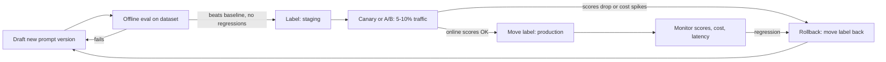
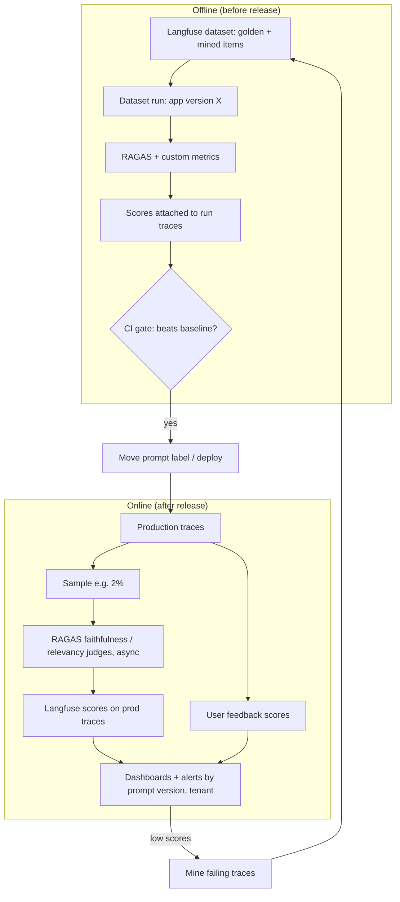
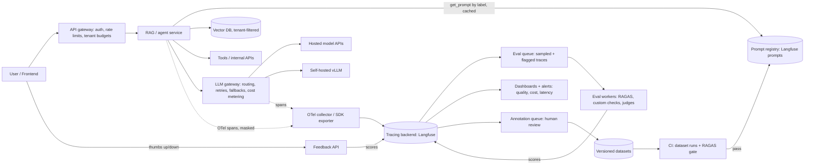

# LLMOps: Tracing, Prompt Management, Langfuse and RAGAS in Practice

> **Level:** Beginner to Advanced · **Study time:** ~120 min · **Prerequisites:** [Monitoring ML and LLM Systems in Production](06-monitoring-ml-and-llm-systems-in-production.md), [Data Versioning, Model Versioning and the Model Registry](02-data-and-model-versioning-and-model-registry.md), [Prompt Engineering for Production](../05-llms/04-prompt-engineering-for-production.md), [Evaluating LLMs: Metrics, Benchmarks and LLM-as-a-Judge](../05-llms/10-llm-evaluation-metrics-and-llm-as-a-judge.md), [Evaluating RAG: Retrieval Metrics, Faithfulness and RAGAS](../08-rag/10-rag-evaluation-metrics-and-ragas.md)

## Table of contents

- [Why this matters](#why-this-matters)
- [From MLOps to LLMOps: what actually changes](#from-mlops-to-llmops-what-actually-changes)
- [Tracing concepts: traces, spans, generations and sessions](#tracing-concepts-traces-spans-generations-and-sessions)
- [What to capture and what to redact](#what-to-capture-and-what-to-redact)
- [Langfuse in depth](#langfuse-in-depth)
- [Alternatives: LangSmith, Arize Phoenix and others](#alternatives-langsmith-arize-phoenix-and-others)
- [OpenTelemetry GenAI semantic conventions](#opentelemetry-genai-semantic-conventions)
- [The prompt management lifecycle](#the-prompt-management-lifecycle)
- [Cost tracking and budgets](#cost-tracking-and-budgets)
- [Continuous evaluation of a RAG app with RAGAS and Langfuse scores](#continuous-evaluation-of-a-rag-app-with-ragas-and-langfuse-scores)
- [Building evaluation datasets from production traces](#building-evaluation-datasets-from-production-traces)
- [A reference LLMOps architecture](#a-reference-llmops-architecture)
- [Going deeper: LLMOps at scale](#going-deeper-llmops-at-scale)
- [Common mistakes and misconceptions](#common-mistakes-and-misconceptions)
- [Interview questions and model answers](#interview-questions-and-model-answers)
- [Key takeaways](#key-takeaways)
- [Further reading](#further-reading)
- [Next](#next)

## Why this matters

Almost every company shipping a chatbot, a RAG assistant (retrieval-augmented generation: the app looks up relevant documents and pastes them into the prompt) or an agent (an LLM that decides, in a loop, which tools to call next) hits the same wall a few weeks after launch: a user complains about a wrong answer, and nobody can say which prompt version, which retrieved chunks, which model and which tool calls produced it. Classic MLOps tooling (experiment trackers, model registries, drift dashboards) does not answer that question, because in LLM apps the behavior lives in prompts, retrieval and multi-step chains, not in a single model file you trained. **LLMOps** is the set of practices and tools that fill this gap: tracing every step of a request, managing prompts like deployable code, tracking token costs, and evaluating quality continuously with judges and human feedback. Interviewers for senior AI roles probe this area hard because it separates people who built a demo from people who ran an LLM product in production. By the end of this chapter you will be able to design that stack and explain it with concrete tools such as Langfuse and RAGAS.

## From MLOps to LLMOps: what actually changes

> **Analogy:** Classic MLOps is like running a bakery where you bake your own bread: you control the recipe, the oven and the ingredients, and you version each batch. LLMOps is like running a restaurant that buys bread from a supplier (the model API) and adds its own sauces (prompts, retrieved documents, tools). The sauces change weekly, the supplier sometimes changes the bread without telling you, and every plate has a per-item cost.

**MLOps** (covered in [The ML Lifecycle, MLOps and Experiment Tracking](01-ml-lifecycle-and-experiment-tracking.md)) is the discipline of reliably training, versioning, deploying and monitoring machine learning models. **LLMOps** is the same discipline adapted to applications built on large language models. The goals are identical (reproducibility, safe releases, observability, quality over time), but five things change.

| Dimension | Classic MLOps | LLMOps |
|---|---|---|
| Main artifact you change | Model weights you trained | **Prompts**, retrieval config, tool definitions, model choice; weights often belong to a vendor |
| Where the model runs | Your own serving stack | Often an **external API** (OpenAI, Google, Mistral and others) or a self-hosted open-weight model |
| Output type | A number or a label | Free text, JSON or tool calls; many valid answers |
| Determinism | Same input gives same output | **Nondeterministic**: sampling, provider-side changes, batching effects |
| Cost model | Mostly fixed compute | **Per-token** variable cost, per request |
| How quality is measured | Accuracy, AUC, RMSE on labeled data | Rubrics, **LLM-as-a-judge**, human feedback, task-specific checks |
| Debug unit | A prediction | A **trace**: many steps (retrieval, several LLM calls, tools) |

Let us unpack each change.

**1. Prompts are artifacts.** A **prompt** is the text (instructions, examples, placeholders) that you send to the model. Changing one sentence in a system prompt can change behavior as much as retraining a classic model. So prompts need what model weights get in MLOps: versions, reviews, tests, staged rollout and rollback.

**2. External model APIs.** When you call a hosted model, you do not control the weights. Vendors update model aliases (for example a name like `gpt-4o` pointing to a newer snapshot), deprecate models and change rate limits. You must pin **model snapshots** (a dated, immutable model identifier) where the vendor offers them, and record the exact model string in every trace.

**3. Nondeterminism.** With temperature above zero, the model samples tokens randomly (see [How LLMs Generate Text: Decoding Strategies](../05-llms/03-text-generation-and-decoding-strategies.md)). Even at temperature 0, hosted APIs are not guaranteed to be bit-for-bit reproducible (floating-point differences across batches and hardware). Consequence: you cannot debug by "just re-running it". You must **record what actually happened**, which is exactly what tracing does.

**4. Token costs.** A **token** is a chunk of text, roughly a word piece (see [Tokenization](../04-transformers/01-tokenization.md)). Vendors bill per input token and per output token, usually at different prices. A prompt change that adds 2,000 tokens of context silently multiplies your bill. Cost becomes a first-class metric next to latency.

**5. Evaluation via judges.** There is rarely one correct output string, so exact-match accuracy fails. Teams use **LLM-as-a-judge** (a second model scoring outputs against a rubric, covered in [Evaluating LLMs](../05-llms/10-llm-evaluation-metrics-and-llm-as-a-judge.md)), heuristics (valid JSON, contains a citation), and human feedback. These scores must be attached to the exact traces they evaluate.

> **Senior insight:** LLMOps does not replace MLOps. If you fine-tune or self-host models, you still need a model registry, data versioning and GPU monitoring. LLMOps adds a layer on top: prompts, traces, judges and token economics.

### Running example for this chapter

We will reuse one small system throughout: **HelpDesk Bot**, an HR assistant built with RAG for multiple customer companies (**tenants**, meaning separate customer organizations sharing one deployment, such as `acme` and `globex`). Its knowledge base is a 4-document corpus:

1. `leave-policy.md`: "Employees get 25 vacation days per year."
2. `expense-policy.md`: "Meals are reimbursed up to 40 USD per day."
3. `remote-work.md`: "Remote work is allowed up to 3 days per week."
4. `it-security.md`: "Passwords rotate every 90 days."

A request flows like this: the user asks "How many vacation days do I get?", the app retrieves 2 chunks, fills a prompt template, calls a model, and may call a tool (`get_employee_balance`) to look up the user's remaining days.

## Tracing concepts: traces, spans, generations and sessions

> **Analogy:** A package delivery tracker. The whole delivery is one tracking number (the trace). Each leg (picked up, sorted at the hub, loaded on the truck, delivered) is a step with its own start time, end time and status (the spans). Several deliveries to the same customer this month form their order history (the session).

**Observability** means being able to understand what a system did from the data it emits. Classic observability has three signal types: **logs** (timestamped text lines), **metrics** (numeric time series such as p95 latency, the latency that 95% of requests stay under) and **traces**. For LLM apps, traces are the most important, because a single request is a tree of steps.

Precise definitions (these follow the OpenTelemetry model, which most LLM tools reuse):

- **Trace:** the full record of one end-to-end request, identified by a unique **trace ID**. Example: one user question to HelpDesk Bot and everything the system did to answer it.
- **Span:** one timed unit of work inside a trace, with a name, start time, end time, status (ok or error), attributes (key-value data) and a **parent span ID** that places it in a tree. Example: the `retrieve` step.
- **Root span:** the top span with no parent; it represents the whole request.
- **Generation:** a span that is specifically an LLM call. It carries model name, parameters, prompt, completion, token usage and cost. Langfuse uses this term; OpenTelemetry calls it a span with `gen_ai.*` attributes.
- **Event:** a point-in-time record with no duration (for example "guardrail triggered").
- **Session:** a group of traces that belong to one conversation or workflow, linked by a shared **session ID**. A chat with 6 user turns is 1 session with 6 traces.
- **Score:** a number, boolean or category attached to a trace or span after the fact (judge rating, user thumbs-up, RAGAS faithfulness).

Here is one HelpDesk Bot trace as a tree:

```text
TRACE  id=7f3a  user=u-17  tenant=acme  session=sess-42        total 1,840 ms   cost = sum of all generations
└── span   rag-request                                          1,840 ms
    ├── span       rewrite-query    (generation, small model)     210 ms
    ├── span       retrieve         (retriever, top_k=2)           95 ms
    │     attrs: chunk_ids=[leave-policy#0, remote-work#0], scores=[0.82, 0.41]
    ├── generation answer            (gpt-4o-mini style model)    980 ms
    │     input_tokens=3,000  output_tokens=250  cost=$0.0100  finish_reason=tool_calls
    ├── span       tool:get_employee_balance                      120 ms
    │     args={"user_id": "u-17"}   result={"remaining": 11}
    └── generation answer-final                                   435 ms
          output="You get 25 days per year; 11 remain this year."
SCORES: user_feedback=1 (thumbs up), faithfulness=1.0 (sampled judge)
```

Notice what the tree gives you that logs do not: **causality** (which step called which), **timing** (where the 1,840 ms went), and **evidence** (exactly which chunks the model saw).

### How tracing works under the hood: a tiny tracer from scratch

Every tracing SDK does three things: (1) when a step starts, create a span record and remember it as the "current" span; (2) when a nested step starts, make the current span its parent; (3) when a step ends, record duration and status, then send the record to a backend. Python's `contextvars` module holds the "current span" separately per thread and per async task, so concurrent requests do not mix up their parents. Caveat: a new thread (for example a `ThreadPoolExecutor` worker) does not inherit the caller's context automatically, so SDKs copy it explicitly (`contextvars.copy_context()`) or the child spans become orphans.

```python
# tiny_tracer.py - no dependencies, Python 3.10+
import contextvars, time, uuid
from contextlib import contextmanager

_current = contextvars.ContextVar("current_span", default=None)
SPANS = []  # a real SDK exports spans asynchronously in batches instead

@contextmanager
def span(name, kind="span", **attrs):
    parent = _current.get()
    rec = {
        "trace_id": parent["trace_id"] if parent else uuid.uuid4().hex[:8],
        "span_id": uuid.uuid4().hex[:8],
        "parent_id": parent["span_id"] if parent else None,
        "name": name, "kind": kind, "attrs": dict(attrs),
        "start": time.perf_counter(),
    }
    token = _current.set(rec)          # this span is now the parent of nested spans
    try:
        yield rec
        rec["status"] = "ok"
    except Exception as e:
        rec["status"] = f"error: {e!r}"
        raise
    finally:
        rec["latency_ms"] = round((time.perf_counter() - rec["start"]) * 1000, 1)
        _current.reset(token)          # restore the previous parent
        SPANS.append(rec)

def retrieve(question):
    with span("retrieve", kind="retriever", top_k=2) as s:
        chunks = ["Leave policy: 25 vacation days per year.",
                  "Remote work policy: up to 3 days per week."]
        s["attrs"]["chunks"] = chunks   # capture the evidence the model will see
        return chunks

def call_llm(prompt):
    with span("llm", kind="generation", model="gpt-4o-mini", temperature=0.0) as s:
        answer = "You get 25 vacation days per year."   # stand-in for a real API call
        s["attrs"].update(input_tokens=48, output_tokens=9)
        return answer

def answer(question, user_id):
    with span("rag-request", kind="trace", user_id=user_id, session_id="sess-42"):
        chunks = retrieve(question)
        return call_llm(f"Context: {chunks}\nQuestion: {question}")

print(answer("How many vacation days do I get?", user_id="u-17"))

by_id = {s["span_id"]: s for s in SPANS}
def depth(s):
    d = 0
    while s["parent_id"]:
        s, d = by_id[s["parent_id"]], d + 1
    return d

for s in sorted(SPANS, key=lambda s: s["start"]):
    print("  " * depth(s) + f'{s["kind"]:<10} {s["name"]:<12} status={s["status"]}')
# You get 25 vacation days per year.
# trace      rag-request  status=ok
#   retriever  retrieve     status=ok
#   generation llm          status=ok
```

That is the whole idea. Production SDKs add: batching and background export so tracing does not slow requests, sampling, redaction hooks, retries, and **context propagation** across services (passing the trace ID in HTTP headers, standardized as W3C Trace Context's `traceparent` header) so a retriever microservice's spans join the same trace.

> **Common mistake:** Logging only the final prompt and answer. When the answer is wrong you then cannot tell whether retrieval returned the wrong chunks, the query rewrite mangled the question, or the model ignored good evidence. Trace every step that can change the outcome.

## What to capture and what to redact

> **Analogy:** An aircraft's flight recorder captures everything needed to reconstruct an incident, but it does not record passengers' credit card numbers. Your trace should be the flight recorder of a request: complete enough to replay the decision, stripped of data you have no right to keep.

### What to capture

| Field | Why you need it | Example |
|---|---|---|
| Prompt (rendered messages) and completion | Reproduce and judge the exact interaction | system + user messages, assistant reply |
| Prompt name and version | Know which template produced it; enables rollback analysis | `rag-answer` v7, label `production` |
| Model and parameters | Behavior depends on them | `gpt-4o-mini-2024-07-18`, temperature 0.2, max_tokens 400 |
| Token counts (input, output, cached, reasoning) | Cost, context-limit debugging | in 3,000, out 250 |
| Latency per span, plus time to first token for streams | Find the slow step | retrieve 95 ms, generation 980 ms |
| Cost | Budgets, per-tenant billing | 0.0100 USD |
| Retrieved chunks: IDs, scores, text or a pointer, index version | Debug retrieval vs generation errors | `leave-policy#0`, score 0.82 |
| Tool calls: name, arguments, result, error, tool call ID | Debug agents and tool misuse | `get_employee_balance({"user_id": "u-17"})` |
| Model decisions: finish reason, chosen route, chosen tool | Explain control flow | `finish_reason=tool_calls`, route=`hr` |
| User ID, tenant ID, session ID | Group, filter, bill, honor deletion requests | `u-17`, `acme`, `sess-42` |
| Environment and release | Compare versions, separate staging from prod | `prod`, `release=2026.10.3` |
| Scores and feedback | Quality over time | thumbs up, faithfulness 0.75 |
| Errors and retries | Reliability debugging | `RateLimitError`, retried twice |

The **finish reason** is the model API's explanation of why generation stopped: `stop` (natural end), `length` (hit the max token limit, a common cause of truncated JSON), `tool_calls` (the model wants to call a tool) or `content_filter`.

### What to redact

**PII** (personally identifiable information) is data that identifies a person: names, emails, phone numbers, addresses, government IDs, health and financial details. **Secrets** are credentials: API keys, passwords, tokens, connection strings. LLM traces are full of both, because users paste anything into chat boxes and tool results often contain customer records.

Three layers of defense, from strongest to weakest:

1. **Do not send it.** Configure the SDK to not capture inputs and outputs for sensitive spans (most SDKs have a flag per decorator or a global setting), and log pointers (`chunk_id`) instead of full text where possible.
2. **Mask before export.** Run a masking function inside your process, before data leaves for the tracing backend. Langfuse SDKs accept a `mask` function for this.
3. **Control storage.** Retention limits (for example delete raw traces after 30 days), role-based access to the tracing UI, region choice for data residency, encryption, and deletion by user ID for GDPR-style "right to erasure" requests.

A simple masking function (regex based, good as a first layer):

```python
import re

PATTERNS = [
    (re.compile(r"[\w.+-]+@[\w-]+\.[\w.-]+"), "<EMAIL>"),
    (re.compile(r"\bsk-[A-Za-z0-9_-]{16,}\b"), "<API_KEY>"),
    (re.compile(r"\b(?:\d[ -]?){13,16}\b"), "<CARD>"),
    (re.compile(r"\+?\d{1,3}[ .-]?\(?\d{3}\)?[ .-]?\d{3}[ .-]?\d{4}\b"), "<PHONE>"),
]

def mask(data):
    """Recursively redact strings inside str / dict / list payloads."""
    if isinstance(data, str):
        for pattern, placeholder in PATTERNS:
            data = pattern.sub(placeholder, data)
        return data
    if isinstance(data, dict):
        return {k: mask(v) for k, v in data.items()}
    if isinstance(data, list):
        return [mask(v) for v in data]
    return data

msg = {"role": "user",
       "content": "I'm jane.doe@acme.com, call +1 415-555-0134. Key sk-abcDEF1234567890xyz"}
print(mask(msg)["content"])
# I'm <EMAIL>, call <PHONE>. Key <API_KEY>
```

Regexes miss names and free-form addresses. For stronger detection, teams add a named-entity recognizer such as Microsoft Presidio (an open-source PII detection library) or a small classifier, accepting some extra latency. Since masking runs on every exported span, keep it fast or run it in the background export thread.

> **Senior insight:** Redaction is a trade-off against debuggability. If you mask everything, you cannot debug or build eval datasets. A common compromise: full capture in staging, masked capture in production, plus a short-lived, access-controlled "raw" store that only on-call engineers can open, with every access audited. Agree on this with your security and legal teams before launch, not after an incident.

> **Common mistake:** Forgetting that tool results and retrieved chunks contain PII too. Masking only the user message leaves the customer record returned by `get_employee_record` in plain text in the trace. Also remember multi-tenant isolation: one tenant's traces must not be visible to another tenant's admins (see [Secure Multi-Tenant RAG](../08-rag/13-secure-multi-tenant-rag.md)).

## Langfuse in depth

**Langfuse** is an open-source LLM engineering platform. It bundles the main LLMOps building blocks in one product:

- **Tracing** (observability) of LLM apps, agents and RAG pipelines.
- **Prompt management** with versions and labels.
- **Datasets** and **experiments** (dataset runs) for offline evaluation.
- **Scores** from LLM-as-a-judge evaluators, custom code, human annotation and user feedback.
- **Dashboards** for cost, latency, usage and quality, sliced by user, tenant (via tags or metadata), model, prompt version and more.

You can use the managed **Langfuse Cloud** or **self-host** it. The core is open source under the MIT license; some enterprise features have historically been under a separate commercial license, and that boundary has moved over time, so check the current licensing page before relying on a specific feature.

> **Interview tip:** Interviewers rarely care about exact SDK syntax. They care that you know the data model (traces, observations, sessions, scores, prompts, datasets) and how the pieces form a loop: trace, evaluate, find failures, add them to datasets, change prompts, run experiments, release with labels, monitor.

### The Langfuse data model

```text
Project (one per app/environment boundary)
├── Traces ─── each has: id, name, user_id, session_id, tags, metadata,
│   │          release, version, environment, input, output
│   └── Observations (tree) ─── types: span, generation, event
│         (newer SDK versions add more specific types such as agent, tool,
│          retriever, embedding, guardrail; check your version)
│         generation fields: model, model_parameters, usage_details,
│                            cost_details, prompt (link to prompt version)
├── Sessions ── traces grouped by session_id
├── Scores ──── name, value (numeric | categorical | boolean), comment,
│               attached to a trace, an observation or a session
├── Prompts ─── name -> versions 1..n, each with labels and config
└── Datasets ── items (input, expected_output, metadata, source trace)
                └── Dataset runs: one experiment = app version run over all items
```

### Tracing with the Python SDK

```bash
pip install langfuse openai
```

> **Version warning:** The Langfuse Python SDK changed substantially between major versions. v2 used `from langfuse.decorators import observe, langfuse_context`. v3 (2025) was rebuilt on top of OpenTelemetry and uses `from langfuse import observe, get_client`. Method names for updating traces, creating scores and running experiments also changed, and later releases added helpers such as an experiment runner. The code below follows the v3 style; treat it as a realistic sketch and check the current docs for your installed version.

Configuration usually comes from environment variables, so keys never live in code:

```bash
export LANGFUSE_PUBLIC_KEY="pk-lf-..."
export LANGFUSE_SECRET_KEY="sk-lf-..."
export LANGFUSE_HOST="https://cloud.langfuse.com"   # or your self-hosted URL
```

Now instrument HelpDesk Bot with decorators. A **decorator** (`@observe`) wraps a function so that every call automatically becomes a span, with inputs, outputs, timing and errors recorded, and nested decorated calls become child spans.

```python
from langfuse import observe, get_client
from openai import OpenAI

langfuse = get_client()          # reads LANGFUSE_* env vars
llm = OpenAI()                   # reads OPENAI_API_KEY

@observe(as_type="retriever")    # older versions: use a plain @observe() span
def retrieve(question: str, tenant: str) -> list[dict]:
    # Stand-in for a vector DB query filtered by tenant
    chunks = [{"id": "leave-policy#0", "score": 0.82,
               "text": "Employees get 25 vacation days per year."}]
    langfuse.update_current_span(metadata={"index_version": "hr-idx-2026-10-01",
                                           "top_k": 2})
    return chunks

@observe(as_type="generation")
def generate(question: str, chunks: list[dict]) -> str:
    context = "\n".join(c["text"] for c in chunks)
    messages = [
        {"role": "system", "content": "Answer only from the context. Cite chunk ids."},
        {"role": "user", "content": f"Context:\n{context}\n\nQuestion: {question}"},
    ]
    resp = llm.chat.completions.create(model="gpt-4o-mini", messages=messages,
                                       temperature=0.2)
    langfuse.update_current_generation(
        input=messages,
        model=resp.model,                                  # exact model string returned
        model_parameters={"temperature": 0.2},
        usage_details={"input": resp.usage.prompt_tokens,
                       "output": resp.usage.completion_tokens},
        metadata={"finish_reason": resp.choices[0].finish_reason},
    )
    return resp.choices[0].message.content

@observe()                       # root span -> creates the trace
def answer(question: str, user_id: str, tenant: str, session_id: str) -> str:
    langfuse.update_current_trace(user_id=user_id, session_id=session_id,
                                  tags=[f"tenant:{tenant}"],
                                  metadata={"tenant": tenant})
    chunks = retrieve(question, tenant)
    return generate(question, chunks)

print(answer("How many vacation days do I get?", "u-17", "acme", "sess-42"))
langfuse.flush()   # short-lived scripts: send buffered spans before exit
```

Key behaviors to know:

- Spans are buffered and exported in the background, so tracing adds little latency to the request path. In short-lived processes (scripts, serverless functions) you must call `flush()` or you lose data.
- If you send token usage but not cost, Langfuse can compute cost from its **model definitions** (a table mapping model names to per-token prices, which you can extend with your own models). If you send `cost_details` yourself, that takes precedence.
- Tool calls are just spans: decorate your tool functions, or wrap them in a span named after the tool.

### Integrations instead of manual instrumentation

Writing `update_current_generation` by hand is tedious. Langfuse ships **integrations** that capture model calls automatically:

- **OpenAI drop-in:** replace `from openai import OpenAI` with `from langfuse.openai import OpenAI` (or `from langfuse.openai import openai`), and every call is traced with model, usage and cost.
- **LangChain and LangGraph:** pass a Langfuse `CallbackHandler` in the run config (import path changed between versions, for example `langfuse.callback` in v2 and `langfuse.langchain` in v3).
- **Frameworks via OpenTelemetry:** since the v3 SDK is OpenTelemetry-based, any library emitting OTel spans (LlamaIndex, Pydantic AI, the OpenAI Agents SDK, and others through OpenLLMetry or OpenInference instrumentors) can feed Langfuse.
- **Gateways:** LLM proxies such as LiteLLM can forward traces to Langfuse.

> **Senior insight:** Prefer one root span you create yourself (with user, tenant and session) plus auto-instrumentation for the inner model calls. Pure auto-instrumentation often produces orphan traces with no business context, which you cannot filter by tenant or connect to user feedback.

### Prompt management

Langfuse stores prompts outside your code. Each prompt has a **name**, an auto-incrementing **version** (immutable once created) and movable **labels** such as `production` or `staging` (Langfuse also maintains a `latest` label automatically, always pointing at the newest version). The app asks for "the version with label `production`", so you can change behavior by moving a label, without redeploying code.

```python
from langfuse import get_client
langfuse = get_client()

# 1) Create a new version (usually from the UI or a CI job, not at request time)
langfuse.create_prompt(
    name="rag-answer",
    type="chat",
    prompt=[
        {"role": "system", "content": "You are an HR assistant for {{company}}. "
                                      "Answer only from the context and cite chunk ids."},
        {"role": "user", "content": "Context:\n{{context}}\n\nQuestion: {{question}}"},
    ],
    labels=["staging"],                          # not production yet
    config={"model": "gpt-4o-mini", "temperature": 0.2, "max_tokens": 400},
)

# 2) At request time: fetch by label (SDK caches it client-side)
prompt = langfuse.get_prompt("rag-answer", type="chat", label="production",
                             cache_ttl_seconds=60)
messages = prompt.compile(company="Acme", context="...", question="...")
model_cfg = prompt.config                       # model + params travel with the prompt
print(prompt.version)                           # e.g. 7
```

Three properties make this production-safe:

- **Client-side caching:** the SDK caches fetched prompts for a **TTL** (time to live, here 60 seconds) and refreshes them in the background, so prompt fetching does not add a network round trip to every request. You can also pass a `fallback` prompt for when the Langfuse server is unreachable at cold start.
- **Linking prompts to generations:** pass the prompt object when you record the generation (for example `langfuse.update_current_generation(prompt=prompt)`, or `langfuse_prompt=prompt` with the OpenAI integration). Langfuse can then show quality, cost and latency per prompt version.
- **Config with the prompt:** storing model name and parameters in the prompt's `config` means a prompt version is a complete, testable unit.

### Datasets, experiments, scores and feedback

- **Datasets** are collections of items with `input`, optional `expected_output` and `metadata`. Items can link to the production trace they came from (`source_trace_id`).
- **Dataset runs (experiments)** execute your app over every item and record a trace per item, grouped under a run name such as `prompt-v8-gpt-4o-mini`. You can compare runs side by side.
- **Scores** come from several sources: your own code via the SDK or API, **LLM-as-a-judge evaluators** configured in the UI that run automatically on new traces (with filters and sampling), **annotation queues** where humans label traces, and **user feedback** captured from your front end.

Capturing user feedback from a thumbs-up button:

```python
# In the request handler, return the trace id to the front end
trace_id = langfuse.get_current_trace_id()

# Later, in the feedback endpoint
langfuse.create_score(trace_id=trace_id, name="user_feedback",
                      value=1, data_type="BOOLEAN",          # 1 = thumbs up
                      comment="Correct and fast")
```

### Self-hosting vs cloud

| Option | What it is | Pros | Cons | Choose when |
|---|---|---|---|---|
| Langfuse Cloud | Managed SaaS, with regional deployments | Zero ops, fast start, upgrades handled | Data leaves your network (check regions and contracts); usage-based pricing | Startups, prototypes, teams without strict data residency rules |
| Self-hosted (Docker Compose) | Single machine | Easy local or small-team setup | Not highly available; you own backups | Evaluation, small internal tools |
| Self-hosted (Kubernetes, Helm chart) | Production deployment in your cloud | Data stays in your VPC (virtual private cloud, your isolated cloud network); meets strict compliance | You operate the databases, scaling, upgrades and backups | Regulated industries (health, finance), large enterprises |

The self-hosted Langfuse v3 platform is not one container: it has a web server, a background **worker**, **Postgres** (transactional data such as users, prompts, settings), **ClickHouse** (a column-oriented analytics database storing the high-volume traces, observations and scores), **Redis** or a compatible cache and queue, and **S3-compatible blob storage** for raw events and large payloads. Exact components can change between platform versions, so follow the official self-hosting guide.

> **Senior insight:** Self-hosting is a real operational commitment. ClickHouse at tens of millions of observations per day needs disk, retention policies and monitoring of its own. Estimate trace volume before choosing (requests per day times observations per trace times average payload size), and budget engineering time for upgrades.

## Alternatives: LangSmith, Arize Phoenix and others

Langfuse is one of several tools in this category. They converge on the same concepts, so knowing one well transfers.

| Tool | What it is | Strengths | Weaknesses | Pick when |
|---|---|---|---|---|
| **Langfuse** | Open-source LLM engineering platform (MIT core), cloud or self-host | Tracing + prompt management + datasets + scores in one; framework-agnostic; self-host friendly | Self-hosting means operating ClickHouse and friends | You want open source, self-hosting or vendor neutrality |
| **LangSmith** | Commercial platform from the LangChain team | Deepest LangChain/LangGraph integration; tracing (`@traceable`), datasets, evaluators, prompt hub, annotation queues | Proprietary; self-hosting is an enterprise offering | Your stack is LangChain/LangGraph and a managed SaaS is acceptable |
| **Arize Phoenix** | Source-available (Elastic License 2.0, free to self-host, not OSI open source) observability and eval tool from Arize, built on OpenTelemetry and the OpenInference conventions | Runs locally in a notebook or as a server; strong eval library and retrieval/embedding analysis; OTel native | Fewer prompt management features historically; the enterprise product is Arize AX | Local debugging, eval-heavy workflows, OTel-first teams |
| **Others** | MLflow (GenAI tracing and evaluation in MLflow 3), Weights & Biases Weave, Braintrust, Helicone (proxy-based logging), Traceloop's OpenLLMetry (OTel instrumentation) | Fit existing ecosystems | Feature sets vary and move fast | You already standardize on that ecosystem |

Two architectural styles exist:

- **SDK/instrumentation based** (Langfuse, LangSmith, Phoenix): code emits spans for every step, including retrieval and tools. Full visibility.
- **Proxy/gateway based** (Helicone, LiteLLM proxy logging): all model calls go through a proxy that logs them. Zero code changes, but the proxy only sees model calls, not retrieval or tool steps, so you lose the tree.

> **Interview tip:** If asked "which tool would you choose?", answer with criteria, not brand loyalty: data residency and self-hosting needs, framework lock-in, OpenTelemetry compatibility (so you can switch backends), prompt management needs, eval features, cost at your trace volume, and team familiarity.

## OpenTelemetry GenAI semantic conventions

**OpenTelemetry (OTel)** is a vendor-neutral, open standard (a Cloud Native Computing Foundation project) for producing and exporting traces, metrics and logs. **Semantic conventions** are agreed attribute names, so that every tool means the same thing by, say, `http.response.status_code`. The **GenAI semantic conventions** do this for LLM calls, agents and tools.

> **Analogy:** Electrical plugs. If every LLM library invented its own attribute names, each tracing backend would need adapters for each library. A shared convention is a standard socket: any instrumented library plugs into any backend.

Commonly used attributes (the conventions were still marked as in development in 2025 and some names have been renamed, so verify against the current spec):

| Attribute | Meaning | Example |
|---|---|---|
| `gen_ai.operation.name` | Kind of operation | `chat`, `embeddings`, `execute_tool`, `invoke_agent` |
| `gen_ai.provider.name` (older: `gen_ai.system`) | Model provider | `openai` |
| `gen_ai.request.model` / `gen_ai.response.model` | Requested vs actually served model | `gpt-4o-mini` / `gpt-4o-mini-2024-07-18` |
| `gen_ai.request.temperature`, `gen_ai.request.max_tokens` | Sampling parameters | `0.2`, `400` |
| `gen_ai.usage.input_tokens`, `gen_ai.usage.output_tokens` | Token usage | `3000`, `250` |
| `gen_ai.response.finish_reasons` | Why generation stopped | `["tool_calls"]` |
| `gen_ai.tool.name`, `gen_ai.tool.call.id` | Tool execution details | `get_employee_balance`, `call_abc` |
| `gen_ai.conversation.id` | Session or thread ID | `sess-42` |

The conventions also recommend span names like `chat gpt-4o-mini`, define metrics such as `gen_ai.client.token.usage` and `gen_ai.client.operation.duration`, and treat capturing **message content** as opt-in, precisely because prompts and completions may contain sensitive data.

Why a senior engineer cares:

- **Portability:** instrument once with OTel, then send spans to Langfuse, Phoenix, Datadog, Grafana Tempo or Jaeger by changing an exporter, not your code.
- **One trace across the whole system:** the LLM spans join the same distributed trace as your API gateway, database and vector DB spans.
- **Avoiding lock-in:** a strong argument in vendor selection discussions.

A minimal manual OTel span for a tool call:

```python
# pip install opentelemetry-sdk
from opentelemetry import trace
from opentelemetry.sdk.trace import TracerProvider
from opentelemetry.sdk.trace.export import ConsoleSpanExporter, SimpleSpanProcessor

provider = TracerProvider()
provider.add_span_processor(SimpleSpanProcessor(ConsoleSpanExporter()))  # prints spans
trace.set_tracer_provider(provider)
tracer = trace.get_tracer("helpdesk-bot")

def get_employee_balance(user_id: str) -> dict:
    with tracer.start_as_current_span("execute_tool get_employee_balance") as s:
        s.set_attribute("gen_ai.operation.name", "execute_tool")
        s.set_attribute("gen_ai.tool.name", "get_employee_balance")
        s.set_attribute("gen_ai.tool.call.id", "call_abc")
        result = {"remaining": 11}                  # stand-in for an HR API call
        s.set_attribute("app.tool.result_size", len(str(result)))
        return result

get_employee_balance("u-17")
```

In production you would replace `ConsoleSpanExporter` with an OTLP (OpenTelemetry Protocol, the standard wire format for sending spans) exporter pointed at your collector or at a backend's OTLP endpoint (Langfuse exposes one).

## The prompt management lifecycle

> **Analogy:** A newspaper. Writers draft articles (prompt versions), editors review them, one version gets the "print edition" stamp (the `production` label), and if a correction is needed the editor can swap back to yesterday's article quickly. Nobody re-builds the printing press to fix a typo.

Treat prompts like code with a deployment pipeline. The lifecycle:



### Versioning

- Every change creates a new **immutable version**. Never edit a version in place, or old traces point at text that no longer exists.
- Store **who changed what and why** (commit message style notes).
- Version the **whole bundle** that defines behavior, not only the text: template, model ID, parameters, output schema, tool definitions. In Langfuse the `config` field helps; otherwise keep a manifest.

### Labels, rollout and rollback

A **label** is a movable pointer to one version, like a Git tag you can move. Apps fetch by label (`production`), never by hard-coded version number, except in tests where pinning is what you want.

- **Rollout:** move `production` from v7 to v8. Because the SDK caches prompts with a short TTL, the change propagates within the cache TTL (for example 60 seconds), with no deploy.
- **Rollback:** move `production` back to v7. This is the fastest mitigation for a bad prompt; make sure on-call engineers know how to do it and have permission.
- **Guard rails on the process:** require a passing offline eval before a version can get the `production` label (enforce it in CI calling the API, or with review rules), and restrict who can move production labels.

> **Common mistake:** Allowing anyone to edit production prompts in a UI with no review and no eval gate. That is equivalent to letting anyone push to production without tests. Prompt management makes changes easy, which makes discipline more important, not less.

There are two schools for where prompts live:

| Approach | How | Pros | Cons |
|---|---|---|---|
| Prompts in Git (code) | Templates in the repo, deployed with the app | Code review, single source of truth, atomic with code changes | Every prompt tweak needs a deploy; non-engineers cannot iterate |
| Prompts in a registry (Langfuse, LangSmith hub) | Fetched by label at runtime | Instant rollout and rollback, domain experts can iterate, version linked to traces | Runtime dependency (mitigate with caching and fallbacks); two sources of truth if not careful |
| Hybrid | Registry is source of truth, CI syncs and tests, or Git is source and CI publishes to registry | Review plus fast rollout | More tooling |

### A/B testing prompt versions

Two related ideas: a **canary** sends a small share of traffic (say 5 to 10%) to the new version to catch breakage early, while an **A/B test** splits traffic between versions to measure which one is better. A canary that runs long enough to collect metrics doubles as an A/B test.

To compare v7 (control) and v8 (candidate) on live traffic, assign users deterministically, so the same user always sees the same version (otherwise their experience flips between turns and the measurement mixes effects):

```python
import hashlib

def variant(user_id: str, experiment: str, share_b: float = 0.5) -> str:
    """Deterministic: the same user always sees the same prompt version."""
    h = hashlib.sha256(f"{experiment}:{user_id}".encode()).hexdigest()
    bucket = int(h[:8], 16) / 0xFFFFFFFF          # roughly uniform in [0, 1]
    return "prod-b" if bucket < share_b else "production"

label = variant("u-17", "rag-answer-v8", share_b=0.1)   # 10% canary
# prompt = langfuse.get_prompt("rag-answer", label=label)
# Record the label/version on the trace so scores can be split by variant.
```

Then compare a quality metric between the two groups. Suppose the metric is the thumbs-up rate. To know whether a difference is real or noise, compute the **standard error** of the difference of two proportions:

$$
SE = \sqrt{\frac{p_A(1-p_A)}{n_A} + \frac{p_B(1-p_B)}{n_B}}, \qquad z = \frac{p_B - p_A}{SE}
$$

- $p_A$, $p_B$: the observed thumbs-up rates for version A (v7) and B (v8).
- $n_A$, $n_B$: the number of rated responses in each group.
- $SE$: how much the difference would wobble by chance alone.
- $z$: how many standard errors apart the two rates are; $|z| > 1.96$ roughly means "significant at the 5% level".

Worked example (illustrative numbers): $p_A = 0.72$, $n_A = 2000$, $p_B = 0.76$, $n_B = 2000$.

1. $p_A(1-p_A) = 0.72 \times 0.28 = 0.2016$, divided by 2000 gives $0.0001008$.
2. $p_B(1-p_B) = 0.76 \times 0.24 = 0.1824$, divided by 2000 gives $0.0000912$.
3. Sum: $0.0001008 + 0.0000912 = 0.000192$.
4. $SE = \sqrt{0.000192} \approx 0.01386$.
5. Difference: $0.76 - 0.72 = 0.04$.
6. $z = 0.04 / 0.01386 \approx 2.89$, which is above 1.96, so the improvement is unlikely to be noise. (This is the unpooled SE; the classic two-proportion test pools the rates under the null hypothesis, $\bar p = 0.74$, giving $SE \approx 0.01387$ and $z \approx 2.88$, essentially the same here.)

> **Senior insight:** Thumbs-up rates are biased (typically only a small fraction of users click, mostly unhappy or very happy ones). Use them alongside judge scores on a random sample, cost per request and latency, and decide the success metric and sample size before starting the test. For a deeper treatment of statistics see [Probability and Statistics for Machine Learning](../00-foundations/04-probability-and-statistics.md).

## Cost tracking and budgets

> **Analogy:** A taxi meter. Every request runs its own meter (input tokens at one rate, output tokens at another). If you do not watch the meters per passenger (tenant), one passenger can run up a bill that everyone else pays for.

The basic formula for one LLM call:

$$
\text{cost} = \frac{T_{in} \cdot P_{in} + T_{out} \cdot P_{out}}{10^6}
$$

- $T_{in}$: input (prompt) tokens, including system prompt, retrieved chunks, conversation history and tool definitions.
- $T_{out}$: output (completion) tokens, including hidden reasoning tokens for reasoning models, which are billed as output by most vendors.
- $P_{in}$, $P_{out}$: price in USD per 1 million input and output tokens. Output is usually several times more expensive than input.
- $10^6$: converts "per million tokens" to "per token".

Worked example with **illustrative prices** ($P_{in} = 2.50$, $P_{out} = 10.00$; not any vendor's real price list). One HelpDesk Bot request, in a top_k=4 configuration (as in the release manifest later in this chapter; the illustrative trace earlier showed only 2 chunks), has a 500-token system prompt, 4 retrieved chunks of 600 tokens each and a 100-token question:

1. $T_{in} = 500 + 4 \times 600 + 100 = 500 + 2400 + 100 = 3000$.
2. $T_{out} = 250$.
3. Input cost: $3000 \times 2.50 / 10^6 = 7500 / 10^6 = 0.0075$ USD.
4. Output cost: $250 \times 10.00 / 10^6 = 2500 / 10^6 = 0.0025$ USD.
5. Total: $0.0075 + 0.0025 = 0.0100$ USD per request.
6. At 50,000 requests per day: $50{,}000 \times 0.01 = 500$ USD per day, or $500 \times 30 = 15{,}000$ USD per 30-day month.

Notice where the money goes: 75% of this request's cost is input, and most input is retrieved context. Retrieving 2 chunks instead of 4 would cut $T_{in}$ to 1,800 and the cost to $(1800 \times 2.5 + 250 \times 10)/10^6 = (4500 + 2500)/10^6 = 0.0070$ USD, a 30% saving, if quality holds (measure it).

### What to track

- **Cost per trace** (sum of all generations, including query rewriting, judges you run inline and retries).
- **Cost per user, per tenant, per feature, per prompt version, per model.**
- **Cached tokens** separately: many providers discount repeated prompt prefixes (prompt caching, see [Speculative Decoding, Prompt Caching and Other Inference Speedups](../06-llm-inference/05-speculative-decoding-caching-and-other-speedups.md)), so cached input tokens are cheaper.
- **Evaluation cost** separately: online judges are LLM calls too.
- For self-hosted models, cost is GPU-hours, not tokens; convert to an internal cost per 1M tokens from measured throughput (see [Optimizing and Benchmarking LLM Latency and Cost](../06-llm-inference/07-optimizing-and-benchmarking-llm-latency-and-cost.md)).

### Budgets and enforcement

Dashboards tell you after the fact. Budgets act in real time:

```python
from collections import defaultdict

# Illustrative prices in USD per 1M tokens (not real vendor prices)
PRICES = {"small-model": {"input": 2.50, "output": 10.00}}

def request_cost(model: str, input_tokens: int, output_tokens: int) -> float:
    p = PRICES[model]
    return (input_tokens * p["input"] + output_tokens * p["output"]) / 1_000_000

spend = defaultdict(float)                     # tenant -> USD this month (use Redis in prod)
BUDGET = {"acme": 300.0, "globex": 50.0}       # monthly budgets in USD

def check_and_record(tenant: str, model: str, tin: int, tout: int) -> str:
    spend[tenant] += request_cost(model, tin, tout)
    used = spend[tenant] / BUDGET[tenant]
    if used >= 1.0:
        return "block_or_degrade"   # e.g. switch to a cheaper model, or return 429
    if used >= 0.8:
        return "alert"              # notify the account owner
    return "ok"

print(round(request_cost("small-model", 3000, 250), 4))
# 0.01
```

At 0.01 USD per request, `globex` with a 50 USD budget reaches the 80% alert after about 4,000 requests and the limit after about 5,000. Real systems also: estimate the cost **before** the call (count input tokens, assume max output) to reject requests that would exceed the budget, cap `max_tokens`, cap agent loop iterations and tool calls per request, and alert on cost anomalies (for example cost per request rising 50% after a prompt change).

> **Common mistake:** Tracking only model calls you make directly. Agents, retries after timeouts and inline guardrail or judge calls often double the real cost per user request. Cost must be aggregated per trace, not per API call.

## Continuous evaluation of a RAG app with RAGAS and Langfuse scores

**RAGAS** ("RAGAS: Automated Evaluation of Retrieval Augmented Generation", Es et al., 2023) is an open-source library of metrics for RAG systems, most of them computed with an LLM judge. The metrics themselves are taught in [Evaluating RAG: Retrieval Metrics, Faithfulness and RAGAS](../08-rag/10-rag-evaluation-metrics-and-ragas.md); here we focus on running them continuously in production. Quick recap:

| Metric | Question it answers | Needs a reference answer? |
|---|---|---|
| Faithfulness | Is every claim in the answer supported by the retrieved context? | No |
| Response (answer) relevancy | Does the answer address the question? | No |
| Context precision | Are the relevant chunks ranked near the top? | Some variants yes, some no |
| Context recall | Did retrieval find everything needed for the reference answer? | Yes |

Faithfulness recap with our running example:

$$
\text{Faithfulness} = \frac{\text{number of answer claims supported by the context}}{\text{total number of claims in the answer}}
$$

- Numerator: claims the judge verifies against the retrieved chunks.
- Denominator: all atomic claims the judge extracts from the answer.

Answer: "You get 25 vacation days per year, unused days carry over, you can work remotely 3 days a week, and 11 days remain." The context contained the leave policy, the remote work policy and the tool result (11 days remaining), but nothing about carry-over. Claims: (1) 25 days per year, supported; (2) unused days carry over, not supported; (3) remote 3 days a week, supported; (4) 11 days remain, supported (tool output counts as context if you pass it in). Faithfulness $= 3/4 = 0.75$.

> **Common mistake:** Forgetting to include tool results in the "context" you give the judge. Then every claim that came from a tool looks like a hallucination, and faithfulness looks worse than reality.

### The continuous evaluation loop

Two loops work together. **Offline evaluation** runs a candidate version over a fixed, versioned dataset before release, like unit tests for behavior. Its core is a **golden dataset**: hand-curated questions with reference (expected) answers. **Online evaluation** scores a sample of live production traces after release, like monitoring. Offline catches regressions you already know about; online catches the questions nobody put in the dataset.



### Offline: dataset runs scored with RAGAS

> **Version warning:** RAGAS's API changed significantly across versions (the 0.1 series used Hugging Face `Dataset` objects and metric singletons such as `faithfulness`; 0.2 introduced `SingleTurnSample`, `EvaluationDataset` and metric classes; later releases reorganized metrics and added an experiments API). Combine that with Langfuse SDK changes and you should treat this code as a pattern, then adapt names to your installed versions.

```python
# pip install langfuse ragas langchain-openai
import asyncio
from langfuse import get_client
from ragas import SingleTurnSample
from ragas.metrics import Faithfulness, ResponseRelevancy, LLMContextRecall
from ragas.llms import LangchainLLMWrapper
from ragas.embeddings import LangchainEmbeddingsWrapper
from langchain_openai import ChatOpenAI, OpenAIEmbeddings

langfuse = get_client()
judge_llm = LangchainLLMWrapper(ChatOpenAI(model="gpt-4o", temperature=0))
judge_emb = LangchainEmbeddingsWrapper(OpenAIEmbeddings())
metrics = {
    "faithfulness": Faithfulness(llm=judge_llm),
    "answer_relevancy": ResponseRelevancy(llm=judge_llm, embeddings=judge_emb),
    "context_recall": LLMContextRecall(llm=judge_llm),
}

def rag_app(question: str) -> dict:
    """Your instrumented app; must return the answer AND the contexts it used."""
    ...
    return {"answer": "...", "contexts": ["..."]}

async def run_experiment(run_name: str):
    dataset = langfuse.get_dataset("helpdesk-golden-v3")
    for item in dataset.items:
        # item.run(...) creates a trace linked to this dataset item and run
        with item.run(run_name=run_name) as root_span:
            out = rag_app(item.input["question"])
            sample = SingleTurnSample(
                user_input=item.input["question"],
                response=out["answer"],
                retrieved_contexts=out["contexts"],
                reference=item.expected_output,      # needed for context_recall
            )
            for name, metric in metrics.items():
                value = await metric.single_turn_ascore(sample)
                root_span.score_trace(name=name, value=float(value))
    langfuse.flush()

asyncio.run(run_experiment("prompt-v8_gpt-4o-mini_k4"))
```

Now the Langfuse UI shows run `prompt-v8_gpt-4o-mini_k4` next to the baseline run, with average scores and per-item drill-down into the trace that produced each score. A CI job can fetch the aggregate scores and fail the build if, for example, mean faithfulness drops by more than 0.02 versus the baseline (see [CI/CD and Testing for ML Pipelines](07-ci-cd-and-testing-for-ml-pipelines.md) and [Building an LLM Evaluation Framework and Regression Tests](../05-llms/11-building-an-llm-evaluation-framework-and-regression-tests.md)).

> **Senior insight:** Name runs with the full configuration (prompt version, model, top_k, index version). Six weeks later, "run-final-2" tells you nothing, while `prompt-v8_gpt-4o-mini_k4` tells you exactly what was tested.

### Online: sampled scoring of production traces

Online scoring evaluates real traffic, where real questions differ from your dataset. Use reference-free metrics (faithfulness, answer relevancy, context precision without reference), because production traces have no ground-truth answer unless an annotator adds one.

Pattern:

1. In the request handler, decide with probability $r$ whether this trace will be evaluated. Record the decision.
2. After responding to the user (never on the hot path), push the trace ID, question, answer and contexts to a queue.
3. A worker runs RAGAS metrics and writes them back as Langfuse scores with `create_score(trace_id=..., name="faithfulness", value=...)`.
4. Dashboards slice scores by prompt version, model, tenant and time; alerts fire when the rolling mean drops.

Alternatively, configure Langfuse's built-in LLM-as-a-judge evaluators to run on a sampled, filtered subset of new traces, with no worker code. RAGAS gives you established metric definitions in code; built-in evaluators give you less code to run. Many teams use both.

How big a sample do you need? For a score averaged over $n$ sampled traces, the standard error of the mean of a score that behaves like a proportion is:

$$
SE = \sqrt{\frac{p(1-p)}{n}}
$$

- $p$: the true average score (for example the fraction of faithful answers).
- $n$: number of scored traces in the window.

Worked example (illustrative): 50,000 requests per day, sampling rate $r = 2\%$, so $n = 50{,}000 \times 0.02 = 1{,}000$ scored traces per day. If $p = 0.9$:

1. $p(1-p) = 0.9 \times 0.1 = 0.09$.
2. $0.09 / 1000 = 0.00009$.
3. $SE = \sqrt{0.00009} \approx 0.0095$.
4. A 95% interval is about $\pm 1.96 \times 0.0095 \approx \pm 0.019$, so the daily faithfulness estimate is roughly $0.90 \pm 0.02$.

That is precise enough to detect a drop from 0.90 to 0.85 within a day. For a small tenant with 500 requests per day, 2% gives only 10 scored traces, which is far too noisy; use a higher rate (stratified sampling) for small tenants or new prompt versions.

> **Senior insight:** Sampling is a cost knob. If each RAGAS faithfulness evaluation makes a few judge calls, scoring 100% of traffic can cost as much as serving it. Sample uniformly for unbiased averages, and add targeted sampling (all traces with thumbs-down, all traces with `finish_reason=length`, all traces from a new prompt version) for finding failures. Keep these separate in dashboards, because targeted samples are biased by design.

### Using a custom evaluator alongside RAGAS

RAGAS metrics are generic. Most products also need domain checks that a library cannot know about:

```python
import json, re

def citation_check(answer: str, retrieved_ids: list[str]) -> float:
    """1.0 if the answer cites at least one id and every cited id was actually retrieved."""
    cited = re.findall(r"\[([\w-]+#\d+)\]", answer)
    if not cited:
        return 0.0
    return 1.0 if all(c in retrieved_ids for c in cited) else 0.0

def valid_json(answer: str) -> float:
    try:
        json.loads(answer)
        return 1.0
    except json.JSONDecodeError:
        return 0.0

print(citation_check("You get 25 days [leave-policy#0].", ["leave-policy#0"]))  # 1.0
print(citation_check("You get 25 days [hr-faq#3].", ["leave-policy#0"]))        # 0.0
```

These deterministic checks are cheap, so run them on 100% of traffic, and reserve sampled LLM judges for fuzzy qualities. Before trusting any LLM judge (RAGAS or custom), **calibrate** it: have humans label 100 to 200 traces, compare with the judge's labels, and measure agreement (for example Cohen's kappa or simple accuracy).

**Cohen's kappa** corrects raw agreement for the agreement you would get by chance: $\kappa = (p_o - p_e)/(1 - p_e)$, where $p_o$ is observed agreement and $p_e$ is chance agreement. Worked example (illustrative): judge and humans agree on 90% of 200 traces ($p_o = 0.9$), and each labels 80% of traces "faithful". Chance agreement is $p_e = 0.8 \times 0.8 + 0.2 \times 0.2 = 0.68$, so $\kappa = (0.9 - 0.68)/(1 - 0.68) = 0.22/0.32 \approx 0.69$. The 90% looked excellent, but much of it came from both sides saying "faithful" most of the time; a kappa of about 0.69 is decent, but far from near-perfect. Re-check when you change the judge model or prompt, because a judge version change shifts all your historical scores.

## Building evaluation datasets from production traces

> **Analogy:** A driving school that only practices on an empty parking lot passes its own tests but fails on real roads. Production traces are the real roads: they show the questions users actually ask and the places your system actually crashes.

A static golden dataset written before launch goes stale quickly: users ask things nobody predicted, documents change and new features appear. The fix is a **data flywheel**: production failures become test cases.

Where to mine candidates:

| Source | What it finds | Bias to remember |
|---|---|---|
| Thumbs-down and negative comments | Failures users noticed | Only vocal users; misses silent failures |
| Low online judge scores | Unfaithful or irrelevant answers | Judge errors included |
| Heuristic flags: `finish_reason=length`, tool errors, empty retrieval, retries | System failures | Over-represents technical issues |
| Clustering of questions (embed and cluster user queries) | Coverage of topics and intents | Need to sample per cluster |
| Random sample | Unbiased picture of real traffic | Mostly easy cases |

The workflow:

1. **Filter** traces in Langfuse (score below threshold, tag, time range, tenant).
2. **Review** in an annotation queue: a human confirms the failure, writes or corrects the **expected output** (the reference answer) and tags the failure category (retrieval miss, hallucination, wrong tool, formatting).
3. **Redact** the item (it will live much longer than a 30-day trace).
4. **Add** it to a dataset, linked to its source trace:

```python
langfuse.create_dataset_item(
    dataset_name="helpdesk-golden-v3",
    input={"question": "Do unused vacation days carry over?"},
    expected_output="The leave policy does not say; tell the user to ask HR.",
    metadata={"category": "unanswerable", "tenant": "acme", "added": "2026-10-20"},
    source_trace_id="7f3a...",              # keeps provenance back to production
)
```

5. **Version the dataset.** When you add items, record it as a new dataset version (new dataset name, or a version field in metadata, or rely on the tool's item timestamps), so you can still compare old runs fairly. Scores from different dataset versions are not directly comparable.
6. **Balance it.** Keep a mix: recent failures (regression tests), common intents (from clustering), adversarial cases (prompt injection, off-topic) and unanswerable questions (the correct behavior is to say "I don't know").

> **Common mistake:** Building the dataset only from failures. Then every prompt change looks like a big improvement on the dataset while quietly breaking the common easy cases you never included. Keep a stable, representative core plus a growing failure set, and report scores for each slice separately.

## A reference LLMOps architecture

Putting it all together for HelpDesk Bot:



What each component is responsible for:

| Component | Responsibility |
|---|---|
| API gateway | Authentication, tenant ID, rate limits, budget checks before work starts |
| Prompt registry | Versioned prompts with labels; cached client-side with fallbacks |
| LLM gateway | One place for provider keys, retries, fallbacks between providers, token metering, model allow-lists |
| Instrumentation | Root span with user, tenant, session, release; child spans for retrieval, tools, generations; masking before export |
| Tracing backend | Stores traces, scores, prompts, datasets; dashboards |
| Eval workers | Asynchronous scoring of sampled traces with RAGAS and custom metrics |
| Annotation and datasets | Turn failures into versioned test cases |
| CI | Runs the app on datasets for every prompt, model, retrieval or code change; gates releases |

This architecture also answers the versioning question: every trace records the **release manifest**, the set of versions that determined behavior:

```yaml
# release manifest attached to every trace as metadata (illustrative)
release: 2026.10.3
app_git_sha: 4c1e9ab
prompt: {name: rag-answer, version: 8, label: production}
model: {provider: openai, id: gpt-4o-mini-2024-07-18, temperature: 0.2}
retrieval: {embedding_model: text-embedding-3-small, index_version: hr-idx-2026-10-01, top_k: 4, reranker: none}
tools: {schema_version: 3}
guardrails: {policy_version: 5}
eval: {dataset: helpdesk-golden-v3, judge_model: gpt-4o, ragas_version: "pinned in lockfile"}
```

## Going deeper: LLMOps at scale

### Trace sampling vs evaluation sampling

These are different knobs. **Trace sampling** decides which requests are stored at all (Langfuse SDKs support a sample rate). **Evaluation sampling** decides which stored traces get judged. At high volume you may store 10% of successful traces but 100% of errors, thumbs-down traces and traces from new prompt versions. Head-based sampling (decide at the start of the request) is simple; tail-based sampling (decide after seeing the outcome, keeping errors and slow requests) catches more interesting traces but needs a collector that buffers whole traces, such as an OpenTelemetry Collector with a tail sampling processor.

### Overhead and reliability of tracing itself

- The tracing path must **never** fail or slow the user request. SDKs buffer and export asynchronously; set bounded queues and drop data rather than block when the backend is down.
- Large payloads (long contexts, base64 images) inflate storage and network cost. Store chunk IDs and truncate or offload large blobs.
- For serverless functions, flush before the function returns, or use an exporter that sends synchronously at the end, accepting a few milliseconds of latency.

### Storage volume estimate

Illustrative: 50,000 requests per day, 8 observations per trace, 4 KB average per observation: $50{,}000 \times 8 \times 4 \text{ KB} = 1{,}600{,}000 \text{ KB} \approx 1.6 \text{ GB}$ per day, about $48$ GB per 30 days, before compression. Columnar stores compress text well, but this still drives retention decisions (for example 30 days raw, scores and aggregates kept for a year).

### Agents make traces deep and wide

An agent may loop 15 times, calling tools and sub-agents, producing hundreds of observations per trace. Practical rules: one span per loop iteration with the iteration number; span per tool call with arguments, result size, error and duration; a generation per model call with `finish_reason` and the requested tool calls; explicit spans or events for decisions (router choice, plan, handoff to another agent) with the options considered. Cap iterations and alert on traces exceeding a step or cost threshold. See [Evaluating and Observing Agents](../09-agents/09-evaluating-and-observing-agents.md) for agent-specific evaluation such as trajectory scoring.

### Judges drift too

LLM judges are models behind APIs: if the judge model alias changes, scores shift with no change in your app. Pin the judge's model snapshot, version the judge prompt like any other prompt, re-calibrate against human labels periodically, and annotate dashboards when the judge changes so nobody reads a judge update as a product regression.

### Provider changes and silent regressions

Because hosted models change, run a small **canary dataset** on a schedule (for example nightly) against the exact production configuration and alert on score shifts. This catches provider-side changes, index rebuilds and data drift (see [Data Drift, Concept Drift and When to Retrain](../01-classical-ml/08-data-drift-concept-drift-and-retraining.md)) even when nobody deployed anything.

### Multi-tenancy and compliance

Put tenant ID on every trace, enforce access control in the observability tool so tenant admins only see their own data (or do not give tenants access at all), support deletion by user ID, and choose regions for data residency. Some regulated teams keep two tiers: a metadata-only trace store with long retention, and a content store with short retention and strict access.

### How to debug with traces: a 5-step routine

1. Find the trace (by user ID, session ID or the trace ID your app returned to support).
2. Check the retrieval span: were the right chunks retrieved? If not, it is a retrieval problem (see [Debugging RAG Systems](../08-rag/11-debugging-rag-systems.md)).
3. Check the generation input: did the prompt version and rendered context look right? Was context truncated?
4. Check model decisions: `finish_reason`, requested tool calls, tool results and errors.
5. Reproduce: rerun the exact inputs in a playground or a dataset run with the same prompt version and model snapshot, then add the case to your dataset.

## Common mistakes and misconceptions

- **"We log requests, so we have observability."** Flat logs lack the tree of steps, the retrieved evidence and links to scores. You need traces.
- **Tracing only the LLM call.** Most RAG and agent bugs are in retrieval, query rewriting or tool calls.
- **No user, tenant or session IDs on traces.** You cannot answer support tickets, bill tenants or honor deletion requests.
- **Logging raw PII and secrets.** Tool outputs and retrieved chunks leak data too; mask before export and set retention.
- **Hard-coding prompt version numbers in app code.** Use labels so rollout and rollback do not require a deploy; pin versions only in tests.
- **Editing prompts in production with no eval gate.** Prompt management without review is a fast path to incidents.
- **Treating judge scores as ground truth.** Judges need calibration against human labels and their own versioning.
- **Comparing scores across different datasets or judge versions.** Only compare runs on the same dataset version with the same judge.
- **Evaluating 100% of traffic with LLM judges.** It can double costs; sample, and use cheap deterministic checks for full coverage.
- **Building eval sets only from failures.** You overfit to edge cases and miss regressions on common questions.
- **Forgetting `flush()` in scripts and serverless functions.** Traces silently disappear.
- **Assuming temperature 0 means reproducible.** Hosted APIs are not guaranteed deterministic; record what happened instead of relying on reruns.
- **Copying SDK code from an old blog post.** Langfuse, RAGAS and LangChain APIs change between major versions; check the version you installed.

## Interview questions and model answers

<details>
<summary><b>Q1. How do you trace tool calls and model decisions in an LLM application or agent?</b></summary>

**Short answer:** I instrument the app so every request produces one trace: a root span carrying user, tenant, session and release IDs, child generation spans for each model call, and a span per tool call. Generation spans record the model, parameters, prompt version, token usage, `finish_reason` and the tool calls the model requested. Tool spans record tool name, arguments, result (or a pointer and size), latency, errors and the tool call ID that links them to the requesting generation. Decisions such as routing, planning and agent handoffs get their own spans or events with the options and the chosen branch. I use OpenTelemetry with the GenAI semantic conventions, so the same spans can go to Langfuse or another backend.

**Deeper answer and follow-ups:**
- **Linking request and execution:** the model's response contains tool call IDs; the tool span records the same `gen_ai.tool.call.id`, so you can see exactly which model output triggered which execution and what came back. When one response requests several tool calls in parallel, each gets its own span and ID, so you can tell which result fed which part of the answer.
- **Agent loops:** one span per iteration, with iteration number, so a 15-step loop is readable; alert on traces with too many steps, repeated identical tool calls (a loop) or high cost.
- **What "model decisions" means in practice:** the observable signals are the output, finish reason, requested tool calls, structured plan outputs and router classifications. If the provider returns reasoning summaries, capture them as metadata; do not assume you can see hidden reasoning.
- **Errors:** record validation failures (bad JSON arguments), timeouts and retries on the tool span with error status; these are among the most common agent failures.
- **Privacy:** tool results often contain customer records; mask before export or store a reference.
- **Pitfall:** auto-instrumentation alone gives disconnected spans without business context; always create your own root span.
- **How to measure:** derive metrics from the spans: tool error rate and p95 latency per tool, average steps per task, share of traces hitting the iteration cap, and how often the model requests a tool that does not exist or passes invalid arguments. Keep 100% of error traces (tail sampling) even if you sample successful ones.
- **Overhead:** export asynchronously with bounded queues so tracing never blocks or fails the request; truncate large tool results and store pointers.
- **Use:** traces then feed trajectory evaluation (did the agent call the right tools in a sensible order) and dataset building.

</details>

<details>
<summary><b>Q2. How would you use RAGAS or a custom evaluator to evaluate a RAG application continuously?</b></summary>

**Short answer:** Two loops. Offline, I keep a versioned dataset (golden questions plus cases mined from production) and run every candidate change (prompt, model, chunking, top_k) over it as a Langfuse dataset run, scoring with RAGAS faithfulness, answer relevancy, context precision and recall, plus custom checks such as citation validity. CI blocks the release if scores regress versus the baseline. Online, I sample a small percentage of production traces, compute reference-free metrics asynchronously and write them back as scores on the traces, then dashboard and alert by prompt version, tenant and model.

**Deeper answer and follow-ups:**
- **Faithfulness** = supported claims / total claims. Example: 3 of 4 claims supported gives 0.75.
- **Reference-free vs reference-based:** context recall needs a ground-truth answer, so it runs offline (or on the few production traces annotators have labeled); faithfulness and relevancy work online.
- **Custom evaluators** cover what RAGAS cannot know: citations point to retrieved chunks, required disclaimers present, JSON schema valid, refusal on unanswerable questions, tenant-specific policy rules. Deterministic checks are cheap: run them on 100% of traffic.
- **Sample size:** with $n = 1000$ scored traces and $p = 0.9$, $SE = \sqrt{0.09/1000} \approx 0.0095$, so the estimate is about $\pm 0.02$ at 95%. Small tenants need higher sampling rates.
- **Judge trust:** calibrate against 100 to 200 human labels (report Cohen's kappa, not only raw agreement), pin the judge model snapshot, version the judge prompt. Known judge biases include position bias, verbosity bias and self-preference (favoring outputs from its own model family), so avoid using the same model as both generator and sole judge.
- **RAGAS vs custom:** RAGAS gives standard, comparable definitions for generic RAG quality (faithfulness, relevancy, retrieval quality); custom evaluators encode product rules. Start with RAGAS for the generic dimensions and add custom checks for every failure category your annotators keep finding.
- **Pitfalls:** pass tool outputs as context to the judge, compare only runs on the same dataset version, and remember that RAGAS APIs change between versions (pin it in the lockfile).
- **Cost:** each RAGAS metric can make several judge calls; budget for it and sample.

</details>

<details>
<summary><b>Q3. How do you version models, data, experiments, prompts and other LLM artifacts?</b></summary>

**Short answer:** I version everything that determines behavior and record the full set on every trace as a release manifest. Code in Git; prompts in a registry with immutable versions and movable labels (`production`, `staging`); model by pinned snapshot ID (and weights plus adapters in a model registry if self-hosted or fine-tuned); retrieval by embedding model, chunking config and index version; tool schemas and guardrail policies by version; datasets as versioned snapshots; experiments as named dataset runs that record all of the above. That way any production answer can be reproduced and any change can be rolled back.

**Deeper answer and follow-ups:**
- **Prompts:** never edit a version in place; label-based rollout and rollback with client-side caching; store model and parameters in the prompt config so a version is a complete unit; link prompt versions to generations to compare quality and cost per version.
- **Models:** prefer dated snapshots over floating aliases; for fine-tuned models, the registry stores base model, adapter (for example LoRA weights), training data version and eval results (see [Data Versioning, Model Versioning and the Model Registry](02-data-and-model-versioning-and-model-registry.md)).
- **Data:** the RAG corpus and index are data artifacts; re-embedding with a new embedding model is a new index version, typically blue-green swapped (build the new index next to the old one, then switch traffic in one step, keeping the old one for rollback).
- **Where prompts live:** Git gives code review and atomic changes with the app; a registry gives instant label-based rollout and lets non-engineers iterate. Many teams use a hybrid where CI syncs one to the other, so there is a single source of truth.
- **Eval datasets:** versioned because scores across dataset versions are not comparable; items keep provenance to source traces.
- **Experiments:** run names encode configuration (`prompt-v8_gpt-4o-mini_k4`), and each run stores the manifest, so results remain interpretable months later.
- **Judges** are artifacts too: judge model snapshot and judge prompt version.
- **Pitfall:** versioning only the prompt text while the model alias, retrieval index or tools changed underneath.
- **How to measure it works:** run a reproducibility drill: pick a random production trace from last month and rebuild its exact configuration from the manifest alone. If any component cannot be pinned down, that component is not really versioned.

</details>

<details>
<summary><b>Q4. How does LLMOps differ from classic MLOps?</b></summary>

**Short answer:** The goals are the same (reproducibility, safe release, monitoring), but the artifacts and signals change. The main things you change are prompts, retrieval and tools rather than trained weights; the model is often an external API you do not control; outputs are nondeterministic free text; cost is per token per request; and quality is measured with judges, rubrics and user feedback rather than accuracy on a labeled test set. The unit of debugging is a multi-step trace instead of a single prediction.

**Deeper answer and follow-ups:**
- New needs: prompt registry with labels, tracing of chains and agents, token cost tracking per tenant, LLM-as-a-judge pipelines, provider fallback and rate-limit handling.
- Still needed: model registry and GPU monitoring if you fine-tune or self-host, data versioning for the RAG corpus, CI/CD.
- Monitoring shifts from feature drift on numeric inputs to query distribution shifts, retrieval quality, refusal rates, hallucination scores and cost per request.
- Nondeterminism means you record what happened instead of relying on reruns.

</details>

<details>
<summary><b>Q5. What would you capture in an LLM trace, and what would you redact?</b></summary>

**Short answer:** Capture everything needed to explain and reproduce a decision: rendered prompt and completion, prompt name and version, model snapshot and parameters, token counts including cached and reasoning tokens, latency per step and time to first token, cost, retrieved chunk IDs and scores with index version, tool calls with arguments and results, finish reasons, user, tenant and session IDs, release, errors and scores. Redact PII and secrets before data leaves the process, using SDK masking hooks, and control retention and access.

**Deeper answer and follow-ups:**
- Layers: do not capture for sensitive spans, mask before export (regex plus an NER-based detector such as Presidio), restrict and audit access, short retention for raw content, deletion by user ID.
- Tool outputs and retrieved chunks contain PII, not only user messages.
- Trade-off: heavy masking hurts debugging and dataset building; a common compromise is full capture in staging and masked capture in production with a short-lived, audited raw store.
- Multi-tenant: tenant ID on every trace and access control so tenants never see each other's traces.
- Data residency may force self-hosting the tracing backend.

</details>

<details>
<summary><b>Q6. Walk me through safely rolling out a new prompt version, and rolling it back.</b></summary>

**Short answer:** Create v8 as a new immutable version with the `staging` label. Run it over the versioned eval dataset and compare with v7 on quality, cost and latency; CI gates on no regressions. Then canary it to 5 to 10% of users with deterministic hash-based assignment, recording the version on every trace. If online scores, feedback, cost and latency hold, move the `production` label to v8. If anything regresses, move the label back to v7; with client-side caching, that takes effect within the cache TTL and needs no deploy.

**Deeper answer and follow-ups:**
- Deterministic assignment (hash of user ID plus experiment name) keeps each user on one version across a conversation.
- Significance: with 2,000 rated responses per arm, 72% vs 76% thumbs-up gives $SE \approx 0.0139$ and $z \approx 2.89$, a real difference; but thumbs-up is biased, so also use sampled judge scores.
- Watch for cost regressions: a longer prompt multiplies input tokens on every request.
- Process controls: who may move production labels, change logs, and a documented on-call rollback.
- Fallback prompts in code protect against the prompt registry being unreachable at cold start.

</details>

<details>
<summary><b>Q7. How do you track and control LLM costs in a multi-tenant product?</b></summary>

**Short answer:** Compute cost per generation from token usage and a price table (input and output priced separately, cached tokens discounted), aggregate per trace, then per user, tenant, feature, prompt version and model. Enforce budgets in the gateway: alert at a threshold such as 80%, and at 100% block, rate-limit or degrade to a cheaper model. Prevent runaway costs with max_tokens caps, agent iteration limits and pre-call cost estimates.

**Deeper answer and follow-ups:**
- Formula: $\text{cost} = (T_{in} P_{in} + T_{out} P_{out})/10^6$. Illustrative: 3,000 input tokens at 2.50 and 250 output at 10.00 per million gives 0.0075 + 0.0025 = 0.01 USD.
- Biggest lever is usually input context size (retrieved chunks, history): halving chunks from 4 to 2 cut cost 30% in the example, if quality holds.
- Include hidden costs: retries, query rewriting, guardrails, online judges, embeddings.
- Self-hosted models: convert GPU-hour cost to cost per 1M tokens using measured throughput.
- Alert on anomalies (cost per request up after a release), not only on totals.

</details>

<details>
<summary><b>Q8. Langfuse, LangSmith or Arize Phoenix: how would you choose, and would you self-host?</b></summary>

**Short answer:** They share the same concepts (traces, datasets, evaluators, feedback). I choose by constraints: Langfuse if I want open source, self-hosting and framework neutrality with built-in prompt management; LangSmith if the stack is LangChain/LangGraph and managed SaaS is fine; Phoenix for OTel-native, local or eval-heavy workflows. I self-host only when data residency or compliance requires it, because it means operating Postgres, ClickHouse, Redis and blob storage.

**Deeper answer and follow-ups:**
- Instrument with OpenTelemetry GenAI conventions where possible so the backend can change without code changes.
- Estimate volume (requests x observations x payload size) to size storage and compare pricing.
- Check: RBAC (role-based access control) and SSO (single sign-on), data retention controls, masking support, regional hosting, API access for CI gates.
- Proxy-based tools need no code changes but do not see retrieval and tool spans.

</details>

<details>
<summary><b>Q9. What are the OpenTelemetry GenAI semantic conventions and why should you care?</b></summary>

**Short answer:** They are standard attribute and span names for LLM operations, part of OpenTelemetry: for example `gen_ai.operation.name`, `gen_ai.request.model`, `gen_ai.usage.input_tokens`, `gen_ai.usage.output_tokens`, `gen_ai.response.finish_reasons` and `gen_ai.tool.name`. They let any instrumented library export to any compatible backend, put LLM spans in the same distributed trace as the rest of the system, and reduce vendor lock-in.

**Deeper answer and follow-ups:**
- Message content capture is opt-in because of privacy.
- The conventions were still evolving in 2025 (for example `gen_ai.system` being replaced by `gen_ai.provider.name`), so pin instrumentation versions and expect renames.
- Langfuse v3 and Phoenix are OTel-based; you can route through an OpenTelemetry Collector for tail sampling and fan-out to several backends.

</details>

<details>
<summary><b>Q10. How do you build and maintain an evaluation dataset from production traces?</b></summary>

**Short answer:** Mine candidates from thumbs-down feedback, low judge scores, heuristic flags (truncation, tool errors, empty retrieval), query clustering and a random sample. Review them in an annotation queue where a human writes the expected output and a failure category, redact them, and add them to a versioned dataset linked to the source trace. Keep a stable representative core plus a growing regression set, and report scores per slice.

**Deeper answer and follow-ups:**
- Include unanswerable and adversarial cases so the system is rewarded for saying "I don't know" and resisting prompt injection.
- Dataset version changes break comparability; rerun the baseline on the new version.
- Watch for leakage: do not use the same examples as few-shot examples in the prompt and as test items.
- Each production incident should end with new dataset items, closing the flywheel.

</details>

## Key takeaways

- LLMOps keeps MLOps goals but changes the artifacts: prompts, retrieval config, tools and model choice are what you version and release.
- External APIs, nondeterminism and per-token cost mean you must record what actually happened in every request; reruns are not evidence.
- A trace is the tree of one request; spans are timed steps; generations are LLM-call spans; sessions group traces; scores attach quality to traces.
- Capture prompt version, model snapshot, parameters, tokens, latency, cost, retrieved chunk IDs, tool calls, finish reasons, and user, tenant and session IDs.
- Mask PII and secrets before export, including tool outputs and retrieved chunks; set retention and access controls.
- Langfuse combines tracing, prompt management (immutable versions plus movable labels), datasets, experiments, scores and cost dashboards; it is open source and can be self-hosted (Postgres, ClickHouse, Redis, blob storage).
- SDK APIs (Langfuse v2 vs v3, RAGAS versions) change; learn the concepts, pin versions, check docs.
- OpenTelemetry GenAI semantic conventions make instrumentation portable across backends.
- Roll out prompts with an offline eval gate, a deterministic canary, then a label move; roll back by moving the label back.
- Cost $= (T_{in} P_{in} + T_{out} P_{out})/10^6$ per call; aggregate per trace and tenant; enforce budgets in a gateway.
- Continuous evaluation = offline dataset runs scored with RAGAS and custom metrics in CI, plus sampled online scoring written back as trace scores.
- Size online samples with $SE = \sqrt{p(1-p)/n}$; 1,000 scored traces at $p = 0.9$ give about $\pm 0.02$.
- Calibrate and version LLM judges; a judge change can masquerade as a product regression.
- Turn production failures into versioned dataset items, but keep a representative core so you do not overfit to edge cases.

## Further reading

- "RAGAS: Automated Evaluation of Retrieval Augmented Generation", Es, James, Espinosa-Anke and Schockaert, 2023: the metric definitions behind the library.
- "Judging LLM-as-a-Judge with MT-Bench and Chatbot Arena", Zheng et al., 2023: strengths and biases of LLM judges.
- "ARES: An Automated Evaluation Framework for Retrieval-Augmented Generation Systems", Saad-Falcon et al., 2023: judge-based RAG evaluation with confidence intervals.
- "Dapper, a Large-Scale Distributed Systems Tracing Infrastructure", Sigelman et al., Google, 2010: the origin of modern span-based tracing.
- "Hidden Technical Debt in Machine Learning Systems", Sculley et al., 2015: why the system around the model dominates maintenance cost.
- Langfuse documentation (tracing, prompt management, datasets, evaluation, self-hosting): https://langfuse.com/docs
- RAGAS documentation: https://docs.ragas.io
- OpenTelemetry documentation, including the semantic conventions for generative AI: https://opentelemetry.io/docs/
- LangSmith documentation (LangChain) and Arize Phoenix documentation: official vendor docs for the alternatives discussed.
- *Designing Machine Learning Systems*, Chip Huyen, 2022, and *AI Engineering*, Chip Huyen, 2025: production ML and foundation-model application practices.

## Next

- **Next chapter:** [How to Approach AI/ML System Design and Debugging Interviews](../11-system-design/01-how-to-approach-ai-system-design-interviews.md), where you will use this LLMOps architecture as a building block in full system designs.
- **Related:**
  - [Monitoring ML and LLM Systems in Production](06-monitoring-ml-and-llm-systems-in-production.md)
  - [CI/CD and Testing for ML Pipelines](07-ci-cd-and-testing-for-ml-pipelines.md)
  - [Evaluating RAG: Retrieval Metrics, Faithfulness and RAGAS](../08-rag/10-rag-evaluation-metrics-and-ragas.md)
  - [Debugging RAG Systems: A Systematic Playbook](../08-rag/11-debugging-rag-systems.md)
  - [Evaluating and Observing Agents](../09-agents/09-evaluating-and-observing-agents.md)
  - [Building an LLM Evaluation Framework and Regression Tests](../05-llms/11-building-an-llm-evaluation-framework-and-regression-tests.md)
  - [System Design: An Enterprise Support Chatbot and Its Evaluation Framework](../11-system-design/04-design-an-enterprise-support-chatbot-with-evaluation.md)
  - [Debugging Case: A RAG Application Gives Fluent but Unsupported Answers](../11-system-design/07-debugging-case-rag-fluent-but-unsupported-answers.md)
