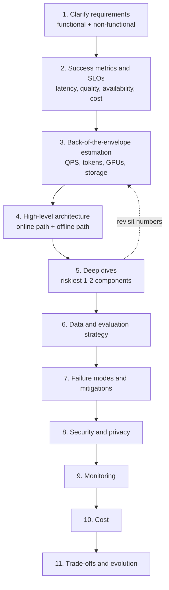
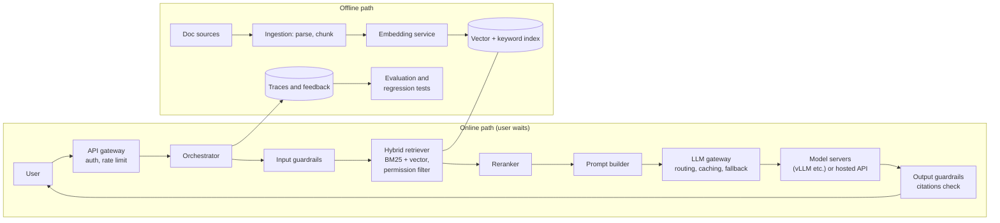
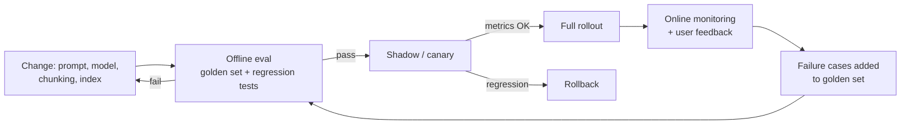
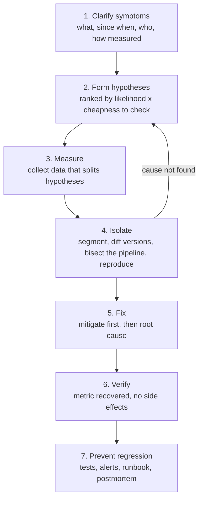

# How to Approach AI/ML System Design and Debugging Interviews

> **Level:** Beginner to Advanced · **Study time:** ~120 min · **Prerequisites:** Helpful but not required (key ideas are recapped here): [LLM Inference Fundamentals](../06-llm-inference/01-inference-fundamentals-prefill-decode-and-latency-metrics.md), [The KV Cache](../06-llm-inference/02-kv-cache-explained.md), [What Is RAG](../08-rag/01-what-is-rag-and-why-it-matters.md), [Monitoring ML and LLM Systems](../10-mlops/06-monitoring-ml-and-llm-systems-in-production.md)

## Table of contents

- [Why this matters](#why-this-matters)
- [What a system design interview is](#what-a-system-design-interview-is)
- [What interviewers evaluate at senior level](#what-interviewers-evaluate-at-senior-level)
- [The framework at a glance](#the-framework-at-a-glance)
- [Step 1: Clarify requirements](#step-1-clarify-requirements)
- [Step 2: Define success metrics and SLOs](#step-2-define-success-metrics-and-slos)
- [Step 3: Back-of-the-envelope estimation](#step-3-back-of-the-envelope-estimation)
- [Step 4: High-level architecture](#step-4-high-level-architecture)
- [Step 5: Deep dives into the riskiest components](#step-5-deep-dives-into-the-riskiest-components)
- [Step 6: Data and evaluation strategy](#step-6-data-and-evaluation-strategy)
- [Step 7: Failure modes and mitigations](#step-7-failure-modes-and-mitigations)
- [Step 8: Security and privacy](#step-8-security-and-privacy)
- [Step 9: Monitoring and observability](#step-9-monitoring-and-observability)
- [Step 10: Cost](#step-10-cost)
- [Step 11: Trade-offs and evolution](#step-11-trade-offs-and-evolution)
- [Reusable building blocks for AI systems](#reusable-building-blocks-for-ai-systems)
- [Adapting the framework to different problem types](#adapting-the-framework-to-different-problem-types)
- [Time management in a 45 to 60 minute interview](#time-management-in-a-45-to-60-minute-interview)
- [A framework for debugging questions](#a-framework-for-debugging-questions)
- [How to communicate](#how-to-communicate)
- [Going deeper: what separates a senior answer](#going-deeper-what-separates-a-senior-answer)
- [The one-page template answer](#the-one-page-template-answer)
- [Common mistakes and misconceptions](#common-mistakes-and-misconceptions)
- [Interview questions and model answers](#interview-questions-and-model-answers)
- [Key takeaways](#key-takeaways)
- [Further reading](#further-reading)
- [Next](#next)

## Why this matters

At senior level, the system design round is often the round that decides your level. Coding rounds show you can build a component; design rounds show you can own a whole system: turn a vague business goal into a working, measurable, affordable, safe product. AI systems add twists that classic backend design does not have: outputs are probabilistic, quality is hard to measure, GPUs are expensive and scarce, and a single prompt change can silently break things. Debugging rounds ("latency doubled after a release, what do you do?") test the same muscles from the other direction. This chapter gives you one repeatable framework for both, with the arithmetic and vocabulary you need to sound like someone who has actually run these systems in production.

## What a system design interview is

> **Analogy:** An architect asked to "design a house" does not start drawing walls. They ask: how many people live there, what is the budget, what is the climate, do you need a wheelchair ramp? Then they sketch the floor plan, then zoom into the tricky parts (the cantilevered balcony), then explain what happens in a storm. A system design interview is exactly that, for software.

A **system design interview** is an open-ended, conversational exercise (usually 45 to 60 minutes) in which you design a software system on a whiteboard or shared document. There is no single right answer. The interviewer judges your *process* and *judgment*: what you ask, what you prioritize, which trade-offs you see.

An **AI/ML system design interview** is the same exercise where the core of the system is a learned model: a ranking model, a fraud classifier, a large language model (LLM), a retrieval pipeline. Typical prompts:

- "Design a chatbot that answers questions over our company documents." (a **RAG** system: **Retrieval-Augmented Generation**, where you first retrieve relevant text, then let an LLM answer using it; see [What Is RAG](../08-rag/01-what-is-rag-and-why-it-matters.md))
- "Design a platform that serves LLMs to 50 internal teams."
- "Design an agent that processes refund requests."
- "Design real-time fraud detection for card payments."

A **debugging interview** gives you a broken or underperforming system ("the quantized model uses less memory but is not faster", "answers are fluent but not supported by the documents") and evaluates how systematically you find the cause.

### Classic vs AI system design

| Aspect | Classic backend design | AI/ML system design |
|---|---|---|
| Core component | Deterministic services, databases | A model whose output is probabilistic |
| "Correct" output | Usually well-defined | Often fuzzy; needs evaluation sets, judges, human review |
| Main bottleneck | Database, network, CPU | Often GPU memory and GPU time; model quality |
| Cost driver | Servers, storage | GPU hours or per-token API fees |
| What breaks silently | Less often; most failures surface as errors or alerts | Quality can degrade with no errors at all (drift, bad prompts, stale index) |
| Change management | Code deploys | Code, models, prompts, data and indexes all version independently |

The last two rows are where most candidates lose points: they design a beautiful serving path and never say how they would *know* the answers are good.

### Running example used throughout

We will reuse one example so the numbers connect:

> **DocsAssist:** an assistant inside a document-editing product. Users ask questions about their own workspace documents and get answers with citations. 2 million **daily active users (DAU)**, the number of distinct users who use the feature on a given day. We will serve it with a 7B-parameter open model (a "7B model", meaning 7 billion learned numbers) or a hosted API, and compare.

For contrast we will occasionally use a tiny version: an internal HR assistant for a 10,000-person company.

## What interviewers evaluate at senior level

Interviewers usually score against a rubric. The exact wording varies by company, but the dimensions are remarkably consistent.

| Dimension | What a mid-level answer shows | What a senior answer shows |
|---|---|---|
| Problem framing | Accepts the prompt as given | Asks who the users are, what success means, what is out of scope; pushes back on vague goals |
| Requirements and metrics | Lists features | Turns goals into measurable SLOs and quality metrics, with numbers |
| Estimation | Skips it or guesses | Does quick arithmetic that *changes the design* (one GPU or sixty? fits in RAM or needs sharding?) |
| Architecture | Boxes and arrows | Clear online and offline paths, data flow, ownership of state, explicit interfaces |
| Depth | Shallow everywhere | Deep on the 1 to 2 riskiest parts, knows the internals (KV cache, ANN indexes, batching) |
| ML judgment | "Use the best model" | Starts simple, chooses prompting vs RAG vs fine-tuning on evidence, plans evaluation first |
| Production readiness | Happy path only | Failure modes, degradation, rollout, monitoring, security, cost |
| Trade-offs | One option | Two or three options with explicit pros, cons and a reasoned choice |
| Communication | Silent drawing, or rambling | Structured, thinks aloud, checks in, adapts to hints |

> **Senior insight:** "Senior" mostly means *judgment under ambiguity*. The interviewer is asking themselves: "If I gave this person a vague project, would they ship something reliable without me holding their hand?" Every behavior in the right-hand column is evidence for that.

## The framework at a glance

Here is the full framework. You will not spend equal time on every step; the point is to never forget one.



Eleven steps are hard to remember, so group them into four acts:

1. **Understand** (steps 1 to 3): what are we building, how do we measure it, how big is it?
2. **Design** (steps 4 and 5): the architecture and the hard parts.
3. **Harden** (steps 6 to 10): evaluation, failures, security, monitoring, cost.
4. **Reflect** (step 11): what we traded away and how it evolves.

## Step 1: Clarify requirements

> **Analogy:** A chef asked to "cook dinner" first asks how many guests, any allergies, and when they arrive. Cooking a perfect risotto for 2 when 40 people with nut allergies arrive in 10 minutes is a failure, no matter how good the risotto is.

**Functional requirements** describe *what the system does*: the features and behaviors ("answer questions over the user's documents with citations"). **Non-functional requirements** describe *how well it does it*: speed, scale, reliability, cost, security, compliance ("answers start appearing within 1.5 seconds", "users never see documents they lack permission to read").

### Questions to ask (pick the 5 to 8 most relevant)

| Category | Questions | Why it matters |
|---|---|---|
| Users and use case | Who uses it? Internal or external? What is the top task? | Drives quality bar, risk tolerance and UX |
| Scale | How many users, requests per day, documents? Growth rate? | Drives estimation and architecture |
| Latency | Interactive (chat) or batch (overnight reports)? Streaming OK? | Interactive needs low **TTFT** (defined in Step 2) |
| Quality | What does a good answer look like? Cost of a wrong answer? | Medical/legal answers need stricter grounding than marketing copy |
| Data | Where does the data live, how big, how often does it change? Labels available? | Drives ingestion, freshness and training options |
| Constraints | Must data stay in a region? Can we call external APIs? Budget? | May force self-hosting or a specific cloud |
| Security | Multi-tenant (many customer organizations, called **tenants**, sharing one deployment)? Per-document permissions? PII? | Drives retrieval filtering and logging design |
| Scope | What is out of scope for v1? Languages? Modalities (images, tables)? | Keeps the design focused |

For DocsAssist, a good clarification sounds like this:

> "Let me confirm scope. Users ask natural-language questions about documents in their own workspace, and we answer with citations. Streaming answers are fine. English only for v1, text and simple tables, no images. Permissions matter: a user must never get content from a document they cannot open. Out of scope: editing documents on the user's behalf. Is that right?"

> **Interview tip:** Write the agreed requirements in a corner of the board and keep them visible. When you make a decision later, point back at them: "I am choosing hybrid search because requirement 3 says users search for exact product codes."

> **Common mistake:** Asking 20 questions for 15 minutes. Clarification should take about 10% of the time. If the interviewer says "you decide", state an assumption out loud and move on.

## Step 2: Define success metrics and SLOs

A system without numbers cannot be evaluated, and an interview answer without numbers sounds junior. You need four families of metrics: **latency, quality, availability and cost**.

### Vocabulary

- **Latency**: how long one request takes.
- **Throughput**: how many requests (or tokens) the system handles per second.
- **QPS (queries per second)**: request rate. Also written RPS.
- **Percentile**: the **p95 latency** is the value that 95% of requests are faster than. **p50** is the median; **p99** is the slowest 1% boundary. We use percentiles rather than averages because users feel the slow tail, and averages hide it.
- **SLI (Service Level Indicator)**: a measured number, for example "fraction of requests with TTFT under 1.5 s".
- **SLO (Service Level Objective)**: an internal target for an SLI, for example "99% of requests have TTFT under 1.5 s, measured over 28 days".
- **SLA (Service Level Agreement)**: a contract with customers, with penalties if missed. SLAs are usually looser than SLOs so you have a safety margin.
- **Availability**: the fraction of time (or of requests) the service works correctly.

For LLM features, latency splits into two numbers (full treatment in [Inference Fundamentals](../06-llm-inference/01-inference-fundamentals-prefill-decode-and-latency-metrics.md)):

- **TTFT (time to first token)**: time until the first word of the answer appears. Dominated by **prefill**, the phase where the model processes the whole prompt, plus any time the request spends queued under load.
- **TPOT (time per output token)**: average time between subsequent tokens during **decode**, the phase where the model generates one token at a time. A **token** is a word piece, roughly 3/4 of an English word on average (see [Tokenization](../04-transformers/01-tokenization.md)).

### End-to-end LLM latency

$$T_{\text{e2e}} \approx \text{TTFT} + (N_{\text{out}} - 1) \times \text{TPOT}$$

- $T_{\text{e2e}}$: total time until the last token arrives.
- $\text{TTFT}$: time to first token.
- $N_{\text{out}}$: number of output tokens.
- $\text{TPOT}$: time per output token after the first.

**Worked example (illustrative numbers):** TTFT = 0.6 s, $N_{\text{out}} = 300$, TPOT = 18 ms = 0.018 s.

- $(300 - 1) \times 0.018 = 299 \times 0.018 = 5.382$ s
- $T_{\text{e2e}} = 0.6 + 5.382 = 5.982 \approx 6.0$ s

So a 300-token answer takes about 6 seconds to finish, but with **streaming** (sending tokens as they are produced) the user starts reading after 0.6 s. That is why chat SLOs are written on TTFT and TPOT, not just total time.

### Error budgets

An **error budget** is the amount of failure your SLO permits. It turns reliability into a resource you can spend (on risky deploys, experiments) or protect (freeze releases when it is exhausted).

$$\text{Error budget} = (1 - \text{SLO}) \times \text{window}$$

- $\text{SLO}$: target as a fraction, for example 0.999 for 99.9%.
- $\text{window}$: the measurement period, in minutes or in number of requests.

**Worked example:** SLO = 99.9% availability over 30 days.

- Minutes in 30 days: $30 \times 24 \times 60 = 43{,}200$
- Budget: $(1 - 0.999) \times 43{,}200 = 0.001 \times 43{,}200 = 43.2$ minutes of downtime per month.
- Request-based view for DocsAssist: 10 million requests/day (we derive this in Step 3) gives $10{,}000{,}000 \times 30 = 300{,}000{,}000$ requests per month, so the budget is $0.001 \times 300{,}000{,}000 = 300{,}000$ failed requests.

### Availability of chained dependencies

If a request must pass through several components in series, and they fail independently, their availabilities multiply:

$$A_{\text{serial}} = A_1 \times A_2 \times \dots \times A_n$$

If you have redundant alternatives (a fallback), the request fails only if *all* alternatives fail:

$$A_{\text{parallel}} = 1 - (1 - A_1)(1 - A_2)$$

- $A_i$: availability of component $i$ as a fraction.

**Worked example (illustrative):** your API (99.9%) calls a vector database (99.9%) and an external LLM API (99.5%).

- $0.999 \times 0.999 = 0.998001$
- $0.998001 \times 0.995 = 0.993011$, about 99.30%
- Expected downtime per 30 days: $(1 - 0.993011) \times 43{,}200 \approx 0.006989 \times 43{,}200 \approx 302$ minutes, about 5 hours.

Now add a fallback LLM provider at 99.0%, assumed to fail independently:

- $1 - (1 - 0.995)(1 - 0.990) = 1 - 0.005 \times 0.010 = 1 - 0.00005 = 0.99995$

The LLM step goes from 99.5% to 99.995%. Lesson: **your SLO cannot be better than your weakest serial dependency unless you add redundancy.** The independence assumption is optimistic (two providers can share a cloud region), so say that out loud.

### Quality and business metrics

| Layer | Example metrics for DocsAssist | How measured |
|---|---|---|
| Retrieval | Recall@k (did the right chunk appear in the top k?) | Labeled question-to-chunk pairs ([RAG evaluation](../08-rag/10-rag-evaluation-metrics-and-ragas.md)) |
| Generation | Faithfulness/groundedness (is every claim supported by retrieved text?), answer relevance | LLM-as-a-judge (a strong LLM grading answers with a rubric) calibrated against humans ([LLM evaluation](../05-llms/10-llm-evaluation-metrics-and-llm-as-a-judge.md)) |
| Safety | Rate of permission leaks (target: zero), harmful content rate | Red-team sets, audits |
| Product | Thumbs-up rate, follow-up rate, task completion, retention | Online logging, A/B tests |
| Cost | Cost per request, cost per active user | Token and GPU accounting |

A complete DocsAssist SLO sheet might read (all targets illustrative, to be negotiated with product):

```text
Latency      : p95 TTFT <= 1.5 s, p95 TPOT <= 50 ms (streaming)
Availability : 99.9% of requests succeed (incl. graceful fallback answers), 30-day window
Quality      : faithfulness >= 0.90 on golden set; retrieval recall@10 >= 0.85
Safety       : 0 cross-permission leaks (hard requirement, tested in CI)
Cost         : <= $0.002 per request on average
```

> **Interview tip:** Tie every metric to a decision. "If faithfulness drops below 0.9 on the golden set, the release is blocked" is far stronger than "we will track faithfulness".

## Step 3: Back-of-the-envelope estimation

> **Analogy:** Before a road trip you estimate distance, fuel and stops on a napkin. You do not need the exact fuel consumption to know whether you need one tank or three.

**Back-of-the-envelope estimation** means quick, rounded arithmetic that tells you the *order of magnitude* (10 or 100 or 1,000?) of load, memory and cost. The goal is not precision; it is to find out which design regime you are in. One GPU and sixty GPUs are different designs.

### 3.1 Request rate (QPS)

$$\text{QPS}_{\text{avg}} = \frac{\text{DAU} \times r}{86{,}400}, \qquad \text{QPS}_{\text{peak}} = \text{QPS}_{\text{avg}} \times f_{\text{peak}}$$

- $\text{DAU}$: daily active users.
- $r$: requests per user per day.
- $86{,}400$: seconds in a day ($24 \times 60 \times 60$).
- $f_{\text{peak}}$: **peak factor**, ratio of the busiest period's rate to the average (commonly assumed 2 to 5 for consumer traffic; measure it if you can).

**DocsAssist (illustrative):** 2,000,000 DAU, 5 requests each, peak factor 3.

- Requests/day: $2{,}000{,}000 \times 5 = 10{,}000{,}000$
- Average QPS: $10{,}000{,}000 / 86{,}400 = 115.74$
- Peak QPS: $115.74 \times 3 = 347.22$, call it about 350

**Internal HR assistant (contrast):** 10,000 employees, 40% use it daily, 5 questions each, mostly during an 8-hour workday.

- $10{,}000 \times 0.4 \times 5 = 20{,}000$ requests/day
- Over 8 hours ($8 \times 3{,}600 = 28{,}800$ s): $20{,}000 / 28{,}800 = 0.69$ QPS
- Peak at 3x: about 2.1 QPS

> **Senior insight:** The HR assistant needs one small deployment or a hosted API, and no sharding, queues or autoscaling heroics. Saying "at 2 QPS, the simplest thing works; I will not over-engineer this" is a *senior* signal. Estimation is how you earn the right to keep things simple.

### 3.2 Tokens per day

Assume each DocsAssist request has 2,000 input tokens (300 system prompt + 5 retrieved chunks of 300 tokens = 1,500 + 200 for the question and history) and 300 output tokens.

- Input: $10{,}000{,}000 \times 2{,}000 = 20{,}000{,}000{,}000 = 20$ billion tokens/day
- Output: $10{,}000{,}000 \times 300 = 3$ billion tokens/day

Notice that input dominates. In RAG systems, **prompt length is usually the biggest cost lever**, which is why reranking (to send fewer, better chunks) and **prompt caching** (also called prefix caching: reusing the already computed state for a prompt prefix, such as the system prompt, that many requests share) matter.

### 3.3 GPU count from throughput

If you self-host, you need enough GPUs to generate the peak output tokens per second:

$$N_{\text{GPU}} = \frac{\text{QPS}_{\text{peak}} \times N_{\text{out}}}{R_{\text{GPU}} \times u}$$

- $N_{\text{out}}$: output tokens per request (300).
- $R_{\text{GPU}}$: output tokens per second one GPU sustains *while meeting your latency SLO*. This must come from a benchmark of your model, hardware, serving engine and prompt lengths ([benchmarking chapter](../06-llm-inference/07-optimizing-and-benchmarking-llm-latency-and-cost.md)). We use 2,500 tokens/s for a 7B model on one 80 GB GPU, **illustrative only**.
- $u$: target utilization (0.7 means plan to run at 70% of max to absorb bursts).

Worked:

- Peak output tokens/s: $347.22 \times 300 = 104{,}166 \approx 104{,}170$
- Raw GPUs: $104{,}166 / 2{,}500 = 41.67$
- With headroom: $41.67 / 0.7 = 59.5$, so **60 GPUs**, before adding redundancy across zones.

### 3.4 GPU count from memory (cross-check)

Throughput is one constraint; memory is the other. An LLM server holds the model weights plus a **KV cache**: stored attention keys and values for every token of every active sequence, so the model does not recompute them each step (see [The KV Cache](../06-llm-inference/02-kv-cache-explained.md)).

$$M_{\text{weights}} = P \times b_w \qquad M_{\text{KV/token}} = 2 \times L \times H_{kv} \times d_h \times b_{kv}$$

- $P$: number of parameters (7 billion).
- $b_w$: bytes per weight (2 for FP16/BF16, 1 for INT8, 0.5 for INT4; see [Number Formats](../07-model-compression/01-number-formats-and-model-memory.md)).
- $2$: one key and one value per position.
- $L$: number of layers; $H_{kv}$: number of key/value heads; $d_h$: dimension per head.
- $b_{kv}$: bytes per cached number (2 for FP16).

For a Llama-2-7B-like configuration (32 layers, 32 KV heads, head dimension 128, FP16):

- Weights: $7 \times 10^9 \times 2 = 14 \times 10^9$ bytes = 14 GB
- KV per token: $2 \times 32 \times 32 \times 128 \times 2$. Step by step: $2 \times 32 = 64$; $64 \times 32 = 2{,}048$; $2{,}048 \times 128 = 262{,}144$; $262{,}144 \times 2 = 524{,}288$ bytes, which is 0.5 MiB per token
- Per sequence of 2,300 tokens (2,000 in + 300 out): $524{,}288 \times 2{,}300 = 1{,}205{,}862{,}400$ bytes, about 1.21 GB
- On an 80 GB GPU, reserve 6 GB for runtime overhead (illustrative): free for KV = $80 - 14 - 6 = 60$ GB
- Sequences per GPU: $60 \times 10^9 / 1{,}205{,}862{,}400 = 49.76$, so **49** concurrent sequences

How many sequences are in flight at peak? Use **Little's Law** (Little, 1961): in a stable system, average number of items inside equals arrival rate times average time inside. Intuition: if 2 customers enter a coffee shop per minute and each stays 5 minutes, about 10 are inside at any moment.

$$L = \lambda \times W$$

- $L$: average number of concurrent requests.
- $\lambda$: arrival rate (peak QPS).
- $W$: average time each request spends in the system (6.0 s from Step 2).

Worked: $L = 347.22 \times 6.0 = 2{,}083$ concurrent sequences, and $2{,}083 / 49 = 42.5$, so **43 GPUs** by memory alone.

Sanity check: 49 sequences each producing one token every 18 ms gives $49 / 0.018 \approx 2{,}722$ tokens/s per GPU, close to the 2,500 we assumed. The two estimates agree (about 42 to 43 GPUs before headroom), which gives you confidence.

> **Senior insight:** Now use the numbers to make design decisions. With **grouped-query attention (GQA)** using 8 KV heads instead of 32 (common in modern models; see [Modern LLM Architecture](../04-transformers/08-modern-llm-architecture-improvements.md)), KV per token drops 4x to 131,072 bytes, and sequences per GPU rise to $60 \times 10^9 / (131{,}072 \times 2{,}300) \approx 199$. Memory stops being the bottleneck and throughput dominates. Quantizing weights to INT4 frees about 10.5 GB more for KV. Shortening prompts from 2,000 to 1,200 tokens cuts both KV memory and prefill cost. This is how estimation drives architecture.

### 3.5 Vector storage

$$S_{\text{vectors}} = N_{\text{chunks}} \times d \times b$$

- $N_{\text{chunks}}$: number of indexed text chunks.
- $d$: embedding dimension (for example 768).
- $b$: bytes per number (4 for float32, 1 for int8).

**DocsAssist corpus (illustrative):** 200,000 documents in a typical large tenant set, 10 chunks each.

- Chunks: $200{,}000 \times 10 = 2{,}000{,}000$
- Bytes per vector: $768 \times 4 = 3{,}072$
- Raw vectors: $2{,}000{,}000 \times 3{,}072 = 6{,}144{,}000{,}000$ bytes, about 6.1 GB
- **HNSW** (a graph-based approximate nearest-neighbor index, see [Vector Search Algorithms](../08-rag/06-vector-search-ann-hnsw-ivf-and-product-quantization.md)) with $M = 16$ stores up to 32 neighbor IDs of 4 bytes in its bottom layer: $32 \times 4 = 128$ bytes per vector, so $2{,}000{,}000 \times 128 = 256{,}000{,}000$ bytes, about 0.26 GB
- Chunk text plus metadata at about 1,500 bytes each: $2{,}000{,}000 \times 1{,}500 = 3$ GB
- Total: $6.1 + 0.26 + 3 \approx 9.4$ GB, about 19 GB with 2 replicas

Decision: this fits comfortably in RAM on one or two nodes; no sharding needed. Scale it to 1 billion chunks and raw float32 vectors alone are $10^9 \times 3{,}072 = 3.07$ TB, which forces compression (int8 gives $768$ bytes per vector, 4x smaller; **product quantization**, which splits each vector into sub-vectors and stores a short code (typically 1 byte) per sub-vector, can bring it to tens of bytes), disk-based indexes and sharding. Same formula, totally different architecture.

### 3.6 Putting it in code

A tiny estimator you can adapt during practice (standard library only, no installs needed):

```python
"""Back-of-the-envelope capacity estimator (all inputs illustrative)."""
import math
from dataclasses import dataclass


@dataclass
class Workload:
    dau: int                  # daily active users
    req_per_user: float       # requests per user per day
    peak_factor: float        # peak QPS / average QPS
    in_tokens: int            # prompt tokens per request (system + context + question)
    out_tokens: int           # generated tokens per request


@dataclass
class Serving:
    params_billion: float     # model size, e.g. 7 for a 7B model
    bytes_per_param: float    # 2 for FP16/BF16, 1 for INT8, 0.5 for INT4
    layers: int
    kv_heads: int
    head_dim: int
    kv_bytes: int             # bytes per KV element (2 for FP16)
    gpu_mem_gb: float         # e.g. 80
    runtime_reserve_gb: float # activations, CUDA context, fragmentation
    out_tok_per_s_per_gpu: float  # MEASURED at your latency SLO (benchmark it!)
    target_util: float        # plan to run GPUs at this fraction of max


def estimate(w: Workload, s: Serving, seconds_per_request: float) -> None:
    req_day = w.dau * w.req_per_user
    avg_qps = req_day / 86_400
    peak_qps = avg_qps * w.peak_factor
    print(f"requests/day      : {req_day:,.0f}")
    print(f"avg / peak QPS    : {avg_qps:,.1f} / {peak_qps:,.1f}")

    in_day = req_day * w.in_tokens
    out_day = req_day * w.out_tokens
    print(f"tokens/day in/out : {in_day/1e9:,.1f}B / {out_day/1e9:,.1f}B")

    # GPU count from throughput
    peak_out_tps = peak_qps * w.out_tokens
    gpus_tput = peak_out_tps / s.out_tok_per_s_per_gpu
    print(f"peak output tok/s : {peak_out_tps:,.0f}")
    print(f"GPUs (throughput) : {gpus_tput:.1f} -> with headroom "
          f"{math.ceil(gpus_tput / s.target_util)}")

    # GPU count from memory (Little's law: concurrency = rate x time in system)
    weights_gb = s.params_billion * 1e9 * s.bytes_per_param / 1e9
    kv_per_token = 2 * s.layers * s.kv_heads * s.head_dim * s.kv_bytes  # K and V
    kv_free_bytes = (s.gpu_mem_gb - weights_gb - s.runtime_reserve_gb) * 1e9
    seq_tokens = w.in_tokens + w.out_tokens
    seqs_per_gpu = math.floor(kv_free_bytes / (kv_per_token * seq_tokens))
    concurrency = peak_qps * seconds_per_request
    print(f"weights           : {weights_gb:.0f} GB")
    print(f"KV cache / token  : {kv_per_token:,} bytes")
    print(f"seqs per GPU      : {seqs_per_gpu}")
    print(f"peak concurrency  : {concurrency:,.0f}")
    print(f"GPUs (memory)     : {math.ceil(concurrency / seqs_per_gpu)}")


if __name__ == "__main__":
    estimate(
        Workload(dau=2_000_000, req_per_user=5, peak_factor=3,
                 in_tokens=2_000, out_tokens=300),
        Serving(params_billion=7, bytes_per_param=2, layers=32, kv_heads=32,
                head_dim=128, kv_bytes=2, gpu_mem_gb=80, runtime_reserve_gb=6,
                out_tok_per_s_per_gpu=2_500, target_util=0.7),
        seconds_per_request=6.0,
    )

# Output:
# requests/day      : 10,000,000
# avg / peak QPS    : 115.7 / 347.2
# tokens/day in/out : 20.0B / 3.0B
# peak output tok/s : 104,167
# GPUs (throughput) : 41.7 -> with headroom 60
# weights           : 14 GB
# KV cache / token  : 524,288 bytes
# seqs per GPU      : 49
# peak concurrency  : 2,083
# GPUs (memory)     : 43
```

Try changing `kv_heads=8` (GQA) or `bytes_per_param=0.5` (INT4) and watch which constraint becomes binding.

> **Interview tip:** Round aggressively and say so: "86,400 is about 100,000, so 10 million a day is about 100 QPS average, maybe 300 at peak." Interviewers care that you know the order of magnitude and which number matters, not the third decimal.

### Handy numbers to memorize

| Quantity | Value | Use |
|---|---|---|
| Seconds per day | 86,400 (about $10^5$) | QPS from daily volume |
| Minutes per 30 days | 43,200 | Error budgets |
| Bytes per param | FP32 4, FP16/BF16 2, INT8 1, INT4 0.5 | Model memory |
| 7B model weights at FP16 | 14 GB | Fits on one 24 GB+ GPU for weights alone |
| 70B model weights at FP16 | 140 GB | Needs multiple 80 GB GPUs or quantization |
| float32 768-dim vector | 3,072 bytes | Vector storage |
| Tokens per English word | about 1.3 (varies by tokenizer) | Words to tokens |

## Step 4: High-level architecture

Now draw boxes. Keep the first drawing simple, then refine. Separate two paths:

- The **online path** (also called the serving or request path): what happens while a user waits. Latency matters.
- The **offline path**: work done ahead of time or in the background, such as ingesting documents, building indexes, training models, running evaluations. Throughput and correctness matter more than latency.



Walk through it out loud, one request at a time:

1. The **API gateway** authenticates the user and applies **rate limiting** (capping requests per user or tenant so no one can overload the system).
2. The **orchestrator** is the service that runs the steps in order and holds the request's state.
3. **Guardrails** are checks before and after the model: blocking disallowed content, detecting **prompt injection** (text that tries to hijack the model's instructions), validating output format. See [Safety and Guardrails](../05-llms/13-llm-safety-guardrails-and-responsible-ai.md).
4. The **retriever** finds candidate chunks using **hybrid search** (keyword search such as BM25 plus vector similarity search), filtered by the user's permissions. See [Retrieval Methods](../08-rag/05-retrieval-bm25-dense-and-hybrid-search.md).
5. A **reranker** (a slower, more accurate model that scores each query-chunk pair) keeps the best 5 of perhaps 50 candidates. See [Reranking](../08-rag/08-reranking-and-query-transformation.md).
6. The **LLM gateway** is a single internal entry point to all models: it routes requests to the right model, applies caching, retries, fallbacks, quotas and cost accounting.
7. **Model servers** run the LLM with an inference engine that does **continuous batching** (requests join and leave the running GPU batch at every decode step, instead of the whole batch waiting for its longest answer) and KV cache management (see [Serving Frameworks](../06-llm-inference/06-serving-frameworks-vllm-sglang-tgi-tensorrt-llm-and-ollama.md)).
8. Every step emits **traces** (timed, linked records of each step of a request) for debugging and evaluation.

### Latency budget

Split the SLO across stages so each owner knows their target. For a p95 TTFT target of 1.5 s (illustrative stage numbers):

| Stage | p95 budget (ms) |
|---|---|
| Gateway, auth | 20 |
| Input guardrails | 50 |
| Query rewrite (small model, optional) | 150 |
| Hybrid retrieval with permission filter | 80 |
| Reranking 50 candidates | 120 |
| Prompt assembly | 10 |
| LLM TTFT (queueing + prefill) | 600 |
| Network to client | 50 |
| **Total** | **1,080** |

$20 + 50 + 150 + 80 + 120 + 10 + 600 + 50 = 1{,}080$ ms, leaving 420 ms headroom.

> **Senior insight:** Percentiles do not add exactly. Summing per-stage p95 values is a rough and usually pessimistic budget, because it is unlikely every stage hits its slow tail on the same request. Use it for planning, then verify the real end-to-end p95 with tracing. Also notice the budget makes trade-offs visible: query rewriting costs 150 ms; is the quality gain worth 10% of the budget?

## Step 5: Deep dives into the riskiest components

You cannot go deep on everything in 60 minutes. Choose the 1 to 2 components where the design is most likely to fail or most expensive to get wrong, and say *why* you chose them.

A simple heuristic: $\text{risk} \approx \text{likelihood of failure} \times \text{impact} \times \text{novelty}$. Novelty matters because standard components (load balancers, object storage) are solved problems; the interviewer wants to see the parts that are specific to this system.

| System | Typical riskiest components | What a deep dive covers |
|---|---|---|
| Enterprise RAG | Retrieval quality; permission filtering | Chunking, hybrid search, reranking, metadata filters, freshness, recall measurement |
| LLM inference platform | GPU scheduling and memory; multi-tenancy | Continuous batching, KV cache, quantization, autoscaling, fairness, isolation |
| Agent | Tool-call reliability; safety of side effects | Schemas, idempotency, human approval, loop limits, prompt injection |
| Fraud detection | Feature freshness; label delay; latency | Streaming features, training-serving skew, thresholds, feedback loops |
| Vision system | Domain shift; edge latency | Data collection, augmentation, model size, on-device constraints |

For DocsAssist, a good choice is: "I will go deep on (1) permission-aware retrieval, because a leak is a security incident, and (2) LLM serving cost and latency, because it dominates spend." Then go genuinely deep, using the linked chapters:

- **Retrieval:** Should permissions be enforced by filtering before or during the vector search (pre-filtering or filtered search) or after it (post-filtering)? Post-filtering can return too few results when most top hits are forbidden; pre-filtering needs an index that supports efficient filtered search. Per-tenant indexes give strong isolation but many small indexes. See [Secure Multi-Tenant RAG](../08-rag/13-secure-multi-tenant-rag.md).
- **Serving:** Continuous batching, prefix caching of the shared system prompt, quantization trade-offs, autoscaling on queue depth rather than CPU (GPU servers saturate GPU memory and compute long before CPU, so CPU utilization does not reflect load). See [Batching and PagedAttention](../06-llm-inference/04-batching-continuous-batching-and-paged-attention.md) and [Speculative Decoding and Caching](../06-llm-inference/05-speculative-decoding-caching-and-other-speedups.md).

> **Interview tip:** Offer the choice: "I think the riskiest parts are retrieval permissions and serving cost. Which would you like me to go deeper on first?" This shows judgment and lets the interviewer steer you toward what they score.

## Step 6: Data and evaluation strategy

> **Analogy:** You would not open a restaurant without tasting the food. Evaluation is tasting the food, before opening (offline) and every night after (online).

In AI systems, data and evaluation are *part of the design*, not an afterthought. Cover four things.

**1. Data sources and pipelines.** Where does training or retrieval data come from, how fresh must it be, how are updates and deletions propagated? For DocsAssist: documents change constantly, so ingestion must be incremental and **idempotent** (re-running it produces the same result, no duplicates), and deleting a document must remove its chunks quickly. See [Production Ingestion Pipelines](../08-rag/12-production-ingestion-pipelines-at-scale.md).

**2. Offline evaluation.** A **golden set** is a curated, versioned set of inputs with expected outputs or reference facts, used to score every change before release. Start with 100 to 300 realistic questions, including hard ones: multi-document questions, questions with no answer in the corpus, permission edge cases. Score retrieval (recall@k) separately from generation (faithfulness), so you know which half broke. **LLM-as-a-judge** (using a strong LLM with a rubric to grade outputs) scales scoring, but must be calibrated against human labels. Run the golden set automatically in **CI** (continuous integration: the pipeline that tests every change before it merges), so a failing score blocks the release. See [Building an LLM Evaluation Framework](../05-llms/11-building-an-llm-evaluation-framework-and-regression-tests.md).

**3. Online evaluation.** Offline sets never fully match real traffic. Use **shadow deployment** (the new version receives a copy of live traffic but its answers are not shown), **canary releases** (a small percentage of users get the new version), and **A/B tests** with product metrics. See [Deployment Patterns](../10-mlops/04-model-deployment-patterns.md).

**4. Feedback loop.** Collect thumbs up/down, edits, escalations; sample traces for human review; turn failures into new golden-set cases. This loop is how the system improves after launch.



Also state the model strategy honestly: start with prompting a strong model plus RAG; only fine-tune when evaluation shows a gap that prompting and retrieval cannot close (style, format, latency via a smaller model). See [Prompting vs RAG vs Fine-Tuning](../05-llms/08-prompting-vs-rag-vs-fine-tuning-decision-guide.md).

## Step 7: Failure modes and mitigations

A **failure mode** is a specific way the system can break. Senior candidates list them *before* being asked, with a mitigation for each.

| Failure mode | Symptom | Mitigation |
|---|---|---|
| LLM provider outage or rate limit | 5xx errors, 429 responses | Fallback model/provider, retries with exponential backoff and jitter, circuit breaker |
| GPU out of memory under long prompts | Crashes, evictions, latency spikes | Cap context length, admission control, paged KV cache, separate pool for long requests |
| Traffic spike | Queues grow, TTFT explodes | Autoscaling on queue depth, **back-pressure** (rejecting or delaying work when overloaded), per-tenant quotas |
| Retry storm | Load multiplies during an incident | Retry budgets, circuit breakers, timeouts shorter than the caller's |
| Hallucination | Fluent but unsupported answers | Grounding instructions, citation verification, "I don't know" path, faithfulness monitoring ([Hallucinations](../05-llms/06-hallucinations-and-grounding.md)) |
| Stale or missing index data | Wrong or outdated answers | Freshness SLO for ingestion, deletion propagation, index version tracking |
| Prompt injection via documents | Model follows instructions hidden in a document | Treat retrieved text as data, least-privilege tools, output checks ([Agent security](../09-agents/08-agent-reliability-security-and-prompt-injection.md)) |
| Silent quality regression after a prompt or model change | No errors, worse answers | Versioned prompts, regression tests in CI, canary with quality metrics |
| Cost runaway | Bill spikes (long outputs, agent loops) | Max tokens, loop limits, per-tenant budgets, cost alerts |

Terms worth defining: a **circuit breaker** stops calling a failing dependency for a cool-down period after errors cross a threshold, so you fail fast instead of piling up waiting requests. **Exponential backoff with jitter** waits exponentially longer between retries (for example 1, 2, 4, 8 seconds) with randomness added, so thousands of clients do not retry in lockstep. **Admission control** refuses or queues new requests when the server is near its memory or concurrency limit, instead of accepting work it cannot finish. **Graceful degradation** means offering a reduced but useful service instead of failing completely.

A degradation ladder for DocsAssist:

```text
Level 0  Normal: rewrite + hybrid retrieval + rerank + large model
Level 1  Reranker slow  -> skip rerank, send top-5 from hybrid search
Level 2  Primary LLM down -> route to fallback model (smaller or other provider)
Level 3  All LLMs down   -> return top matching document snippets with links, no generation
Level 4  Retrieval down  -> clear error message, no guessing from model memory
```

> **Senior insight:** Notice Level 4 deliberately *refuses* to answer from the model's memory. For a product that promises answers grounded in the user's documents, an ungrounded answer is worse than no answer. Degradation must respect the product's core promise.

## Step 8: Security and privacy

AI systems widen the attack surface: users can talk to the model, documents can carry hidden instructions, and logs contain sensitive prompts. Cover these briefly in every design, and deeply when the prompt involves enterprise data.

| Concern | What to say |
|---|---|
| Authentication and authorization | Every request carries the user identity end to end; retrieval filters on the user's permissions at query time, not just at ingestion |
| Tenant isolation | Separate indexes or mandatory tenant filters; never share caches across tenants unless keyed by tenant |
| PII (personally identifiable information) | Detect and redact in logs; minimize what is sent to third-party APIs; retention limits |
| Data residency and vendor terms | Region constraints may force self-hosting; check whether a provider may train on or retain your data |
| Prompt injection | Instructions only from the system prompt; retrieved text is untrusted data; tools follow least privilege; humans approve risky actions |
| Output safety | Moderation, citation checks, refusal policies |
| Audit | Log who asked what, which documents were retrieved, which model and prompt version answered |
| Supply chain | Pin model versions and weights hashes; scan dependencies; control who can change prompts in production |

> **Common mistake:** Assuming the LLM will "respect" permissions if you tell it to in the prompt. Authorization must be enforced in code before the text ever reaches the model. Anything in the context window can end up in the answer.

## Step 9: Monitoring and observability

**Monitoring** tells you *that* something is wrong; **observability** (traces, logs, metrics rich enough to ask new questions) helps you find *why*. AI systems need three layers. Full detail in [Monitoring ML and LLM Systems](../10-mlops/06-monitoring-ml-and-llm-systems-in-production.md) and [LLMOps and Tracing](../10-mlops/08-llmops-tracing-prompt-management-and-langfuse.md).

| Layer | What to watch | Examples |
|---|---|---|
| System | The classic "four golden signals" from the Google SRE book: latency, traffic, errors, saturation | p50/p95/p99, QPS, 5xx rate, GPU memory and utilization, queue depth |
| LLM-specific | Token and serving behavior | TTFT, TPOT, input/output tokens per request, cache hit rate, cost per request, truncation rate |
| Quality and data | Is the system still *good*? | Sampled faithfulness (LLM judge), retrieval scores distribution, user feedback, refusal rate, **drift** (changes in input distribution over time; see [Data Drift](../01-classical-ml/08-data-drift-concept-drift-and-retraining.md)) |

Practical rules:

- **Alert on symptoms users feel** (SLO burn rate, TTFT p95), and use cause metrics (GPU memory) for diagnosis dashboards. Too many cause-based alerts create alert fatigue. **Burn rate** is how fast you spend the error budget relative to plan: a burn rate of 1 uses exactly the whole budget over the window. Example: a 30-day window is 720 hours, so a burn rate of 14.4 sustained for 1 hour spends $14.4 / 720 = 2\%$ of the monthly budget, a common threshold for paging someone (Google SRE Workbook).
- **Tag every trace** with model version, prompt version, index version and tenant. Without versions you cannot correlate a regression with a change.
- **Segment metrics** by tenant, route, prompt length and language. Aggregates hide problems that affect one segment.

## Step 10: Cost

Cost is a first-class requirement for GenAI systems because it scales with usage in a way classic web serving rarely did.

$$C_{\text{req}} = \frac{T_{\text{in}} \times p_{\text{in}} + T_{\text{out}} \times p_{\text{out}}}{10^6}$$

- $C_{\text{req}}$: cost per request in dollars (API pricing model).
- $T_{\text{in}}, T_{\text{out}}$: input and output tokens per request.
- $p_{\text{in}}, p_{\text{out}}$: price per million input and output tokens. Output tokens are usually priced higher than input tokens.

**Worked example with illustrative prices** (USD 0.50 per million input tokens, USD 1.50 per million output tokens; real prices vary by vendor, model and year):

- Input: $2{,}000 \times 0.50 = 1{,}000$
- Output: $300 \times 1.50 = 450$
- $C_{\text{req}} = (1{,}000 + 450) / 10^6 = \$0.00145$
- Per day: $0.00145 \times 10{,}000{,}000 = \$14{,}500$; per 30 days: $\$435{,}000$

**Self-hosted comparison (illustrative):** 60 GPUs at an assumed USD 2.50 per GPU-hour, running all day: $60 \times 2.50 \times 24 = \$3{,}600$ per day, about USD 108,000 per 30 days, or $3{,}600 / 10{,}000{,}000 = \$0.00036$ per request.

This looks like a 4x saving, but be careful: the self-hosted 7B model may be less capable than the API model; you pay for engineers, on-call and idle capacity at night (autoscaling helps since average load is about a third of peak); and the API needs no capacity planning. Volume can flip the answer: with the same prompt shape, the HR assistant's 20,000 requests/day cost $20{,}000 \times 0.00145 = \$29$ per day on the API, less than one always-on GPU at $2.50 \times 24 = \$60$ per day. The right answer depends on volume, quality needs and data constraints. That is exactly the trade-off discussion interviewers want.

### Cost levers

| Lever | Effect | Trade-off |
|---|---|---|
| Shorter prompts (fewer, better chunks via reranking) | Cuts input tokens, prefill time and KV memory | Risk of missing context |
| Prompt/prefix caching | Reuses computation for shared prefixes | Requires stable prompt prefixes |
| Model routing (small model for easy queries) | Large savings when most queries are easy | Router errors; two models to evaluate |
| Quantization ([LLM Quantization](../07-model-compression/04-llm-quantization-gptq-awq-and-outliers.md)) | Less memory, more concurrent sequences | Possible quality loss; speedup depends on kernels |
| Distillation ([Distilling LLMs](../07-model-compression/06-distilling-large-language-models.md)) | Smaller model with similar task quality | Training cost; narrower capability |
| Semantic caching (reuse answers for similar questions) | Skips generation entirely on hits | Stale or wrong answers if similarity threshold is loose; per-user permissions complicate it |
| Batch APIs / offline processing | Cheaper for non-interactive work | Higher latency |
| Max output tokens, concise answer style | Caps output cost | Possibly truncated answers |

## Step 11: Trade-offs and evolution

Close the design by naming what you traded away, and how the system grows.

**State trade-offs as explicit pairs:**

- Latency vs quality: reranking and query rewriting add 270 ms but improve retrieval.
- Cost vs capability: hosted frontier model vs self-hosted 7B.
- Freshness vs cost: re-index every minute vs every hour.
- Isolation vs efficiency: per-tenant indexes vs shared index with filters.
- Build vs buy: managed vector database vs open-source on your own infrastructure.

**Show an evolution plan** (versions are a powerful senior signal because they show you can ship incrementally):

```text
v0 (2-4 weeks):  Hosted LLM API + simple vector search + golden set of 100 questions.
                 Goal: learn what users ask; measure baseline quality.
v1 (quarter):    Hybrid search + reranker, permission filters, tracing, canary releases,
                 regression tests in CI, cost dashboards.
v2 (at scale):   Model routing, self-hosted model for the high-volume path,
                 fine-tuned or distilled small model, semantic cache, multi-region.
```

And always answer the classic follow-up "what changes at 10x?" before it is asked: which component breaks first (from your estimation), and what you would change.

## Reusable building blocks for AI systems

Most AI designs are assembled from the same parts. Knowing them lets you draw a credible architecture quickly and spend your time on what is unique.

| Building block | What it does | When you need it | Key design choices | Learn more |
|---|---|---|---|---|
| API gateway | Auth, rate limits, routing | Always | Per-tenant quotas, request size limits | [Scalable Inference API](../10-mlops/05-building-a-scalable-inference-api.md) |
| LLM gateway | One interface to many models | More than one model or provider | Routing, fallback, caching, cost accounting | [Multi-Tenant Inference Platform](03-design-a-multi-tenant-llm-inference-platform.md) |
| Model server | Runs models efficiently on GPUs | Self-hosting | Engine choice, batching, quantization, autoscaling | [Serving Frameworks](../06-llm-inference/06-serving-frameworks-vllm-sglang-tgi-tensorrt-llm-and-ollama.md) |
| Embedding service | Text to vectors | Search, RAG, clustering | Model choice, batch size, re-embedding plan | [Text Embeddings](../08-rag/02-text-embeddings-and-similarity-search.md) |
| Vector database | Approximate nearest-neighbor search | RAG, recommendations | Index type, filtering, sharding, replicas | [Vector Databases](../08-rag/07-vector-databases-in-practice.md) |
| Reranker | Precise reordering of candidates | Quality-critical retrieval | Candidate count vs latency | [Reranking](../08-rag/08-reranking-and-query-transformation.md) |
| Ingestion pipeline | Parse, chunk, embed, index | Any RAG | Idempotency, deletions, freshness | [Ingestion Pipelines](../08-rag/12-production-ingestion-pipelines-at-scale.md) |
| Prompt registry | Versioned prompts | Any LLM product | Versioning, review, rollback | [LLMOps](../10-mlops/08-llmops-tracing-prompt-management-and-langfuse.md) |
| Guardrails | Input/output checks | Any user-facing LLM | Latency cost, false positives | [Safety and Guardrails](../05-llms/13-llm-safety-guardrails-and-responsible-ai.md) |
| Eval harness | Offline scoring and regression tests | Any model change | Golden sets, judges, thresholds | [Evaluation Framework](../05-llms/11-building-an-llm-evaluation-framework-and-regression-tests.md) |
| Tracing and monitoring | Per-step visibility | Always | Sampling, PII redaction, version tags | [Monitoring](../10-mlops/06-monitoring-ml-and-llm-systems-in-production.md) |
| Queue / stream | Decouples producers and consumers | Async jobs, ingestion, spikes | Ordering, retries, dead-letter queues | [Deployment Patterns](../10-mlops/04-model-deployment-patterns.md) |
| Feature store | Consistent features for training and serving | Classic ML (fraud, ranking) | Online/offline consistency, freshness | [Training-Serving Skew](../10-mlops/03-reproducibility-and-training-serving-skew.md) |
| Model registry | Versioned models with metadata | Any trained model | Promotion workflow, lineage | [Model Registry](../10-mlops/02-data-and-model-versioning-and-model-registry.md) |
| Agent runtime | Loops of model calls and tool calls | Multi-step tasks | State machine, limits, approvals | [Agent Orchestration](../09-agents/04-orchestration-with-langgraph-and-state-machines.md) |
| Human-in-the-loop | Review and approval | High-stakes actions, labeling | Queue design, SLAs for reviewers | [Production Agent Case Study](../09-agents/10-case-study-designing-a-production-agent.md) |

## Adapting the framework to different problem types

The framework is the same; the emphasis shifts.

| Problem type | Dominant non-functional requirement | Where to spend deep-dive time | Worked chapter |
|---|---|---|---|
| RAG / knowledge assistant | Answer quality, permissions | Ingestion, retrieval, evaluation | [Enterprise RAG](02-design-a-scalable-enterprise-rag-system.md) |
| LLM inference platform | Throughput, cost, fairness | GPU memory, batching, scheduling, multi-tenancy | [Multi-Tenant Inference Platform](03-design-a-multi-tenant-llm-inference-platform.md) |
| Chatbot with evaluation | Quality measurement, safety | Eval framework, feedback loops, escalation | [Support Chatbot](04-design-an-enterprise-support-chatbot-with-evaluation.md) |
| Agent | Reliability, safety of actions | Tool design, state, approvals, loop control | [Production Agent Case Study](../09-agents/10-case-study-designing-a-production-agent.md) |
| Classic ML (fraud, ranking) | Low latency, label quality | Features, labels, thresholds, drift, retraining; for ranking, the retrieval-ranking-re-ranking funnel, implicit labels and position bias | [Fraud Detection](05-design-a-real-time-fraud-detection-system.md), [Recommendation and Search Ranking](05-design-a-real-time-fraud-detection-system.md#going-deeper-adapting-the-design-to-a-recommendation-or-search-ranking-system) |
| Computer vision | Domain shift, device constraints | Data collection, augmentation, compression | [CV in Production](../03-computer-vision/04-computer-vision-in-production.md) |

For classic ML designs, add the standard ML steps inside Step 6: **problem formulation** (what exactly is the label and prediction target?), **features**, **model choice starting from a simple baseline**, **offline metrics** that match the business cost (for fraud, precision at a fixed review capacity, not accuracy; see [Classification Metrics](../01-classical-ml/04-classification-metrics-and-imbalanced-data.md)), **retraining strategy**, and a guard against **training-serving skew** (a feature computed differently in the training pipeline than in the live service, so the model sees inputs it never trained on).

## Time management in a 45 to 60 minute interview

The most common way strong candidates fail is running out of time before the deep dive, or never reaching failure modes. Plan the clock.

| Phase | 45 min interview | 60 min interview |
|---|---|---|
| Clarify requirements and scope | 4 | 6 |
| Metrics and SLOs | 3 | 4 |
| Estimation | 4 | 5 |
| High-level architecture | 8 | 10 |
| Deep dives (1 to 2 components) | 14 | 20 |
| Evaluation, failures, security, monitoring, cost | 8 | 10 |
| Trade-offs, evolution, summary | 4 | 5 |
| **Total** | **45** | **60** |

Practical tactics:

- **Checkpoint at transitions.** "I have the high-level design. I would like to deep dive on retrieval and serving. Does that match what you want to explore?"
- **Park, do not drop.** If something is important but would derail you, write it in a "parking lot" corner: "multi-region, revisit later".
- **Follow the interviewer's lead.** If they keep asking about evaluation, that is where their rubric is. Shift your plan.
- **Leave 3 to 5 minutes for a summary.** A crisp 60-second recap of requirements, design, key trade-offs and next steps is remembered.
- **For a 45-minute slot, compress breadth, not depth.** Mention security and monitoring in one sentence each with a pointer ("standard golden signals plus token and quality metrics"), and keep the deep dive substantial.

## A framework for debugging questions

> **Analogy:** A good doctor does not prescribe antibiotics the moment you say "I feel bad". They ask about symptoms, form a list of possible causes (a differential diagnosis), order the tests that best tell them apart, treat, check you got better, and advise you how to avoid it next time.

Debugging interviews follow the same shape. The interviewer is grading *method* more than the final answer.



### Step by step

**1. Clarify symptoms.** Make the problem precise before touching anything.

- What exactly is wrong, measured how? ("p95 TTFT from 1.0 s to 1.2 s" is different from "users say it feels slow".)
- Since when? Sudden (suggests a change) or gradual (suggests growth, drift, leaks)?
- Who is affected? All users, one tenant, one region, long prompts only?
- What changed around that time? Deploys, model or prompt versions, index rebuilds, traffic mix, dependencies, hardware.
- Is it still happening, and how severe is the user impact? (This decides whether you mitigate immediately.)

**2. Form hypotheses.** List 3 to 6 plausible causes across layers, then rank them by likelihood *and* how cheap they are to check. For AI systems, think in layers:

```text
Product / traffic   : new feature, different users, longer inputs, spike
Data                : stale index, bad ingestion, drift, label problems
Model / prompt      : new model version, prompt edit, decoding settings, quantization
Serving             : batching config, cache hit rate, memory pressure, queueing
Infrastructure      : GPU type, drivers, network, noisy neighbors, autoscaler
```

**3. Measure.** Gather data that *distinguishes* hypotheses. Traces with per-stage timings, metrics split by version, sample inputs and outputs. If the data does not exist, adding instrumentation is a legitimate step.

**4. Isolate.** Narrow down by:

- **Segmenting**: compare the metric across tenants, versions, prompt lengths, cache hit vs miss.
- **Diffing**: compare old vs new version on identical inputs (replay).
- **Bisecting**: check each pipeline stage's output in order (Was the right document ingested? Chunked? Retrieved? In the prompt? Used in the answer?).
- **Reproducing**: a minimal reproduction turns a mystery into an experiment.

**5. Fix.** In a live incident, **mitigate first** (roll back, shift traffic, raise capacity) to stop user harm, then find and fix the root cause. Say this explicitly; it is a strong production signal.

**6. Verify.** Confirm the metric recovered *in the segment that was affected*, check for side effects (did the fix hurt quality or cost?), ideally against a control group.

**7. Prevent regression.** Add a test or eval case that would have caught it, an alert on the leading indicator, a runbook entry, and a blameless **postmortem** (a written analysis of what happened, why, and what changes prevent recurrence).

### Worked mini case: "TTFT got worse after release v42"

Symptom: after release v42, p50 TTFT jumped and p95 rose. No errors. GPU count unchanged.

| Hypothesis | Evidence that would confirm it | Cheap check |
|---|---|---|
| Traffic grew | QPS up, queue depth up | Traffic dashboard |
| Prompts got longer | Input tokens per request up | Token metrics by version |
| Prefix cache hit rate dropped | Cache hit rate down; per-hit and per-miss latency unchanged | Segment TTFT by cache hit |
| Serving config changed (batch size, max sequences) | Config diff | Diff deployment configs |
| Slower hardware in new pool | Latency differs by node type | Segment by node |

Suppose traffic and token counts are flat. Next cheapest check: segment by cache hit. Here is that analysis on simulated logs (standard library only):

```python
import random
import statistics
from collections import defaultdict


def pct(xs: list[float], q: int) -> float:
    """q-th percentile (1..99) using the standard library."""
    return statistics.quantiles(xs, n=100)[q - 1]


# --- Simulated request logs (illustrative) -------------------------------
# Hidden cause: release v42 put a timestamp at the START of the system prompt,
# so the serving engine's prefix (prompt) cache rarely hits any more.
rng = random.Random(7)
logs = []
for release, hit_rate in [("v41", 0.80), ("v42", 0.20)]:
    for _ in range(5_000):
        hit = rng.random() < hit_rate
        base = 350 if hit else 900          # time to first token, ms
        logs.append({"release": release, "cache_hit": hit,
                     "ttft_ms": max(50.0, rng.gauss(base, base * 0.2))})


def report(key_fn, title: str) -> None:
    groups = defaultdict(list)
    for r in logs:
        groups[key_fn(r)].append(r["ttft_ms"])
    print(title)
    for k in sorted(groups):
        xs = groups[k]
        print(f"  {str(k):<16} n={len(xs):>5}  p50={pct(xs, 50):6.0f}  p95={pct(xs, 95):6.0f}")


# Step 1: confirm the symptom (aggregate view)
report(lambda r: r["release"], "TTFT by release")
# Step 2: isolate (segment the same metric by a candidate cause)
report(lambda r: (r["release"], r["cache_hit"]), "TTFT by release and cache hit")

# Output (verified on Python 3.12; exact digits can differ slightly across Python versions):
# TTFT by release
#   v41              n= 5000  p50=   372  p95=  1025
#   v42              n= 5000  p50=   854  p95=  1175
# TTFT by release and cache hit
#   ('v41', False)   n=  997  p50=   907  p95=  1191
#   ('v41', True)    n= 4003  p50=   350  p95=   468
#   ('v42', False)   n= 4062  p50=   904  p95=  1194
#   ('v42', True)    n=  938  p50=   356  p95=   473
```

Read the output like a detective: within each segment (hit or miss), latency is unchanged between releases. What changed is the **mix**: hits fell from about 80% to about 20% of requests. That rules out "the model got slower" and points to "something broke prefix caching". Diffing the prompt templates shows v42 added a timestamp at the start of the system prompt, so only requests that happen to carry the same timestamp (for example, within the same minute) can still share a cached prefix; everything after the timestamp, including the long static instructions, must be recomputed.

- **Fix:** move dynamic content (timestamp, user name) to the end of the prompt.
- **Verify:** cache hit rate and p50 TTFT return to v41 levels; answer quality unchanged on the golden set.
- **Prevent:** a CI check that the static prompt prefix is byte-identical across requests, and an alert on cache hit rate.

> **Senior insight:** "Aggregate moved, segments did not" is a mix shift, and it is one of the most common patterns in production debugging. Always segment before concluding that a component got slower or a model got worse.

The full debugging chapters walk through three classic cases in depth: [A Quantized LLM Is Not Faster](06-debugging-case-quantized-llm-not-faster.md), [Fluent but Unsupported RAG Answers](07-debugging-case-rag-fluent-but-unsupported-answers.md) and [Rising p95 Latency and Memory](08-debugging-case-rising-p95-latency-and-memory.md). For RAG specifically, see [Debugging RAG Systems](../08-rag/11-debugging-rag-systems.md).

## How to communicate

Communication is not decoration; it is scored. The interviewer can only grade the reasoning you say out loud.

### Think aloud, with structure

Narrate decisions, not keystrokes. A useful pattern for every decision is **context → options → choice → reason → risk**:

> "For the vector index we have three options: a flat exact index, HNSW, or IVF (cluster the vectors, then search only the nearest clusters) with product quantization. At 2 million vectors and 9 GB, everything fits in RAM, so I will use HNSW for its high recall at low latency. The risk is memory growth if the corpus grows 100x; then I would move to IVF-PQ or a disk-based index."

### State assumptions explicitly

"I will assume a peak factor of 3, since this is a workday productivity tool. If you have real numbers, I will adjust." Assumptions are not weaknesses; hidden assumptions are.

### Offer options with trade-offs

Use a small table on the board whenever you face a real choice:

| Option | Pros | Cons | When I would pick it |
|---|---|---|---|
| Hosted LLM API | Fast to ship, top quality, no GPU ops | Per-token cost, data leaves your boundary, rate limits | v0, low or spiky volume |
| Self-hosted open model | Cost control at high volume, data stays in-house, customizable | GPU ops burden, capacity planning, possibly lower quality | High steady volume, residency rules |
| Hybrid (route by task) | Best of both | Two systems to evaluate and operate | At scale with mixed difficulty |

### Handle pushback well

When the interviewer challenges a choice, they are often testing whether you can update on new information. Three good responses:

- **Agree and adapt:** "Good point, if latency matters more than cost here, I would drop the query rewrite step."
- **Defend with evidence:** "I would keep the reranker, because retrieval precision is our main quality risk; but I would measure the gain and remove it if it is under a few points of recall."
- **Ask what is behind it:** "Are you worried about latency or cost there?"

Never defend a choice just to avoid looking wrong, and never abandon a good choice at the first frown.

### Useful phrases

```text
"Before designing, let me make sure I understand the goal..."
"Let me do a quick estimate, because it decides between X and Y."
"There are two ways to do this; here is the trade-off..."
"The riskiest part of this design is ..., so let me go deeper there."
"How would we know this is working? Here is the evaluation plan..."
"What happens when this fails? ..."
"If I had more time, I would ..."
"To summarize: requirements, design, key trade-offs, next steps."
```

## Going deeper: what separates a senior answer

### Numbers that drive decisions

Juniors estimate because they were told to. Seniors estimate because the numbers decide things: one GPU vs a fleet, RAM vs disk index, API vs self-hosting, sync vs async. After every estimate, say what it implies.

### Tail latency and fan-out

If one user request fans out to many backends and waits for all of them, rare slowness becomes common. With 10 independent backends each slow 1% of the time:

$$P(\text{at least one slow}) = 1 - (1 - p)^n = 1 - 0.99^{10}$$

- $p$: probability one backend call is slow (0.01).
- $n$: number of parallel calls (10).

$0.99^{10} \approx 0.9044$, so $1 - 0.9044 = 0.0956$: about **9.6%** of user requests hit at least one slow backend. This is the core insight of "The Tail at Scale" (Dean and Barroso, 2013). Mitigations: hedged requests (send a backup request after a delay), timeouts with partial results, reducing fan-out.

### Evaluation is the product

For GenAI, the hardest engineering is often not serving but *knowing whether it works*. A senior answer budgets real time for evaluation datasets, judges, human review and regression gates, and treats prompts, models and indexes as versioned artifacts that must pass those gates.

### Everything versions independently

Code, model weights, prompts, embedding models, chunking configs and indexes all change on different schedules. A subtle senior point: **changing the embedding model invalidates the whole index**, since vectors from different models are not comparable. That requires a full re-embed, usually with a blue-green index swap (build the new index alongside the old, switch traffic, keep the old one for rollback).

### What changes at scale

| Scale | What breaks first (typical) | What changes |
|---|---|---|
| 1 to 10 QPS | Nothing; simplicity wins | Hosted API, single vector index, manual eval |
| 100 to 1,000 QPS | GPU cost, rate limits, tail latency | Self-hosting or provisioned capacity, batching, caching, routing, autoscaling |
| 10,000+ QPS or billions of vectors | Memory, sharding, multi-region | Sharded and compressed indexes, regional deployments, dedicated platform teams |

### Organizational reality and responsibility

Seniors consider team size and ownership ("a team of four should not run its own GPU fleet for 2 QPS"), on-call burden and vendor exit plans. In one or two sentences, also cover responsible AI: bias, consent, retention, the right to deletion (which must reach embeddings and caches too) and human oversight for high-stakes decisions.

## The one-page template answer

Memorize the skeleton; fill it in for any prompt.

```text
0. RESTATE    "We are building <system> for <users> so that <outcome>."

1. REQUIREMENTS
   Functional    : <3-5 core capabilities>; out of scope: <...>
   Non-functional: scale <DAU, QPS, data size>, latency <p95 targets>,
                   availability <99.x%>, security <tenancy, permissions, PII>,
                   constraints <region, budget, build vs buy>

2. METRICS AND SLOs
   Latency (TTFT/TPOT or p95), quality (offline + online), availability, cost/request.
   Each tied to a decision (release gate, alert).

3. ESTIMATES
   QPS avg/peak -> tokens/day -> GPUs (throughput + memory) -> storage -> $/day.
   "This implies <design decision>."

4. ARCHITECTURE
   Online path: gateway -> orchestrator -> guardrails -> retrieval/features
                -> model (via gateway) -> post-processing -> client
   Offline path: ingestion/training -> indexes/registry -> evaluation
   Latency budget per stage.

5. DEEP DIVES (1-2)
   "<Component> is riskiest because <reason>." Options table -> choice -> why.

6. DATA AND EVALUATION
   Golden set, offline metrics, LLM judge calibration, shadow/canary/A-B, feedback loop.

7. FAILURE MODES
   Dependency down, overload, OOM, bad output, stale data, cost runaway.
   Degradation ladder.

8. SECURITY AND PRIVACY
   AuthZ enforced in code, tenant isolation, PII, prompt injection, audit.

9. MONITORING
   Golden signals + LLM metrics + quality sampling; tagged by versions.

10. COST
   $/request, main levers (prompt length, caching, routing, quantization).

11. TRADE-OFFS AND EVOLUTION
   2-3 explicit trade-offs; v0 -> v1 -> v2; "at 10x, <X> breaks first, so <Y>."

12. SUMMARY (60 seconds)
```

And for debugging questions:

```text
SYMPTOM   precise metric, since when, who, what changed, severity
HYPOTHESES across product/data/model/serving/infra, ranked by likelihood x cheapness
MEASURE   traces, version-tagged metrics, sample I/O
ISOLATE   segment, diff, bisect pipeline, reproduce
FIX       mitigate (rollback) first, then root cause
VERIFY    metric back in affected segment, no side effects
PREVENT   test or eval case, alert, runbook, postmortem
```

## Common mistakes and misconceptions

- **Jumping to architecture in minute one.** Drawing boxes before agreeing on users, scale and success metrics. You may design the wrong system well.
- **No numbers.** Saying "it should be fast and scalable" instead of "p95 TTFT under 1.5 s at 350 peak QPS".
- **Estimation that does not change anything.** Computing QPS and then never referring to it. Always state the implication.
- **Using the biggest model by default.** Ignoring cost and latency; not considering a smaller model, routing or distillation once evaluation shows it is enough.
- **Fine-tuning as the first answer.** Most knowledge problems are retrieval problems. Start with prompting and RAG; fine-tune for behavior, style or cost, backed by evaluation evidence.
- **No evaluation plan.** "We will check the answers" is not a plan. Name the golden set, metrics, judges and release gates.
- **Happy path only.** Not mentioning what happens when the LLM provider is down, the GPU runs out of memory, or traffic spikes.
- **Enforcing permissions in the prompt.** Authorization belongs in code, before retrieval results reach the model.
- **Treating averages as enough.** Users feel tail latency; report p95/p99, and segment.
- **Going wide but shallow.** Mentioning 25 technologies without deeply explaining any. Depth on 1 to 2 components beats a tour of logos.
- **Name-dropping tools as answers.** "Use Pinecone and LangChain" is not a design. Explain the mechanism and the trade-off; tools are interchangeable implementation details.
- **Ignoring the interviewer.** Missing hints, not checking in, or defending a choice after being shown a flaw.
- **In debugging: changing things before measuring.** Proposing "increase the GPU count" before establishing whether the bottleneck is GPU, queueing, retrieval or the network.
- **In debugging: forgetting mitigation.** Spending the incident hunting for root cause while users suffer, instead of rolling back first.
- **Misconception: "there is one correct design".** There are many acceptable designs; the score comes from requirements-driven reasoning and explicit trade-offs.

## Interview questions and model answers

<details>
<summary><b>Q1. Walk me through how you approach an open-ended AI system design question.</b></summary>

**Short answer:** I first clarify the users, the core task and the constraints, then turn them into measurable SLOs for latency, quality, availability and cost. I do a quick estimate of load, tokens, GPUs and storage because it decides the architecture regime. Then I draw the online and offline paths, go deep on the one or two riskiest components, and harden the design with an evaluation plan, failure modes, security, monitoring and cost. I close with trade-offs and how the system evolves from v0 to scale.

**Deeper answer and follow-ups:**
- I check in at each transition so the interviewer can steer, and justify later decisions by pointing back to the agreed requirements.
- Time split: about 10% clarifying, 15% metrics and estimates, 15% architecture, 35% deep dives, the rest hardening and summary.
- AI-specific parts I never skip: how we know answers are good, how prompts/models/indexes are versioned and gated, and GPU or token cost.
- Pitfall: over-engineering. At 2 QPS, a hosted API and a single index is the right v0.

</details>

<details>
<summary><b>Q2. A product manager says "make the assistant fast and accurate". How do you turn that into SLOs?</b></summary>

**Short answer:** I translate each adjective into a measurable indicator, a target and a window, and tie each to an action. "Fast" becomes p95 TTFT and TPOT targets for a streaming chat UI. "Accurate" becomes faithfulness and retrieval recall on a versioned golden set, plus online signals like thumbs-up rate. I add availability and cost per request, because those are implicit requirements that bite later.

**Deeper answer and follow-ups:**
- Example: p95 TTFT ≤ 1.5 s, p95 TPOT ≤ 50 ms, 99.9% success over 30 days, faithfulness ≥ 0.90 on the golden set, ≤ USD 0.002 per request (all illustrative; negotiate with product).
- Error budget: 99.9% over 30 days is $0.001 \times 43{,}200 = 43.2$ minutes. When it is spent, risky releases pause.
- Quality SLOs need calibration: an LLM judge's scores must agree with human labels on a sample, otherwise the SLO measures the judge's bias.
- Separate retrieval and generation metrics so a failure points to the right component.
- Follow-up "why not average latency?": averages hide tails; a 1 s average can coexist with a 6 s p99 that users hate.

</details>

<details>
<summary><b>Q3. Estimate how many GPUs you need to serve a 7B model to 2 million daily users making 5 requests each.</b></summary>

**Short answer:** That is 10 million requests a day, about 116 QPS average and roughly 350 at a 3x peak. With 300 output tokens per request, peak output is about 104,000 tokens/s. If a benchmark shows one 80 GB GPU sustains about 2,500 tokens/s at our latency SLO, that is about 42 GPUs, or 60 at 70% target utilization, plus redundancy. I cross-check memory: about 49 concurrent 2,300-token sequences fit per GPU in FP16 without GQA, and Little's Law gives about 2,083 concurrent sequences at peak, so about 43 GPUs, consistent.

**Deeper answer and follow-ups:**
- KV per token: $2 \times 32 \times 32 \times 128 \times 2 = 524{,}288$ bytes; $60 \times 10^9 / (524{,}288 \times 2{,}300) = 49.76$, so 49 sequences; $L = \lambda W = 347.22 \times 6.0 \approx 2{,}083$.
- Levers: choosing a model that uses GQA (4x less KV with 8 KV heads), INT8/INT4 weights, an FP8 KV cache (half the KV bytes, check quality), shorter prompts, prefix caching, speculative decoding.
- Pitfall: per-GPU throughput must be *measured* at the target latency; peak throughput at huge batch sizes violates TPOT SLOs.
- Add capacity for zone failure (N+1 or spread across zones) and use autoscaling since average load is about a third of peak.

</details>

<details>
<summary><b>Q4. How would you size and choose a vector index for 2 million chunks, and what changes at 1 billion?</b></summary>

**Short answer:** At 768 dimensions in float32, each vector is 3,072 bytes, so 2 million chunks is about 6.1 GB, plus about 0.26 GB of HNSW links and about 3 GB of text and metadata, roughly 9.4 GB per replica. That fits in RAM on one node, so I would use HNSW for high recall at low latency, with replicas for availability. At 1 billion chunks raw vectors alone are about 3 TB, so I need compression (int8 or product quantization), possibly disk-based indexes, and sharding.

**Deeper answer and follow-ups:**
- Formula: $S = N \times d \times b$; $2 \times 10^6 \times 768 \times 4 = 6.144 \times 10^9$ bytes.
- int8 quantization: 768 bytes per vector (4x smaller), usually a small recall loss; PQ: tens of bytes per vector with a larger recall loss, often fixed by reranking with full-precision vectors.
- Filtering: permission or tenant filters can wreck recall with naive post-filtering; check the database's filtered-search behavior.
- Measure recall@k of the ANN index against exact search on a sample; tune `ef_search` (HNSW: size of the candidate list explored per query) or `nprobe` (IVF: number of clusters searched) for the recall/latency trade-off. Higher values raise recall and latency together.

</details>

<details>
<summary><b>Q5. You have 20 minutes left and a complete high-level design. How do you decide what to deep dive into?</b></summary>

**Short answer:** I pick the components with the highest product of likelihood of failure, impact and novelty, and I say why out loud. Standard parts like load balancers rarely deserve the time. For an enterprise RAG system, that is usually permission-aware retrieval (a leak is a security incident) and retrieval quality; for an inference platform it is GPU memory, batching and multi-tenant fairness. Then I offer the interviewer the choice.

**Deeper answer and follow-ups:**
- A good deep dive has: the options (table), the mechanism of each, a choice tied to requirements, how to measure it, and how it fails.
- Example: pre-filter vs post-filter vs per-tenant index for permissions, with recall, latency and isolation trade-offs.
- Other problem types: for an agent, the riskiest part is side-effecting tool calls (idempotency keys so a retried refund is not paid twice, human approval above a threshold, step and cost limits); for fraud detection, it is feature freshness and label delay.
- Watch the interviewer's questions: repeated probing on one area means it is on their rubric.
- Pitfall: picking the component you know best rather than the riskiest one. Interviewers notice.

</details>

<details>
<summary><b>Q6. How would you design the evaluation strategy for a new GenAI feature before launch?</b></summary>

**Short answer:** I build a versioned golden set of realistic and adversarial inputs, define metrics per component (retrieval recall, faithfulness, answer relevance, format validity, safety), and automate them as regression tests that gate every prompt, model or index change. I calibrate any LLM judge against human labels. After offline gates pass, I use shadow traffic and a canary with online metrics, and I feed production failures back into the golden set.

**Deeper answer and follow-ups:**
- Golden set: 100 to 300 cases to start, mixing common, multi-hop, unanswerable (tests "I don't know"), permission edge cases and prompt-injection attempts. Track which cases flip between versions, not only averages.
- Judge calibration: measure agreement with humans on a sample; watch for known judge biases (position, verbosity, self-preference).
- Online: thumbs up/down are sparse and biased; combine with implicit signals (follow-up questions, copy actions, escalations).
- Release gate example: block if faithfulness drops more than 2 points or any permission test fails (thresholds illustrative).

</details>

<details>
<summary><b>Q7. Your system depends on an external LLM API that sometimes times out or rate-limits you. How do you design for that?</b></summary>

**Short answer:** I put an LLM gateway in front of all model calls with timeouts, retries with exponential backoff and jitter, a circuit breaker, and fallback to a second provider or a self-hosted model. I add per-tenant quotas and back-pressure so a spike does not cascade, and a degradation ladder down to "return relevant snippets without generation". Availability math justifies it: a 99.5% dependency in series caps the whole system near 99.5%; an independent 99% fallback lifts that step to about 99.995%.

**Deeper answer and follow-ups:**
- $A_{\text{parallel}} = 1 - (0.005)(0.01) = 0.99995$, but failures are often correlated (same region, same upstream), so test it.
- Retries need a budget (for example at most 10% extra load) or they become a retry storm.
- Fallback models must pass the golden set too; a fallback that hallucinates is not a fallback.
- Streaming complicates retries: once tokens are sent, you cannot silently switch models mid-answer.

</details>

<details>
<summary><b>Q8. Answer quality dropped last week, but there are no errors. How do you debug it?</b></summary>

**Short answer:** First I make the symptom precise: which metric, by how much, since when, for which users, and what changed (model, prompt, embedding model, chunking, index rebuild, traffic mix). Then I form hypotheses across layers and bisect the pipeline on failing examples: was the right document ingested, chunked, retrieved, included in the prompt, and used in the answer? I segment metrics by version and tenant, replay failing queries against the old and new versions, mitigate by rolling back if needed, fix, verify on the golden set and add the failures as regression cases.

**Deeper answer and follow-ups:**
- Common causes: an embedding model change without full re-embedding (mixed vector spaces), a parser change that drops tables, a prompt edit, a provider silently updating a model alias, drift toward new question types.
- Separate retrieval from generation: if recall@k fell, it is a retrieval problem; if recall is fine but faithfulness fell, look at the prompt or model.
- Pin model versions rather than floating aliases so changes are deliberate.
- See the RAG debugging playbook and the "fluent but unsupported answers" case.

</details>

<details>
<summary><b>Q9. p95 latency doubled right after a deploy. Walk me through your first 15 minutes.</b></summary>

**Short answer:** Minute zero: check user impact and whether the deploy correlates exactly; if impact is significant, roll back first, since that both mitigates and tests the hypothesis. Then I look at per-stage traces to find which stage grew, and segment by version, prompt length, cache hit and node. Typical culprits are longer prompts, broken prefix caching, a serving config change (max batch size, max sequences), a new synchronous step such as an extra guardrail call, or a slower node pool.

**Deeper answer and follow-ups:**
- Distinguish queueing from compute: if TTFT rose but per-request prefill time is flat, requests are waiting (capacity or batching config).
- Mix shift check: if per-segment latency is unchanged, the share of slow segments changed (for example cache hit rate fell from 80% to 20%).
- Verify after the fix in the affected segment, then add an alert on the leading indicator (cache hit rate, input tokens per request).
- Prevent: performance tests in CI on a fixed workload, canary releases with latency SLO checks.

</details>

<details>
<summary><b>Q10. Usage is growing 10x. How do you keep LLM cost under control?</b></summary>

**Short answer:** I start with cost per request and break it into input and output tokens, then attack the biggest term. In RAG, input tokens usually dominate, so better reranking to send fewer chunks and prefix caching help most. Then routing easy queries to a smaller model, quantization or distillation for self-hosted paths, semantic caching where permissions allow, and caps on output length and agent loops. Every change goes through the evaluation gate so savings do not silently cost quality.

**Deeper answer and follow-ups:**
- Formula: $C_{\text{req}} = (T_{\text{in}} p_{\text{in}} + T_{\text{out}} p_{\text{out}})/10^6$. With illustrative prices, 2,000 in and 300 out gives USD 0.00145 per request, of which USD 0.001 is input.
- At 10x volume, re-evaluate build vs buy: steady high volume favors self-hosting or provisioned capacity; spiky low volume favors pay-per-token.
- Track cost per tenant and per feature; set budgets and alerts.
- Pitfall: semantic caching across users can leak data; key caches by tenant and permission scope.

</details>

<details>
<summary><b>Q11. Hosted LLM API or self-hosted open model: how do you decide?</b></summary>

**Short answer:** I decide on five factors: quality needed (measured on our golden set), volume and its steadiness, latency requirements, data residency and privacy constraints, and team capacity to operate GPUs. Hosted APIs win for v0, low or spiky volume and top-tier quality. Self-hosting wins at high steady volume, strict data constraints or when a fine-tuned smaller model is good enough. Often the answer is a hybrid behind an LLM gateway.

**Deeper answer and follow-ups:**
- Compare on cost per request at expected volume, including idle GPU time, engineering and on-call, not just GPU-hour price. With this chapter's illustrative numbers, 10 million requests/day costs about USD 14,500 per day on the API vs USD 3,600 for 60 GPUs, but 20,000 requests/day costs about USD 29 on the API, under the USD 60 for a single always-on GPU.
- Self-hosting gives control over versions (no silent updates) and latency tuning, at the cost of capacity planning.
- Keep the application decoupled through a gateway so switching is a config change, which reduces lock-in.
- Re-evaluate periodically: model quality and prices change quickly (this is year- and vendor-dependent).

</details>

<details>
<summary><b>Q12. How do you make sure a multi-tenant RAG assistant never leaks one user's documents to another?</b></summary>

**Short answer:** Authorization is enforced in code at retrieval time, never by asking the model. Every request carries the authenticated identity; retrieval applies mandatory tenant and permission filters (or uses per-tenant indexes); caches are keyed by tenant and permission scope; and deletions and permission changes propagate quickly to the index. I verify it with automated permission tests in CI, audit logs of which documents were retrieved per request, and red-team tests including prompt injection.

**Deeper answer and follow-ups:**
- Options: per-tenant index (strong isolation, more operational overhead), shared index with mandatory metadata filters (efficient, needs careful filtered-search recall), hybrid by tenant size.
- Permission freshness: if a user loses access, how long until retrieval reflects it? Make it an SLO.
- Logs and traces contain sensitive content: redact PII and restrict access.
- Treat retrieved text as untrusted: a document saying "ignore previous instructions" must not change behavior or grant tool access.

</details>

## Key takeaways

- System design interviews grade **process and judgment**: requirements, numbers, trade-offs, depth and communication.
- Use one framework every time: **clarify → metrics/SLOs → estimate → architecture → deep dives → evaluation → failures → security → monitoring → cost → trade-offs/evolution**.
- Turn adjectives into SLOs with numbers and windows; chat systems need **TTFT and TPOT**, not just total latency.
- Error budget $= (1 - \text{SLO}) \times \text{window}$; 99.9% over 30 days is 43.2 minutes.
- Serial dependencies multiply availability; redundancy uses $1 - \prod (1 - A_i)$ (both assume independent failures, which is optimistic).
- Estimate QPS from DAU, tokens per day, GPUs from both **throughput** and **memory** (Little's Law $L = \lambda W$), and vector storage from $N \times d \times b$. Always say what the numbers imply.
- Draw **online and offline paths** separately and assign a **latency budget** per stage.
- Deep dive on the 1 to 2 **riskiest** components, with options, mechanisms, a reasoned choice and how to measure it.
- **Evaluation is part of the design**: golden sets, calibrated judges, regression gates, shadow/canary, feedback loops.
- List **failure modes before you are asked** and design a degradation ladder that respects the product's core promise.
- Enforce **authorization in code**, never in the prompt; treat retrieved text as untrusted.
- Know cost per request and the main levers: prompt length, caching, routing, quantization, distillation.
- For debugging: **symptoms → hypotheses → measure → isolate → fix (mitigate first) → verify → prevent**. Segment before concluding; watch for mix shifts.
- Communicate with **context → options → choice → reason → risk**, state assumptions, and check in at transitions.
- Budget the clock; leave time for a 60-second summary.

## Further reading

- *Designing Machine Learning Systems*, Chip Huyen (O'Reilly, 2022): end-to-end ML system design, data, deployment and monitoring.
- *AI Engineering: Building Applications with Foundation Models*, Chip Huyen (O'Reilly, 2025): evaluation, RAG, agents and inference optimization for LLM applications.
- *Designing Data-Intensive Applications*, Martin Kleppmann (O'Reilly, 2017): the distributed systems foundations behind every design answer.
- *Site Reliability Engineering: How Google Runs Production Systems*, Beyer, Jones, Petoff and Murphy (eds.) (O'Reilly, 2016): SLOs, error budgets, the four golden signals, postmortems. Free online at https://sre.google/books/
- *Machine Learning Design Patterns*, Lakshmanan, Robinson and Munn (O'Reilly, 2020).
- "Hidden Technical Debt in Machine Learning Systems", Sculley et al. (NeurIPS 2015).
- "The ML Test Score: A Rubric for ML Production Readiness and Technical Debt Reduction", Breck et al. (IEEE Big Data, 2017).
- "The Tail at Scale", Jeffrey Dean and Luiz André Barroso (Communications of the ACM, 2013).
- "A Proof for the Queuing Formula: L = λW", John D. C. Little (Operations Research, 1961).
- "Efficient Memory Management for Large Language Model Serving with PagedAttention", Kwon et al. (SOSP 2023): the vLLM paper, useful for inference deep dives.
- *System Design Interview: An Insider's Guide*, Alex Xu (2020): general (non-ML) system design interview practice.

## Next

- **Next chapter:** [System Design: A Scalable Enterprise RAG System](02-design-a-scalable-enterprise-rag-system.md), where we apply this framework end to end.
- Other worked designs: [Multi-Tenant LLM Inference Platform](03-design-a-multi-tenant-llm-inference-platform.md), [Enterprise Support Chatbot and Its Evaluation](04-design-an-enterprise-support-chatbot-with-evaluation.md), [Real-Time Fraud Detection](05-design-a-real-time-fraud-detection-system.md).
- Debugging cases: [Quantized LLM Not Faster](06-debugging-case-quantized-llm-not-faster.md), [RAG Fluent but Unsupported Answers](07-debugging-case-rag-fluent-but-unsupported-answers.md), [Rising p95 Latency and Memory](08-debugging-case-rising-p95-latency-and-memory.md).
- Refreshers: [Optimizing and Benchmarking LLM Latency and Cost](../06-llm-inference/07-optimizing-and-benchmarking-llm-latency-and-cost.md), [Monitoring ML and LLM Systems](../10-mlops/06-monitoring-ml-and-llm-systems-in-production.md), [Prompting vs RAG vs Fine-Tuning](../05-llms/08-prompting-vs-rag-vs-fine-tuning-decision-guide.md).
