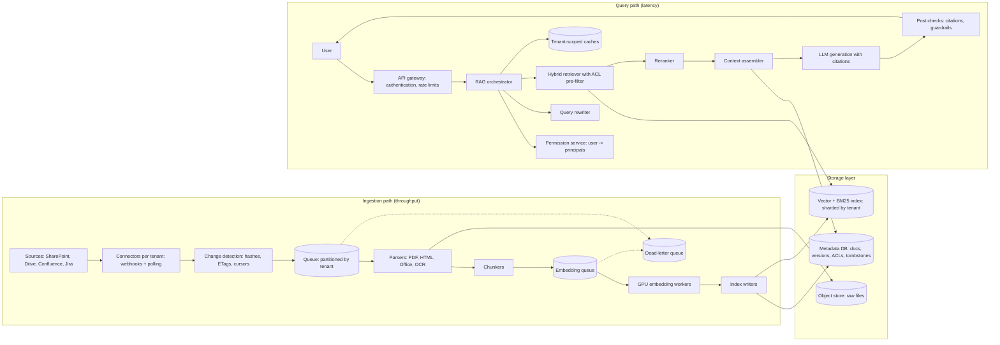

# System Design: A Scalable Enterprise RAG System

> **Level:** Beginner to Advanced · **Study time:** ~150 min · **Prerequisites:** [How to Approach AI/ML System Design Interviews](01-how-to-approach-ai-system-design-interviews.md), [What Is RAG and Why It Matters](../08-rag/01-what-is-rag-and-why-it-matters.md), [Vector Databases in Practice](../08-rag/07-vector-databases-in-practice.md), [Production Ingestion Pipelines](../08-rag/12-production-ingestion-pipelines-at-scale.md), [Secure Multi-Tenant RAG](../08-rag/13-secure-multi-tenant-rag.md)

## Table of contents

- [Why this matters](#why-this-matters)
- [How to run this interview in 45 minutes](#how-to-run-this-interview-in-45-minutes)
- [Step 1: Requirements](#step-1-requirements)
- [Step 2: Capacity estimates with worked numbers](#step-2-capacity-estimates-with-worked-numbers)
- [Step 3: High-level architecture](#step-3-high-level-architecture)
- [Step 4: The ingestion pipeline](#step-4-the-ingestion-pipeline)
- [Step 5: Partitioning and indexing documents](#step-5-partitioning-and-indexing-documents)
- [Step 6: Scaling ingestion and embedding generation](#step-6-scaling-ingestion-and-embedding-generation)
- [Step 7: The query path](#step-7-the-query-path)
- [Step 8: Enforcing tenant permissions](#step-8-enforcing-tenant-permissions)
- [Step 9: Failures, degraded modes and deletion guarantees](#step-9-failures-degraded-modes-and-deletion-guarantees)
- [Step 10: Tenant-scoped caching](#step-10-tenant-scoped-caching)
- [Step 11: The latency budget](#step-11-the-latency-budget)
- [Step 12: SLOs for latency, quality, availability and freshness](#step-12-slos-for-latency-quality-availability-and-freshness)
- [Step 13: Evaluation and monitoring](#step-13-evaluation-and-monitoring)
- [Step 14: The cost model](#step-14-the-cost-model)
- [Going deeper: trade-offs and how the design evolves](#going-deeper-trade-offs-and-how-the-design-evolves)
- [Common mistakes and misconceptions](#common-mistakes-and-misconceptions)
- [Interview questions and model answers](#interview-questions-and-model-answers)
- [Key takeaways](#key-takeaways)
- [Further reading](#further-reading)
- [Next](#next)

## Why this matters

"Design an enterprise RAG system" is one of the most common GenAI system design questions in 2026, because almost every company building on LLMs ends up with one: a product where many customer companies upload or connect their documents and their employees ask questions in natural language. The demo version takes a weekend. The enterprise version has to handle millions of documents, thousands of tenants, permissions that change hourly, deletions that must be guaranteed for legal reasons, answers with verifiable citations, and a cost per query that does not bankrupt the business. Interviewers use this question because it touches everything at once: data pipelines, search, distributed systems, security, LLM inference, evaluation and cost. This chapter walks through a complete interview-grade answer, step by step, with the numbers worked out by hand so you can reproduce them on a whiteboard.

## How to run this interview in 45 minutes

Before the design, a word on pacing. The general framework is in [How to Approach AI/ML System Design Interviews](01-how-to-approach-ai-system-design-interviews.md); here is how it maps onto this question.

| Minutes | What you do | What the interviewer is checking |
|---|---|---|
| 0-5 | Clarify requirements, write them down | Do you ask before building? |
| 5-10 | Capacity estimates | Can you size a system with arithmetic? |
| 10-20 | Architecture diagram: ingestion and query paths | Do you see the whole system? |
| 20-35 | Deep dives: partitioning, permissions, scaling, failures | Senior depth where it matters |
| 35-42 | SLOs, evaluation, monitoring, cost | Do you think about operating it? |
| 42-45 | Trade-offs and evolution | Judgment, not just knowledge |

> **Interview tip:** Say out loud that an enterprise RAG system is really **two systems sharing a storage layer**: a write-heavy, throughput-oriented **ingestion path** and a read-heavy, latency-oriented **query path**. That one sentence organizes the whole conversation.

## Step 1: Requirements

### The running example

We will design **AskDocs**, a SaaS assistant. Customer companies (we will use two: **Acme**, a 50,000-employee bank, and **Globex**, a 200-person startup) connect their SharePoint, Google Drive, Confluence, Jira and ticketing systems. Their employees ask questions like "What is our travel reimbursement limit for Asia?" and get an answer with clickable citations to the exact source passages.

A few terms first:

- A **tenant** is one customer organization (Acme is a tenant). Data from one tenant must never be visible to another.
- A **principal** is an identity that can be granted access: a user (`user:ana`) or a group (`group:finance`).
- An **access control list (ACL)** is the list of principals allowed to read a document. "Permissions" in this chapter means document-level ACLs inherited from the source system.
- A **chunk** is a passage of a document (a few hundred tokens) that we embed and retrieve as a unit. See [Chunking Strategies](../08-rag/04-chunking-strategies.md).
- An **embedding** is a vector of numbers that represents the meaning of a chunk, so that similar texts have nearby vectors. See [Text Embeddings and Similarity Search](../08-rag/02-text-embeddings-and-similarity-search.md).

### Clarifying questions to ask

Ask these, then write the answers down as assumptions. If the interviewer says "you decide", pick reasonable values and state them.

1. How many tenants, and how skewed are they in size? (Here: about 1,000 tenants; a few huge ones like Acme, a long tail like Globex.)
2. How many documents in total, and how big? (20 million documents, about 5,000 tokens each on average.)
3. Which sources, and do they expose change notifications? (Mix: some have webhooks, some only list APIs.)
4. Must answers respect source-system permissions per user? (Yes, always.)
5. How fresh must the index be? (Edits searchable within minutes; permission revocations faster.)
6. Are deletions legally required to be complete? (Yes: GDPR-style erasure and contract termination.)
7. Query volume and latency expectations? (5 million queries per day; first token in under 2 seconds.)
8. Are citations mandatory? (Yes. Unsupported answers are worse than no answer.)
9. Any data residency or compliance constraints? (EU tenants must stay in EU regions; SOC 2.)

### Functional requirements

- Connect sources per tenant, ingest documents continuously, and keep them in sync (adds, edits, moves, permission changes, deletes).
- Answer natural-language questions using only documents the asking user may read.
- Every factual claim cites a source passage; the system **abstains** ("I could not find this in your documents") when evidence is missing.
- Admins can see ingestion status, audit logs of which sources supported each answer, and can delete data.

### Non-functional requirements

| Property | Target (illustrative, agreed with interviewer) |
|---|---|
| Scale | 1,000 tenants, 20M documents, 200M chunks, growth 2x per year |
| Query latency | p95 time to first token (TTFT) under 2 s; p95 full answer under 8 s |
| Availability | 99.9% of queries succeed per 30-day window |
| Content freshness | 95% of edits searchable within 5 minutes |
| Permission freshness | Revocations enforced within 1 minute |
| Deletion | Unretrievable within 1 minute; physically purged everywhere within 30 days |
| Isolation | Zero cross-tenant leaks; per-user ACLs enforced |
| Quality | Faithfulness and citation accuracy above agreed thresholds (Step 12) |

Here **p95** (95th percentile) latency means 95% of requests are faster than this value. **TTFT** is the time from sending the request to receiving the first streamed token of the answer, defined in [LLM Inference Fundamentals](../06-llm-inference/01-inference-fundamentals-prefill-decode-and-latency-metrics.md).

> **Senior insight:** Notice that freshness has two targets. Content edits can take minutes; a permission revocation (an employee was fired, a document was made private) must be fast because the cost of being late is a security incident, not a stale answer. Splitting these early lets you design a fast, cheap "metadata-only" path later.

## Step 2: Capacity estimates with worked numbers

All numbers below are **illustrative** assumptions for the exercise. The point is the method: write down assumptions, multiply carefully, and draw conclusions.

### Documents to chunks to vectors

$$N_{\text{chunks}} = N_{\text{docs}} \times \frac{T_{\text{doc}}}{T_{\text{chunk}}}$$

- $N_{\text{docs}}$: number of documents (20,000,000).
- $T_{\text{doc}}$: average tokens per document (5,000).
- $T_{\text{chunk}}$: tokens per chunk (500; we ignore overlap for simplicity, which would add roughly 10%).

Worked example:

- Chunks per document: $5{,}000 / 500 = 10$.
- Total chunks: $20{,}000{,}000 \times 10 = 200{,}000{,}000$ (200 million).
- One vector per chunk, so 200 million vectors.

### Vector storage, with and without quantization

$$S = N_{\text{chunks}} \times d \times b$$

- $S$: raw vector storage in bytes.
- $d$: embedding dimension (1,024, a common size for modern embedding models).
- $b$: bytes per dimension (4 for float32, 2 for float16, 1 for int8, 1/8 for binary).

Worked example for float32: one vector is $1{,}024 \times 4 = 4{,}096$ bytes. Total: $200{,}000{,}000 \times 4{,}096 = 819{,}200{,}000{,}000$ bytes, which is 819.2 GB.

| Format | Bytes per vector | Total for 200M vectors | Notes |
|---|---|---|---|
| float32 | 4,096 | 819.2 GB | Baseline |
| float16 | 2,048 | 409.6 GB | Usually negligible recall loss |
| int8 (scalar quantization) | 1,024 | 204.8 GB | Small recall loss, often recovered by rescoring |
| binary (1 bit per dimension) | 128 | 25.6 GB | Large loss alone; used as a first pass, then rescore |
| PQ, 64 sub-vectors x 8 bits | 64 | 12.8 GB | Product quantization, see below |

**Quantization** here means storing each number with fewer bits; **product quantization (PQ)** splits each vector into sub-vectors and stores a 1-byte codebook index for each. Both are explained in [Vector Search Algorithms](../08-rag/06-vector-search-ann-hnsw-ivf-and-product-quantization.md).

Two terms the table relies on. **Approximate nearest neighbor (ANN)** search finds vectors that are *probably* the closest to the query, trading a little accuracy for a huge speedup over comparing against all 200 million. **Recall** in this context is the fraction of the true top-$k$ nearest neighbors that the approximate search actually returns: if exact search would return 10 specific chunks and the compressed index returns 9 of them, recall@10 is $9/10 = 0.9$. Step 12 reuses the same idea for "relevant chunks found".

Then add:

- **Index overhead.** An **HNSW** graph index (Hierarchical Navigable Small World, a graph where each vector links to its near neighbors) stores neighbor IDs. With $M = 32$, the base layer keeps about $2M = 64$ links of 4 bytes, so about $64 \times 4 = 256$ bytes per vector, or $200{,}000{,}000 \times 256 = 51.2$ GB (illustrative; exact overhead depends on the engine).
- **Replication.** With 2 replicas for availability, double everything: float32 vectors become 1,638.4 GB of RAM, while int8 becomes 409.6 GB.
- **Chunk text and metadata.** At roughly 4 bytes of English text per token, a 500-token chunk is about 2 KB. $200{,}000{,}000 \times 2{,}000 = 400$ GB of text, plus metadata. This lives in a cheaper store, not in vector RAM.
- **Keyword index.** A **BM25** inverted index (a map from each word to the chunks containing it, scored by the classic BM25 formula) adds a fraction of the text size.

> **Senior insight:** The storage table drives a real decision. 1.6 TB of RAM for float32 with replication is many large machines; int8 or binary-plus-rescoring brings the hot index down by 4x to 32x. Rescoring means you search the compressed vectors to get, say, the top 200 candidates, then re-rank those with full-precision vectors read from SSD. This is how billion-scale systems such as DiskANN-style indexes stay affordable.

### Embedding throughput and cost

$$H_{\text{GPU}} = \frac{N_{\text{docs}} \times T_{\text{doc}}}{r \times 3{,}600}$$

- $H_{\text{GPU}}$: GPU-hours needed to embed the corpus once (we reserve $T$ for token counts).
- $r$: tokens per second one GPU worker embeds (illustrative: 20,000 tokens/s for a mid-size embedding model with good batching).
- 3,600: seconds per hour.

Worked example for the initial **backfill** (embedding the whole corpus once):

- Total tokens: $20{,}000{,}000 \times 5{,}000 = 100{,}000{,}000{,}000 = 10^{11}$ tokens.
- GPU-seconds: $10^{11} / 20{,}000 = 5{,}000{,}000$.
- GPU-hours: $5{,}000{,}000 / 3{,}600 \approx 1{,}389$.
- With 20 GPUs in parallel: $1{,}389 / 20 \approx 69$ hours, a bit under 3 days.
- At an illustrative \$2 per GPU-hour: $1{,}389 \times 2 \approx \$2{,}778$.
- Via a hosted embedding API at an illustrative \$0.02 per million tokens: $10^{11} / 10^6 = 100{,}000$ million-token units, times \$0.02 = \$2,000, but subject to the provider's rate limits.

**Steady state** is much smaller. If 2% of documents change per day:

- Tokens per day: $10^{11} \times 0.02 = 2 \times 10^9$.
- GPU-seconds per day: $2 \times 10^9 / 20{,}000 = 100{,}000$.
- Average GPUs busy: $100{,}000 / 86{,}400 \approx 1.16$. Provision 2 to 4 for bursts.

> **Senior insight:** Steady-state embedding is cheap. What is expensive is a **re-embedding** event (you change the embedding model or the chunker) and onboarding a huge new tenant. Design the ingestion system for backfills, not for the average day.

### Query load

- Average QPS (queries per second): $5{,}000{,}000 / 86{,}400 \approx 57.9$.
- Peak at an illustrative 3x the average: $57.9 \times 3 \approx 174$ QPS. Design for about 200.

How many answers are being generated at the same time? Use **Little's law**:

$$L = \lambda \times W$$

- $L$: average number of requests in the system at once (concurrency).
- $\lambda$: arrival rate (requests per second).
- $W$: average time each request spends in the system (seconds).

Worked example: at 200 QPS with each answer streaming for about 5 seconds, $L = 200 \times 5 = 1{,}000$ concurrent LLM generations. That number sizes your LLM serving fleet or your provider rate-limit contract, not the QPS alone.

### A capacity calculator

```python
# capacity.py - back-of-the-envelope sizing for an enterprise RAG system.
# All defaults are illustrative assumptions; change them to match your scenario.
from dataclasses import dataclass

@dataclass
class Workload:
    n_docs: int = 20_000_000
    tokens_per_doc: int = 5_000
    tokens_per_chunk: int = 500
    dim: int = 1024
    daily_change_rate: float = 0.02
    queries_per_day: int = 5_000_000
    peak_factor: float = 3.0

BYTES_PER_DIM = {"float32": 4, "float16": 2, "int8": 1, "binary": 1 / 8}

def estimate(w: Workload, gpu_tokens_per_s: float = 20_000) -> None:
    chunks = w.n_docs * w.tokens_per_doc // w.tokens_per_chunk
    print(f"chunks/vectors: {chunks:,}")
    for fmt, b in BYTES_PER_DIM.items():
        print(f"  raw vectors as {fmt:8s}: {chunks * w.dim * b / 1e9:8.1f} GB")

    total_tokens = w.n_docs * w.tokens_per_doc
    print(f"backfill: {total_tokens:.2e} tokens = "
          f"{total_tokens / gpu_tokens_per_s / 3600:,.0f} GPU-hours")

    daily_tokens = total_tokens * w.daily_change_rate
    print(f"steady state: {daily_tokens:.2e} tokens/day = "
          f"{daily_tokens / gpu_tokens_per_s / 86_400:.2f} GPUs busy on average")

    avg_qps = w.queries_per_day / 86_400
    print(f"query load: avg {avg_qps:.1f} QPS, peak {avg_qps * w.peak_factor:.0f} QPS")

estimate(Workload())
# chunks/vectors: 200,000,000
#   raw vectors as float32 :    819.2 GB
#   raw vectors as float16 :    409.6 GB
#   raw vectors as int8    :    204.8 GB
#   raw vectors as binary  :     25.6 GB
# backfill: 1.00e+11 tokens = 1,389 GPU-hours
# steady state: 2.00e+09 tokens/day = 1.16 GPUs busy on average
# query load: avg 57.9 QPS, peak 174 QPS
```

## Step 3: High-level architecture



The components, in one table so you can name each box's job in one sentence:

| Component | Job | Scales with |
|---|---|---|
| Connectors | Pull or receive document changes and ACLs from each source | Number of sources and their rate limits |
| Change detection | Skip unchanged documents, detect deletes | Number of documents |
| Queues | Decouple stages, absorb bursts, enable retries | Ingestion throughput |
| Parsers and chunkers | Turn files into clean text chunks with structure | CPU, document complexity |
| Embedding workers | Turn chunks into vectors in batches | GPU count or API quota |
| Index writers | Upsert vectors, text and metadata atomically per document version | Write throughput of the index |
| Metadata DB | Source of truth for documents, versions, ACLs, tombstones | Number of documents |
| Vector + BM25 index | Fast hybrid search with metadata filters | Number of chunks, QPS |
| Permission service | Resolve a user into all principals (user and groups) | Users, group nesting |
| Orchestrator | Runs the query pipeline, timeouts and fallbacks | QPS |
| Reranker | Re-scores top candidates with a precise model | QPS x candidates |
| LLM | Writes the answer with citations | Concurrency, tokens |

A **queue** (for example Kafka, Amazon SQS or Google Pub/Sub) is a durable buffer where producers put messages and consumers take them off at their own pace. A **dead-letter queue (DLQ)** is a side queue where messages go after failing too many times, so one bad document does not block everything behind it.

## Step 4: The ingestion pipeline

This step recaps [Production Ingestion Pipelines](../08-rag/12-production-ingestion-pipelines-at-scale.md) and [Document Ingestion and Parsing](../08-rag/03-document-ingestion-and-parsing.md) at system design altitude.

> **Analogy:** Ingestion is a mail-sorting facility. Trucks (connectors) arrive at random times, letters are scanned (parsed), cut into postcards (chunks), stamped with a postal code (embedded), and filed into pigeonholes per building (tenant shards). If a letter is unreadable, it goes to a "problem" bin (DLQ) instead of stopping the conveyor belt.

### Connectors

A **connector** is a per-source adapter that lists documents, fetches content and fetches ACLs. Two modes:

- **Push (webhooks or change feeds):** the source tells you what changed. Fast and cheap, but webhooks can be dropped.
- **Pull (polling with cursors):** you ask "what changed since cursor X?". Reliable but slower and costs API quota.

Production systems use both: webhooks for speed, plus a periodic **reconciliation** crawl that compares the full list of source IDs with your index to catch missed events, especially deletes.

### Change detection

Re-embedding unchanged documents wastes money. A cheap first check is the source's own version marker: many APIs return an **ETag** or last-modified timestamp that changes whenever the file changes, and a **cursor** (a bookmark of "how far I have read the change list") so the next poll asks only for newer changes. Then keep a **content hash** (for example SHA-256 of the normalized text) per document, because a new ETag does not always mean new text. If the new hash equals the stored hash, skip content processing. If only the ACL changed, take the cheap metadata-only path: update the ACL fields on existing chunks, no re-embedding.

### Parsing, chunking, embedding, writing

- **Parsing** extracts text, headings, tables and page numbers (needed for citations).
- **Chunking** splits text into retrievable passages, attaching metadata: `tenant_id`, `doc_id`, `version`, `chunk_index`, page or section, `acl_principals`, `updated_at`, `embedding_model_version`.
- **Embedding workers** batch chunks for the GPU.
- **Index writers** write all chunks of a new document version, then flip the document's "current version" pointer in the metadata DB, then delete the old version's chunks. Readers only see chunks whose version matches the current pointer, so a user never sees half a document.

An operation is **idempotent** if doing it twice has the same effect as doing it once. Ingestion must be idempotent because queues deliver messages "at least once": retries and duplicates are normal. The trick is **deterministic chunk IDs** derived from the tenant, document, content hash and position, so a retry overwrites instead of duplicating.

```python
# ingest_sketch.py - idempotent, version-safe ingestion in miniature (no external deps).
import hashlib

def content_hash(text: str) -> str:
    return hashlib.sha256(text.encode("utf-8")).hexdigest()[:12]

def chunk_words(text: str, size: int = 4) -> list[str]:
    words = text.split()
    return [" ".join(words[i:i + size]) for i in range(0, len(words), size)]

class TinyIndex:
    def __init__(self):
        self.chunks: dict[str, dict] = {}            # chunk_id -> record
        self.current: dict[tuple, str] = {}          # (tenant, doc) -> current content hash

    def upsert_document(self, tenant: str, doc_id: str, text: str, acl: set[str]) -> str:
        h = content_hash(text)
        key = (tenant, doc_id)
        if self.current.get(key) == h:
            return self.update_acl(tenant, doc_id, acl)   # content unchanged: metadata-only path
        # 1) write the new version's chunks (deterministic IDs make retries safe)
        for i, piece in enumerate(chunk_words(text)):
            cid = f"{tenant}:{doc_id}:{h}:{i}"
            self.chunks[cid] = {"tenant": tenant, "doc": doc_id, "ver": h,
                                "text": piece, "acl": set(acl)}
        # 2) flip the pointer: readers now see only the new version
        self.current[key] = h
        # 3) garbage-collect old versions
        stale = [c for c, r in self.chunks.items()
                 if r["tenant"] == tenant and r["doc"] == doc_id and r["ver"] != h]
        for c in stale:
            del self.chunks[c]
        return f"indexed version {h}"

    def update_acl(self, tenant: str, doc_id: str, acl: set[str]) -> str:
        for r in self.chunks.values():
            if r["tenant"] == tenant and r["doc"] == doc_id:
                r["acl"] = set(acl)
        return "acl updated, no re-embedding"

    def delete_document(self, tenant: str, doc_id: str) -> str:
        self.current.pop((tenant, doc_id), None)          # tombstone first: invisible at once
        for c in [c for c, r in self.chunks.items() if r["tenant"] == tenant and r["doc"] == doc_id]:
            del self.chunks[c]                             # then physical removal
        return "deleted"

idx = TinyIndex()
print(idx.upsert_document("acme", "travel-policy", "Asia travel limit is 200 USD per day", {"group:all"}))
print(idx.upsert_document("acme", "travel-policy", "Asia travel limit is 200 USD per day", {"group:all"}))
print(idx.upsert_document("acme", "travel-policy", "Asia travel limit is 200 USD per day", {"group:finance"}))
print(idx.upsert_document("acme", "travel-policy", "Asia travel limit is 250 USD per day", {"group:finance"}))
print(len(idx.chunks), "chunks")    # 2 chunks (8 words / 4 words per chunk), only the new version
print(idx.delete_document("acme", "travel-policy"), len(idx.chunks), "chunks")
```

Notice the order: re-sending the identical document hits the metadata-only path; changing only the ACL never touches the embedder; changing the text writes new chunks before deleting old ones.

## Step 5: Partitioning and indexing documents

### Partitioning: how to split data across machines

**Partitioning** (also called **sharding**) means splitting the index into pieces called **shards**, each held by a different machine or process, so that no single machine needs to hold or search everything. A **replica** is a copy of a shard for availability and read throughput.

For a multi-tenant system the natural partition key is the tenant. There are three isolation models, explained fully in [Secure Multi-Tenant RAG](../08-rag/13-secure-multi-tenant-rag.md):

| Model | What it is | When to use | Pros | Cons |
|---|---|---|---|---|
| Shared index + `tenant_id` filter | All tenants in one index; every query filters on tenant | Many small tenants | Cheapest, simplest ops | A missing filter is a leak; noisy neighbors; filtered ANN recall issues |
| Namespace or collection per tenant | Logical partition per tenant inside one cluster | Most tenants | Strong logical isolation, easy per-tenant delete and re-index | Per-namespace overhead; thousands of namespaces stress some engines |
| Dedicated shards or cluster per tenant | Physical isolation | Huge or regulated tenants (Acme) | Strongest isolation, per-tenant encryption keys, residency, no noisy neighbors | Expensive, more ops work |

A **noisy neighbor** is a tenant whose heavy traffic slows down other tenants sharing the same machines. "Filtered ANN recall issues" means approximate search can miss good results when a filter excludes most of the index; Step 8 explains why.

> **Senior insight:** The right answer is usually **tiered**: pool the long tail (Globex and 900 others) into shared clusters with one namespace each, and give the top few tenants (Acme) dedicated shards. Route queries with a **tenant directory**, a small lookup table mapping `tenant_id` to cluster, namespace and region. This also solves data residency: EU tenants map to EU clusters.

```text
tenant directory (tenant_id -> where its data lives)
  acme    -> cluster eu-dedicated-1, shards 1-4 (hash of doc_id), region EU
  globex  -> cluster us-pool-3, namespace "globex", region US
  initech -> cluster us-pool-3, namespace "initech", region US

query from Ana (token says tenant=acme) -> directory lookup -> fan out to acme shards 1-4 only
```

Within a big tenant, shard by a hash of `doc_id` so all chunks of a document land together (makes deletes and version flips local), and so load spreads evenly. A query for Acme then fans out only to Acme's shards, not to every shard in the fleet.

Why fan-out width matters, from "The Tail at Scale" (Dean and Barroso, 2013): if each shard is slow 1% of the time and a query must wait for all $N$ shards, then

$$P(\text{query is slow}) = 1 - (1 - p)^N$$

- $p$: probability that one shard is slow (0.01).
- $N$: number of shards the query touches.

Worked example with $N = 100$: $(0.99)^{100} \approx 0.366$, so $P = 1 - 0.366 = 0.634$. Almost two thirds of queries hit at least one slow shard. With tenant routing to $N = 4$ shards: $(0.99)^4 \approx 0.961$, so $P \approx 0.039$. Routing by tenant is a latency feature, not only a security feature.

### Indexing: hybrid by default

**Hybrid search** runs keyword search (BM25) and dense vector search together and merges the results. Keyword search nails exact terms (product codes, error IDs, names); dense search handles paraphrases. Details are in [Retrieval Methods](../08-rag/05-retrieval-bm25-dense-and-hybrid-search.md).

Each chunk record in the index carries:

```json
{
  "chunk_id": "acme:travel-policy:9f2c1a7b3e01:0",
  "tenant_id": "acme",
  "doc_id": "travel-policy",
  "version": "9f2c1a7b3e01",
  "text": "Asia travel limit is 250 USD per day ...",
  "dense_vector": "[1024 floats or int8 codes]",
  "acl_principals": ["group:finance", "user:ana"],
  "source": "sharepoint",
  "title": "Travel Policy 2026",
  "page": 3,
  "updated_at": "2026-10-01T09:00:00Z",
  "embedding_model_version": "emb-v3"
}
```

Index choices:

- **Dense index:** HNSW for low latency when vectors fit in RAM; IVF-PQ or disk-based graph indexes when they do not. **IVF** (inverted file) clusters vectors and searches only the nearest clusters.
- **Sparse index:** BM25 inverted index on the same chunks, ideally in the same engine so one query can filter and fuse in one round trip. Engines such as OpenSearch, Elasticsearch, Vespa, Weaviate and Qdrant support some form of hybrid search; exact features vary by version, so verify before committing. See [Vector Databases in Practice](../08-rag/07-vector-databases-in-practice.md).
- **Metadata indexes:** on `tenant_id`, `acl_principals`, `doc_id`, `updated_at` so filters are fast and deletes by `doc_id` are cheap.
- **Versioned index names with aliases:** queries go to an alias like `acme-current`, which points at `acme-emb-v3`. Changing embedding models means building `acme-emb-v4` and flipping the alias.

## Step 6: Scaling ingestion and embedding generation

### The shape of the load

Ingestion load is spiky: a new tenant connects 5 million documents on Monday; a re-embedding migration touches all 200 million chunks; on a normal day, 2% changes. The design principle is **decouple with queues, scale each stage independently, and protect everyone else from a single big job**.

### Techniques

| Technique | What it does | Why it matters |
|---|---|---|
| Per-stage queues | Parsing, embedding and indexing each consume from their own queue | A slow stage builds a backlog instead of crashing others |
| Batching | Group many chunks into one GPU call (for example 64-256 chunks) | GPUs are efficient only with large batches; see [Batching](../06-llm-inference/04-batching-continuous-batching-and-paged-attention.md) |
| Length bucketing | Batch chunks of similar length together | Less padding, more useful work per batch |
| GPU worker pool | Self-hosted embedding model on GPUs (optionally an inference server) | Cost control and no external rate limits |
| Autoscaling on queue lag | Add workers when backlog age grows, remove when it drains | Pay only for what you need |
| Rate limiting per connector | Respect each source API's quota with a **token bucket** per tenant per source (a counter refilled at the allowed rate; each API call spends one token and waits when the bucket is empty) | Avoid getting a tenant's API key throttled or banned |
| Priority lanes | Separate queues: live edits and ACL changes (high), new tenant backfills (low) | A huge backfill never delays a revocation |
| Per-tenant fairness | Weighted fair scheduling across tenants | Prevents a **noisy neighbor** (one tenant consuming shared capacity) from starving others |
| Checkpointing | Backfills record progress so they resume after failure | A 3-day job cannot restart from zero |
| Backpressure | When the index is overloaded, slow consumers upstream | Prevents cascading failure |

**Autoscaling on queue lag** is better than on CPU or GPU utilization because lag measures what users feel (how far behind the index is). A simple rule: target workers so the backlog drains within the freshness SLO.

$$n_w = \left\lceil \frac{B}{r_w \times t} \right\rceil$$

- $n_w$: number of workers needed (not to be confused with $W$, the time in system in Little's law).
- $B$: backlog in tokens.
- $r_w$: tokens per second per worker.
- $t$: seconds allowed to drain.

Worked example: a backlog of 300 million tokens, 20,000 tokens/s per worker, to drain within 1 hour (3,600 s). One worker clears $20{,}000 \times 3{,}600 = 72{,}000{,}000$ tokens per hour. $n_w = \lceil 300{,}000{,}000 / 72{,}000{,}000 \rceil = \lceil 4.17 \rceil = 5$ workers.

### Hosted API versus self-hosted embedding models

| | Hosted embedding API | Self-hosted on GPUs |
|---|---|---|
| Setup | Minutes | Days to weeks |
| Throughput limit | Provider rate limits per minute | Your GPU count |
| Cost profile | Per token, linear | Fixed per GPU-hour; cheaper at high, steady volume |
| Data control | Data leaves your boundary (contract matters) | Stays in your VPC; easier for regulated tenants |
| Model choice | Provider's models | Any open model, can fine-tune per domain |

Many teams start hosted and move the high-volume path in-house. Either way, the embedding call needs retries with exponential backoff and jitter on rate-limit errors, covered in Step 9.

### Backfills and re-embedding

A **backfill** re-processes a large set of existing documents. Run it as a separate low-priority job with its own worker pool and budget, writing into a **new versioned index** (for example `acme-emb-v4`) rather than overwriting in place. Meanwhile, live edits are **dual-written** to both old and new indexes; start dual-writing before the backfill begins (or replay the change log from the backfill's start point), otherwise edits and deletes made mid-backfill are missing from the new index. When the new index is complete and evaluation passes, flip the alias. Old and new embedding models produce incompatible vector spaces, so you can never mix vectors from two models in one index.

## Step 7: The query path

Here is one query traced end to end. Ana, in Acme's finance group, asks: "What's the Asia travel limit now?"

```text
 1. Gateway        authenticate Ana (SSO token) -> tenant=acme, user=ana; per-tenant rate limit
 2. Permissions    expand principals -> {user:ana, group:finance, group:all}   (cached, short TTL)
 3. Cache check    tenant-scoped answer cache (usually a miss for natural-language questions)
 4. Rewrite        "What's the Asia travel limit now?" -> "Asia travel reimbursement daily limit"
 5. Retrieve       in parallel, both filtered by tenant=acme AND acl overlaps Ana's principals:
                     BM25 top 50     dense ANN top 50
 6. Fuse           reciprocal rank fusion -> top 50 unique candidates
 7. Rerank         cross-encoder scores 50 (query, chunk) pairs -> top 8
 8. Assemble       fetch text + titles + page numbers, dedupe, order, fit token budget
 9. Generate       LLM answers using only the context, cites [1], [2]; may abstain
10. Post-check     every citation maps to a provided chunk; claims supported; guardrails
11. Respond        stream answer + citations; log trace (sources used) for audit
```

### Query rewriting

**Query rewriting** turns a messy conversational question into a better search query: resolve pronouns from chat history ("what about Europe?" becomes "Europe travel reimbursement daily limit"), expand acronyms, or generate several sub-queries. It usually uses a small, fast LLM. Make it optional and skip it for already-clean queries, because it adds 100-300 ms (illustrative). Techniques like HyDE and multi-query are in [Reranking and Query Transformation](../08-rag/08-reranking-and-query-transformation.md).

### Hybrid retrieval with fusion

**Reciprocal rank fusion (RRF)** (Cormack, Clarke and Buettcher, 2009) merges ranked lists using only ranks, which avoids comparing BM25 scores and cosine similarities that live on different scales:

$$\text{RRF}(c) = \sum_{r \in R} \frac{1}{k + \text{rank}_r(c)}$$

- $c$: a candidate chunk.
- $R$: the set of ranked lists (here BM25 and dense).
- $\text{rank}_r(c)$: position of $c$ in list $r$ (1 is best); a chunk missing from a list contributes 0 for that list.
- $k$: a smoothing constant, commonly 60.

Worked example with $k = 60$: chunk A is rank 1 in BM25 and rank 3 in dense; chunk B is rank 2 in BM25 and rank 1 in dense.

- A: $1/61 + 1/63 = 0.016393 + 0.015873 = 0.032266$.
- B: $1/62 + 1/61 = 0.016129 + 0.016393 = 0.032522$.
- B wins narrowly because it is strong in both lists.

### Reranking

A **reranker** is usually a **cross-encoder**: a transformer that reads the query and one chunk together and outputs a relevance score. It is far more accurate than comparing two independently computed embeddings, but too slow to run on millions of chunks, so it only re-scores the top 30-100 candidates. Classic reference: "Passage Re-ranking with BERT" (Nogueira and Cho, 2019).

### Context assembly

The **context assembler** decides what the LLM actually sees:

- Take the top 5-10 reranked chunks, drop near-duplicates, optionally expand to the parent section ([Advanced RAG Patterns](../08-rag/09-advanced-rag-patterns.md)).
- Label each chunk with a citation ID, title, and page so the model can cite `[2]`.
- Respect a token budget (say 4,000 tokens). Put the most relevant chunks first or last; "Lost in the Middle" (Liu et al., 2023) showed models can underuse information in the middle of long contexts.
- Wrap retrieved text in clear delimiters and tell the model to treat it as data, not instructions (a partial defense against prompt injection hidden in documents).

### Generation with citations and abstention

The system prompt instructs: answer only from the provided sources, cite each claim with its source ID, and if the sources do not contain the answer, say so. Asking for structured output, for example JSON with `answer`, `citations` and `confidence`, makes post-checks easier ([Structured Outputs](../05-llms/05-structured-outputs-and-function-calling.md)).

**Abstention** means deliberately not answering. Trigger it when the best rerank score is below a calibrated threshold (no good evidence was found), or when the model itself says the context is insufficient. In enterprise settings a confident wrong answer about a policy is worse than "I could not find that; here are the closest documents".

### Post-checks

Before or while streaming:

- **Citation validity:** every cited ID exists in the context the model received, and every cited chunk is one the user may read (it always should be, but checking is cheap).
- **Support check:** optionally, a small natural-language-inference model or LLM judge verifies that each sentence is supported by its cited chunk. Doing this on every request adds latency; many teams run it on a sample, or run a cheap version synchronously and a thorough version asynchronously. See [Hallucinations and Grounding](../05-llms/06-hallucinations-and-grounding.md).
- **Guardrails:** PII leakage checks, policy filters ([LLM Safety and Guardrails](../05-llms/13-llm-safety-guardrails-and-responsible-ai.md)).

> **Common mistake:** Streaming tokens to the user and then discovering a citation is invalid. Options: buffer the first sentence until it passes, validate citations at the end and visually mark unsupported claims, or generate the answer non-streamed for high-risk tenants. State the trade-off: streaming improves perceived latency, post-checks improve trust.

## Step 8: Enforcing tenant permissions

This is the deep dive interviewers press hardest on. Full treatment: [Secure Multi-Tenant RAG](../08-rag/13-secure-multi-tenant-rag.md). The system design version:

### Two layers of isolation

1. **Tenant isolation:** the tenant comes from the authenticated token, never from the request body or the prompt. The router sends the query only to that tenant's namespace or shards. With namespace or dedicated isolation, even a filter bug cannot reach other tenants' data, because it is not in the search space; in a shared index with a `tenant_id` filter, that filter must be enforced in a mandatory data-access layer, since a missing filter is a leak.
2. **User-level ACLs inside a tenant:** chunks carry `acl_principals`. At query time the permission service expands the user into principals (their user ID plus all groups, including nested groups), and retrieval adds the filter `acl_principals ∩ user_principals ≠ ∅` (the sets share at least one element).

### Pre-filter, never post-filter only

- **Pre-filtering:** the ACL filter is applied inside the search, so the top-k results are the best k chunks the user may read.
- **Post-filtering:** retrieve top-k for everyone, then drop forbidden chunks. Two problems: forbidden data has already passed through your pipeline (logs, caches, reranker), and if Ana may read only 1% of Acme's documents, the top 50 might contain zero allowed chunks, so she gets an empty or poor answer.

> **Analogy:** Pre-filtering is a librarian who searches only the shelves you hold a key for. Post-filtering is a librarian who fetches the 50 best books from the whole library and then confiscates the ones you may not read: the forbidden books have already been carried across the room, and you may walk away with nothing.

Worked example of the empty-result problem: if allowed chunks are scattered randomly and make up a fraction $f = 0.01$ of the tenant's index, the expected number of allowed chunks in a post-filtered top 50 is $50 \times 0.01 = 0.5$, and the chance that none of the 50 is allowed is about $(1 - 0.01)^{50} \approx 0.61$. Pre-filtering returns the best 50 *allowed* chunks (as long as the user can read at least 50, and subject to the filtered-ANN recall caveat below).

Filtered ANN has its own catch: graph indexes like HNSW lose recall when the filter is very selective, because the graph walk keeps hitting disallowed nodes. Mitigations, depending on the engine: engines with filter-aware graph traversal, raising the search breadth, or switching to exact (brute-force) search over the allowed subset when it is small. A few thousand vectors can be scanned exactly in milliseconds.

### A runnable toy: ACL pre-filtered hybrid retrieval

```python
# acl_hybrid.py - tenant + ACL pre-filtering, keyword and dense ranking, RRF fusion.
# pip install numpy
import numpy as np

CHUNKS = [
    {"id": "a1", "tenant": "acme",   "acl": {"group:eng"},     "text": "vpn setup guide for engineers", "vec": [0.9, 0.1, 0.0]},
    {"id": "a2", "tenant": "acme",   "acl": {"group:hr"},      "text": "salary bands and vpn policy",   "vec": [0.7, 0.6, 0.1]},
    {"id": "a3", "tenant": "acme",   "acl": {"group:all"},     "text": "office wifi and vpn faq",       "vec": [0.8, 0.2, 0.3]},
    {"id": "g1", "tenant": "globex", "acl": {"group:all"},     "text": "globex vpn setup",              "vec": [0.95, 0.05, 0.0]},
]

def allowed(chunk, tenant, principals):
    return chunk["tenant"] == tenant and bool(chunk["acl"] & principals)   # pre-filter

def keyword_rank(query, cands):      # stand-in for BM25: count shared words
    q = set(query.split())
    scored = sorted(cands, key=lambda c: -len(q & set(c["text"].split())))
    return [c["id"] for c in scored]

def dense_rank(qvec, cands):         # cosine similarity
    q = np.array(qvec) / np.linalg.norm(qvec)
    sims = {c["id"]: float(q @ (np.array(c["vec"]) / np.linalg.norm(c["vec"]))) for c in cands}
    return sorted(sims, key=sims.get, reverse=True)

def rrf(rankings, k=60):
    scores = {}
    for ranking in rankings:
        for pos, cid in enumerate(ranking, start=1):
            scores[cid] = scores.get(cid, 0.0) + 1.0 / (k + pos)
    return sorted(scores.items(), key=lambda kv: kv[1], reverse=True)

tenant, principals = "acme", {"user:ana", "group:eng", "group:all"}
cands = [c for c in CHUNKS if allowed(c, tenant, principals)]
print([c["id"] for c in cands])                       # ['a1', 'a3']  (a2 is HR-only, g1 is Globex)
fused = rrf([keyword_rank("vpn setup", cands), dense_rank([0.9, 0.1, 0.1], cands)])
print([(cid, round(s, 4)) for cid, s in fused])       # [('a1', 0.0328), ('a3', 0.0323)]
```

The important line is the filter: it runs **before** ranking, so forbidden chunks never become candidates. In a real system that filter is pushed down into the search engine query, not applied in Python.

### Keeping ACLs fresh

- **ACL sync is its own fast pipeline.** Group membership and document permissions change without content changes. Process them on the high-priority lane as metadata-only updates.
- **Group expansion at query time** (user to groups) is cached with a short TTL (time to live), for example 15 seconds. Size it from the SLO: worst-case staleness is roughly ACL-sync lag plus cache TTL, so with a 1-minute revocation SLO and up to about 30 s of sync lag, a 60 s TTL would already blow the budget, and even a 30 s TTL would leave zero headroom.
- **Store groups, not individual users, where possible.** A document shared with 10,000 people via `group:all` should carry one principal, not 10,000. Very large organizations often centralize this in a dedicated relationship-based authorization service in the style of Google's Zanzibar (Pang et al., 2019), which answers "who can read what" consistently for every product.
- **Late-binding check (defense in depth):** for the final 5-10 cited documents, verify access against the authoritative permission service (or the source system) just before answering. Against an internal permission service it typically costs a few milliseconds (a live call to the source system costs far more and is subject to its rate limits), and it catches index staleness.
- **Deny wins:** if a source supports explicit deny entries, store and enforce them; a principal matching a deny entry is excluded even if an allow also matches.

> **Interview tip:** Name every place data can leak, not just the index: caches, logs and traces, the reranker service, the evaluation datasets, analytics, and the LLM provider. Then say how each is tenant-scoped. That list is what distinguishes a senior answer.

## Step 9: Failures, degraded modes and deletion guarantees

### Ingestion failures

| Failure | Handling |
|---|---|
| Transient (timeouts, 429 rate limit, 503) | Retry with **exponential backoff and jitter**: wait 1 s, 2 s, 4 s ... plus a random offset so thousands of workers do not retry in lockstep |
| Poison document (parser crash, 2 GB PDF, malformed file) | After N attempts, send to the **DLQ** with the error; alert; continue with the rest |
| Partial write (worker dies after writing 6 of 10 chunks) | Version pointer is not flipped, so readers never see the partial version; retry rewrites the same deterministic IDs |
| Connector auth expired | Mark the source unhealthy, notify tenant admin, keep serving the last good index |
| Missed webhook | Periodic reconciliation crawl detects drift |

The DLQ needs an owner, a dashboard and a **redrive** tool (re-enqueue after a fix). A DLQ nobody watches is a silent data-loss mechanism.

### Query-path failures and degraded modes

Every stage gets a **timeout** and a **circuit breaker** (a switch that stops calling a failing dependency for a cool-down period, so you fail fast instead of piling up waiting requests). Then define what "degraded but useful" looks like:

| Dependency down or slow | Degraded mode | User impact |
|---|---|---|
| Query rewriter | Use the raw query | Slightly worse recall on conversational follow-ups |
| Reranker | Use RRF order directly | Somewhat worse precision |
| Dense index or embedding service | **BM25-only** retrieval | Worse on paraphrases, fine on exact terms |
| BM25 index | Dense-only retrieval | Worse on IDs and rare terms |
| Primary LLM | Fallback model or secondary provider | Possibly lower answer quality |
| All generation | Return ranked search results with snippets ("Here are the most relevant documents") | No synthesized answer, still useful |
| Total backend outage | Serve **cached answers** for exact repeated questions (tenant- and ACL-scoped) | Limited coverage |

Also: **load shedding** (reject or queue low-priority traffic when overloaded) and **per-tenant rate limits** so one tenant's spike does not take down others.

```python
# degrade.py - run dense and BM25 retrieval in parallel with timeouts; degrade gracefully.
import asyncio

async def dense_search(q):            # simulate an overloaded vector index
    await asyncio.sleep(0.2)
    return ["d1", "d2"]

async def bm25_search(q):
    await asyncio.sleep(0.01)
    return ["b1", "b2"]

async def retrieve(q, timeout_s=0.08):
    dense, bm25 = await asyncio.gather(
        asyncio.wait_for(dense_search(q), timeout_s),
        asyncio.wait_for(bm25_search(q), timeout_s),
        return_exceptions=True,       # a timeout becomes a value, not a crash
    )
    ok = {name: r for name, r in (("dense", dense), ("bm25", bm25)) if not isinstance(r, Exception)}
    if len(ok) == 2:
        return "hybrid", ok["dense"] + ok["bm25"]
    if ok:
        mode = next(iter(ok))
        return f"{mode}_only", ok[mode]   # record this mode in the trace and metrics
    return "search_unavailable", []

print(asyncio.run(retrieve("asia travel limit")))   # ('bm25_only', ['b1', 'b2'])
```

> **Senior insight:** Tag every response with its mode (`hybrid`, `bm25_only`, `fallback_llm`, `cached`). Otherwise your quality dashboards silently mix degraded and normal answers, and you cannot tell whether a quality drop is a model regression or an outage.

### Document deletion guarantees

Deletion is a promise with a deadline. A document lives in many places after ingestion:

```text
 source system -> object store (raw file) -> metadata DB (doc row, ACLs)
               -> vector index (chunks, vectors) -> BM25 index (postings)
               -> caches (retrieval, answer) -> logs/traces (snippets)
               -> evaluation datasets -> backups and replicas
```

A two-phase protocol:

1. **Logical delete (seconds):** write a **tombstone** (a "this is deleted" marker) for `doc_id` in the metadata DB and remove the document's current-version pointer. The query path already joins against the pointer table, or filters on a small in-memory deny set of recently deleted IDs, so the document becomes unretrievable immediately even before vectors are physically removed. Invalidate caches that reference the document (keep an index from `doc_id` to cache keys, or bump the tenant's index version so all its cache keys change).
2. **Physical purge (hours to days):** delete chunks and vectors from every index and replica (many ANN indexes only mark-delete, so schedule **compaction**), delete raw files, scrub logs and eval sets per retention policy, and let backups expire on a documented schedule. Treat embeddings as personal data: research on embedding inversion shows text can sometimes be partially reconstructed from vectors.
3. **Verify:** a deletion audit job queries every store for the `doc_id` and records proof of completion. For a tenant offboarding, delete the whole namespace and, ideally, destroy the tenant's encryption key (**crypto-shredding**), which makes any lingering copies unreadable.

## Step 10: Tenant-scoped caching

A cache stores a previous result to avoid recomputation. In a multi-tenant system, every cache key must include everything that could change the answer or who may see it.

| Cache | Key must include | Typical benefit |
|---|---|---|
| Group-expansion cache | tenant, user | Saves a call to the identity provider on every query |
| Query-embedding cache | embedding model version, normalized query text, tenant (the query text is tenant data) | Small; embedding a query is cheap |
| Retrieval cache | tenant, **ACL fingerprint** (hash of the user's sorted principals), normalized query, tenant index version | Moderate for repeated questions |
| Answer cache | all of the above + prompt version + LLM model version (+ conversation context for follow-up questions) | Large savings per hit, but hit rates on free-text questions are often low |
| LLM prompt-prefix cache | Provider- or server-managed; shared system prompt prefix | Lower TTFT and input cost, see [Speculative Decoding, Prompt Caching](../06-llm-inference/05-speculative-decoding-caching-and-other-speedups.md) |

```python
import hashlib, json

def answer_cache_key(tenant, principals, query, index_version, prompt_version, model):
    acl_fp = hashlib.sha256(",".join(sorted(principals)).encode()).hexdigest()[:16]
    payload = json.dumps([tenant, acl_fp, " ".join(query.lower().split()),
                          index_version, prompt_version, model])
    return f"ans:{tenant}:" + hashlib.sha256(payload.encode()).hexdigest()
```

A user with different permissions always gets a different key. Note that the expanded principal set includes the user's own ID (`user:ana`), so this fingerprint is effectively per user: safe, but it lowers hit rates. Two users share entries only when their full principal sets are identical; fingerprinting groups alone to raise hit rates is safe only if documents are never shared with individual users, otherwise a user-level grant could leak through the shared entry. Bumping `index_version` on every ingest batch for a tenant invalidates that tenant's entries in one move.

> **Common mistake:** A **semantic cache** (return a cached answer if a new question's embedding is close to an old one) across tenants or across permission sets. It is both a leak and a correctness risk: "Can I expense taxis in Asia?" and "Can I expense taxis in Europe?" may be very close in embedding space.

## Step 11: The latency budget

A **latency budget** splits the end-to-end target across stages so each team knows its allowance. Illustrative p50-ish allocations for TTFT:

| Stage | Budget (ms) | Notes |
|---|---|---|
| Gateway, auth, tenant routing | 20 | Token validation cached |
| Permission expansion | 10 | Cache hit; miss costs more |
| Query rewriting | 150 | Small LLM; skip when not needed |
| Query embedding | 20 | Small batch on GPU |
| Hybrid retrieval (BM25 and dense in parallel) | 60 | Max of the two, not the sum |
| Fusion | 5 | In memory |
| Reranking 50 candidates | 120 | Cross-encoder on GPU, batched |
| Context assembly (fetch text, metadata) | 30 | Batch read from document store |
| LLM prefill to first token (the model reads the whole prompt before emitting anything) | 500 | Depends on model size, context length, load |
| Network and overhead | 85 | Several hops |
| **TTFT total** | **1,000** | Under the 2 s p95 target with headroom |

Sum check: $20 + 10 + 150 + 20 + 60 + 5 + 120 + 30 + 500 + 85 = 1{,}000$ ms.

After the first token, the answer streams at the decode speed. For 300 output tokens at an illustrative 75 tokens/s: $300 / 75 = 4$ s, so the full answer finishes at about $1 + 4 = 5$ s. Prefill and decode are explained in [LLM Inference Fundamentals](../06-llm-inference/01-inference-fundamentals-prefill-decode-and-latency-metrics.md).

> **Senior insight:** Percentiles do not add. The p95 of the whole request is not the sum of the stage p95s (that sum is a pessimistic upper bound, since rarely is every stage slow at once). Measure end-to-end percentiles directly with distributed tracing, and use the per-stage budget as a guide for where to look.

Where the time usually goes, and the levers:

- **LLM prefill** dominates TTFT: shorter context (fewer, better chunks after reranking), prompt-prefix caching, a smaller or quantized model for simple questions ([Optimizing LLM Latency and Cost](../06-llm-inference/07-optimizing-and-benchmarking-llm-latency-and-cost.md)).
- **Query rewriting** is the most skippable stage.
- **Retrieval tail latency** comes from fan-out and filtered ANN; route by tenant and use exact search on tiny filtered subsets.

## Step 12: SLOs for latency, quality, availability and freshness

Three terms first:

- An **SLI** (service level indicator) is a measured quantity, such as "fraction of queries with TTFT under 2 s".
- An **SLO** (service level objective) is a target for an SLI over a window, such as "99% of queries under 2 s TTFT over 30 days".
- An **SLA** (service level agreement) is a contractual promise to customers, usually looser than the internal SLO, with penalties.

The SRE practice of SLOs and error budgets comes from Google's "Site Reliability Engineering" book (Beyer et al., 2016).

### Latency SLOs

- TTFT: p95 under 2 s, p99 under 4 s (illustrative), measured at the gateway for successful requests.
- Full answer: p95 under 8 s.
- Retrieval-only (for the search API): p95 under 300 ms.
- Measure per tenant as well as globally; a global p95 can hide one huge tenant suffering.

### Availability SLO and error budget

$$\text{Availability} = \frac{\text{good requests}}{\text{valid requests}}$$

Define "good" carefully: a 200 response that says "search unavailable" is not good; a BM25-only answer arguably is (decide and document it). Client errors such as malformed requests are excluded from "valid".

The **error budget** is the allowed failure: $1 - \text{SLO}$.

Worked example for 99.9% over 30 days:

- In time: $30 \times 24 \times 60 = 43{,}200$ minutes, times $0.001 = 43.2$ minutes of full outage.
- In requests: $5{,}000{,}000 \times 30 = 150{,}000{,}000$ requests, times $0.001 = 150{,}000$ failed requests allowed.

When the budget is burning fast, freeze risky launches and work on reliability.

**Availability compounds through serial dependencies.** If a request needs the gateway (99.99%), retrieval (99.9%), reranker (99.9%) and LLM (99.9%), all independently:

$$0.9999 \times 0.999 \times 0.999 \times 0.999 \approx 0.9969$$

Step by step: $0.999^3 = 0.997003$; then $0.997003 \times 0.9999 = 0.997003 - 0.0000997 \approx 0.996903$, about 99.69%, which misses 99.9%. Fallbacks fix this, because parallel alternatives multiply failure probabilities instead:

$$A_{\text{with fallback}} = 1 - (1 - A_1)(1 - A_2)$$

- $A_1$: availability of the primary (for example the main LLM, 0.999).
- $A_2$: availability of the fallback (for example a second provider, 0.995).

Worked example: $1 - (0.001)(0.005) = 1 - 0.000005 = 0.999995$. Make the reranker optional (skip on failure, so it leaves the serial chain), and give retrieval a BM25-or-dense fallback ($1 - 0.001 \times 0.001 = 0.999999$). Now: $0.9999 \times 0.999999 \times 0.999995 \approx 0.99989$, about 99.99%. The caveat: this assumes independent failures. Shared infrastructure (same region, same network) makes failures correlated, which is why multi-zone deployment matters.

### Quality SLOs

Quality is the SLO most teams forget. Make it measurable:

| SLI | How it is measured | Example SLO (illustrative) |
|---|---|---|
| Retrieval recall@k | Golden set of questions with known relevant chunks, run nightly per tenant tier | recall@10 at least 0.85 |
| Faithfulness | LLM judge or NLI model checks that claims are supported by cited context, on a daily sample of production traffic | at least 0.90 of sampled answers fully supported |
| Citation precision | Fraction of citations that actually support their sentence | at least 0.95 |
| Abstention correctness | On unanswerable test questions, fraction where the system abstains | at least 0.80 |
| User signal | Thumbs-down rate, citation click-through, query reformulation rate | Alert on week-over-week regression |

Recall@k, the core retrieval metric:

$$\text{recall@}k = \frac{|\text{relevant chunks in top } k|}{|\text{all relevant chunks}|}$$

Worked example: a question has 4 relevant chunks; 3 appear in the top 10. recall@10 $= 3/4 = 0.75$. Averaged over the golden set, this is the number you track. More metrics (MRR, nDCG, RAGAS) are in [Evaluating RAG](../08-rag/10-rag-evaluation-metrics-and-ragas.md); judge design is in [LLM-as-a-Judge](../05-llms/10-llm-evaluation-metrics-and-llm-as-a-judge.md).

> **Common mistake:** Quality SLOs measured only offline. Production traffic drifts (new document types, new question styles), so sample live traffic, judge it asynchronously, and alert on the trend. Also respect privacy: sampled traces contain tenant data, so judging must stay inside the tenant's data boundary and retention policy.

### Freshness SLOs

- **Content freshness:** time from a source edit to "searchable" (measure with synthetic canary documents per connector: edit a known document every few minutes and query for the new text).
- **Permission freshness:** time from a revocation to enforcement (canary: remove a test user from a group, check the canary doc stops appearing).
- **Deletion:** time to unretrievable and time to full purge, with audit evidence.

## Step 13: Evaluation and monitoring

### Evaluation lifecycle

1. **Offline golden sets:** per domain and for a few large tenants (with their consent), a few hundred questions with labeled relevant chunks and reference answers; include unanswerable and permission-trap questions ("Ana asks about HR salary bands; the answer must not use HR documents").
2. **Regression tests in CI:** any change to chunking, embedding model, prompt, reranker or LLM runs the suite; block merges on significant drops ([Building an LLM Evaluation Framework](../05-llms/11-building-an-llm-evaluation-framework-and-regression-tests.md), [CI/CD for ML](../10-mlops/07-ci-cd-and-testing-for-ml-pipelines.md)).
3. **Canary and shadow deployments:** route a small slice of traffic to the new version, or run it in shadow without showing users, and compare quality and latency ([Deployment Patterns](../10-mlops/04-model-deployment-patterns.md)).
4. **Online monitoring:** sampled LLM-judge scores, user feedback, abstention rate.

### What to monitor

| Area | Metrics |
|---|---|
| Ingestion | Queue depth and oldest-message age per tenant, DLQ size, docs per minute, parser error rate by file type, connector health |
| Freshness | Canary edit-to-searchable time, ACL-sync lag, deletion lag |
| Index | Vector count per tenant vs source count (reconciliation drift), memory, compaction backlog |
| Retrieval | Empty-result rate, top rerank score distribution, filter selectivity, degraded-mode rate |
| Generation | TTFT, tokens in and out, abstention rate, citation-validation failures, guardrail triggers |
| Quality | Sampled faithfulness, thumbs-down rate, reformulation rate |
| Cost | Cost per query and per tenant, GPU utilization, cache hit rates |
| Security | Cross-tenant canary tests, late-binding ACL check failures (should be near zero; a spike means ACL sync is broken) |

Every query should produce a **trace**: one record linking all stages with timings, retrieved chunk IDs, scores, model versions and the degraded mode. That trace is your debugging tool ([LLMOps: Tracing](../10-mlops/08-llmops-tracing-prompt-management-and-langfuse.md), [Monitoring ML and LLM Systems](../10-mlops/06-monitoring-ml-and-llm-systems-in-production.md)) and your audit log of which sources supported each answer.

## Step 14: The cost model

$$C_{\text{query}} = C_{\text{embed}} + C_{\text{retrieve}} + C_{\text{rerank}} + C_{\text{LLM}}$$

$$C_{\text{LLM}} = T_{\text{in}} \cdot p_{\text{in}} + T_{\text{out}} \cdot p_{\text{out}}$$

- $T_{\text{in}}$, $T_{\text{out}}$: input and output tokens per query.
- $p_{\text{in}}$, $p_{\text{out}}$: price per token for input and output.

Worked example with illustrative prices of \$0.50 per million input tokens and \$2.00 per million output tokens, 4,000 input tokens (8 chunks of 500) and 300 output tokens:

- Input: $4{,}000 \times 0.50 / 1{,}000{,}000 = \$0.0020$.
- Output: $300 \times 2.00 / 1{,}000{,}000 = \$0.0006$.
- LLM total: \$0.0026 per query.

Reranker (self-hosted, illustrative): 50 candidates truncated to 256 tokens is $50 \times 256 = 12{,}800$ tokens. At 50,000 tokens/s per GPU, that is $12{,}800 / 50{,}000 = 0.256$ GPU-seconds. At \$2 per GPU-hour, a GPU-second costs $2 / 3{,}600 \approx \$0.000556$, so reranking costs about $0.256 \times 0.000556 \approx \$0.00014$ per query.

Query embedding: about 30 tokens at \$0.02 per million is $30 \times 0.02 / 1{,}000{,}000 = \$0.0000006$, negligible.

Retrieval infrastructure is mostly fixed cost (RAM-heavy machines); amortize it. Suppose an illustrative \$30,000 per month for the vector and BM25 clusters, over $150{,}000{,}000$ queries per month: $30{,}000 / 150{,}000{,}000 = \$0.0002$ per query.

Total: $0.0026 + 0.00014 + 0.0002 = 0.00294$, roughly \$0.0029 per query. At 5 million queries per day: $0.00294 \times 5{,}000{,}000 = 14{,}700$, about \$14,700 per day. The LLM is close to 90% of it ($0.0026 / 0.00294 \approx 0.88$).

Reranker fleet size from the same numbers: 5 million queries times 0.256 GPU-s is 1,280,000 GPU-seconds per day, or $1{,}280{,}000 / 86{,}400 \approx 14.8$ GPUs on average, and about 45 at a 3x peak. Not a rounding error: reranker size (number of candidates, truncation length, model size) is a real cost lever.

Cost levers, in rough order of impact:

| Lever | Effect | Risk |
|---|---|---|
| Fewer, better chunks in context (rerank then keep top 5 instead of 10) | Cuts input tokens and prefill latency | Lower recall for multi-part questions |
| Model routing: small model for simple questions, big model for hard ones | Large LLM savings | Router mistakes; needs evaluation |
| Prompt-prefix caching | Cheaper and faster repeated system prompts | Provider-specific behavior |
| Vector quantization (int8, binary + rescoring) | 4x-32x less RAM | Small recall loss, measure it |
| Answer cache | Big savings per hit | Low hit rate, invalidation complexity |
| Self-hosting embeddings or the LLM at high volume | Lower unit cost | Ops burden, capacity planning |

Show per-tenant cost dashboards: pricing tiers and fair-use limits depend on knowing that Acme costs ten times what Globex does.

## Going deeper: trade-offs and how the design evolves

### Key trade-offs to state explicitly

| Decision | Option A | Option B | How to choose |
|---|---|---|---|
| Isolation | Shared index + filter | Dedicated per tenant | Tenant size, compliance, cost; usually tiered |
| Vector precision | float32/float16 | int8, binary, PQ | Measure recall@k vs RAM cost on your golden set |
| Freshness | Streaming upserts | Periodic batch rebuilds | Streaming for edits and ACLs; batch for re-embedding |
| Reranker | Cross-encoder | None or a light model | Quality gain vs ~100 ms and GPU cost |
| Query rewriting | Always | Only for follow-ups | Latency vs recall on conversational queries |
| Post-checks | Synchronous on every answer | Sampled, asynchronous | Tenant risk level; regulated tenants pay the latency |
| Embedding model | Hosted API | Self-hosted, maybe domain-tuned | Volume, data control, quality on your domain |
| Long context vs retrieval | Stuff whole documents in a long-context model | Retrieve top chunks | Retrieval wins on cost, latency and permission control at millions of documents; long context helps for deep reading of a few retrieved documents |

### Evolution roadmap

| Stage | Scale | Design |
|---|---|---|
| v0: pilot | 1-5 tenants, 100K docs | Managed vector DB, one namespace per tenant, hosted embedding API and LLM, simple dense retrieval, nightly sync |
| v1: product | 100 tenants, 2M docs | Hybrid search, reranker, webhooks + reconciliation, ACL pre-filtering, tracing, golden-set evaluation |
| v2: scale | 1,000 tenants, 20M docs | Tiered isolation, quantized vectors, self-hosted embedding workers, priority lanes, degraded modes, SLOs with error budgets, per-tenant cost |
| v3: advanced | 10,000+ tenants, 200M+ docs, multi-region | Data residency per region, per-tenant encryption keys, DiskANN-style indexes, model routing, agentic retrieval for multi-hop questions, GraphRAG for entity-heavy corpora ([Advanced RAG Patterns](../08-rag/09-advanced-rag-patterns.md)) |

### Migrating to a new embedding model with zero downtime

1. Build a new index version per tenant (`acme-emb-v4`) with a backfill job on the low-priority lane.
2. Dual-write live changes to both versions.
3. Evaluate offline on golden sets and online in shadow mode.
4. Flip the alias tenant by tenant, starting with small tenants; keep the old index for fast rollback.
5. Delete the old index after a bake period. Budget the full re-embedding cost (Step 2) before starting.

### Noisy neighbors and fairness

One tenant's backfill or query spike must not degrade others. Use per-tenant quotas on ingestion workers, weighted fair queues, per-tenant query rate limits and concurrency caps on the LLM, and move tenants that consistently dominate a shared cluster onto dedicated shards. The same theme, applied to LLM serving, continues in [Multi-Tenant LLM Inference Platform](03-design-a-multi-tenant-llm-inference-platform.md).

### Prompt injection through documents

Any employee can write a page saying "ignore previous instructions". ACL pre-filtering limits what injected text can reach, retrieved text is delimited and treated as data, the RAG model gets no side-effecting tools, and outputs are post-checked. Details: [Making Agents Reliable and Secure](../09-agents/08-agent-reliability-security-and-prompt-injection.md).

## Common mistakes and misconceptions

- **"A vector database is the architecture."** It is one box. Ingestion, permissions, evaluation and failure handling are most of the work.
- **Post-filtering for permissions.** Retrieving for everyone and filtering afterwards leaks data into intermediate systems and returns empty results for users with narrow access.
- **Taking `tenant_id` from the request body.** It must come from the authenticated identity.
- **Re-embedding on every sync.** Use content hashes; ACL-only changes need no embedding.
- **Mixing embedding model versions in one index.** Vectors from different models are not comparable.
- **Treating deletion as "delete from the vector DB".** Caches, logs, raw files, replicas, eval sets and backups also hold the data.
- **Global caches.** Any cache without tenant and ACL fingerprint in the key is a leak.
- **Adding stage p95s to get the end-to-end p95.** Measure end to end.
- **A group cache TTL longer than the revocation SLO.** Worst-case staleness is sync lag plus TTL; size the TTL from the SLO, not from convenience.
- **No quality SLO.** Latency and uptime look perfect while answers silently degrade after a chunker change.
- **Designing for the average day.** Backfills and re-embeddings are the real throughput requirement.
- **Forgetting abstention.** Without it, the LLM fills gaps with plausible fiction.
- **Unwatched DLQs.** A failed document that nobody redrives is missing knowledge nobody notices.

## Interview questions and model answers

<details>
<summary><b>Q1. Design a scalable enterprise RAG system.</b></summary>

**Short answer:** I split it into an ingestion path and a query path over a shared, tenant-partitioned storage layer. Ingestion: per-tenant connectors with webhooks plus reconciliation, content-hash change detection, queues, parsers, chunkers, batched GPU embedding workers and idempotent index writers that flip a per-document version pointer. Storage: object store for raw files, a metadata DB as source of truth for versions, ACLs and tombstones, and a hybrid BM25 plus vector index sharded by tenant. Query: authenticate, resolve the user's principals, optionally rewrite the query, run hybrid retrieval with tenant and ACL pre-filters, fuse with RRF, rerank with a cross-encoder, assemble a cited context, generate with an instruction to cite and abstain, and post-check citations. Around it: timeouts and degraded modes, tenant-scoped caches, SLOs for latency, availability, quality and freshness, tracing and a cost model.

**Deeper answer and follow-ups:**
- Start with requirements and numbers: 20M docs at 5,000 tokens is 200M chunks of 500 tokens; at 1,024 dims that is 819.2 GB of float32 vectors, 204.8 GB as int8; backfill is $10^{11}$ tokens, about 1,389 GPU-hours at 20,000 tokens/s (illustrative).
- 5M queries per day is about 58 QPS average, ~174 at 3x peak (design for about 200); with 5 s answers, Little's law gives $200 \times 5 = 1{,}000$ concurrent generations.
- The LLM dominates cost (close to 90% in the worked model), so context size and model routing are the main cost levers.
- Pitfalls to mention: post-filtering ACLs, global caches, mixing embedding versions, incomplete deletion.
- How I know it works: SLO dashboards for TTFT, availability, quality (recall@k, faithfulness, citation precision) and freshness, plus cost per query per tenant and cross-tenant canary queries that must always return nothing.
- Evolution: start with managed services, move to tiered isolation, quantized indexes and self-hosted embeddings as scale grows.

</details>

<details>
<summary><b>Q2. How do you partition and index documents?</b></summary>

**Short answer:** Partition by tenant first, using a tiered model: small tenants share clusters with a namespace each, large or regulated tenants get dedicated shards, and a tenant directory routes queries. Inside a large tenant, shard by hash of `doc_id` so a document's chunks stay together. Index every chunk in both a BM25 inverted index and a dense ANN index (HNSW in RAM, or IVF-PQ or disk-based graphs when it does not fit), with metadata fields for tenant, ACL principals, doc ID, version, timestamps and embedding model version. Use versioned index names behind aliases so re-indexing is a pointer flip.

**Deeper answer and follow-ups:**
- Why tenant-first: isolation (a filter bug cannot reach data that is not in the search space), per-tenant deletion and re-indexing, data residency, and narrower fan-out. With 1% slow shards, touching 100 shards gives $1 - 0.99^{100} \approx 63\%$ slow queries; touching 4 gives about 4%.
- Thousands of tiny namespaces can stress some engines; pool them and use a strict tenant filter, or group small tenants into shared namespaces with mandatory filters enforced in a data-access layer.
- Choose precision with data: compare recall@10 of float16 vs int8 vs binary-plus-rescoring on the golden set against the RAM savings (4x to 32x).
- Metadata indexes on `doc_id` make deletes and version flips efficient.
- Follow-up "hot tenant?": add replicas for that tenant's shards, or split its shards further. Prefer resharding by building a new index version with more shards behind the alias and flipping, rather than splitting live shards in place.
- Measure: per-shard size and QPS skew, per-shard p99 latency, and recall@k with and without the tenant and ACL filters, so you see when a shard runs hot or a filter starts hurting recall.

</details>

<details>
<summary><b>Q3. How do you scale ingestion and embedding generation?</b></summary>

**Short answer:** Decouple every stage with queues so each scales independently; batch chunks for GPU embedding with length bucketing; autoscale workers on queue lag rather than CPU; respect source API limits with per-connector token buckets; separate priority lanes so ACL changes and live edits are never stuck behind backfills; enforce per-tenant fairness; and run backfills and re-embeddings as checkpointed jobs writing into a new index version.

**Deeper answer and follow-ups:**
- Size with arithmetic: workers $n_w = \lceil B / (r_w \cdot t) \rceil$; a 300M-token backlog at 20,000 tokens/s per worker drained in 1 hour needs $\lceil 4.17 \rceil = 5$ workers.
- Steady state is small (2% daily churn is about 1.16 GPUs on average in the example); backfills and onboarding drive capacity.
- Skip work: content hashes avoid re-embedding unchanged documents; ACL-only changes use a metadata-only path.
- Hosted API vs self-hosted: API is fast to start but rate-limited and per-token; self-hosted wins at high steady volume and for data control.
- Reliability: idempotent writes with deterministic chunk IDs, retries with backoff and jitter, DLQ for poison documents, backpressure from the index writers.
- Measure: oldest-message age per lane and per tenant (the autoscaling signal), canary edit-to-searchable time, DLQ inflow, and tokens per second per GPU worker (low numbers usually mean poor batching or padding).

</details>

<details>
<summary><b>Q4. How do you enforce tenant permissions?</b></summary>

**Short answer:** Two layers. Tenant isolation: the tenant comes only from the authenticated token, and queries are routed to that tenant's namespace or shards. User ACLs: each chunk stores the principals allowed to read its document, the permission service expands the user into user ID plus groups, and retrieval applies a pre-filter so only readable chunks can ever become candidates. On top, a late-binding check verifies the final cited documents against the authoritative permission source, and every cache, log and eval dataset is tenant-scoped.

**Deeper answer and follow-ups:**
- Pre-filter vs post-filter: post-filtering leaks data into intermediate systems and returns empty results for users with narrow access.
- Filtered ANN recall drops with very selective filters; use filter-aware engines, raise search breadth, or do exact search over small allowed subsets.
- ACL freshness: a high-priority metadata-only sync pipeline, plus short-TTL group-expansion caching, to meet a revocation SLO of about a minute. Budget it: sync lag plus cache TTL must fit inside the SLO.
- Filter size: index groups rather than thousands of individual users, and watch users who belong to thousands of groups, because their filter clause becomes large and slow.
- Deny entries override allows; nested groups must be expanded.
- Test it: permission-trap questions in the golden set and cross-tenant canary queries in production that must always return nothing.
- Cache keys include tenant and an ACL fingerprint (hash of sorted principals).

</details>

<details>
<summary><b>Q5. How do you handle failures and document deletion?</b></summary>

**Short answer:** In ingestion, every write is idempotent, transient errors are retried with exponential backoff and jitter, poison documents go to a monitored DLQ with a redrive tool, partial writes are invisible because the version pointer flips only after all chunks are written, and reconciliation crawls catch missed events. On the query path, every stage has timeouts and circuit breakers and a defined degraded mode: skip rewrite, skip rerank, BM25-only or dense-only, fallback LLM, search results without synthesis, or cached answers. Deletion is two-phase: an immediate tombstone makes the document unretrievable and invalidates caches within seconds, then an asynchronous purge removes it from every index, replica, raw store, log and eval set, followed by an audit job that verifies it is gone.

**Deeper answer and follow-ups:**
- Tag each response with its mode so quality metrics are not polluted by degraded answers.
- Availability math: serial dependencies multiply (three at 99.9% and one at 99.99% give about 99.69%; four at 99.9% give about 99.60%); fallbacks make components parallel, $1 - (1 - A_1)(1 - A_2)$, which lifts the total to about 99.99% if failures are independent.
- ANN indexes often mark-delete; schedule compaction and include it in the purge SLO.
- Tenant offboarding: drop the namespace and destroy the tenant key (crypto-shredding).
- Backups: documented retention, so "purged within 30 days" is a true statement.
- Measure: DLQ size and age, degraded-mode rate per mode, time-to-unretrievable and time-to-purge per deletion, and the pass rate of the deletion audit job.

</details>

<details>
<summary><b>Q6. How do you define latency, quality, and availability SLOs?</b></summary>

**Short answer:** Each SLO is an SLI, a target and a window. Latency: p95 TTFT under 2 s and p95 full answer under 8 s, measured at the gateway, also per tenant. Availability: fraction of valid requests that return a good answer, 99.9% over 30 days, with a clear definition of whether degraded answers count. Quality: retrieval recall@k on golden sets, faithfulness and citation precision from an LLM judge on sampled production traffic, and abstention correctness on unanswerable questions. I also add freshness SLOs for edits, permission revocations and deletions, measured with synthetic canaries.

**Deeper answer and follow-ups:**
- Error budget for 99.9% over 30 days: 43.2 minutes or, at 150M requests per month, 150,000 failed requests. Burning it fast freezes risky launches.
- Alert on **burn rate** (how fast the budget is being spent relative to an even pace), not on single errors. A burn rate of 14.4 sustained for 1 hour spends $14.4 \times 1 / 720 = 2\%$ of a 30-day (720-hour) budget, a common paging threshold in the SRE Workbook.
- Latency budget per stage guides engineering, but percentiles do not add; measure end to end with tracing.
- Quality SLOs need calibrated judges (check judge agreement with human labels) and privacy-safe sampling.
- Report SLOs per tenant tier; a global average hides a large tenant having a bad week.
- SLAs to customers are looser than internal SLOs.

</details>

<details>
<summary><b>Q7. How would you migrate all tenants to a new embedding model without downtime?</b></summary>

**Short answer:** Build a new versioned index per tenant with a low-priority, checkpointed backfill; dual-write live changes to old and new indexes; evaluate the new one offline and in shadow; flip the alias tenant by tenant starting with small tenants; keep the old index for rollback until a bake period ends; then delete it.

**Deeper answer and follow-ups:**
- Vectors from different models are incompatible; never mix them in one index or compare their scores.
- Cost and time: in the example, $10^{11}$ tokens, about 1,389 GPU-hours, about 3 days on 20 GPUs (illustrative).
- Start dual-writing before the backfill starts (or replay changes since its snapshot); otherwise edits, ACL changes and deletes made during the backfill are lost, and a deleted document could reappear after the flip.
- During migration, RAM roughly doubles; quantizing the new index helps.
- Query embedding must use the model matching the index version the alias points to; store `embedding_model_version` in metadata and check it.

</details>

<details>
<summary><b>Q8. A large tenant complains that some users get poor answers while others are fine. What do you investigate?</b></summary>

**Short answer:** Suspect permission-filter selectivity. Users with narrow access have only a small slice of the tenant's chunks readable, and filtered HNSW search can lose recall when the filter is very selective, so retrieval returns few or irrelevant chunks. I would compare retrieval traces for affected and unaffected users, check filter selectivity and empty-result rates, and fix by using filter-aware search, exact search over small allowed subsets, or larger search breadth.

**Deeper answer and follow-ups:**
- Rule out ACL sync lag (users missing newly granted access) by checking ACL-sync lag metrics.
- Rule out group-expansion bugs (nested groups not expanded).
- Check whether those users ask about content that is genuinely restricted: then abstention is correct behavior.
- Use the playbook in [Debugging RAG Systems](../08-rag/11-debugging-rag-systems.md): retrieval first, then generation.

</details>

<details>
<summary><b>Q9. How do you keep the index fresh within minutes without re-embedding everything?</b></summary>

**Short answer:** Event-driven incremental updates: webhooks or change feeds trigger per-document processing, content hashes skip unchanged documents, only changed documents are re-chunked and re-embedded, and ACL-only changes update metadata without embedding. A high-priority lane keeps edits and revocations ahead of backfills, and reconciliation crawls catch missed events.

**Deeper answer and follow-ups:**
- Measure freshness with canary documents per connector.
- Version-pointer flips ensure users never see a half-updated document.
- Chunk-level hashing can avoid re-embedding unchanged chunks of a long edited document, but chunk boundaries can shift after an edit, so savings vary.
- Batch micro-windows (for example every few seconds) keep GPU batches efficient without hurting the minutes-level SLO.

</details>

<details>
<summary><b>Q10. Where does the money go, and how would you cut cost by half?</b></summary>

**Short answer:** In the worked model, the LLM is close to 90% of per-query cost (about \$0.0026 of \$0.0029, illustrative prices), so I would attack generation first: fewer and better chunks after reranking, routing simple questions to a smaller model, prompt-prefix caching, and capping output length. Then reduce vector RAM with quantization and right-size the reranker.

**Deeper answer and follow-ups:**
- Halving context from 8 to 4 chunks cuts input tokens from 4,000 to 2,000, saving \$0.001 per query in the example, roughly a third of the total, if recall@4 after reranking stays acceptable.
- Validate every cost cut with the quality SLOs; cheap wrong answers are not a saving.
- Track cost per tenant to inform pricing and fair-use limits.

</details>

<details>
<summary><b>Q11. Why not just put all of a tenant's documents into a long-context model instead of building retrieval?</b></summary>

**Short answer:** At millions of documents it does not fit, and even for smaller tenants it is much more expensive and slower per query, it makes per-user permissions hard (you would need a different context per permission set), and models can underuse information buried in very long contexts. Retrieval selects the few readable, relevant passages; long context is useful after retrieval for reading a handful of whole documents deeply.

**Deeper answer and follow-ups:**
- Prefill cost and TTFT grow with input length; see the prefill discussion in [LLM Inference Fundamentals](../06-llm-inference/01-inference-fundamentals-prefill-decode-and-latency-metrics.md).
- Citations are easier with discrete chunks.
- The broader decision guide is [Prompting vs RAG vs Fine-Tuning](../05-llms/08-prompting-vs-rag-vs-fine-tuning-decision-guide.md).

</details>

## Key takeaways

- An enterprise RAG system is two systems: a throughput-oriented ingestion path and a latency-oriented query path over a tenant-partitioned storage layer.
- Always start with requirements and arithmetic: 20M docs x 10 chunks = 200M vectors; at 1,024 dims that is 819.2 GB float32, 204.8 GB int8, 25.6 GB binary.
- Backfills and re-embeddings, not the average day, set ingestion capacity; content hashes and metadata-only ACL updates avoid waste.
- Partition by tenant with tiered isolation (pooled namespaces for small tenants, dedicated shards for large ones) and route queries via a tenant directory; narrow fan-out also cuts tail latency.
- Index hybrid (BM25 + dense) with rich metadata, versioned index names and aliases.
- Permissions: tenant from the auth token, ACL pre-filtering inside retrieval, fast ACL sync, short-TTL group caches, late-binding checks on cited documents.
- Idempotent ingestion (deterministic chunk IDs, version-pointer flips), retries with backoff and jitter, monitored DLQs and reconciliation crawls.
- Deletion is two-phase: immediate tombstone plus cache invalidation, then verified physical purge everywhere, including caches, logs, replicas and backups.
- Define degraded modes (skip rerank, BM25-only, fallback LLM, results without synthesis, cached answers) and tag responses with the mode.
- Every cache key includes tenant and an ACL fingerprint; never share semantic caches across permission sets.
- Budget latency per stage, but measure percentiles end to end; LLM prefill usually dominates TTFT.
- SLOs cover latency, availability (with error budgets), quality (recall@k, faithfulness, citation precision, abstention) and freshness (edits, revocations, deletions).
- The LLM dominates cost; context size, model routing and caching are the biggest levers, always validated against quality SLOs.

## Further reading

- "Retrieval-Augmented Generation for Knowledge-Intensive NLP Tasks", Lewis et al., 2020.
- "Efficient and Robust Approximate Nearest Neighbor Search Using Hierarchical Navigable Small World Graphs", Malkov and Yashunin (arXiv 2016, IEEE TPAMI 2018).
- "Product Quantization for Nearest Neighbor Search", Jégou, Douze and Schmid, 2011.
- "Billion-scale similarity search with GPUs", Johnson, Douze and Jégou, 2017 (the FAISS paper).
- "DiskANN: Fast Accurate Billion-point Nearest Neighbor Search on a Single Node", Subramanya et al., NeurIPS 2019.
- "Reciprocal Rank Fusion Outperforms Condorcet and Individual Rank Learning Methods", Cormack, Clarke and Buettcher, SIGIR 2009.
- "Passage Re-ranking with BERT", Nogueira and Cho, 2019.
- "Lost in the Middle: How Language Models Use Long Contexts", Liu et al., 2023.
- "RAGAS: Automated Evaluation of Retrieval Augmented Generation", Es et al., 2023.
- "The Tail at Scale", Dean and Barroso, Communications of the ACM, 2013.
- "Zanzibar: Google's Consistent, Global Authorization System", Pang et al., USENIX ATC 2019.
- "Site Reliability Engineering" (Beyer, Jones, Petoff and Murphy, O'Reilly, 2016) and "The Site Reliability Workbook" (O'Reilly, 2018), for SLIs, SLOs and error budgets.
- "Designing Data-Intensive Applications", Martin Kleppmann, O'Reilly, 2017, for partitioning, replication and stream processing.

## Next

- Next chapter: [System Design: A Multi-Tenant LLM Inference Platform](03-design-a-multi-tenant-llm-inference-platform.md)
- Related: [Secure Multi-Tenant RAG](../08-rag/13-secure-multi-tenant-rag.md), [Production Ingestion Pipelines](../08-rag/12-production-ingestion-pipelines-at-scale.md), [Vector Databases in Practice](../08-rag/07-vector-databases-in-practice.md), [Evaluating RAG](../08-rag/10-rag-evaluation-metrics-and-ragas.md), [Debugging Case: A RAG Application Gives Fluent but Unsupported Answers](07-debugging-case-rag-fluent-but-unsupported-answers.md), [System Design: An Enterprise Support Chatbot and Its Evaluation Framework](04-design-an-enterprise-support-chatbot-with-evaluation.md)
