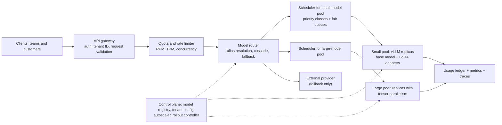
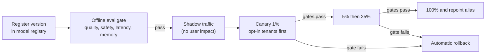

# System Design: A Multi-Tenant LLM Inference Platform

> **Level:** Beginner to Advanced · **Study time:** ~120 min · **Prerequisites:** [How to Approach AI/ML System Design and Debugging Interviews](./01-how-to-approach-ai-system-design-interviews.md), [LLM Inference Fundamentals: Prefill, Decode, TTFT and Throughput](../06-llm-inference/01-inference-fundamentals-prefill-decode-and-latency-metrics.md), [The KV Cache](../06-llm-inference/02-kv-cache-explained.md), [Batching, Continuous Batching and PagedAttention](../06-llm-inference/04-batching-continuous-batching-and-paged-attention.md), [Building a Scalable Inference API](../10-mlops/05-building-a-scalable-inference-api.md)

## Table of contents

- [Why this matters](#why-this-matters)
- [Step 1: Requirements and the running scenario](#step-1-requirements-and-the-running-scenario)
- [Step 2: The high-level architecture](#step-2-the-high-level-architecture)
- [Step 3: GPU capacity planning, a worked example](#step-3-gpu-capacity-planning-a-worked-example)
- [Step 4: Choosing a serving engine and a deployment unit](#step-4-choosing-a-serving-engine-and-a-deployment-unit)
- [Step 5: Request routing: aliases, cascades and fallbacks](#step-5-request-routing-aliases-cascades-and-fallbacks)
- [Step 6: Rate limiting and per-tenant quotas](#step-6-rate-limiting-and-per-tenant-quotas)
- [Step 7: Priority classes, fairness and admission control](#step-7-priority-classes-fairness-and-admission-control)
- [Step 8: Continuous batching and KV cache management at platform scale](#step-8-continuous-batching-and-kv-cache-management-at-platform-scale)
- [Step 9: Multi-LoRA serving for many fine-tuned variants](#step-9-multi-lora-serving-for-many-fine-tuned-variants)
- [Step 10: Autoscaling when models load slowly](#step-10-autoscaling-when-models-load-slowly)
- [Step 11: Observability and per-tenant cost attribution](#step-11-observability-and-per-tenant-cost-attribution)
- [Step 12: Safe rollout of new model versions](#step-12-safe-rollout-of-new-model-versions)
- [Step 13: Failover across regions and providers](#step-13-failover-across-regions-and-providers)
- [Step 14: Security, isolation and logging policies](#step-14-security-isolation-and-logging-policies)
- [Going deeper: what changes at the next order of magnitude](#going-deeper-what-changes-at-the-next-order-of-magnitude)
- [Common mistakes and misconceptions](#common-mistakes-and-misconceptions)
- [Interview questions and model answers](#interview-questions-and-model-answers)
- [Key takeaways](#key-takeaways)
- [Further reading](#further-reading)
- [Next](#next)

## Why this matters

Almost every company that gets serious about generative AI ends up building the same thing: one shared platform that serves several LLMs to many internal teams (and sometimes external customers) through a single API. Hosted APIs from OpenAI, Google and others are themselves giant multi-tenant inference platforms, and open-source stacks such as vLLM, SGLang, KServe, llm-d and NVIDIA Dynamo exist largely to make building one easier. GPUs are the most expensive resource in most AI budgets, so the difference between a good and a naive platform design is often a large multiple in cost and a visible difference in latency. In interviews, "design an LLM serving platform for many teams" is a favorite senior question because it tests everything at once: inference mechanics (KV cache, batching), classic distributed systems (routing, rate limiting, autoscaling, failover), MLOps (rollouts, evals) and business sense (cost attribution, SLAs).

This chapter walks through the design in the order you would present it in an interview: requirements, architecture, numbers, then each component in depth.

## Step 1: Requirements and the running scenario

> **Analogy:** Think of the platform as a shared commercial kitchen. Many restaurants (tenants) rent time on the same expensive ovens (GPUs). The kitchen manager must make sure every restaurant gets its orders out on time, that one restaurant cannot hog every oven, that each restaurant is billed fairly for what it used, and that nobody can taste another restaurant's secret sauce.

A **tenant** is any isolated customer of the platform: an internal team, a product, or an external customer account. **Multi-tenant** means many tenants share the same infrastructure while being logically separated (separate quotas, bills, logs and permissions).

### The running scenario (illustrative)

We will design for a fictional company. All numbers are **illustrative**, chosen to make the arithmetic clear.

- **Tenants:** about 40 internal teams plus a few hundred external business customers.
- **Models:**
  - a **7B-class chat model** (our running example, called "small"), used for most traffic;
  - a **70B-class model** ("large") for hard tasks;
  - an **embedding model** for RAG teams;
  - about **200 fine-tuned variants** of the 7B model, built with LoRA (explained in Step 9).
- **Workloads:** interactive chat and copilots, RAG question answering with long prompts, agent loops with many short calls, and offline batch jobs (classifying a million support tickets overnight).
- **Peak load on the small model:** 20 requests per second, with an average of 1,500 prompt tokens and 500 output tokens per request.

### Functional requirements

1. One API (OpenAI-compatible chat completions and embeddings, which most client libraries already speak) for all models.
2. Tenants pick a model by name or by **alias** (a stable name like `chat-default` that the platform can repoint to a new version).
3. Streaming responses (tokens arrive as they are generated).
4. Per-tenant API keys, quotas and access control over which models and fine-tunes they can use.
5. Usage reporting and cost attribution per tenant.
6. Support for tenant-owned fine-tuned variants.

### Non-functional requirements

These are where the real design lives. First, two latency terms (defined fully in [LLM Inference Fundamentals](../06-llm-inference/01-inference-fundamentals-prefill-decode-and-latency-metrics.md)):

- **TTFT (time to first token):** how long the user waits before the first token appears. Dominated by queueing plus **prefill** (processing the whole prompt in one parallel pass).
- **TPOT (time per output token)**, also called **ITL (inter-token latency):** the gap between consecutive streamed tokens during **decode** (generating one token at a time).

An **SLA (service level agreement)** is a promise to tenants; an **SLO (service level objective)** is the internal target you engineer to, usually a bit stricter. A **p95** latency is the value 95% of requests beat.

| Requirement | Interactive class | Standard class | Batch class |
|---|---|---|---|
| TTFT p95 | under 1 s | under 3 s | not applicable |
| TPOT p95 | under 50 ms (about 20+ tokens/s, faster than people read) | under 100 ms | not applicable |
| Completion target | real time | real time | within 24 h |
| Availability | 99.9% | 99.5% | best effort, retried |
| Price | highest | medium | cheapest (fills idle GPUs) |

Other non-functional requirements:

- **Isolation:** one tenant's traffic spike must not break another tenant's SLO (the **noisy neighbor** problem).
- **Cost efficiency:** keep GPU utilization high without violating SLOs.
- **Cost attribution:** every GPU-dollar is assigned to a tenant (**showback** means reporting costs; **chargeback** means actually billing them).
- **Data handling:** prompts and outputs may contain confidential or personal data; logging must be controlled per tenant.
- **Safe change:** new model versions roll out without surprising tenants.

> **Interview tip:** Spend the first 5 minutes on requirements and write the latency SLOs as numbers on the whiteboard. Every later decision (batch size, GPU count, autoscaling signal) gets justified against those numbers. Ask: "How many tenants, which models, what traffic mix, what latency targets, any data residency rules?"

## Step 2: The high-level architecture

Split the system into a **data plane** (the path every request takes, which must be fast) and a **control plane** (configuration, scaling and rollout decisions, which can be slower).



Walking a request through it:

1. **Gateway:** checks the API key, attaches `tenant_id`, validates the request (model exists, `max_tokens` within limits, prompt length within the model's context window).
2. **Quota and rate limiter:** checks the tenant's budget of requests per minute (RPM), tokens per minute (TPM) and concurrent requests (Step 6). Rejects early with HTTP 429 ("Too Many Requests") when over.
3. **Router:** turns `chat-default` into a concrete model version, applies cascade or fallback policy (Step 5), and picks a model pool.
4. **Scheduler:** per model pool, queues requests by priority class and tenant fairness (Step 7), then picks a replica (least loaded, or the one that already caches this prompt prefix).
5. **Engine replica:** a serving engine (Step 4) running continuous batching on one or more GPUs.
6. **Usage ledger:** on completion, an event records tenant, model, prompt tokens, output tokens, cached tokens, latency and status. Billing, dashboards and quotas all read from it.

A **model pool** is a set of identical **replicas** (copies of the same model server) behind one scheduler. Each pool scales independently.

> **Senior insight:** Keep the gateway, limiter and router stateless and horizontally scalable on cheap CPU machines. Push all expensive state (KV cache, loaded weights, adapters) into the GPU pools, and keep shared counters (quotas) in a fast store such as Redis. This separation is what lets you scale CPUs and GPUs independently.

## Step 3: GPU capacity planning, a worked example

This is the part interviewers probe hardest. The method has five steps: memory per replica, KV cache per request, concurrency per GPU at the SLO, throughput per GPU, then GPUs for the target load.

> **Analogy:** A GPU is like a restaurant with a fixed number of tables (memory for the KV cache) and one chef who cooks a little for every table in each round (decode step). More tables means more guests served at once, but each round takes longer, so each guest waits longer between dishes. Capacity planning finds the number of tables where guests are still happy.

### 3a. Model weight memory

Weight memory is parameters times bytes per parameter (see [Number Formats and Model Memory](../07-model-compression/01-number-formats-and-model-memory.md)).

$$M_{\text{weights}} = N_{\text{params}} \times b_{\text{weight}}$$

- $N_{\text{params}}$: number of parameters (7 billion for our small model).
- $b_{\text{weight}}$: bytes per parameter (2 for FP16 or BF16, 1 for FP8 or INT8, about 0.5 for INT4).

Worked example: $7 \times 10^9 \times 2 = 14 \times 10^9$ bytes, about 14 GB. (1 GB is $10^9$ bytes while 1 GiB is $2^{30}$ bytes, about 7% more; likewise KiB $= 2^{10}$ and MiB $= 2^{20}$ bytes. Strictly the weights are about 13.04 GiB; we round up to 14 GiB below, which is slightly conservative and keeps the arithmetic simple.)

The 70B model in BF16 needs about $70 \times 10^9 \times 2 = 140$ GB, more than one 80 GB GPU, so it must be split across GPUs with **tensor parallelism** (each layer's matrices divided across GPUs, see [Distributed Training and Training Memory](../02-deep-learning/10-distributed-training-and-training-memory.md)), or quantized (see [Practical LLM Quantization](../07-model-compression/04-llm-quantization-gptq-awq-and-outliers.md)).

### 3b. KV cache per token and per request

The **KV cache** stores the attention keys and values of every previous token so decode does not recompute them (full treatment in [The KV Cache](../06-llm-inference/02-kv-cache-explained.md)).

$$m_{\text{token}} = 2 \times n_{\text{layers}} \times n_{\text{kv}} \times d_{\text{head}} \times b$$

- $2$: one key vector and one value vector.
- $n_{\text{layers}}$: number of transformer layers.
- $n_{\text{kv}}$: number of key/value heads (smaller than the number of query heads when the model uses **GQA**, grouped-query attention, see [Modern LLM Architecture](../04-transformers/08-modern-llm-architecture-improvements.md)).
- $d_{\text{head}}$: dimension of each head.
- $b$: bytes per cached number (2 for FP16).

Our small model (illustrative, but the shape matches common 7B to 8B models with GQA): 32 layers, 8 KV heads, head dimension 128, FP16 cache.

$$m_{\text{token}} = 2 \times 32 \times 8 \times 128 \times 2$$

Step by step: $2 \times 32 = 64$; $64 \times 8 = 512$; $512 \times 128 = 65{,}536$; $65{,}536 \times 2 = 131{,}072$ bytes $= 128$ KiB per token.

A request with 1,500 prompt tokens and 500 output tokens reaches 2,000 tokens at the end of generation, so its peak KV footprint is $2{,}000 \times 128$ KiB $= 256{,}000$ KiB $= 250$ MiB.

### 3c. KV budget per GPU and the memory limit on concurrency

Assume one 80 GB data-center GPU (treated as 80 GiB for easy arithmetic).

- Engines reserve a fraction of memory; with a setting of 0.90 the engine may use $0.90 \times 80 = 72$ GiB.
- Subtract weights: $72 - 14 = 58$ GiB.
- Subtract activations (temporary tensors of the current step), CUDA graphs (pre-recorded GPU kernel sequences that cut launch overhead) and fragmentation (illustrative 4 GiB): $58 - 4 = 54$ GiB for KV cache.

Tokens that fit:

$$\frac{54 \text{ GiB}}{128 \text{ KiB}} = \frac{54 \times 2^{30}}{2^{17}} = 54 \times 2^{13} = 54 \times 8{,}192 = 442{,}368 \text{ tokens}$$

Memory-limited concurrency at 2,000 tokens per request: $442{,}368 / 2{,}000 = 221.2$, so at most **221 concurrent requests** fit in memory.

> **Senior insight:** GQA matters enormously here. An older 7B model with full multi-head attention (32 KV heads instead of 8) needs 512 KiB per token, so a 2,000-token request needs 1,000 MiB, and the same 54 GiB ($= 55{,}296$ MiB) fits only $55{,}296 / 1{,}000 \approx 55$ requests. Same parameter count, four times less concurrency.

### 3d. The latency limit on concurrency

Memory is only an upper bound. Each decode step processes every active request, so more concurrent requests make each step slower and push TPOT up. The only trustworthy way to find the latency limit is a **load test** with your real prompt and output length mix (see [Optimizing and Benchmarking LLM Latency and Cost](../06-llm-inference/07-optimizing-and-benchmarking-llm-latency-and-cost.md)).

Suppose a load test of the small model on one GPU (1,500 tokens in, 500 out) gives this table. **All numbers are illustrative.**

| Max concurrent requests | TTFT p95 | TPOT p95 | Aggregate output tokens/s (about concurrency / TPOT) | Meets interactive SLO? |
|---|---|---|---|---|
| 8 | 0.25 s | 15 ms | about 530 | yes, but wasteful |
| 16 | 0.30 s | 20 ms | about 800 | yes |
| 32 | 0.40 s | 28 ms | about 1,140 | yes |
| 64 | 0.60 s | 40 ms | about 1,600 | **yes (chosen)** |
| 128 | 1.40 s | 70 ms | about 1,830 | no |

Notice the classic shape: throughput keeps rising with concurrency, but with diminishing returns, while latency rises steadily. Going from 64 to 128 buys only about 14% more throughput but breaks both SLOs. We pick **64 concurrent requests per GPU** as the operating point. In vLLM this is enforced with the `--max-num-seqs` setting.

The memory check: 64 requests use $64 \times 250$ MiB $= 16{,}000$ MiB $\approx 15.6$ GiB of the 54 GiB budget. This workload is **latency-bound, not memory-bound**: the spare memory can hold prefix cache, LoRA adapters, or longer-context outliers.

> **Sanity check with physics (optional):** decode is memory-bandwidth-bound (see [GPU Fundamentals](../06-llm-inference/03-gpu-fundamentals-compute-bound-vs-memory-bound.md)). Each decode step must read all weights (14 GB) plus the KV cache of every active request (64 requests with an average context of about 1,750 tokens is $64 \times 1{,}750 \times 131{,}072 \approx 14.7$ GB). That is about 28.7 GB per step. On a GPU with roughly 2 TB/s of memory bandwidth (A100 80 GB class), the floor is about 14 ms per step. A measured 40 ms p95 above that floor is plausible, because prefill chunks from newly arriving requests share the same steps and real kernels never reach peak bandwidth. If your measurement were *below* the floor, your test is probably wrong (unless something changed the bytes read per token, such as quantized weights or KV cache, or speculative decoding emitting several tokens per step).

### 3e. GPUs for the target load: Little's law

**Little's law** connects arrival rate, time in system and concurrency for any stable queueing system:

$$L = \lambda \times W$$

- $L$: average number of requests in the system at once (concurrency).
- $\lambda$: arrival rate (requests per second).
- $W$: average time each request spends in the system (seconds).

Intuition: if 2 customers enter a cafe per minute and each stays 10 minutes, about $2 \times 10 = 20$ are inside at any moment. Long-lived LLM requests are the customers; each one occupies a concurrency slot on a GPU for its whole stay.

For a streamed LLM request, $W \approx \text{TTFT} + n_{\text{out}} \times \text{TPOT}$ (the exact count is $n_{\text{out}} - 1$ gaps after the first token; rounding up to $n_{\text{out}}$ adds one TPOT of safety margin, negligible at 500 tokens). Using the p95 values (conservative): $W = 0.6 + 500 \times 0.040 = 0.6 + 20 = 20.6$ s.

At peak, $\lambda = 20$ requests/s, so $L = 20 \times 20.6 = 412$ concurrent requests.

Now the GPU count:

$$N_{\text{GPU}} = \left\lceil \frac{L}{c \times u} \right\rceil$$

- $c$: concurrency per GPU at the SLO (64 from the load test).
- $u$: target utilization (below 1 to leave headroom for bursts and imperfect load balancing; 0.7 here).
- $\lceil \cdot \rceil$: round up.

$$N_{\text{GPU}} = \left\lceil \frac{412}{64 \times 0.7} \right\rceil = \left\lceil \frac{412}{44.8} \right\rceil = \lceil 9.20 \rceil = 10 \text{ GPUs}$$

Cross-check with throughput: we need $20 \times 500 = 10{,}000$ output tokens/s; one GPU delivers about 1,600, so $10{,}000 / 1{,}600 = 6.25$ GPUs at 100% utilization, or $6.25 / 0.7 \approx 8.9$ at 70%. That is close to the Little's law answer (the gap is because a request occupies a slot during its TTFT too). Two independent methods agreeing within about 10% is a good sign.

Then add **redundancy**: with 10 replicas spread over two availability zones, losing one zone halves capacity. Whether you provision for that (N+1 or zone-level redundancy) depends on the availability SLO and how fast you can get more GPUs. A common answer: 10 for load, plus 2 for single-replica failures, plus a warm pool (Step 10) for zone loss and ramps.

### 3f. Cost per million tokens

With an illustrative price of \$2.50 per GPU-hour, 10 GPUs cost \$25 per hour. At peak, the pool produces $20 \times 500 \times 3{,}600 = 36{,}000{,}000$ output tokens per hour, so the cost is $\$25 / 36 = \$0.69$ per million output tokens. If average traffic is only 30% of peak and the fleet stays at 10 GPUs, the cost becomes $\$25 / (36 \times 0.3) = \$25 / 10.8 \approx \$2.31$ per million output tokens.

> **Senior insight:** Utilization is the biggest lever on cost, bigger than most kernel optimizations. That is why platforms combine autoscaling (shrink at night), batch workloads (fill idle GPUs with cheap offline jobs) and consolidation (many fine-tunes on one base model).

### Code: a capacity planner

```python
# capacity_planner.py: back-of-envelope GPU planning (all inputs illustrative)
import math

GiB, KiB = 2**30, 2**10

def kv_bytes_per_token(n_layers, n_kv_heads, d_head, bytes_per_val=2):
    return 2 * n_layers * n_kv_heads * d_head * bytes_per_val

def plan(rps, prompt_toks, out_toks, ttft_s, tpot_s, conc_at_slo,
         gpu_gib=80, mem_util=0.90, weights_gib=14, overhead_gib=4,
         n_layers=32, n_kv_heads=8, d_head=128, target_util=0.7):
    kv_tok = kv_bytes_per_token(n_layers, n_kv_heads, d_head)
    kv_budget = (gpu_gib * mem_util - weights_gib - overhead_gib) * GiB
    mem_conc = int(kv_budget // (kv_tok * (prompt_toks + out_toks)))
    conc = min(conc_at_slo, mem_conc)          # binding constraint
    w = ttft_s + out_toks * tpot_s              # time in system per request
    L = rps * w                                 # Little's law
    gpus = math.ceil(L / (conc * target_util))
    return {"kv_KiB_per_token": kv_tok / KiB, "memory_concurrency": mem_conc,
            "concurrency_used": conc, "seconds_per_request": round(w, 2),
            "concurrent_requests": round(L, 1), "gpus": gpus}

print(plan(rps=20, prompt_toks=1500, out_toks=500,
           ttft_s=0.6, tpot_s=0.040, conc_at_slo=64))
# {'kv_KiB_per_token': 128.0, 'memory_concurrency': 221, 'concurrency_used': 64,
#  'seconds_per_request': 20.6, 'concurrent_requests': 412.0, 'gpus': 10}
```

> **Common mistake:** Planning GPUs from average traffic and average lengths. LLM traffic is bursty and output lengths are long-tailed. Plan from peak traffic, use p95 latencies, and keep a separate check for the longest contexts you allow, because one 100k-token request occupies as much KV memory as 50 of our typical requests.

## Step 4: Choosing a serving engine and a deployment unit

A **serving engine** is the software on each GPU replica that loads the model, runs batching and the KV cache, and exposes an HTTP API. The detailed comparison lives in [LLM Serving Frameworks](../06-llm-inference/06-serving-frameworks-vllm-sglang-tgi-tensorrt-llm-and-ollama.md); here we only ask what a multi-tenant platform needs.

**Platform requirements for the engine:**

- continuous batching and paged KV cache (non-negotiable for throughput);
- prefix caching (shared system prompts are common across a tenant's requests);
- multi-LoRA serving with dynamic adapter loading;
- request priority or at least a way to bound the queue;
- Prometheus-style metrics (queue length, KV usage, TTFT, TPOT);
- quantization support (FP8, INT4) and tensor parallelism for large models;
- an OpenAI-compatible API, to keep the router simple.

| Engine | What it is | Best for | Pros | Cons |
|---|---|---|---|---|
| vLLM | Open-source engine built around PagedAttention | Default general-purpose choice | Broad model support, multi-LoRA, prefix caching, large community | Many flags, behavior changes between versions |
| SGLang | Open-source engine with RadixAttention prefix caching | Prefix-heavy workloads (agents, few-shot, shared system prompts) | Strong prefix reuse, structured output speed, its own router | Smaller ecosystem than vLLM (this changes fast) |
| TensorRT-LLM (often behind NVIDIA Triton or Dynamo) | NVIDIA's compiled engine | Max performance on NVIDIA GPUs for a few stable, high-volume models | Highly optimized kernels, FP8 | Build step per model and GPU, less flexible, vendor lock-in |
| Hugging Face TGI | Hugging Face's serving server | Teams in the Hugging Face ecosystem | Simple to deploy | Check its current maintenance status before choosing (2026) |
| llama.cpp / Ollama | Lightweight local engines | Laptops, edge, CPU | Easy, GGUF quantization | Not designed for high-concurrency multi-tenant GPU serving |
| Managed APIs (OpenAI, Google, AWS Bedrock, Azure) | Someone else's platform | Frontier models, spiky or small volume | No GPUs to manage | Per-token price, less control, data-handling contracts |

**Deployment unit.** On Kubernetes, each replica is usually a pod holding one or more GPUs (pods, GPU node pools, probes and autoscalers are explained in [Kubernetes in five minutes (for ML engineers)](../10-mlops/04-model-deployment-patterns.md#kubernetes-in-five-minutes-for-ml-engineers)). Projects such as KServe, llm-d and NVIDIA Dynamo add LLM-aware routing and scaling on top. Pick the deployment unit per model:

| Model | Example deployment unit (illustrative) | Why |
|---|---|---|
| 7B base + LoRAs | 1 GPU per replica, many replicas | Fits easily; scaling out is simpler than scaling up |
| 70B | 4 GPUs per replica with tensor parallelism (or 2 GPUs with FP8 weights) | Weights alone exceed one GPU; leave room for KV cache |
| Embedding model | Small GPU or even CPU, high batch size | One forward pass per input (often an encoder-only model, though some embedders are decoder-based), no decode phase, very different profile |

> **Interview tip:** Do not just name an engine. Name the properties you need, then say you would benchmark two candidates on your own traffic before committing.

## Step 5: Request routing: aliases, cascades and fallbacks

**Routing** decides which model, which version and which replica serves each request. There are three layers.

### 5a. Alias resolution and version pinning

Tenants call either a pinned version (`small-chat@2026-07-01`) or an alias (`chat-default`). The control plane maps aliases to versions, per tenant if needed. Pinning protects tenants who have tuned prompts against a specific model; aliases let the platform upgrade everyone else. Publish a **deprecation policy** (for example, pinned versions stay available for at least 90 days after a replacement).

### 5b. Cascades and model routers

A **cascade** tries a cheap model first and escalates to an expensive model only when needed. A **model router** predicts upfront which model a request needs. Both trade a little quality risk for large cost savings, since most traffic is easy. Relevant work: "FrugalGPT" (Chen, Zaharia and Zou, 2023) on LLM cascades and "RouteLLM" (Ong et al., 2024) on learned routers. See also routing as an agent pattern in [Agent Design Patterns](../09-agents/03-agent-design-patterns.md).

| Approach | How it decides | Latency cost | Pros | Cons |
|---|---|---|---|---|
| Static (tenant chooses) | Tenant config | None | Predictable | Tenants over-use the big model |
| Rule-based router | Prompt length, task tag, tenant tier | Negligible | Simple, debuggable | Coarse |
| Learned router | Small classifier predicts "needs large model" | A few ms | Better cost/quality frontier | Needs labeled data, can drift |
| Cascade | Run small, check a quality signal, escalate | Adds a full small-model call on escalation | Uses real output evidence | Escalated requests pay twice; quality check is hard for open-ended text |

Cascades work best when the quality check is cheap and reliable: a JSON schema validation, a confidence score on a classification, or a verifier. They are risky when the check is "was this chat answer good?", which needs an LLM judge (see [Evaluating LLMs](../05-llms/10-llm-evaluation-metrics-and-llm-as-a-judge.md)).

### 5c. Fallbacks

A **fallback** is what the router does when the primary target fails or is overloaded: another replica, another region, a smaller model, or an external provider. Fallbacks must be explicit, per tenant and tested, because different models produce different outputs. Step 13 covers failover in depth.

### Code: a router with alias resolution, a cascade and fallbacks

This is a framework-free sketch; `call_model` stands in for an HTTP call to an engine.

```python
# router.py: conceptual router (no external dependencies)
import json, random

ALIASES = {"chat-default": "small-chat@2026-07-01"}
FALLBACKS = {"small-chat@2026-07-01": ["small-chat@2026-07-01/region-b", "large-chat@2026-05-15"]}

class Overloaded(Exception): ...

def call_model(target: str, prompt: str) -> str:
    """Stand-in for a streaming HTTP call to a serving engine."""
    if random.random() < 0.05:
        raise Overloaded(target)
    return json.dumps({"label": "refund", "confidence": 0.9})

def call_with_fallbacks(target, prompt):
    for t in [target, *FALLBACKS.get(target, [])]:
        try:
            return t, call_model(t, prompt)
        except Overloaded:
            continue                      # next target; real code also records metrics
    raise Overloaded("all targets failed")

def classify_with_cascade(prompt, tenant_policy):
    small = ALIASES.get(tenant_policy["model"], tenant_policy["model"])
    used, out = call_with_fallbacks(small, prompt)
    try:
        parsed = json.loads(out)          # cheap, reliable quality check
        if parsed.get("confidence", 0) >= tenant_policy["escalate_below"]:
            return used, parsed
    except json.JSONDecodeError:
        pass
    used, out = call_with_fallbacks("large-chat@2026-05-15", prompt)  # escalate
    return used, json.loads(out)

print(classify_with_cascade("I want my money back",
                            {"model": "chat-default", "escalate_below": 0.7}))
```

> **Common mistake:** Silent fallback to a different model family. If a tenant's prompt was tuned for model A and the platform quietly answers with model B, quality changes without anyone noticing. Return the actual model used in the response metadata, and let tenants opt out of cross-model fallback.

## Step 6: Rate limiting and per-tenant quotas

> **Analogy:** A water tank with a tap that refills it at a fixed rate. Each request drains some water. If the tank is empty, you wait. A big tank allows short bursts; the tap rate sets the long-run average.

That is the **token bucket** algorithm. (The "tokens" in the bucket are units of allowance; for LLMs we conveniently make them LLM tokens.)

### What to limit

| Limit | What it protects | Why it alone is not enough |
|---|---|---|
| RPM (requests per minute) | Gateway and router, per-request overheads | A single 100k-token request costs as much as hundreds of small ones |
| TPM (tokens per minute, prompt + output) | GPU capacity | Must be estimated before output length is known |
| Concurrent requests | KV cache slots in the engine | Says nothing about rate |
| Daily or monthly budget (tokens or dollars) | Finance | Too coarse for protecting latency |

Use all of them, configured per tenant and per model. Large models get smaller limits because each token costs more.

### The token bucket formula

$$T(t) = \min\big(B,\; T(t_0) + r \times (t - t_0)\big)$$

- $T(t)$: tokens available in the bucket at time $t$.
- $B$: bucket capacity (maximum burst).
- $r$: refill rate (tokens per second).
- $t_0$: time of the last update.

A request costing $k$ tokens is admitted if $T(t) \ge k$, and then $T \leftarrow T - k$.

**Worked example (illustrative).** A tenant has 60,000 TPM, so $r = 60{,}000 / 60 = 1{,}000$ tokens/s, and burst $B = 20{,}000$. The bucket is full ($T = 20{,}000$). At $t = 0$ a request arrives with a 3,000-token prompt and `max_tokens` = 1,000, so we reserve $k = 4{,}000$: $T = 20{,}000 - 4{,}000 = 16{,}000$. The request actually generates only 400 tokens, so true usage is 3,400 and we refund $4{,}000 - 3{,}400 = 600$: $T = 16{,}600$. Two seconds later, refill adds $1{,}000 \times 2 = 2{,}000$: $T = \min(20{,}000,\; 18{,}600) = 18{,}600$.

### The output-length problem

You do not know how many tokens a request will produce until it finishes. Options:

1. **Reserve `max_tokens` up front, refund the unused part** (shown above). Safe, but tenants who set huge `max_tokens` get throttled early, which nudges them to set realistic values (a good side effect).
2. **Reserve an estimate** (for example the tenant's p90 output length) and charge the difference afterwards, letting the bucket go negative briefly.
3. **Limit prompt tokens at admission and output tokens via concurrency caps.**

Most platforms use option 1 or 2 and document the behavior clearly.

### Code: a per-tenant token bucket with reserve and reconcile

```python
# token_bucket.py: per-tenant TPM limiter with reservation and refund
import time
from dataclasses import dataclass, field

@dataclass
class TokenBucket:
    rate: float                      # tokens per second
    capacity: float                  # burst size
    tokens: float = field(init=False)
    last: float = field(init=False)

    def __post_init__(self):
        self.tokens, self.last = self.capacity, time.monotonic()

    def _refill(self):
        now = time.monotonic()
        self.tokens = min(self.capacity, self.tokens + self.rate * (now - self.last))
        self.last = now

    def try_reserve(self, k: float) -> bool:
        self._refill()
        if self.tokens >= k:
            self.tokens -= k
            return True
        return False

    def reconcile(self, reserved: float, actual: float):
        self._refill()
        self.tokens = min(self.capacity, self.tokens + (reserved - actual))

buckets = {"team-search": TokenBucket(rate=1_000, capacity=20_000)}

def admit(tenant, prompt_tokens, max_tokens):
    k = prompt_tokens + max_tokens
    if not buckets[tenant].try_reserve(k):
        return None                  # gateway returns HTTP 429 with Retry-After
    return k

k = admit("team-search", 3_000, 1_000)
buckets["team-search"].reconcile(k, actual=3_000 + 400)
print(round(buckets["team-search"].tokens))  # about 16600 (plus a tiny refill)
```

In production the bucket state lives in a shared store (Redis with an atomic Lua script is the classic choice) because many gateway instances serve the same tenant. To avoid a network hop per request at very high rates, gateways can hold small local token leases that they refill from the central store.

> **Senior insight:** Return HTTP 429 with a `Retry-After` header and expose remaining quota in response headers. Well-behaved clients then back off with jitter instead of hammering you, which is how you avoid a **retry storm** (failed requests retried immediately, multiplying load exactly when you are overloaded).

## Step 7: Priority classes, fairness and admission control

Rate limits stop a tenant from exceeding its *contract*. They do not decide who goes first when the platform is busy and everyone is within quota. That is the scheduler's job.

### Priority classes

Assign each request a **priority class** (from the tenant's tier and the endpoint): interactive, standard, batch.

- **Strict priority** (always serve the highest class first) is simple, but lower classes can **starve** (never get served) under sustained load.
- **Weighted sharing** gives each class a guaranteed share (for example 60% interactive, 30% standard, 10% batch) and lets any class borrow idle capacity. This is usually the better default.
- **Batch traffic** should be **preemptible**: when interactive load rises, batch requests are paused or rejected first. Many engines support preemption by evicting a running request's KV cache and either recomputing it later or swapping it to CPU memory.

### Fairness between tenants

Inside a class, use **fair queuing**: each tenant has its own queue, and the scheduler takes from queues in proportion to their weights, measured in *tokens served* rather than requests. **Deficit round robin (DRR)** is a simple way to do this: each round, each tenant's "deficit counter" grows by its weight times a quantum, and the tenant may dispatch requests while its counter covers their estimated cost. "Fairness in Serving Large Language Models" (Sheng et al., 2024) proposes a Virtual Token Counter that applies this idea with prefill and decode tokens weighted separately.

```python
# fair_queue.py: deficit round robin across tenants (costs in estimated tokens)
from collections import deque

class DRRScheduler:
    def __init__(self, weights: dict[str, float], quantum: int = 2_000):
        self.weights, self.quantum = weights, quantum
        self.queues = {t: deque() for t in weights}
        self.deficit = {t: 0.0 for t in weights}

    def submit(self, tenant: str, req_id: str, cost: int):
        self.queues[tenant].append((req_id, cost))

    def next_round(self) -> list[str]:
        dispatched = []
        for t, q in self.queues.items():
            if not q:
                self.deficit[t] = 0.0       # idle tenants do not bank credit
                continue
            self.deficit[t] += self.weights[t] * self.quantum
            while q and q[0][1] <= self.deficit[t]:
                req_id, cost = q.popleft()
                self.deficit[t] -= cost
                dispatched.append(req_id)
        return dispatched

s = DRRScheduler({"noisy-team": 1.0, "quiet-team": 1.0})
for i in range(10):
    s.submit("noisy-team", f"n{i}", cost=1_000)
s.submit("quiet-team", "q0", cost=1_000)
print(s.next_round())  # ['n0', 'n1', 'q0']: the quiet team is not stuck behind 10 noisy requests
```

With a plain first-in-first-out queue, `q0` would wait behind all ten noisy requests. With DRR it is served in the first round.

### Admission control and load shedding

**Admission control** decides whether to accept a request at all. Accepting a request you cannot serve within its SLO is worse than rejecting it fast: the tenant waits, then times out, then retries.

- Bound queue length per class, and give each request a **queue deadline** shorter than the client timeout. Drop requests whose deadline has passed before they reach a GPU.
- **Shed load** in a fixed order: batch first, then standard, then interactive.
- Use **degradation modes** before rejecting interactive traffic: cap `max_tokens`, disable expensive features (very long contexts), or route to a smaller model if the tenant allows it.

> **Senior insight:** Measure **goodput**: requests per second that complete *within* their SLO. Raw throughput can rise while goodput falls, which is exactly what happens when an overloaded scheduler accepts everything.

## Step 8: Continuous batching and KV cache management at platform scale

**Continuous batching** (also called in-flight batching, introduced in "Orca", Yu et al., 2022) adds and removes requests from the running batch at every decode step instead of waiting for the whole batch to finish. **PagedAttention** ("Efficient Memory Management for Large Language Model Serving with PagedAttention", Kwon et al., 2023) stores the KV cache in fixed-size blocks like operating-system pages, so almost no memory is wasted on padding or fragmentation (at most part of each request's last block). Both are explained in [Batching, Continuous Batching and PagedAttention](../06-llm-inference/04-batching-continuous-batching-and-paged-attention.md). Here we focus on what the *platform* has to decide.

### Engine knobs the platform owns

| Knob (vLLM-style names, version-fragile) | What it controls | Platform guidance |
|---|---|---|
| `--gpu-memory-utilization` | Fraction of GPU memory the engine may use | 0.85 to 0.92 typical; leave room if anything else runs on the GPU |
| `--max-num-seqs` | Max concurrent sequences | Set from your load test (64 in Step 3), not from memory alone |
| `--max-model-len` | Max context length served | Do not default to the model's maximum if tenants never need it; long contexts reduce concurrency |
| `--max-num-batched-tokens` | Tokens processed per step (with chunked prefill) | Lower values protect TPOT; higher values improve TTFT and prefill throughput |
| `--enable-prefix-caching` | Reuse KV blocks for identical prompt prefixes | On for most chat and RAG workloads |

### Chunked prefill

A 30,000-token RAG prompt arriving mid-stream would stall every other request's decode for the duration of its prefill, causing a visible TPOT spike for all tenants on that replica. **Chunked prefill** ("Sarathi-Serve", Agrawal et al., 2024) splits long prefills into chunks that are mixed into decode steps, smoothing TPOT at a small cost to the long request's TTFT. On a multi-tenant platform this is a fairness tool, not just a speedup.

### Prefix caching and prefix-aware routing

Tenants often send the same long system prompt or few-shot examples on every call. With **prefix caching**, the KV blocks for that shared prefix are computed once and reused. SGLang's RadixAttention ("SGLang: Efficient Execution of Structured Language Model Programs", Zheng et al., 2023) organizes cached prefixes in a tree. Caching only helps if the request lands on the replica that holds the cache, so platforms add **prefix-aware routing** (also called KV-aware or cache-aware routing): hash the first N tokens and prefer the replica that recently served that hash, balanced against load. See [Speculative Decoding, Prompt Caching and Other Inference Speedups](../06-llm-inference/05-speculative-decoding-caching-and-other-speedups.md).

| Replica selection policy | Pros | Cons |
|---|---|---|
| Round robin | Trivial | Ignores load and cache |
| Least outstanding requests or least KV usage | Balances load | Scatters a tenant's prefix across replicas |
| Consistent hashing on prefix | High cache hit rate | Hot tenants create hot replicas |
| Hybrid (prefer cache hit unless that replica is above a load threshold) | Best of both in practice | More moving parts; needs engine metrics in the router |

> **Common mistake:** Sharing the prefix cache across tenants without thinking about security. If tenant B's request is measurably faster when its prompt starts with the same text as tenant A's, B can probe what A is sending (a timing side channel). Scope cache keys by tenant (some engines support a per-request cache salt for exactly this), or only share cache for platform-owned prefixes.

## Step 9: Multi-LoRA serving for many fine-tuned variants

Our scenario has about 200 fine-tuned variants of the 7B model. Giving each its own GPU would mean 200 GPUs, most of them idle most of the time.

**LoRA (Low-Rank Adaptation)** ("LoRA: Low-Rank Adaptation of Large Language Models", Hu et al., 2021) fine-tunes a model by freezing the base weights and learning two small matrices per adapted weight matrix (full treatment in [Fine-Tuning LLMs: Full, LoRA and QLoRA](../05-llms/07-fine-tuning-full-lora-and-qlora.md)). For a frozen weight $W$ of shape $d \times k$, LoRA learns $A$ ($r \times k$) and $B$ ($d \times r$) and computes:

$$h = W x + B A x$$

- $x$: input vector; $h$: output vector.
- $r$: the rank, small (for example 8 to 64), so $BA$ is a cheap low-rank correction.
- The full LoRA formula scales the update by $\alpha / r$ ($h = Wx + \frac{\alpha}{r}BAx$); here we assume that constant is already folded into $B$ to keep the notation short, so a merge below is $W' = W + BA$ (in PEFT terms, $W + \frac{\alpha}{r}BA$).

> **Analogy:** The base model is a textbook everyone shares. Each LoRA adapter is a thin set of sticky notes for one team. You do not print a new textbook per team; you keep one textbook on the desk and swap in the right sticky notes per question.

### How small is an adapter?

Parameters added per adapted matrix: $r \times (d + k)$.

Worked example on our small model (hidden size 4,096, 32 query heads, 8 KV heads of dimension 128, so the K and V projections output $8 \times 128 = 1{,}024$), adapting the four attention projections with $r = 16$:

- $W_q$: $4{,}096 \times 4{,}096$ gives $16 \times (4{,}096 + 4{,}096) = 16 \times 8{,}192 = 131{,}072$
- $W_k$: $4{,}096 \to 1{,}024$ gives $16 \times (4{,}096 + 1{,}024) = 16 \times 5{,}120 = 81{,}920$
- $W_v$: same as $W_k$: $81{,}920$
- $W_o$: $4{,}096 \times 4{,}096$: $131{,}072$
- Per layer: $131{,}072 + 81{,}920 + 81{,}920 + 131{,}072 = 425{,}984$
- 32 layers: $425{,}984 \times 32 = 13{,}631{,}488$ parameters, about 13.6M
- In FP16: $13{,}631{,}488 \times 2 = 27{,}262{,}976$ bytes, about 27 MB

So one adapter is about 0.2% of the 14 GB base model, and 100 adapters together take about 2.7 GB. That is why multi-LoRA serving works.

### How multi-LoRA serving works

```text
             one GPU replica
 +-----------------------------------------------+
 |  base weights W (14 GB, shared by everyone)    |
 |                                               |
 |  GPU adapter slots (e.g. max 8 active):       |
 |   [legal-v3] [sql-v1] [support-v7] [ ... ]    |
 |                                               |
 |  one continuous batch, mixed adapters:        |
 |   req1 -> legal-v3   req2 -> sql-v1           |
 |   req3 -> (base)     req4 -> legal-v3         |
 +-----------------------------------------------+
        ^ adapters paged in from CPU RAM (e.g. 64 cached)
        ^ which are loaded from object storage / registry
```

- The base model computation $Wx$ is batched across all requests as usual.
- The adapter part $BAx$ differs per request. Special kernels compute it for a batch where each row uses a different adapter. "Punica: Multi-Tenant LoRA Serving" (Chen et al., 2023) introduced the SGMV (segmented gather matrix-vector multiplication) kernel for this, and "S-LoRA: Serving Thousands of Concurrent LoRA Adapters" (Sheng et al., 2023) added unified paging of adapters and KV cache.
- Adapters live in a hierarchy: object storage, then CPU memory cache, then a limited number of GPU slots, with LRU (least recently used) eviction.

### Trade-offs

| Option | Latency | Cost | When |
|---|---|---|---|
| Merge adapter into weights ($W' = W + BA$), dedicated replica | Same as base | One replica per variant | A few very high-traffic variants |
| Unmerged multi-LoRA on shared replicas | Small overhead from the extra low-rank math, which grows with rank and number of distinct adapters per batch | Many variants per GPU | The long tail of variants |
| Adapter not in GPU or CPU cache | Adds load time on first request | Same | Rarely used adapters; prewarm important ones |

Routing should be **adapter-aware**: prefer replicas that already hold the requested adapter in a GPU slot, which is the same idea as prefix-aware routing.

### Code: serving multiple LoRA adapters with vLLM (version-fragile)

```bash
# pip install vllm   (flags below exist in recent vLLM releases; check your version's docs)
vllm serve meta-llama/Llama-3.1-8B-Instruct \
  --enable-lora \
  --lora-modules legal-v3=/adapters/legal-v3 sql-v1=/adapters/sql-v1 \
  --max-loras 8 \
  --max-lora-rank 16 \
  --max-cpu-loras 64 \
  --max-num-seqs 64 \
  --gpu-memory-utilization 0.90 \
  --enable-prefix-caching
```

```python
# pip install openai   (the engine exposes an OpenAI-compatible API)
from openai import OpenAI

client = OpenAI(base_url="http://localhost:8000/v1", api_key="unused-locally")
resp = client.chat.completions.create(
    model="sql-v1",  # the adapter name selects the LoRA; the base model name selects no adapter
    messages=[{"role": "user", "content": "Count orders per customer in SQL."}],
    max_tokens=200,
)
print(resp.choices[0].message.content)
```

In the platform, the router (not the tenant) maps `tenant=analytics, model=sql-assistant` to adapter `sql-v1` on a replica that has it loaded, and checks the tenant is allowed to use that adapter. Engines also offer runtime endpoints to load and unload adapters without restarts; their exact names and enabling flags vary by version.

## Step 10: Autoscaling when models load slowly

Web services scale up in seconds. LLM replicas do not. A new replica has to go through a long **cold start**:

| Phase | What happens | Illustrative time | Mitigation |
|---|---|---|---|
| Get a GPU node | Cloud provisions a VM with GPUs (may fail if capacity is scarce) | 2 to 10 min | Reserved capacity, pre-provisioned node pools |
| Pull container image | Engine images are often several GB | 0.5 to 3 min | Pre-pulled images, image streaming, slim images |
| Download weights | 14 GB for the small model, 140 GB for the large one | 0.5 to 10 min | Local NVMe cache, weight streaming straight to GPU, faster storage |
| Load to GPU and warm up | Copy weights, allocate KV cache, capture CUDA graphs, compile kernels | 0.5 to 3 min | Cache compiled artifacts, warm-up requests before joining the load balancer |

Total: often 5 to 15 minutes for a fully cold replica. A traffic spike that lasts 5 minutes is over before cold capacity arrives.

### Scale on the right signal

| Signal | Good? | Why |
|---|---|---|
| CPU utilization | No | The engine's CPU is mostly idle while the GPU works |
| GPU utilization (the standard "% busy") | Poor | Reports that a kernel was running, not how much work was done; a memory-bound decode can show "100%" at low throughput |
| Queue length and queue wait time | Good | Directly predicts TTFT violations |
| Running requests vs `max-num-seqs`, KV cache usage | Good | Shows how close replicas are to their safe concurrency |
| TTFT and TPOT p95 versus SLO | Good, but lagging | Confirms the outcome; use with a leading signal |
| Predicted traffic (time-of-day model) | Good for known patterns | Lets you scale *before* the morning ramp |

Scale up fast and down slowly (a cool-down of tens of minutes), because a wrong scale-down costs a 10-minute cold start to undo.

### Warm pools: sizing them with the same math

A **warm pool** is capacity that is already provisioned and partially or fully loaded, so it can take traffic in seconds. Levels of warmth:

```text
hot     serving traffic                         seconds: already there
warm    weights in GPU, not in load balancer    seconds to join (or "sleep mode": weights parked in CPU RAM)
standby node up, image and weights on local disk ~1 to 3 min
cold    nothing provisioned                      5 to 15 min
```

**Worked example (illustrative).** Traffic on the small model can rise by at most 2 requests/s every minute during the morning ramp, and a cold replica takes 6 minutes. In 6 minutes traffic can grow by $2 \times 6 = 12$ requests/s. Using Little's law with $W = 20.6$ s, that is $12 \times 20.6 = 247.2$ extra concurrent requests. Each GPU safely carries $64 \times 0.7 = 44.8$, so we need $247.2 / 44.8 = 5.52$, rounded up to **6 GPUs** of warm capacity, enough to absorb the ramp while cold capacity is being provisioned behind it.

Warm capacity is not free. Two common ways to make it pay: fill it with preemptible batch work (Step 7) that is evicted instantly when interactive traffic needs it, or share one warm pool across several models whose peaks happen at different times, loading the right model when needed.

### Scale to zero

For the long tail of rarely used models (full fine-tunes, old pinned versions), scaling to zero saves money but means the first request after idle waits minutes. Offer it only to tenants who accept that, typically for batch or development use, and surface it clearly ("model is loading, retry after 300 s").

> **Senior insight:** GPU availability itself is a risk. In tight markets the cloud may simply not have GPUs for you when the autoscaler asks. Senior designs combine a base of reserved capacity sized for typical peak, on-demand or spot capacity for bursts, and load shedding by priority class when neither is available.

## Step 11: Observability and per-tenant cost attribution

### What to measure

Every metric gets labels for `tenant`, `model`, `version`, `adapter`, `priority_class` and `region`. Watch label cardinality: hundreds of tenants times 200 adapters times many metrics can overwhelm a metrics system. Put high-cardinality detail in the usage ledger and traces, and keep dashboards on aggregated labels.

| Layer | Metrics |
|---|---|
| Request (per tenant) | TTFT, TPOT, end-to-end latency (p50, p95, p99), queue wait, input/output/cached tokens, status (ok, 429, timeout, error), goodput |
| Scheduler | Queue length per class and tenant, admitted vs rejected, preemptions, deadline drops |
| Engine | Running and waiting sequences, KV cache usage, prefix cache hit rate, batch size, tokens per second, adapter load events |
| GPU | Memory used, power, temperature, hardware errors (XID errors on NVIDIA) |
| Quality (sampled) | Guardrail trigger rate, refusal rate, output length distribution, online eval scores |

Monitoring LLM systems in general is covered in [Monitoring ML and LLM Systems in Production](../10-mlops/06-monitoring-ml-and-llm-systems-in-production.md), and tracing in [LLMOps: Tracing, Prompt Management, Langfuse and RAGAS in Practice](../10-mlops/08-llmops-tracing-prompt-management-and-langfuse.md). OpenTelemetry defines semantic conventions for GenAI spans (still evolving in 2026), which helps keep traces portable.

### The usage ledger

On every request completion, the platform emits one immutable event, for example:

```json
{"request_id": "r-81f2", "tenant_id": "team-search", "model": "small-chat@2026-07-01",
 "adapter": null, "priority": "interactive", "region": "eu-west",
 "prompt_tokens": 1520, "cached_prompt_tokens": 1200, "output_tokens": 412,
 "ttft_ms": 430, "e2e_ms": 17100, "status": "ok", "ts": "2026-10-23T09:14:03Z"}
```

Events go to a durable stream (Kafka or similar) and a warehouse. Quotas, dashboards, invoices and capacity planning all use the same source, so the numbers always agree. Make the write idempotent by `request_id` so retries do not double-bill.

### Cost attribution

GPUs are shared, so you need a rule that turns a GPU bill into per-tenant costs. Simply counting tokens is a common first attempt, but prefill tokens are much cheaper per token than decode tokens (prefill processes many tokens in one parallel pass; decode produces one token per step per request). Weight them.

$$\text{cost}_i = C_{\text{pool}} \times \frac{w_p P_i + w_d D_i}{\sum_j \left(w_p P_j + w_d D_j\right)}$$

- $\text{cost}_i$: cost assigned to tenant $i$.
- $C_{\text{pool}}$: total cost of the model pool for the period (GPU-hours times price).
- $P_i$: uncached prefill tokens of tenant $i$ (cached prefix tokens can get a smaller weight or be free).
- $D_i$: decode (output) tokens of tenant $i$.
- $w_p, w_d$: relative cost weights, derived from load tests (how much GPU time a prefill token costs compared with a decode token at your operating point).
- $j$: runs over all tenants of the pool.

**Worked example (illustrative).** The small pool runs 10 GPUs for 24 hours at \$2.50 per GPU-hour: $C_{\text{pool}} = 10 \times 24 \times 2.50 = \$600$. Benchmarks suggest $w_p = 0.2$, $w_d = 1$.

| Tenant | Prefill tokens $P$ | Decode tokens $D$ | Weighted units $0.2P + D$ | Share | Cost |
|---|---|---|---|---|---|
| A (RAG, long prompts) | 200M | 40M | $40 + 40 = 80$M | $80/150 = 53.3\%$ | \$320 |
| B (chat, long answers) | 50M | 60M | $10 + 60 = 70$M | $70/150 = 46.7\%$ | \$280 |
| Total | 250M | 100M | 150M | 100% | \$600 |

If we had naively split by total tokens, A would have $240 / 350 = 68.6\%$, which is \$411.43, and B only \$188.57. The naive method overcharges prompt-heavy tenants by about \$91 per day here.

```python
# cost_attribution.py: weighted split of a pool's GPU cost
def attribute(pool_cost, usage, w_prefill=0.2, w_decode=1.0):
    units = {t: w_prefill * u["prefill"] + w_decode * u["decode"] for t, u in usage.items()}
    total = sum(units.values())
    return {t: round(pool_cost * x / total, 2) for t, x in units.items()}

usage = {"A": {"prefill": 200e6, "decode": 40e6}, "B": {"prefill": 50e6, "decode": 60e6}}
print(attribute(600.0, usage))                               # {'A': 320.0, 'B': 280.0}
print(attribute(600.0, usage, w_prefill=1.0, w_decode=1.0))  # {'A': 411.43, 'B': 188.57}
```

Two more decisions every platform must make:

- **Idle capacity and headroom:** who pays for the 30% headroom and warm pools? Options: spread proportionally (simple), charge it as a platform overhead line, or charge tenants for the capacity their SLO class requires (interactive tenants pay for headroom, batch tenants do not).
- **Dedicated capacity:** tenants with reserved replicas pay for the whole replica-hours regardless of use, which is simple and honest.

## Step 12: Safe rollout of new model versions

New versions arrive often: a new base model, a re-quantized model, a new engine version, a retrained adapter. Any of them can change outputs, latency or memory use. General deployment patterns are in [Model Deployment Patterns](../10-mlops/04-model-deployment-patterns.md); here is the LLM-specific pipeline.



1. **Offline eval gate.** Run the regression suite from [Building an LLM Evaluation Framework and Regression Tests](../05-llms/11-building-an-llm-evaluation-framework-and-regression-tests.md): task accuracy on golden sets, safety and refusal tests, structured-output validity, plus a performance benchmark (TTFT, TPOT, max concurrency, memory) on the target hardware. Tenants with important use cases can contribute their own eval sets to the gate.
2. **Shadow traffic.** Copy a sample of real requests to the new version and discard its responses (respecting logging policy). Compare latency, errors and output statistics. Note that shadowing doubles GPU cost for the sampled traffic.
3. **Canary.** Route a small slice of real traffic, starting with tenants who opted in, using sticky assignment so a conversation does not flip between versions mid-session.
4. **Online gates at every stage.** Compare canary and control on error rate, TTFT and TPOT p95, output length, refusal rate, guardrail triggers, JSON validity, user feedback and sampled LLM-as-a-judge scores. Promote only if each metric is within a set tolerance.
5. **Automatic rollback** if any gate fails, which requires the old version to stay deployed (warm) until the new one is fully promoted.

```python
# canary_gate.py: compare canary vs control on guardrail metrics
GATES = {  # metric: (direction, max allowed relative change)
    "error_rate":     ("lower_is_better", 0.10),
    "ttft_p95_ms":    ("lower_is_better", 0.15),
    "json_valid_rate": ("higher_is_better", 0.01),
    "judge_score":    ("higher_is_better", 0.02),
}

def gate(control: dict, canary: dict) -> list[str]:
    failures = []
    for m, (direction, tol) in GATES.items():
        change = (canary[m] - control[m]) / control[m]
        if (direction == "lower_is_better" and change > tol) or \
           (direction == "higher_is_better" and change < -tol):
            failures.append(f"{m}: {change:+.1%}")
    return failures

control = {"error_rate": 0.010, "ttft_p95_ms": 600, "json_valid_rate": 0.990, "judge_score": 4.20}
canary  = {"error_rate": 0.0105, "ttft_p95_ms": 720, "json_valid_rate": 0.985, "judge_score": 4.25}
print(gate(control, canary))  # ['ttft_p95_ms: +20.0%'] -> stop and roll back
```

Real gates also need enough samples for the difference to be statistically meaningful (see [Probability and Statistics for Machine Learning](../00-foundations/04-probability-and-statistics.md)); a 1% canary on a low-traffic tenant may need hours before a decision.

> **Common mistake:** Repointing a widely used alias (`chat-default`) in one step. Tenants' prompts, parsers and downstream evals depend on model behavior. Move aliases gradually, announce changes, and keep pinned versions available through the deprecation window.

## Step 13: Failover across regions and providers

### Failure modes to design for

| Failure | Response |
|---|---|
| Single replica (GPU error, engine crash, out-of-memory) | Health checks remove it; retry elsewhere if no tokens were streamed yet |
| Zone or region outage | Route to another region with spare capacity |
| Capacity exhaustion | Shed by priority class, degrade, or overflow to another region or provider |
| Bad deploy | Rollback (Step 12) |
| External provider outage | Circuit breaker, next fallback |

### Multi-region patterns

| Pattern | How it works | Pros | Cons |
|---|---|---|---|
| Active-passive | Secondary region on standby | Simple | Standby GPUs are expensive and idle; failover is slow if standby is cold |
| Active-active | All regions serve; each sized to absorb a share of a failed region | Fast failover, capacity is used | Each region needs headroom; data residency limits which regions a tenant may use |
| Overflow to provider | Excess or failed traffic goes to an external API | No idle GPUs | Different model outputs, per-token price, contracts and data-handling review required |

With $R$ active regions each running at utilization $u$, surviving the loss of one region requires the others to absorb its load: $u \times R / (R - 1) \le 1$, so $u \le (R - 1)/R$. With 2 regions, each must run at most 50% full; with 3 regions, at most about 67%. This is one reason large platforms prefer more, smaller regions.

### Mechanics that matter for LLMs

- **Retries only before the first token.** Once tokens have streamed to the client, a transparent retry would produce a different continuation. Retry automatically before the first token; after that, return an error and let the client decide.
- **Retry budgets.** Limit retries to a fraction of traffic (for example 10%) so a partial outage does not turn into a retry storm.
- **Circuit breakers.** Stop sending traffic to a target whose error rate crosses a threshold, probe it periodically, and restore it gradually.
- **Hedged requests** (sending a duplicate request after a delay and taking the first answer, from "The Tail at Scale", Dean and Barroso, 2013) cut tail latency for cheap calls but double GPU cost when they fire. Use them sparingly, for example for short classification calls, and generally avoid them for long generations.
- **Evaluate fallbacks.** A provider fallback is a different model. Run it through the same offline evals, and adapt prompts if needed. For data residency or confidentiality, some tenants must have cross-provider fallback disabled.

## Step 14: Security, isolation and logging policies

### Isolation levels

| Level | What is shared | Use for |
|---|---|---|
| Shared pool, logical isolation | GPUs, engine process, batch | Most internal tenants |
| Dedicated replicas | Cluster and control plane, not GPUs | Tenants with strict latency guarantees or contractual isolation |
| Dedicated cluster, account or region | Nothing but the software | Regulated customers, sovereign or residency requirements |

In a shared engine, requests from different tenants share a batch. The engine keeps each request's KV blocks separate, but bugs are possible, so sensitive tenants get dedicated replicas.

### Controls

- **Authentication and authorization:** per-tenant API keys or workload identity, short-lived tokens, mTLS (mutual TLS) between internal services. Enforce, per tenant, which models, adapters and priority classes are allowed. Tenant A must never be able to call tenant B's adapter by guessing its name.
- **Adapter and model supply chain:** load weights only from the registry, verify checksums or signatures, and prefer the `safetensors` format over pickle-based files, which can execute code on load.
- **Cache isolation:** scope prefix caches by tenant, as discussed in Step 8.
- **Guardrails as a service:** input and output safety filters, PII detection and jailbreak detection offered as optional platform features (see [LLM Safety, Guardrails and Responsible AI](../05-llms/13-llm-safety-guardrails-and-responsible-ai.md)). Prompt injection is mostly an application-level problem (see [Making Agents Reliable and Secure for Production](../09-agents/08-agent-reliability-security-and-prompt-injection.md)), but the platform can supply detection tools.
- **Abuse protection:** quotas and anomaly detection on token usage catch leaked API keys quickly.

### Prompt and output logging policy

Prompts and outputs are the most sensitive data in the system: they contain customer messages, documents pulled in by RAG, and sometimes credentials pasted by users. A strong default policy:

| Data | Default | Option |
|---|---|---|
| Metadata (tenant, model, token counts, latency, status) | Always logged | Needed for billing and operations |
| Full prompts and outputs | **Not logged** | Tenant opt-in, with a retention period (for example 30 days), redaction and restricted access |
| Sampled content for quality evals | Off by default | Tenant opt-in; PII redaction before storage |
| Debug captures | Off | Time-limited, approved per incident, audited |

Supporting rules: encrypt at rest and in transit, keep content logs in the tenant's region, log every human access to content logs, honor deletion requests, and make sure content never leaks into metrics labels, error messages or crash dumps. When an external provider is used, check its data retention and training-use terms (many offer zero-data-retention options for business accounts). Multi-tenant data access for retrieval is covered in [Secure Multi-Tenant RAG](../08-rag/13-secure-multi-tenant-rag.md).

> **Senior insight:** "We don't log prompts" conflicts with "we debug quality problems and run online evals". Resolve it explicitly with per-tenant opt-in, sampling, redaction and short retention, rather than pretending the conflict does not exist.

## Going deeper: what changes at the next order of magnitude

### Prefill-decode disaggregation

Prefill is compute-bound and bursty; decode is memory-bandwidth-bound and steady. Running both on the same GPU makes them interfere (long prefills spike TPOT). **Disaggregated serving** runs prefill and decode on separate GPU pools and transfers the KV cache between them over a fast interconnect. "DistServe" (Zhong et al., 2024) and "Splitwise" (Patel et al., 2024) showed gains in goodput under tight TTFT and TPOT SLOs. It pays off at large scale with long prompts and strict latency targets; at small scale, chunked prefill is simpler and usually enough. Production frameworks such as NVIDIA Dynamo and llm-d support it, with fast-changing APIs.

### Heterogeneous hardware

Not every model needs the newest GPU. Small models and embedding models can run on cheaper or older GPUs; the 70B model needs high-memory, high-bandwidth GPUs. A scheduler that places models on the cheapest hardware that meets their SLO lowers cost. Quantization (FP8 or INT4 weights, FP8 KV cache) moves models down a hardware tier, after passing quality gates (see [Practical LLM Quantization](../07-model-compression/04-llm-quantization-gptq-awq-and-outliers.md)).

### Batch API

Expose an asynchronous batch endpoint (upload a file of requests, get results within hours) at a discount. It lets you run offline work in the troughs of the daily curve, raising average utilization, which Step 3f showed is the biggest cost lever.

### Build vs buy

| Situation | Leaning |
|---|---|
| Low or spiky volume, need frontier quality | Managed APIs, with the platform acting as a gateway (quotas, logging, cost attribution) in front of providers |
| High steady volume on open-weight models | Self-host; GPU cost amortizes well at high utilization |
| Many fine-tuned variants | Self-host with multi-LoRA, or a provider that supports hosted adapters |
| Strict data residency or air-gapped | Self-host |

Most mature companies end up hybrid: one gateway in front of both self-hosted pools and external providers. The gateway layers (auth, quotas, routing, ledger, logging policy) are the same either way, which is why designing them well matters.

## Common mistakes and misconceptions

- **"GPU utilization at 100% means we are full."** The usual utilization metric only says a kernel was running. Use queue time, running sequences versus your measured safe concurrency, and TTFT/TPOT against SLOs.
- **Sizing concurrency from memory alone.** Memory gives the maximum batch that fits; the SLO usually binds first. Always load test.
- **Rate limiting by requests only.** Token cost varies by orders of magnitude between requests. Limit tokens and concurrency too.
- **One FIFO queue for everyone.** A single bulk job then delays every interactive user. Use priority classes and per-tenant fair queuing.
- **Autoscaling like a web service.** Cold starts take minutes. Use leading signals, warm pools, predictive scaling and slow scale-down.
- **Silent model swaps.** Repointing aliases or falling back to another model family without telling tenants breaks their prompts and parsers.
- **Retrying mid-stream.** After tokens have streamed, a retry produces a different answer. Retry only before the first token.
- **Forgetting the long tail of context length.** One very long request can take the KV memory of dozens of normal ones; cap `max_model_len` per pool and route long-context traffic to a dedicated pool.

## Interview questions and model answers

<details>
<summary><b>Q1. Design an LLM inference platform that serves several models to many internal teams. Walk me through it.</b></summary>

**Short answer:** In the data plane I would separate a stateless CPU request path (gateway with auth and tenant ID, a token-based quota limiter, a model router with aliases and fallbacks) from GPU model pools, each running a continuous-batching engine such as vLLM behind a per-pool scheduler with priority classes and fair queuing. Every request writes a usage event to a ledger used for quotas, dashboards and cost attribution. A control plane owns the model registry, tenant config, autoscaling and canary rollouts.

**Deeper answer and follow-ups:**
- Pacing for 45 minutes: requirements and SLOs per class (5 min), architecture diagram (7), capacity math (8), deep dives the interviewer picks (15), failure modes, security and trade-offs (10).
- Capacity: KV bytes per token, concurrency at SLO from load tests, Little's law for GPU count, plus headroom and redundancy.
- Isolation: per-tenant token buckets, priority classes, fair queuing by tokens, admission control with deadlines.
- Efficiency: multi-LoRA, prefix caching with prefix-aware routing, a batch class to fill troughs.
- Pitfall to mention: GPU utilization is not a capacity signal.

</details>

<details>
<summary><b>Q2. How many GPUs do you need to serve a 7B model at 20 requests per second with 1,500 input and 500 output tokens per request?</b></summary>

**Short answer:** Work out memory, then concurrency at the SLO, then use Little's law. In my illustrative example, a 7B GQA model uses 128 KiB of KV per token, so a 2,000-token request needs 250 MiB, and about 221 fit in 54 GiB of KV budget. A load test shows 64 concurrent requests keep TPOT p95 at 40 ms and TTFT p95 at 0.6 s. Each request lives about $0.6 + 500 \times 0.04 = 20.6$ s, so $20 \times 20.6 = 412$ are in flight. At 70% target utilization, $412 / (64 \times 0.7) = 9.2$, so 10 GPUs, plus redundancy.

**Deeper answer and follow-ups:**
- $m_{\text{token}} = 2 \times 32 \times 8 \times 128 \times 2 = 131{,}072$ bytes.
- Cross-check by throughput: 10,000 output tokens/s needed, about 1,600 per GPU, so about 6.25 GPUs at 100% or 8.9 at 70%.
- Say which constraint binds (here latency, not memory) and what you do with the spare memory (prefix cache, adapters).
- Follow-up "what if prompts become 8,000 tokens?": KV per request rises to $8{,}500 \times 128$ KiB $\approx 1.04$ GiB, memory concurrency falls to $442{,}368 / 8{,}500 \approx 52$ per GPU, which is now below the 64 latency limit, so memory becomes the binding constraint (unless prefix caching shares much of the prompt), prefill load rises sharply, and TTFT may become the binding constraint; re-run the load test, consider chunked prefill, prefix caching or a separate long-context pool.

</details>

<details>
<summary><b>Q3. One team launches a bulk job and everyone else's latency jumps. How do you prevent noisy neighbors?</b></summary>

**Short answer:** Layer three defenses: per-tenant quotas (token buckets on TPM, RPM and concurrent requests) at the gateway; priority classes so bulk work runs in a preemptible batch class; and per-tenant fair queuing inside each class so no single tenant's backlog sits in front of others. Back it with admission control that rejects early instead of queueing forever.

**Deeper answer and follow-ups:**
- Fair queuing by tokens, not requests (DRR or a virtual token counter as in Sheng et al., 2024), because requests vary hugely in cost.
- Chunked prefill so one tenant's 30k-token prompts do not stall other tenants' decode steps.
- Weighted class shares (for example 60/30/10) rather than strict priority, to avoid starving lower classes.
- Isolation escalation: dedicated replicas for tenants whose SLO cannot tolerate any sharing.
- Measure per-tenant goodput and queue wait so you can prove fairness, not just assert it.

</details>

<details>
<summary><b>Q4. Why rate limit by tokens rather than requests, and how do you enforce a token limit when you don't know the output length in advance?</b></summary>

**Short answer:** GPU cost scales with tokens, and requests differ by orders of magnitude in token count, so a request limit does not protect capacity. I reserve prompt tokens plus `max_tokens` from a token bucket at admission, then refund the unused part when the request finishes, using the actual counts from the usage event.

**Deeper answer and follow-ups:**
- Token bucket: $T(t) = \min(B, T(t_0) + r(t - t_0))$; admit if $T \ge k$.
- Alternative: reserve an estimate (tenant's p90 output) and settle afterwards, allowing small temporary overdraft.
- Keep RPM too (per-request overhead) and concurrency caps (KV slots).
- Distributed enforcement: Redis with atomic scripts, or local leases refreshed from a central store to avoid a hop per request.
- Return 429 with `Retry-After` and quota headers; clients use exponential backoff with jitter.

</details>

<details>
<summary><b>Q5. You need to serve 200 fine-tuned variants of the same 7B model. How?</b></summary>

**Short answer:** If they are LoRA adapters, serve them all on shared base-model replicas with multi-LoRA serving: the base weights are loaded once, adapters (tens of MB each) are paged between object storage, CPU memory and a few GPU slots, and special kernels batch requests that use different adapters together. Route adapter-aware so requests go to replicas that already have the adapter loaded.

**Deeper answer and follow-ups:**
- Size: rank 16 on the four attention projections of our 7B GQA model is about 13.6M parameters, about 27 MB in FP16, versus 14 GB for the base.
- Mechanism: $h = Wx + BAx$; $Wx$ is batched for everyone, $BAx$ uses per-request adapters (Punica SGMV, S-LoRA paging).
- Trade-off: unmerged adapters add some latency, growing with rank and the number of distinct adapters per batch; merge the few highest-traffic variants into dedicated replicas.
- Security: per-tenant access control on adapters; tenant A cannot invoke tenant B's adapter.
- If they are full fine-tunes, each is a separate 14 GB model, so you need bin-packing, scale-to-zero for the tail and a cold-start policy, and you should encourage teams to use LoRA.

</details>

<details>
<summary><b>Q6. Your model replicas take about 8 minutes to start. How do you autoscale?</b></summary>

**Short answer:** Scale on leading signals (queue length and wait, running sequences versus safe concurrency, KV usage) rather than CPU or GPU utilization, add predictive scaling for known daily patterns, keep a warm pool sized to cover the worst ramp during one cold start, scale down slowly, and attack the cold start itself with local weight caches, pre-pulled images and weight streaming.

**Deeper answer and follow-ups:**
- Warm pool sizing: max ramp rate times cold start time gives extra requests per second; times $W$ gives extra concurrency; divide by safe concurrency per GPU. With this question's 8-minute cold start and a ramp of 2 rps per minute: $2 \times 8 = 16$ rps, $16 \times 20.6 = 329.6$ concurrent, $329.6 / 44.8 = 7.36 \to 8$ GPUs (the chapter's 6-minute example gives $12 \times 20.6 = 247.2$ and $247.2 / 44.8 \to 6$ GPUs). Every minute shaved off the cold start shrinks the warm pool you must pay for.
- GPU scarcity: reserved base capacity, on-demand or spot for bursts, priority-based shedding when nothing is available.
- Scale-to-zero only for tenants who accept multi-minute first-request latency.
- How to measure: time-to-ready per cold-start phase, SLO violations and 429s during ramps, and how often the warm pool runs empty; these tell you whether to buy warmth or shorten the cold start.

</details>

<details>
<summary><b>Q7. How would you attribute the cost of shared GPUs to tenants?</b></summary>

**Short answer:** Record a usage event per request (prompt, cached and output tokens, model, class) and split each pool's GPU cost in proportion to weighted token units, with decode tokens weighted more heavily than prefill tokens and cached tokens cheaper still, weights derived from benchmarks. Charge dedicated capacity by replica-hour, and decide explicitly who pays for headroom.

**Deeper answer and follow-ups:**
- $\text{cost}_i = C_{\text{pool}} \cdot (w_p P_i + w_d D_i) / \sum_j (w_p P_j + w_d D_j)$.
- Example: \$600/day pool, $w_p = 0.2$: RAG tenant A (200M prefill, 40M decode) pays \$320, chat tenant B (50M, 60M) pays \$280; a naive token split would charge A \$411.43.
- Headroom: proportional spread, platform overhead line, or charged to the SLO classes that need it.
- Make the ledger idempotent per request ID so retries do not double-bill.
- Showback changes behavior: shorter prompts, realistic `max_tokens`, more batch usage.

</details>

<details>
<summary><b>Q8. How do you roll out a new version of the default chat model safely?</b></summary>

**Short answer:** Register it, pass an offline gate (quality regression suite, safety tests, structured output validity, latency and memory benchmarks on target hardware), shadow real traffic, then canary at 1%, 5%, 25% with automated online gates comparing canary to control, and only then repoint the alias. Keep the old version warm for instant rollback and keep pinned versions available through a deprecation window.

**Deeper answer and follow-ups:**
- Online gates: error rate, TTFT/TPOT p95, output length, refusal and guardrail rates, JSON validity, sampled LLM-as-a-judge scores, user feedback; each with a tolerance and enough samples for significance.
- Sticky assignment so a conversation does not switch versions.
- Engine upgrades and quantization changes need the same process, because they can change both outputs and memory behavior.
- Pitfall: repointing a popular alias in one step and breaking tenants' parsers.

</details>

<details>
<summary><b>Q9. A whole region goes down. What happens to LLM traffic?</b></summary>

**Short answer:** In an active-active design, the global router stops sending traffic to the failed region and other regions absorb it, which only works if they have headroom: with $R$ regions each must run at utilization at most $(R-1)/R$. If capacity is still short, shed batch and standard traffic first, degrade (smaller model, lower `max_tokens`), and overflow to an external provider only for tenants whose data rules allow it.

**Deeper answer and follow-ups:**
- In-flight streams fail; requests that had not streamed a token can be retried in another region; streamed ones return errors to the client.
- Retry budgets and circuit breakers prevent retry storms on the surviving regions.
- Data residency may forbid cross-region failover for some tenants; their availability SLO must reflect that.
- Provider fallback is a different model: pre-evaluate it and adapt prompts.
- Practice failovers (game days) because untested failover usually fails.

</details>

<details>
<summary><b>Q10. How do you isolate tenants and what is your prompt logging policy?</b></summary>

**Short answer:** Offer isolation levels: shared pools with logical isolation (auth, per-tenant quotas, adapter access control, tenant-scoped prefix caches) for most tenants, dedicated replicas or clusters for sensitive ones. Log metadata always, but log prompt and output content only on tenant opt-in, with redaction, short retention, regional storage, restricted and audited access.

**Deeper answer and follow-ups:**
- Prefix cache timing side channel: scope cache keys per tenant or only share platform-owned prefixes.
- Keep content out of metric labels, error messages and crash dumps.
- Resolve the debugging versus privacy tension with sampled, redacted, opt-in capture and time-limited incident access.
- External providers: check retention and training-use terms; zero-data-retention options where required.

</details>

<details>
<summary><b>Q11. When would you use a model cascade or router, and what can go wrong?</b></summary>

**Short answer:** When most traffic is easy and a cheaper model handles it well, a router or cascade cuts cost substantially. Cascades work best when there is a cheap, reliable quality check (schema validation, a confidence score, a verifier); learned routers work when you have labeled data about which requests need the big model.

**Deeper answer and follow-ups:**
- Cascade cost: escalated requests pay for both calls and add latency, so it only helps if the escalation rate is low.
- Open-ended chat lacks a reliable check, so a router decided upfront is often better there.
- Routers drift as traffic changes; monitor the escalation rate and sampled quality per route.
- Always return the model actually used, and let tenants opt out.
- References: FrugalGPT (Chen, Zaharia and Zou, 2023), RouteLLM (Ong et al., 2024).

</details>

<details>
<summary><b>Q12. When is prefill-decode disaggregation worth the complexity?</b></summary>

**Short answer:** When prompts are long, traffic is large and both TTFT and TPOT SLOs are tight, colocated prefill and decode interfere, and splitting them onto separate GPU pools (DistServe, Splitwise) raises goodput. At smaller scale, chunked prefill on colocated replicas gets much of the benefit with far less complexity.

**Deeper answer and follow-ups:**
- Prefill is compute-bound; decode is memory-bandwidth-bound, so each pool can be sized independently and even use different hardware.
- Cost: KV cache transfer needs a fast interconnect and a two-stage router (frameworks such as NVIDIA Dynamo and llm-d provide one); more components to schedule and fail.
- Failure modes: the prefill-to-decode GPU ratio drifts out of balance as the prompt/output mix shifts (one pool queues while the other idles), and KV transfer bandwidth can become the bottleneck.
- Decide with measurements: goodput at your SLOs, colocated versus disaggregated, on your own traffic.

</details>

## Key takeaways

- Split the data plane into a stateless CPU request path (gateway, quota limiter, router) and GPU model pools with per-pool schedulers, managed by a separate control plane (registry, tenant config, autoscaler, rollouts); a usage ledger feeds quotas, dashboards and billing.
- Write SLOs per priority class as numbers (TTFT p95, TPOT p95) and justify every decision against them.
- KV bytes per token $= 2 \times n_{\text{layers}} \times n_{\text{kv}} \times d_{\text{head}} \times b$; our 7B GQA example is 128 KiB per token, 250 MiB per 2,000-token request.
- Memory gives the maximum concurrency; the latency SLO from a load test usually gives the real one (64 in the example).
- Little's law $L = \lambda W$ plus $N_{\text{GPU}} = \lceil L / (c \cdot u) \rceil$ turns traffic into a GPU count (10 in the example); cross-check with tokens per second.
- Utilization drives cost per token more than anything else: autoscale, add a discounted batch class and consolidate.
- Rate limit by tokens, requests and concurrency; reserve `max_tokens` and refund on completion.
- Priority classes with weighted shares plus per-tenant fair queuing (by tokens) solve noisy neighbors; reject early with deadlines instead of queueing forever; track goodput.
- Chunked prefill, prefix caching and prefix- or adapter-aware routing are platform-level levers, and prefix caches must be tenant-scoped.
- Multi-LoRA serving consolidates hundreds of fine-tunes onto shared replicas; one rank-16 adapter is about 27 MB versus 14 GB of base weights.
- Autoscale on queue and KV signals, not CPU or GPU utilization; size warm pools as ramp rate times cold-start time; scale down slowly.
- Attribute cost with weighted prefill, decode and cached tokens, and decide explicitly who pays for headroom.
- Roll out models through offline gates, shadow, canary with online eval gates, automatic rollback, and versioned aliases with deprecation windows.
- Retry only before the first streamed token; active-active regions need utilization at most $(R-1)/R$.
- Log metadata always and content only by opt-in, redacted, short-lived, regional and audited.

## Further reading

- "Efficient Memory Management for Large Language Model Serving with PagedAttention", Kwon et al., 2023 (the vLLM paper).
- "Orca: A Distributed Serving System for Transformer-Based Generative Models", Yu et al., 2022 (iteration-level, that is, continuous, batching).
- "Taming Throughput-Latency Tradeoff in LLM Inference with Sarathi-Serve", Agrawal et al., 2024 (chunked prefill).
- "DistServe: Disaggregating Prefill and Decoding for Goodput-optimized Large Language Model Serving", Zhong et al., 2024.
- "Splitwise: Efficient Generative LLM Inference Using Phase Splitting", Patel et al., 2024.
- "SGLang: Efficient Execution of Structured Language Model Programs", Zheng et al., 2023 (RadixAttention).
- "LoRA: Low-Rank Adaptation of Large Language Models", Hu et al., 2021.
- "S-LoRA: Serving Thousands of Concurrent LoRA Adapters", Sheng et al., 2023.
- "Punica: Multi-Tenant LoRA Serving", Chen et al., 2023.
- "Fairness in Serving Large Language Models", Sheng et al., 2024.
- "FrugalGPT: How to Use Large Language Models While Reducing Cost and Improving Performance", Chen, Zaharia and Zou, 2023.
- "RouteLLM: Learning to Route LLMs with Preference Data", Ong et al., 2024.
- "The Tail at Scale", Dean and Barroso, Communications of the ACM, 2013.
- *Site Reliability Engineering* (Google, O'Reilly, 2016), chapters on load balancing, handling overload and cascading failures.
- Official documentation for vLLM, SGLang, NVIDIA TensorRT-LLM and Dynamo, KServe and llm-d (check the version you deploy; flags and features change frequently).

## Next

Continue with [System Design: An Enterprise Support Chatbot and Its Evaluation Framework](./04-design-an-enterprise-support-chatbot-with-evaluation.md).

Related chapters:

- [System Design: A Scalable Enterprise RAG System](./02-design-a-scalable-enterprise-rag-system.md)
- [Debugging Case: Rising p95 Latency and Memory Usage in an Inference Service](./08-debugging-case-rising-p95-latency-and-memory.md)
- [Debugging Case: A Quantized LLM Uses Less Memory but Latency Is Unchanged](./06-debugging-case-quantized-llm-not-faster.md)
- [Optimizing and Benchmarking LLM Latency and Cost](../06-llm-inference/07-optimizing-and-benchmarking-llm-latency-and-cost.md)
- [LLM Serving Frameworks: vLLM, SGLang, TGI, TensorRT-LLM, llama.cpp and Ollama](../06-llm-inference/06-serving-frameworks-vllm-sglang-tgi-tensorrt-llm-and-ollama.md)
- [Model Deployment Patterns: Batch, Online, Canary, Shadow and Rollback](../10-mlops/04-model-deployment-patterns.md)
