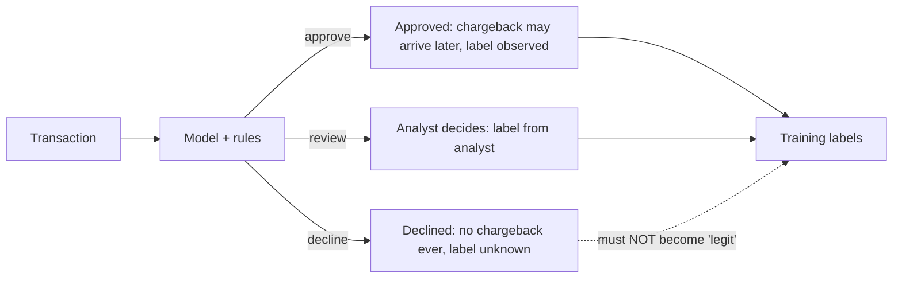
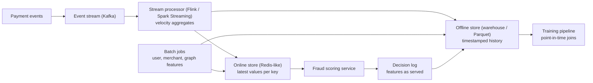
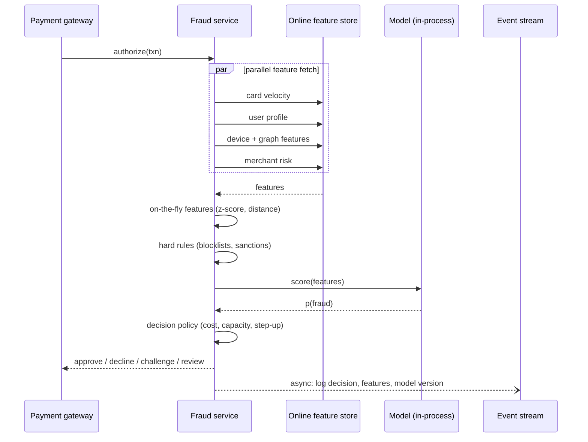
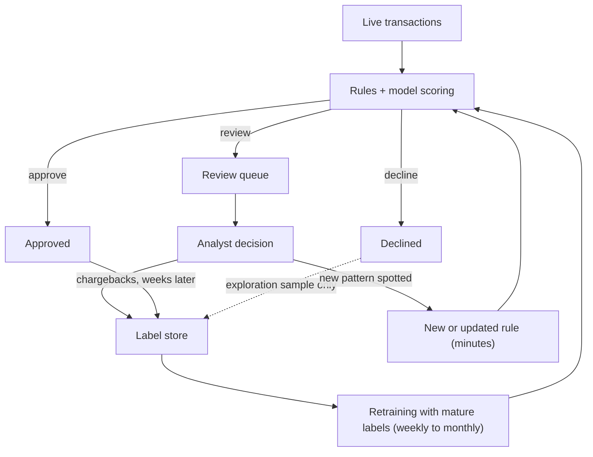
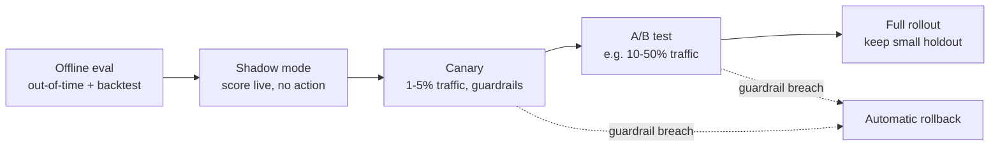
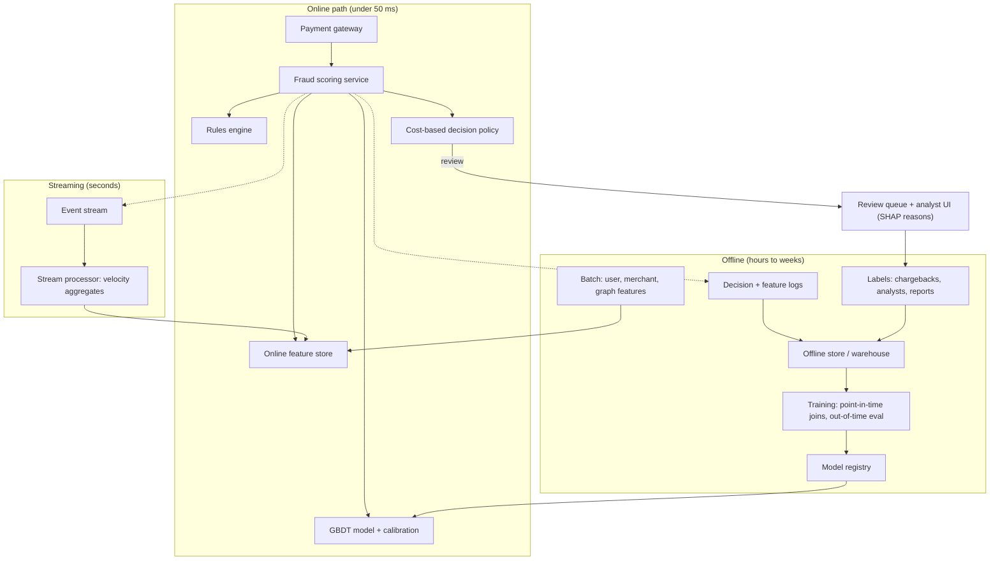
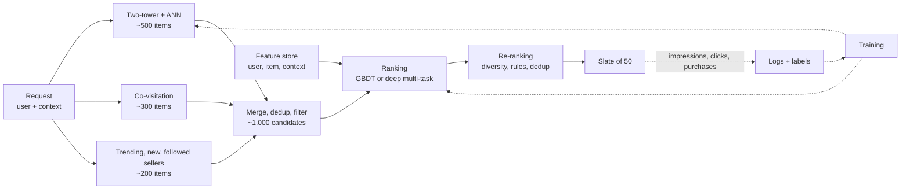

# System Design: A Classic ML System (Real-Time Fraud Detection)

> **Level:** Beginner to Advanced · **Study time:** ~130 min · **Prerequisites:** [How to Approach AI/ML System Design Interviews](01-how-to-approach-ai-system-design-interviews.md), [Classification Metrics and Imbalanced Data](../01-classical-ml/04-classification-metrics-and-imbalanced-data.md), [Decision Trees, Random Forests and Gradient Boosting](../01-classical-ml/06-decision-trees-random-forests-and-gradient-boosting.md), [Data Drift, Concept Drift and When to Retrain](../01-classical-ml/08-data-drift-concept-drift-and-retraining.md), [Reproducible Training and Training-Serving Skew](../10-mlops/03-reproducibility-and-training-serving-skew.md)

## Table of contents

- [Why this matters](#why-this-matters)
- [Step 1: Clarify requirements and frame the problem](#step-1-clarify-requirements-and-frame-the-problem)
- [Step 2: Labels and label delay](#step-2-labels-and-label-delay)
- [Step 3: Features](#step-3-features)
- [Step 4: The feature store and online/offline consistency](#step-4-the-feature-store-and-onlineoffline-consistency)
- [Step 5: Model choice](#step-5-model-choice)
- [Step 6: Handling imbalance and choosing thresholds from business costs](#step-6-handling-imbalance-and-choosing-thresholds-from-business-costs)
- [Step 7: Real-time serving with a tight latency budget](#step-7-real-time-serving-with-a-tight-latency-budget)
- [Step 8: The human review queue and the feedback loop](#step-8-the-human-review-queue-and-the-feedback-loop)
- [Step 9: Evaluation and backtesting](#step-9-evaluation-and-backtesting)
- [Step 10: Monitoring drift and adversarial adaptation](#step-10-monitoring-drift-and-adversarial-adaptation)
- [Step 11: A/B testing and safe rollout](#step-11-ab-testing-and-safe-rollout)
- [Step 12: Explainability and compliance](#step-12-explainability-and-compliance)
- [Going deeper: what changes at scale](#going-deeper-what-changes-at-scale)
- [Putting it together: a 45-minute interview walkthrough](#putting-it-together-a-45-minute-interview-walkthrough)
- [Going deeper: adapting the design to a recommendation or search-ranking system](#going-deeper-adapting-the-design-to-a-recommendation-or-search-ranking-system)
- [Common mistakes and misconceptions](#common-mistakes-and-misconceptions)
- [Interview questions and model answers](#interview-questions-and-model-answers)
- [Key takeaways](#key-takeaways)
- [Further reading](#further-reading)
- [Next](#next)

## Why this matters

Most AI/ML system design interviews are not about LLMs. A large share are about "classic" ML systems: fraud detection, ads ranking, recommendations, churn prediction. Fraud detection is the favorite of these because it packs almost every hard production problem into one system: extreme class imbalance, labels that arrive weeks late, features that must be computed in milliseconds, an adversary who adapts to your model, humans in the loop, and regulators who want explanations. Banks, card networks, payment processors and marketplaces all run systems like this, and each decision moves real money. If you can design this system end to end, you can design most tabular ML systems, and you will have strong answers for the "what about label delay / drift / thresholds / rollout" follow-ups that interviewers use to separate senior candidates from everyone else. Near the end, [a dedicated section](#going-deeper-adapting-the-design-to-a-recommendation-or-search-ranking-system) adapts the same blueprint to the other most common classic prompt: recommendation and search ranking.

---

## Step 1: Clarify requirements and frame the problem

### The everyday picture

> **Analogy:** Think of a bouncer at a club door. Thousands of people walk up. Almost all are fine. A few have fake IDs. The bouncer has about two seconds per person, can call a manager for a closer look (but the manager is slow and expensive), and every mistake costs something: turning away a regular customer makes them angry and they may never come back, letting in a troublemaker costs damages. The bouncer also learns: troublemakers change their tricks once they notice what gets them caught.

That is the whole chapter in one picture. Our system is the bouncer, the manager is a human analyst, and the troublemakers are fraudsters.

### Our running example

We will design fraud detection for **PayFlow**, a fictional card payment processor. All numbers below are **illustrative**, chosen to make the arithmetic easy, not taken from any real company.

**Who is who in a card payment.** The **cardholder** pays a **merchant**. The merchant's **payment processor** (working with the merchant's bank, the *acquirer*) sends an **authorization request** through the **card network** (for example Visa or Mastercard) to the **issuer**, the bank that issued the card, which answers approve or decline while the customer waits at checkout. Fraud checks can run at any of these parties; PayFlow runs one inside this **authorization path**, before the answer goes back.

| Requirement | Value (illustrative) |
|---|---|
| Transactions per day | 10 million |
| Fraud rate | 0.1% (1 in 1,000) |
| Decision latency budget | 100 ms at p99 for the whole fraud check |
| Possible actions | approve, decline, step-up authentication, send to manual review |
| Analyst team | 50 analysts |
| Average fraud amount | \$200 |

Back-of-envelope traffic: $10{,}000{,}000 / 86{,}400 \text{ s} \approx 116$ transactions per second on average. Payment traffic is spiky (lunch hours, holiday sales), so plan for a peak of roughly 10x average, about 1,200 transactions per second (illustrative peak factor).

**p99 latency** means the 99th percentile: 99% of requests finish faster than this number. We use tail percentiles because the slowest 1% of payments are still real customers waiting at a checkout.

**Step-up authentication** means asking the customer for extra proof (a one-time code by SMS, a banking app confirmation, a 3-D Secure challenge) instead of a flat yes or no. It is a cheap middle action: a little friction for the good customer, a large obstacle for a fraudster.

### Framing as ML

The core ML task is **binary classification**: for each transaction, predict the probability that it is fraudulent. Formally, given a feature vector $x$ describing the transaction and its context, the model outputs $\hat{p} = P(y = 1 \mid x)$ where $y = 1$ means fraud.

Two properties make this harder than a textbook classifier:

1. **Heavy class imbalance.** Only 0.1% of examples are positive (the rare class we care about, fraud). A model that always says "not fraud" is 99.9% accurate and completely useless. Accuracy is the wrong metric (see [Classification Metrics and Imbalanced Data](../01-classical-ml/04-classification-metrics-and-imbalanced-data.md)).
2. **Asymmetric, amount-dependent costs.** The two kinds of mistakes cost very different amounts, and the cost depends on the transaction.

Recall the two error types:

- A **false positive (FP)** is a legitimate transaction we wrongly flag. The customer is declined or annoyed. Cost: lost revenue on that sale, support calls, and churn (the customer switches to another card).
- A **false negative (FN)** is a fraudulent transaction we wrongly approve. Cost: usually the full amount (the merchant or issuer eats the loss), plus chargeback fees (a chargeback is a disputed charge that gets reversed; see Step 2) and operational cost.

| Error | What happens | Typical cost driver | Who feels it |
|---|---|---|---|
| False positive | Good customer declined or challenged | Lost margin, churn, support load | Customer, merchant, brand |
| False negative | Fraud approved | Transaction amount, fees | Merchant, issuer, processor |
| Unnecessary review | Analyst time spent on a good transaction | Analyst cost per case, delay | Operations team |

> **Interview tip:** Ask early: "What actions are available, and who bears the loss?" The answer changes the design. A card issuer, a merchant and a marketplace all care about fraud but have different costs, different labels and different actions.

### Non-functional requirements to state out loud

- **Latency:** synchronous decision inside the payment authorization path, so tens of milliseconds.
- **Availability:** the fraud check must never become the reason payments fail. Define a fallback.
- **Freshness:** features like "transactions on this card in the last 10 minutes" must include events from seconds ago.
- **Auditability:** every decision must be reproducible later: which model version, which features, which rules fired.
- **Explainability:** analysts and regulators need reasons, not just a score.

---

## Step 2: Labels and label delay

### Where labels come from

A **label** is the ground truth we train on: was this transaction really fraud? In fraud, nobody hands you labels. They trickle in from several sources:

| Label source | Speed | Quality | Bias |
|---|---|---|---|
| **Chargebacks** (the cardholder disputes the charge with their bank and the money is reversed) | Slow: days to months | Good but noisy (includes "friendly fraud") | Only exists for approved transactions |
| Customer fraud reports ("I did not make this") | Days | Good | Only from customers who notice |
| Analyst decisions in the review queue | Minutes to hours | Good but subjective | Only for transactions the system flagged |
| Confirmed by customer at step-up (passed the one-time passcode) | Seconds | Strong but not conclusive evidence of legitimacy (SIM swaps and phished codes let fraudsters pass) | Only for challenged transactions |
| Rules or blocklist hits | Instant | Weak (circular if used for training) | Reflects your own past rules |

**Friendly fraud** is when the real cardholder makes a purchase and then disputes it anyway ("I don't recognize this", "it never arrived"). It looks like fraud in the label stream but is a different problem, so many teams label it separately.

### Label delay

**Label delay** (or label latency) is the time between a transaction and the moment its true label is known. Chargebacks are the main fraud label and they are slow: the cardholder has to notice the charge on a statement, call the bank, and the bank has to process the dispute. Card network rules allow disputes for weeks to months after the transaction (the exact windows vary by network and reason code).

> **Analogy:** It is like grading an exam where some students' answers are only revealed weeks after they hand it in. If you grade today, the recent exams look perfect simply because the wrong answers have not shown up yet.

Here is an illustrative **label maturity curve**: the fraction of eventual chargebacks that have arrived by day $d$ after the transaction.

```text
Fraction of eventual chargebacks received (illustrative)

100% |                                   ...........
 95% |                         ..........
 80% |              ...........
     |          ....
 40% |     .....
     |  ...
  0% +--+-----+---------+---------+---------+------> days since transaction
        0     7        30        60        90
```

Read it like this: if the curve says 80% by day 30, then a transaction from 30 days ago that is still labeled "legit" has a meaningful chance of becoming "fraud" later.

**Worked example (illustrative numbers).** Suppose the true fraud rate is 0.10%. Look at transactions from last week (7 days old, 40% mature) and from two months ago (60 days, 95% mature):

- Observed fraud rate last week: $0.10\% \times 0.40 = 0.04\%$.
- Observed fraud rate 60 days ago: $0.10\% \times 0.95 = 0.095\%$.

If you naively train on everything up to yesterday, the recent data teaches the model that fraud is rarer than it is, and specifically that recent fraud patterns are "legit". This is the label delay trap.

### Strategies for label delay

1. **Wait for maturity.** Train only on transactions older than a cutoff (for example 60-90 days), where labels are mostly complete. Simple and honest, but your model is always learning from slightly old patterns.
2. **Use fast proxy labels for recent data.** Analyst decisions, customer reports and failed step-ups arrive quickly. Combine them with mature chargebacks. Proxy labels are biased (they only cover flagged traffic) so treat them carefully.
3. **Gap in evaluation.** Leave a gap between training cutoff and evaluation window so that evaluation labels are mature too (we revisit this in Step 9).
4. **Model the delay.** Advanced: weight recent negatives by their probability of still flipping to fraud, or use survival-analysis style methods (models of the *time until* an event, here the time until a chargeback arrives). Useful at scale, but say "start with waiting plus proxy labels" first.

### The selection bias problem (the most important senior point in this chapter)

When your system declines a transaction, the money never moves, so there is never a chargeback. You never learn whether that transaction was really fraud. If your pipeline labels "no chargeback" as "legit", every transaction you blocked becomes a "legit" training example. That is badly wrong.

More generally, the model's own decisions decide which labels you see. This is called **selection bias** or the **counterfactual labeling problem**: you only observe outcomes for actions you took.



Fixes, from simple to advanced:

- **Exclude or separately label declined transactions.** Never default them to legit.
- **Exploration holdout.** For a tiny random fraction of transactions the model would decline, take a less final action instead (approve with a small amount cap, or send to review). This produces unbiased labels in the region where the model is confident. You pay a small, controlled loss for information.
- **Inverse propensity weighting (IPW).** The **propensity** is the probability that an example received the action that revealed its label (here, the exploration rate). Weighting by its inverse makes each explored example stand in for the many unexplored ones like it. If you explore 1% of would-be declines, each explored example gets weight $1 / 0.01 = 100$ in training and evaluation.

> **Senior insight:** Selection bias is why a fraud model can look great offline and slowly get worse in production: it trains on a world filtered by its previous self. Bringing this up unprompted is a strong senior signal. The classic academic treatment of delayed and alert-driven feedback in fraud is Dal Pozzolo et al., "Credit Card Fraud Detection: A Realistic Modeling and a Novel Learning Strategy" (2018).

---

## Step 3: Features

Features are where fraud systems win or lose. Gradient-boosted trees are a commodity; good features are not. We group them in five families, from simplest to most advanced. (For general techniques like encoding and missing values, see [Feature Engineering](../01-classical-ml/07-feature-engineering-missing-values-and-encoding.md).)

### 3.1 Transaction features (no history needed)

Facts about this payment alone: amount, currency, merchant category code (MCC, a standard code for the type of business), card-present vs card-not-present (online), entry method (chip, contactless, magnetic stripe, typed-in card number), time of day, day of week, country of card vs country of merchant, BIN (the first digits of the card number, which identify the issuing bank and card type).

These are cheap and always available, but weak alone: a \$500 electronics purchase is normal for one person and wildly abnormal for another.

### 3.2 Real-time aggregates over sliding windows (velocity features)

**Velocity features** count or sum recent activity for an entity (card, account, device, IP address, email) over a **sliding window**, a time window that moves with the current moment, such as "the last 10 minutes".

Examples:

- Number of transactions on this card in the last 10 minutes, 1 hour, 24 hours.
- Total amount spent on this card in the last 24 hours.
- Number of distinct merchants for this card in the last hour.
- Number of distinct cards used from this device in the last day.
- Number of declined attempts on this card in the last hour.

Why they matter: a classic attack is **card testing**, where a fraudster with a list of stolen card numbers makes many tiny purchases to see which cards work. One tiny purchase looks innocent; 30 tiny purchases in 5 minutes from one device is screaming.

> **Analogy:** A single cough tells you nothing. Thirty coughs in ten minutes tells you something is wrong. Velocity features count the coughs.

From scratch, a sliding-window counter is just a queue of timestamps:

```python
# Pure Python, no installs needed.
from collections import deque, defaultdict

class SlidingWindowCounter:
    """Count and sum events per entity over the last `window_s` seconds."""

    def __init__(self, window_s: float):
        self.window_s = window_s
        self.events = defaultdict(deque)   # entity -> deque of (ts, amount)
        self.sums = defaultdict(float)

    def _evict(self, entity: str, now: float) -> None:
        q = self.events[entity]
        while q and q[0][0] <= now - self.window_s:   # drop events that fell out
            _, amt = q.popleft()
            self.sums[entity] -= amt

    def query(self, entity: str, now: float) -> tuple[int, float]:
        """Features BEFORE adding the current event (strictly past)."""
        self._evict(entity, now)
        return len(self.events[entity]), self.sums[entity]

    def add(self, entity: str, now: float, amount: float) -> None:
        self.events[entity].append((now, amount))
        self.sums[entity] += amount

c = SlidingWindowCounter(window_s=600)          # 10-minute window
for ts, amt in [(0, 1.0), (60, 1.0), (120, 2.0), (700, 5.0)]:
    cnt, total = c.query("card_42", ts)
    print(ts, cnt, total)
    c.add("card_42", ts, amt)
# 0 0 0.0
# 60 1 1.0
# 120 2 2.0
# 700 1 2.0     (events at t=0 and t=60 have expired; only t=120 remains)
```

Notice the order: **query first, then add**. The feature describes the past, not including the current transaction. Whatever convention you pick (include or exclude the current event), you must use the same one in training. Mismatched conventions are a classic source of training-serving skew.

In production, exact per-event sliding windows are expensive at high volume. Stream processors usually approximate them with **bucketed windows**: keep per-minute buckets and sum the last 60 buckets for a 1-hour window. You trade a little precision at the window edge for bounded memory.

The offline (training) equivalent in pandas, computing the same "strictly past" features:

```python
# pip install pandas numpy
import pandas as pd

df = pd.DataFrame({
    "card_id": ["a", "a", "a", "b", "a"],
    # Use one timestamp format for every string: pandas 2+ infers the format
    # from the first element and raises on mixed "HH:MM" / "HH:MM:SS" strings.
    "ts": pd.to_datetime(["2026-01-01 10:00:00", "2026-01-01 10:01:00",
                          "2026-01-01 10:02:00", "2026-01-01 10:02:00",
                          "2026-01-01 10:11:40"]),
    "amount": [1.0, 1.0, 2.0, 50.0, 5.0],
})

df = df.sort_values(["card_id", "ts"]).reset_index(drop=True)
g = df.set_index("ts").groupby("card_id")["amount"]

# closed="left" excludes the current row, matching "query before add" online.
df["cnt_10m"] = g.rolling("10min", closed="left").count().fillna(0).to_numpy()
df["sum_10m"] = g.rolling("10min", closed="left").sum().fillna(0).to_numpy()
print(df)
# Card "a": cnt_10m = 0, 1, 2, 1 and sum_10m = 0, 1, 2, 2 (same as the online
# counter above); card "b": 0, 0.
```

The `.to_numpy()` alignment works because we sorted by `card_id` then `ts`, which is the same order the grouped rolling result comes back in.

One subtle mismatch remains at the window edge: `closed="left"` keeps an event exactly 10 minutes old, while the online counter above evicts it (`closed="neither"` would match exactly). Edge conventions like this are precisely what the automated skew checks in Step 4 exist to catch.

### 3.3 User (card, account) history

Long-term behavior profiles: account age, typical amount, usual countries, usual merchants, usual time of day, number of past chargebacks. The most useful features compare *this* transaction to *this user's* normal.

**Amount z-score.** How unusual is this amount for this user?

$$z = \frac{a - \mu_u}{\sigma_u}$$

- $a$: the current transaction amount.
- $\mu_u$: the user's historical mean amount.
- $\sigma_u$: the user's historical standard deviation of amounts.

Worked example: a user's mean is $\mu_u = \$40$ with standard deviation $\sigma_u = \$15$. A new transaction of $a = \$250$:

$$z = \frac{250 - 40}{15} = \frac{210}{15} = 14.0$$

That is 14 standard deviations above normal, extremely unusual for this user, while \$250 might be perfectly normal for another user. Amounts are heavy-tailed, so in practice the z-score is often computed on log amounts (or replaced by a percentile of the user's history), which is more robust to a few large past purchases. For new users with little history, $\sigma_u$ is unreliable, so fall back to population or segment statistics and also feed in "number of past transactions" so the model knows how much to trust the z-score.

**Impossible travel.** Distance between this transaction's location and the previous card-present one, divided by time between them. A card used in New York and then in London 30 minutes later (about 5,570 km apart) implies a speed of $5{,}570 / 0.5 = 11{,}140$ km/h, far beyond any airliner. Either the card was cloned, or one of the location signals is wrong.

### 3.4 Merchant history

Merchant-level risk: the merchant's historical fraud rate, chargeback rate, age, category, refund rate. Raw fraud rates are unstable for small merchants, so use **smoothing** (also called Bayesian or additive smoothing): blend the merchant's own rate with a global prior.

$$\tilde{r}_m = \frac{f_m + k \cdot r_0}{n_m + k}$$

- $f_m$: number of confirmed frauds at merchant $m$.
- $n_m$: number of transactions at merchant $m$.
- $r_0$: global (prior) fraud rate.
- $k$: smoothing strength, how many "virtual" transactions at the prior rate we add.
- $\tilde{r}_m$: smoothed fraud rate.

Worked example with $r_0 = 0.001$ and $k = 500$:

- New merchant, 2 frauds in 10 transactions. Raw rate $2/10 = 0.20$. Smoothed: $(2 + 500 \times 0.001) / (10 + 500) = 2.5 / 510 \approx 0.0049$.
- Big merchant, 300 frauds in 100,000 transactions. Raw rate $0.003$. Smoothed: $(300 + 0.5) / 100{,}500 \approx 0.00299$.

The big merchant's rate barely changes (it has plenty of evidence). The new merchant's wild 20% is pulled toward the prior, but it is still about 5x the global rate, which is a useful signal.

> **Common mistake:** Computing the merchant fraud rate over the whole dataset, including the future, and then using it as a feature in training. This is **target leakage** (see [Overfitting, Regularization and Data Leakage](../01-classical-ml/03-overfitting-regularization-and-data-leakage.md)): the feature contains the label of the very row you are predicting. Always compute history features as of the transaction time, using only labels that were *known* by then (which, with label delay, is even less than "everything before").

### 3.5 Graph features

Fraud is often organized. A **fraud ring** is a group of fraudsters sharing resources: the same devices, IP addresses, shipping addresses, phone numbers or emails across many accounts and cards. Looking at one transaction in isolation hides this. A **graph** view reveals it.

Build a graph where **nodes** are entities (accounts, cards, devices, IPs, addresses) and **edges** connect entities seen together in a transaction or signup.

```text
  card_1 ---- device_X ---- card_2
                 |
  card_3 ---- ip_9 ---- account_7 (known fraud)
                 |
              card_4
```

Useful graph features, from simple to advanced:

- **Degree counts:** number of distinct cards seen on this device (normal phones see 1-3 cards; a fraud device may see 50).
- **Distance to known fraud:** is this card within 2 hops of a confirmed fraud account?
- **Connected component size:** size of the cluster this entity belongs to.
- **Learned node embeddings:** vectors produced by a graph neural network (Step 5) that summarize a node's neighborhood.

Graph features are expensive to compute in real time. Common practice: compute heavy graph features (components, embeddings) in batch every few hours, and compute cheap ones (degree counts, "one hop from a blocked entity") in the stream.

> **Senior insight:** Good fraud features are **hard for the fraudster to control**. A fraudster can pick any amount and any merchant, but it is costly to buy a new device, a new residential IP, and a new aged account for every attempt. Features built on those scarce resources (device and graph features) degrade much more slowly under attack than amount-based ones.

---

## Step 4: The feature store and online/offline consistency

### The problem

We compute features in two places:

- **Online** (at serving time): in milliseconds, from a fast key-value store, for one transaction.
- **Offline** (at training time): in batch, over months of history, for millions of transactions.

If the two computations disagree even slightly, the model sees different inputs in production than in training. This is **training-serving skew** (covered in depth in [Reproducible Training and Training-Serving Skew](../10-mlops/03-reproducibility-and-training-serving-skew.md)). In fraud it is especially easy to create, because velocity features depend on precise timing.

### What a feature store is

A **feature store** is a system that manages feature definitions once and serves them in both modes:

- An **offline store** (a data warehouse or Parquet files, a columnar file format, on object storage) holding the full history of feature values with timestamps, used to build training sets.
- An **online store** (a low-latency key-value database such as Redis, DynamoDB, Cassandra or Aerospike) holding the latest feature values per entity, used at serving time.
- A **registry** of feature definitions, owners and versions.

Open-source Feast and managed offerings from cloud vendors and data platforms implement this pattern; their APIs change across versions, so focus on the concept.



In the diagram, **Kafka** is a durable, replayable event log that many consumers read independently, and **Flink** or **Spark Streaming** are stream processors that maintain running aggregates (like the sliding-window counter in Step 3) over that log.

### Point-in-time correctness

When building a training example for a transaction at time $t$, every feature must use only information available *strictly before* $t$ (and, for label-derived features, only labels known before $t$). Joining "the latest value" instead of "the value as of $t$" leaks the future. The correct operation is a **point-in-time join** (also called an as-of join): for each transaction, take the most recent feature snapshot whose timestamp is earlier than the transaction.

```python
# pip install pandas
import pandas as pd

txns = pd.DataFrame({
    "ts": pd.to_datetime(["2026-01-01 10:05", "2026-01-01 12:00", "2026-01-02 09:00"]),
    "card_id": ["a", "a", "a"],
    "amount": [20.0, 300.0, 15.0],
}).sort_values("ts")

# Daily batch profile snapshots: the value became available at `ts`.
profiles = pd.DataFrame({
    "ts": pd.to_datetime(["2026-01-01 00:00", "2026-01-02 00:00"]),
    "card_id": ["a", "a"],
    "avg_amount_30d": [40.0, 55.0],
}).sort_values("ts")

train = pd.merge_asof(
    txns, profiles, on="ts", by="card_id",
    direction="backward",        # only snapshots from the past
    allow_exact_matches=False,   # a snapshot at exactly ts is not yet visible
)
print(train[["ts", "amount", "avg_amount_30d"]])
# The 01-01 transactions get 40.0; the 01-02 transaction gets 55.0.
```

### Three ways to keep online and offline consistent

| Approach | How it works | Pros | Cons |
|---|---|---|---|
| Shared definitions | One feature definition compiled to both stream and batch code | Single source of truth | Two execution engines can still differ subtly (time zones, nulls, late events) |
| Backfill from the stream | Replay historical events through the same streaming code to build training data | Same code path | Replaying months of events is expensive |
| **Log and wait** | Log the exact features the service used at decision time, then join labels when they mature | Zero skew by construction | New features need weeks of logging before you can train with them |

Mature teams combine them: log-and-wait for the production feature set, backfills to prototype new features, and automated skew checks that compare logged online values with recomputed offline values for a sample of transactions.

> **Interview tip:** Say "point-in-time correct joins" and "log features at serving time" explicitly. Those two phrases tell the interviewer you have shipped a real-time ML system.

---

## Step 5: Model choice

### The baseline: rules

Before any model, fraud teams have **rules**: hand-written conditions like "decline if amount > \$2,000 and card age < 1 day and country mismatch". Rules are fast, explainable and can be deployed in minutes. They do not generalize, they multiply into an unmaintainable pile, and they interact in surprising ways. Keep them, but not as the main brain.

### The workhorse: gradient-boosted trees

**Gradient-boosted decision trees (GBDTs)** build an ensemble of small decision trees, each one fixing the errors of the previous ones (explained in [Decision Trees, Random Forests and Gradient Boosting](../01-classical-ml/06-decision-trees-random-forests-and-gradient-boosting.md)). Libraries: XGBoost (Chen and Guestrin, 2016), LightGBM (Ke et al., 2017) and CatBoost.

Why GBDTs dominate fraud on tabular features:

- They handle **heterogeneous features** (amounts, counts, categories, ratios) without scaling.
- They capture **interactions** automatically ("high amount AND new device AND foreign country").
- They handle **missing values** natively, which is common (no device fingerprint, new user with no history).
- **Inference is fast**: a few hundred to a few thousand small trees score one row on a CPU in roughly a millisecond or a few (depends on tree count, depth and implementation).
- **Monotonic constraints** are supported: you can force "more declined attempts never decreases risk", which improves robustness and makes explanations sane.
- Exact, fast **SHAP explanations** exist for trees (Step 12).

### When to add deep or graph models

| Model family | What it captures | When to add it | Cost |
|---|---|---|---|
| Logistic regression | Linear effects on hand-made features | Baseline, very strict explainability needs | Weak on interactions |
| **GBDT** | Nonlinear interactions on tabular features | Default first and often final model | Needs strong features |
| Sequence models (RNN/LSTM, transformer over transaction history) | Order and timing patterns in a user's event sequence | Lots of data, rich histories, GBDT plateaued | Training and serving complexity, GPU maybe |
| Entity embeddings (learned vectors for merchants, devices) | Similarity between high-cardinality entities | Millions of merchants or devices | Embedding pipelines, staleness |
| Graph neural networks (GNNs), for example GraphSAGE (Hamilton et al., 2017) | Neighborhood structure, fraud rings | Organized fraud, account takeover rings, marketplaces | Hard to serve in real time; often precomputed |
| Unsupervised anomaly detection (Isolation Forest, Liu et al., 2008; autoencoders) | "Unlike anything normal" | Cold start, brand-new attack types, no labels yet | High false positive rate, hard to tune |

(Sequence models are introduced in [RNNs, LSTMs and the Road to Transformers](../02-deep-learning/08-rnns-lstms-and-the-road-to-transformers.md); anomaly detection in [Unsupervised Learning](../01-classical-ml/10-unsupervised-learning-clustering-and-dimensionality-reduction.md).)

A very common production pattern is **stacking**: deep or graph models run offline or in parallel and produce *features* (a sequence-risk score, a node embedding, an anomaly score) that the GBDT consumes. You keep the GBDT's speed, robustness and explainability while borrowing the richer signal.

> **Senior insight:** "When would you use a neural network instead?" The honest answer: when you have a strong GBDT baseline, a measurable plateau, and a signal type trees cannot see (raw sequences, graph structure, text, images of documents). Not because deep learning is newer.

### A runnable GBDT pipeline

This uses synthetic data, so the numbers it prints are not meaningful; the point is the shape of the pipeline: time-ordered split, imbalance-aware metrics, and calibrated probabilities.

```python
# pip install numpy scikit-learn lightgbm
import numpy as np
from sklearn.datasets import make_classification
from sklearn.metrics import average_precision_score, roc_auc_score
from sklearn.isotonic import IsotonicRegression
import lightgbm as lgb

# Synthetic stand-in for transactions: 0.5% positives. Pretend row order is time.
X, y = make_classification(
    n_samples=200_000, n_features=20, n_informative=8,
    weights=[0.995], flip_y=0.0, random_state=0,
)

# Time-based split: train on the past, calibrate on the next slice, test on the latest.
n = len(y)
tr, ca = int(0.70 * n), int(0.85 * n)
X_tr, y_tr = X[:tr], y[:tr]
X_ca, y_ca = X[tr:ca], y[tr:ca]
X_te, y_te = X[ca:], y[ca:]

model = lgb.LGBMClassifier(
    n_estimators=400, learning_rate=0.05, num_leaves=31,
    subsample=0.8, subsample_freq=1, colsample_bytree=0.8,
    random_state=0, verbose=-1,
)
model.fit(X_tr, y_tr)

raw_ca = model.predict_proba(X_ca)[:, 1]
raw_te = model.predict_proba(X_te)[:, 1]

# Calibrate on a held-out slice so scores behave like probabilities.
iso = IsotonicRegression(out_of_bounds="clip").fit(raw_ca, y_ca)
p_te = iso.predict(raw_te)

print("ROC-AUC:", round(roc_auc_score(y_te, p_te), 4))
print("PR-AUC (average precision):", round(average_precision_score(y_te, p_te), 4))
print("Base rate (PR-AUC of a random model):", round(y_te.mean(), 4))
```

**Isotonic regression** fits a non-decreasing step function from raw score to observed fraud rate; Step 6 explains why calibration matters, and Step 9 defines PR-AUC. Note we did not use `class_weight` or resampling here. With GBDTs and enough positives, training on the natural distribution plus calibration is often perfectly fine. The next step explains when to do more.

---

## Step 6: Handling imbalance and choosing thresholds from business costs

### Options for imbalance

| Technique | What it does | When it helps | Watch out for |
|---|---|---|---|
| Do nothing, calibrate | Train on natural data | Enough positives in absolute terms (thousands+) | Slow training if negatives are huge |
| Class weights (`scale_pos_weight`, `class_weight`) | Each positive counts more in the loss | Few positives | Distorts probabilities; recalibrate |
| **Negative downsampling** | Keep all fraud, keep only a fraction $\beta$ of legit | Billions of negatives, training cost | Probabilities shift; correct them (below) |
| Focal loss (Lin et al., 2017) | Down-weights easy examples | Neural nets with many easy negatives | Rarely needed for GBDTs |
| SMOTE (Chawla et al., 2002) | Synthesizes new positives by interpolation | Small classic datasets | Often useless or harmful for fraud: interpolated "fake fraud" is not realistic, and leaks across time if done before splitting |

The key idea: **imbalance is mostly a metrics and thresholds problem, not a training problem.** GBDTs can learn from 0.1% positives if you have enough of them. What breaks is accuracy as a metric and a default 0.5 threshold.

### Correcting probabilities after downsampling

Downsampling negatives by rate $\beta$ (for example keep 1 in 100, $\beta = 0.01$) makes fraud look 100x more common to the model, so its raw scores are inflated. The fix is easiest in **odds** form, where odds $= p / (1 - p)$:

$$\text{odds}_{\text{true}} = \beta \cdot \text{odds}_{\text{sample}} \quad\Longrightarrow\quad p = \frac{\beta\, p_s}{\beta\, p_s - p_s + 1}$$

- $p_s$: the probability the model outputs (trained on downsampled data).
- $\beta$: the fraction of negatives kept (between 0 and 1).
- $p$: the corrected probability on the true distribution.

This correction is analyzed in Dal Pozzolo et al., "Calibrating Probability with Undersampling for Unbalanced Classification" (2015).

Worked example: $\beta = 0.01$ and the model says $p_s = 0.5$.

- Sample odds: $0.5 / 0.5 = 1$.
- True odds: $0.01 \times 1 = 0.01$.
- True probability: $0.01 / (1 + 0.01) = 0.01 / 1.01 \approx 0.0099$.
- Formula check: $\frac{0.01 \times 0.5}{0.01 \times 0.5 - 0.5 + 1} = \frac{0.005}{0.505} \approx 0.0099$. Same answer.

So a "50% fraud" raw score is really about 1%. Using the raw score with a cost-based threshold would decline far too many good customers.

```python
def correct_downsampled(p_s: float, beta: float) -> float:
    """Map a probability from a negative-downsampled model back to the true base rate."""
    return beta * p_s / (beta * p_s - p_s + 1)

print(round(correct_downsampled(0.5, 0.01), 4))   # 0.0099
print(round(correct_downsampled(0.5, 1.0), 4))    # 0.5 (no downsampling, no change)
```

### Why you need calibrated probabilities

A model is **calibrated** if, among transactions it scores 0.05, about 5% are really fraud. Threshold math below multiplies probabilities by dollars, so it only works with calibrated scores. Calibrate with Platt scaling (a logistic fit) or isotonic regression on a recent held-out slice, as in the code above. Recalibrate whenever you retrain or change sampling.

### The cost-based threshold

Intuition: decline a transaction when the expected loss from approving it is bigger than the expected loss from declining it.

- Expected cost of approving: $p \cdot C_{FN}$ (with probability $p$ it is fraud and we lose $C_{FN}$).
- Expected cost of declining: $(1 - p) \cdot C_{FP}$ (with probability $1 - p$ it is legit and we lose $C_{FP}$).

Decline when $p \cdot C_{FN} > (1 - p) \cdot C_{FP}$. Solving for $p$:

$$p^* = \frac{C_{FP}}{C_{FP} + C_{FN}}$$

- $p^*$: the probability threshold above which declining is cheaper.
- $C_{FP}$: cost of declining a legitimate transaction.
- $C_{FN}$: cost of approving a fraudulent one.

Worked example, with an illustrative $C_{FP} = \$10$ (lost margin plus churn risk) and $C_{FN}$ equal to the transaction amount:

- A \$200 transaction: $p^* = 10 / (10 + 200) = 10 / 210 \approx 0.048$. Decline if fraud probability exceeds about 4.8%.
- A \$20 transaction: $p^* = 10 / (10 + 20) = 10 / 30 \approx 0.333$. Decline only above about 33%.

So the threshold is **amount-dependent**: we tolerate more risk on small transactions. This one formula is worth more in an interview than any discussion of model architecture.

### Three actions: approve, review, decline

With a review queue, compute the expected cost of each action and pick the cheapest. Assume (illustratively) analyst review costs $R = \$4$ per case and resolves the case correctly.

- Approve: $p \cdot A$ (where $A$ is the amount)
- Review: $R$
- Decline: $(1 - p) \cdot C_{FP}$

For $A = \$200$, $C_{FP} = \$10$, $R = \$4$:

| Fraud probability $p$ | Approve cost $200p$ | Review cost | Decline cost $10(1-p)$ | Best action |
|---|---|---|---|---|
| 0.01 | \$2.00 | \$4.00 | \$9.90 | Approve |
| 0.05 | \$10.00 | \$4.00 | \$9.50 | Review |
| 0.50 | \$100.00 | \$4.00 | \$5.00 | Review |
| 0.70 | \$140.00 | \$4.00 | \$3.00 | Decline |

The boundaries: review beats approve when $200p > 4$, so $p > 0.02$. Decline beats review when $10(1 - p) < 4$, so $p > 0.6$. For this amount: approve below 2%, review between 2% and 60%, decline above 60%.

```python
def best_action(p: float, amount: float, c_fp: float = 10.0, review_cost: float = 4.0) -> str:
    costs = {
        "approve": p * amount,
        "review": review_cost,
        "decline": (1 - p) * c_fp,
    }
    return min(costs, key=costs.get)

for p in [0.01, 0.05, 0.50, 0.70]:
    print(p, best_action(p, amount=200))
# 0.01 approve
# 0.05 review
# 0.5 review
# 0.7 decline
```

### The capacity constraint

The cost table assumes unlimited analysts. In reality, 50 analysts can only review so many cases per day (Step 8 computes this). So the real policy is: compute the expected savings of reviewing each transaction, rank, and send the top $N$ to review where $N$ is the capacity. Everything else falls back to approve or decline. When fraud spikes, the queue fills, and the review threshold effectively rises.

Add step-up authentication as a fourth action with its own cost (a small friction cost and some abandonment of good customers) and the same expected-cost logic applies.

> **Common mistake:** Choosing the threshold by maximizing F1 score. F1 treats false positives and false negatives as equally bad and ignores amounts, so it almost never matches the business objective. Optimize expected cost (or expected profit) directly.

---

## Step 7: Real-time serving with a tight latency budget

### The request path



Key design choices:

- **Model in-process.** A GBDT is small (megabytes). Load it into the scoring service instead of calling a separate model server, saving a network hop.
- **Parallel fetches.** Fetch all feature groups concurrently; total time is the slowest call, not the sum.
- **Async writes.** Updating aggregates and logging happen after responding, via the event stream. The stream processor consumes the same event and updates velocity counters within seconds.

### A worked latency budget

Suppose the gateway gives the fraud check 100 ms at p99. We target 50 ms internally to leave headroom for the network and unexpected spikes. Illustrative p99 numbers:

| Stage | p99 budget (ms, illustrative) |
|---|---|
| Network in and out (same region) | 4 |
| Parse, validate, local cache lookups (BIN table, merchant config) | 2 |
| Parallel online feature fetch (slowest of 4 calls) | 12 |
| On-the-fly features (z-score, distance, ratios) | 1 |
| Rules engine | 3 |
| GBDT inference, single row, CPU | 3 |
| Decision policy and reason codes | 1 |
| Serialize response, enqueue async log | 2 |
| **Total** | **28** |
| Headroom to 50 ms internal target | 22 |

Check: $4 + 2 + 12 + 1 + 3 + 3 + 1 + 2 = 28$ ms. Summing per-stage p99s is a conservative estimate (it is unlikely every stage hits its p99 on the same request), which is exactly what you want for a budget.

### Fan-out makes tails worse

Each parallel call has its own tail. If each of 5 independent calls is under its p99 latency 99% of the time, the chance that *all* of them are fast on a given request is:

$$0.99^5 \approx 0.951$$

So about 4.9% of requests hit at least one slow call, which means the request-level p99 is set by component tails, and even roughly the request-level p95 is exposed to them. Fixes: fewer calls (co-locate feature groups under one key), **hedged requests** (send a duplicate request to a replica if the first has not answered after a short delay), tight per-call timeouts, and keeping hot keys in a local in-process cache.

### Fallbacks: what happens when something is slow or down

| Failure | Fallback | Trade-off |
|---|---|---|
| A feature group times out | Score with that feature missing (GBDTs handle nulls; train with some features randomly dropped so the model has seen this) | Slightly lower accuracy |
| Online store down | Rules-only decision plus a simple fallback model on request-only features | Noticeably lower accuracy, temporarily |
| Fraud service down | **Fail open** (approve) for small amounts, **fail closed** (decline or challenge) above a limit | Business decides the risk appetite in advance |

> **Interview tip:** Always state the fallback. "The fraud service must never take payments down" is a requirement interviewers love to hear you volunteer.

### Rules plus model

Production systems run both. Typical division of labor:

| Rules | Model |
|---|---|
| Hard constraints: sanctions lists, blocklisted cards and devices, regulatory limits | Ranking all remaining risk |
| Emergency response to a new attack (deploy in minutes) | Generalizing across many weak signals |
| Business policy ("never auto-decline VIP accounts, send to review") | Probabilities that feed the cost policy |

Order matters: hard-block rules first (cheap, short-circuit), then the model, then policy rules that adjust the action. Govern rules like code: version them, log which rules fired, measure each rule's precision, and retire rules the model has made redundant. Rules also shape labels (declined transactions have no chargebacks), so a rule change can bias the next model's training data.

---

## Step 8: The human review queue and the feedback loop

### Sizing the queue

Illustrative capacity: 50 analysts, 8 hours each, about 30 cases per hour each:

$$50 \times 8 \times 30 = 12{,}000 \text{ cases per day}$$

Compared to 10 million transactions per day: $12{,}000 / 10{,}000{,}000 = 0.12\%$. The review queue can only take roughly the top 0.12% of traffic. This is why ranking quality at the very top of the score distribution matters so much, and why precision in the top-$k$ is a key metric.

### Prioritizing the queue

Do not sort by probability alone. Sort by **expected loss prevented**, roughly $p \times A$: a 30% chance of a \$2,000 fraud (\$600 expected) beats a 90% chance of a \$10 fraud (\$9 expected). Also consider time-sensitivity: a held transaction with a waiting customer should be reviewed in minutes, while a post-authorization review (the money already moved, but you can still block the card or stop shipment) can wait longer.

### What the analyst sees

A good case view shows: the score, the top reason codes (Step 12), the user's recent timeline, linked entities from the graph (other cards on this device), and one-click actions (approve, decline, block card, block device, escalate). Linking related cases means one analyst decision can resolve an entire ring.

### The feedback loop



Two loops at two speeds:

- **Fast loop (minutes to hours):** analysts spot a new pattern and write a rule or blocklist entry.
- **Slow loop (weeks):** labels mature, the model retrains and absorbs the pattern, and the temporary rule can be retired.

Pitfalls of the feedback loop:

- **Analyst labels are biased** to the flagged region. Never treat "not reviewed" as "legit".
- **Analyst disagreement**: measure inter-analyst agreement on a sample of double-reviewed cases; low agreement means your labels are noisy.
- **Automation bias**: analysts tend to agree with a high score. Occasionally show cases without the score, or audit samples, to measure true analyst accuracy.
- **Active learning**: occasionally route uncertain cases (scores near the threshold) to review even if expected savings are lower. Those labels improve the model most where it is most confused.

---

## Step 9: Evaluation and backtesting

### Time-based splits, with a gap

Do not evaluate fraud models on a random split. A random split puts tomorrow's transactions from the same fraud ring into training and today's into test, and velocity and history features computed across the boundary leak future information. Use **out-of-time** splits: train on the past, test on the future, with a gap for label maturity (general splitting is in [The ML Workflow, Train/Validation/Test Splits and Cross-Validation](../01-classical-ml/01-ml-workflow-data-splits-and-cross-validation.md)).

```text
time --->
|<------- train (labels mature) ------->|<- gap ->|<-- validation -->|<- gap ->|<--- test --->|<-- too recent: labels immature -->|
 Jan                                   Apr        May                Jun        Jul             Aug                     Oct (today)
```

With a 60-90 day maturity cutoff (Step 2), roughly the last two to three months before today cannot be used for training or evaluation yet; the test window ends about 80 days before today.

The gaps serve two purposes: they prevent features in the validation window from being computed with labels from the training window boundary, and they mimic reality, where a model trained today will be used for weeks before it is replaced.

For more robust estimates, use **rolling-origin evaluation**: repeat the train/test split at several cutoffs (train to March, test April; train to April, test May; and so on) and look at the spread.

### Metrics: why PR-AUC over ROC-AUC

**ROC-AUC** measures how well the model ranks a random fraud above a random legit transaction. It is insensitive to class imbalance, which sounds nice but hides the pain. **PR-AUC** (area under the precision-recall curve, usually computed as average precision) focuses on the positive class and punishes false positives in proportion to how many there are.

Worked example. 1,000,000 transactions, 1,000 fraud (0.1%), 999,000 legit. At some threshold the model catches 800 frauds (recall, also called true positive rate, $= 800 / 1000 = 0.80$) with a false positive rate (FPR, the fraction of legit transactions wrongly flagged) of 1%:

- False positives: $0.01 \times 999{,}000 = 9{,}990$.
- Precision (the fraction of flagged transactions that are really fraud): $800 / (800 + 9{,}990) = 800 / 10{,}790 \approx 0.074$.

On a ROC curve, "80% TPR at 1% FPR" looks excellent. In reality, 93% of the flagged transactions are good customers, and the review team sees about 12.5 legit cases for every fraud ($9{,}990 / 800 \approx 12.5$). PR-AUC shows this; ROC-AUC hides it. The classic reference is Davis and Goadrich, "The Relationship Between Precision-Recall and ROC Curves" (2006). Also remember the baseline: a random model's PR-AUC equals the positive rate (0.001 here), not 0.5.

### Metrics that match operations

| Metric | Question it answers | Why it matters |
|---|---|---|
| PR-AUC (average precision) | How good is ranking for the rare class overall? | Model comparison, imbalance-aware |
| Recall at fixed alert rate (for example top 0.12%) | How much fraud do we catch with our review capacity? | Matches the analyst constraint |
| Precision at top-$k$ | How much analyst time is wasted? | Analyst efficiency and morale |
| **Dollar-weighted recall** | What fraction of fraud *dollars* do we stop? | Losses are in dollars, not counts |
| Decline rate / false positive rate on good customers | How much friction do we cause? | Customer experience, revenue |
| **Expected total cost** | Fraud losses + FP costs + review costs | The real business objective |

Dollar-weighted recall example: 10 frauds, 8 of them \$50 each, 2 of them \$2,000 each. The model catches the 8 small ones and misses the 2 big ones.

- Count recall: $8 / 10 = 80\%$.
- Dollar recall: caught $8 \times 50 = \$400$; total $400 + 2 \times 2{,}000 = \$4{,}400$; recall $400 / 4{,}400 \approx 9.1\%$.

Same model, wildly different story. Report both.

```python
# pip install numpy scikit-learn
import numpy as np
from sklearn.metrics import average_precision_score

def fraud_report(y, p, amount, alert_rate=0.0012, c_fp=10.0, review_cost=4.0):
    """Evaluate a review policy that flags the top `alert_rate` fraction by p."""
    k = max(1, int(alert_rate * len(y)))
    flagged = np.zeros(len(y), dtype=bool)
    flagged[np.argsort(-p)[:k]] = True

    tp = (flagged & (y == 1)).sum()
    return {
        "pr_auc": average_precision_score(y, p),
        "precision_at_k": tp / k,
        "recall_at_k": tp / max(1, y.sum()),
        "dollar_recall": amount[flagged & (y == 1)].sum() / max(1e-9, amount[y == 1].sum()),
        # Cost if flagged cases are reviewed (perfectly) and the rest approved:
        "expected_cost": amount[~flagged & (y == 1)].sum() + review_cost * k,
    }
```

### Backtesting the whole policy

Offline metrics evaluate the *model*. **Backtesting** (or replay) evaluates the *whole decision system*: replay a historical period of transactions through the candidate rules, model, calibration, thresholds and capacity limits, and compute what would have happened: fraud dollars stopped, good customers declined, review volume per hour, and total cost. Compare against the current production policy on the same replay.

Two caveats a senior engineer should mention:

1. **Counterfactual gap.** For transactions production declined, you do not know the true outcome, so the challenger's behavior on them is uncertain. Use exploration data with inverse propensity weights, or report results with and without those transactions.
2. **Feature reconstruction.** The backtest must use point-in-time features (ideally the logged online values), or it will flatter the challenger.

> **Common mistake:** Reporting a big PR-AUC gain from a random split. When re-evaluated on an out-of-time split, the gain often shrinks or disappears, because the random split leaked fraud-ring patterns and future aggregates.

---

## Step 10: Monitoring drift and adversarial adaptation

### What to monitor

Fraud labels arrive weeks late, so you cannot wait for accuracy metrics to tell you something is wrong. Monitor in layers, from fastest to slowest (general monitoring is covered in [Monitoring ML and LLM Systems in Production](../10-mlops/06-monitoring-ml-and-llm-systems-in-production.md)):

| Layer | Signals | Latency of signal |
|---|---|---|
| System health | p50/p99 latency, timeouts, error rates, fallback rate | Seconds |
| Data quality | Feature null rates, feature freshness (age of the newest aggregate), schema changes, out-of-range values | Minutes |
| Input drift | Distribution shift per feature, for example with PSI | Hours |
| Output drift | Score distribution, decline rate, review rate, step-up rate | Minutes to hours |
| Fast proxy outcomes | Analyst-confirmed fraud rate in the queue, step-up failure rate, customer fraud reports | Hours to days |
| True outcomes | Chargeback rate, fraud dollars, dollar recall (on mature cohorts) | Weeks |

### Population Stability Index (PSI)

**PSI** compares a feature's (or the score's) current distribution with a reference distribution, after binning:

$$\text{PSI} = \sum_{i=1}^{B} (a_i - e_i)\,\ln\!\left(\frac{a_i}{e_i}\right)$$

- $B$: the number of bins (often 10, by quantiles of the reference).
- $e_i$: the fraction of reference (expected) data in bin $i$.
- $a_i$: the fraction of current (actual) data in bin $i$.
- $\ln$: natural logarithm.

Worked example with 3 bins: reference $e = (0.5, 0.3, 0.2)$, current $a = (0.4, 0.3, 0.3)$.

- Bin 1: $(0.4 - 0.5) \ln(0.4 / 0.5) = (-0.1)(\ln 0.8) = (-0.1)(-0.2231) = 0.0223$.
- Bin 2: $(0.3 - 0.3) \ln(1) = 0$.
- Bin 3: $(0.3 - 0.2) \ln(0.3 / 0.2) = (0.1)(\ln 1.5) = (0.1)(0.4055) = 0.0405$.
- Total: $0.0223 + 0 + 0.0405 = 0.0628$.

A widely used rule of thumb (an industry heuristic, not a law) reads PSI below 0.1 as small, 0.1-0.25 as moderate, above 0.25 as large. So 0.063 is a small shift.

```python
import math

def psi(expected: list[float], actual: list[float], eps: float = 1e-6) -> float:
    """PSI between two binned distributions given as fractions that each sum to 1."""
    total = 0.0
    for e, a in zip(expected, actual):
        e, a = max(e, eps), max(a, eps)          # avoid log(0) on empty bins
        total += (a - e) * math.log(a / e)
    return total

print(round(psi([0.5, 0.3, 0.2], [0.4, 0.3, 0.3]), 4))   # 0.0629
```

(The code prints 0.0629 because it does not round intermediate terms; the hand calculation rounded each term to four decimals.)

Drift alone does not mean the model is broken. A holiday sale shifts amounts dramatically and the model may handle it fine. Use drift alerts to trigger investigation, and decide retraining based on outcome metrics (see [Data Drift, Concept Drift and When to Retrain](../01-classical-ml/08-data-drift-concept-drift-and-retraining.md)).

### Adversarial adaptation

Fraud is not ordinary drift. In most ML problems, the data changes by accident. In fraud, an intelligent adversary changes it **on purpose, in response to your model**. This is **adversarial concept drift**: the relationship between features and fraud shifts because fraudsters learn what gets them caught.

Typical adaptation patterns:

- **Threshold probing:** fraudsters test amounts to find the largest one that gets approved, then stay just below it.
- **Feature evasion:** if velocity on a card is watched, they spread attempts across many cards and devices.
- **Shifting to weak spots:** new merchant categories, new countries, new payment methods where the model has little data.
- **Account aging:** buying or creating accounts and leaving them idle for months to defeat "account age" features.

Defenses:

| Defense | Why it helps |
|---|---|
| Features that are costly to fake (device, network, graph, behavioral) | Raises the attacker's cost per attempt |
| Do not reveal exact decline reasons to the requester | Probing becomes harder (detailed reasons go to analysts, not to the API caller) |
| Rules as a fast-response layer | Minutes to react instead of weeks |
| Frequent retraining with fresh proxy labels | Shortens the window an exploit stays open |
| Segment-level monitoring (by country, MCC, channel, new merchants) | Attacks usually start in one segment and are invisible in global averages |
| Anomaly detectors alongside the supervised model | Catches attacks unlike anything labeled before |
| Some randomization in step-up decisions near the threshold | Makes the boundary harder to map |

> **Senior insight:** A sudden *improvement* in a metric can be a warning sign. If the decline rate drops and chargebacks have not arrived yet, you may be looking at a successful attack, not a calmer world. Always read fast metrics with the knowledge that the slow ones are still on their way.

---

## Step 11: A/B testing and safe rollout

### Why A/B testing fraud models is hard

- **Delayed outcomes:** the main metric (fraud loss) is only known weeks later.
- **Rare events:** fraud is 0.1%, so you need huge samples to detect differences.
- **Asymmetric risk:** a bad challenger costs real money every minute.
- **Interference:** fraudsters probing one arm may affect the other, and shared features (velocity counts) mix arms.

Rough sample size, using Lehr's rule of thumb for 80% power at a 5% two-sided significance level (power is the chance of detecting a real difference of size $\delta$; the significance level is the false-alarm rate when there is no difference):

$$n \approx \frac{16\, \sigma^2}{\delta^2}, \qquad \sigma^2 = p(1 - p)$$

- $n$: transactions needed per arm.
- $p$: baseline rate of the outcome (fraud rate among approved transactions).
- $\delta$: the absolute difference you want to detect.

Worked example: $p = 0.001$; to detect a 10% relative change, $\delta = 0.0001$:

$$n \approx \frac{16 \times 0.001 \times 0.999}{0.0001^2} = \frac{0.015984}{0.00000001} = 1{,}598{,}400$$

About 1.6 million transactions per arm. At 10 million per day with 10% of traffic in each arm (1 million per day per arm), that is under 2 days of traffic, but then you must wait for labels to mature (weeks) before reading the result. In practice you read fast proxy metrics early and the chargeback metric later.

### The rollout ladder



1. **Shadow mode:** the challenger scores every live transaction, but production decisions still come from the champion. Compare score distributions, latency, and the **disagreement set** (transactions where the two would decide differently). Have analysts review a sample of disagreements: this gives early, targeted labels.
2. **Canary:** the challenger makes real decisions on a small slice, with automatic guardrails, for example "roll back if decline rate rises above X% or review queue volume above Y per hour" (thresholds set in advance).
3. **A/B test:** larger split, randomized by **card or account** (not by transaction), so one customer gets consistent treatment and velocity features are not mixed across arms.
4. **Full rollout with a holdout:** keep a small permanent holdout on the previous policy (or a rules-only policy) to measure long-run value and detect slow degradation.

Champion/challenger is the common name for this setup in fraud teams. Deployment mechanics (canary, shadow, rollback) are covered in [Model Deployment Patterns](../10-mlops/04-model-deployment-patterns.md).

> **Interview tip:** When asked "how would you know the new model is better?", answer in three time horizons: offline (out-of-time + backtest), days (shadow disagreements reviewed by analysts, decline and review rates, analyst-confirmed precision), weeks (chargeback-based fraud dollars and cost on mature cohorts).

---

## Step 12: Explainability and compliance

### Why explanations are needed

- **Analysts** need to know *why* a case was flagged to resolve it quickly.
- **Customers** who are declined call support, and support needs something to say (without helping fraudsters).
- **Model risk and audit teams** need to validate the model before and during use. In US banking, the Federal Reserve and OCC guidance on model risk management (SR 11-7, 2011) is the standard reference.
- **Regulators** may require transparency for automated decisions. For example, the EU GDPR (Article 22) restricts decisions based solely on automated processing that significantly affect people, with safeguards such as human intervention (Recital 71 explicitly mentions fraud monitoring and prevention as a purpose for which Union or Member State law may authorize such decisions, so the exceptions matter). The EU AI Act also matters for financial AI: its Annex III lists creditworthiness assessment and credit scoring as high-risk but explicitly excludes systems used to detect financial fraud. Still treat how it classifies a given system (for example one that also feeds credit decisions) as a question for your legal and compliance teams, since obligations depend on the use case and keep evolving.

### SHAP in one picture

**SHAP** (SHapley Additive exPlanations; Lundberg and Lee, 2017) splits a single prediction into contributions from each feature, based on Shapley values from game theory: a fair way to split a payout among players. For trees, **TreeSHAP** (Lundberg et al., 2020) computes exact values quickly.

The key property is additivity: base value plus contributions equals the model output. For a GBDT classifier, the output is usually in **log-odds** (the logarithm of $p / (1 - p)$), so contributions add in log-odds space:

$$f(x) = \phi_0 + \sum_{j=1}^{M} \phi_j, \qquad p = \frac{1}{1 + e^{-f(x)}}$$

- $f(x)$: the model's log-odds output for transaction $x$.
- $\phi_0$: the base value (average log-odds over the background data).
- $\phi_j$: the SHAP value of feature $j$ (how much it pushed this prediction up or down).
- $M$: number of features.

Worked example (illustrative values). Base value $\phi_0 = -6.9$, which corresponds to $p = 1 / (1 + e^{6.9}) \approx 0.001$, the base fraud rate. Contributions:

| Feature | Value | SHAP (log-odds) |
|---|---|---|
| New device for this account | yes | +2.0 |
| Card transactions in last 10 min | 6 | +1.5 |
| Amount z-score | 14.0 | +1.2 |
| Account age | 4 years | -0.3 |

Sum: $-6.9 + 2.0 + 1.5 + 1.2 - 0.3 = -2.5$. Probability: $p = 1 / (1 + e^{2.5}) = 1 / (1 + 12.18) \approx 0.076$.

The analyst view turns this into reason codes: "New device (+), burst of 6 transactions in 10 minutes (+), amount far above usual (+); long account history (-)".

```python
# pip install shap lightgbm
# The shap API has changed across versions; this uses the Explanation-object style.
import shap

explainer = shap.TreeExplainer(model)          # `model` from the GBDT example above
explanation = explainer(X_te[:5])              # explain 5 transactions

# For a LightGBM binary classifier, values are typically in log-odds.
# Depending on the shap version, values may have an extra class dimension.
print(explanation.values.shape, explanation.base_values[:1])

# Top 3 reason codes for the first transaction (largest positive contributions).
vals = explanation.values[0]
top = sorted(range(len(vals)), key=lambda j: -vals[j])[:3]
print("Top risk drivers (feature indices):", top)
```

Note the explanation above is of the raw GBDT output, before the isotonic calibration step. Calibration is monotonic, so it does not change the ranking of reasons, but analysts should see calibrated probabilities as the headline number.

### Limits of SHAP to mention

- SHAP explains the **model**, not the world. A high SHAP value for "country = X" shows the model relies on it, not that country X causes fraud.
- Correlated features split credit in ways that can look arbitrary.
- Real-time SHAP adds latency. Common practice: compute SHAP only for flagged transactions, or asynchronously for the analyst view.
- Do not expose detailed reason codes to the transaction requester (adversarial probing).

### Fairness and proxies

Fraud models do not usually use protected attributes directly, but features like postal code, device type or name-derived signals can act as **proxies** for them. Measure decline and step-up rates across segments where you lawfully can, review high-impact features with compliance, and document decisions. Fraud prevention and fair treatment are both requirements, not alternatives.

### Audit trail

For every decision, store: transaction ID, timestamp, model version, rules version, feature values as served, score, calibrated probability, action, and reason codes. This makes every decision reproducible months later when a dispute or audit arrives. Model registries and versioning are covered in [Data Versioning, Model Versioning and the Model Registry](../10-mlops/02-data-and-model-versioning-and-model-registry.md).

---

## Going deeper: what changes at scale

### Retraining cadence and automation

- **Scheduled retraining** (for example weekly or monthly, with a training cutoff set by label maturity) plus **triggered retraining** when outcome metrics degrade.
- Every retrain goes through the same gates: out-of-time evaluation, backtest against the champion, shadow, canary. Automate them in CI/CD for ML (see [CI/CD and Testing for ML Pipelines](../10-mlops/07-ci-cd-and-testing-for-ml-pipelines.md)).
- Keep the previous model warm for instant rollback.

### Cold start

New users, new merchants and new markets have no history. Approaches: population or segment priors (smoothed rates), features that do not require history (device, network, BIN), conservative policies (lower limits, more step-up) for new entities, and anomaly detection. Feed "history length" as a feature so the model knows when its history features are thin.

### One model or many?

| Option | Pros | Cons |
|---|---|---|
| One global model with segment features | Shares data across segments, one thing to maintain | Small segments get dominated by large ones |
| Separate models per segment (card-present vs online, region) | Specialized | Less data per model, more pipelines, inconsistent behavior |
| Global model plus segment-specific thresholds | Good middle ground | Thresholds need per-segment cost estimates |

Most teams start with one global model plus per-segment thresholds and split only where a segment clearly behaves differently (card-present vs card-not-present is the classic split).

### Streaming correctness

- **Late and out-of-order events:** an event may arrive after events that happened later. Stream processors use **event time** (when it happened) with **watermarks** (a bound on how late events can be) instead of processing time.
- **Exactly-once or idempotent updates:** a retried event must not double-count in velocity features. Use event IDs and idempotent writes.
- **Hot keys:** a big merchant or a shared corporate IP produces a key with huge traffic. Shard aggregates or cap per-key work.

### Cost

At 10 million transactions a day, the serving fleet for a CPU GBDT is small; the expensive parts are the streaming pipeline, the online store memory (one record per card, device, IP and merchant, each with many features), and the analyst team. A senior design weighs every additional feature's lift against its storage, freshness and latency cost, and every model improvement against analyst hours saved.

### Beyond card payments

The same blueprint transfers to account takeover detection, promotion abuse, fake account detection, insurance claims fraud, and anti-money-laundering (which is slower, more graph-heavy and more regulated). The constants are: imbalance, delayed and biased labels, adversaries, human review, and costs that are not symmetric.

---

## Putting it together: a 45-minute interview walkthrough



A good time allocation (adapt to the interviewer's cues; see [How to Approach AI/ML System Design Interviews](01-how-to-approach-ai-system-design-interviews.md)):

| Minutes | What to cover |
|---|---|
| 0-5 | Requirements: actions, who bears loss, volume, latency, fraud rate |
| 5-10 | Framing: binary classification, imbalance, cost of FP vs FN, metric choice |
| 10-15 | Labels: sources, delay, selection bias, exploration |
| 15-22 | Features and feature store: velocity, history, graph, point-in-time joins |
| 22-27 | Model: GBDT baseline, calibration, when to add deep or graph |
| 27-33 | Serving: architecture, latency budget, rules plus model, fallbacks |
| 33-38 | Thresholds and review queue capacity |
| 38-43 | Evaluation, monitoring, adversaries, rollout |
| 43-45 | Explainability, compliance, what you would do next |

---

## Going deeper: adapting the design to a recommendation or search-ranking system

Interviewers often follow a fraud question with "now design a recommender", or open with "design the home feed for a shopping app" or "design product search ranking". Much of this chapter carries over unchanged: the feature store with point-in-time joins, logging served features, selection bias created by the system's own decisions, layered monitoring, and shadow, canary and A/B rollout. What changes is the shape of the output: instead of one score for one transaction, you must pick and order a handful of items out of millions, in well under 100 ms, from labels that users only give you implicitly.

> **Analogy:** Hiring at a large company. Thousands of resumes pass a cheap keyword screen, a few hundred get a phone screen, a few dozen get a full interview loop, and a final committee shapes the offer list (team balance, budget, no two offers for the same seat). Each stage costs more per candidate and sees fewer candidates. A recommender is the same funnel: cheap retrieval over the whole catalog, an expensive ranker over a short list, and a rules-aware final pass.

### Clarify requirements

Running example: **ShopFeed**, the home feed of a fictional e-commerce app (all numbers illustrative).

| Requirement | Value (illustrative) |
|---|---|
| Catalog | 10 million items, about 50,000 new items per day |
| Users | 20 million daily active users, about 5 feed loads each per day |
| Traffic | $20\text{M} \times 5 / 86{,}400 \approx 1{,}160$ requests/s average; plan for about 3,500/s at a 3x peak |
| Slate size | 50 items per page (a **slate** is the ordered list shown together) |
| Latency | 100 ms p99 server-side for the whole request |
| Freshness | New items recommendable within an hour; a click should influence the next page within seconds |
| Objective | Purchases and long-term return visits, not just clicks |

Questions that change the design:

- **What is the objective?** Clicks are easy to optimize and easy to game (clickbait). Ask whether the business cares about purchases, watch time or 30-day retention, and which guardrails apply (returns, complaints, "hide this item").
- **Is there a query?** In **search ranking** the user types a query, so relevance to the query dominates. In a **feed** the "query" is the user plus context (time, device, current session).
- **What constraints apply to the final list?** Out-of-stock items, sponsored slots, per-country legal restrictions, seller fairness.
- **What is the latency budget per stage?** We split it at the end of this section.

### The funnel: candidate generation, ranking, re-ranking



This two-stage retrieval-then-ranking design was popularized by YouTube's recommender (Covington et al., 2016).

**Candidate generation** (also called **retrieval**) must cut 10 million items to about 1,000 in roughly 10 ms, so it favors recall over precision: its job is to not lose the good items, not to order them. Production systems run several **candidate sources** in parallel because each one catches what the others miss:

- **Two-tower model.** A **user tower** (a neural network over the user ID embedding, recently clicked items and context) outputs a vector $u$; an **item tower** (item ID embedding, category, price, title and image embeddings) outputs a vector $v_i$; the score is the dot product $u^\top v_i$. This is the **bi-encoder** from [Text Embeddings and Similarity Search](../08-rag/02-text-embeddings-and-similarity-search.md#the-bi-encoder-architecture) with users in place of queries. Because the item tower never sees the user, all item vectors are computed offline and loaded into an **approximate nearest neighbor (ANN)** index such as HNSW ([Vector Search Algorithms](../08-rag/06-vector-search-ann-hnsw-ivf-and-product-quantization.md#hnsw-graph-based-search)). A request costs one user-tower forward pass plus one ANN lookup that compares against thousands of vectors, not 10 million.
- **Co-visitation** ("people who viewed X also viewed Y"): count how often item pairs appear in the same session, normalize by item popularity, and store each item's top neighbors in a key-value table. At request time, look up neighbors of the user's last few items. Cheap, fresh (recomputed hourly) and strong for "more like what I just looked at".
- **Heuristic sources:** trending in the user's region, new arrivals in favorite categories, followed sellers, recently viewed. They guarantee coverage where the models have little data.

For **search ranking**, add a lexical source: BM25 plus dense retrieval fused as in [Hybrid Search](../08-rag/05-retrieval-bm25-dense-and-hybrid-search.md#hybrid-search-combining-both-worlds), with the user and context as extra ranking features.

**Training the two-tower model.** Each positive is a (user, engaged item) pair. As with [in-batch negatives](../08-rag/02-text-embeddings-and-similarity-search.md#in-batch-negatives-free-negatives) for text, the other items in the batch act as negatives and the loss is a softmax over the batch. The catch in recommendation: items enter batches in proportion to their popularity, so popular items serve as negatives far more often and get pushed down. The **logQ correction** (Yi et al., 2019) subtracts the log of each item's sampling probability from its training logit:

$$\text{logit}(u, i) = u^\top v_i - \log Q(i)$$

- $Q(i)$: the probability that item $i$ appears in a training batch, estimated from its frequency in the training stream.
- The correction is applied in training only; serving uses the raw $u^\top v_i$.

Worked example: a popular item with $Q = 0.01$ and an equally relevant niche item with $Q = 0.0001$. Without the correction, the learned score behaves like $\log P(i \mid u) - \log Q(i)$ (up to a per-user constant), so the popular item ends up $\ln(0.01 / 0.0001) = \ln 100 \approx 4.6$ logit units below the niche one purely because of sampling. With the correction, both scores approximate $\log P(i \mid u)$, and any popularity penalty becomes a deliberate re-ranking choice instead of an accident.

**Ranking** scores every surviving candidate with a much richer model, which is affordable because it runs on about 1,000 items:

- **Features:** user features (category affinities, typical price range, purchases in 30 days), item features (smoothed CTR, price, age, rating, stock), **cross features** describing this user with this item (bought this brand before, the two-tower score itself), and context (time of day, device, surface). They come from a feature store like Step 4's, with training sets built by [point-in-time correct joins](../10-mlops/03-reproducibility-and-training-serving-skew.md#point-in-time-correct-joins), and the served values are logged at impression time so the next model trains on exactly what the ranker saw.
- **Model:** a GBDT with a ranking objective (LambdaMART, below) is a strong baseline at moderate scale. Large platforms move to deep models that learn embeddings for sparse IDs and their interactions (for example Wide & Deep, Cheng et al., 2016), usually **multi-task**: separate heads predict P(click), P(add to cart) and P(purchase), and the final score is a weighted combination whose weights are tuned online.
- **Calibration:** if scores are multiplied by prices, blended with ads, or compared across surfaces, they must be calibrated probabilities (as in Step 6). If only the order within one request matters, calibration is optional.

**Re-ranking** turns a scored list into a good page:

- **Diversity.** Ten near-identical phone cases each score well alone but make a poor page. **Maximal marginal relevance (MMR)** (Carbonell and Goldstein, 1998) picks items greedily by $\lambda \cdot \text{rel}(i) - (1 - \lambda) \max_{j \in S} \text{sim}(i, j)$, where $S$ is the set already picked and $\lambda$ trades relevance against redundancy. Worked example with $\lambda = 0.7$ and one phone case already picked: another case (relevance 0.90, similarity 0.95) scores $0.63 - 0.285 = 0.345$; a charger (relevance 0.80, similarity 0.30) scores $0.56 - 0.09 = 0.47$, so the charger goes next.
- **Business rules:** drop out-of-stock and region-restricted items, insert sponsored slots, cap items per seller, apply frequency caps (stop showing an item the user has scrolled past five times today).
- **Dedup:** the same item can arrive from three sources, and catalogs contain near-duplicate listings (color variants, resellers), so collapse them.

### Labels from implicit feedback

**Explicit feedback** (star ratings, thumbs up) is rare. Recommenders learn mostly from **implicit feedback**: behavior that suggests preference without stating it. It is abundant and noisy.

| Signal | Typical use | Caveat |
|---|---|---|
| Impression without click | Weak negative | Only if the item was actually on screen (viewport logs), not merely in the response |
| Click | Weak positive | Clickbait, accidental taps |
| **Dwell time** (time spent on the item page after a click) | Filters clicks: a 2-second bounce is close to a negative | Long dwell can also mean confusion |
| Add to cart, purchase | Strong positive | Rare, delayed (minutes to days), and returns can reverse it |
| Hide, "not interested" | Strong negative | Rare |

A common choice is **graded labels** per impression, for example purchase = 3, add to cart = 2, click with dwell over 10 s = 1, everything else = 0. These plug directly into nDCG and LambdaMART.

**Negatives differ per stage.** The ranker trains on **impressions** (items actually shown), so its negatives are "shown but not engaged". The retriever must score the whole catalog, so it trains with sampled negatives (in-batch or random, plus some **hard negatives**: items shown and skipped, or near-misses from the ANN). Training the retriever only on shown items would teach it nothing about the vast majority of the catalog the old system never showed: the same selection bias as declined transactions in Step 2.

**Position bias.** Users click higher slots more, whatever is in them. The standard model is the **examination hypothesis**: $P(\text{click at position } k) = \theta_k \cdot P(\text{click} \mid \text{examined})$, where $\theta_k$ is the probability that the user even looks at position $k$. Worked example: with $\theta_1 = 1.0$ and $\theta_5 = 0.4$, an item that gets clicked 10% of the time when seen shows a 10% CTR at position 1 but $0.4 \times 10\% = 4\%$ at position 5. A naive model concludes the item is worse whenever it was shown lower, so it keeps it lower, a self-reinforcing loop. Three fixes:

1. **Position as a training feature.** Feed the logged position into the model, often through a small separate "shallow tower" whose output is added to the logit (as in YouTube's ranker, Zhao et al., 2019), so the position effect is absorbed there instead of in the item's score. At serving, set position to a fixed value or drop that tower, since positions are not known before ranking.
2. **Inverse propensity weighting.** Weight each click by $1 / \theta_k$ (Joachims, Swaminathan and Schnabel, 2017). A click at position 5 gets weight $1 / 0.4 = 2.5$, standing in for the clicks it would have earned at the top. Clip large weights (for example at 10), because rarely examined positions make the estimate high-variance.
3. **Randomized slots** to estimate $\theta_k$. For a small, randomly chosen fraction of traffic, swap the item at position 1 with the item at position $k$. The same population of top-ranked items is then seen at position 1 (normal traffic) and at position $k$ (swapped traffic), so the ratio of their CTRs estimates $\theta_k / \theta_1$: 10% at position 1 and 4% at position 5 gives $0.4$. Like fraud's exploration slice, you pay a little engagement for unbiased data.

### Learning-to-rank losses

**Learning to rank (LTR)** means training a model whose scores produce a good *ordering*. There are three families:

| Family | What the loss looks at | Example | Use when |
|---|---|---|---|
| **Pointwise** | One item at a time: predict its label | Logistic loss on click; regression on the grade | You need calibrated probabilities (blending with price, ads or several objectives) |
| **Pairwise** | Two items from the same list: is the better one scored higher? | RankNet loss $\log(1 + e^{-(s_i - s_j)})$ for $i$ preferred to $j$ (Burges et al., 2005) | Only the order within a request matters |
| **Listwise** | The whole list, or a ranking metric | ListNet softmax loss (Cao et al., 2007); LambdaMART | You want to optimize nDCG, especially at the top |

**LambdaMART** (overview in Burges, 2010) is one of the most widely used LTR methods in practice. For every pair it takes the RankNet gradient, multiplies it by $|\Delta \text{nDCG}|$ (how much nDCG would change if the two items swapped places), and fits gradient-boosted trees (MART, multiple additive regression trees) to the resulting per-item gradients, called "lambdas". Pairs whose order matters most to the metric get the strongest push. It is often classed as listwise because the metric weighting looks at the whole list. LightGBM (`objective="lambdarank"`) and XGBoost (`objective="rank:ndcg"`) implement it. (Margin-based pairwise losses are covered in [Loss Functions](../02-deep-learning/04-loss-functions.md#margin-ranking-and-contrastive-pairwise-loss).)

Worked pairwise example. One feed request showed three items with grades A = 2 (add to cart), B = 1 (click with long dwell), C = 0 (no click), using the graded scheme above. The model scores $s_A = 1.0$, $s_B = 2.0$, $s_C = 0.5$, so it orders them B, A, C: wrong at the top.

- Pair A over B: $s_A - s_B = -1.0$, loss $\log(1 + e^{1.0}) = 1.313$. Mis-ordered, so the loss is large.
- Pair A over C: difference $0.5$, loss $\log(1 + e^{-0.5}) = 0.474$.
- Pair B over C: difference $1.5$, loss $\log(1 + e^{-1.5}) = 0.201$.
- Total pairwise loss about 1.99, dominated by the one mis-ordered pair. The RankNet gradient pushing $s_A$ up for pair (A, B) is $1 / (1 + e^{s_A - s_B}) = 1 / (1 + e^{-1}) = 0.731$.
- LambdaMART scales it. With exponential gains $2^{\text{rel}} - 1$ (A = 3, B = 1, C = 0; the convention from [nDCG with graded relevance](../08-rag/10-rag-evaluation-metrics-and-ragas.md#ndcg-with-graded-relevance)), the current nDCG is $(1 + 3/\log_2 3) / (3 + 1/\log_2 3) = 2.893 / 3.631 = 0.797$. Swapping A and B gives the ideal order (nDCG 1.0), so $|\Delta \text{nDCG}| = 0.203$ and the lambda is $0.731 \times 0.203 = 0.149$. The already-correct pair (B, C) gets only $0.182 \times 0.138 = 0.025$.

```python
# pip install numpy
import numpy as np

scores = {"A": 1.0, "B": 2.0, "C": 0.5}      # current model scores
grades = {"A": 2, "B": 1, "C": 0}            # add to cart, click, no click

def dcg(order):
    return sum((2 ** grades[x] - 1) / np.log2(k + 2) for k, x in enumerate(order))

order = sorted(scores, key=scores.get, reverse=True)          # B, A, C
idcg = dcg(sorted(grades, key=grades.get, reverse=True))      # A, B, C

for i, j in [("A", "B"), ("A", "C"), ("B", "C")]:             # i should beat j
    diff = scores[i] - scores[j]
    loss = np.log1p(np.exp(-diff))                            # RankNet loss
    grad = 1 / (1 + np.exp(diff))                             # push s_i up by this
    swapped = [j if x == i else i if x == j else x for x in order]
    delta = abs(dcg(swapped) - dcg(order)) / idcg             # |change in nDCG|
    print(f"{i}>{j}: loss={loss:.3f} grad={grad:.3f} "
          f"|dNDCG|={delta:.3f} lambda={grad * delta:.3f}")
# A>B: loss=1.313 grad=0.731 |dNDCG|=0.203 lambda=0.149
# A>C: loss=0.474 grad=0.378 |dNDCG|=0.108 lambda=0.041
# B>C: loss=0.201 grad=0.182 |dNDCG|=0.138 lambda=0.025
```

### Offline and online metrics

| Stage | Offline metric | What it checks |
|---|---|---|
| Candidate generation | **Recall@K**: of the items the user engaged with next (held out, later in time), the fraction found in the top K candidates | Did retrieval keep the good items? Use the K the ranker actually reads, for example Recall@1000 |
| Ranking | **nDCG@K**, **MAP**, MRR on held-out sessions (defined in [Retrieval metrics, worked by hand](../08-rag/10-rag-evaluation-metrics-and-ragas.md#retrieval-metrics-worked-by-hand)) | Are the best items at the top of the slate? |
| CTR or conversion model | **Log loss** and **calibration ratio** (sum of predicted probabilities divided by the number of actual clicks) | Are the probabilities trustworthy? A predicted mean CTR of 5% against an observed 4% is a ratio of 1.25, a 25% overprediction |

Online metrics are what the business cares about: CTR, add-to-cart and conversion rate, revenue per session, and **long-term** outcomes such as 7-day or 30-day return rate, plus guardrails (latency, hide rate, returns, catalog coverage).

Why an offline nDCG gain often fails to appear online:

- **Logged-data bias:** offline you can only grade items the *old* system showed. A new ranker that surfaces never-shown items gets no credit for them (they have no labels), so the offline score mostly measures how it re-orders the old system's choices.
- **Position bias in the labels:** uncorrected labels reward reproducing the old ranking.
- **Proxy mismatch:** clicks are a proxy, and more clicks can mean more clickbait and fewer purchases.
- **Downstream stages:** re-ranking, diversity and business rules reshape the final slate and dilute the ranker's change.
- **Skew and freshness:** offline features can be cleaner or fresher than the ones served (Step 4).
- **Short term vs long term:** a novelty effect can lift the first week while retention moves the other way later.

**Interleaving vs A/B testing.** An A/B test splits *users* between rankers and compares business metrics: it is required for a launch decision but slow and traffic-hungry. **Interleaving** merges the two rankers' lists into one slate for the same user (in **team-draft interleaving**, Radlinski et al., 2008, the rankers take turns adding their next-best item not already on the slate, with a coin flip deciding who picks first in each round, like captains picking teams) and credits each click to the ranker that contributed the item. Every user compares both rankers directly, which removes between-user variance, so interleaving needs far fewer users (Chapelle et al., 2012), but it measures preference only, not revenue or retention. Common practice: interleave to prune many candidate rankers quickly, then A/B test the winner ([Model Deployment Patterns](../10-mlops/04-model-deployment-patterns.md#ab-testing-with-statistical-significance)).

### Cold start for new users and new items

- **New users:** start from **popularity priors** by segment (country, device, acquisition channel), ask a short onboarding question (favorite categories), use context, and use **session-based** signals: a user tower that consumes the last few clicked items personalizes from the first click, with no trained user ID embedding needed.
- **New items:** a new item's ID embedding is untrained, so the item tower must rely on **content features** (title and image embeddings, category, price, seller). Randomly dropping the ID embedding during training forces the tower to work from content alone. CTR features use the same additive smoothing as merchant fraud rates in [Step 3.4](#34-merchant-history): with a prior CTR of 2% and $k = 200$, a new item with 3 clicks in 10 impressions gets $(3 + 200 \times 0.02) / (10 + 200) = 7 / 210 \approx 3.3\%$ instead of a wild 30%, while an established item with 2,000 clicks in 50,000 impressions stays at $(2{,}000 + 4) / 50{,}200 \approx 4.0\%$.
- **Exploration:** reserve a few slots for new or uncertain items and log the probability of showing each one, so their outcomes can be inverse-propensity weighted later. **Multi-armed bandits** automate this: **epsilon-greedy** shows a random candidate with a small probability $\epsilon$; **Thompson sampling** draws each item's CTR from its posterior distribution (wide for new items) and shows the highest draw, so uncertain items get traffic in proportion to how plausibly good they are.

### Feedback loops and filter bubbles

The recommender decides what users see, users can only click what they see, and those clicks train the next model. Left alone, this **degenerate feedback loop** concentrates exposure: popular items get more impressions, hence more clicks, hence more impressions (**popularity bias**), and each user sees an ever narrower slice of topics (a **filter bubble**). It is fraud's "the model trains on a world filtered by its previous self" problem at the scale of a whole catalog.

Monitor it explicitly:

| Signal | What it shows |
|---|---|
| **Catalog coverage**: fraction of items with at least one impression per day | Whether the long tail is shown at all |
| **Gini coefficient of impressions** across items (0 = equal exposure, near 1 = a few items get almost all of it) | Concentration trend over weeks |
| **Intra-list diversity**: average pairwise dissimilarity, or distinct categories per slate | Variety within a page |
| Per-user category entropy over 30 days (how spread a user's clicks are across categories) | Whether individual users are narrowing |
| Share of impressions going to items less than 7 days old | Whether new items get a chance |
| Long-term holdout (a small group served a simpler or more exploratory policy) | Whether the main model helps retention or just harvests clicks |

Mitigations: exploration slots with logged propensities, inverse propensity weighting in training, diversity in re-ranking, and objectives that include long-term outcomes, not clicks alone.

### Latency and cost math for a 100 ms budget

| Stage | p99 budget (ms, illustrative) |
|---|---|
| Network in and out, parse request | 5 |
| Fetch user features, run user tower | 10 |
| Candidate sources in parallel (ANN, co-visitation, trending): slowest | 10 |
| Merge, dedup, filter | 3 |
| Batched fetch of item features for ~1,000 candidates | 15 |
| Ranking model on ~1,000 candidates (batched) | 25 |
| Re-ranking (MMR on the top 200, business rules) | 5 |
| Serialize, log impressions asynchronously | 2 |
| **Total** | **75** |
| Headroom to 100 ms | 25 |

Check: $5 + 10 + 10 + 3 + 15 + 25 + 5 + 2 = 75$ ms.

Why the funnel exists, in one line of arithmetic: ranking the whole catalog at peak would mean $10^7 \times 3{,}500 = 3.5 \times 10^{10}$ item scorings per second, while ranking 1,000 candidates is $3.5 \times 10^6$ per second, 10,000x less.

Fleet sizing for a GBDT ranker (illustrative): at about 20 microseconds per candidate on one CPU core, a core scores 50,000 candidates per second, so the peak needs $3.5 \times 10^6 / 50{,}000 = 70$ cores at full load, about 140 at a 50% utilization target. Per request, 1,000 candidates take 20 ms on one core or 5 ms split across 4 cores, inside the 25 ms ranking slot. The candidate count is the main cost and latency knob: doubling it doubles ranking compute, so choose it by plotting Recall@K against cost. Deep rankers often run on GPUs (or on heavily optimized CPU inference) with the candidates scored as one batch.

> **Senior insight:** Fraud's hardest problems reappear in ranking under new names. Selection bias from declines becomes exposure and position bias, delayed chargebacks become delayed purchases and returns, and the review queue's capacity becomes the slate's limited slots. Saying this out loud shows the interviewer you understand the shared structure, not two memorized designs.

---

## Common mistakes and misconceptions

- **"99.9% accuracy, great model."** A constant "not fraud" prediction gets that. Use PR-AUC, recall at alert rate, and cost.
- **Random train/test splits.** They leak future fraud patterns and future aggregates. Use out-of-time splits with a maturity gap.
- **Labeling declined transactions as legit.** They never get chargebacks. This silently poisons training data.
- **Training on immature labels.** Recent fraud looks legit until chargebacks arrive.
- **Using a 0.5 threshold, or maximizing F1.** Thresholds come from costs, amounts and review capacity.
- **Using uncalibrated or downsampled scores in cost formulas.** Correct for downsampling and calibrate first.
- **Computing aggregates differently online and offline.** Inclusive vs exclusive of the current event, time zones and late events all cause skew. Log served features.
- **Target-encoding merchant fraud rates over the full dataset.** That leaks labels from the future and from the row itself.
- **SMOTE as the default fix for imbalance.** Usually unnecessary for GBDTs and can create unrealistic fraud.
- **Treating drift as the only threat.** Fraud has an adversary; expect deliberate adaptation and watch segments, not just global averages.
- **No fallback.** The fraud service must never be the reason payments go down.
- **Exposing detailed decline reasons to the caller.** It teaches fraudsters how to evade you.
- **Believing SHAP explains causes.** It explains the model's computation, not the world.
- **(Ranking) Treating every unclicked item as disliked, or trusting offline nDCG on logged clicks.** Unseen items are not negatives, and logged clicks carry position bias and the old ranker's choices.

---

## Interview questions and model answers

<details>
<summary><b>Q1. Design a real-time fraud detection system for card payments. Walk me through it.</b></summary>

**Short answer:** I would clarify actions (approve, decline, step-up, review), volume, latency and who bears losses, then frame it as calibrated binary classification under heavy imbalance with amount-dependent costs. Labels come from chargebacks (slow), analysts and customer reports (fast but biased). Features are transaction attributes, streaming velocity aggregates, user and merchant history, and device/graph features, served from a feature store with point-in-time correct training data. A GBDT scores in-process after hard rules, and a cost-based policy picks the action subject to review capacity. I evaluate out-of-time with PR-AUC, dollar recall and expected cost, backtest the full policy, roll out via shadow and canary, monitor in layers, and explain decisions with SHAP.

**Deeper answer and follow-ups:**
- Back-of-envelope: 10M/day is about 116 TPS average; plan for roughly 10x peaks.
- Latency: parallel feature fetch dominates; GBDT inference is a few ms on CPU; keep a fallback (rules-only, fail-open for small amounts).
- Name the two senior traps early: label delay and selection bias from declined transactions.
- Two feedback loops: rules in minutes, retraining in weeks.
- Pitfall: spending the whole interview on model architecture. The hard parts are labels, features, thresholds and operations.

</details>

<details>
<summary><b>Q2. Chargebacks arrive weeks after the transaction. How do you train and evaluate under this label delay?</b></summary>

**Short answer:** Train on transactions old enough that labels are mostly mature (for example 60-90 days, based on the measured maturity curve), supplement with fast proxy labels (analyst decisions, customer reports, step-up failures) for recent patterns, and evaluate on an out-of-time window that also has mature labels, with a gap between train and test.

**Deeper answer and follow-ups:**
- Measure the maturity curve: fraction of eventual chargebacks received by day $d$. If 80% arrive by day 30, a 30-day-old "legit" label is still uncertain.
- Naive training on recent data teaches the model that new fraud patterns are legit: illustratively, a true 0.10% fraud rate looks like 0.04% at 40% maturity.
- Options: wait; proxy labels; weight recent negatives by their probability of flipping; survival-style models.
- Monitoring cannot wait for chargebacks, so use fast proxies (analyst-confirmed precision, decline and review rates) and read chargeback metrics on mature cohorts.
- Pitfall: comparing a new model evaluated on mature data with production metrics computed on immature data.

</details>

<details>
<summary><b>Q3. How do you choose the decision threshold?</b></summary>

**Short answer:** From business costs, not from F1 or 0.5. With calibrated probability $p$, decline when $p \cdot C_{FN} > (1-p) \cdot C_{FP}$, giving $p^* = C_{FP}/(C_{FP} + C_{FN})$. Since $C_{FN}$ is roughly the amount, the threshold is lower for large transactions. With review and step-up, pick the action with the lowest expected cost, then respect review capacity by ranking expected savings.

**Deeper answer and follow-ups:**
- Example: $C_{FP} = \$10$; a \$200 transaction gives $p^* = 10/210 \approx 4.8\%$; a \$20 transaction gives $10/30 \approx 33\%$.
- Three actions with $R = \$4$, $A = \$200$: approve below 2%, review 2-60%, decline above 60%.
- Requires calibrated probabilities: recalibrate after retraining, and correct for any negative downsampling.
- Capacity: 12,000 reviews/day out of 10M is 0.12%; send the top expected-savings cases.
- Per-segment thresholds (card-present vs online) are common because costs differ.
- Pitfall: $C_{FP}$ is hard to estimate (churn is long-term); run experiments or use conservative estimates agreed with the business.

</details>

<details>
<summary><b>Q4. Why gradient-boosted trees? When would you add a deep learning or graph model?</b></summary>

**Short answer:** GBDTs are the best default for tabular, heterogeneous features: they learn interactions, handle missing values and unscaled features, support monotonic constraints, score in milliseconds on CPU, and have exact fast SHAP. I add deep or graph models when there is a measured plateau and a signal trees cannot see: raw event sequences, high-cardinality entities, or ring structure in an entity graph.

**Deeper answer and follow-ups:**
- Sequence models (LSTM or transformer over a user's last N events) capture order and timing; graph models (for example GraphSAGE) capture shared devices and addresses.
- Common pattern: run them offline or in parallel and feed their outputs (scores, embeddings) into the GBDT as features. Keeps latency and explainability.
- Real-time GNN inference is costly; precompute embeddings in batch and refresh them on a schedule, accept some staleness.
- Unsupervised anomaly detection helps cold start and new attacks but has high false positive rates alone.
- Pitfall: adopting deep learning without a strong feature-engineered GBDT baseline to beat.

</details>

<details>
<summary><b>Q5. How do you guarantee online/offline feature consistency?</b></summary>

**Short answer:** One feature definition used by both paths through a feature store, point-in-time correct joins for training, and, most robust, logging the exact feature values the service used at decision time and training on those once labels mature. Then continuously check skew by recomputing offline values for a sample and comparing.

**Deeper answer and follow-ups:**
- Point-in-time join: for a transaction at $t$, use the latest feature snapshot strictly before $t$ (`merge_asof` with `direction="backward"`).
- Subtle skew sources: including vs excluding the current event in a window, time zones, late events, default values for missing keys, different rounding.
- Log-and-wait has zero skew but slows new feature adoption; backfills via replaying the stream let you prototype.
- Monitor feature freshness online: a stale velocity counter is silent and dangerous.
- Pitfall: training on today's merchant profile for last year's transactions (future leakage).

</details>

<details>
<summary><b>Q6. Your model only sees outcomes for transactions it approved. What problem does that cause and how do you fix it?</b></summary>

**Short answer:** Selection bias: declined transactions never generate chargebacks, so their labels are unknown, and naive pipelines label them legit. Over retraining cycles the model learns from a world filtered by its previous version and can forget patterns it used to block. Fix it by excluding or separately labeling declines, adding a small randomized exploration slice, and using inverse propensity weights in training and evaluation.

**Deeper answer and follow-ups:**
- Exploration: for a tiny random fraction of would-be declines, take a softer action (review, step-up, approve with a low cap). Weight each explored example by $1/\text{rate}$ (1% exploration gives weight 100).
- Review queue labels are also selected (only flagged traffic), so the same logic applies.
- Rules cause the same bias: a rule that declines a pattern removes its labels.
- Backtests inherit the bias; report with and without counterfactual-uncertain transactions.
- Pitfall: an exploration slice without loss caps; set a strict budget.

</details>

<details>
<summary><b>Q7. Why PR-AUC instead of ROC-AUC? What would you report to the business?</b></summary>

**Short answer:** ROC-AUC is insensitive to class imbalance, so it can look excellent while most alerts are false. PR-AUC focuses on precision for the rare class. For the business I report dollar-weighted recall, recall at the review capacity, precision at top-$k$, good-customer decline rate, and total expected cost.

**Deeper answer and follow-ups:**
- Example: 1M transactions, 1,000 fraud. 80% recall at 1% FPR gives 9,990 false positives and precision $800/10{,}790 \approx 7.4\%$.
- Random baseline for PR-AUC is the positive rate (0.001), not 0.5.
- Dollar recall can differ wildly from count recall: catching 8 of 10 frauds can be 9% of fraud dollars if the 2 missed ones are large.
- Evaluate on out-of-time data with mature labels, and backtest the full policy.
- Pitfall: comparing PR-AUC across datasets with different fraud rates; it depends on the base rate.

</details>

<details>
<summary><b>Q8. Walk me through your latency budget. What happens when the feature store is slow?</b></summary>

**Short answer:** With 100 ms from the gateway, I target about 50 ms internally: network 4 ms, parsing 2, parallel feature fetch 12, on-the-fly features 1, rules 3, GBDT 3, policy 1, serialization and async logging 2, total 28 ms plus headroom (illustrative p99s). If a feature call times out, score with that feature missing (the model is trained with dropout of feature groups); if the store is down, fall back to rules plus a request-only model, with fail-open below an amount limit and fail-closed or step-up above.

**Deeper answer and follow-ups:**
- Fan-out tail: 5 parallel calls each at p99 means only $0.99^5 \approx 95\%$ of requests avoid every tail.
- Mitigations: co-locate features under one key, hedged requests, tight timeouts, local caches for hot keys.
- Model in-process, not behind a network hop.
- Updates to aggregates are async via the event stream; accept seconds of staleness or update a short-window counter synchronously if card testing demands it.
- Pitfall: a slow fraud check that times out at the gateway turns into either a lost sale or approved fraud.

</details>

<details>
<summary><b>Q9. Review queue precision dropped from 30% to 15% over two weeks. How do you debug it?</b></summary>

**Short answer:** Separate system bugs from real-world change. Check data quality and freshness first (null rates, stale aggregates, a schema change upstream), then score and feature drift by segment, then whether a rule or threshold changed, then whether the fraud mix changed (a new attack or a benign shift like a sales event).

**Deeper answer and follow-ups:**
- Pipeline: a broken velocity feature (always 0) is common and silent. Compare logged online values with offline recomputation.
- Segments: slice precision by country, MCC, channel, new vs old merchants; attacks and changes usually start in one slice.
- Population shift: a marketing campaign brings many new users whose behavior looks risky to the model, so more good customers get flagged.
- Calibration drift: scores may still rank well but the absolute threshold is now too low; check reliability on recent analyst-labeled cases.
- Adversarial: if precision fell because alerts are now mostly legit while losses rise elsewhere, fraudsters may have moved to an unflagged region.
- Fixes: patch the pipeline, adjust thresholds per segment, add a temporary rule, retrain with fresh proxy labels.

</details>

<details>
<summary><b>Q10. How would you roll out a new model safely when the main outcome is delayed by weeks?</b></summary>

**Short answer:** Offline out-of-time evaluation and a full-policy backtest, then shadow mode with analyst review of the disagreement set, then a canary with automatic guardrails on decline rate, review volume and latency, then an A/B test randomized by card or account, reading fast proxies first and chargeback-based cost later, and finally full rollout with a small permanent holdout.

**Deeper answer and follow-ups:**
- Sample size: Lehr's rule $n \approx 16p(1-p)/\delta^2$. For $p = 0.001$ and $\delta = 0.0001$, about 1.6M transactions per arm.
- Randomize by entity so velocity features and customer experience are consistent within an arm.
- Guardrails are set before launch and trigger automatic rollback.
- Keep the old model warm for instant rollback.
- Pitfall: declaring victory after a week because decline rate fell; fraud losses may show up a month later.

</details>

<details>
<summary><b>Q11. You trained on data with negatives downsampled 100x. What happens to the probabilities, and why does it matter?</b></summary>

**Short answer:** The model sees fraud as 100x more common, so its scores are inflated. Correct in odds space: true odds equal $\beta$ times sample odds, so $p = \beta p_s / (\beta p_s - p_s + 1)$. It matters because cost-based thresholds multiply probabilities by dollars; uncorrected scores decline far too many good customers.

**Deeper answer and follow-ups:**
- Example: $\beta = 0.01$, $p_s = 0.5$ gives $p \approx 0.0099$.
- Ranking (and ROC-AUC, PR-AUC) is unaffected by this monotonic correction; only absolute probabilities change.
- Class weights distort probabilities similarly; recalibrate with isotonic or Platt on a recent, naturally distributed slice.
- Reference: Dal Pozzolo et al., 2015.
- Pitfall: calibrating on a downsampled validation set.

</details>

<details>
<summary><b>Q12. How do you explain a decision to an analyst, a customer and a regulator?</b></summary>

**Short answer:** Compute SHAP values (TreeSHAP for GBDTs) and map the top contributors to human reason codes for analysts. Customers get a generic, safe message plus a path to verify (step-up), never detailed reasons that help fraudsters. Regulators and auditors get documentation, validation reports, versioned models and a full audit trail of each decision.

**Deeper answer and follow-ups:**
- Additivity: base log-odds plus SHAP values equals model log-odds; for example $-6.9 + 2.0 + 1.5 + 1.2 - 0.3 = -2.5$, which is $p \approx 7.6\%$.
- Compute SHAP only for flagged cases or asynchronously to protect latency.
- Limits: correlated features split credit unpredictably; SHAP explains the model, not causation.
- Governance: model risk management (for example SR 11-7 in US banking), GDPR Article 22 safeguards for automated decisions, fairness checks for proxy features. Legal specifics vary by jurisdiction and change, so involve compliance.
- Pitfall: explaining the uncalibrated model but showing analysts a calibrated probability without saying so.

</details>

<details>
<summary><b>Q13. Design a home feed (or product recommender) for an e-commerce app.</b></summary>

**Short answer:** Clarify the objective (purchases and retention, not raw clicks), scale (10M items, 20M daily users, about 3,500 requests/s at peak), a 100 ms p99 budget and freshness needs. Then build a three-stage funnel: candidate generation from several sources in parallel (a two-tower model with an ANN index, co-visitation, trending and new items), a ranker that scores about 1,000 candidates with a GBDT or multi-task deep model on point-in-time-correct user, item and context features, and a re-ranker for diversity, business rules and dedup. Labels come from graded implicit feedback with position-bias correction. Evaluate offline with Recall@K and nDCG, online with interleaving and then an A/B test on conversion and retention, and monitor coverage and concentration for feedback loops.

**Deeper answer and follow-ups:**
- Latency: about 10 ms for retrieval, 15 ms for the item feature fetch, 25 ms for ranking, 75 ms in total with 25 ms headroom.
- Two-tower training: in-batch negatives with the logQ correction; item vectors precomputed; new items inserted into the HNSW index incrementally, with periodic rebuilds.
- The ranker trains on viewed impressions only, with position as a feature or inverse propensity weights.
- Multi-task heads (click, cart, purchase) are combined with weights tuned online against the business metric.
- Cold start: content features in the item tower, smoothed CTR priors, reserved exploration slots.
- Pitfall: jumping to a model architecture before defining the objective and the funnel.

</details>

<details>
<summary><b>Q14. Your new ranker improves offline nDCG by 3%, but the A/B test shows no lift in CTR or conversion. Why, and what do you do?</b></summary>

**Short answer:** Offline evaluation on logged data is biased toward the old ranker: you can only grade items it showed, the labels carry position bias, and nDCG on clicks is only a proxy for purchases. The gain can also be erased downstream by re-ranking and rules, or by skew between offline and served features. Check each gap before blaming the model.

**Deeper answer and follow-ups:**
- Verify the experiment first: sample ratio mismatch (arm sizes differ from the planned split), statistical power, metric definitions, novelty effects. Also check that the 3% offline gain is itself significant (for example a bootstrap confidence interval over sessions).
- Compare logged online features with offline recomputation for the same impressions to rule out training-serving skew.
- Measure how much the final slate actually changed after re-ranking; if most slates are identical, no test can show a gain.
- Debias offline evaluation: inverse-propensity-weighted metrics, or evaluation on randomized-slot traffic.
- Use interleaving to detect a preference with far less traffic, and check whether the offline label (clicks) matches the online goal (purchases).
- Pitfall: tuning harder against the same biased offline set, which rewards agreeing with the old system.

</details>

<details>
<summary><b>Q15. How do you handle cold start for new users and new items?</b></summary>

**Short answer:** For new users: segment-level popularity priors, a short onboarding question, context features, and session-based models that personalize from the first few clicks. For new items: content features in the item tower (text, image, category, price) so the item has a useful vector at upload time, smoothed CTR priors, and guaranteed exploration traffic through reserved slots or bandits with logged propensities.

**Deeper answer and follow-ups:**
- Drop the ID embedding randomly during training so the model still works when the ID is unknown.
- Smoothing: 3 clicks in 10 impressions with a 2% prior and $k = 200$ gives about 3.3%, not 30%.
- Bandits: Thompson sampling gives uncertain items traffic in proportion to how plausibly good they are; epsilon-greedy is simpler but explores blindly.
- Freshness: insert new item vectors into the ANN index within minutes and rebuild it periodically.
- Monitor the share of impressions going to new items and their time to a first meaningful number of impressions.
- Pitfall: letting new items compete only on ID-based learned scores; they lose to items with history and never collect the data to catch up.

</details>

---

## Key takeaways

- Fraud detection is calibrated binary classification under heavy imbalance with **asymmetric, amount-dependent costs**. Accuracy is meaningless here.
- **Labels are delayed** (chargebacks take weeks to months) and **biased** (declined transactions never get labels). Wait for maturity, use proxy labels, and add a small exploration slice with inverse propensity weights.
- The best features are **velocity aggregates, user-relative comparisons, merchant history and device/graph signals**, especially ones that are costly for fraudsters to fake.
- A **feature store** with **point-in-time correct joins** and **logged serving features** prevents training-serving skew.
- **GBDTs are the workhorse**. Add sequence, embedding or graph models when there is a measured plateau, often as feature generators for the GBDT.
- Imbalance is mostly a **metrics and thresholds** problem. If you downsample, correct probabilities: $p = \beta p_s/(\beta p_s - p_s + 1)$.
- **Threshold from costs**: $p^* = C_{FP}/(C_{FP} + C_{FN})$, amount-dependent, with review and step-up chosen by expected cost and limited by analyst capacity.
- **Serving**: in-process model, parallel feature fetches, async updates, a worked p99 budget, and explicit fallbacks (fail-open small, fail-closed large).
- **Rules plus model**: rules for hard constraints and fast response, the model for ranking risk.
- **Evaluate out-of-time** with a maturity gap. Report PR-AUC, recall at review capacity, dollar recall and expected cost. Backtest the full policy.
- **Monitor in layers** (system, data, drift, proxies, chargebacks), by segment, and expect **adversarial adaptation**.
- **Roll out** via shadow, canary with guardrails, entity-randomized A/B, and a permanent holdout.
- **Explain** with SHAP reason codes for analysts, keep an audit trail, and never reveal detailed reasons to the requester.
- **Ranking and recommendation** reuse this blueprint as a funnel: two-tower plus ANN candidate generation, a feature-rich ranker (pointwise, pairwise or LambdaMART), and re-ranking for diversity and rules. Labels are implicit and position-biased, so debias with position features, inverse propensity weights and randomized slots; evaluate with Recall@K and nDCG offline but decide with interleaving and A/B tests online; and monitor coverage to catch feedback loops.

## Further reading

- Dal Pozzolo, Caelen, Johnson, Bontempi, "Calibrating Probability with Undersampling for Unbalanced Classification" (IEEE SSCI, 2015).
- Dal Pozzolo, Boracchi, Caelen, Alippi, Bontempi, "Credit Card Fraud Detection: A Realistic Modeling and a Novel Learning Strategy" (IEEE Transactions on Neural Networks and Learning Systems, 2018).
- Le Borgne, Siblini, Lebichot, Bontempi, "Reproducible Machine Learning for Credit Card Fraud Detection: Practical Handbook" (open online handbook, 2022).
- Chen and Guestrin, "XGBoost: A Scalable Tree Boosting System" (KDD, 2016).
- Ke et al., "LightGBM: A Highly Efficient Gradient Boosting Decision Tree" (NeurIPS, 2017).
- Lundberg and Lee, "A Unified Approach to Interpreting Model Predictions" (NeurIPS, 2017).
- Lundberg et al., "From Local Explanations to Global Understanding with Explainable AI for Trees" (Nature Machine Intelligence, 2020).
- Davis and Goadrich, "The Relationship Between Precision-Recall and ROC Curves" (ICML, 2006).
- Hamilton, Ying, Leskovec, "Inductive Representation Learning on Large Graphs" (GraphSAGE, NeurIPS, 2017).
- Liu, Ting, Zhou, "Isolation Forest" (ICDM, 2008).
- Chawla et al., "SMOTE: Synthetic Minority Over-sampling Technique" (JAIR, 2002).
- Sculley et al., "Hidden Technical Debt in Machine Learning Systems" (NeurIPS, 2015).
- Chip Huyen, *Designing Machine Learning Systems* (O'Reilly, 2022).
- Board of Governors of the Federal Reserve System and OCC, "Supervisory Guidance on Model Risk Management" (SR 11-7, 2011).
- Covington, Adams, Sargin, "Deep Neural Networks for YouTube Recommendations" (RecSys, 2016).
- Yi et al., "Sampling-Bias-Corrected Neural Modeling for Large Corpus Item Recommendations" (RecSys, 2019).
- Zhao et al., "Recommending What Video to Watch Next: A Multitask Ranking System" (RecSys, 2019).
- Cheng et al., "Wide & Deep Learning for Recommender Systems" (DLRS workshop, 2016).
- Burges et al., "Learning to Rank using Gradient Descent" (RankNet, ICML, 2005).
- Cao et al., "Learning to Rank: From Pairwise Approach to Listwise Approach" (ListNet, ICML, 2007).
- Burges, "From RankNet to LambdaRank to LambdaMART: An Overview" (Microsoft Research technical report, 2010).
- Joachims, Swaminathan, Schnabel, "Unbiased Learning-to-Rank with Biased Feedback" (WSDM, 2017).
- Radlinski, Kurup, Joachims, "How Does Clickthrough Data Reflect Retrieval Quality?" (CIKM, 2008).
- Chapelle, Joachims, Radlinski, Yue, "Large-Scale Validation and Analysis of Interleaved Search Evaluation" (ACM TOIS, 2012).
- Carbonell and Goldstein, "The Use of MMR, Diversity-Based Reranking for Reordering Documents and Producing Summaries" (SIGIR, 1998).
- Official documentation for LightGBM, XGBoost, SHAP and Feast (APIs change between versions; check the version you use).

## Next

- **Next chapter:** [Debugging Case: A Quantized LLM Uses Less Memory but Latency Is Unchanged](06-debugging-case-quantized-llm-not-faster.md)
- Related:
  - [How to Approach AI/ML System Design and Debugging Interviews](01-how-to-approach-ai-system-design-interviews.md)
  - [Classification Metrics and Imbalanced Data](../01-classical-ml/04-classification-metrics-and-imbalanced-data.md)
  - [Decision Trees, Random Forests and Gradient Boosting](../01-classical-ml/06-decision-trees-random-forests-and-gradient-boosting.md)
  - [Data Drift, Concept Drift and When to Retrain](../01-classical-ml/08-data-drift-concept-drift-and-retraining.md)
  - [Reproducible Training and Training-Serving Skew](../10-mlops/03-reproducibility-and-training-serving-skew.md)
  - [Model Deployment Patterns: Batch, Online, Canary, Shadow and Rollback](../10-mlops/04-model-deployment-patterns.md)
  - [Monitoring ML and LLM Systems in Production](../10-mlops/06-monitoring-ml-and-llm-systems-in-production.md)
  - [Text Embeddings and Similarity Search](../08-rag/02-text-embeddings-and-similarity-search.md) (two-tower retrieval)
  - [Vector Search Algorithms: Exact kNN, HNSW, IVF and Product Quantization](../08-rag/06-vector-search-ann-hnsw-ivf-and-product-quantization.md)
  - [Evaluating RAG: Retrieval Metrics, Faithfulness and RAGAS](../08-rag/10-rag-evaluation-metrics-and-ragas.md) (Recall@K, MAP, nDCG)
