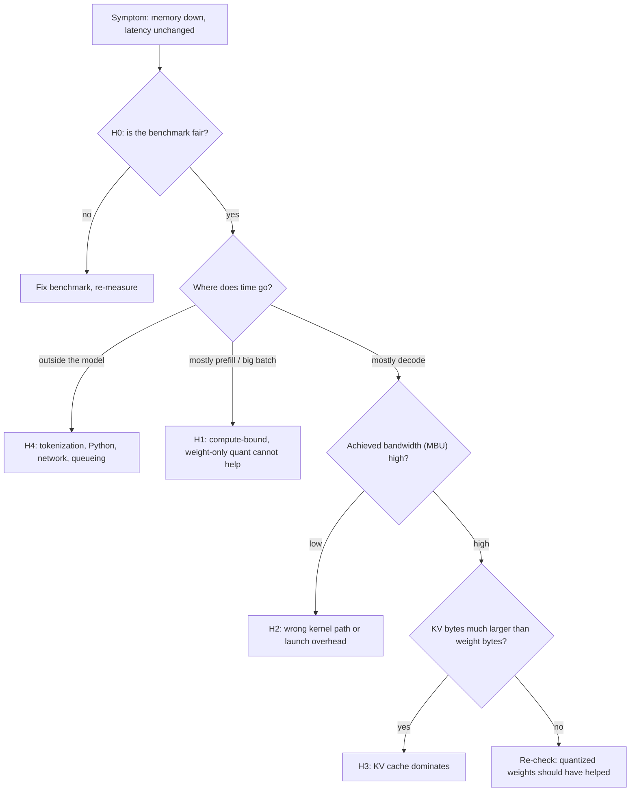
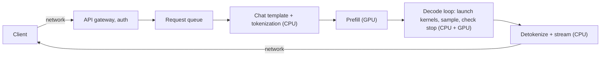

# Debugging Case: A Quantized LLM Uses Less Memory but Latency Is Unchanged

> **Level:** Beginner to Advanced · **Study time:** ~110 min · **Prerequisites:** [How to Approach AI/ML System Design and Debugging Interviews](01-how-to-approach-ai-system-design-interviews.md), [LLM Inference Fundamentals: Prefill, Decode, TTFT and Throughput](../06-llm-inference/01-inference-fundamentals-prefill-decode-and-latency-metrics.md), [The KV Cache](../06-llm-inference/02-kv-cache-explained.md), [GPU Fundamentals for LLMs: Compute-Bound vs Memory-Bound](../06-llm-inference/03-gpu-fundamentals-compute-bound-vs-memory-bound.md), [Practical LLM Quantization](../07-model-compression/04-llm-quantization-gptq-awq-and-outliers.md)

## Table of contents

- [Why this matters](#why-this-matters)
- [1. The case and how to attack it in an interview](#1-the-case-and-how-to-attack-it-in-an-interview)
- [2. Five-minute recap: where LLM latency comes from](#2-five-minute-recap-where-llm-latency-comes-from)
- [3. The running example and the first measurements](#3-the-running-example-and-the-first-measurements)
- [4. Hypothesis 0: is the measurement even right?](#4-hypothesis-0-is-the-measurement-even-right)
- [5. Hypothesis 1: is the workload compute-bound or memory-bandwidth-bound?](#5-hypothesis-1-is-the-workload-compute-bound-or-memory-bandwidth-bound)
- [6. Hypothesis 2: are optimized quantized kernels actually being used?](#6-hypothesis-2-are-optimized-quantized-kernels-actually-being-used)
- [7. Hypothesis 3: is the KV cache or attention the dominant cost?](#7-hypothesis-3-is-the-kv-cache-or-attention-the-dominant-cost)
- [8. Hypothesis 4: is the bottleneck outside the model?](#8-hypothesis-4-is-the-bottleneck-outside-the-model)
- [9. How to profile inference, top-down](#9-how-to-profile-inference-top-down)
- [10. Remedies, matched to the diagnosis](#10-remedies-matched-to-the-diagnosis)
- [11. Verifying the fix with a fair benchmark](#11-verifying-the-fix-with-a-fair-benchmark)
- [12. Going deeper: senior-level production concerns](#12-going-deeper-senior-level-production-concerns)
- [Common mistakes and misconceptions](#common-mistakes-and-misconceptions)
- [Interview questions and model answers](#interview-questions-and-model-answers)
- [Key takeaways](#key-takeaways)
- [Further reading](#further-reading)
- [Next](#next)

## Why this matters

Quantization is the most common "make the LLM cheaper and faster" lever, and it is also one of the most commonly misunderstood. Teams quantize a model to 4-bit, see GPU memory drop by roughly 3x, and then are surprised that users see no faster responses. This exact scenario is a favorite senior interview question because it cannot be answered by reciting a definition: you have to reason about where time actually goes (prefill vs decode, weights vs KV cache, GPU vs CPU, model vs everything around it), and then prove it with measurements. A strong answer shows that you know quantization saves *bytes*, that saved bytes only save *time* when moving bytes was the bottleneck, and that the right kernel on the right hardware has to exist for the savings to become real. The same debugging method (restate, hypothesize, measure, fix, verify) transfers to almost every performance problem you will own.

## 1. The case and how to attack it in an interview

### 1.1 The symptom, restated

> "We quantized our 7B chat model from FP16 to 4-bit. GPU memory went from about 16 GB to about 5.5 GB. But the p50 end-to-end latency only went from 3.12 s to 3.05 s. Why, and what would you do?"

First, restate it in precise terms so you and the interviewer agree on what is being measured:

- **What changed:** the weight format (16-bit to 4-bit). Was anything else changed at the same time (library, engine, GPU, prompt, batch settings)?
- **What improved:** memory footprint, which is expected: 4-bit weights are about a quarter the size of 16-bit weights.
- **What did not improve:** **latency**, the time a user waits. We need to know which latency: **end-to-end (E2E)** latency (request in to last token out), **time to first token (TTFT)**, or **time per output token (TPOT)**, the average gap between generated tokens. And which statistic: **p50** is the median request, **p95** is the latency that 95% of requests beat (the slow tail users complain about).
- **Under what conditions:** a single request on an idle server, or production traffic with many concurrent users?

> **Interview tip:** Before hypothesizing, ask 3 to 5 clarifying questions: which quantization method and library, which GPU, which serving stack, typical prompt and output lengths, batch size or concurrency, and which latency metric. Each answer eliminates whole branches of the investigation. The general framework for these interviews is in [How to Approach AI/ML System Design and Debugging Interviews](01-how-to-approach-ai-system-design-interviews.md).

### 1.2 The core insight in one sentence

Quantizing weights shrinks **how many bytes the GPU must read**, so it speeds up only the part of the time that is spent **reading weights**, and only if a kernel actually reads the small format instead of expanding it back to 16-bit.

> **Analogy:** You replaced a delivery company's heavy boxes with light ones. Shipping got faster only on routes where the trucks were overloaded (bandwidth-limited). On routes where the delay is the warehouse paperwork (CPU overhead), the loading dock queue (request queueing), or the time to assemble the product before shipping (compute), lighter boxes change nothing. And if the warehouse unpacks every light box back into a heavy one before loading it (dequantize to FP16), you saved storage space but not shipping time.

### 1.3 The hypothesis list

A senior answer lists hypotheses, orders them by likelihood and cost to check, and investigates each with a concrete measurement:

| # | Hypothesis | Quick check | Typical evidence |
|---|---|---|---|
| H0 | The measurement is wrong or unfair | Re-run with warmup, GPU sync, fixed input and output lengths | Numbers change a lot between runs; different output lengths |
| H1 | The workload is **compute-bound** (prefill-heavy or large batches), so saving bytes does not help | Split latency into TTFT vs decode; check batch size; roofline math | Most time in prefill; large batches; high tensor-core utilization |
| H2 | Optimized low-bit kernels are not used (dequantize to FP16 then standard GEMM, or a slow fallback path) | Inspect module types, engine logs, profiler kernel names | Separate dequantize kernels plus cuBLAS GEMMs; low achieved bandwidth |
| H3 | The **KV cache** or attention dominates the bytes per step, not the weights | Compute KV bytes vs weight bytes per step | Long contexts or many concurrent sequences |
| H4 | The bottleneck is outside the model: tokenization, Python, network, queueing, retrieval | Stage-level timers, `py-spy`, server queue metrics | GPU idle gaps; time spent before the model runs |

If some terms in this table are new (roofline, GEMM, cuBLAS, MBU, DCGM), that is expected: each one is defined in the section that tests its hypothesis.



The rest of the chapter walks this tree with a running example, real commands, and a fix.

## 2. Five-minute recap: where LLM latency comes from

This section is a brief recap. The full treatment is in [LLM Inference Fundamentals](../06-llm-inference/01-inference-fundamentals-prefill-decode-and-latency-metrics.md) and [GPU Fundamentals](../06-llm-inference/03-gpu-fundamentals-compute-bound-vs-memory-bound.md).

### 2.1 Two phases: prefill and decode

An LLM generates text in two phases:

- **Prefill:** the model processes the whole prompt in one big forward pass and produces the first output token. All prompt tokens are processed in parallel, so this is a large matrix multiplication that keeps the GPU's arithmetic units busy. Its duration drives TTFT.
- **Decode:** the model generates one token at a time. Each step runs the whole model for just one new token per sequence, reusing the **KV cache** (the stored attention keys and values of all previous tokens, explained in [The KV Cache](../06-llm-inference/02-kv-cache-explained.md)). Each step must read every weight from GPU memory, but does very little arithmetic per weight. Its per-step duration is the TPOT.

### 2.2 The latency equation

$$T_{\text{E2E}} = T_{\text{outside}} + T_{\text{queue}} + T_{\text{prefill}} + n_{\text{out}} \cdot \text{TPOT}$$

- $T_{\text{E2E}}$: end-to-end latency the user sees.
- $T_{\text{outside}}$: work outside the model: HTTP handling, authentication, chat templating, tokenization, retrieval (in RAG), detokenization, network.
- $T_{\text{queue}}$: time the request waits before the GPU starts working on it.
- $T_{\text{prefill}}$: prompt processing time (roughly TTFT minus queue and outside time).
- $n_{\text{out}}$: number of generated tokens.
- $\text{TPOT}$: time per output token during decode.

**Tiny example (illustrative):** outside work 0.25 s, no queue, prefill 0.07 s, 200 output tokens at 14 ms each.

- Decode: $200 \times 0.014 = 2.8$ s.
- Total: $0.25 + 0 + 0.07 + 2.8 = 3.12$ s.

Notice that decode is $2.8 / 3.12 \approx 90\%$ of the total here. Weight quantization targets decode, so in this shape it *should* help a lot. Remember this; it is why our running example is so suspicious.

### 2.3 Compute-bound vs memory-bandwidth-bound

A GPU has two speed limits:

- **Peak compute** $P$: how many floating-point operations (**FLOPs**) per second it can do. An NVIDIA A100 (Ampere generation) does about 312 TFLOPS (trillion FLOPs per second) of dense FP16/BF16 math on its **tensor cores**, the specialized matrix-multiply units that do almost all of an LLM's arithmetic.
- **Memory bandwidth** $BW$: how many bytes per second it can move from its main memory (**HBM**, high-bandwidth memory) to the compute units. An A100 80 GB moves about 2.0 TB/s.

A piece of work is **compute-bound** when the arithmetic takes longer than moving the data, and **memory-bandwidth-bound** (usually just **memory-bound**) when moving the data takes longer. The ratio that decides it is **arithmetic intensity**:

$$AI = \frac{\text{FLOPs performed}}{\text{bytes moved from memory}}$$

The hardware's break-even point, the **ridge point**, is $P / BW$. For the A100: $312 \times 10^{12} / 2.0 \times 10^{12} = 156$ FLOPs per byte. Work with $AI$ below 156 is memory-bound on an A100; above 156 it is compute-bound.

```text
attainable FLOP/s (log scale)
     ^
312T +                    +=======================x=======  flat compute roof
     |                  / ^                       ^
     |                /   ridge point             prefill, AI ~ 1,000:
     |              /     (AI = 156 on an A100)   compute-bound
     |            /
     |          /   slanted bandwidth roof: FLOP/s = AI x 2.0 TB/s
     |        /
     |      x  <- decode at batch 1 in FP16, AI ~ 1: memory-bound
     +----------------------------------------------------------> arithmetic intensity
                                                                  (FLOPs per byte, log scale)
```

This picture is the **roofline model** (Williams, Waterman and Patterson, 2009): the best speed any piece of work can reach is the lower of the two roofs at its $AI$. Weight-only quantization keeps the FLOPs and cuts the bytes, so it moves decode to the right along the slanted roof, raising its ceiling. Work already under the flat roof gains nothing from moving right.

### 2.4 Why quantization should speed up decode

During decode at batch size 1, every weight is read once per step and used for about 2 FLOPs (one multiply, one add). So the time per step is bounded below by the time to read all the bytes:

$$\text{TPOT} \gtrsim \frac{W_{\text{bytes}} + K_{\text{bytes}}}{BW}$$

- $W_{\text{bytes}}$: total bytes of model weights read per step.
- $K_{\text{bytes}}$: bytes of KV cache read per step (all cached keys and values of all active sequences).
- $BW$: memory bandwidth in bytes per second.
- $\gtrsim$: "at least about"; real kernels reach some fraction of peak bandwidth.

**Worked example (7B model on an A100, batch 1, about 1,100 tokens of context):**

- FP16 weights: $7 \times 10^9 \text{ params} \times 2 \text{ bytes} = 14$ GB.
- KV cache (computed in section 7): about 0.58 GB.
- FP16 bound: $(14 + 0.58) / 2{,}000 \text{ GB/s} = 14.58 / 2{,}000 = 0.00729$ s $= 7.29$ ms.
- 4-bit weights, using about 4.5 effective bits per parameter to account for scales and layers kept in 16-bit (illustrative): $7 \times 10^9 \times 4.5 / 8 = 3.94$ GB.
- 4-bit bound: $(3.94 + 0.58) / 2{,}000 = 4.52 / 2{,}000 = 0.00226$ s $= 2.26$ ms.

So in the ideal case, decode should get about $7.29 / 2.26 \approx 3.2\times$ faster. When it does not, one of our hypotheses is true.

## 3. The running example and the first measurements

Here is the concrete setup we will debug through the chapter. All timing numbers are **illustrative**, chosen to be realistic in shape; your real numbers will differ.

| Item | Value |
|---|---|
| Model | A 7B decoder-only chat model, Llama-2-7B-like shape: 32 layers, 32 attention heads, head dimension 128, standard multi-head attention |
| GPU | One NVIDIA A100 80 GB (about 2.0 TB/s, about 312 dense FP16 TFLOPS) |
| Serving stack | A FastAPI service calling Hugging Face Transformers `model.generate()`, one request at a time |
| Use case | Internal support assistant: about 1,000 prompt tokens in, about 200 tokens out |
| Change | Loaded with bitsandbytes 4-bit NF4 (`load_in_4bit=True`) instead of FP16. **NF4** ("4-bit NormalFloat", introduced with QLoRA) is a 4-bit data type whose 16 levels are spaced to suit normally distributed weights; the weights are quantized on the fly at load time |

The team's measurements (illustrative):

| Metric | FP16 | 4-bit NF4 | Change |
|---|---|---|---|
| GPU memory in use | ~16 GB | ~5.5 GB | -66% |
| p50 E2E latency | 3.12 s | 3.05 s | -2% |
| TTFT (excluding outside work) | 70 ms | 95 ms | +36% (worse) |
| TPOT | 14.0 ms | 13.5 ms | -4% |

Already, splitting E2E into TTFT and TPOT tells us a lot:

- Decode is 90% of the time, so H1 ("it is compute-bound") cannot be the main story for this workload. Decode at batch 1 is memory-bound.
- TPOT barely moved even though bytes per step dropped about 3.2x. That points to H2 (kernels) or H4 (launch and Python overhead).
- Prefill got *slower*. That is a classic signature of dequantization overhead in a compute-bound phase (H2 and H1 together).

### 3.1 Amdahl's law: how much can a local speedup help?

**Amdahl's law** says the overall speedup from speeding up one part of a system is limited by the fraction of time that part takes:

$$S_{\text{overall}} = \frac{1}{(1 - f) + \dfrac{f}{s}}$$

- $f$: fraction of total time spent in the part you sped up (here, weight reading during decode).
- $s$: speedup of that part (here, the reduction in weight bytes).
- $S_{\text{overall}}$: speedup of the whole request.

**Example 1 (decode dominates):** $f = 0.9$, $s = 3$.

- $1 - f = 0.1$; $f / s = 0.9 / 3 = 0.3$.
- $S = 1 / (0.1 + 0.3) = 1 / 0.4 = 2.5\times$.

**Example 2 (something else dominates):** $f = 0.2$, $s = 3$.

- $1 - f = 0.8$; $f / s = 0.2 / 3 \approx 0.0667$.
- $S = 1 / (0.8 + 0.0667) = 1 / 0.8667 \approx 1.15\times$.

In example 2, a perfect 3x speedup of the model only gives 15% end to end: "almost unchanged". So the first job is always to find $f$.

> **Senior insight:** "Latency unchanged" is a statement about the whole request. Quantization is a statement about one component. Amdahl's law connects them. Always decompose the latency before blaming or praising the model.

## 4. Hypothesis 0: is the measurement even right?

Before any deep investigation, make sure the comparison is fair. A surprising fraction of "quantization did nothing" reports are measurement bugs.

### 4.1 The fairness checklist

| Pitfall | Why it distorts results | Fix |
|---|---|---|
| No warmup | First calls pay for CUDA context creation, kernel selection, memory allocation, `torch.compile` compilation | Run 3 or more warmup iterations and discard them |
| No GPU synchronization | GPU work is **asynchronous**: Python returns as soon as the work is queued, so timers measure queuing, not execution | Call `torch.cuda.synchronize()` before stopping timers, or use CUDA events |
| Different output lengths | The quantized model may answer more verbosely or stop at different places; 250 tokens vs 200 tokens is 25% more decode | Force a fixed number of output tokens (`min_new_tokens = max_new_tokens`, or `ignore_eos` in engines); report TPOT, not only E2E |
| Different prompts or batch sizes | Prefill cost scales with prompt length and batch | Same prompt set, same batch size, same concurrency |
| Different decoding settings | Sampling, beam search, repetition penalty, logits processors change both work and output length | Greedy decoding for benchmarks, identical generation config |
| Caches warm in one run only | Prefix caching (reusing the stored KV of a prompt prefix seen before) or the OS file cache make the second variant look faster | Disable prefix caching or warm both equally |
| Shared or throttled GPU | Another process on the GPU, thermal or power throttling | Check `nvidia-smi` for other processes, clocks and power |
| Single sample | Run-to-run noise of several percent | Many iterations; report median and p95 |
| Measuring at the wrong layer | Client-side timing includes network; server-side does not | Measure at both, and know which one the users experience |

> **Common mistake:** Comparing E2E latency of two models that generated different numbers of tokens. Always normalize: TTFT for prefill, TPOT for decode, and a fixed output length when comparing E2E.

### 4.2 A fair micro-benchmark: separating TTFT from TPOT

A neat trick: time a generation of 1 token (approximately prefill plus one step) and of $n$ tokens. The difference divided by $n - 1$ is the TPOT.

$$\text{TPOT} \approx \frac{T(n) - T(1)}{n - 1}$$

- $T(n)$: time to generate exactly $n$ tokens.
- $T(1)$: time to generate exactly 1 token (prefill plus one sampling step).

**Example:** $T(200) = 2.88$ s, $T(1) = 0.0835$ s. Then $\text{TPOT} \approx (2.88 - 0.0835) / 199 = 2.7965 / 199 \approx 0.01405$ s $= 14.05$ ms.

```python
# pip install torch transformers accelerate bitsandbytes
# Fair TTFT/TPOT benchmark for a Hugging Face causal LM (needs a CUDA GPU).
import gc, statistics, time
import torch
from transformers import AutoModelForCausalLM, AutoTokenizer, BitsAndBytesConfig

MODEL = "meta-llama/Llama-2-7b-chat-hf"   # gated on the Hub; any 7B causal LM works

def timed_generate(model, inputs, n_new: int) -> tuple[float, int]:
    """Generate exactly n_new tokens greedily; return (seconds, tokens generated)."""
    torch.cuda.synchronize()                       # start from an idle GPU
    t0 = time.perf_counter()
    with torch.inference_mode():
        out = model.generate(**inputs, max_new_tokens=n_new, min_new_tokens=n_new,
                             do_sample=False)
    torch.cuda.synchronize()                       # wait for all GPU work to finish
    return time.perf_counter() - t0, out.shape[1] - inputs["input_ids"].shape[1]

def benchmark(model, tok, prompt: str, n_new: int = 200, warmup: int = 3, iters: int = 10):
    inputs = tok(prompt, return_tensors="pt").to(model.device)
    for _ in range(warmup):                        # discard warmup runs
        timed_generate(model, inputs, n_new)
    t1 = statistics.median(timed_generate(model, inputs, 1)[0] for _ in range(iters))
    runs = [timed_generate(model, inputs, n_new) for _ in range(iters)]
    assert all(n == n_new for _, n in runs), "output length must be identical"
    tn = statistics.median(t for t, _ in runs)
    return {"prompt_tokens": inputs["input_ids"].shape[1],
            "ttft_ms": 1e3 * t1, "tpot_ms": 1e3 * (tn - t1) / (n_new - 1),
            "e2e_s": tn, "peak_mem_gb": torch.cuda.max_memory_allocated() / 1e9}

tok = AutoTokenizer.from_pretrained(MODEL)
prompt = "Summarize our refund policy for a customer. " * 100   # roughly 1,000 tokens

variants = {
    # `dtype=` is the current argument name; Transformers before 4.56 calls it `torch_dtype=`.
    "fp16": dict(dtype=torch.float16),
    "nf4": dict(quantization_config=BitsAndBytesConfig(
        load_in_4bit=True, bnb_4bit_quant_type="nf4",
        bnb_4bit_compute_dtype=torch.float16)),
}
for name, kwargs in variants.items():
    torch.cuda.reset_peak_memory_stats()
    model = AutoModelForCausalLM.from_pretrained(MODEL, device_map="cuda", **kwargs).eval()
    print(name, benchmark(model, tok, prompt))
    del model; gc.collect(); torch.cuda.empty_cache()   # free before the next variant
```

Notes on this harness:

- It loads one variant at a time so they do not compete for the GPU.
- `min_new_tokens` forces identical output lengths even if the model wants to stop early.
- It measures one request at a time. Production latency under load is a different experiment (section 11).

If H0 survives (the gap is still "almost unchanged" with a fair benchmark), move on.

## 5. Hypothesis 1: is the workload compute-bound or memory-bandwidth-bound?

### 5.1 What weight-only quantization changes, and what it does not

Most 4-bit LLM formats (GPTQ, AWQ, bitsandbytes NF4) are **weight-only** quantization, often written **W4A16**: weights stored in 4 bits, **activations** (the intermediate values flowing through the network) kept in 16 bits. Inside the kernel, the 4-bit weights are converted (**dequantized**) back to 16-bit and multiplied using ordinary FP16 tensor-core math.

That has a crucial consequence:

| Resource | FP16 model | W4A16 model |
|---|---|---|
| Bytes of weights read per step | 2 per parameter | about 0.5 per parameter (plus scales) |
| FLOPs per token | about 2 per parameter | about 2 per parameter (same!) plus dequantization work |
| Tensor-core format used for the math | FP16 | FP16 |

So W4A16 helps **only** memory-bound work. Compute-bound work does the same FP16 arithmetic, plus extra instructions to unpack and scale the 4-bit values.

> **Analogy:** You compressed the recipe book so it is faster to carry into the kitchen, but the chef still has to cook every dish at the same speed, and now also has to decompress each page before reading it.

### 5.2 Arithmetic intensity with batching and quantization

For one linear layer with batch size $B$ (tokens processed together) and $b_w$ bytes per weight, ignoring the small activation traffic:

$$AI \approx \frac{2B}{b_w}$$

- $2B$: FLOPs per weight (one multiply and one add for each of the $B$ tokens).
- $b_w$: bytes per weight: 2 for FP16, 1 for INT8 or FP8, about 0.5 for 4-bit.

| Format | $AI$ | Becomes compute-bound on A100 (ridge 156) when |
|---|---|---|
| FP16 | $2B / 2 = B$ | $B > 156$ |
| W8A16 | $2B / 1 = 2B$ | $B > 78$ |
| W4A16 | $2B / 0.5 = 4B$ | $B > 39$ |

**Worked check for W4A16:** we need $4B > 156$, so $B > 156 / 4 = 39$.

Read this as: with 4-bit weights, once roughly 40 or more tokens are processed together in one matmul, the layer is already compute-bound, and the 4-bit storage no longer buys speed. Real kernels hit this crossover somewhat earlier or later depending on their efficiency, but the shape of the argument holds.

Where do "tokens processed together" come from?

- **Prefill:** every prompt token. A 1,000-token prompt means $B = 1{,}000$ for every weight matmul: firmly compute-bound.
- **Decode with batching:** one token per active sequence. A server running 64 concurrent sequences has $B = 64$ during decode: the linear layers are compute-bound for W4A16 on an A100 (in this ideal model). Attention over the KV cache is different: each sequence reads its own keys and values, so that part stays memory-bound at any batch size.
- **Decode at batch 1:** $B = 1$: strongly memory-bound. This is where weight-only quantization shines.

### 5.3 Measuring the prefill vs decode share

The **decode share** of a request is:

$$\text{decode share} = \frac{n_{\text{out}} \cdot \text{TPOT}}{T_{\text{prefill}} + n_{\text{out}} \cdot \text{TPOT}}$$

Compare two workloads (illustrative, model time only, FP16):

| Workload | Prompt | Output | Prefill | Decode | Decode share |
|---|---|---|---|---|---|
| A: chat assistant | 1,000 | 200 | 0.07 s | $200 \times 0.014 = 2.8$ s | $2.8 / 2.87 \approx 98\%$ |
| B: document classifier | 6,000 | 5 | 0.45 s | $5 \times 0.016 = 0.08$ s | $0.08 / 0.53 \approx 15\%$ |

Workload B (long input, tiny output: classification, extraction, reranking, summarization with short summaries) is dominated by prefill. Weight-only quantization cannot make it meaningfully faster, and may make it slower.

### 5.4 A back-of-the-envelope estimator

This from-scratch script applies the two bounds (compute for prefill, bandwidth for decode). It ignores attention FLOPs and kernel inefficiency, so treat its output as an *ideal lower bound*, not a prediction.

```python
# Roofline-style latency estimator for one batch of identical requests (no GPU needed).
from dataclasses import dataclass

@dataclass
class GPU:
    bw_gbs: float      # HBM bandwidth in GB/s
    tflops16: float    # dense FP16/BF16 tensor-core TFLOPS

@dataclass
class Model:
    params_b: float    # parameters, in billions
    n_layers: int
    n_kv_heads: int
    head_dim: int

def kv_bytes_per_token(m: Model, kv_bytes: float) -> float:
    # keys + values, for every layer and KV head
    return 2 * m.n_layers * m.n_kv_heads * m.head_dim * kv_bytes

def estimate(m: Model, g: GPU, weight_bits: float, batch: int, prompt: int, out: int,
             kv_bytes: float = 2.0):
    params = m.params_b * 1e9
    # Prefill: compute-bound, about 2 FLOPs per parameter per token (attention FLOPs ignored).
    # Weight-only formats still compute in FP16, so the FP16 peak applies.
    prefill_s = 2 * params * prompt * batch / (g.tflops16 * 1e12)
    # Decode: each step reads all weights once plus every sequence's KV cache.
    avg_ctx = prompt + out / 2
    step_bytes = params * weight_bits / 8 + batch * avg_ctx * kv_bytes_per_token(m, kv_bytes)
    tpot_s = max(step_bytes / (g.bw_gbs * 1e9),              # bandwidth bound
                 2 * params * batch / (g.tflops16 * 1e12))   # compute bound
    return prefill_s, tpot_s, prefill_s + out * tpot_s

a100 = GPU(bw_gbs=2000, tflops16=312)
llama7b = Model(params_b=7, n_layers=32, n_kv_heads=32, head_dim=128)

cases = [("A fp16", 16, 1, 1000, 200, 2), ("A int4", 4.5, 1, 1000, 200, 2),
         ("B fp16", 16, 8, 8000, 50, 2), ("B int4", 4.5, 8, 8000, 50, 2),
         ("B int4+fp8kv", 4.5, 8, 8000, 50, 1)]
for name, bits, batch, prompt, out, kvb in cases:
    p, t, tot = estimate(llama7b, a100, bits, batch, prompt, out, kvb)
    print(f"{name}: prefill={p*1e3:.1f} ms TPOT={t*1e3:.2f} ms total={tot:.2f} s")
# A fp16: prefill=44.9 ms TPOT=7.29 ms total=1.50 s
# A int4: prefill=44.9 ms TPOT=2.26 ms total=0.50 s
# B fp16: prefill=2871.8 ms TPOT=23.83 ms total=4.06 s
# B int4: prefill=2871.8 ms TPOT=18.80 ms total=3.81 s
# B int4+fp8kv: prefill=2871.8 ms TPOT=10.38 ms total=3.39 s
```

Let us verify case A by hand:

- Prefill: $2 \times 7 \times 10^9 \times 1{,}000 \times 1 = 1.4 \times 10^{13}$ FLOPs. Divided by $312 \times 10^{12}$ FLOP/s: $1.4 \times 10^{13} / 3.12 \times 10^{14} = 0.0449$ s $= 44.9$ ms.
- Average context: $1{,}000 + 200 / 2 = 1{,}100$ tokens.
- KV bytes per token: $2 \times 32 \times 32 \times 128 \times 2 = 524{,}288$ bytes. Times 1,100 tokens: $576{,}716{,}800$ bytes $\approx 0.577$ GB.
- FP16 step: $(14 + 0.577) \text{ GB} / 2{,}000 \text{ GB/s} = 7.29$ ms. Total: $0.0449 + 200 \times 0.00729 = 0.0449 + 1.458 = 1.50$ s.
- INT4 step: $(3.9375 + 0.577) / 2{,}000 = 4.514 / 2{,}000 = 2.26$ ms. Total: $0.0449 + 200 \times 0.00226 = 0.0449 + 0.451 = 0.50$ s.
- Ideal speedup: $1.50 / 0.50 \approx 3.0\times$.

And case B (batch 8 of 8,000-token documents, 50 output tokens):

- Prefill: $2 \times 7 \times 10^9 \times 8{,}000 \times 8 = 8.96 \times 10^{14}$ FLOPs; $/ 3.12 \times 10^{14} = 2.87$ s.
- KV per step: $8 \times 8{,}025 \times 524{,}288 = 64{,}200 \times 524{,}288 = 33{,}659{,}289{,}600$ bytes $\approx 33.66$ GB.
- FP16 step: $(14 + 33.66) / 2{,}000 = 23.83$ ms; INT4 step: $(3.94 + 33.66) / 2{,}000 = 18.80$ ms.
- Totals: $2.87 + 50 \times 0.02383 = 2.87 + 1.19 = 4.06$ s vs $2.87 + 50 \times 0.0188 = 2.87 + 0.94 = 3.81$ s.
- Ideal speedup: $4.06 / 3.81 \approx 1.07\times$. "Almost unchanged" even with perfect kernels.

> **Interview tip:** When asked "is the workload compute-bound or memory-bound?", answer *per phase*: "Prefill is compute-bound because hundreds of tokens share each weight read. Decode at small batch is memory-bound because each weight is read for one token. Large-batch decode moves toward compute-bound, and with 4-bit weights that happens at a batch about 4x smaller than with FP16." Then say how you would measure it: TTFT vs TPOT split, batch size from server metrics, and tensor-core vs DRAM utilization from DCGM (NVIDIA's Data Center GPU Manager, which exposes hardware activity counters).

### 5.5 How to measure it directly

| Signal | Tool | Compute-bound looks like | Memory-bound looks like |
|---|---|---|---|
| Time split | Server metrics or the harness above | Most time in prefill (TTFT) | Most time in decode (TPOT x tokens) |
| Running batch size | Engine metrics (running requests) | Large (dozens or more) | Small (1 to a few) |
| Tensor pipe active | DCGM field 1004 (`DCGM_FI_PROF_PIPE_TENSOR_ACTIVE`) | High | Low |
| DRAM active | DCGM field 1005 (`DCGM_FI_PROF_DRAM_ACTIVE`) | Moderate | High (if kernels are good) |
| Kernel roofline position | Nsight Compute "Speed of Light" and roofline sections | Near the compute roof | Near the bandwidth roof |

```bash
# Sample SM active, SM occupancy, tensor-pipe active and DRAM active every second while traffic runs.
# Profiling fields depend on GPU model and DCGM version; check the DCGM docs for yours.
dcgmi dmon -e 1002,1003,1004,1005
```

An **SM** (streaming multiprocessor) is one of the GPU's compute blocks (an A100 has 108); "SM active" is the fraction of time SMs have work assigned.

If both tensor activity and DRAM activity are low, the GPU is neither compute- nor memory-bound: it is mostly **idle or waiting**, which points to H2 (bad kernels) or H4 (overhead outside the GPU).

## 6. Hypothesis 2: are optimized quantized kernels actually being used?

This is the most common root cause in practice, and the one interviewers most want to hear.

### 6.1 Three execution paths for a 4-bit matmul

A **kernel** is a function that runs on the GPU. A **GEMM** (general matrix multiply) is the matrix multiplication at the heart of every linear layer. When only one token is processed, the GEMM degenerates into a **GEMV** (matrix-vector multiply), which is why batch-1 decode kernels often have `gemv` in their names. **cuBLAS** is NVIDIA's standard library of GEMM kernels for FP16, BF16, FP32 and so on, and **CUTLASS** is NVIDIA's open-source template library that many custom GEMM kernels are built from. There are three ways a framework can execute a 4-bit linear layer:

```text
Path A: fused low-bit kernel (what you want)
  HBM: 4-bit weights --> [one kernel: load 4-bit tile into registers,
                          dequantize on chip, FP16 tensor-core multiply] --> output
  HBM traffic per weight: about 0.5 byte read
  Kernels per layer: 1

Path B: dequantize, then standard GEMM
  HBM: 4-bit weights --> [kernel 1: dequantize] --> HBM: temporary FP16 copy
                     --> [kernel 2: cuBLAS FP16 GEMM reads the FP16 copy] --> output
  HBM traffic per weight: 0.5 read + 2 written + 2 read = 4.5 bytes
  Kernels per layer: 2 or more

Path C: slow fallback
  Generic or unfused code: FP32 compute, Python-level loops over blocks,
  layers silently offloaded to CPU, emulated formats the GPU lacks
  HBM traffic: irrelevant; time is dominated by the slow path itself
```

Look at path B's byte count. Reading 4.5 bytes per weight is *more* than the 2 bytes FP16 would read. A dequantize-then-GEMM path can be **slower** than plain FP16 even though it uses less memory at rest. (When a dequantized layer is small enough to stay in the on-chip L2 cache some of that traffic is avoided, but a 7B model's weight matrices, about 34 to 90 MB each in FP16 against the A100's 40 MB of L2, mostly do not fit.)

Fused kernels such as **Marlin** (a mixed-precision INT4 x FP16 kernel developed by the GPTQ authors' group), the AWQ and ExLlama kernels, and TensorRT-LLM's low-bit kernels implement path A.

### 6.2 Known traps that push you onto path B or C

| Trap | What happens | How to spot it |
|---|---|---|
| bitsandbytes 4-bit used for serving | Designed primarily for memory savings and QLoRA fine-tuning. Recent versions have a fast path for single-token inputs, but multi-token inputs (prefill, batched decode) dequantize and then run a standard 16-bit matmul (behavior varies by version) | Profiler shows dequantize kernels plus cuBLAS GEMMs; prefill gets slower than FP16 |
| Compute dtype left at FP32 | Transformers' `BitsAndBytesConfig` defaults `bnb_4bit_compute_dtype` to FP32 unless you set it; bitsandbytes warns that this leads to slow inference | A warning in the logs; FP32 GEMM kernels (no tensor cores or TF32 paths) in the profile |
| LLM.int8() (`load_in_8bit=True`) | Splits outlier columns into a separate FP16 matmul; extra gather and two GEMMs; often slower than FP16 at small batch | Many small kernels per layer; see [Practical LLM Quantization](../07-model-compression/04-llm-quantization-gptq-awq-and-outliers.md) |
| GPTQ or AWQ checkpoint without its kernel package | The library falls back to a slower generic implementation, or kernels are disabled by a config flag | Startup warnings; kernel names in the profile do not mention the fast kernel |
| Format not supported by the hardware | FP8 W8A8 needs FP8 tensor cores (NVIDIA's Ada, Hopper and Blackwell generations, for example L40S, H100, B200). On an A100 there are none, so an engine either refuses, runs weight-only with upcasting, or falls back | Engine log says which method and kernel it picked |
| Kernel not tuned for this shape | Fused kernels have supported shapes, group sizes and batch ranges; outside them some engines pick a generic path | Engine log, or a microbenchmark across batch sizes |
| Layers silently on CPU | `device_map="auto"` offloads layers to CPU when it thinks GPU memory is short | `model.hf_device_map` shows `"cpu"` or `"disk"` entries; PCIe traffic every step |

### 6.3 Check 1: what modules and devices are actually loaded?

```python
# Inspect a loaded Hugging Face model: which Linear implementations, which devices, how big.
from collections import Counter

def describe(model):
    linear_types = Counter(f"{type(m).__module__}.{type(m).__name__}"
                           for m in model.modules() if "Linear" in type(m).__name__)
    devices = Counter(str(p.device) for p in model.parameters())
    print("linear layer types:", dict(linear_types))
    print("parameter devices:", dict(devices))
    print("footprint (GB):", round(model.get_memory_footprint() / 1e9, 2))
    print("device map:", getattr(model, "hf_device_map", None))
    print("quant config:", getattr(model.config, "quantization_config", None))

# describe(model)
# For a bitsandbytes 4-bit model you would expect most layers to be
# bitsandbytes.nn.modules.Linear4bit, plus a torch.nn Linear for lm_head
# (the output head is usually kept in 16-bit).
```

This confirms what was loaded, but not which kernel runs. For that, profile.

### 6.4 Check 2: which kernels run, and how long do they take?

The **PyTorch profiler** records every operator and GPU kernel with its duration. We profile a short decode and a prefill separately, because they use different shapes and often different kernels.

```python
# pip install torch transformers accelerate bitsandbytes
import torch
from torch.profiler import profile, ProfilerActivity

def top_kernels(model, inputs, n_new: int, rows: int = 15):
    with torch.inference_mode():
        model.generate(**inputs, max_new_tokens=4, do_sample=False)      # warmup
        with profile(activities=[ProfilerActivity.CPU, ProfilerActivity.CUDA]) as prof:
            model.generate(**inputs, max_new_tokens=n_new, min_new_tokens=n_new,
                           do_sample=False)
    # Sort key is "cuda_time_total" in many PyTorch versions, "device_time_total" in newer ones.
    print(prof.key_averages().table(sort_by="cuda_time_total", row_limit=rows))
    prof.export_chrome_trace("trace.json")   # open in https://ui.perfetto.dev

# top_kernels(model, inputs, n_new=1)    # mostly prefill
# top_kernels(model, inputs, n_new=64)   # mostly decode
```

How to read the table (exact kernel names vary by library, GPU and version):

- **Path A signature:** the top GPU entries are kernels whose names reference the quantization library or fused kernel (for example names containing `marlin`, `awq`, `exllama`, `gemv_4bit` or similar), and no separate dequantize kernel accompanies each layer.
- **Path B signature:** kernels with `dequantize` in the name, each followed by a standard cuBLAS or CUTLASS GEMM (names often contain `gemm`, `sm80` or `cutlass`). The count of dequantize calls roughly equals the number of linear layers times the number of forward passes.
- **Path C signature:** FP32 GEMM kernels, `aten::to` / `aten::copy_` conversions dominating, `cudaMemcpy` host-to-device every step (CPU offload), or huge CPU time with small GPU time.
- **Overhead signature:** "Self CPU total" much larger than total GPU time; thousands of tiny kernels each lasting a few microseconds.

### 6.5 Check 3: microbenchmark one layer across batch sizes

To see the crossover from section 5 on your actual kernels, time a single linear layer from each model at several token counts. Using CUDA events times the GPU work precisely.

```python
import torch

@torch.inference_mode()
def time_layer_ms(layer, n_tokens: int, iters: int = 200) -> float:
    x = torch.randn(n_tokens, layer.in_features, device="cuda", dtype=torch.float16)
    for _ in range(20):                       # warmup
        layer(x)
    start = torch.cuda.Event(enable_timing=True)
    end = torch.cuda.Event(enable_timing=True)
    start.record()
    for _ in range(iters):
        layer(x)
    end.record()
    torch.cuda.synchronize()
    return start.elapsed_time(end) / iters    # milliseconds per call

# fp16_layer = fp16_model.model.layers[0].mlp.down_proj   # torch.nn.Linear, 11008 -> 4096
# q_layer    = nf4_model.model.layers[0].mlp.down_proj    # bitsandbytes Linear4bit
# for n in (1, 8, 64, 512):
#     print(n, round(time_layer_ms(fp16_layer, n), 4), round(time_layer_ms(q_layer, n), 4))
```

What a healthy fused 4-bit kernel should show: clearly faster than FP16 at 1 to 8 tokens (memory-bound), converging toward FP16 by a few dozen tokens, roughly equal or slightly slower at hundreds of tokens (compute-bound). If the quantized layer is slower even at 1 token, the kernel path is the problem.

### 6.6 Check 4: achieved bandwidth (MBU)

**Model bandwidth utilization (MBU)** is the fraction of peak memory bandwidth the decode step actually achieves (popularized by Databricks' 2023 write-up "LLM Inference Performance Engineering: Best Practices"; full treatment in [GPU Fundamentals](../06-llm-inference/03-gpu-fundamentals-compute-bound-vs-memory-bound.md)):

$$\text{MBU} = \frac{(W_{\text{bytes}} + K_{\text{bytes}}) / \text{TPOT}}{BW_{\text{peak}}}$$

- Numerator: bytes the step logically must read, divided by the measured time per step, giving achieved bytes per second.
- $BW_{\text{peak}}$: the GPU's peak bandwidth.

**Our running example (illustrative measurements):**

- FP16: $14.58 \text{ GB} / 0.014 \text{ s} = 1{,}041$ GB/s. MBU $= 1{,}041 / 2{,}000 \approx 52\%$.
- NF4: $4.51 \text{ GB} / 0.0135 \text{ s} = 334$ GB/s. MBU $= 334 / 2{,}000 \approx 17\%$.

An MBU of 17% means the decode step is spending about 83% of its time on something other than streaming the bytes it needs. Reading less data did not help because reading data was no longer the bottleneck after quantization. Something else (dequantization kernels, launch overhead, Python) now sets the pace.

The compute-side twin is **model FLOPs utilization (MFU)**: achieved FLOPs per second divided by peak FLOPs, the right yardstick for compute-bound prefill. Rough check on our prefill (about $1.4 \times 10^{13}$ linear-layer FLOPs, computed in section 5.4; TTFT includes a little non-prefill work, so this slightly understates MFU): FP16 $1.4 \times 10^{13} / 0.070 \text{ s} = 200$ TFLOPS, about 64% of 312; NF4 $1.4 \times 10^{13} / 0.095 \text{ s} \approx 147$ TFLOPS, about 47%. Same FLOPs, more time: the dequantization overhead is visible as an MFU drop.

> **Senior insight:** MBU turns "TPOT barely changed" into a diagnosis. If MBU *drops* sharply after quantization, the bytes went away but the time did not: look at kernels and overhead. If MBU stays high but TPOT barely improved, the bytes did not go away: look at the KV cache (H3).

## 7. Hypothesis 3: is the KV cache or attention the dominant cost?

### 7.1 Memory capacity vs bytes per step

There are two different questions hiding under "is the KV cache the dominant memory consumer?":

1. **Capacity:** how many GB of GPU memory does the KV cache occupy? This decides how many sequences fit at once.
2. **Traffic:** how many bytes of KV cache must be read every decode step? This decides TPOT.

Weight quantization reduces the weight part of both. If the KV part is larger, the gain is small.

### 7.2 KV cache size formula

$$K_{\text{per token}} = 2 \times n_{\text{layers}} \times n_{\text{kv heads}} \times d_{\text{head}} \times b_{\text{kv}}$$

- $2$: one key vector and one value vector.
- $n_{\text{layers}}$: number of transformer layers.
- $n_{\text{kv heads}}$: number of key/value heads (equal to attention heads in standard multi-head attention; fewer with **grouped-query attention, GQA**, see [Modern LLM Architecture](../04-transformers/08-modern-llm-architecture-improvements.md)).
- $d_{\text{head}}$: dimension of each head.
- $b_{\text{kv}}$: bytes per stored value (2 for FP16, 1 for FP8 or INT8 KV).

**For our 7B model:** $2 \times 32 \times 32 \times 128 \times 2$.

- $2 \times 32 = 64$; $64 \times 32 = 2{,}048$; $2{,}048 \times 128 = 262{,}144$; $262{,}144 \times 2 = 524{,}288$ bytes, which is 0.5 MiB (about 0.52 MB) per token.

Then the KV bytes read per decode step are:

$$K_{\text{bytes}} = B \times L \times K_{\text{per token}}$$

where $B$ is the number of active sequences and $L$ their (average) context length.

### 7.3 When KV dominates

| Scenario | $B$ | $L$ | KV bytes per step | FP16 weights | Weight share of bytes (FP16) | Ideal decode speedup from 4-bit weights |
|---|---|---|---|---|---|---|
| Chat, batch 1 | 1 | 1,100 | 0.58 GB | 14 GB | 96% | $14.58 / 4.52 \approx 3.2\times$ |
| Long docs, batch 8 | 8 | 8,025 | 33.66 GB | 14 GB | 29% | $47.66 / 37.60 \approx 1.27\times$ |
| Long context, batch 1 | 1 | 32,000 | 16.78 GB | 14 GB | 45% | $30.78 / 20.72 \approx 1.49\times$ |

Checking the last row: $32{,}000 \times 524{,}288 = 16{,}777{,}216{,}000$ bytes $\approx 16.78$ GB. FP16 total $14 + 16.78 = 30.78$ GB; 4-bit total $3.94 + 16.78 = 20.72$ GB; ratio $30.78 / 20.72 \approx 1.49$.

With long contexts or many concurrent sequences, the KV cache is often the dominant memory consumer *and* the dominant per-step traffic. Weight quantization then attacks the minority of the bytes.

### 7.4 Attention as a cost of its own

Two more ways attention can dominate:

- **Prefill attention compute** grows with the square of the prompt length. At very long prompts it becomes a noticeable fraction of prefill FLOPs, and weight-only quantization does not touch it at all.
- **Unoptimized attention kernels.** Eager attention implementations that materialize the full attention matrix are much slower than fused ones such as **FlashAttention** (Dao et al., 2022). In Hugging Face, check the attention implementation in use (the `attn_implementation` argument, for example `"sdpa"`, PyTorch's fused scaled dot-product attention, or `"flash_attention_2"`). If your FP16 baseline used a fast attention path and the quantized load path ended up with a slower one, that alone can cancel the weight savings.

### 7.5 How to measure it

- **Compute it:** the formula above with your model config (`num_hidden_layers`, `num_key_value_heads`, `head_dim` or `hidden_size / num_attention_heads`) and real context lengths from logs.
- **Engine metrics:** serving engines report KV cache usage (vLLM, for example, logs the KV cache capacity at startup and exports a KV-cache usage percentage metric; exact metric names vary by version).
- **Profiler:** in the decode trace, compare total time in attention kernels vs linear-layer kernels. If attention kernels take more time than the matmuls, H3 is confirmed.

> **Common mistake:** Concluding "quantization did not save memory" from `nvidia-smi` on vLLM or similar engines. They pre-allocate a fixed fraction of GPU memory (for example `--gpu-memory-utilization 0.9`) regardless of model size, then fill the rest with KV cache blocks. After quantization `nvidia-smi` shows the same usage, but the startup log shows many more KV blocks. The saving went into capacity for more concurrent sequences.

## 8. Hypothesis 4: is the bottleneck outside the model?

### 8.1 Where time hides outside the GPU math



| Source | Why quantization does not touch it | How to detect |
|---|---|---|
| Network and gateway | Not model work | Compare client-side and server-side latency |
| Queueing | Requests wait for a free slot; if the concurrency limit was not raised, freed memory is unused | Queue time metric; requests waiting count |
| Tokenization and templating | CPU work; slow (pure-Python) tokenizers on long prompts can take tens of milliseconds | Stage timers; `py-spy` |
| Retrieval, guardrails, other services | RAG lookups, moderation calls, logging | Distributed tracing spans |
| Python decode loop and kernel launches | Each decode step launches hundreds of small kernels; launch and Python overhead is a fixed cost per step, not per byte | GPU idle gaps in Nsight Systems; CPU time much greater than GPU time in the profiler |
| Synchronization in the loop | `.item()`, `.cpu()`, stop-string checks, logits processors force the CPU to wait for the GPU each step | `cudaStreamSynchronize` / `aten::item` in traces |
| Detokenization and streaming | Per-token CPU work and socket writes | Stage timers |

### 8.2 The launch-overhead trap, quantified

This is the most likely story in our running example. Suppose (illustrative) each decode step has about 6 ms of fixed overhead that does not shrink with fewer bytes: Python control flow in `generate()`, hundreds of kernel launches, sampling, stopping checks. Then:

- FP16: GPU work about 8 ms (bytes-bound) + 6 ms overhead = 14 ms TPOT.
- 4-bit with a good kernel: GPU work about 2.5 ms + 6 ms overhead = 8.5 ms TPOT. Only $14 / 8.5 \approx 1.6\times$ faster, not 3.2x.
- 4-bit with an inefficient kernel path (here, a single-token 4-bit kernel reaching only a fraction of peak bandwidth, plus extra small kernels per layer): GPU work about 7.5 ms + 6 ms = 13.5 ms. "Almost unchanged".
- For comparison, a full dequantize-then-GEMM path (path B) during decode would move about $7 \times 10^9 \times 4.5 = 31.5$ GB per step, about 15.75 ms at 2.0 TB/s before any overhead: *slower* than FP16. That is why path B mainly shows up in prefill here (section 9.4), while decode suffers from a weak kernel plus overhead.

The smaller the GPU work per step becomes, the larger the fraction that fixed overhead takes. Quantization makes overhead *more* visible, not less.

The remedies are **CUDA graphs** (record the whole decode step once and replay it with a single launch), `torch.compile`, and above all a serving engine whose decode loop is built for this (see section 10).

### 8.3 Stage timers in the service

```python
# Minimal per-stage timing for an inference service (illustrative; use OpenTelemetry in production).
import time
from collections import defaultdict
from contextlib import contextmanager
import torch

timings: dict[str, list[float]] = defaultdict(list)

@contextmanager
def stage(name: str):
    t0 = time.perf_counter()
    try:
        yield
    finally:
        if torch.cuda.is_available():
            torch.cuda.synchronize()          # make GPU stages report real GPU time
        timings[name].append(time.perf_counter() - t0)

def handle(request_text: str, model, tok) -> str:
    with stage("template_tokenize"):
        msgs = [{"role": "user", "content": request_text}]
        ids = tok.apply_chat_template(msgs, add_generation_prompt=True, return_dict=False,
                                      return_tensors="pt").to(model.device)   # API varies by version
    with stage("generate"):
        out = model.generate(ids, max_new_tokens=200, do_sample=False)
    with stage("detokenize"):
        return tok.decode(out[0, ids.shape[1]:], skip_special_tokens=True)

# After some traffic:
# for k, v in timings.items(): print(k, f"median={sorted(v)[len(v)//2]*1e3:.1f} ms", f"n={len(v)}")
```

And for a live Python process, the sampling profiler `py-spy` needs no code changes:

```bash
pip install py-spy
py-spy top --pid <SERVER_PID>          # live view of where Python time goes
py-spy dump --pid <SERVER_PID>         # current stack of every thread
py-spy record -o profile.svg --pid <SERVER_PID> --duration 30   # flame graph
```

If `py-spy` shows the main thread busy in Python inside `generate()` (logits processing, stopping criteria, cache bookkeeping) rather than waiting on CUDA, the decode loop is CPU-bound.

### 8.4 The queueing trap

Under real traffic, latency includes waiting. Suppose a custom server allows at most 4 concurrent generations because "that is what fit in memory" with FP16. After quantization, more would fit, but nobody raised the limit. Requests still wait in the same queue, so p50 and p95 latency under load do not change. The memory saving only becomes a latency or throughput win when the scheduler is allowed to use it, ideally with **continuous batching** (adding and removing sequences from the running batch at every decode step; see [Batching, Continuous Batching and PagedAttention](../06-llm-inference/04-batching-continuous-batching-and-paged-attention.md)).

## 9. How to profile inference, top-down

Profile from the outside in. Start cheap and broad, go narrow and expensive only once you know where to look. The tools are introduced in [GPU Fundamentals](../06-llm-inference/03-gpu-fundamentals-compute-bound-vs-memory-bound.md); here is how to apply them to this case.

| Layer | Tool | Question it answers here |
|---|---|---|
| 1. Request | Client and server timers, tracing spans | Is the time in the model at all? TTFT vs decode vs outside? |
| 2. Engine | Serving engine metrics (running and waiting requests, TTFT, TPOT, KV usage) | Is there queueing? What is the real batch size? Is KV capacity the limit? |
| 3. Device | `nvidia-smi`, DCGM | Is the GPU busy? Tensor-bound or DRAM-bound? Throttled? |
| 4. Framework | PyTorch profiler | Which ops and kernels dominate? Dequantize kernels? CPU time vs GPU time? |
| 5. Timeline | Nsight Systems | Are there gaps between kernels? Syncs? Host-device copies each step? |
| 6. Kernel | Nsight Compute | Is the hot quantized GEMM near the bandwidth roof? |

### 9.1 Device level

```bash
# Per-second GPU utilization, memory, power and SM clock, as CSV.
nvidia-smi --query-gpu=utilization.gpu,memory.used,power.draw,clocks.sm,temperature.gpu --format=csv -l 1
```

Caution: `utilization.gpu` ("GPU-Util") is the percentage of time *at least one kernel* was running, not how hard the GPU worked. A decode loop full of tiny kernels can show 90% GPU-Util with very low SM and DRAM activity. Use DCGM's SM-active, tensor-active and DRAM-active fields for the real picture.

### 9.2 Timeline level with Nsight Systems

Add **NVTX ranges** (named markers that show up on the timeline) around phases, then capture:

```python
import torch

def generate_with_markers(model, inputs, n_new: int):
    torch.cuda.nvtx.range_push("prefill")
    with torch.inference_mode():
        model.generate(**inputs, max_new_tokens=1, do_sample=False)
    torch.cuda.nvtx.range_pop()
    torch.cuda.nvtx.range_push("full_generation")
    with torch.inference_mode():
        model.generate(**inputs, max_new_tokens=n_new, min_new_tokens=n_new, do_sample=False)
    torch.cuda.nvtx.range_pop()
```

```bash
# Capture CUDA API calls, kernels, NVTX ranges and OS runtime for the benchmark script.
nsys profile --trace=cuda,nvtx,osrt -o nf4_decode python bench_decode.py
nsys stats nf4_decode.nsys-rep     # text summary: top kernels, CUDA API calls, memcpy
```

What you would see in each diagnosis:

| Diagnosis | Nsight Systems picture |
|---|---|
| Healthy memory-bound decode | GPU row densely packed with GEMM/GEMV kernels; few gaps |
| Dequantize-then-GEMM (path B) | Alternating `dequantize` kernels and GEMMs per layer; dequantize kernels take a large share |
| Launch or Python bound | Many short kernels separated by white gaps; CPU thread busy the whole time |
| Sync in the loop | `cudaStreamSynchronize` or device-to-host `cudaMemcpy` every step |
| CPU offload | Host-to-device copies of weight-sized buffers every step |
| Queueing or outside work | Long idle stretches between requests' NVTX ranges |

### 9.3 Kernel level with Nsight Compute

Only once you know the hot kernel:

```bash
# Replay a few launches of GEMM-like kernels and collect full metrics (slow: replays each kernel).
ncu --set full --kernel-name regex:"gemm|gemv|marlin|dequant" --launch-count 5 -o nf4_kernels python bench_decode.py
```

In the "Speed of Light" section, a good memory-bound decode kernel shows memory throughput at a high percentage of peak. A kernel at low memory *and* low compute throughput is latency-bound (too little work per launch, low occupancy), common for small batch shapes with poor kernels.

### 9.4 Applying the profile to our running example

Putting it all together, the illustrative evidence in our case:

| Check | Finding | Conclusion |
|---|---|---|
| Fair benchmark (H0) | Gap persists with fixed lengths, warmup and sync | Real effect |
| Time split (H1) | Decode is about 90% of E2E at batch 1 | Decode is memory-bound; quantization should help |
| MBU (H2) | FP16 52%, NF4 17% | Bytes dropped but time did not: kernel or overhead problem |
| PyTorch profiler (H2) | Prefill: `dequantize` kernels + cuBLAS GEMMs. Decode: single-token 4-bit path, but CPU time greater than GPU time | Path B for prefill; overhead-bound decode |
| KV math (H3) | 0.58 GB vs 14 GB weights | KV is not the issue at this context length |
| Nsight Systems (H4) | Visible gaps between small kernels in each decode step; CPU thread fully busy | Python and launch overhead is a large fixed cost per step |
| Stage timers (H4) | About 0.25 s outside the model per request | Fixed cost; worth a separate optimization |

Root cause, stated the way you would in an interview: *"We quantized with a library designed for memory savings, served through an eager Python decode loop. After quantization, the GPU's byte-moving time shrank, but the per-step overhead and dequantize-then-GEMM work did not, so TPOT barely changed, and prefill got slower."*

## 10. Remedies, matched to the diagnosis

There is no single fix. Choose by diagnosis:

| Diagnosis | Primary remedy | Also consider |
|---|---|---|
| Wrong kernel path (H2) | Serving engine with fused low-bit kernels; a format the engine supports natively | Correct compute dtype; check engine logs |
| Launch or Python overhead (H4) | Serving engine with CUDA graphs and an optimized scheduler | `torch.compile`; remove syncs from the loop |
| Compute-bound prefill or large batch (H1) | W8A8 (INT8 or FP8) with tensor-core support; smaller or distilled model | Prefix caching; shorter prompts |
| KV-dominated (H3) | KV cache quantization (FP8 KV); GQA models | Shorter contexts, prefix caching, context trimming |
| Queueing under load (H4) | Raise concurrency, continuous batching, more replicas | Autoscaling, admission control |
| Batch-1 decode latency still too high | Speculative decoding | Fewer output tokens; smaller model |

### 10.1 Use a serving engine with fused low-bit kernels

Production engines such as **vLLM**, **SGLang**, **TensorRT-LLM** and **TGI** combine fused quantized kernels, fast attention, CUDA graphs and continuous batching (compared in [LLM Serving Frameworks](../06-llm-inference/06-serving-frameworks-vllm-sglang-tgi-tensorrt-llm-and-ollama.md)). Moving from eager `generate()` to an engine is often a bigger win than quantization itself.

```bash
pip install vllm
# Serve a pre-quantized AWQ checkpoint. vLLM detects the method from the checkpoint config and,
# on supported NVIDIA GPUs, upgrades AWQ to its faster awq_marlin kernel. Passing
# --quantization awq explicitly can force the older, slower AWQ kernel instead (use awq_marlin
# if you want to be explicit). Flags and kernel choices change between vLLM versions.
vllm serve <org>/<model>-AWQ --max-model-len 4096

# Startup logs report the quantization method, the linear kernel chosen, and the KV cache capacity.
# For an A/B of CUDA graphs specifically, --enforce-eager disables them.
```

Then check its metrics endpoint (metric names vary by version):

```bash
curl -s localhost:8000/metrics | grep -E "vllm:(num_requests_running|num_requests_waiting|time_to_first_token|time_per_output_token|inter_token_latency|kv_cache_usage|gpu_cache_usage)"
```

> **Senior insight:** Prefer pre-quantized checkpoints in a format your engine has optimized kernels for (for example AWQ or GPTQ with Marlin-style kernels on NVIDIA GPUs, FP8 on Hopper) over quantizing on the fly at load time. On-the-fly methods are convenient for experiments, but the serving engine's fast path is what makes the saved bytes become saved milliseconds.

### 10.2 Choose a format matched to the hardware and the bottleneck

The details of each format are in [Number Formats and Model Memory](../07-model-compression/01-number-formats-and-model-memory.md) and [Practical LLM Quantization](../07-model-compression/04-llm-quantization-gptq-awq-and-outliers.md). Performance view:

| Format | What is low-precision | Speeds up | Hardware and kernel needs | Best fit | Watch out |
|---|---|---|---|---|---|
| W4A16 (AWQ, GPTQ) | Weights only | Memory-bound decode at small batch; fitting models on fewer GPUs | Fused mixed-precision kernels in your engine | Latency-sensitive, low-concurrency serving; large models on limited memory | Little or no gain in prefill and large-batch decode; quality loss larger than 8-bit |
| W8A16 | Weights only | Decode, up to about 2x fewer weight bytes | Fused kernels | Middle ground when 4-bit quality is not acceptable | Same compute-bound limits as W4A16 |
| W8A8 INT8 (for example SmoothQuant) | Weights and activations | Both memory-bound and compute-bound phases (INT8 tensor cores roughly double the math rate vs FP16 on supported GPUs) | INT8 tensor cores (Turing, Ampere and later); calibrated activation scales | High-throughput serving on A100-class GPUs | Activation outliers make calibration harder |
| FP8 W8A8 | Weights and activations | Both phases | FP8 tensor cores: Ada (L4, L40S), Hopper (H100, H200), Blackwell | Default high-throughput choice on H100-class GPUs; usually near-lossless | No FP8 tensor cores on A100 |
| FP4 variants (NVFP4, MXFP4) | Weights and often activations | Both phases | FP4 tensor cores (Blackwell) | Emerging; check your engine version | Tooling and quality still maturing as of 2026 |
| GGUF k-quants | Weights | CPU, Apple silicon and consumer GPU inference | llama.cpp and friends | Local and edge | Not a data-center GPU serving format |
| bitsandbytes NF4 / LLM.int8() | Weights | Mainly memory | bitsandbytes | QLoRA fine-tuning; fitting a model for experiments | Usually not the fastest serving path |

The rule of thumb: **weight-only formats save bytes; weight-and-activation formats on matching tensor cores save bytes *and* FLOPs.** If the diagnosis is compute-bound, only the second kind helps.

### 10.3 Use the freed memory: larger batches

Quantization frees memory. Batching is how you convert that memory into throughput:

- More KV capacity means more sequences fit in the running batch.
- Each weight read is shared across more tokens, raising arithmetic intensity until the compute roof.
- Under load, larger batches shorten the queue, which lowers p50 and p95 E2E latency even though each individual decode step gets slightly slower.

What batching does *not* do: make a single request on an idle server faster. At batch 1, a lone user sees the same TPOT. So "would batching help?" depends on whether the latency complaint is from an idle system (no) or from a loaded one where requests queue (yes).

### 10.4 Speculative decoding

**Speculative decoding** (Leviathan, Kalman and Matias, 2023; Chen et al., 2023) uses a small, fast **draft model** (or a draft head) to propose $k$ tokens, then the large **target model** verifies all $k$ in a single forward pass. Verification of $k$ tokens costs about the same as generating one, because decode at small batch is memory-bound: you read the weights once either way. With the rejection-sampling acceptance rule (and greedy matching in the greedy case), the output is guaranteed to follow the target model's distribution, so quality is unchanged up to numerical effects. Full treatment: [Speculative Decoding, Prompt Caching and Other Inference Speedups](../06-llm-inference/05-speculative-decoding-caching-and-other-speedups.md).

Expected tokens produced per target forward pass, assuming each draft token is accepted independently with probability $\alpha$:

$$E[\text{tokens}] = \frac{1 - \alpha^{k+1}}{1 - \alpha}$$

- $\alpha$: acceptance rate, how often the target agrees with the draft.
- $k$: number of draft tokens proposed per round.

**Example:** $\alpha = 0.8$, $k = 4$.

- $\alpha^{5} = 0.8^5 = 0.32768$.
- $1 - 0.32768 = 0.67232$.
- $0.67232 / (1 - 0.8) = 0.67232 / 0.2 = 3.36$ tokens per target pass.

If each draft pass costs $c = 0.1$ of a target pass, one round costs $1 + k \times c = 1 + 4 \times 0.1 = 1.4$ target-pass equivalents, so the ideal speedup is $3.36 / 1.4 \approx 2.4\times$.

When it helps: low batch, memory-bound decode, predictable text (code, structured output, retrieval-grounded answers). When it does not: high batch (the GPU is already compute-bound, so verification is no longer "free"), low acceptance rates, or when the bottleneck is overhead or queueing. It also stacks with quantization: a 4-bit target with a small draft is a common combination.

### 10.5 KV cache quantization and other KV levers

If H3 is the diagnosis:

- **FP8 (or INT8) KV cache** halves KV bytes per token. In our case B estimate, going from FP16 KV to FP8 KV cut the ideal TPOT from 18.80 ms to 10.38 ms (both with 4-bit weights). Most engines expose it as a flag (in vLLM, `--kv-cache-dtype fp8`); check quality on long-context tasks.
- **GQA or MQA models** (grouped-query attention shares each KV head among a group of query heads; multi-query attention uses a single KV head) store fewer KV heads by design: a model with 8 KV heads instead of 32 has 4x less KV per token.
- **Prefix caching** reuses the KV of shared prompt prefixes (system prompts, few-shot examples, the same document), removing repeated prefill work.
- **Shorter contexts**: trim chat history, retrieve fewer and tighter chunks. Often the cheapest fix of all.

### 10.6 A smaller or distilled model

A smaller model is the one remedy that reduces bytes **and** FLOPs **and** KV at once:

| Option | Weight bytes | FLOPs per token | KV per token |
|---|---|---|---|
| 7B FP16 | 14 GB | about 14 GFLOPs | baseline |
| 7B W4A16 | about 3.9 GB | about 14 GFLOPs (unchanged) | unchanged |
| 3B FP16 (illustrative shape) | 6 GB | about 6 GFLOPs | smaller (fewer layers and/or heads) |

(FLOPs per token $\approx 2 \times$ parameters: $2 \times 7 \times 10^9 = 14 \times 10^9$, and $2 \times 3 \times 10^9 = 6 \times 10^9$.)

For a prefill-heavy workload like case B, a 3B model cuts prefill compute by about $7 / 3 \approx 2.3\times$, something 4-bit weights cannot do. The cost is quality: you need **distillation** or task-specific fine-tuning to recover it, and you must evaluate. See [Distilling Large Language Models into Smaller Ones](../07-model-compression/06-distilling-large-language-models.md).

### 10.7 Generate fewer tokens

Decode time is $n_{\text{out}} \times \text{TPOT}$. Halving $n_{\text{out}}$ (concise instructions, structured output, sensible `max_tokens`, stop sequences) halves decode time, with zero infrastructure work. Check whether the quantized model became more verbose, too.

### 10.8 The fix in our running example

1. Move from eager `generate()` to a serving engine with CUDA graphs and continuous batching.
2. Replace on-the-fly NF4 with an AWQ (or GPTQ) checkpoint that the engine serves with a fused W4A16 kernel on the A100.
3. Raise the concurrency limit to use the freed memory.
4. Keep stage timers; the 0.25 s outside the model is now the next target.

## 11. Verifying the fix with a fair benchmark

A fix is not done until it is proven, on the same workload, with quality checked.

### 11.1 Attribute the gain: a 2 x 2 matrix

When you change both the engine and the precision, measure all four combinations so you know what actually helped (illustrative numbers, batch 1, 1,000 in and 200 out, outside work 0.25 s included):

| | FP16 | 4-bit |
|---|---|---|
| Eager Hugging Face `generate()` | TTFT 70 ms, TPOT 14.0 ms, E2E 3.12 s | TTFT 95 ms (NF4), TPOT 13.5 ms, E2E 3.05 s |
| Serving engine (CUDA graphs, fused kernels) | TTFT 60 ms, TPOT 10.0 ms, E2E 2.31 s | TTFT 65 ms (AWQ), TPOT 4.0 ms, E2E 1.12 s |

Checking E2E for the engine rows: $0.25 + 0.06 + 200 \times 0.010 = 0.25 + 0.06 + 2.0 = 2.31$ s, and $0.25 + 0.065 + 200 \times 0.004 = 0.25 + 0.065 + 0.8 = 1.115 \approx 1.12$ s. (The engine TTFTs correspond to roughly 75% and 69% MFU, plausible for large prefill GEMMs; claiming TTFT near the 44.9 ms ideal would imply about 90% MFU, which a careful interviewer would question.)

MBU after the fix: $4.51 \text{ GB} / 0.004 \text{ s} = 1{,}128$ GB/s, about 56% of 2,000 GB/s, up from 17%. The engine made FP16 faster (overhead removed), and the fused kernel made the 4-bit bytes saving real. Both mattered.

### 11.2 The benchmark protocol

- **Same workload:** replay a sample of production prompts with their real input and output length distribution, or use fixed lengths that match it. Force output lengths (`ignore_eos` in engine benchmarks) for latency comparisons.
- **Same everything else:** GPU type and clocks, engine version, sampling settings, prefix caching on or off, number of replicas.
- **Measure at several load levels:** concurrency 1, 4, 16, 64 (or request rates up to saturation). Plot latency (p50, p95, p99 of TTFT, TPOT and E2E) against throughput (output tokens per second). Quantization often helps the loaded end of the curve more than the idle end.
- **Report goodput:** requests per second that meet the latency **SLO** (service-level objective, for example "p95 TTFT under 500 ms"), not just raw throughput.
- **Warm up, repeat, report percentiles.**

```bash
# vLLM ships a serving benchmark. Recent versions expose it as `vllm bench serve`;
# older versions use benchmarks/benchmark_serving.py with similar options. Check --help for your version.
# It sends requests to an already running `vllm serve` (default localhost:8000) for the same model.
vllm bench serve --model <org>/<model>-AWQ --dataset-name random \
  --random-input-len 1000 --random-output-len 200 --ignore-eos \
  --num-prompts 200 --max-concurrency 1
# Repeat with --max-concurrency 4, 16, 64, and for the FP16 model, on the same GPU.
```

Methodology in depth: [Optimizing and Benchmarking LLM Latency and Cost](../06-llm-inference/07-optimizing-and-benchmarking-llm-latency-and-cost.md).

### 11.3 Do not forget quality

A faster model that answers worse is a regression. Before rollout:

- Run the task evaluation suite and compare against the FP16 baseline (see [Building an LLM Evaluation Framework and Regression Tests](../05-llms/11-building-an-llm-evaluation-framework-and-regression-tests.md)).
- Check long-context and reasoning-heavy slices separately: quantization damage is often uneven.
- Compare output length distributions (verbosity changes affect both cost and latency).
- Roll out as a canary or shadow deployment with latency and quality monitoring (see [Model Deployment Patterns](../10-mlops/04-model-deployment-patterns.md)).

## 12. Going deeper: senior-level production concerns

### 12.1 Multi-GPU: quantization's hidden latency win

With **tensor parallelism** (splitting each layer across GPUs, see [Distributed Training and Training Memory](../02-deep-learning/10-distributed-training-and-training-memory.md)), every layer ends in an all-reduce communication step whose size depends on activations, not on weight precision. Quantizing weights does not shrink it. But quantization can let a model fit on fewer GPUs (for example a 70B model on one 80 GB GPU in 4-bit, about 35 to 40 GB of weights, instead of at least two in FP16 at 140 GB of weights, and in practice often four to leave room for the KV cache), which removes that communication entirely. Sometimes the latency win from quantization comes from dropping tensor parallelism, not from the kernels.

### 12.2 Mixture-of-experts models

In a **mixture-of-experts (MoE)** model, each token activates only a few experts. At batch 1, decode reads only the active experts' weights; at larger batches, different tokens touch different experts, so most experts get read every step. Byte math must count the experts actually touched, and MoE kernels for low-bit formats are less mature than dense ones, so check kernel support specifically.

### 12.3 Latency vs throughput vs cost

For many production teams, the main value of quantization is not single-request latency but **cost**: more concurrent sequences per GPU, or fewer GPUs per model.

$$\text{cost per 1M tokens} = \frac{\text{GPU price per hour}}{\text{tokens per second} \times 3{,}600} \times 10^6$$

**Example (illustrative price):** $2.00 per GPU-hour at 1,000 output tokens per second: $2.00 / (1{,}000 \times 3{,}600) \times 10^6 = 2.00 / 3{,}600{,}000 \times 1{,}000{,}000 \approx \$0.56$ per million tokens. If quantization plus larger batches doubles throughput to 2,000 tokens per second, cost halves to about $0.28.

So when stakeholders say "it is not faster", ask what they need: lower idle latency (look at kernels, overhead, speculative decoding, smaller models) or more capacity at the same latency (look at batching and concurrency limits).

### 12.4 Hardware and environment surprises

- **Throttling and sharing:** power or thermal limits lower SM clocks (watch `clocks.sm` and `power.draw`), and MIG (Multi-Instance GPU) partitions or other tenants reduce the bandwidth available to you.
- **SKU and version drift:** a PCIe card and an SXM (socketed server module) A100 differ in bandwidth and compute, and kernel selection changes between engine versions. Record GPU SKU and pinned versions with every benchmark.

### 12.5 Guard against regressions

- Add a **performance regression test** to CI or the release pipeline: a fixed benchmark that fails if TPOT or TTFT regress beyond a threshold, or if the engine log no longer reports the expected quantized kernel.
- Export TTFT, TPOT, queue time, running batch size and KV usage to dashboards; alert on changes (see [Monitoring ML and LLM Systems in Production](../10-mlops/06-monitoring-ml-and-llm-systems-in-production.md)).
- Write the investigation up: symptom, hypotheses, evidence, root cause, fix, verification. The next "quantization did nothing" report will take an hour instead of a week.

## Common mistakes and misconceptions

- **"Quantization always makes models faster."** It reduces bytes. Time drops only where bytes were the bottleneck and a kernel exploits the small format.
- **Comparing runs with different output lengths.** A slightly more verbose quantized model can hide a real TPOT gain or fake a loss. Compare TTFT and TPOT, and fix output length.
- **Timing without `torch.cuda.synchronize()` or warmup.** You measure queuing and one-time setup, not execution.
- **Assuming weight-only 4-bit speeds up prefill.** Prefill is compute-bound; W4A16 computes in FP16 and adds dequantization work, so it can be slower.
- **Serving with a memory-saving library.** bitsandbytes NF4 and LLM.int8() are great for QLoRA and experiments; they are usually not the fastest serving path.
- **Using FP8 on a GPU without FP8 tensor cores** and expecting compute speedups (A100 has none).
- **Ignoring the KV cache.** At long contexts or high concurrency it can exceed the weights in both capacity and per-step traffic.
- **Reading `nvidia-smi` memory on an engine that pre-allocates** and concluding quantization saved nothing; the saving went into KV capacity.
- **Trusting "GPU-Util 95%".** It means a kernel was running, not that the GPU was working hard. Use DCGM SM, tensor and DRAM activity.
- **Not raising concurrency limits** after quantization, so the freed memory sits unused and queueing latency stays the same.
- **Optimizing the model when the time is elsewhere:** tokenization, retrieval, network, queueing (Amdahl's law).
- **Shipping without a quality check.** A latency win that hurts accuracy is not a win.

## Interview questions and model answers

<details>
<summary><b>Q1. A quantized LLM uses less memory but has almost unchanged latency. Diagnose it.</b></summary>

**Short answer:** Memory dropping proves the weights are smaller; latency staying flat means reading weights was not what limited latency, or the smaller weights are not being read efficiently. I would first make sure the benchmark is fair, then split latency into outside-the-model time, TTFT and TPOT, and check five hypotheses: compute-bound workload, missing fused low-bit kernels, KV cache dominating, overhead outside the GPU math, and queueing. Then fix based on evidence and verify with a fair A/B.

**Deeper answer and follow-ups:**

- Clarify: which method and library (bitsandbytes, GPTQ, AWQ, FP8), which GPU, which serving stack, prompt and output lengths, concurrency, which latency metric.
- H0, measurement: warmup, `torch.cuda.synchronize()`, same prompts, same output length, same decoding settings, percentiles.
- H1, compute-bound: if most time is prefill (long prompts, short outputs) or batches are large, W4A16 cannot help because it computes in FP16. On an A100, W4A16 linear layers become compute-bound at roughly $B > 39$ tokens.
- H2, kernels: profiler shows dequantize kernels plus cuBLAS GEMMs (path B, about 4.5 bytes of traffic per weight vs 2 for FP16), FP32 compute dtype, or CPU offload. Compute MBU: a sharp drop after quantization means the bytes went away but the time did not.
- H3, KV cache: compute $K = 2 \cdot n_{\text{layers}} \cdot n_{\text{kv}} \cdot d_{\text{head}} \cdot b$ per token; at long context or high batch, KV bytes exceed weight bytes.
- H4, outside the model: tokenization, Python decode loop and kernel launch overhead, retrieval, network, queueing with unchanged concurrency limits.
- Typical root cause: memory-oriented quantization served through an eager Python loop. Fix: serving engine with fused W4A16 kernels and CUDA graphs, or FP8 W8A8 on H100, plus raised concurrency. Verify with a 2 x 2 benchmark (engine x precision) and a quality eval.

</details>

<details>
<summary><b>Q2. Is the workload compute-bound or memory-bandwidth-bound? How do you tell?</b></summary>

**Short answer:** It depends on the phase and the batch size. Prefill is compute-bound because hundreds or thousands of tokens share each weight read. Decode at small batch is memory-bandwidth-bound because each weight is read to serve one token per sequence. Large-batch decode moves toward compute-bound. I would measure the TTFT vs decode split, the running batch size, and DCGM tensor-active vs DRAM-active.

**Deeper answer and follow-ups:**

- Arithmetic intensity of a linear layer: $AI \approx 2B / b_w$. Ridge point $= P / BW$, about 156 FLOPs per byte on an A100 (312 TFLOPS / 2.0 TB/s).
- FP16 crosses the ridge at $B \approx 156$, W8A16 at $\approx 78$, W4A16 at $\approx 39$. Weight-only quantization makes a workload compute-bound *sooner*.
- Decode share $= n_{\text{out}} \cdot \text{TPOT} / (T_{\text{prefill}} + n_{\text{out}} \cdot \text{TPOT})$: a chat with 200 output tokens is about 98% decode; a classifier with 6,000 input tokens and 5 output tokens is about 85% prefill (illustrative).
- Evidence: Nsight Compute roofline position of the hot kernels; MBU for decode and MFU for prefill.
- Pitfall: if both tensor and DRAM activity are low, the GPU is neither; it is idle or launch-bound.

</details>

<details>
<summary><b>Q3. Are optimized quantized kernels being used? How do you check?</b></summary>

**Short answer:** Check what was loaded (module types, device map, quantization config), check the engine's startup log for the method and kernel chosen, then profile: a fused path shows a single low-bit GEMM or GEMV kernel per layer, while a slow path shows dequantize kernels followed by standard cuBLAS GEMMs, FP32 kernels, or host-device copies. Finally, microbenchmark one layer at batch sizes 1, 8, 64 and 512 against FP16.

**Deeper answer and follow-ups:**

- Dequantize-then-GEMM traffic: read 0.5 byte, write 2 bytes, read 2 bytes per weight, about 4.5 bytes, worse than FP16's 2 bytes. It can be slower than not quantizing.
- Known traps: bitsandbytes NF4 (fast path mainly for single-token input; multi-token inputs dequantize, behavior varies by version), compute dtype left at FP32, LLM.int8() outlier decomposition, GPTQ/AWQ without kernel packages, FP8 on GPUs without FP8 tensor cores, layers offloaded to CPU.
- MBU is the quick quantitative check: our illustrative case fell from 52% to 17%.
- A healthy fused 4-bit kernel beats FP16 at small token counts and converges to it near the compute-bound crossover.
- Fix: serve a pre-quantized checkpoint in a format the engine has fused kernels for (AWQ or GPTQ with Marlin-style kernels, FP8 on Hopper).

</details>

<details>
<summary><b>Q4. Is the KV cache the dominant memory consumer? How would you find out, and what if it is?</b></summary>

**Short answer:** Compute it: KV bytes per token $= 2 \times n_{\text{layers}} \times n_{\text{kv heads}} \times d_{\text{head}} \times$ bytes, times context length times concurrent sequences, and compare with the weight bytes. For a Llama-2-7B-shaped model that is 0.5 MiB per token in FP16, so 8 sequences of 8,000 tokens hold about 33.6 GB of KV against 14 GB of FP16 weights. If KV dominates, weight quantization attacks the minority of the bytes; quantize the KV cache, use GQA models, cache prefixes and shorten contexts.

**Deeper answer and follow-ups:**

- Distinguish capacity (how many sequences fit) from traffic (bytes read per decode step). Both scale with $B \times L$.
- Full memory budget: weights + KV cache + activations and temporary workspace + CUDA context and allocator overhead. In the running example, about 16 GB in use is 14 GB of weights, 0.58 GB of KV, and the rest is runtime overhead, so at batch 1 and 1,100 tokens the weights, not the KV cache, dominate.
- In the long-document example (8 sequences averaging 8,025 tokens, 33.66 GB of KV), the ideal decode speedup from 4-bit weights is only $47.66 / 37.60 \approx 1.27\times$.
- FP8 KV halves the KV bytes; in that long-document example ideal TPOT falls from 18.80 ms to 10.38 ms with 4-bit weights.
- Measure: engine KV usage metrics and startup logs, attention vs linear kernel time in the profiler.
- Pitfall: engines that pre-allocate memory make `nvidia-smi` useless for this question; read the KV block count instead.

</details>

<details>
<summary><b>Q5. How would you profile inference?</b></summary>

**Short answer:** Top-down. Request-level timers and tracing first (outside vs TTFT vs decode), then serving engine metrics (queue, running batch, TPOT, KV usage), then device counters with `nvidia-smi` and DCGM, then the PyTorch profiler for the dominant ops and kernels, then Nsight Systems for the timeline (gaps, syncs, copies), and only finally Nsight Compute on the one hot kernel.

**Deeper answer and follow-ups:**

- Correct timing: warmup, `torch.cuda.synchronize()` or CUDA events, fixed shapes, percentiles over many runs.
- Compute MBU for decode and MFU for prefill to know how close you are to the relevant roof.
- GPU-Util is misleading; use DCGM SM-active, tensor-active, DRAM-active.
- Nsight Systems patterns: white gaps (launch or CPU bound), `cudaStreamSynchronize` every step (sync in the loop), host-to-device copies of large buffers (CPU offload), alternating dequantize and GEMM kernels.
- `py-spy` for the Python process when the CPU is suspected; NVTX ranges to label phases.
- Profile prefill and decode separately; they use different shapes and kernels.
- Production: profilers add overhead and Nsight Compute replays kernels, so profile on a canary or offline replica with production-like prompt lengths and concurrency; keep always-on, low-cost signals (TTFT, TPOT, queue time, batch size, DCGM counters) on dashboards for the rest.

</details>

<details>
<summary><b>Q6. Would batching, speculative decoding, or a smaller model help?</b></summary>

**Short answer:** It depends on the diagnosis. Batching raises throughput and cuts queueing under load but does not make a lone request faster. Speculative decoding helps latency in memory-bound, low-batch decode with a good acceptance rate, but not under heavy batching or when overhead dominates. A smaller or distilled model is the only option that cuts bytes, FLOPs and KV together, so it also helps prefill-bound workloads, at a quality cost that must be evaluated.

**Deeper answer and follow-ups:**

- Batching: quantization frees memory for more KV, so continuous batching can run more sequences; check that concurrency limits were raised. Per-token latency rises slightly with batch size, but queue time falls.
- Speculative decoding: $E[\text{tokens}] = (1 - \alpha^{k+1}) / (1 - \alpha)$; with $\alpha = 0.8$, $k = 4$ that is 3.36 tokens per target pass, about $2.4\times$ ideal speedup if the draft costs 10% of the target. Gains shrink at high batch because verification is no longer free.
- Smaller model: 3B vs 7B cuts FLOPs per token from about 14 to about 6 GFLOPs, helping prefill where W4A16 cannot. Needs distillation or fine-tuning and evaluation.
- Also: fewer output tokens is often the cheapest lever, and FP8 W8A8 on H100 helps compute-bound phases.
- Decision rule from the diagnosis: idle-system TPOT too high, decode memory-bound: speculative decoding (after fixing kernels and overhead). p95 under load dominated by queue time: batching and concurrency. Prefill-bound or every phase too slow: smaller or distilled model.
- Failure modes: a draft model normally must share the target's tokenizer (vocabulary), and the acceptance rate measured on real traffic (it drops with higher sampling temperature and unpredictable text) decides the gain; larger batches raise TTFT for newcomers when long prefills stall running decodes; a smaller model can regress quality on the hardest slices, so evaluate them separately.

</details>

<details>
<summary><b>Q7. Why can 4-bit weight-only quantization make prefill slower than FP16?</b></summary>

**Short answer:** Prefill is compute-bound, and W4A16 does the same FP16 math as the unquantized model plus extra work to unpack and scale the 4-bit weights. If the implementation dequantizes to a temporary FP16 buffer and then calls cuBLAS, it also adds memory traffic and kernel launches. So TTFT can rise even when TPOT falls.

**Deeper answer and follow-ups:**

- Saved bytes only matter when bytes are the bottleneck; in prefill the bottleneck is tensor-core math.
- Fix for prefill-heavy workloads: W8A8 INT8 on Ampere or FP8 on Hopper/Ada (actually faster math), prefix caching, shorter prompts, smaller models.
- Some engines choose different kernels for prefill and decode shapes; profile both.
- Mixed workloads may be best served with FP8 W8A8 rather than W4A16 even if W4A16 has better decode-only numbers.

</details>

<details>
<summary><b>Q8. After moving to vLLM, nvidia-smi shows the same memory for the FP16 and 4-bit models. Did quantization fail?</b></summary>

**Short answer:** Probably not. vLLM pre-allocates a fixed fraction of GPU memory (set by `--gpu-memory-utilization`) and fills whatever the weights do not use with KV cache blocks. With 4-bit weights, more of that memory becomes KV cache. Check the startup log's KV cache capacity and the KV usage metric, not `nvidia-smi`.

**Deeper answer and follow-ups:**

- The benefit shows up as more concurrent sequences and longer supported contexts, not as lower `nvidia-smi` numbers.
- To realize it, make sure scheduler limits (maximum running sequences, maximum batched tokens) are not capping concurrency.
- Confirm the quantization method in the logs; a misconfigured load might load FP16 weights.

</details>

<details>
<summary><b>Q9. What is MBU, and how would you use it in this investigation?</b></summary>

**Short answer:** Model bandwidth utilization is achieved bytes per second during decode divided by peak bandwidth, where achieved bytes are the weights plus KV read per step divided by TPOT. It tells you whether decode is actually limited by memory traffic. In this case, MBU falling from about 52% to 17% after quantization shows the bytes went away but the time did not, which points at kernels or overhead.

**Deeper answer and follow-ups:**

- Formula: $\text{MBU} = ((W + K) / \text{TPOT}) / BW_{\text{peak}}$.
- Example: $4.51 \text{ GB} / 13.5 \text{ ms} = 334$ GB/s on a 2,000 GB/s A100, so about 17%.
- High MBU but little speedup: bytes did not shrink much, so suspect the KV cache.
- After the fix: $4.51 / 0.004 = 1{,}128$ GB/s, about 56% (illustrative).
- MFU is the analogous ratio for compute-bound prefill.

</details>

<details>
<summary><b>Q10. How would you design a fair benchmark to compare FP16 and a quantized model?</b></summary>

**Short answer:** Same hardware, engine version, prompts and decoding settings; fixed output lengths; warmup; GPU synchronization; many runs reported as percentiles; and separate metrics for TTFT, TPOT and E2E at several concurrency levels. Plus a quality evaluation, because a speedup that hurts answers is not a win.

**Deeper answer and follow-ups:**

- Use production-like length distributions with `ignore_eos` or `min_new_tokens`; greedy decoding; prefix caching disabled or equalized.
- Measure latency vs throughput curves and goodput under the SLO, not a single point.
- When changing engine and precision together, run all four combinations to attribute gains; record versions, clocks and GPU SKU.

</details>

<details>
<summary><b>Q11. You are serving on H100s. Would you pick FP8 or 4-bit AWQ?</b></summary>

**Short answer:** For high-throughput or prefill-heavy serving, FP8 W8A8, because H100 has FP8 tensor cores, so it speeds up both compute-bound and memory-bound phases and is usually close to FP16 quality. For low-concurrency, latency-sensitive decode, or to fit a larger model on fewer GPUs, 4-bit AWQ can give lower TPOT because it moves fewer bytes. I would benchmark both on our workload and check quality.

**Deeper answer and follow-ups:**

- FP8 halves bytes and roughly doubles peak tensor math vs FP16 on Hopper.
- W4A16 quarters weight bytes but computes in FP16; it loses its edge at larger batch.
- Combine with FP8 KV cache if contexts are long.
- On an A100 the answer changes: no FP8 tensor cores, so INT8 W8A8 or W4A16 with fused kernels.

</details>

<details>
<summary><b>Q12. Single-request latency improved after the fix, but p95 latency under production load did not. What is going on?</b></summary>

**Short answer:** Under load, p95 latency is often dominated by queueing and batching, not by single-request speed. If concurrency limits, replica counts or scheduler settings did not change, requests still wait. Also, at higher batch sizes the workload becomes compute-bound sooner with W4A16, so its per-step advantage shrinks.

**Deeper answer and follow-ups:**

- Look at queue time and waiting-request metrics, running batch size, and KV usage over time.
- Raise maximum concurrent sequences to use the freed KV memory; ensure continuous batching.
- Long prompts arriving in bursts can stall decode for others; chunked prefill (splitting long prefills into pieces interleaved with decode steps) smooths this in engines that support it.
- Consider FP8 W8A8 if the loaded regime is compute-bound, and autoscaling on queue depth.
- Related case: [Debugging Case: Rising p95 Latency and Memory Usage in an Inference Service](08-debugging-case-rising-p95-latency-and-memory.md).

</details>

## Key takeaways

- Quantization saves **bytes**; it saves **time** only where moving bytes is the bottleneck and a kernel reads the small format directly.
- Always split latency into outside-the-model time, queue, TTFT (prefill) and TPOT (decode) before diagnosing. Use Amdahl's law to bound the possible gain.
- Prefill is compute-bound; small-batch decode is memory-bound; weight-only W4A16 helps only the memory-bound part.
- Arithmetic intensity of a linear layer is about $2B / b_w$; on an A100 W4A16 becomes compute-bound at roughly 39 tokens per batch, FP16 at roughly 156.
- Dequantize-then-GEMM moves about 4.5 bytes per weight, more than FP16's 2; it can be slower than not quantizing.
- bitsandbytes NF4 and LLM.int8() are memory tools for fine-tuning and experiments, not fast serving paths. Check compute dtype and device map.
- KV bytes per token $= 2 \times n_{\text{layers}} \times n_{\text{kv heads}} \times d_{\text{head}} \times$ bytes; at long contexts or high concurrency, KV can exceed weights.
- MBU drop after quantization means kernels or overhead; high MBU with little gain means the KV cache or other bytes dominate.
- Fixed per-step overhead (Python, kernel launches, syncs) becomes more visible as GPU work shrinks; CUDA graphs and serving engines remove it.
- Profile top-down: request timers, engine metrics, DCGM, PyTorch profiler, Nsight Systems, then Nsight Compute.
- Match format to hardware: W4A16 with fused kernels for latency at small batch; INT8 W8A8 on Ampere or FP8 on Ada/Hopper for compute-bound work.
- Batching raises throughput and cuts queueing; speculative decoding cuts small-batch latency; smaller or distilled models cut bytes, FLOPs and KV together.
- Verify with a fair benchmark (fixed lengths, warmup, sync, percentiles, several concurrency levels, 2 x 2 attribution) and a quality evaluation before rollout.

## Further reading

- Dettmers, Lewis, Belkada and Zettlemoyer (2022), "LLM.int8(): 8-bit Matrix Multiplication for Transformers at Scale".
- Dettmers, Pagnoni, Holtzman and Zettlemoyer (2023), "QLoRA: Efficient Finetuning of Quantized LLMs" (introduces NF4).
- Frantar, Ashkboos, Hoefler and Alistarh (2022), "GPTQ: Accurate Post-Training Quantization for Generative Pre-trained Transformers".
- Lin et al. (2023), "AWQ: Activation-aware Weight Quantization for LLM Compression and Acceleration".
- Xiao et al. (2022), "SmoothQuant: Accurate and Efficient Post-Training Quantization for Large Language Models".
- Micikevicius et al. (2022), "FP8 Formats for Deep Learning".
- Pope et al. (2022), "Efficiently Scaling Transformer Inference".
- Kwon et al. (2023), "Efficient Memory Management for Large Language Model Serving with PagedAttention".
- Leviathan, Kalman and Matias (2023), "Fast Inference from Transformers via Speculative Decoding"; Chen et al. (2023), "Accelerating Large Language Model Decoding with Speculative Sampling".
- Dao et al. (2022), "FlashAttention: Fast and Memory-Efficient Exact Attention with IO-Awareness".
- Williams, Waterman and Patterson (2009), "Roofline: An Insightful Visual Performance Model for Multicore Architectures".
- Databricks (2023), "LLM Inference Performance Engineering: Best Practices" (blog post introducing MBU in this context).
- Official documentation: PyTorch Profiler, NVIDIA Nsight Systems and Nsight Compute, NVIDIA DCGM, the vLLM documentation (quantization, metrics, benchmarking; https://docs.vllm.ai), and the Hugging Face Transformers quantization guides.

## Next

**Next chapter:** [Debugging Case: A RAG Application Gives Fluent but Unsupported Answers](07-debugging-case-rag-fluent-but-unsupported-answers.md), the next debugging case, which applies the same restate, hypothesize, measure, fix and verify method to retrieval quality.

**Related chapters:**

- [GPU Fundamentals for LLMs: Compute-Bound vs Memory-Bound](../06-llm-inference/03-gpu-fundamentals-compute-bound-vs-memory-bound.md)
- [The KV Cache: What It Is and Why It Dominates Memory](../06-llm-inference/02-kv-cache-explained.md)
- [Batching, Continuous Batching and PagedAttention](../06-llm-inference/04-batching-continuous-batching-and-paged-attention.md)
- [Speculative Decoding, Prompt Caching and Other Inference Speedups](../06-llm-inference/05-speculative-decoding-caching-and-other-speedups.md)
- [Optimizing and Benchmarking LLM Latency and Cost](../06-llm-inference/07-optimizing-and-benchmarking-llm-latency-and-cost.md)
- [Practical LLM Quantization: Outliers, LLM.int8(), SmoothQuant, GPTQ, AWQ, GGUF and FP8](../07-model-compression/04-llm-quantization-gptq-awq-and-outliers.md)
- [Pruning, Low-Rank Factorization and Choosing a Compression Strategy](../07-model-compression/07-pruning-low-rank-factorization-and-choosing-a-compression-method.md)
- [System Design: A Multi-Tenant LLM Inference Platform](03-design-a-multi-tenant-llm-inference-platform.md)
- [Debugging Case: Rising p95 Latency and Memory Usage in an Inference Service](08-debugging-case-rising-p95-latency-and-memory.md)
