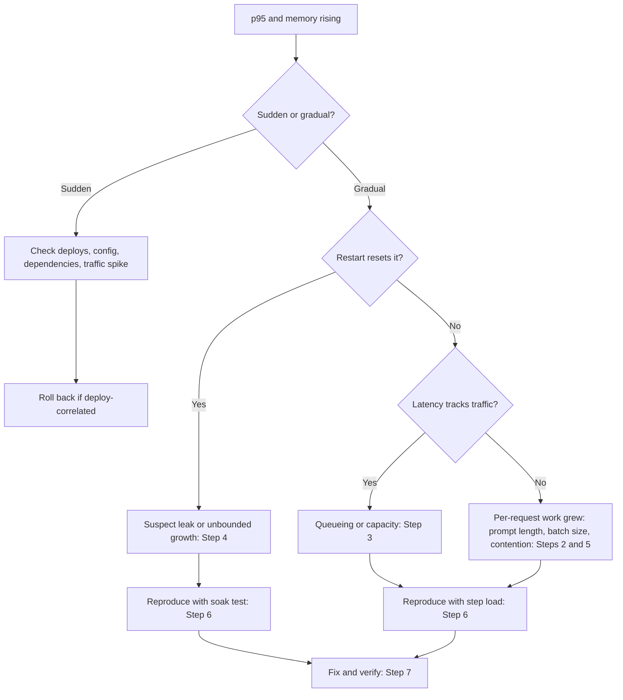
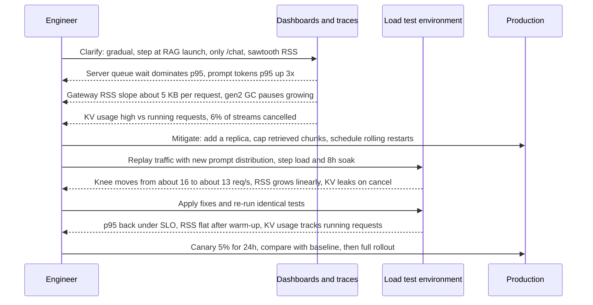

# Debugging Case: Rising p95 Latency and Memory Usage in an Inference Service

> **Level:** Beginner to Advanced · **Study time:** ~110 min · **Prerequisites:** [LLM Inference Fundamentals](../06-llm-inference/01-inference-fundamentals-prefill-decode-and-latency-metrics.md), [The KV Cache](../06-llm-inference/02-kv-cache-explained.md), [Batching, Continuous Batching and PagedAttention](../06-llm-inference/04-batching-continuous-batching-and-paged-attention.md), [Building a Scalable Inference API](../10-mlops/05-building-a-scalable-inference-api.md), [Monitoring ML and LLM Systems in Production](../10-mlops/06-monitoring-ml-and-llm-systems-in-production.md)

## Table of contents

- [Why this matters](#why-this-matters)
- [The running example: a 7B chat service that is slowly getting worse](#the-running-example-a-7b-chat-service-that-is-slowly-getting-worse)
- [Vocabulary you need first: latency, percentiles and memory](#vocabulary-you-need-first-latency-percentiles-and-memory)
- [Step 1: Clarify the symptom before touching anything](#step-1-clarify-the-symptom-before-touching-anything)
- [Step 2: Collect the right metrics and traces](#step-2-collect-the-right-metrics-and-traces)
- [Step 3: Identify queue buildup with Little's law](#step-3-identify-queue-buildup-with-littles-law)
- [Step 4: Identify memory leaks (host and GPU)](#step-4-identify-memory-leaks-host-and-gpu)
- [Step 5: Investigate batching and concurrency](#step-5-investigate-batching-and-concurrency)
- [Step 6: Reproduce the problem with load testing](#step-6-reproduce-the-problem-with-load-testing)
- [Step 7: Fix it and prove the fix worked](#step-7-fix-it-and-prove-the-fix-worked)
- [Going deeper: the full incident, end to end](#going-deeper-the-full-incident-end-to-end)
- [Going deeper: what changes at scale](#going-deeper-what-changes-at-scale)
- [Common mistakes and misconceptions](#common-mistakes-and-misconceptions)
- [Interview questions and model answers](#interview-questions-and-model-answers)
- [Key takeaways](#key-takeaways)
- [Further reading](#further-reading)
- [Next](#next)

## Why this matters

Almost every production inference service eventually gets slower or fatter over time: a new feature makes prompts longer, a cache never evicts, a client starts retrying aggressively, or a cancelled request never releases its GPU memory. These problems rarely announce themselves as crashes; they show up as a slowly climbing **p95 latency** line (the latency that 95% of requests beat, defined below) and a memory graph that only goes up. Interviewers love this scenario because it tests whether you can reason from symptoms to causes with data instead of guessing, and because it touches queueing theory, memory management, GPU serving, load testing and safe rollout in one question. A senior engineer is expected to have a calm, repeatable playbook: clarify, measure, form hypotheses, reproduce, fix, verify. This chapter gives you that playbook with numbers you can work out on a whiteboard.

## The running example: a 7B chat service that is slowly getting worse

We will use one concrete system throughout. All numbers are **illustrative**, chosen to make the arithmetic easy.

```text
 Clients (web app, mobile, internal batch jobs)
        |
        v
 +-------------------+      +-----------------------------------+
 |  API gateway       | ---> |  Model server replica A (1 GPU)   |
 |  (Python, FastAPI) |      |  7B LLM, continuous batching      |
 |  auth, rate limit, | ---> |  Model server replica B (1 GPU)   |
 |  prompt building,  |      +-----------------------------------+
 |  session history   |
 +-------------------+
        |
        v
 Retrieval service (adds documents to the prompt)
```

The symptom, as reported in the incident channel:

- Over the last 10 days, **p95 latency** of `/chat` went from about 2.5 s to about 9 s. Median latency rose much less.
- The gateway's memory grows steadily and the gateway pods get restarted by the orchestrator every couple of days.
- The model servers' "KV cache usage" metric is higher than it used to be at the same traffic.

Your job, in the interview and in real life, is to find out why and fix it without making things worse.

## Vocabulary you need first: latency, percentiles and memory

### Latency and throughput

> **Analogy:** A coffee shop. **Latency** is how long one customer waits from walking in to getting their coffee. **Throughput** is how many coffees the shop hands out per minute. A shop can have great throughput and still make some customers wait a long time.

- **Latency:** time from when a request arrives to when its response completes (or, for streaming LLMs, to the first token, see below).
- **Throughput:** completed requests (or generated tokens) per second.
- **TTFT (time to first token)** and **TPOT (time per output token)** are the LLM-specific latency metrics. They are covered in depth in [LLM Inference Fundamentals](../06-llm-inference/01-inference-fundamentals-prefill-decode-and-latency-metrics.md). Recap: TTFT is dominated by waiting in the queue plus **prefill** (processing the whole prompt), and TPOT by the **decode** step (generating one token at a time).

### Percentiles: why p95 and not the average

A **percentile** answers "what latency is this fraction of requests faster than?". The **p95** is the value that 95% of requests are at or below; the slowest 5% are above it. The **p50** (median) is the typical request. The region above p95 or p99 is called the **tail**.

**Precise definition (nearest-rank method).** Sort the $n$ latencies ascending: $x_{(1)} \le x_{(2)} \le \dots \le x_{(n)}$. Then

$$
p_q = x_{(k)}, \quad k = \lceil q \cdot n \rceil
$$

- $q$: the fraction you want, for example $0.95$ for p95.
- $n$: number of measured requests.
- $\lceil \cdot \rceil$: round up to the next whole number.
- $x_{(k)}$: the $k$-th smallest value.

**Worked example.** Twenty latencies in milliseconds, already sorted:

```text
100 105 110 110 115 120 120 125 130 130
135 140 150 160 170 180 200 250 900 1500
```

- Mean: the sum is 4950, so mean $= 4950 / 20 = 247.5$ ms.
- p50: $k = \lceil 0.5 \times 20 \rceil = 10$, the 10th value is **130 ms**.
- p95: $k = \lceil 0.95 \times 20 \rceil = \lceil 19 \rceil = 19$, the 19th value is **900 ms**.

The mean (247.5 ms) describes no actual user. The median user waits 130 ms, while 1 in 20 users waits 900 ms or more. If the 900 and 1500 grew to 3000 and 5000, the median would not move at all. That is why rising tail latency is often invisible in averages and medians.

```python
# pip install numpy
import math
import numpy as np

lat_ms = np.array([100, 105, 110, 110, 115, 120, 120, 125, 130, 130,
                   135, 140, 150, 160, 170, 180, 200, 250, 900, 1500])

def nearest_rank(values, q):
    s = np.sort(values)
    k = math.ceil(q * len(s))      # 1-based rank
    return s[k - 1]

print(lat_ms.mean())                 # 247.5
print(nearest_rank(lat_ms, 0.50))    # 130
print(nearest_rank(lat_ms, 0.95))    # 900
# NumPy's default method interpolates between neighbours, so it differs slightly:
print(np.percentile(lat_ms, 50))     # 132.5
print(np.percentile(lat_ms, 95))     # 930.0000000000005 (930 up to floating-point rounding)
```

> **Common mistake:** Averaging percentiles. If replica A has p95 = 2 s and replica B has p95 = 8 s, the fleet p95 is **not** 5 s. You must merge the underlying distributions (for example, sum the histogram buckets across replicas, then compute the percentile). Prometheus-style histograms exist precisely so you can do this.

### Memory words

- **RSS (resident set size):** how much physical RAM a process is currently using, as seen by the operating system. It is the main thing container memory limits and the OOM killer react to (cgroup accounting also counts some kernel memory and page cache, so the container's "working set" can be somewhat higher than RSS).
- **OOM (out of memory) kill:** the operating system or container runtime terminates a process that exceeds its memory limit. On GPUs, an OOM is a failed allocation (`CUDA out of memory`), usually surfaced as an exception.
- **Memory leak:** memory that keeps growing because the program keeps references to data it will never use again. In garbage-collected languages like Python, a leak is almost never "forgot to call free"; it is "something still points to it".
- **Garbage collection (GC):** the runtime's automatic reclamation of objects nothing refers to. Python mainly uses reference counting plus a periodic cycle collector; long collections can pause your process. The cycle collector is **generational**: new objects start in generation 0, survivors are promoted to generations 1 and 2, and a **gen-2 (full) collection** scans every tracked object, so it is the slowest and gets slower as the heap grows. (This describes the classic three-generation CPython collector; recent CPython versions have been reworking it, for example toward incremental collection, so check the `gc` docs for your version.)
- **KV cache:** GPU memory where an LLM server stores the attention keys and values of every token of every active request, so they are not recomputed at each generated token. Servers report **KV cache usage %**. When it runs out, the server **preempts** some requests: pauses them and later recomputes or swaps back their cache.
- **SLO (service level objective):** an internal target such as "p95 of `/chat` under 3 s, measured over 30 days". The allowed amount of violation is the **error budget**.
- **Allocated vs reserved GPU memory:** PyTorch uses a **caching allocator**: when a tensor is freed, the memory goes back to PyTorch's cache, not to the GPU driver. "Allocated" is what live tensors use; "reserved" is allocated plus the cache. Tools like `nvidia-smi` show roughly reserved memory plus runtime overhead, so they look "full" even when you are fine.

## Step 1: Clarify the symptom before touching anything

> **Analogy:** A doctor does not prescribe medicine when you say "I feel bad". They ask: since when, where does it hurt, did anything change, is it worse after meals? Clarifying questions narrow the space of causes before any test is run.

In an interview, spend the first minute or two here. It shows structure and it changes what you do next.

### The clarifying questions

| Question | Why it matters | What each answer suggests |
|---|---|---|
| Gradual or sudden? | Sudden changes point to an event; gradual changes point to accumulation or trends | Sudden: deploy, config change, dependency outage, traffic spike. Gradual: leak, growing data (prompt length, cache size), organic traffic growth |
| Correlated with deploys? | The single most common root cause of production regressions | Line up the latency graph with deploy markers for the gateway, model server, model weights, prompts and dependencies |
| Correlated with traffic? | Separates "capacity" problems from "bug" problems | Latency tracks traffic: queueing/capacity. Latency rises at constant traffic: something per-request got slower or resources are leaking |
| All endpoints or some? All tenants or some? | Localizes the problem | One endpoint: its code path or model. One tenant: their traffic shape (huge prompts, high concurrency). Everything: shared resource (GPU, gateway, network) |
| Which percentile moved? | Tail-only vs everything | p50 and p95 both up: everything got slower. Only p95/p99 up: queueing, contention, GC pauses, some request types are slow |
| Which memory? | Different memory, different causes | Host RSS of gateway: Python objects, caches. GPU memory: tensors, KV cache, fragmentation |
| Does a restart reset it? | Classic leak test | If latency and memory both drop after a restart and climb again, suspect a leak or an unbounded cache |
| Any change in errors, timeouts, retries? | Errors and retries add load | Rising timeouts plus retries can create a feedback loop (retry storm) |
| What does the user feel? TTFT or total time? | For streaming LLMs these differ | TTFT up: queueing or prefill. TPOT up: bigger decode batches, contention |

For our running example, suppose you learn:

- The rise was **gradual** over 10 days, but there is a slight **step** 10 days ago, when the team launched "chat with your documents" (the retrieval service started adding documents to prompts).
- Traffic grew about 15% over the same period.
- Only `/chat` is affected, not `/embed`.
- Gateway memory has a **sawtooth** shape: it climbs, the pod is OOM-killed, it restarts, it climbs again.
- p50 rose from 1.8 s to 2.6 s; p95 rose from 2.5 s to 9 s.

```text
Gateway RSS (GB)
16 |            OOM            OOM
   |           /|             /|
12 |         /  |           /  |          <- sawtooth = classic leak signature
   |       /    |         /    |
 8 |     /      |       /      |
   |   /        |     /        |
 4 | /          |   /          |
   +-------------------------------> time (days)
```

### Turn answers into hypotheses

Write down explicit hypotheses and the evidence that would confirm or reject each. This is what separates a senior answer from a list of buzzwords.

| Hypothesis | Predicts | Would be rejected if |
|---|---|---|
| H1: Longer prompts (RAG launch) increased service time, pushing utilization near 100% so queues build | Prompt token p95 up since launch; queue wait share of latency up; prefill time up | Prompt lengths unchanged; queue wait flat |
| H2: Memory leak in the gateway | RSS grows with request count; sawtooth; restarts reset it | RSS plateaus at constant load; RSS does not grow with cumulative request count (note: a per-request leak also stays flat while idle, so idle flatness alone does not reject it) |
| H3: KV cache blocks not freed for cancelled requests | KV usage high relative to running requests; more preemptions; client disconnects common | KV usage tracks running requests exactly |
| H4: Retry storm amplifying load | Requests per user action rising; retries correlated with timeouts | Retry rate flat |
| H5: GC pauses in the gateway | Latency spikes align with gen-2 GC events; worse as heap grows | GC time negligible |

Notice H2 and H5 are linked: a leaking heap makes each full garbage collection slower, which can raise tail latency on its own.



> **Interview tip:** Mention mitigation separately from diagnosis. "If users are suffering right now, I would first mitigate: roll back the last deploy if correlated, scale out replicas, or schedule rolling restarts as a stopgap. Then I would diagnose properly." Restarts that hide a leak buy time but must come with a ticket, or the leak lives forever.

## Step 2: Collect the right metrics and traces

### Three layers of observability

> **Analogy:** A car's dashboard shows speed and fuel (metrics), a trip log records every stop on one journey (a trace), and the mechanic's notebook records specific events (logs). You need all three.

- **Metric:** a number aggregated over time. Cheap, good for trends and alerts. A **counter** only goes up (total requests, total retries); a **gauge** goes up and down (queue depth, RSS); a **histogram** counts observations per value range ("bucket"), from which percentiles are estimated.
- **Trace:** the record of one request's journey through the system. A trace is made of **spans**; each span is one timed operation (for example "tokenize", "retrieve", "prefill"), with a parent-child structure. **Distributed tracing** (for example with OpenTelemetry) propagates a trace ID across services so you can see the whole path.
- **Log:** a timestamped event record, best when structured (JSON) with the trace ID included.
- **Profile:** a sample of where CPU time or memory goes inside a process (for example from `py-spy` or `memray`).

Monitoring in general is covered in [Monitoring ML and LLM Systems in Production](../10-mlops/06-monitoring-ml-and-llm-systems-in-production.md) and tracing tools in [LLMOps: Tracing, Prompt Management and Langfuse](../10-mlops/08-llmops-tracing-prompt-management-and-langfuse.md). Here we focus on which signals answer this specific question.

### Break latency into stages

The single most useful move is decomposing end-to-end latency into stages. For one `/chat` request:

$$
T_{\text{total}} = T_{\text{gateway queue}} + T_{\text{retrieval}} + T_{\text{prompt build}} + T_{\text{server queue}} + T_{\text{prefill}} + T_{\text{decode}} + T_{\text{post}} + T_{\text{network}}
$$

- $T_{\text{gateway queue}}$: time waiting for a worker or thread in the gateway.
- $T_{\text{retrieval}}$: calls to the retrieval service.
- $T_{\text{prompt build}}$: assembling history plus documents plus tokenization.
- $T_{\text{server queue}}$: time waiting in the model server before being scheduled into a batch.
- $T_{\text{prefill}}$: processing the prompt tokens on the GPU.
- $T_{\text{decode}}$: generating output tokens, roughly (number of output tokens) $\times$ TPOT.
- $T_{\text{post}}$: detokenization, safety filters, logging.
- $T_{\text{network}}$: transfer to the client.

**Worked example (illustrative p95 values per stage, in seconds).** Note that p95s of stages do not add up exactly to the p95 of the total (percentiles are not additive), but per-stage p95s still show which stage moved.

| Stage | p95 before (day 0) | p95 now (day 10) | Change |
|---|---|---|---|
| Retrieval | 0.15 | 0.18 | +0.03 |
| Prompt build | 0.02 | 0.25 | +0.23 |
| Server queue wait | 0.10 | 5.20 | **+5.10** |
| Prefill | 0.20 | 0.65 | +0.45 |
| Decode | 1.80 | 2.40 | +0.60 |

The story jumps out: the GPU work per request grew moderately (prefill and decode), but **waiting** grew enormously. That pattern is the fingerprint of a system running close to its capacity, which we will quantify with Little's law in Step 3. Prompt build also grew more than 10x (0.02 s to 0.25 s, about 12x), which smells like the gateway (GC or a growing data structure).

### The metric checklist

| Category | Metric | What it reveals |
|---|---|---|
| Latency | p50/p95/p99 end to end, and per stage; TTFT and TPOT | Which stage is slow; tail vs everything |
| Queueing | Queue depth (waiting requests), queue wait time histogram, in-flight requests | Whether demand exceeds capacity |
| Batching | Batch size distribution per step, running vs waiting sequences, preemptions | Whether batches are oversized or starved |
| Concurrency | Active threads, thread pool queue, event loop lag, connection pool usage | Whether the CPU side is the bottleneck |
| GPU | Utilization, memory allocated vs reserved, KV cache usage %, power/clock throttling | GPU saturation, leaks, fragmentation |
| CPU and host | CPU % per core, RSS, open file descriptors, GC pause time and count | Gateway leaks, GC pauses, CPU-bound tokenization |
| Request shape | Prompt token length distribution, output token length distribution, request size in bytes | Workload drift (prompts getting longer) |
| Reliability | Error rate by type, timeout rate, retry rate, client disconnect / cancel rate | Feedback loops, wasted work |
| Caches | Prefix/prompt cache hit rate, application cache hit rate and size | Cache thrashing, unbounded caches |
| Traffic | Requests per second by endpoint, tenant, client version | Who is sending what |
| Events | Deploy markers, config changes, autoscaling events, restarts, OOM kills | Correlation with changes |

> **Senior insight:** Measure **request shape**, not just request count. "Traffic only grew 15%" can hide "tokens processed grew 80%" because each request got longer. For LLMs, capacity is measured in tokens per second, not requests per second.

Serving frameworks expose many of these directly. For example, vLLM and similar servers export Prometheus metrics for running and waiting requests, KV cache usage and token throughput. Exact metric names change between versions, so check your version's docs.

### Instrumenting stages yourself

```python
# pip install prometheus-client
import time
from contextlib import contextmanager
from prometheus_client import Histogram, Gauge, Counter, start_http_server

STAGE_LATENCY = Histogram(
    "chat_stage_seconds", "Latency of each request stage", ["stage"],
    buckets=(0.01, 0.05, 0.1, 0.25, 0.5, 1, 2, 4, 8, 16, 32),
)
QUEUE_DEPTH = Gauge("chat_queue_depth", "Requests waiting for a worker")
PROMPT_TOKENS = Histogram(
    "chat_prompt_tokens", "Prompt length in tokens",
    buckets=(256, 512, 1024, 2048, 4096, 8192, 16384),
)
RETRIES = Counter("chat_upstream_retries_total", "Retries to the model server")

@contextmanager
def timed(stage: str):
    start = time.perf_counter()          # monotonic, high resolution
    try:
        yield
    finally:
        STAGE_LATENCY.labels(stage=stage).observe(time.perf_counter() - start)

def handle_chat(prompt_tokens: list[int]) -> None:
    PROMPT_TOKENS.observe(len(prompt_tokens))
    with timed("retrieval"):
        time.sleep(0.01)                 # stand-in for real work
    with timed("model_call"):
        time.sleep(0.05)

if __name__ == "__main__":
    start_http_server(9100)              # metrics at http://localhost:9100/metrics
    for _ in range(100):
        handle_chat(list(range(1500)))
```

Choose histogram buckets to cover the latencies you care about: if your largest bucket is 1 s and latency is now 9 s, every slow request lands in "+Inf" and your p95 becomes meaningless.

### Traces: find the slow requests, then ask what they have in common

Metrics tell you **that** p95 rose; traces tell you **which** requests were slow. Pull the slowest 1% of traces and group them by attributes: prompt length bucket, tenant, model, replica, whether retrieval was used, whether the request was a retry. In our example, slow traces are dominated by requests with more than 6,000 prompt tokens, and by requests that spent most of their time in the server queue span.

> **Interview tip:** Say "tail-based sampling". Keeping 1% of traces at random throws away most of the slow ones you care about. Tail-based sampling decides after the request finishes and keeps all slow or failed traces plus a random sample of normal ones.

## Step 3: Identify queue buildup with Little's law

### Intuition

> **Analogy:** A supermarket with 4 checkout lanes, each taking 2 minutes per customer, can serve 2 customers per minute. If 1.5 customers arrive per minute, lines stay short. If 1.9 arrive per minute, lines are usually short but occasionally long, because arrivals are bursty. If 2.1 arrive per minute, the line grows forever, no matter how fast the cashiers work.

Two rates govern any queue:

- **Arrival rate** $\lambda$ (lambda): requests arriving per second.
- **Service rate** $\mu$ (mu): requests the system can complete per second at full capacity.
- **Utilization** $\rho = \lambda / \mu$ (rho): the fraction of capacity in use.

### Little's law

**Little's law** (John D. C. Little, 1961) relates three averages in any stable system, whatever the arrival pattern or scheduling policy:

$$
L = \lambda W
$$

- $L$: the average number of requests in the system (waiting plus being served).
- $\lambda$: the average arrival rate, which equals throughput when the system is stable.
- $W$: the average time a request spends in the system.

Intuition: if 2 customers enter a shop per minute and each stays 10 minutes, then on average $2 \times 10 = 20$ customers are inside. Know any two of $L$, $\lambda$, $W$ and you get the third.

**Worked example 1: reading the dashboard.** On day 0, the service handles $\lambda = 12$ req/s and the average number of in-flight requests (queued plus running, summed across replicas) is $L = 24$. Then

$$
W = \frac{L}{\lambda} = \frac{24}{12} = 2.0 \text{ s}
$$

That mean of 2.0 s sits sensibly between the day-0 p50 (1.8 s) and p95 (2.5 s). On day 10, traffic is still about 12 req/s at the same hour, but $L = 60$. Then $W = 60 / 12 = 5$ s. The average time in system rose 2.5x without a traffic change: each request is either served more slowly, or waits longer, or both. (A mean of 5 s with a p50 of 2.6 s and a p95 of 9 s is the signature of a heavy tail: a minority of requests are waiting a very long time.)

**Worked example 2: cross-checking your instrumentation.** If Little's law applied to the in-flight count measured at the gateway (the outermost point) says $W = 5$ s but your model server's latency histogram says the average is 3 s, then 2 s per request is spent somewhere the server histogram does not cover (for example waiting in the gateway, a thread pool or the load balancer). If $L$ and the histogram are measured at the same boundary and still disagree, the instrumentation itself is wrong. This is a cheap, powerful sanity check.

### Capacity of an inference server

Apply Little's law to the server itself. If a replica can run at most $c$ requests concurrently and each takes $S$ seconds of service on average, its maximum throughput is

$$
\mu_{\text{replica}} = \frac{c}{S}
$$

- $c$: maximum concurrent requests (for an LLM server, limited by KV cache memory and batch limits).
- $S$: average service time per request (prefill plus decode, not counting queue wait).

**Worked example 3: how longer prompts broke capacity (illustrative).**

- Day 0: $c = 16$, $S = 2$ s, so $\mu_{\text{replica}} = 16 / 2 = 8$ req/s. Two replicas: $\mu = 16$ req/s. Traffic $\lambda = 12$ req/s gives $\rho = 12 / 16 = 0.75$.
- After the RAG launch, prompts are longer, so prefill and decode take longer: $S = 2.5$ s. Now $\mu_{\text{replica}} = 16 / 2.5 = 6.4$ req/s, and two replicas give $\mu = 12.8$ req/s. With the same $\lambda = 12$: $\rho = 12 / 12.8 = 0.9375$.
- Traffic grows to $\lambda = 14$ req/s at peak: $\rho = 14 / 12.8 = 1.09375$. Now arrivals exceed capacity.

When $\lambda > \mu$, the queue grows by $\lambda - \mu$ every second:

$$
\text{growth} = 14 - 12.8 = 1.2 \text{ req/s}
$$

After a 10-minute peak (600 s) the queue holds $1.2 \times 600 = 720$ requests. A request arriving at that moment waits roughly $720 / 12.8 = 56.25$ s before it even starts. Clients time out long before that, which (as we will see) can trigger retries that make it worse.

In real LLM servers $c$ is not fixed: longer prompts also consume more KV cache memory per request, so $c$ shrinks at the same time as $S$ grows. Both push $\mu$ down. See [The KV Cache](../06-llm-inference/02-kv-cache-explained.md).

### Why latency explodes before you hit 100%

Even below 100% utilization, random bursts create queues. The simplest queueing model, the **M/M/1 queue** (Poisson arrivals, meaning independent random arrivals at a constant average rate; exponentially distributed service times; one server), gives the average time in system:

$$
W = \frac{1/\mu}{1 - \rho}
$$

- $1/\mu$: average service time for one request.
- $\rho$: utilization, which must be below 1.

With a service time of $1/\mu = 0.1$ s:

| Utilization $\rho$ | $1 - \rho$ | $W = 0.1 / (1-\rho)$ |
|---|---|---|
| 0.50 | 0.50 | 0.2 s |
| 0.80 | 0.20 | 0.5 s |
| 0.90 | 0.10 | 1.0 s |
| 0.95 | 0.05 | 2.0 s |
| 0.99 | 0.01 | 10.0 s |

Going from 90% to 99% busy makes the average time 10x worse, and the tail grows by even more seconds (in M/M/1 the time in system is exponentially distributed, so its p95 is $\ln 20 \approx 3$ times the mean). Real inference servers are not M/M/1 (they batch, have many slots, and service times are not exponential), so do not quote these numbers as predictions. The durable lesson is the shape: **latency is a hockey stick in utilization**, and p95 bends earlier than p50. That is exactly our symptom: p50 up a little, p95 up a lot.

### A tiny queue simulation

```python
# pip install numpy
import numpy as np

def simulate_queue(arrival_rate: float, service_rate: float,
                   seconds: int = 600, seed: int = 0) -> np.ndarray:
    """Discrete 1-second ticks. Returns queue depth at the end of each second."""
    rng = np.random.default_rng(seed)
    queue = 0
    depths = []
    for _ in range(seconds):
        queue += rng.poisson(arrival_rate)              # bursty arrivals
        served = min(queue, rng.poisson(service_rate))  # variable service
        queue -= served
        depths.append(queue)
    return np.array(depths)

for lam in (9.6, 12.0, 14.0):          # rho = 0.75, 0.9375, 1.09375 for mu = 12.8
    d = simulate_queue(lam, 12.8)
    throughput = min(lam, 12.8)          # stable: = arrivals; overloaded: = capacity
    approx_wait = d[-60:].mean() / throughput  # Little's law: wait ~ queue / throughput
    print(f"lambda={lam:5.1f}  final depth={d[-1]:5d}  approx wait last minute={approx_wait:6.2f}s")
```

Run it and you will see a small, stable queue at $\rho = 0.75$, a noisy queue that occasionally spikes at $\rho \approx 0.94$, and a queue that grows roughly linearly (on the order of hundreds of requests after 10 minutes) at $\rho > 1$.

### Signatures of queue buildup

- Queue depth and queue wait time rise; time-in-service is roughly flat or rises a little.
- Throughput plateaus while arrivals keep rising (the server is at $\mu$).
- Latency correlates with traffic by hour of day.
- GPU utilization is high. **If the queue is building but the GPU is not busy**, the bottleneck is elsewhere: CPU tokenization, a blocked event loop, a thread pool limit, or a scheduler limit like max concurrent sequences set too low.

> **Senior insight:** Queues also consume memory. An unbounded queue of 720 requests holds 720 prompts, retrieved documents and response buffers in RAM. Rising latency and rising memory can be **one** problem, not two. Bounded queues with load shedding (reject early with HTTP 429 or 503) protect both.

## Step 4: Identify memory leaks (host and GPU)

### Intuition

> **Analogy:** A restaurant that never clears tables. Each customer leaves, but their plates stay. The restaurant does not crash immediately; it just gets slower to find free tables, and eventually no one can sit. A leak in a garbage-collected program is the same: the "plates" are objects that something still references.

### Leak, growth or caching? Tell them apart first

Not every rising memory graph is a leak.

| Pattern | Shape over time | Restart resets it? | Likely cause |
|---|---|---|---|
| True leak | Grows linearly with request count, never plateaus | Yes, then grows again (sawtooth) | Unbounded dict/list, references held by globals, closures, tracebacks |
| Warm-up / cache fill | Grows then plateaus | Yes, then refills to the same level | Bounded caches, JIT, allocator pools filling up |
| Pre-allocation | High from the start, flat | No change | LLM servers reserve a fixed fraction of GPU memory for KV cache at startup |
| Fragmentation | Reserved grows while allocated stays flat | Yes | Many different tensor shapes (variable sequence lengths) on the caching allocator; native `malloc` fragmentation |
| Load-driven | Rises and falls with traffic or queue length | Not needed | Unbounded queue, large in-flight batches |

**Worked example: is it a leak, and how long until we crash?** During a soak test (Step 6) at a constant 50,000 requests per hour, the gateway RSS is sampled hourly (illustrative):

| Hour $x$ | 0 | 1 | 2 | 3 | 4 | 5 |
|---|---|---|---|---|---|---|
| RSS $y$ (GB) | 4.0 | 4.3 | 4.5 | 4.8 | 5.0 | 5.3 |

Fit a straight line. The least-squares slope is

$$
\hat\beta = \frac{\sum_i (x_i - \bar x)(y_i - \bar y)}{\sum_i (x_i - \bar x)^2}
$$

- $x_i, y_i$: hour and RSS of sample $i$.
- $\bar x, \bar y$: their averages.
- $\hat\beta$: estimated growth in GB per hour.

Step by step:

1. $\bar x = (0+1+2+3+4+5)/6 = 15/6 = 2.5$.
2. $\bar y = (4.0+4.3+4.5+4.8+5.0+5.3)/6 = 27.9/6 = 4.65$.
3. Deviations $x_i - \bar x$: $-2.5, -1.5, -0.5, 0.5, 1.5, 2.5$. Deviations $y_i - \bar y$: $-0.65, -0.35, -0.15, 0.15, 0.35, 0.65$.
4. Products: $1.625, 0.525, 0.075, 0.075, 0.525, 1.625$. Sum $= 4.45$.
5. Squared $x$ deviations: $6.25, 2.25, 0.25, 0.25, 2.25, 6.25$. Sum $= 17.5$.
6. $\hat\beta = 4.45 / 17.5 \approx 0.254$ GB per hour.

So roughly $0.254 \times 10^9 / 50{,}000 \approx 5{,}100$ bytes leak per request, and with a 16 GB container limit the pod has $(16 - 5.3) / 0.254 \approx 42$ hours left. A steady positive slope at constant load, with no plateau, is strong evidence of a leak. Bytes per request is a great clue: about 5 KB smells like "we keep each prompt or response text forever".

### Common leak sources in inference services

| Source | How it happens | How to spot it |
|---|---|---|
| Unbounded caches | A dict keyed by session ID, prompt hash or user that never evicts; `functools.cache` (unbounded) on a function with high-cardinality inputs | `tracemalloc` diff points to the line inserting into the dict; object counts of one type grow |
| Tensors kept alive by references | Appending model outputs to a list for logging or metrics; keeping tensors that carry an autograd graph; storing GPU tensors in request objects held by a long-lived structure | `torch.cuda.memory_allocated()` climbs with request count; inputs kept alive through the graph |
| Inference without `no_grad` | Autograd (PyTorch's automatic differentiation, see [Backpropagation](../02-deep-learning/02-backpropagation-and-gradient-descent.md)) records the graph and saves activations for a backward pass that never happens | Memory per request much higher than expected; fixed by `torch.inference_mode()` |
| KV cache not freed | Client disconnects or times out but the server keeps generating, or a session cache holds KV blocks for idle conversations | KV cache usage high relative to running requests; tokens generated for requests no one reads |
| CUDA memory fragmentation | Variable-length inputs create many differently sized blocks; free memory exists but not in a large enough contiguous chunk | `memory_reserved` much larger than `memory_allocated`; OOM despite "free" memory |
| Native memory fragmentation | glibc `malloc` arenas in multithreaded Python processes keep freed memory | RSS grows but Python-level `tracemalloc` totals stay flat |
| Exceptions and tracebacks | Stored exceptions keep their frames, which keep local variables (large tensors, buffers) alive | Memory jumps after error bursts |
| Background tasks | Fire-and-forget tasks or callbacks that accumulate | Task counts growing in the event loop |

### Hunting a Python leak with tracemalloc

`tracemalloc` is in the standard library. Take a snapshot, run traffic, take another, and compare: the top lines show where new memory was allocated and not freed.

```python
import random
import string
import tracemalloc

_history: dict[str, list[str]] = {}   # BUG: per-session history that never evicts

def handle_request(session_id: str, prompt: str) -> str:
    _history.setdefault(session_id, []).append(prompt)
    return prompt.upper()

def random_text(n: int) -> str:
    return "".join(random.choices(string.ascii_letters, k=n))

tracemalloc.start(10)                  # keep 10 frames of traceback per allocation
before = tracemalloc.take_snapshot()

for i in range(50_000):                # every request is a new session
    handle_request(f"user-{i}", random_text(200))

after = tracemalloc.take_snapshot()
for stat in after.compare_to(before, "lineno")[:3]:
    print(stat)  # top lines: where the retained prompts, session keys and lists were created

# tracemalloc reports where memory was ALLOCATED. Here the prompt strings are created in
# random_text but kept alive by _history; following who still references them
# (for example with objgraph) leads you to the unbounded dict.
```

The fix is to bound the structure: a maximum size plus a time-to-live, or move the state to an external store with expiry (for example Redis with TTLs).

```python
from collections import OrderedDict
import time

class BoundedTTLCache:
    """LRU cache with a size cap and per-entry expiry. Not thread-safe."""
    def __init__(self, max_items: int = 10_000, ttl_s: float = 1800.0):
        self.max_items, self.ttl_s = max_items, ttl_s
        self._data: OrderedDict[str, tuple[float, object]] = OrderedDict()

    def get(self, key: str):
        item = self._data.get(key)
        if item is None:
            return None
        ts, value = item
        if time.monotonic() - ts > self.ttl_s:
            del self._data[key]
            return None
        self._data.move_to_end(key)          # mark as recently used
        return value

    def put(self, key: str, value) -> None:
        self._data[key] = (time.monotonic(), value)
        self._data.move_to_end(key)
        while len(self._data) > self.max_items:
            self._data.popitem(last=False)    # evict least recently used
```

Other useful tools: `memray` (allocation profiler with flame graphs, Linux and macOS), `objgraph` (find what references an object), and `gc.get_objects()` counts by type. For native memory fragmentation, teams commonly try limiting malloc arenas (`MALLOC_ARENA_MAX`) or switching allocators (jemalloc); verify with a soak test rather than assuming.

### Tensors kept alive by references

```python
# pip install torch
import torch

device = "cuda" if torch.cuda.is_available() else "cpu"
model = torch.nn.Linear(4096, 4096).to(device)
debug_outputs = []                      # e.g. "keep last outputs for debugging"

def infer_leaky(x: torch.Tensor) -> torch.Tensor:
    y = model(x)                        # autograd records a graph (no no_grad)
    debug_outputs.append(y)             # keeps y, its graph and the saved input alive
    return y.argmax(dim=-1)

@torch.inference_mode()                 # no graph, no saved activations
def infer_fixed(x: torch.Tensor) -> torch.Tensor:
    y = model(x)
    return y.argmax(dim=-1).cpu()       # return only what the caller needs

def gpu_report(tag: str) -> None:
    if device != "cuda":
        print(tag, "(CPU run: use tracemalloc or RSS instead)")
        return
    gib = 2**30
    print(f"{tag}: allocated={torch.cuda.memory_allocated()/gib:.2f} GiB "
          f"reserved={torch.cuda.memory_reserved()/gib:.2f} GiB "
          f"peak={torch.cuda.max_memory_allocated()/gib:.2f} GiB")

for step in range(3):
    infer_leaky(torch.randn(256, 4096, device=device))
    gpu_report(f"leaky step {step}")    # allocated climbs every call
```

Each leaky call keeps the input (saved by autograd for the weight gradient) and the output. In a real server, that is a few megabytes per request, forever.

For deeper GPU investigation, PyTorch offers `torch.cuda.memory_summary()` and, in recent versions, a memory-history recorder (`torch.cuda.memory._record_memory_history` and `_dump_snapshot`) whose snapshots can be viewed in PyTorch's memory visualizer. The leading underscore means the API is private and may change between versions.

### KV cache not freed

Recap from [The KV Cache](../06-llm-inference/02-kv-cache-explained.md): for every token in every active sequence, the server stores a key and a value vector per layer. Memory per token:

$$
\text{bytes per token} = 2 \times n_{\text{layers}} \times n_{\text{kv heads}} \times d_{\text{head}} \times b
$$

- $2$: one key and one value.
- $n_{\text{layers}}$: transformer layers.
- $n_{\text{kv heads}}$: key/value heads (fewer than query heads if the model uses grouped-query attention).
- $d_{\text{head}}$: dimension per head.
- $b$: bytes per element (2 for FP16/BF16).

For a Llama-2-7B-style model (32 layers, 32 KV heads, head dimension 128, FP16):

$$
2 \times 32 \times 32 \times 128 \times 2 = 524{,}288 \text{ bytes} = 0.5 \text{ MiB per token}
$$

A 2,048-token conversation holds $2048 \times 0.5 = 1024$ MiB $= 1$ GiB. If 10 abandoned conversations keep their KV blocks, that is 10 GiB of GPU memory no active request can use.

In servers with **paged attention** (for example vLLM), KV memory is pre-allocated at startup, so `nvidia-smi` stays flat. The leak symptom instead appears as **KV cache usage % rising relative to the number of running requests**, fewer concurrent sequences fitting, more **preemptions** (sequences evicted and recomputed or swapped when memory runs out), and therefore lower $c$ and higher latency. That is why "memory" problems on the GPU often show up as **latency** problems. See [Batching, Continuous Batching and PagedAttention](../06-llm-inference/04-batching-continuous-batching-and-paged-attention.md).

The most common real-world cause is **not aborting generation on client disconnect**: the user closes the tab, the gateway times out, but the request keeps decoding to `max_tokens`. That wastes GPU time and KV memory simultaneously. Check that cancellation propagates from the client through the gateway to the model server.

### CUDA memory fragmentation

PyTorch's caching allocator splits large cached blocks to serve smaller requests. With highly variable shapes (different sequence lengths every request), free memory gets chopped into pieces.

**Worked example (illustrative).** Reserved = 20 GiB, allocated = 14 GiB, so 6 GiB is cached but unused:

$$
\text{unused fraction} = 1 - \frac{\text{allocated}}{\text{reserved}} = 1 - \frac{14}{20} = 0.30
$$

If the 6 GiB is spread across many small free blocks inside segments that also hold live tensors (so the allocator cannot release and re-request them as one piece), a request that needs one 2 GiB block can fail with an OOM even though 6 GiB is "free". Mitigations: pad or bucket input shapes to a small set of sizes, pre-allocate at warm-up with the largest shapes, and in recent PyTorch versions set `PYTORCH_CUDA_ALLOC_CONF=expandable_segments:True`, which lets segments grow instead of creating many fixed-size ones. Calling `torch.cuda.empty_cache()` returns cached memory to the driver but does not fix fragmentation inside live allocations and slows later allocations; treat it as a diagnostic, not a fix.

### Garbage collection pauses

As the Python heap grows (for example because of a leak), each full collection of the oldest generation scans more objects and can pause the process for longer. This adds latency to whatever requests are in flight, which shows up in the tail. Measure it with `gc.callbacks`:

```python
import gc
import time

_gc_start = {}

def gc_timer(phase: str, info: dict) -> None:
    if phase == "start":
        _gc_start["t"] = time.perf_counter()
    elif phase == "stop":
        pause_ms = (time.perf_counter() - _gc_start["t"]) * 1000
        if info["generation"] == 2 and pause_ms > 10:
            print(f"gen2 GC pause {pause_ms:.1f} ms, collected={info['collected']}")

gc.callbacks.append(gc_timer)
```

A common optimization after loading a model and warming up is `gc.freeze()` (Python 3.7+), which moves all current objects to a permanent generation so later collections skip them. It reduces pause time but does not fix a leak.

## Step 5: Investigate batching and concurrency

### Batching recap

**Batching** runs several requests through the model together to use the GPU efficiently. **Dynamic batching** collects requests for up to a timeout or a max batch size. **Continuous batching** (iteration-level scheduling, from the Orca paper) adds and removes sequences at every decode step. The details are in [Batching, Continuous Batching and PagedAttention](../06-llm-inference/04-batching-continuous-batching-and-paged-attention.md). Here we care about how batching goes wrong.

### Oversized batches increase latency

> **Analogy:** A shuttle bus. A bigger bus carries more people per trip (throughput), but each trip takes longer to load and drive, so each passenger arrives later (latency).

**Worked example (illustrative cost model).** Suppose one batch of $B$ requests through a classifier takes $20 + 2B$ milliseconds (fixed overhead plus per-item work).

| Batch size $B$ | Batch time | Throughput $B / \text{time}$ |
|---|---|---|
| 8 | $20 + 16 = 36$ ms | $8 / 0.036 \approx 222$ req/s |
| 64 | $20 + 128 = 148$ ms | $64 / 0.148 \approx 432$ req/s |

Going from 8 to 64 roughly doubles throughput but quadruples batch time, and with dynamic batching each request may also wait for the batch to fill (up to the batching timeout). If someone raised `max_batch_size` to "improve throughput", p95 can go up even at the same traffic.

For LLM decode, larger batches raise **TPOT** because every decode step processes more sequences. At small batch sizes decode is memory-bandwidth-bound and extra sequences are nearly free as far as weight reads go (the weights are read once per step for the whole batch), but each sequence still adds its own KV cache reads, which grow with its context length; that is one reason the longer RAG prompts raised decode time and TPOT in our example. Past some point it becomes compute-bound and every extra sequence slows everyone. See [GPU Fundamentals: Compute-Bound vs Memory-Bound](../06-llm-inference/03-gpu-fundamentals-compute-bound-vs-memory-bound.md).

### Head-of-line blocking

**Head-of-line (HOL) blocking** is when a slow item at the front of a queue delays everything behind it. In LLM serving, a request with a 30,000-token prompt has a long prefill; if the scheduler runs that prefill as one step, every decoding sequence in the batch stalls for its duration, and short requests behind it in the queue wait too. Symptoms: TPOT spikes that align with long-prompt arrivals; p95 of short requests rising when long-prompt traffic rises.

Fixes:

- **Chunked prefill:** split long prefills into chunks interleaved with decode steps (the idea behind Sarathi-Serve, Agrawal et al., 2024; available in several serving frameworks).
- Separate queues or replicas by request size class, or prefill/decode disaggregation at larger scale.
- Cap prompt length per tenant, or route very long contexts to dedicated capacity.

### Thread pool exhaustion and a blocked event loop

The gateway is Python. Two classic traps:

1. **Blocking calls inside `async def` handlers.** A synchronous HTTP call, a CPU-heavy tokenization or a `time.sleep` inside an async handler blocks the whole event loop, so every other request on that worker waits. Symptom: **event loop lag** rises; CPU is busy on one core; latency rises for all endpoints on that process.
2. **Thread pool exhaustion.** Frameworks run synchronous handlers or `run_in_executor` work in a bounded thread pool. In FastAPI and Starlette, sync endpoints go through AnyIO's thread limiter, which defaults to 40 threads in current versions (check yours). If each request holds a thread for 5 s while waiting on a slow model server, 40 threads serve only $40 / 5 = 8$ req/s, which is Little's law again, and further requests queue invisibly inside the gateway.

Also check **connection pools** to downstream services: HTTP clients and database drivers have default maximum connections, and when exhausted, requests wait for a free connection. That wait often is not in any span unless you instrument it.

A simple event-loop lag monitor:

```python
import asyncio

async def monitor_loop_lag(interval_s: float = 0.5) -> None:
    """If the loop is blocked, sleep() wakes up late. The extra delay is the lag."""
    loop = asyncio.get_running_loop()
    while True:
        start = loop.time()
        await asyncio.sleep(interval_s)
        lag = loop.time() - start - interval_s
        if lag > 0.05:
            print(f"event loop lag: {lag * 1000:.0f} ms")  # export as a histogram in production

async def bad_handler() -> None:
    import time
    time.sleep(0.3)        # BUG: blocks the event loop; use await asyncio.sleep or a thread

async def main() -> None:
    asyncio.create_task(monitor_loop_lag())
    for _ in range(3):
        await bad_handler()
        await asyncio.sleep(0.6)

asyncio.run(main())
```

For a live process, `py-spy dump --pid <PID>` shows what every thread is doing right now without restarting it, which quickly reveals threads stuck in the same blocking call.

### Retry storms

A **retry storm** happens when slow responses cause timeouts, timeouts cause retries, and retries add load, which makes responses slower. It is a positive feedback loop.

**Worked example: retry amplification.** Three layers (client, gateway, model client library), each making up to 3 attempts (1 original plus 2 retries). In the worst case the bottom layer receives

$$
3 \times 3 \times 3 = 27
$$

attempts for one user action. Even modest retry rates add significant load exactly when the system is weakest. Worse, a timed-out request often keeps running on the server (see the KV cache section), so the server does the same work twice.

Defenses:

- Retry at **one** layer only, with exponential backoff (wait about 1 s, then 2 s, then 4 s) and jitter (randomize each wait so thousands of clients do not retry in lockstep).
- A **retry budget**: for example, retries may not exceed 10% of requests over a window.
- **Deadline propagation:** pass the remaining time budget downstream; servers drop work whose deadline has passed.
- **Circuit breakers:** stop calling a failing dependency for a while.
- **Load shedding and admission control:** reject early with 429/503 instead of queueing forever.

```python
import asyncio

MAX_IN_FLIGHT = 64       # tune from load tests: near the knee of the throughput curve
MAX_WAITING = 128        # bounded queue: beyond this, shed load
_slots = asyncio.Semaphore(MAX_IN_FLIGHT)
_waiting = 0

class Overloaded(Exception):
    """Map to HTTP 429/503 with a Retry-After header."""

async def admit_and_run(coro_fn, *args):
    global _waiting
    if _waiting >= MAX_WAITING:
        raise Overloaded()               # fail fast: cheaper than timing out later
    _waiting += 1
    try:
        await _slots.acquire()
    finally:
        _waiting -= 1
    try:
        return await coro_fn(*args)
    finally:
        _slots.release()
```

### The concurrency knee

If you plot throughput against the number of concurrent requests, throughput rises, then flattens at the **knee** where the bottleneck saturates. Past the knee, extra concurrency adds only latency (and memory). Your concurrency and queue limits should sit near the knee, with load shedding beyond it.

```text
throughput                         p95 latency
   |        ________________          |                  /
   |      /                           |                /
   |    /   ^ knee                    |             _/
   |  /                               |  ________/  ^ knee
   |/                                 |/
   +-------------------> concurrency  +-------------------> concurrency
```

### Batching and concurrency investigation checklist

| Check | Healthy | Suspicious |
|---|---|---|
| Batch size distribution over time | Stable, below configured max | Pinned at max (overloaded) or tiny (starved by CPU-side bottleneck) |
| Running vs waiting sequences | Waiting near zero most of the time | Waiting grows at peak |
| Preemptions | Rare | Frequent: KV memory is short |
| TPOT vs batch size | Flat-ish until a high batch size | Rising sharply: compute-bound or HOL blocking |
| Event loop lag | Under a few ms | Tens to hundreds of ms |
| Thread pool and connection pool usage | Below limits | At limits with waiters |
| Retries per user action | Close to 1.0 | Rising with latency |
| Cancelled vs completed generations | Cancelled requests stop quickly | Tokens generated after client disconnect |

## Step 6: Reproduce the problem with load testing

You do not truly understand a production problem until you can reproduce it on demand. Reproduction lets you test hypotheses safely and later prove the fix.

### Types of load tests

| Test | What it does | Reveals | Typical duration |
|---|---|---|---|
| Step load | Increase arrival rate in steps (for example 4, 8, 12, 16, 20 req/s), holding each step | Capacity, the knee, where p95 bends | 5-15 min per step |
| Soak (endurance) | Constant realistic load for a long time | Leaks, fragmentation, slow degradation, GC growth | Hours to days |
| Spike | Sudden jump in load | Queue behavior, autoscaling lag, retry storms | Minutes |
| Stress | Push past capacity | Failure mode: graceful shedding or collapse | Until failure |
| Replay | Re-send a sample of real production traffic with its timing | Realistic mix and shapes | Varies |

### Replay production traffic shapes, not just request counts

A test that sends the same 100-token prompt at a constant rate will miss almost everything in this chapter. Reproduce:

- **Prompt length distribution** (especially the tail: the 99th percentile prompt drives HOL blocking and KV usage). In our example, this changed after the RAG launch, so test with both the old and new distributions.
- **Output length distribution** (`max_tokens` and actual stop lengths).
- **Arrival process:** bursty, not perfectly uniform; reproduce peak-hour rates.
- **Endpoint, tenant and feature mix.**
- **Streaming and cancellations:** a fraction of clients disconnect mid-stream. Without this you will never reproduce the KV-not-freed bug.
- **Session behavior:** many distinct session IDs over time (to reproduce the unbounded session cache leak).
- **Cache behavior:** realistic prefix sharing so prompt cache hit rates match production.

Use sanitized or synthetic prompts that match production length and structure if real prompts contain sensitive data.

### Open-loop vs closed-loop load (coordinated omission)

- **Closed-loop** generators (fixed number of virtual users, each waiting for its response before sending the next) automatically slow down when the server slows down. The server gets less load exactly when it is struggling, which hides queueing. This measurement bias is known as **coordinated omission** (a term popularized by Gil Tene).
- **Open-loop** generators send requests on a schedule regardless of responses, like real independent users. Use open-loop for latency testing, and measure latency from the **intended** send time.

```python
# pip install httpx numpy
# Conceptual open-loop load generator for an OpenAI-compatible completions endpoint.
# Request/response fields differ by server and version: adjust to yours.
import asyncio
import time
import httpx
import numpy as np

URL = "http://localhost:8000/v1/completions"
RATE = 12.0                      # requests per second (arrivals)
DURATION_S = 300
CANCEL_FRACTION = 0.05           # simulate users closing the tab

rng = np.random.default_rng(0)
# Prompt lengths sampled from a production histogram (illustrative bins and weights)
LEN_BINS = np.array([300, 1000, 3000, 6000, 12000])
LEN_PROBS = np.array([0.30, 0.30, 0.25, 0.10, 0.05])

def make_prompt(n_words: int) -> str:
    return "lorem " * n_words    # synthetic text with a realistic length

async def one_request(client, scheduled_t, results):
    n = int(rng.choice(LEN_BINS, p=LEN_PROBS))
    body = {"model": "my-7b", "prompt": make_prompt(n), "max_tokens": 256}
    try:
        if rng.random() < CANCEL_FRACTION:
            await asyncio.wait_for(client.post(URL, json=body), timeout=1.0)
        else:
            await client.post(URL, json=body)
        results.append(time.perf_counter() - scheduled_t)   # from INTENDED send time
    except Exception:
        results.append(float("nan"))                         # count as failure/cancel

async def main():
    results: list[float] = []
    t0 = time.perf_counter()
    next_t = t0
    tasks = []
    async with httpx.AsyncClient(timeout=60.0,
                                 limits=httpx.Limits(max_connections=1000)) as client:
        while next_t - t0 < DURATION_S:
            next_t += rng.exponential(1.0 / RATE)            # Poisson arrivals
            await asyncio.sleep(max(0.0, next_t - time.perf_counter()))
            tasks.append(asyncio.create_task(one_request(client, next_t, results)))
        await asyncio.gather(*tasks)
    ok = np.array([r for r in results if not np.isnan(r)])
    print(f"sent={len(results)} ok={len(ok)}  p50={np.percentile(ok, 50):.2f}s  "
          f"p95={np.percentile(ok, 95):.2f}s  p99={np.percentile(ok, 99):.2f}s")

if __name__ == "__main__":
    asyncio.run(main())
```

Mature tools do the same with less code: Locust, k6 and Vegeta are general-purpose (check whether each runs open- or closed-loop in your configuration); serving frameworks such as vLLM ship benchmark scripts reporting TTFT, TPOT and throughput (flags change between versions). See [Optimizing and Benchmarking LLM Latency and Cost](../06-llm-inference/07-optimizing-and-benchmarking-llm-latency-and-cost.md).

### Soak test: making a slow leak visible

A leak of a few KB per request is invisible in a 10-minute test. Run realistic load for hours and sample memory regularly, then fit the slope as in the worked example.

```python
# pip install psutil numpy
import time
import numpy as np
import psutil

def sample_rss_gb(pid: int, samples: int, every_s: float) -> np.ndarray:
    proc = psutil.Process(pid)
    out = []
    for _ in range(samples):
        out.append(proc.memory_info().rss / 1e9)
        time.sleep(every_s)
    return np.array(out)

def leak_slope_gb_per_hour(rss_gb: np.ndarray, every_s: float) -> float:
    hours = np.arange(len(rss_gb)) * every_s / 3600
    slope, _intercept = np.polyfit(hours, rss_gb, deg=1)   # least-squares line
    return slope

# Sanity check with the worked example's data (hourly samples):
demo = np.array([4.0, 4.3, 4.5, 4.8, 5.0, 5.3])
print(round(leak_slope_gb_per_hour(demo, every_s=3600), 3))  # 0.254
```

Good soak practice:

- Ignore the warm-up period (caches filling, allocator pools growing) before fitting.
- Hold load **constant**; otherwise load-driven memory looks like a leak.
- Include a quiet period at the end: memory that does not come down after load stops, and keeps growing during the next load period, is a leak.
- Watch GPU allocated vs reserved and KV cache usage alongside host RSS.

### Step load: find the knee and confirm the queueing hypothesis

Run step load twice, once with the old prompt length distribution and once with the new one. If H1 is right, the knee moves left (lower sustainable req/s) with the new distribution, in line with Worked example 3 (capacity falling from about 16 to about 12.8 req/s across two replicas). Being able to predict the knee with Little's law and then observe it is a very convincing piece of evidence in a postmortem.

> **Common mistake:** Load testing against a different setup than production: different GPU type, different batch limits, warm caches, no gateway in the path, no retrieval service. Reproduce the full request path, or at least know which parts you skipped.

## Step 7: Fix it and prove the fix worked

### Map causes to fixes

| Root cause | Fix | Trade-off |
|---|---|---|
| Capacity: longer prompts lowered $\mu$ | Add replicas; autoscale on queue depth or waiting requests (not only GPU %) | Cost |
| Longer prompts | Trim retrieved context (fewer, better chunks via reranking), prompt caching for shared prefixes, cap context per tier | Possible quality impact: re-run evals |
| Unbounded queue | Bounded queue, admission control, load shedding with Retry-After | Some requests rejected at peak (better than all being slow) |
| HOL blocking from long prompts | Chunked prefill, size-based routing, separate long-context pool | Slightly lower peak throughput for long requests |
| Oversized batches | Lower max batch or max concurrent sequences; tune batching timeout | Lower peak throughput |
| Gateway leak | Bounded TTL caches, external session store, remove references | Small complexity |
| Tensors kept alive | `torch.inference_mode()`, detach and move only needed results to CPU, no global lists of tensors | None meaningful |
| KV not freed on disconnect | Propagate cancellation to the model server, abort generation, session KV TTLs | None meaningful |
| Fragmentation | Shape bucketing, warm-up with max shapes, allocator settings | Some padding waste |
| Retry storm | Single retry layer, backoff with jitter, retry budget, deadlines, circuit breaker | Some user-visible failures during overload |
| Blocked event loop / thread pool | Move CPU work off the loop, async clients, size pools from load tests | More processes or threads to manage |

Quantization or a smaller model can also raise capacity, but that is a bigger change with quality risk; see [Debugging Case: A Quantized LLM Uses Less Memory but Latency Is Unchanged](./06-debugging-case-quantized-llm-not-faster.md) for why it does not always help.

### Verify under the same load

"It looks better in production this afternoon" is not verification: traffic differs hour to hour. A trustworthy before/after comparison has:

1. **The same load**: identical replayed traffic file (same prompt lengths, rates, cancellations), same duration, same hardware, same configuration except the change.
2. **The same metrics**: p50, p95, p99 end to end and per stage; TTFT and TPOT; throughput; error and shed rate; memory slope.
3. **Repeated runs**: run each side several times; latency has run-to-run noise.
4. **A noise estimate**: report a confidence interval on the difference, not just two numbers.

The **bootstrap** below estimates that interval without formulas: resample the measured latencies with replacement many times, recompute the p95 difference each time, and read off the middle 95% of those recomputed values.

```python
import numpy as np

def bootstrap_p95_diff(before: np.ndarray, after: np.ndarray,
                       n_boot: int = 2000, seed: int = 0) -> tuple[float, float]:
    """95% bootstrap interval for p95(after) - p95(before)."""
    rng = np.random.default_rng(seed)
    diffs = np.empty(n_boot)
    for i in range(n_boot):
        b = rng.choice(before, size=len(before), replace=True)
        a = rng.choice(after, size=len(after), replace=True)
        diffs[i] = np.percentile(a, 95) - np.percentile(b, 95)
    lo, hi = np.percentile(diffs, [2.5, 97.5])
    return float(lo), float(hi)

# If the whole interval is below zero, the improvement is unlikely to be noise.
```

One caveat: requests within one run are not independent (they share queue state), so a bootstrap over requests can be overconfident. Comparing p95 across several independent runs per side is more robust.

### Canary in production

A load test cannot capture everything, so roll out with a **canary**: send a small slice of production traffic (say 5%) to the new version and compare it with the old version **at the same time**, not with last week. Deployment patterns are covered in [Model Deployment Patterns](../10-mlops/04-model-deployment-patterns.md).

- Compare canary vs baseline on p95, p99, TTFT, errors, shed rate and memory slope.
- Define automatic rollback criteria in advance (for example "canary p95 more than 10% worse than baseline for 15 minutes").
- **Run the canary long enough to see leaks.** A slow leak takes hours to show; a 20-minute canary proves nothing about memory. Keep at least one canary instance up through a full daily traffic cycle.
- Watch that improvements do not shift the problem elsewhere: for example, load shedding lowers p95 but raises the 429 rate; trimming context lowers latency but may lower answer quality (check with your evaluation suite, see [Building an LLM Evaluation Framework](../05-llms/11-building-an-llm-evaluation-framework-and-regression-tests.md)).

### Lock it in

- **Alerts** on the leading indicators you discovered: queue wait p95, memory slope, KV usage relative to running requests, retry ratio. Alert on SLO burn rate (how fast the error budget is being consumed) rather than raw thresholds where possible.
- **A performance regression test** in CI/CD: a short step-load test with a realistic prompt distribution on every model or server change, plus a nightly soak. See [CI/CD and Testing for ML Pipelines](../10-mlops/07-ci-cd-and-testing-for-ml-pipelines.md).
- **Capacity model**: a small spreadsheet or script with $\mu = c / S$ per replica so that product changes like "add 4 more retrieved documents" trigger a capacity review before launch.
- **A blameless postmortem** that records the timeline, root causes, why detection was slow, and follow-ups.

## Going deeper: the full incident, end to end

Here is how the running example resolves when you put the steps together. This is the story you would tell in an interview.



**Root cause 1: capacity.** The RAG launch tripled the p95 prompt length. Longer prefills and more KV per request lowered service capacity from about 16 to about 12.8 req/s, so peak traffic of 14 req/s exceeded it. Queues built at peak, and p95 rose much more than p50 (the hockey stick).

**Root cause 2: a gateway leak.** A per-session conversation history dict with no eviction grew by about 5 KB per request. The growing heap made gen-2 garbage collections longer (the roughly 12x rise in "prompt build" time), and the pod was OOM-killed every couple of days.

**Root cause 3 (amplifier): cancelled streams kept generating.** When users gave up waiting, the gateway closed the client connection but did not abort the model server request. Those zombie generations held KV blocks and GPU time, lowering capacity further, which caused more waiting and more cancellations: another feedback loop.

**Fixes:** reranking to keep the best 4 chunks instead of 10 (quality re-validated with evals), a third replica plus autoscaling on waiting requests, a bounded TTL session store in Redis, cancellation propagated to the model server, chunked prefill enabled, retries limited to the client with jitter, and a bounded admission queue.

**Verification:** identical replay before and after (three runs each), an 8-hour soak showing flat RSS after warm-up, and a 24-hour canary at 5%.

> **Senior insight:** Real incidents often have **several interacting causes**, and feedback loops (retries, cancellations, GC growth) turn a modest capacity shortfall into a severe one. Name the loops explicitly. Fixing the trigger alone (prompt growth) leaves the system fragile to the next trigger.

## Going deeper: what changes at scale

- **Percentile aggregation:** with hundreds of replicas, compute fleet percentiles from merged histograms. Also look at the distribution **across** replicas: one bad host (thermal throttling, a noisy neighbor, a bad driver) can dominate fleet p99.
- **Fan-out amplifies tails:** if a request calls 10 backends in parallel and waits for all of them, its latency is the maximum of 10 draws, so $1 - 0.99^{10} \approx 9.6\%$ of requests hit at least one backend slower than its p99: the backend's p99 becomes roughly your p90. With 100 backends, $1 - 0.99^{100} \approx 63\%$ of requests do, so the backend's p99 becomes your typical latency. "The Tail at Scale" (Dean and Barroso, 2013) discusses this and mitigations like hedged requests (send a backup request after a delay, use whichever returns first). Hedging must be budgeted or it becomes a retry storm.
- **Autoscaling masks leaks:** OOM-killed pods are replaced automatically, so a leak shows up only as restart counts and periodic latency blips during restarts and cold starts. Alert on restart rate and memory slope, not only on OOM.
- **GPU cold starts are slow:** loading model weights can take minutes, so reactive autoscaling lags behind spikes. Scale on leading indicators (waiting requests, queue wait) and keep headroom: running at $\rho \approx 0.6$ to $0.7$ at peak is common for latency-sensitive services, because of the hockey stick.
- **Multi-tenancy:** one tenant sending huge prompts can degrade everyone. Per-tenant rate limits in tokens per second, fair queueing and isolation pools are covered in [System Design: A Multi-Tenant LLM Inference Platform](./03-design-a-multi-tenant-llm-inference-platform.md).
- **Cost:** queueing problems are often "solved" with more GPUs, which is expensive. Cheaper first moves: trim prompts, prefix caching, chunked prefill, abort zombie requests, right-size batch limits.
- **Observability cost:** high-cardinality metric labels (per user, per session) can themselves leak memory in the service's metrics client and the monitoring stack. Put that data in traces and logs.

## Common mistakes and misconceptions

- **Watching averages, or averaging percentiles.** The mean hides the tail, and fleet percentiles come from merged histograms, not averaged p95s.
- **Jumping to a fix before clarifying.** "Add more GPUs" fixes queueing temporarily and does nothing for a leak.
- **Assuming `nvidia-smi` at 90% means a leak.** LLM servers pre-allocate KV cache memory and PyTorch caches freed memory. Compare allocated vs reserved, and KV usage vs running requests.
- **Calling every rising memory graph a leak.** Distinguish warm-up plateaus, load-driven growth, fragmentation and true leaks by shape at constant load.
- **Short, uniform, closed-loop load tests.** They miss leaks, HOL blocking and cancellation bugs, and hide queueing through coordinated omission.
- **Retrying at every layer and queueing without bounds.** Both turn overload into collapse. One retry layer with a budget; bounded queues with load shedding.
- **Verifying a fix against last week, or with a 20-minute canary.** Use identical replayed load and a concurrent canary long enough to show a slow leak is gone.
- **Leaving rolling restarts as the permanent fix.** They hide the leak and add cold-start latency blips.

## Interview questions and model answers

<details>
<summary><b>Q1. A production inference service has rising p95 latency and memory usage. How would you debug it?</b></summary>

**Short answer:** First mitigate if users are hurting (roll back if it lines up with a deploy, scale out, rolling restarts as a stopgap). Then clarify the symptom: gradual or sudden, correlated with deploys or traffic, which endpoints and tenants, which memory (host or GPU), and whether restarts reset it. Decompose latency into stages with metrics and traces to see whether time goes to waiting (queueing) or to work (prefill, decode, gateway). Form explicit hypotheses (capacity shortfall from longer prompts, a leak, KV not freed, retry storm, GC pauses), reproduce them with replayed load and a soak test, fix, and verify with identical before/after load tests and a long canary.

**Deeper answer and follow-ups:**
- Rising latency and memory can be one cause (an unbounded queue holds requests in memory; a leaking heap makes GC pauses longer) or several interacting ones. Look for feedback loops: timeouts to retries to more load; cancellations to zombie generations to less capacity.
- Separate p50 and p95 behavior: tail-only growth points to queueing, contention, GC or a subset of slow requests.
- Pitfall: fixing the visible trigger (add GPUs) without fixing the leak or retry policy leaves the system fragile.
- First four graphs I would pull: p50 vs p95 over 30 days with deploy markers; per-stage latency share (waiting vs work); prompt-token p95 over time; RSS and KV usage per replica against cumulative request count. Together they usually split "capacity" from "leak" within minutes.

</details>

<details>
<summary><b>Q2. What metrics and traces would you collect?</b></summary>

**Short answer:** Latency percentiles end to end and per stage (gateway, retrieval, tokenization, server queue, prefill, decode, post-processing), TTFT and TPOT; queue depth and queue wait time; batch size distribution, running vs waiting sequences and preemptions; concurrency (in-flight requests, thread pool and connection pool usage, event loop lag); GPU utilization, GPU memory allocated vs reserved, KV cache usage; host CPU, RSS and GC pause time; request shape (prompt and output token length distributions); error, timeout, retry and cancellation rates; cache hit rates; plus deploy and config events. Traces with tail-based sampling for the slowest requests.

**Deeper answer and follow-ups:**
- Request shape is the most often missed: capacity is in tokens, so prompt length growth can cut capacity while request rate looks flat.
- Use histograms with buckets that cover the slow range, merge them across replicas for fleet percentiles.
- Group the slowest traces by attributes (prompt length bucket, tenant, replica, retry flag) to find what slow requests have in common.
- Cross-check: Little's law on your own metrics reveals unmeasured waiting (for example in a load balancer or thread pool).
- Keep high-cardinality fields (user, session) in traces and logs, not metric labels.

</details>

<details>
<summary><b>Q3. How would you identify queue buildup and memory leaks?</b></summary>

**Short answer:** Queue buildup: queue depth and queue wait rise while service time is roughly flat, throughput plateaus as arrivals rise, and latency tracks traffic. I compare arrival rate $\lambda$ with service capacity $\mu = c/S$ and use Little's law $L = \lambda W$. Memory leaks: memory grows linearly with request count at constant load, never plateaus, and resets on restart (sawtooth). I fit a slope from a soak test, convert to bytes per request, then use `tracemalloc` snapshot diffs (host) or PyTorch memory stats and snapshots (GPU) to find the allocation site.

**Deeper answer and follow-ups:**
- Worked numbers: two replicas with $c = 16$, $S = 2.5$ s give $\mu = 12.8$ req/s; at $\lambda = 14$ the queue grows by 1.2 req/s, so 720 queued after 10 minutes and a new request waits about 56 s.
- Queueing explodes before 100% utilization: in an M/M/1 model, $W = (1/\mu)/(1-\rho)$, so 90% to 99% utilization is 10x worse.
- If the queue grows but the GPU is idle, the bottleneck is CPU-side (event loop, thread pool, tokenization) or a scheduler limit.
- Leak sources: unbounded caches, tensors kept alive by references or autograd graphs, KV cache not freed for cancelled requests, CUDA fragmentation (reserved much larger than allocated), native malloc fragmentation (RSS grows while `tracemalloc` is flat).
- In paged-attention servers, GPU memory looks flat by design; the leak appears as KV usage high relative to running requests and more preemptions.

</details>

<details>
<summary><b>Q4. How would you investigate batching and concurrency?</b></summary>

**Short answer:** Look at the batch size distribution over time, running vs waiting sequences, preemptions, TPOT vs batch size, and whether long prefills stall decodes (head-of-line blocking). On the CPU side, check event loop lag, thread pool and connection pool saturation, and blocking calls in async handlers. Check retries per user action and whether cancelled requests stop generating. Then run a concurrency sweep to find the throughput knee and set limits there.

**Deeper answer and follow-ups:**
- Bigger batches trade latency for throughput: with an illustrative cost of $20 + 2B$ ms, $B = 8$ gives 36 ms per batch and about 222 req/s, $B = 64$ gives 148 ms and about 432 req/s.
- For LLM decode, larger batches raise TPOT mildly through extra KV cache reads (more so with long contexts) and sharply once decode becomes compute-bound; chunked prefill reduces HOL blocking from long prompts.
- Thread pools obey Little's law too: 40 threads each held 5 s serve at most 8 req/s.
- Retry amplification: 3 layers with 3 attempts each can mean 27 attempts at the bottom. Retry at one layer with backoff, jitter, budgets and deadlines.
- Admission control with bounded queues and load shedding prevents overload from turning into unbounded latency and memory.

</details>

<details>
<summary><b>Q5. How would you reproduce the issue through load testing?</b></summary>

**Short answer:** Build a load test that replays production traffic shapes: the real prompt and output length distributions (old and new), bursty arrival rates at peak, endpoint and tenant mix, streaming with realistic cancellation rates, many distinct sessions. Use an open-loop generator measuring from the intended send time. Run a step load to find the knee and confirm the capacity hypothesis, and a multi-hour soak at constant load to reveal leaks via the memory slope.

**Deeper answer and follow-ups:**
- Closed-loop generators suffer from coordinated omission: they slow down with the server and hide queueing.
- Test with the old vs new prompt distribution: if the knee moves left as predicted by $\mu = c/S$, the capacity hypothesis is confirmed.
- Soak: discard warm-up, hold load constant, fit a slope, include a quiet period to check whether memory comes down.
- Match the production path (gateway, retrieval, same GPU type and server flags), or document the differences.
- Without cancellations in the test, you will never reproduce KV-not-freed bugs; without many session IDs, you will never reproduce session-cache leaks.

</details>

<details>
<summary><b>Q6. How would you verify the fix?</b></summary>

**Short answer:** Run the identical replayed load before and after, on the same hardware and configuration except the change, several times each, and compare p50/p95/p99, TTFT/TPOT, throughput, error and shed rates, with a confidence interval on the p95 difference. Run a long soak to confirm memory is flat after warm-up. Then canary in production, comparing against the baseline concurrently with predefined rollback criteria, long enough (a full daily cycle) to catch slow leaks. Finally add alerts and a performance regression test so it cannot silently return.

**Deeper answer and follow-ups:**
- Comparing to last week is invalid: traffic, prompt mix and time of day differ.
- Bootstrap intervals over requests can be overconfident because requests in one run share queue state; compare across independent runs.
- Check for shifted problems: load shedding lowers p95 but raises 429s; trimming context may cut quality, so re-run evals.
- Monitor leading indicators post-rollout: queue wait p95, memory slope, KV usage vs running requests, retry ratio.
- Write the pass criteria before running the test, for example: p95 under the SLO at the replayed peak rate, memory slope after warm-up indistinguishable from zero (its interval includes 0), error and shed rates no worse, eval scores unchanged. Deciding afterwards invites cherry-picking.
- Verify each root cause separately where possible (one change per run, or a flag per fix), so you know which fix bought what and do not ship an unneeded risky change.

</details>

<details>
<summary><b>Q7. Why does p95 often rise much more than p50 when a system approaches capacity?</b></summary>

**Short answer:** Because waiting time grows nonlinearly with utilization, and bursts hit only some requests. Most requests still arrive to a short queue, so the median moves a little, but requests arriving during bursts land behind long queues, which inflates the tail first.

**Deeper answer and follow-ups:**
- In an M/M/1 model, average time in system is $W = (1/\mu)/(1-\rho)$: with 0.1 s service time, 0.2 s at 50% busy, 1 s at 90%, 10 s at 99%. Every percentile scales by the same factor $1/(1-\rho)$ there, but the p95 is about 3x the mean, so it gains about 3x as many seconds.
- The p50-stays-low effect is strongest in multi-slot servers (M/M/c, continuous batching with many sequence slots): at moderate load most requests find a free slot and wait zero, so the median stays near the service time, while the minority that arrive during bursts and wait form the tail.
- Other tail-only causes: GC pauses, HOL blocking by long prompts, one slow replica, cold starts during autoscaling or restarts.
- Practical rule: latency-sensitive services keep peak utilization well below 100% (for example 60-70%), with load shedding beyond.

</details>

<details>
<summary><b>Q8. `nvidia-smi` shows the GPU at 92% memory. Is that a leak?</b></summary>

**Short answer:** Not necessarily. LLM servers like vLLM pre-allocate a configured fraction of GPU memory for the KV cache at startup, and PyTorch's caching allocator keeps freed memory reserved. I would compare allocated vs reserved memory over time, and KV usage vs the number of running requests. A leak shows as allocated memory (or KV usage per running request) climbing at constant load.

**Deeper answer and follow-ups:**
- Reserved much larger than allocated, with OOMs on large requests, suggests fragmentation: bucket shapes, warm up with max shapes, consider `expandable_segments` in recent PyTorch.
- KV usage high relative to running requests suggests blocks not freed, often from not aborting cancelled requests.
- Tools: `torch.cuda.memory_summary()`, PyTorch memory snapshots (private, version-dependent API), server KV metrics.

</details>

<details>
<summary><b>Q9. What would you do in the first 15 minutes, before you know the root cause?</b></summary>

**Short answer:** Stabilize. If it correlates with a recent deploy, roll back. Otherwise add capacity (scale out), reduce load per request (cap `max_tokens` or retrieved context temporarily), turn on or tighten load shedding, reduce client retries, and schedule rolling restarts if memory is near the limit. Communicate status and capture evidence (heap snapshots, traces, metrics) before restarting so you do not destroy the clues.

**Deeper answer and follow-ups:**
- Restarts and scale-out are mitigations, not fixes; open a ticket for the root cause. A `py-spy dump` or memory profile from one bad pod before restarting it preserves evidence.
- Scaling a stateless gateway is fast, but GPU replicas take minutes to start and may hit quota.

</details>

<details>
<summary><b>Q10. Your load test looks fine but production is still slow. Why might that be?</b></summary>

**Short answer:** The test probably does not match production: uniform short prompts instead of the real long-tail distribution, closed-loop load (coordinated omission), too short to show leaks, no cancellations or retries, warm caches, a different GPU or server configuration, or missing parts of the path such as the gateway or retrieval service.

**Deeper answer and follow-ups:**
- Compare the test's request-shape histograms against production's directly, and check the measurement point (client-side vs server-side latency differ by queueing in load balancers and gateways).
- Production has noisy neighbors, multi-tenant bursts and dependency latency that a lab lacks; use canaries and shadow traffic (a copy of live requests sent to the new version, responses discarded) to close the gap.

</details>

<details>
<summary><b>Q11. How do retries make an incident worse, and how do you design retries safely?</b></summary>

**Short answer:** When a service is slow, timeouts trigger retries, which add load, which makes it slower: a positive feedback loop. Timed-out requests may still run on the server, doubling work. Safe design: retry at one layer only, exponential backoff with jitter, a retry budget (for example at most 10% extra requests), deadline propagation so servers drop expired work, circuit breakers, and only retrying idempotent and retryable errors.

**Deeper answer and follow-ups:**
- Amplification: $k$ layers each making $a$ attempts give up to $a^k$ attempts; 3 layers by 3 attempts is 27.
- For LLM streaming, make sure the original generation is aborted when the client gives up.
- Load shedding with `Retry-After` gives clients a signal to back off rather than hammer.

</details>

<details>
<summary><b>Q12. How would you autoscale an LLM inference service to avoid this in the future?</b></summary>

**Short answer:** Scale on leading indicators of queueing, such as waiting requests, queue wait time or KV cache usage, rather than only GPU utilization (which is near 100% under any meaningful load). Keep headroom because GPU replicas take minutes to start, set a capacity model based on tokens per second, and pair autoscaling with admission control so bursts beyond capacity are shed rather than queued forever.

**Deeper answer and follow-ups:**
- GPU utilization saturates early and says nothing about waiting. For cold starts, pre-pull images, cache weights locally and keep warm spare capacity.
- Re-run the capacity model when product changes affect prompt length, and still alert on memory slope and restart rate, since autoscaling hides leaks.

</details>

## Key takeaways

- Mitigate first if users are hurting, then diagnose: clarify gradual vs sudden, deploy vs traffic correlation, scope, which percentile and which memory.
- Decompose latency into stages; the question is whether time goes to **waiting** or to **work**.
- Percentiles beat averages; never average percentiles, merge histograms instead.
- Little's law $L = \lambda W$ holds for any stable system; use it to estimate waiting and to cross-check your instrumentation.
- Capacity is $\mu = c/S$; longer prompts raise $S$ and lower $c$ (more KV per request), so request-count graphs can hide a capacity collapse.
- Latency is a hockey stick in utilization: p95 bends long before 100%; when $\lambda > \mu$ the queue grows by $\lambda - \mu$ per second.
- Leak signature: linear growth with request count at constant load, no plateau, sawtooth with restarts. Convert the slope to bytes per request for clues.
- Python leaks are references: unbounded caches, global lists of tensors, autograd graphs, stored exceptions. Use `tracemalloc` diffs and `torch.inference_mode()`.
- GPU memory: compare allocated vs reserved (fragmentation) and KV usage vs running requests (KV not freed). `nvidia-smi` being full is normal for LLM servers.
- Bigger batches raise throughput and latency; long prefills cause head-of-line blocking (chunked prefill helps).
- CPU-side bottlenecks (blocked event loop, exhausted thread or connection pools) create hidden queues; measure event loop lag and pool usage.
- Retries and cancellations create feedback loops; retry at one layer with backoff, jitter and budgets, and abort generation on disconnect.
- Reproduce with open-loop load that replays real request shapes: step load for capacity, multi-hour soak for leaks.
- Verify with identical before/after load, repeated runs and intervals, a long concurrent canary, then add alerts and a performance regression test.

## Further reading

- John D. C. Little, "A Proof for the Queuing Formula: L = λW", Operations Research, 1961.
- Jeffrey Dean and Luiz André Barroso, "The Tail at Scale", Communications of the ACM, 2013.
- Betsy Beyer, Chris Jones, Jennifer Petoff and Niall Richard Murphy (eds.), "Site Reliability Engineering: How Google Runs Production Systems", O'Reilly, 2016 (chapters on handling overload and addressing cascading failures). Free online at https://sre.google/books/
- Brendan Gregg, "Systems Performance: Enterprise and the Cloud", 2nd edition, 2020 (the USE method: utilization, saturation, errors).
- Mor Harchol-Balter, "Performance Modeling and Design of Computer Systems: Queueing Theory in Action", Cambridge University Press, 2013.
- Woosuk Kwon et al., "Efficient Memory Management for Large Language Model Serving with PagedAttention", SOSP 2023.
- Gyeong-In Yu et al., "Orca: A Distributed Serving System for Transformer-Based Generative Models", OSDI 2022.
- Amey Agrawal et al., "Taming Throughput-Latency Tradeoff in LLM Inference with Sarathi-Serve", OSDI 2024.
- Gil Tene, "How NOT to Measure Latency" (conference talk on coordinated omission and percentiles).
- Python documentation: `tracemalloc`, https://docs.python.org/3/library/tracemalloc.html, and `gc`, https://docs.python.org/3/library/gc.html
- PyTorch documentation: "CUDA semantics" (memory management and the caching allocator), https://pytorch.org/docs/stable/notes/cuda.html

## Next

- **Next chapter:** [Coding Exercises: Classical ML and Deep Learning from Scratch](../12-interview-practice/01-coding-exercises-ml-from-scratch.md)
- Related:
  - [How to Approach AI/ML System Design and Debugging Interviews](./01-how-to-approach-ai-system-design-interviews.md)
  - [System Design: A Multi-Tenant LLM Inference Platform](./03-design-a-multi-tenant-llm-inference-platform.md)
  - [Debugging Case: A Quantized LLM Uses Less Memory but Latency Is Unchanged](./06-debugging-case-quantized-llm-not-faster.md)
  - [Batching, Continuous Batching and PagedAttention](../06-llm-inference/04-batching-continuous-batching-and-paged-attention.md)
  - [Optimizing and Benchmarking LLM Latency and Cost](../06-llm-inference/07-optimizing-and-benchmarking-llm-latency-and-cost.md)
  - [Building a Scalable Inference API](../10-mlops/05-building-a-scalable-inference-api.md)
  - [Monitoring ML and LLM Systems in Production](../10-mlops/06-monitoring-ml-and-llm-systems-in-production.md)
