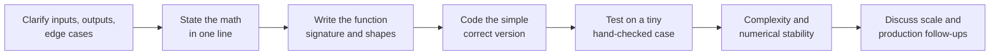

# Coding Exercises: Classical ML and Deep Learning from Scratch

> **Level:** Beginner to Advanced · **Study time:** ~180 min (more if you code every exercise yourself, which you should) · **Prerequisites:** [Calculus for ML](../00-foundations/03-calculus-and-gradients.md), [Softmax, Entropy, Cross-Entropy and KL Divergence](../00-foundations/05-softmax-entropy-cross-entropy-and-kl-divergence.md), [Python Tooling for ML](../00-foundations/06-python-numpy-pandas-pytorch-essentials.md), [Linear and Logistic Regression](../01-classical-ml/02-linear-and-logistic-regression.md), [Classification Metrics](../01-classical-ml/04-classification-metrics-and-imbalanced-data.md), [Backpropagation and Gradient Descent](../02-deep-learning/02-backpropagation-and-gradient-descent.md)

## Table of contents

- [Why this matters](#why-this-matters)
- [How to use these exercises](#how-to-use-these-exercises)
- [Part 1: Data splitting and preprocessing](#part-1-data-splitting-and-preprocessing)
- [Part 2: Linear models trained with gradient descent](#part-2-linear-models-trained-with-gradient-descent)
- [Part 3: Evaluation metrics and decision thresholds](#part-3-evaluation-metrics-and-decision-thresholds)
- [Part 4: Classic algorithms: kNN, k-means and tree splits](#part-4-classic-algorithms-knn-k-means-and-tree-splits)
- [Part 5: Deep learning building blocks in NumPy](#part-5-deep-learning-building-blocks-in-numpy)
- [Part 6: Training loops and production monitoring](#part-6-training-loops-and-production-monitoring)
- [Going deeper: what separates a senior answer](#going-deeper-what-separates-a-senior-answer)
- [Common mistakes and misconceptions](#common-mistakes-and-misconceptions)
- [Interview questions and model answers](#interview-questions-and-model-answers)
- [Key takeaways](#key-takeaways)
- [Further reading](#further-reading)
- [Next](#next)

## Why this matters

Many AI/ML interview loops include at least one "implement it from scratch" round: write ROC-AUC without scikit-learn, code k-means, derive and implement the backward pass of a small network, or write a clean PyTorch training loop. Interviewers use these rounds because they cheaply reveal whether you understand the mechanism behind the library call, whether you write **vectorized** code (whole-array NumPy operations that run in optimized C instead of Python loops) and **numerically stable** code (no overflow, underflow or `log(0)` on extreme inputs), and whether you test your own work. They also reveal production instincts: do you fit the scaler on training data only, do you remember `model.eval()`, do you pick a threshold from business costs instead of defaulting to 0.5? This chapter gives you 18 exercises, ordered from easy to hard, each with hints, a reference solution, complexity notes, tests and the follow-up questions a senior interviewer is likely to ask next.

## How to use these exercises

Treat each exercise as a mock interview. Read the problem, close the solution, set a timer (the table gives a rough time box), and write code in a plain editor. Then compare.

### The interview loop that scores well

Interviewers rarely grade only "does it run". They watch how you get there. A reliable sequence:



> **Interview tip:** Say the shapes out loud. "X is n by d, w is d, so Xw is n." Shape bugs are the most common bug in ML code, and narrating shapes catches them before you run anything.

### Running examples

To keep things concrete, most exercises reuse two tiny datasets:

- **Spam filter:** emails labeled 1 (spam) or 0 (ham, meaning legitimate mail), with features such as the number of links.
- **House prices:** a size feature (in thousands of square feet) and a price.

### The exercise map

| # | Exercise | Topic | Difficulty | Time box |
|---|----------|-------|-----------|----------|
| 1 | Stratified train/test split | Data | Easy | 10 min |
| 2 | Standard scaler without leakage | Data | Easy | 10 min |
| 3 | Linear regression with gradient descent | Linear models | Easy | 15 min |
| 4 | Logistic regression with log loss | Linear models | Medium | 20 min |
| 5 | Confusion matrix | Metrics | Easy | 10 min |
| 6 | Precision, recall and F1 | Metrics | Easy | 10 min |
| 7 | ROC-AUC from scratch | Metrics | Medium | 20 min |
| 8 | Threshold selection by expected cost | Metrics | Medium | 15 min |
| 9 | k-nearest neighbors classifier | Algorithms | Medium | 15 min |
| 10 | k-means clustering | Algorithms | Medium | 20 min |
| 11 | Gini impurity and best stump split | Algorithms | Medium | 25 min |
| 12 | Stable softmax and cross-entropy | Deep learning | Medium | 15 min |
| 13 | 2-layer MLP forward and backward | Deep learning | Hard | 30 min |
| 14 | Numerical gradient check | Deep learning | Medium | 15 min |
| 15 | Dropout forward pass | Deep learning | Easy | 10 min |
| 16 | Batch normalization forward pass | Deep learning | Medium | 20 min |
| 17 | PyTorch loop with validation and early stopping | Training | Medium | 25 min |
| 18 | PSI drift computation | Production | Medium | 20 min |

All solutions assume:

```bash
pip install numpy scikit-learn torch
```

```python
import numpy as np  # every NumPy snippet below assumes this import
```

---

## Part 1: Data splitting and preprocessing

These two exercises are about not fooling yourself. A good split and leak-free preprocessing are what make every later metric trustworthy. The concepts are taught fully in [The ML Workflow and Data Splits](../01-classical-ml/01-ml-workflow-data-splits-and-cross-validation.md) and [Overfitting, Regularization and Data Leakage](../01-classical-ml/03-overfitting-regularization-and-data-leakage.md).

### Exercise 1: Stratified train/test split

> **Analogy:** If a jar of marbles is 10% red and you scoop a handful at random, you might get no red marbles at all. Stratifying is scooping 10% from the red pile and 10% from the blue pile separately, so each handful looks like the jar.

**Stratification** means splitting data so that each class keeps the same proportion in every split.

**Problem.** Write `stratified_train_test_split(X, y, test_size, seed)` that returns `X_train, X_test, y_train, y_test` with class proportions preserved in both splits. Do not use scikit-learn.

**Why it matters.** With 100 emails of which 10 are spam, a purely random test set of 20 contains zero spam emails about 9.5% of the time (hypergeometric probability $\binom{90}{20}/\binom{100}{20} \approx 0.095$). Your recall on that test set would be undefined.

**Hints.**
1. Handle each class separately: find its indices, shuffle them, take the first `round(n_c * test_size)` for test.
2. Shuffle the final index lists so classes are not grouped in blocks (some training code assumes shuffled order).
3. Use a seeded `np.random.default_rng` so the split is reproducible.

**Reference solution.**

```python
def stratified_train_test_split(X, y, test_size=0.2, seed=0):
    X, y = np.asarray(X), np.asarray(y)
    rng = np.random.default_rng(seed)
    train_parts, test_parts = [], []
    for cls in np.unique(y):
        idx = np.flatnonzero(y == cls)        # positions of this class
        rng.shuffle(idx)
        n_test = int(round(len(idx) * test_size))
        test_parts.append(idx[:n_test])
        train_parts.append(idx[n_test:])
    train_idx = rng.permutation(np.concatenate(train_parts))
    test_idx = rng.permutation(np.concatenate(test_parts))
    return X[train_idx], X[test_idx], y[train_idx], y[test_idx]
```

**Complexity.** $O(n \log n)$ time because `np.unique` sorts; $O(n)$ extra memory for the index arrays.

**Tests.**

```python
X = np.arange(100).reshape(-1, 1)
y = np.array([1] * 10 + [0] * 90)                   # 10% spam
X_tr, X_te, y_tr, y_te = stratified_train_test_split(X, y, test_size=0.2, seed=42)
assert len(y_te) == 20 and y_te.sum() == 2          # 10 * 0.2 = 2 spam in test
assert y_tr.sum() == 8
assert len(np.intersect1d(X_tr.ravel(), X_te.ravel())) == 0   # no overlap
assert len(X_tr) + len(X_te) == 100                            # nothing lost
```

**Library version.** `sklearn.model_selection.train_test_split(X, y, test_size=0.2, stratify=y, random_state=0)`.

**Common follow-ups.**
- *Per-class rounding can make the total test size drift by a few samples. How would you fix it?* Allocate the floor for each class, then hand the leftover slots to classes with the largest fractional remainders.
- *What if the same customer appears in many rows?* Split by group (`GroupShuffleSplit`), otherwise the model memorizes customers and the test score is inflated.
- *What if the data is time-ordered?* Split by time (train on the past, test on the future). Stratification does not fix leakage from the future.
- *How do you stratify a regression target?* Bin the target into quantiles and stratify on the bins.
- *Python's `round` uses banker's rounding* (`round(2.5) == 2`). Mention it if a class count lands exactly on .5.

### Exercise 2: Standard scaler without leakage

**Standardization** rescales each feature to mean 0 and standard deviation 1. **Data leakage** is when information that would not be available at prediction time (here, statistics of the test set) sneaks into training or preprocessing.

> **Analogy:** Grading on a curve is fine, but the curve must be computed from last year's class (training data), not from the exam you are currently grading.

$$
z = \frac{x - \mu_{\text{train}}}{\sigma_{\text{train}}}
$$

- $x$: a raw feature value (training, validation, test or production).
- $\mu_{\text{train}}$: the mean of that feature computed on the training set only.
- $\sigma_{\text{train}}$: the standard deviation on the training set only (population form, dividing by $n$, which is what scikit-learn uses).
- $z$: the standardized value.

**Worked example (house sizes).** Training sizes are $[1, 2, 3]$.
- $\mu = (1 + 2 + 3)/3 = 2$.
- $\sigma = \sqrt{((1-2)^2 + (2-2)^2 + (3-2)^2)/3} = \sqrt{2/3} \approx 0.8165$.
- Training values become $[-1/0.8165,\ 0,\ 1/0.8165] \approx [-1.2247, 0, 1.2247]$.
- A test house of size 4 becomes $(4 - 2)/0.8165 \approx 2.4495$. It is allowed to fall outside the training range; that is realistic.

**Problem.** Implement a `StandardScaler` class with `fit`, `transform` and `fit_transform`. Handle constant features.

**Hints.** Store `mean_` and `scale_` during `fit`; `transform` must only read them. A constant column has $\sigma = 0$: replace it by 1 so you do not divide by zero.

**Reference solution.**

```python
class StandardScaler:
    def fit(self, X):
        X = np.asarray(X, dtype=float)
        self.mean_ = X.mean(axis=0)
        std = X.std(axis=0)                       # ddof=0, matches scikit-learn
        self.scale_ = np.where(std == 0, 1.0, std)
        return self

    def transform(self, X):
        if not hasattr(self, "mean_"):
            raise RuntimeError("call fit() before transform()")
        return (np.asarray(X, dtype=float) - self.mean_) / self.scale_

    def fit_transform(self, X):
        return self.fit(X).transform(X)
```

**Complexity.** $O(nd)$ time for both fit and transform, $O(d)$ memory for the statistics.

**Tests.**

```python
sc = StandardScaler().fit([[1.0], [2.0], [3.0]])
assert np.allclose(sc.transform([[1.0], [2.0], [3.0]]).ravel(), [-1.2247449, 0.0, 1.2247449])
assert np.isclose(sc.transform([[4.0]])[0, 0], 2.4494897)
const = StandardScaler().fit_transform([[5.0], [5.0]])
assert np.all(const == 0)                       # constant feature: no NaN
```

**Library version.** `sklearn.preprocessing.StandardScaler`, and wrap it in a `sklearn.pipeline.Pipeline` with the model so cross-validation refits it inside every fold.

**Common follow-ups.**
- *Why not fit on all data, it is just a mean?* Because test statistics leak into training. With small data or heavy-tailed features the effect on scores is real, and the habit generalizes to target encoding (replacing a category by the mean label of its rows) and imputation, where leakage is severe.
- *How do you compute mean and variance on a stream that does not fit in memory?* Welford's online algorithm (shown in [Going deeper](#going-deeper-what-separates-a-senior-answer)).
- *Which models need scaling?* Distance and gradient based ones (kNN, k-means, SVMs, linear models with regularization, neural nets). Tree models split on thresholds and do not care.
- *What if features have outliers?* Use a robust scaler (median and interquartile range).
- *In production, where do `mean_` and `scale_` live?* They are part of the model artifact. Saving them separately from the model is a classic source of training-serving skew, where production features are processed differently from training features (see [Reproducibility and Training-Serving Skew](../10-mlops/03-reproducibility-and-training-serving-skew.md)).

---

## Part 2: Linear models trained with gradient descent

Full theory lives in [Linear and Logistic Regression from Scratch](../01-classical-ml/02-linear-and-logistic-regression.md). Here we focus on writing it correctly under interview pressure.

**Gradient descent** is the loop "compute the loss, compute its gradient with respect to each parameter, step a little in the opposite direction". The step size is the **learning rate**.

> **Analogy:** You are on a foggy hill and want to reach the valley. You feel which way the ground slopes under your feet (the gradient) and take a small step downhill (the learning rate controls the step length). Repeat.

### Exercise 3: Linear regression with gradient descent

**Problem.** Fit $\hat{y} = Xw + b$ by minimizing **mean squared error (MSE)**, the average of squared prediction errors, using batch gradient descent. Return weights, bias and the loss history.

$$
L = \frac{1}{n}\sum_{i=1}^{n} (\hat{y}_i - y_i)^2, \qquad
\frac{\partial L}{\partial w} = \frac{2}{n} X^\top (\hat{y} - y), \qquad
\frac{\partial L}{\partial b} = \frac{2}{n}\sum_{i=1}^{n} (\hat{y}_i - y_i)
$$

- $X$: the $n \times d$ feature matrix ($n$ examples, $d$ features).
- $w$: the weight vector of length $d$; $b$: the scalar bias.
- $\hat{y} = Xw + b$: predictions; $y$: true targets.
- $X^\top(\hat{y} - y)$: for each feature, the sum of (feature value times error).

**Worked example (house prices).** Sizes $x = [1, 2, 3]$, prices $y = [2, 4, 6]$, start at $w = 0, b = 0$, learning rate $0.1$.
1. Predictions are $[0, 0, 0]$, errors $\hat{y} - y = [-2, -4, -6]$.
2. Loss $= (4 + 16 + 36)/3 = 56/3 \approx 18.667$.
3. $\partial L/\partial w = (2/3)(1 \cdot -2 + 2 \cdot -4 + 3 \cdot -6) = (2/3)(-28) \approx -18.667$.
4. $\partial L/\partial b = (2/3)(-2 - 4 - 6) = (2/3)(-12) = -8$.
5. Update: $w = 0 - 0.1 \times (-18.667) = 1.8667$, $b = 0 - 0.1 \times (-8) = 0.8$.
6. New predictions $[2.6667, 4.5333, 6.4]$, errors $[0.6667, 0.5333, 0.4]$, loss $= (0.4444 + 0.2844 + 0.16)/3 \approx 0.2963$. One step cut the loss from 18.67 to 0.30.

**Hints.** Vectorize: no Python loop over examples. Record the loss each **epoch** (one full pass over the training data; in batch gradient descent that is exactly one update) so you can see divergence. Check your answer against the closed form solution from `np.linalg.lstsq`.

**Reference solution.**

```python
def linear_regression_gd(X, y, lr=0.1, epochs=1000):
    X, y = np.asarray(X, float), np.asarray(y, float)
    n, d = X.shape
    w, b = np.zeros(d), 0.0
    history = []
    for _ in range(epochs):
        y_hat = X @ w + b                    # (n,)
        err = y_hat - y
        history.append(float(np.mean(err ** 2)))
        grad_w = (2.0 / n) * (X.T @ err)     # (d,)
        grad_b = (2.0 / n) * err.sum()
        w -= lr * grad_w
        b -= lr * grad_b
    return w, b, history
```

**Complexity.** $O(E \cdot n \cdot d)$ time for $E$ epochs and $O(d)$ parameter memory. The closed form (the **normal equation** $w = (X^\top X)^{-1} X^\top y$, with a column of ones appended to $X$ for the bias) costs about $O(nd^2 + d^3)$, which wins for small $d$ and loses badly for large $d$ or streaming data.

**Tests.**

```python
w, b, hist = linear_regression_gd([[1.0], [2.0], [3.0]], [2.0, 4.0, 6.0], lr=0.1, epochs=1)
assert np.isclose(w[0], 1.8666667) and np.isclose(b, 0.8)
assert np.isclose(hist[0], 18.6666667)

rng = np.random.default_rng(0)
X = rng.normal(size=(500, 3))
y = X @ np.array([3.0, -2.0, 0.5]) + 1.0 + 0.01 * rng.normal(size=500)
w, b, hist = linear_regression_gd(X, y, lr=0.1, epochs=2000)
A = np.c_[X, np.ones(len(X))]                       # add a column of ones for the bias
coef, *_ = np.linalg.lstsq(A, y, rcond=None)
assert np.allclose(np.r_[w, b], coef, atol=1e-3)    # GD matches the closed form
assert hist[-1] < hist[0]
```

**Common follow-ups.**
- *The loss explodes to `inf`. Why?* Learning rate too high for the feature scale. Standardize features (Exercise 2) or lower the rate.
- *Add L2 regularization (ridge).* Add $\lambda \lVert w \rVert^2$ to the loss, so `grad_w += 2 * lam * w`. Do not regularize the bias.
- *Mini-batch or stochastic GD?* Sample a batch each step; noisier but much cheaper per step on large $n$, and the noise can help non-convex models. See [Optimizers](../02-deep-learning/03-optimizers-sgd-momentum-adam-and-learning-rate-schedules.md).
- *Is there a risk of local minima?* No: MSE for linear regression is **convex** (bowl-shaped, with no separate dips), so any minimum is the global one. (It is not necessarily unique: with perfectly collinear features $X^\top X$ is singular and a whole set of weight vectors attains the same minimum loss.)

### Exercise 4: Logistic regression with log loss

A **logit** is the raw score $z = w^\top x + b$ before it is squashed into a probability. The **sigmoid** $\sigma(z) = 1/(1 + e^{-z})$ maps it to $(0, 1)$. **Log loss** (binary cross-entropy) punishes confident wrong probabilities heavily.

$$
L = -\frac{1}{n}\sum_{i=1}^{n}\Big[y_i \log p_i + (1 - y_i)\log(1 - p_i)\Big], \qquad p_i = \sigma(z_i)
$$

$$
\frac{\partial L}{\partial w} = \frac{1}{n} X^\top (p - y), \qquad \frac{\partial L}{\partial b} = \frac{1}{n}\sum_{i=1}^{n}(p_i - y_i)
$$

- $y_i \in \{0, 1\}$: the true label; $p_i$: predicted probability of class 1.
- The gradient has the same "features times error" shape as linear regression, and that is no accident. By the chain rule, $\partial L/\partial p = (p - y)/(p(1 - p))$ and $\partial p/\partial z = \sigma'(z) = p(1 - p)$; the $p(1 - p)$ factors cancel, leaving $\partial L/\partial z = p - y$.

**Worked example (one spam email).** Feature $x = 2$ (two occurrences of "free"), label $y = 1$, current $w = 0.5, b = 0$.
1. $z = 0.5 \times 2 + 0 = 1$.
2. $p = \sigma(1) = 1/(1 + e^{-1}) = 1/1.3679 \approx 0.7311$.
3. Loss $= -\ln(0.7311) \approx 0.3133$.
4. $\partial L/\partial w = (0.7311 - 1) \times 2 = -0.5379$; $\partial L/\partial b = -0.2689$.
5. With learning rate 1: $w = 0.5 + 0.5379 = 1.0379$. The weight on "free" grows, as it should for a spam word.

**Numerical stability.** For $z = -800$, `np.exp(-z)` overflows, and if $p$ rounds to exactly 0 or 1, `log(p)` is $-\infty$. Compute the loss directly from logits instead:

$$
-\big[y\log\sigma(z) + (1-y)\log(1-\sigma(z))\big] = \log(1 + e^{z}) - y z
$$

`np.logaddexp(0, z)` computes $\log(1 + e^z)$ without overflow. Check with the example: $\log(1 + e^1) - 1 \cdot 1 = 1.3133 - 1 = 0.3133$. Same answer.

**Reference solution.**

```python
def sigmoid(z):
    z = np.asarray(z, dtype=float)
    out = np.empty_like(z)
    pos = z >= 0
    out[pos] = 1.0 / (1.0 + np.exp(-z[pos]))      # safe: exp of a non-positive number
    ez = np.exp(z[~pos])                          # safe: exp of a negative number
    out[~pos] = ez / (1.0 + ez)
    return out

def log_loss_from_logits(z, y):
    return float(np.mean(np.logaddexp(0.0, z) - y * z))

def logistic_regression_gd(X, y, lr=0.1, epochs=1000, l2=0.0):
    X, y = np.asarray(X, float), np.asarray(y, float)
    n, d = X.shape
    w, b = np.zeros(d), 0.0
    history = []
    for _ in range(epochs):
        z = X @ w + b
        history.append(log_loss_from_logits(z, y) + l2 * float(w @ w))
        err = sigmoid(z) - y                       # (n,)
        w -= lr * ((X.T @ err) / n + 2 * l2 * w)
        b -= lr * err.mean()
    return w, b, history

def predict_proba(X, w, b):
    return sigmoid(np.asarray(X, float) @ w + b)
```

**Complexity.** Same as linear regression: $O(E \cdot n \cdot d)$.

**Tests.**

```python
assert np.isclose(log_loss_from_logits(np.array([1.0]), np.array([1.0])), 0.3132617)
assert np.all(np.isfinite(sigmoid(np.array([-1000.0, 0.0, 1000.0]))))   # no overflow
assert np.isclose(sigmoid(np.array([0.0]))[0], 0.5)

rng = np.random.default_rng(0)
X = rng.normal(size=(1000, 2))
y = (X[:, 0] + 2 * X[:, 1] > 0).astype(float)
w, b, hist = logistic_regression_gd(X, y, lr=0.5, epochs=500)
acc = np.mean((predict_proba(X, w, b) >= 0.5) == y)
assert acc > 0.95 and hist[-1] < hist[0]
```

**Library version.** `sklearn.linear_model.LogisticRegression` (note: L2 regularization is on by default, controlled by `C`, the inverse strength).

**Common follow-ups.**
- *Why not train logistic regression with MSE?* MSE composed with a sigmoid is non-convex in $w$, and its gradient contains a factor $\sigma'(z)$ that vanishes when the model is confidently wrong, so learning stalls exactly when it should be fastest. Log loss is convex and its gradient is just $p - y$.
- *What happens on perfectly separable data without regularization?* Weights grow without bound because pushing $p$ closer to 0 or 1 always lowers the loss. Regularization or early stopping fixes it.
- *How do you handle class imbalance?* Class weights in the loss, resampling, or (often best) keep the loss unweighted for good probabilities and move the threshold (Exercise 8).
- *Extend to multiclass?* Replace sigmoid with softmax and binary log loss with cross-entropy (Exercise 12).

---

## Part 3: Evaluation metrics and decision thresholds

Theory and trade-offs are in [Classification Metrics and Imbalanced Data](../01-classical-ml/04-classification-metrics-and-imbalanced-data.md). Interviewers love these because they are short, easy to get subtly wrong (zero division, ties) and lead naturally into business discussions.

We use one running example for Exercises 5 and 6: ten emails.

```text
y_true: 1 1 1 1 0 0 0 0 0 0      (4 spam, 6 ham)
y_pred: 1 1 1 0 1 1 0 0 0 0
         TP TP TP FN FP FP TN TN TN TN
```

### Exercise 5: Confusion matrix

A **confusion matrix** counts predictions by (true class, predicted class). In the binary case its four cells are **true positives (TP)**, **false positives (FP)**, **false negatives (FN)** and **true negatives (TN)**.

```text
                   predicted 0 (ham)   predicted 1 (spam)
true 0 (ham)          TN = 4              FP = 2
true 1 (spam)         FN = 1              TP = 3
```

Rows are true classes, columns are predicted classes. This is scikit-learn's convention; always state which you use, because some textbooks flip it.

**Problem.** Write `confusion_matrix(y_true, y_pred, n_classes)` for any number of classes, without a Python loop over samples.

**Hints.** Map each (true, pred) pair to a single index `true * k + pred`, count with `np.bincount`, reshape to `(k, k)`.

**Reference solution.**

```python
def confusion_matrix(y_true, y_pred, n_classes=None):
    y_true, y_pred = np.asarray(y_true, int), np.asarray(y_pred, int)
    k = n_classes or int(max(y_true.max(), y_pred.max())) + 1
    flat = y_true * k + y_pred                    # unique code per (true, pred) cell
    return np.bincount(flat, minlength=k * k).reshape(k, k)
```

**Complexity.** $O(n + k^2)$ time and $O(k^2)$ memory.

**Tests.**

```python
y_true = [1, 1, 1, 1, 0, 0, 0, 0, 0, 0]
y_pred = [1, 1, 1, 0, 1, 1, 0, 0, 0, 0]
assert confusion_matrix(y_true, y_pred).tolist() == [[4, 2], [1, 3]]
assert confusion_matrix([0, 1, 2, 2], [0, 2, 2, 1], 3).tolist() == [[1, 0, 0], [0, 0, 1], [0, 1, 1]]
```

**Common follow-ups.** *Labels are strings like "spam"?* Map them with `np.unique(..., return_inverse=True)` over the union of both arrays. *Normalize rows?* Divide each row by its sum to get per-class recall on the diagonal.

### Exercise 6: Precision, recall and F1

- **Precision** $= TP / (TP + FP)$: of everything flagged as spam, how much really was spam?
- **Recall** $= TP / (TP + FN)$: of all real spam, how much did we catch?
- **F1** $= 2PR/(P + R)$: the harmonic mean of precision $P$ and recall $R$. The harmonic mean is dragged toward the smaller value, so F1 is only high when both are high.

**Worked example.** $TP = 3, FP = 2, FN = 1$.
- Precision $= 3/(3 + 2) = 0.6$.
- Recall $= 3/(3 + 1) = 0.75$.
- F1 $= 2 \times 0.6 \times 0.75 / (0.6 + 0.75) = 0.9/1.35 \approx 0.6667$.
- Accuracy $= (3 + 4)/10 = 0.7$.

**Problem.** Compute per-class precision, recall and F1 from a confusion matrix, plus macro, micro and weighted averages. Return 0 instead of crashing on division by zero.

**Hints.** For class $c$: TP is `cm[c, c]`, column sum is everything predicted as $c$, row sum is everything truly $c$. **Macro** averaging takes the plain mean over classes (every class counts equally). **Micro** averaging pools all TP, FP and FN first (every sample counts equally). **Weighted** averaging weights each class by its number of true samples (its **support**).

**Reference solution.**

```python
def safe_div(a, b):
    a, b = np.asarray(a, float), np.asarray(b, float)
    return np.divide(a, b, out=np.zeros_like(a), where=b != 0)

def precision_recall_f1(cm):
    cm = np.asarray(cm, float)
    tp = np.diag(cm)
    precision = safe_div(tp, cm.sum(axis=0))       # column sums: predicted as c
    recall = safe_div(tp, cm.sum(axis=1))          # row sums: truly c
    f1 = safe_div(2 * precision * recall, precision + recall)
    support = cm.sum(axis=1)
    micro = tp.sum() / cm.sum()                    # micro P = micro R = micro F1 = accuracy
    return {
        "precision": precision, "recall": recall, "f1": f1,
        "macro_f1": f1.mean(),
        "weighted_f1": float((f1 * support).sum() / support.sum()),
        "micro_f1": float(micro),
    }
```

**Complexity.** $O(k^2)$ given the matrix; $O(n)$ to build it.

**Tests.**

```python
r = precision_recall_f1([[4, 2], [1, 3]])
assert np.isclose(r["precision"][1], 0.6) and np.isclose(r["recall"][1], 0.75)
assert np.isclose(r["f1"][1], 2 / 3)
assert np.isclose(r["micro_f1"], 0.7)                         # equals accuracy
assert precision_recall_f1([[5, 0], [0, 0]])["precision"][1] == 0.0   # no crash
```

**Common follow-ups.**
- *Why is micro F1 equal to accuracy for single-label multiclass?* Every false positive for one class is a false negative for another, so pooled FP equals pooled FN, and pooled precision equals pooled recall equals the fraction correct.
- *Macro or micro for imbalanced data?* Macro if rare classes matter as much as common ones; micro (or weighted) if each sample matters equally.
- *What is F-beta?* $F_\beta = (1 + \beta^2)PR/(\beta^2 P + R)$. $\beta > 1$ weights recall more (fraud, medical screening).

### Exercise 7: ROC-AUC from scratch

The **ROC curve** plots the **true positive rate** (TPR, which is recall) against the **false positive rate** (FPR $= FP/(FP + TN)$) as the decision threshold sweeps from high to low. **ROC-AUC** is the area under it.

> **Analogy:** Pick one random spam email and one random ham email. AUC is the probability that your model gives the spam one the higher spam score. A coin flip scores 0.5; a perfect ranker scores 1.0.

That probabilistic definition gives two algorithms:

$$
\text{AUC} = \frac{1}{PN}\sum_{i \in \text{pos}}\sum_{j \in \text{neg}}\Big[\mathbb{1}(s_i > s_j) + \tfrac{1}{2}\mathbb{1}(s_i = s_j)\Big]
= \frac{R_{\text{pos}} - P(P+1)/2}{PN}
$$

- $P, N$: number of positives and negatives; $s_i$: score of example $i$.
- $\mathbb{1}(\cdot)$: 1 if the condition holds, else 0. Ties count as half a win.
- $R_{\text{pos}}$: the sum of the ranks of the positive examples when all scores are sorted ascending (rank 1 is the lowest), with tied scores given their average rank. This is the Mann-Whitney U statistic in disguise.

**Worked example.** Labels $[1, 1, 0, 1, 0, 0]$, scores $[0.9, 0.8, 0.7, 0.4, 0.4, 0.3]$. So $P = 3, N = 3$, 9 pairs.
- Pairwise: positive 0.9 beats all three negatives (0.7, 0.4, 0.3): 3. Positive 0.8 also: 3. Positive 0.4 loses to 0.7 (0), ties 0.4 (0.5), beats 0.3 (1): 1.5. Total $7.5/9 \approx 0.8333$.
- Ranks: ascending order is 0.3 (rank 1), 0.4 and 0.4 (ranks 2 and 3, averaged to 2.5 each), 0.7 (4), 0.8 (5), 0.9 (6). Positive ranks sum to $2.5 + 5 + 6 = 13.5$. AUC $= (13.5 - 3 \times 4/2)/9 = (13.5 - 6)/9 = 7.5/9 \approx 0.8333$. Same answer.
- The curve itself, one point per distinct threshold ("predict positive if score $\ge t$"):

| $t$ | TP | FP | TPR = TP/3 | FPR = FP/3 |
|---|---|---|---|---|
| above 0.9 | 0 | 0 | 0 | 0 |
| 0.9 | 1 | 0 | 0.33 | 0 |
| 0.8 | 2 | 0 | 0.67 | 0 |
| 0.7 | 2 | 1 | 0.67 | 0.33 |
| 0.4 | 3 | 2 | 1 | 0.67 |
| 0.3 | 3 | 3 | 1 | 1 |

The tied pair at 0.4 moves the curve diagonally (up and right at once), and the small triangle under that diagonal adds exactly $1/18 = 0.5/9$, the half credit for that one tied pair. Summing trapezoids: $\tfrac{1}{3}\cdot\tfrac{2}{3} + \tfrac{1}{3}\cdot\tfrac{5}{6} + \tfrac{1}{3}\cdot 1 = \tfrac{15}{18} \approx 0.8333$.

**Hints.** The pairwise version is $O(PN)$ memory and time: fine as a test oracle, too slow for a million rows. The rank version is $O(n \log n)$. Ties are the trap: handle them explicitly.

**Reference solution.**

```python
def roc_auc_pairwise(y_true, scores):
    """O(P*N) reference implementation, used as a test oracle."""
    y = np.asarray(y_true).astype(bool)
    s = np.asarray(scores, float)
    pos, neg = s[y][:, None], s[~y][None, :]
    return float(((pos > neg) + 0.5 * (pos == neg)).mean())

def average_ranks(x):
    """1-based ranks, tied values get the mean of the ranks they span."""
    order = np.argsort(x, kind="stable")
    xs = x[order]
    ranks = np.empty(len(x))
    i = 0
    while i < len(x):
        j = i
        while j + 1 < len(x) and xs[j + 1] == xs[i]:
            j += 1
        ranks[order[i:j + 1]] = (i + j) / 2 + 1
        i = j + 1
    return ranks

def roc_auc(y_true, scores):
    y = np.asarray(y_true).astype(bool)
    s = np.asarray(scores, float)
    n_pos, n_neg = int(y.sum()), int((~y).sum())
    if n_pos == 0 or n_neg == 0:
        raise ValueError("ROC-AUC is undefined when only one class is present")
    r = average_ranks(s)
    return float((r[y].sum() - n_pos * (n_pos + 1) / 2) / (n_pos * n_neg))

def roc_curve_points(y_true, scores):
    """FPR and TPR at every distinct threshold, from strictest to loosest."""
    y = np.asarray(y_true, float)
    s = np.asarray(scores, float)
    order = np.argsort(-s, kind="stable")
    y, s = y[order], s[order]
    last_of_group = np.r_[np.flatnonzero(np.diff(s)), len(s) - 1]  # end of each tie group
    tps = np.cumsum(y)[last_of_group]
    fps = (last_of_group + 1) - tps
    return np.r_[0, fps] / fps[-1], np.r_[0, tps] / tps[-1]

def auc_trapezoid(fpr, tpr):
    return float(np.sum(np.diff(fpr) * (tpr[1:] + tpr[:-1]) / 2))
```

**Complexity.** Rank version: $O(n \log n)$ time for the sort, $O(n)$ memory. ROC curve: also $O(n \log n)$.

**Tests.**

```python
y = [1, 1, 0, 1, 0, 0]
s = [0.9, 0.8, 0.7, 0.4, 0.4, 0.3]
assert np.isclose(roc_auc(y, s), 7.5 / 9)
assert np.isclose(roc_auc_pairwise(y, s), 7.5 / 9)
assert np.isclose(auc_trapezoid(*roc_curve_points(y, s)), 7.5 / 9)  # trapezoid on the curve agrees
assert np.isclose(roc_auc(y, np.log(s)), 7.5 / 9)     # invariant to monotone transforms

rng = np.random.default_rng(0)
yy = rng.integers(0, 2, 300)
ss = rng.random(300).round(1)                          # rounding forces many ties
assert np.isclose(roc_auc(yy, ss), roc_auc_pairwise(yy, ss))
```

**Library version.** `sklearn.metrics.roc_auc_score` and `roc_curve`.

**Common follow-ups.**
- *AUC is 0.97 but the product is bad. How?* AUC measures ranking, not calibration or performance at your operating threshold. With 1 positive per 1,000, a tiny FPR still means many false alarms; check precision-recall curves and PR-AUC (the area under the precision-recall curve, which is far more sensitive to false positives when positives are rare).
- *AUC below 0.5?* The scores are inverted (often a label or sign bug), or the model is truly worse than random on this data.
- *Compute AUC on billions of rows?* Bucket scores into a fixed histogram per class (for example 10,000 bins), merge histograms across workers, and compute AUC from the merged counts (pairs in the same bin count as ties). The error comes only from positive-negative pairs that share a bin, so finer bins shrink it, and it is a single streaming pass.

### Exercise 8: Threshold selection by expected cost

A classifier outputs a probability; a business needs a yes or no. The **decision threshold** $t$ converts one into the other: predict positive if $p \ge t$. The **expected cost** of a threshold adds up what its mistakes cost.

$$
\text{Cost}(t) = C_{FP}\cdot FP(t) + C_{FN}\cdot FN(t)
$$

- $C_{FP}$: the cost of one false positive (for spam: a real email hidden in the spam folder).
- $C_{FN}$: the cost of one false negative (a spam email reaching the inbox).
- $FP(t), FN(t)$: counts at threshold $t$ on a validation set.

**Theory shortcut.** If the probabilities are **calibrated** (when the model says 0.3, the event happens about 30% of the time), predicting positive is worth it when the expected cost of saying "no" exceeds that of saying "yes": $p \cdot C_{FN} > (1 - p)\cdot C_{FP}$, which gives

$$
t^* = \frac{C_{FP}}{C_{FP} + C_{FN}}
$$

- For spam with $C_{FP} = 5$ (hiding a real email hurts) and $C_{FN} = 1$: $t^* = 5/6 \approx 0.83$. Be confident before flagging.
- For fraud with $C_{FP} = 10$ (a manual review) and $C_{FN} = 500$ (a lost chargeback), illustrative numbers: $t^* = 10/510 \approx 0.02$. Flag almost anything suspicious.

**Worked example.** Eight validation emails:

```text
y: 0    0    1     1    0     1    0    0
p: 0.10 0.40 0.35  0.80 0.65  0.90 0.20 0.70
```

| Threshold $t$ | FP | FN | Cost with $C_{FP}=1, C_{FN}=5$ | Cost with $C_{FP}=5, C_{FN}=1$ |
|---|---|---|---|---|
| 0.10 | 5 | 0 | 5 | 25 |
| 0.20 | 4 | 0 | 4 | 20 |
| 0.35 | 3 | 0 | **3** | 15 |
| 0.40 | 3 | 1 | 8 | 16 |
| 0.65 | 2 | 1 | 7 | 11 |
| 0.70 | 1 | 1 | 6 | 6 |
| 0.80 | 0 | 1 | 5 | **1** |
| 0.90 | 0 | 2 | 10 | 2 |
| never | 0 | 3 | 15 | 3 |

Same model, same data, two different best thresholds (0.35 and 0.80) purely because the costs differ.

**Problem.** Return the threshold that minimizes total cost on a validation set.

**Hints.** Only thresholds equal to observed scores can change the confusion matrix, so they are the only candidates worth checking. Add "never predict positive" as a candidate too.

**Reference solution.**

```python
def best_threshold_by_cost(y_true, p, c_fp, c_fn):
    y = np.asarray(y_true).astype(bool)
    p = np.asarray(p, float)
    candidates = np.unique(np.r_[p, np.inf])        # inf means "never predict positive"
    best_t, best_cost = None, np.inf
    for t in candidates:
        pred = p >= t
        fp = np.sum(pred & ~y)
        fn = np.sum(~pred & y)
        cost = c_fp * fp + c_fn * fn
        if cost < best_cost:
            best_t, best_cost = float(t), float(cost)
    return best_t, best_cost
```

**Complexity.** $O(n \cdot T)$ for $T$ candidates, so $O(n^2)$ worst case. The senior version sorts scores once and sweeps with cumulative sums of positives and negatives (the same trick as `roc_curve_points`): $O(n \log n)$.

**Tests.**

```python
y = [0, 0, 1, 1, 0, 1, 0, 0]
p = [0.10, 0.40, 0.35, 0.80, 0.65, 0.90, 0.20, 0.70]
assert best_threshold_by_cost(y, p, c_fp=1, c_fn=5) == (0.35, 3.0)
assert best_threshold_by_cost(y, p, c_fp=5, c_fn=1) == (0.8, 1.0)
```

**Common follow-ups.**
- *Tune on which split?* Validation, never test. The threshold is a **hyperparameter** (a setting you choose rather than one learned by gradient descent).
- *Costs changed next quarter. Retrain?* No: recompute the threshold. That is the payoff of separating the probability model from the decision rule.
- *There is a review team that can only handle 200 cases a day.* Then it is a capacity constraint: take the top 200 scores (a top-k policy), and report precision at k.
- *The fraud rate doubled in production.* This **prior shift** (the base rate of positives changes while each class looks the same) changes the calibrated probabilities. Recalibrate or adjust the threshold (see [Data Drift, Concept Drift and When to Retrain](../01-classical-ml/08-data-drift-concept-drift-and-retraining.md)).

---

## Part 4: Classic algorithms: kNN, k-means and tree splits

These test vectorization and algorithmic thinking. Background: [kNN, SVMs, Naive Bayes](../01-classical-ml/09-knn-svm-naive-bayes-and-other-classic-algorithms.md), [Unsupervised Learning](../01-classical-ml/10-unsupervised-learning-clustering-and-dimensionality-reduction.md) and [Decision Trees and Gradient Boosting](../01-classical-ml/06-decision-trees-random-forests-and-gradient-boosting.md).

### The pairwise distance trick

Both kNN and k-means need distances between every query and every reference point. A naive broadcast `(Q[:, None, :] - X[None, :, :])` builds an $m \times n \times d$ array, which for 1,000 queries, 100,000 points and 128 dimensions is 12.8 billion floats. Expand the square instead:

$$
\lVert q - x \rVert^2 = \lVert q \rVert^2 + \lVert x \rVert^2 - 2\, q^\top x
$$

The cross term for all pairs is one matrix multiply `Q @ X.T` of shape $m \times n$, which runs on optimized BLAS routines (Basic Linear Algebra Subprograms, the tuned matrix libraries NumPy calls under the hood). Floating-point cancellation can produce tiny negative values, so clip at 0.

### Exercise 9: k-nearest neighbors classifier

**k-nearest neighbors (kNN)** predicts the majority label among the $k$ training points closest to the query. Training is just storing the data.

**Worked example.** Training points with labels: $(1,1)\to 0$, $(1,2)\to 0$, $(4,4)\to 1$, $(5,4)\to 1$, $(5,5)\to 1$. Query $(2,2)$, $k = 3$.
- Squared distances: to $(1,1)$: $1 + 1 = 2$; to $(1,2)$: $1 + 0 = 1$; to $(4,4)$: $4 + 4 = 8$; to $(5,4)$: $9 + 4 = 13$; to $(5,5)$: $9 + 9 = 18$.
- Three nearest: $(1,2), (1,1), (4,4)$ with labels $0, 0, 1$. Majority: class 0.

**Problem.** Implement `fit` and a vectorized `predict` that handles many queries without building an $m \times n \times d$ array.

**Hints.** Use the distance trick. `np.argpartition` finds the $k$ smallest in $O(n)$ per row without a full sort. Process queries in chunks to bound memory.

**Reference solution.**

```python
class KNNClassifier:
    def __init__(self, k=3):
        self.k = k

    def fit(self, X, y):
        self.X = np.asarray(X, float)
        self.classes_, self.y_idx = np.unique(np.asarray(y), return_inverse=True)
        self.x_sq = (self.X ** 2).sum(axis=1)           # cache ||x||^2
        return self

    def _sq_dists(self, Q):
        d2 = (Q ** 2).sum(axis=1)[:, None] + self.x_sq[None, :] - 2.0 * Q @ self.X.T
        return np.maximum(d2, 0.0)                       # clip float error

    def predict(self, Q, chunk=1024):
        Q = np.asarray(Q, float)
        k = min(self.k, len(self.X))
        out = []
        for s in range(0, len(Q), chunk):
            d2 = self._sq_dists(Q[s:s + chunk])          # (b, n)
            nn = np.argpartition(d2, k - 1, axis=1)[:, :k]
            votes = self.y_idx[nn]                       # (b, k) class indices
            counts = np.zeros((len(votes), len(self.classes_)), dtype=int)
            np.add.at(counts, (np.arange(len(votes))[:, None], votes), 1)
            out.append(self.classes_[counts.argmax(axis=1)])  # ties: smallest class index
        return np.concatenate(out)
```

**Complexity.** Fit: $O(nd)$ to cache norms. Predict: $O(m \cdot n \cdot d)$ time for $m$ queries (the matrix multiply dominates), $O(\text{chunk} \cdot n)$ memory.

**Tests.**

```python
X = [[1, 1], [1, 2], [4, 4], [5, 4], [5, 5]]
y = ["ham", "ham", "spam", "spam", "spam"]
knn = KNNClassifier(k=3).fit(X, y)
assert knn.predict([[2, 2], [4, 5]]).tolist() == ["ham", "spam"]
assert KNNClassifier(k=1).fit(X, y).predict(X).tolist() == y   # k=1 memorizes training data

from sklearn.neighbors import KNeighborsClassifier
rng = np.random.default_rng(0)
Xr, yr, Qr = rng.normal(size=(200, 5)), rng.integers(0, 3, 200), rng.normal(size=(50, 5))
ours = KNNClassifier(k=5).fit(Xr, yr).predict(Qr)
ref = KNeighborsClassifier(n_neighbors=5).fit(Xr, yr).predict(Qr)
print("agreement:", np.mean(ours == ref))   # expect 1.0 or very close (ties may differ)
```

**Common follow-ups.**
- *Why must features be scaled?* Distance is dominated by the feature with the largest range. A "price in dollars" column would drown "number of rooms".
- *How do you pick $k$?* Cross-validation. Small $k$ is low bias, high variance; large $k$ smooths. Use odd $k$ for binary problems to avoid ties.
- *Why does kNN degrade in high dimensions?* In high dimensions distances concentrate: the nearest and farthest points become almost equally far, so "nearest" carries little information (the curse of dimensionality).
- *10 million items, 50 ms budget?* Exact search is $O(nd)$ per query. Use approximate nearest neighbor (ANN) indexes, which trade a little recall for large speedups: HNSW (a layered graph you walk greedily toward the query) or IVF (search only the few k-means clusters nearest the query) with product quantization (vectors compressed into short codes), as found in FAISS and vector databases. See [Vector Search Algorithms](../08-rag/06-vector-search-ann-hnsw-ivf-and-product-quantization.md).

### Exercise 10: k-means clustering

**k-means** groups points into $k$ clusters, each summarized by a **centroid** (the mean of its points). It minimizes **inertia**, the sum of squared distances from each point to its centroid. **Lloyd's algorithm** alternates two steps until assignments stop changing:

```text
repeat:
  1. assign:  each point -> nearest centroid
  2. update:  each centroid -> mean of its assigned points
until assignments do not change
```

**Worked example (1-D).** Points $[1, 2, 3, 10, 11, 12]$, $k = 2$, initial centroids $1$ and $2$ (a deliberately bad start).
1. Assign: $1 \to c_1$ (distance 0). $2 \to c_2$ (0 vs 1). $3, 10, 11, 12 \to c_2$. Update: $c_1 = 1$, $c_2 = (2 + 3 + 10 + 11 + 12)/5 = 38/5 = 7.6$.
2. Assign: $2 \to c_1$ ($|2 - 1| = 1$ vs $5.6$), $3 \to c_1$ (2 vs 4.6), $10 \to c_2$ (9 vs 2.4), $11, 12 \to c_2$. Update: $c_1 = (1 + 2 + 3)/3 = 2$, $c_2 = (10 + 11 + 12)/3 = 11$.
3. Assign: unchanged, so stop. Inertia $= 1 + 0 + 1 + 1 + 0 + 1 = 4$.

**k-means++ initialization** ("k-means++: The Advantages of Careful Seeding", Arthur and Vassilvitskii, 2007) picks the first centroid at random and each next one with probability proportional to its squared distance from the nearest centroid already chosen. Spreading the seeds out makes bad starts like the one above much less likely.

**Problem.** Implement k-means with k-means++ initialization (allow an explicit `init` for testing), a convergence check, and empty-cluster handling.

**Reference solution.**

```python
def kmeans(X, k, n_iters=100, init=None, seed=0):
    X = np.asarray(X, float)
    n = len(X)
    rng = np.random.default_rng(seed)
    if init is not None:
        C = np.array(init, dtype=float)
    else:                                                # k-means++ seeding
        C = [X[rng.integers(n)]]
        for _ in range(1, k):
            d2 = ((X[:, None, :] - np.array(C)[None]) ** 2).sum(-1).min(axis=1)
            probs = d2 / d2.sum() if d2.sum() > 0 else np.full(n, 1.0 / n)
            C.append(X[rng.choice(n, p=probs)])
        C = np.array(C)
    labels = None
    for _ in range(n_iters):
        d2 = ((X[:, None, :] - C[None]) ** 2).sum(-1)    # (n, k); use the norm trick at scale
        new_labels = d2.argmin(axis=1)
        if labels is not None and np.array_equal(new_labels, labels):
            break                                        # converged
        labels = new_labels
        for j in range(k):
            members = X[labels == j]
            # an empty cluster is re-seeded at a random point instead of becoming NaN
            C[j] = members.mean(axis=0) if len(members) else X[rng.integers(n)]
    inertia = float(((X - C[labels]) ** 2).sum())
    return C, labels, inertia
```

**Complexity.** $O(I \cdot n \cdot k \cdot d)$ for $I$ iterations. The broadcast above uses $O(nkd)$ memory; switch to the norm trick for large data. k-means++ seeding adds $O(nkd)$.

**Tests.**

```python
X = [[1], [2], [3], [10], [11], [12]]
C, labels, inertia = kmeans(X, 2, init=[[1], [2]])
assert np.allclose(np.sort(C.ravel()), [2, 11]) and np.isclose(inertia, 4.0)
assert len(set(labels[:3])) == 1 and labels[0] != labels[3]     # {1,2,3} vs {10,11,12}

rng = np.random.default_rng(1)
blobs = np.r_[rng.normal(0, 0.3, (50, 2)), rng.normal(5, 0.3, (50, 2))]
_, lab, _ = kmeans(blobs, 2, seed=3)
assert len(set(lab[:50])) == 1 and len(set(lab[50:])) == 1      # two clean blobs recovered
```

**Library version.** `sklearn.cluster.KMeans(n_clusters=k, init="k-means++", n_init=10)`, or `MiniBatchKMeans` for large data.

**Common follow-ups.**
- *Is the result deterministic?* No. Lloyd's algorithm converges to a local minimum that depends on the seeds. Run several initializations (`n_init`) and keep the lowest inertia.
- *How do you choose $k$?* Elbow plot of inertia (pick the $k$ where adding clusters stops helping much), silhouette score (how much closer each point is to its own cluster than to the next nearest one, from $-1$ to $1$), or (best) the downstream use: how many segments can marketing act on?
- *When does k-means fail?* Non-spherical clusters, very different cluster sizes or densities, unscaled features and outliers (the mean is not robust). Consider DBSCAN or Gaussian mixtures.
- *Where does k-means show up in GenAI systems?* IVF vector indexes cluster embeddings with k-means and search only the nearest clusters; product quantization runs k-means on sub-vectors to build codebooks.

### Exercise 11: Gini impurity and the best split for a decision stump

A **decision stump** is a decision tree with one split: "if feature $j \le$ threshold, go left, else right". **Gini impurity** measures how mixed a node's labels are: the chance that two labels drawn at random (with replacement) from the node disagree.

$$
G = 1 - \sum_{c=1}^{K} p_c^2, \qquad
G_{\text{split}} = \frac{n_L}{n} G_L + \frac{n_R}{n} G_R, \qquad
\text{gain} = G_{\text{parent}} - G_{\text{split}}
$$

- $p_c$: the fraction of samples in the node with class $c$; $K$: number of classes.
- $n_L, n_R$: samples going left and right; $G_L, G_R$: their impurities.
- A pure node has $G = 0$; a 50/50 binary node has $G = 0.5$, the binary maximum.

**Worked example (spam by number of links).**

```text
links x: 0 0 1 1 2 3 5 6 7 8
label y: 0 0 0 0 0 1 0 1 1 1      (4 spam, 6 ham)
```

- Parent: $G = 1 - (0.4^2 + 0.6^2) = 1 - (0.16 + 0.36) = 0.48$.
- Split $x \le 2.5$: left has 5 ham (pure, $G_L = 0$). Right has $[1, 0, 1, 1, 1]$: 4 spam, 1 ham, $G_R = 1 - (0.8^2 + 0.2^2) = 1 - 0.68 = 0.32$. Weighted $= 0.5 \times 0 + 0.5 \times 0.32 = 0.16$. Gain $= 0.48 - 0.16 = 0.32$.
- Split $x \le 5.5$: left has 7 samples with 1 spam, $G_L = 1 - (1/49 + 36/49) = 12/49 \approx 0.2449$; right has 3 spam, $G_R = 0$. Weighted $= 0.7 \times 0.2449 \approx 0.1714$. Slightly worse.
- Checking all seven candidate thresholds (midpoints 0.5, 1.5, 2.5, 4, 5.5, 6.5, 7.5) gives weighted impurities 0.40, 0.267, **0.16**, 0.317, 0.171, 0.30, 0.40. Best: $x \le 2.5$.

**Problem.** Given $X$ ($n \times d$) and integer labels $y$, return the feature, threshold and gain of the best Gini split.

**Hints.** The naive approach recomputes class counts for each candidate threshold: $O(n^2)$ per feature. Instead, sort by the feature once, then a cumulative sum of one-hot labels gives the left-side class counts at every cut position in $O(nK)$. Never cut between two equal feature values.

**Reference solution.**

```python
def gini_from_counts(counts):
    counts = np.asarray(counts, float)
    n = counts.sum(axis=-1, keepdims=True)
    p = np.divide(counts, n, out=np.zeros_like(counts), where=n > 0)
    return np.where(n[..., 0] > 0, 1.0 - (p ** 2).sum(axis=-1), 0.0)

def best_split(X, y):
    X, y = np.asarray(X, float), np.asarray(y, int)
    n, d = X.shape
    k = int(y.max()) + 1
    total = np.bincount(y, minlength=k)
    parent = float(gini_from_counts(total))
    best = {"feature": None, "threshold": None, "impurity": parent, "gain": 0.0}
    if n < 2:
        return best
    n_left = np.arange(1, n)                               # cut after position i
    for j in range(d):
        order = np.argsort(X[:, j], kind="stable")
        xs, ys = X[order, j], y[order]
        left = np.cumsum(np.eye(k)[ys], axis=0)[:-1]       # (n-1, k) class counts on the left
        right = total - left
        w = (n_left * gini_from_counts(left) + (n - n_left) * gini_from_counts(right)) / n
        w[xs[:-1] == xs[1:]] = np.inf                      # cannot separate equal values
        i = int(np.argmin(w))
        if w[i] < best["impurity"] - 1e-12:
            best = {"feature": j, "threshold": float((xs[i] + xs[i + 1]) / 2),
                    "impurity": float(w[i]), "gain": parent - float(w[i])}
    return best
```

**Complexity.** $O(d \cdot n \log n)$ for the sorts plus $O(d \cdot n \cdot K)$ for the sweeps; $O(nK)$ memory per feature.

**Tests.**

```python
x = np.array([0, 0, 1, 1, 2, 3, 5, 6, 7, 8]).reshape(-1, 1)
y = np.array([0, 0, 0, 0, 0, 1, 0, 1, 1, 1])
b = best_split(x, y)
assert b["feature"] == 0 and b["threshold"] == 2.5
assert np.isclose(b["impurity"], 0.16) and np.isclose(b["gain"], 0.32)
assert np.isclose(gini_from_counts([5, 5]), 0.5)
assert best_split(np.ones((4, 1)), np.array([0, 1, 0, 1]))["feature"] is None  # no valid cut
```

**Common follow-ups.**
- *Gini vs entropy?* Entropy is $-\sum p_c \log_2 p_c$. They usually choose very similar splits; Gini avoids logarithms and is slightly cheaper.
- *Regression trees?* Replace impurity with variance (MSE) of the target in each child; the same cumulative-sum trick works with running sums of $y$ and $y^2$.
- *How do LightGBM and XGBoost go faster?* They bucket each feature into a fixed number of bins (histograms, often 256) once, so finding a split is $O(\text{bins})$ per feature per node instead of re-sorting.
- *Missing values?* XGBoost-style trees learn a default direction for missing values at each split by trying both sides.
- *Why can impurity-based feature importance mislead?* It favors high-cardinality features that offer many candidate thresholds. Prefer permutation importance on held-out data: shuffle one feature's column and measure how much the score drops.

---

## Part 5: Deep learning building blocks in NumPy

These exercises check that you understand what PyTorch does for you. The math is taught in [Neural Networks from Scratch](../02-deep-learning/01-neural-networks-from-scratch.md), [Backpropagation and Gradient Descent](../02-deep-learning/02-backpropagation-and-gradient-descent.md) and [Softmax, Entropy, Cross-Entropy and KL Divergence](../00-foundations/05-softmax-entropy-cross-entropy-and-kl-divergence.md).

### Exercise 12: Numerically stable softmax and cross-entropy

**Softmax** turns a vector of logits into probabilities: $\text{softmax}(z)_i = e^{z_i} / \sum_j e^{z_j}$. **Cross-entropy** for a true class $y$ is $-\log \text{softmax}(z)_y$.

**The stability trick.** Subtracting any constant $m$ from every logit leaves softmax unchanged, because $e^{z_i - m}/\sum_j e^{z_j - m} = e^{-m}e^{z_i}/(e^{-m}\sum_j e^{z_j})$. Choosing $m = \max_j z_j$ makes the largest exponent $e^0 = 1$, so nothing overflows. For the log, use the **log-sum-exp** identity:

$$
\log \text{softmax}(z)_i = z_i - m - \log \sum_j e^{z_j - m}, \qquad m = \max_j z_j
$$

**Worked example (3 classes, true class 0).** Logits $z = [2, 1, 0]$.
1. $e^2 = 7.389$, $e^1 = 2.718$, $e^0 = 1$; sum $= 11.107$.
2. Probabilities $\approx [0.6652, 0.2447, 0.0900]$ (they sum to 1).
3. Cross-entropy $= -\ln(0.6652) \approx 0.4076$.
4. Gradient with respect to logits $= \text{softmax}(z) - \text{onehot}(y) = [0.6652 - 1, 0.2447, 0.0900] = [-0.3348, 0.2447, 0.0900]$: push the true logit up and the others down.

Now try logits $[1002, 1001, 1000]$. Naively, `np.exp(1002)` overflows to `inf` and you get `nan`. After subtracting the max they become $[0, -1, -2]$, giving exactly the same probabilities as $[2, 1, 0]$.

**Reference solution.**

```python
def log_softmax(z, axis=-1):
    z = np.asarray(z, float)
    m = z.max(axis=axis, keepdims=True)
    return z - m - np.log(np.exp(z - m).sum(axis=axis, keepdims=True))

def softmax(z, axis=-1):
    return np.exp(log_softmax(z, axis))

def cross_entropy(logits, y):
    """Mean cross-entropy. logits: (n, C), y: (n,) integer class ids."""
    lp = log_softmax(logits)
    return float(-lp[np.arange(len(y)), y].mean())

def cross_entropy_grad(logits, y):
    """Gradient of the mean cross-entropy with respect to the logits."""
    g = softmax(logits)
    g[np.arange(len(y)), y] -= 1.0
    return g / len(y)
```

**Complexity.** $O(nC)$ time and memory.

**Tests.**

```python
assert np.allclose(softmax(np.array([2.0, 1.0, 0.0])), [0.66524096, 0.24472847, 0.09003057])
assert np.allclose(softmax(np.array([1002.0, 1001.0, 1000.0])), softmax(np.array([2.0, 1.0, 0.0])))
assert np.isclose(cross_entropy(np.array([[2.0, 1.0, 0.0]]), np.array([0])), 0.40760596)
assert np.isfinite(cross_entropy(np.array([[-1000.0, 1000.0]]), np.array([0])))  # 2000, not inf

import torch
z = torch.randn(4, 5, dtype=torch.float64)
t = torch.tensor([0, 3, 1, 4])
assert np.isclose(cross_entropy(z.numpy(), t.numpy()),
                  torch.nn.functional.cross_entropy(z, t).item())
```

**Common follow-ups.**
- *Should I apply softmax before `nn.CrossEntropyLoss`?* No. It expects raw logits and applies log-softmax internally. Feeding probabilities silently applies softmax twice and slows learning.
- *Why is the gradient so simple?* The derivative of log-sum-exp is softmax, and the $-z_y$ term contributes $-1$ at the true class.
- *Label smoothing?* Replace the one-hot target with $(1 - \epsilon)$ on the true class and $\epsilon/C$ spread across all classes; the gradient becomes $\text{softmax} - \text{smoothed target}$.
- *Temperature?* Divide logits by $T$ before softmax: $T > 1$ flattens, $T < 1$ sharpens. Used in distillation and LLM sampling.

### Exercise 13: A 2-layer MLP forward and backward pass in NumPy

A **multilayer perceptron (MLP)** stacks linear layers with nonlinearities between them. **ReLU** is $\max(0, z)$. **Backpropagation** applies the chain rule from the loss backward through each layer, reusing values cached during the forward pass.

```text
X (n,d) --[W1 (d,h), b1]--> z1 (n,h) --ReLU--> a1 (n,h) --[W2 (h,C), b2]--> z2 (n,C) --CE--> loss
   ^                            ^                  ^                            ^
   |      dW1 = X^T dz1         | dz1 = da1*(z1>0) | da1 = dz2 W2^T              | dz2 = (softmax - Y)/n
                                                     dW2 = a1^T dz2
```

**The backward equations** (with $Y$ the one-hot labels):

$$
\begin{aligned}
dz_2 &= (\text{softmax}(z_2) - Y)/n & dW_2 &= a_1^\top dz_2 & db_2 &= \textstyle\sum_{\text{rows}} dz_2 \\
da_1 &= dz_2 W_2^\top & dz_1 &= da_1 \odot \mathbb{1}(z_1 > 0) & & \\
dW_1 &= X^\top dz_1 & db_1 &= \textstyle\sum_{\text{rows}} dz_1 & &
\end{aligned}
$$

- $dz_2$ means $\partial L/\partial z_2$, and so on. Every gradient has the same shape as the thing it is the gradient of.
- $\odot$ is elementwise multiplication. $\mathbb{1}(z_1 > 0)$ is the ReLU derivative: 1 where the unit was active, 0 where it was clipped.
- Bias gradients sum over the batch dimension because the bias was broadcast across rows in the forward pass.

> **Interview tip:** Derive weight gradients by shape matching. $dW_2$ must be $(h, C)$; you have $a_1$ as $(n, h)$ and $dz_2$ as $(n, C)$. The only product that gives $(h, C)$ is $a_1^\top dz_2$.

**Worked example (one sample, $d = h = C = 2$, biases 0).** $x = [1, 2]$, $W_1 = \begin{bmatrix}1 & 0\\ 0 & -0.5\end{bmatrix}$, $W_2 = \begin{bmatrix}1 & -1\\ 0.5 & 0.5\end{bmatrix}$, true class 0.
1. $z_1 = xW_1 = [1 \cdot 1 + 2 \cdot 0,\ 1 \cdot 0 + 2 \cdot (-0.5)] = [1, -1]$; $a_1 = [1, 0]$.
2. $z_2 = a_1 W_2 = [1, -1]$; softmax $= [e^1, e^{-1}]/(e^1 + e^{-1}) = [2.7183, 0.3679]/3.0862 \approx [0.8808, 0.1192]$. Loss $= -\ln 0.8808 \approx 0.1269$.
3. $dz_2 = [0.8808 - 1, 0.1192] = [-0.1192, 0.1192]$.
4. $dW_2 = a_1^\top dz_2 = \begin{bmatrix}-0.1192 & 0.1192\\ 0 & 0\end{bmatrix}$: the dead second hidden unit gets no gradient.
5. $da_1 = dz_2 W_2^\top = [-0.1192 \cdot 1 + 0.1192 \cdot (-1),\ -0.1192 \cdot 0.5 + 0.1192 \cdot 0.5] = [-0.2384, 0]$.
6. $dz_1 = da_1 \odot [1, 0] = [-0.2384, 0]$.
7. $dW_1 = x^\top dz_1 = \begin{bmatrix}1 \cdot (-0.2384) & 0\\ 2 \cdot (-0.2384) & 0\end{bmatrix} = \begin{bmatrix}-0.2384 & 0\\ -0.4768 & 0\end{bmatrix}$.

**Problem.** Implement the network with He initialization, `loss_and_grads(X, y)` and a plain gradient descent training loop. Reuse `cross_entropy` and `cross_entropy_grad` from Exercise 12.

**Reference solution.**

```python
class TwoLayerMLP:
    def __init__(self, d_in, d_hidden, n_classes, seed=0):
        rng = np.random.default_rng(seed)
        self.params = {
            "W1": rng.normal(0.0, np.sqrt(2.0 / d_in), (d_in, d_hidden)),  # He init for ReLU
            "b1": np.zeros(d_hidden),
            "W2": rng.normal(0.0, np.sqrt(1.0 / d_hidden), (d_hidden, n_classes)),
            "b2": np.zeros(n_classes),
        }

    def forward(self, X):
        p = self.params
        z1 = X @ p["W1"] + p["b1"]          # (n, h)
        a1 = np.maximum(z1, 0.0)            # ReLU
        z2 = a1 @ p["W2"] + p["b2"]         # (n, C) logits
        self.cache = (X, z1, a1)
        return z2

    def loss_and_grads(self, X, y):
        logits = self.forward(X)
        loss = cross_entropy(logits, y)
        X, z1, a1 = self.cache
        p = self.params
        dz2 = cross_entropy_grad(logits, y)  # (n, C), already divided by n
        grads = {"W2": a1.T @ dz2, "b2": dz2.sum(axis=0)}
        da1 = dz2 @ p["W2"].T                # (n, h)
        dz1 = da1 * (z1 > 0)                 # ReLU gate
        grads["W1"] = X.T @ dz1              # (d, h)
        grads["b1"] = dz1.sum(axis=0)
        return loss, grads

    def step(self, grads, lr):
        for name in self.params:
            self.params[name] -= lr * grads[name]   # in place, so references stay valid

def train_mlp(model, X, y, lr=0.5, steps=2000):
    losses = []
    for _ in range(steps):
        loss, grads = model.loss_and_grads(X, y)
        model.step(grads, lr)
        losses.append(loss)
    return losses
```

**Complexity.** Forward and backward are each $O(n(dh + hC))$: the backward pass costs about twice the forward because each layer computes two matrix products (one for weights, one for the input gradient). Memory: $O(nh)$ for cached activations; this per-example cost is why activation memory often dominates training memory for large models at large batch sizes or long sequences.

**Tests.**

```python
m = TwoLayerMLP(2, 2, 2)
m.params.update(W1=np.array([[1.0, 0.0], [0.0, -0.5]]), b1=np.zeros(2),
                W2=np.array([[1.0, -1.0], [0.5, 0.5]]), b2=np.zeros(2))
loss, g = m.loss_and_grads(np.array([[1.0, 2.0]]), np.array([0]))
assert np.isclose(loss, 0.12692801)
assert np.allclose(g["W1"], [[-0.23840584, 0.0], [-0.47681169, 0.0]])
assert np.allclose(g["W2"], [[-0.11920292, 0.11920292], [0.0, 0.0]])

# A nonlinear problem a linear model cannot solve: XOR-like quadrants
rng = np.random.default_rng(0)
X = rng.normal(size=(400, 2))
y = (X[:, 0] * X[:, 1] > 0).astype(int)
model = TwoLayerMLP(2, 32, 2, seed=0)
losses = train_mlp(model, X, y, lr=0.5, steps=2000)
acc = np.mean(model.forward(X).argmax(axis=1) == y)
print(f"loss {losses[0]:.3f} -> {losses[-1]:.3f}, train acc {acc:.3f}")
assert losses[-1] < losses[0]        # should fall well below ln(2) = 0.693
```

**Common follow-ups.**
- *Why He initialization?* ReLU zeros about half its inputs, halving the activation variance per layer; scaling weights by $\sqrt{2/d_{\text{in}}}$ compensates, so signals neither vanish nor explode in deep stacks (He et al., 2015). See [Vanishing and Exploding Gradients](../02-deep-learning/05-vanishing-exploding-gradients-initialization-normalization-and-residuals.md).
- *What if all weights start at zero?* Every hidden unit computes the same thing and receives the same gradient forever (symmetry is never broken).
- *Many units output zero for every input. What is happening?* "Dead ReLUs", often from a too-high learning rate pushing biases very negative. Lower the rate, use Leaky ReLU or GELU.
- *Add L2 weight decay?* `grads["W"] += lam * W` for weight matrices only (this is the gradient of the penalty $\tfrac{\lambda}{2}\lVert W \rVert^2$; with the $\lambda \lVert w \rVert^2$ convention of Exercise 3 it would be `2 * lam * W`).

### Exercise 14: Numerical gradient check

A **gradient check** compares your analytic gradient with a numerical estimate from finite differences. It is the standard way to prove a hand-written backward pass is correct.

$$
\frac{\partial f}{\partial \theta} \approx \frac{f(\theta + \epsilon) - f(\theta - \epsilon)}{2\epsilon}, \qquad
\text{relative error} = \frac{|g_{\text{analytic}} - g_{\text{numeric}}|}{\max(|g_{\text{analytic}}| + |g_{\text{numeric}}|,\ \text{tiny})}
$$

- $\theta$: one parameter, nudged while all others stay fixed; $\epsilon$: a small step such as $10^{-5}$.
- The **centered** difference has error $O(\epsilon^2)$, much better than the one-sided $(f(\theta + \epsilon) - f(\theta))/\epsilon$ with error $O(\epsilon)$.

**Worked example.** $f(w) = w^2$ at $w = 3$ (true derivative 6), $\epsilon = 0.01$.
- Centered: $(3.01^2 - 2.99^2)/0.02 = (9.0601 - 8.9401)/0.02 = 0.12/0.02 = 6.0$. Exact for a quadratic.
- One-sided: $(9.0601 - 9)/0.01 = 6.01$. Off by $\epsilon$.

**Reference solution.**

```python
def numerical_grad(f, param, eps=1e-5):
    """f() returns a scalar loss and reads `param` (modified in place)."""
    grad = np.zeros_like(param)
    for idx in np.ndindex(param.shape):
        old = param[idx]
        param[idx] = old + eps
        f_plus = f()
        param[idx] = old - eps
        f_minus = f()
        param[idx] = old                     # always restore
        grad[idx] = (f_plus - f_minus) / (2 * eps)
    return grad

def rel_error(a, b):
    return float(np.max(np.abs(a - b) / np.maximum(1e-12, np.abs(a) + np.abs(b))))

rng = np.random.default_rng(1)
X, y = rng.normal(size=(6, 4)), rng.integers(0, 3, 6)
model = TwoLayerMLP(4, 5, 3, seed=1)                   # float64 by default: required
_, grads = model.loss_and_grads(X, y)
for name, param in model.params.items():
    num = numerical_grad(lambda: model.loss_and_grads(X, y)[0], param)
    print(name, rel_error(grads[name], num))           # expect tiny values, around 1e-7 or below
```

**Rules of thumb** (as popularized by the Stanford CS231n notes): relative error below about $10^{-7}$ is great, around $10^{-4}$ deserves suspicion unless the network has kinks such as ReLU, and above $10^{-2}$ almost certainly means a bug.

**Complexity.** Two forward passes per parameter: $O(P \cdot \text{forward cost})$ for $P$ parameters. Only feasible on tiny networks, which is fine because a bug shows up at any size.

**Common follow-ups.**
- *Why float64?* In float32 each loss value carries a rounding error of about $10^{-7}$ relative, while $f(\theta + \epsilon) - f(\theta - \epsilon)$ with $\epsilon = 10^{-5}$ is only about $10^{-5}$ times the gradient, so the difference is dominated by rounding noise (relative errors near $10^{-2}$ even for a correct backward pass).
- *Why might ReLU nets fail the check even when correct?* If a perturbation moves some $z_1$ across 0, the function is not differentiable there. Use few samples and check that failures are isolated.
- *Dropout during a gradient check?* Turn it off or fix the random mask, otherwise $f$ is not a deterministic function.
- *PyTorch equivalent?* `torch.autograd.gradcheck` on double-precision inputs, used when writing custom autograd functions.

### Exercise 15: Dropout forward pass

**Dropout** randomly zeroes each activation with probability $p$ during training, which stops units from co-adapting and acts as a regularizer ("Dropout: A Simple Way to Prevent Neural Networks from Overfitting", Srivastava et al., 2014).

> **Analogy:** A team where random members call in sick each day learns not to rely on any single person.

**Inverted dropout**, the version mainstream frameworks such as PyTorch and TensorFlow/Keras use, scales the survivors by $1/(1 - p)$ during training so the expected activation is unchanged and inference needs no change at all:

$$
\text{out} = \frac{x \odot m}{1 - p}, \quad m_i \sim \text{Bernoulli}(1 - p), \qquad
\mathbb{E}[\text{out}_i] = \frac{x_i (1 - p)}{1 - p} = x_i
$$

- $p$: the drop probability; $m$: a random keep mask of 0s and 1s; $1 - p$: the keep probability.

**Worked example.** $x = [1, 2, 3, 4]$, $p = 0.5$, sampled mask $[1, 0, 1, 0]$. Output $= [1, 0, 3, 0]/0.5 = [2, 0, 6, 0]$. At evaluation the output is simply $[1, 2, 3, 4]$.

**Reference solution.**

```python
def dropout_forward(x, p=0.5, training=True, rng=None):
    """Returns (output, mask). The mask already includes the 1/(1-p) scale."""
    if not training or p == 0.0:
        return x, None
    if p >= 1.0:
        return np.zeros_like(x), np.zeros_like(x)
    rng = rng or np.random.default_rng()
    mask = (rng.random(x.shape) >= p) / (1.0 - p)     # keep with probability 1-p
    return x * mask, mask

def dropout_backward(dout, mask):
    return dout if mask is None else dout * mask     # same mask, same scale
```

**Complexity.** $O(n)$ time and memory (the mask is stored for the backward pass).

**Tests.**

```python
x = np.ones(1_000_000)
out, mask = dropout_forward(x, p=0.3, rng=np.random.default_rng(0))
assert abs(out.mean() - 1.0) < 0.01                # expectation preserved
assert abs((out == 0).mean() - 0.3) < 0.01         # about 30% dropped
assert np.array_equal(dropout_forward(x, 0.3, training=False)[0], x)   # identity at eval
assert np.all(dropout_forward(x[:10], 1.0)[0] == 0)                     # no division by zero
```

**Common follow-ups.**
- *Why scale during training rather than at test time?* So the deployed model is a plain forward pass with no special case, and you can change $p$ without touching inference code.
- *What breaks if you forget `model.eval()`?* Predictions become random and systematically noisier; two calls on the same input disagree.
- *MC dropout?* Keep dropout on at inference, run several passes, and use the spread as a rough uncertainty estimate.
- *Dropout in LLMs?* Transformers place dropout on attention weights and residual branches; many large pretraining runs use little or none, since one pass over huge data rarely overfits. It reappears in fine-tuning, for example LoRA dropout.

### Exercise 16: Batch normalization forward pass

**Batch normalization (BatchNorm)** normalizes each feature using the mean and variance of the current mini-batch, then applies a learnable scale $\gamma$ and shift $\beta$ ("Batch Normalization: Accelerating Deep Network Training by Reducing Internal Covariate Shift", Ioffe and Szegedy, 2015). It stabilizes and speeds up training of deep networks. The paper's "internal covariate shift" explanation is debated; Santurkar et al. (2018) argue BatchNorm mainly smooths the loss landscape.

$$
\mu_B = \frac{1}{n}\sum_i x_i, \quad \sigma_B^2 = \frac{1}{n}\sum_i (x_i - \mu_B)^2, \quad
\hat{x}_i = \frac{x_i - \mu_B}{\sqrt{\sigma_B^2 + \epsilon}}, \quad y_i = \gamma \hat{x}_i + \beta
$$

- $\mu_B, \sigma_B^2$: per-feature batch mean and (biased) variance.
- $\epsilon$: a small constant such as $10^{-5}$ to avoid dividing by zero.
- $\gamma, \beta$: learned per-feature parameters, so the network can undo the normalization if that helps.
- At **inference** there may be one example, so batch statistics are meaningless. BatchNorm keeps **running averages** of mean and variance during training and uses those at evaluation.

**Worked example (one feature).** Batch $[1, 2, 3, 6]$, $\gamma = 2$, $\beta = 1$.
1. $\mu_B = 12/4 = 3$.
2. $\sigma_B^2 = (4 + 1 + 0 + 9)/4 = 3.5$, so $\sqrt{3.5} \approx 1.8708$.
3. $\hat{x} \approx [-2, -1, 0, 3]/1.8708 = [-1.0690, -0.5345, 0, 1.6036]$.
4. $y = 2\hat{x} + 1 \approx [-1.1381, -0.0690, 1.0, 4.2071]$.
5. Running mean update with momentum 0.1, starting from 0: $0.9 \times 0 + 0.1 \times 3 = 0.3$.

**Problem.** Implement a `BatchNorm1d` forward pass with training and evaluation modes and running statistics that match PyTorch semantics.

**Hints.** PyTorch's `momentum=0.1` means new running value $= 0.9 \times \text{old} + 0.1 \times \text{batch}$, the opposite of the "momentum" convention in optimizers. PyTorch normalizes with the biased variance but stores the unbiased variance (divide by $n - 1$) in `running_var`.

**Reference solution.**

```python
class BatchNorm1d:
    def __init__(self, num_features, momentum=0.1, eps=1e-5):
        self.gamma = np.ones(num_features)
        self.beta = np.zeros(num_features)
        self.running_mean = np.zeros(num_features)
        self.running_var = np.ones(num_features)
        self.momentum, self.eps = momentum, eps

    def forward(self, x, training=True):
        x = np.asarray(x, float)                         # (n, d)
        if training:
            n = x.shape[0]
            mu, var = x.mean(axis=0), x.var(axis=0)       # biased variance for normalizing
            unbiased = var * n / (n - 1) if n > 1 else var
            self.running_mean = (1 - self.momentum) * self.running_mean + self.momentum * mu
            self.running_var = (1 - self.momentum) * self.running_var + self.momentum * unbiased
        else:
            mu, var = self.running_mean, self.running_var
        x_hat = (x - mu) / np.sqrt(var + self.eps)
        return self.gamma * x_hat + self.beta
```

**Complexity.** $O(nd)$ time, $O(d)$ state.

**Tests.**

```python
bn = BatchNorm1d(1)
bn.gamma[:] = 2.0; bn.beta[:] = 1.0
out = bn.forward(np.array([[1.0], [2.0], [3.0], [6.0]]))
assert np.allclose(out.ravel(), [-1.13808688, -0.06904344, 1.0, 4.20713032], atol=1e-5)
assert np.isclose(bn.running_mean[0], 0.3)

import torch
x = np.random.default_rng(0).normal(size=(8, 3))
ref = torch.nn.BatchNorm1d(3).double()
ours = BatchNorm1d(3)
assert np.allclose(ours.forward(x), ref(torch.from_numpy(x)).detach().numpy(), atol=1e-6)
assert np.allclose(ours.running_var, ref.running_var.numpy())   # unbiased running variance
ref.eval()
assert np.allclose(ours.forward(x, training=False), ref(torch.from_numpy(x)).detach().numpy(), atol=1e-6)
```

**Common follow-ups.**
- *Works in training, bad in production?* Classic causes: forgetting `model.eval()` (so each request is normalized with its own batch statistics), or running statistics computed on data that differs from production.
- *Small batches?* Batch statistics get noisy below roughly 8 to 16 examples per device; use GroupNorm, LayerNorm, or synchronized BatchNorm across devices.
- *Why do transformers use LayerNorm instead?* LayerNorm normalizes across features within each token, so it does not depend on batch size or sequence padding, and train and inference behave identically. Modern LLMs often use RMSNorm. See [Modern LLM Architecture](../04-transformers/08-modern-llm-architecture-improvements.md).
- *For CNNs?* Statistics are per channel, computed over $(N, H, W)$.
- *Inference optimization?* In eval mode BatchNorm is an affine function, so it can be folded into the preceding convolution or linear layer's weights and bias.

---

## Part 6: Training loops and production monitoring

### Exercise 17: A PyTorch training loop with validation and early stopping

**Early stopping** halts training when the validation loss stops improving for `patience` epochs and restores the best weights. It is cheap regularization and saves compute. See [Regularization and Debugging Neural Network Training](../02-deep-learning/06-regularization-and-debugging-neural-network-training.md).

**Problem.** Write `fit(model, train_loader, val_loader, ...)` with AdamW, gradient clipping, per-epoch validation, early stopping with `patience` and `min_delta`, best-weight restoration and a history log.

- **AdamW**: the Adam optimizer (per-parameter adaptive step sizes) with weight decay applied directly to the weights rather than mixed into the gradient.
- **Gradient clipping**: if the total gradient norm exceeds `max_grad_norm`, rescale the gradient down to that norm before the update.
- **`min_delta`**: the smallest drop in validation loss that counts as an improvement, so noise-level wiggles do not reset the patience counter.

**Reference solution.**

```python
import copy
import torch
from torch import nn
from torch.utils.data import DataLoader, TensorDataset

def fit(model, train_loader, val_loader, epochs=100, lr=1e-3, weight_decay=1e-2,
        patience=5, min_delta=1e-4, max_grad_norm=1.0, device="cpu"):
    model.to(device)
    opt = torch.optim.AdamW(model.parameters(), lr=lr, weight_decay=weight_decay)
    loss_fn = nn.CrossEntropyLoss()                    # expects raw logits
    best_val, best_state, bad_epochs, history = float("inf"), None, 0, []

    for epoch in range(epochs):
        model.train()                                  # dropout and batchnorm in train mode
        tr_loss, tr_n = 0.0, 0
        for xb, yb in train_loader:
            xb, yb = xb.to(device), yb.to(device)
            opt.zero_grad(set_to_none=True)            # gradients accumulate otherwise
            loss = loss_fn(model(xb), yb)
            loss.backward()
            nn.utils.clip_grad_norm_(model.parameters(), max_grad_norm)
            opt.step()
            tr_loss += loss.item() * len(xb)           # .item() detaches from the graph
            tr_n += len(xb)

        model.eval()                                   # inference behavior
        va_loss, correct, va_n = 0.0, 0, 0
        with torch.no_grad():                          # no graph, less memory
            for xb, yb in val_loader:
                xb, yb = xb.to(device), yb.to(device)
                logits = model(xb)
                va_loss += loss_fn(logits, yb).item() * len(xb)
                correct += (logits.argmax(dim=1) == yb).sum().item()
                va_n += len(xb)
        va_loss /= va_n
        history.append({"epoch": epoch, "train_loss": tr_loss / tr_n,
                        "val_loss": va_loss, "val_acc": correct / va_n})

        if va_loss < best_val - min_delta:
            best_val, bad_epochs = va_loss, 0
            best_state = copy.deepcopy(model.state_dict())   # a COPY, not a reference
        else:
            bad_epochs += 1
            if bad_epochs >= patience:
                break

    if best_state is not None:
        model.load_state_dict(best_state)
    return model, history

# Usage on synthetic data
torch.manual_seed(0)
X = torch.randn(2000, 20)
y = (X[:, 0] + X[:, 1] ** 2 > 1).long()
train_ds, val_ds = TensorDataset(X[:1600], y[:1600]), TensorDataset(X[1600:], y[1600:])
model = nn.Sequential(nn.Linear(20, 64), nn.ReLU(), nn.Dropout(0.2), nn.Linear(64, 2))
model, hist = fit(model,
                  DataLoader(train_ds, batch_size=64, shuffle=True),
                  DataLoader(val_ds, batch_size=256))            # no shuffle needed for validation
print(len(hist), min(h["val_loss"] for h in hist))
```

**Complexity.** Per epoch: $O(N_{\text{train}} + N_{\text{val}})$ forward passes and $O(N_{\text{train}})$ backward passes. Memory: model + optimizer state (AdamW stores two extra tensors per parameter) + activations for one batch + one copy of the best weights.

**Tests** worth writing for a training loop:

```python
# 1. The loop can overfit a tiny batch (catches most wiring bugs).
tiny = TensorDataset(X[:16], y[:16])
m = nn.Sequential(nn.Linear(20, 64), nn.ReLU(), nn.Linear(64, 2))
_, h = fit(m, DataLoader(tiny, batch_size=16), DataLoader(tiny, batch_size=16),
           epochs=300, lr=1e-2, weight_decay=0.0, patience=300)
assert h[-1]["train_loss"] < 0.05

# 2. The restored weights really are the best ones.
model.eval()
with torch.no_grad():
    xv, yv = val_ds.tensors
    val_loss = nn.functional.cross_entropy(model(xv), yv).item()
assert abs(val_loss - min(r["val_loss"] for r in hist)) < 1e-5
```

**What interviewers check, line by line.**

| Detail | Why it matters |
|---|---|
| `model.train()` / `model.eval()` | Switches dropout and BatchNorm behavior |
| `zero_grad` every step | PyTorch accumulates gradients by default |
| `torch.no_grad()` in validation | No autograd graph, so less memory and faster |
| `loss.item()` when logging | Summing tensors keeps every graph alive and leaks memory |
| `copy.deepcopy(model.state_dict())` | `state_dict()` returns references to live tensors; without a copy, "best" silently becomes "last" |
| Shuffle train, not validation | Shuffling training data decorrelates batches; validation order is irrelevant |
| Clip gradients | Protects against occasional exploding updates |
| Weighted average of batch losses | The last batch may be smaller; a plain mean of batch means is biased |

**Common follow-ups.**
- *Add a learning-rate schedule?* Warmup plus cosine decay per step, or `ReduceLROnPlateau` on validation loss per epoch.
- *Mixed precision?* Wrap the forward pass in `torch.autocast`; with float16 also use a gradient scaler, while bfloat16 usually does not need one. See [Mixed-Precision Training](../02-deep-learning/09-mixed-precision-training.md).
- *Batch too large for GPU memory?* Gradient accumulation: call `backward` on several micro-batches (dividing the loss by their count) before one `opt.step()`.
- *Resume after a crash?* Checkpoint model, optimizer, scheduler, epoch and random-number-generator states to disk, not just the weights.
- *Early stop on loss or on the business metric?* Loss is smoother; the metric is what you care about. Many teams stop on loss and select the checkpoint on the metric.
- *Multi-GPU?* `DistributedDataParallel` with a `DistributedSampler`; see [Distributed Training](../02-deep-learning/10-distributed-training-and-training-memory.md).

### Exercise 18: PSI drift computation

The **Population Stability Index (PSI)** measures how much a feature's distribution in production has moved from a reference (usually training) distribution. It comes from credit scoring and is a staple of model monitoring. Full context: [Data Drift, Concept Drift and When to Retrain](../01-classical-ml/08-data-drift-concept-drift-and-retraining.md).

> **Analogy:** Sort last year's customers into ten equal-sized age buckets. If this month's customers still fill each bucket about 10%, nothing moved. If half of them land in the youngest bucket, the population shifted.

$$
\text{PSI} = \sum_{i=1}^{B} (a_i - e_i)\,\ln\frac{a_i}{e_i}
$$

- $B$: number of bins (commonly 10, with edges at the reference deciles).
- $e_i$: fraction of reference (expected) data in bin $i$; $a_i$: fraction of current (actual) data in bin $i$.
- Every term is non-negative, because $a_i - e_i$ and $\ln(a_i/e_i)$ always share a sign. PSI equals $\text{KL}(a \Vert e) + \text{KL}(e \Vert a)$, a symmetric KL divergence.
- Common industry rules of thumb (conventions, not statistical tests): below 0.1 stable, 0.1 to 0.25 moderate shift, above 0.25 significant shift.

**Worked example (4 bins).** Reference $e = [0.25, 0.25, 0.25, 0.25]$, production $a = [0.10, 0.20, 0.30, 0.40]$.
- Bin 1: $(0.10 - 0.25)\ln(0.10/0.25) = (-0.15)(\ln 0.4) = (-0.15)(-0.9163) = 0.1374$.
- Bin 2: $(-0.05)\ln(0.8) = (-0.05)(-0.2231) = 0.0112$.
- Bin 3: $(0.05)\ln(1.2) = (0.05)(0.1823) = 0.0091$.
- Bin 4: $(0.15)\ln(1.6) = (0.15)(0.4700) = 0.0705$.
- PSI $\approx 0.1374 + 0.0112 + 0.0091 + 0.0705 = 0.2282$: a moderate shift, worth investigating.

For intuition: with decile bins on a normal feature, a mean shift of half a standard deviation gives a population PSI of about 0.24, and a shift of one full standard deviation about 0.93 (computed from the normal distribution, no sampling noise).

**Problem.** Implement `psi(reference, current, n_bins=10)` with quantile bins from the reference, handling empty bins, duplicate edges and values outside the reference range.

**Hints.** Compute bin edges from the reference only (the production data must be judged against a fixed yardstick). Use only the interior cut points so the outer bins are open-ended. Clip proportions at a small $\epsilon$ so $\ln 0$ never happens.

**Reference solution.**

```python
def psi_from_proportions(e, a, eps=1e-6):
    e = np.clip(np.asarray(e, float), eps, None)
    a = np.clip(np.asarray(a, float), eps, None)
    return float(np.sum((a - e) * np.log(a / e)))

def psi(reference, current, n_bins=10, eps=1e-6):
    reference = np.asarray(reference, float)
    current = np.asarray(current, float)
    qs = np.linspace(0, 1, n_bins + 1)[1:-1]             # interior quantiles only
    cuts = np.unique(np.quantile(reference, qs))         # ties can merge bins
    k = len(cuts) + 1
    ref_bins = np.searchsorted(cuts, reference, side="right")   # bin ids 0..k-1
    cur_bins = np.searchsorted(cuts, current, side="right")     # out-of-range -> outer bins
    e = np.bincount(ref_bins, minlength=k) / len(reference)
    a = np.bincount(cur_bins, minlength=k) / len(current)
    return psi_from_proportions(e, a, eps)
```

**Complexity.** $O(n \log n)$ for the quantiles on the reference (computed once and stored with the model in practice), then $O(m \log B)$ per monitoring window of $m$ rows.

**Tests.**

```python
assert np.isclose(psi_from_proportions([0.25] * 4, [0.10, 0.20, 0.30, 0.40]), 0.2282174)
assert psi_from_proportions([0.5, 0.5], [0.5, 0.5]) == 0.0

rng = np.random.default_rng(0)
ref = rng.normal(0, 1, 50_000)
assert psi(ref, rng.normal(0, 1, 50_000)) < 0.01     # same distribution: near zero
assert psi(ref, rng.normal(1, 1, 50_000)) > 0.5      # 1-std shift: about 0.9
assert np.isfinite(psi(ref, np.full(1000, 99.0)))    # all values off the chart: still finite
```

**Common follow-ups.**
- *Categorical features?* Each category is a bin; group rare categories into "other" and keep an explicit "unseen" bin.
- *Why does PSI raise false alarms on small windows?* PSI has no notion of sample size, and sampling noise alone pushes it upward: with no real shift its expected value is roughly $(B - 1)(1/n_{\text{ref}} + 1/n_{\text{cur}})$, about 0.09 for 10 bins and a window of 100 rows, so a 0.1 alert fires often on pure noise. With huge windows the noise term vanishes and PSI estimates the true shift (unlike KS p-values, it does not become "significant" just because traffic is large). Pair it with a minimum window size, or bootstrap a baseline of PSI between two reference samples.
- *PSI on what?* Inputs, but also the model's score distribution (a cheap, label-free health signal). Prediction drift without input drift often means a pipeline bug.
- *PSI is high. Retrain immediately?* No. Check for data bugs first (a unit change, a null-filling change, a broken join), then check whether performance actually dropped once labels arrive. Drift is a reason to look, not proof of harm.
- *PSI vs Kolmogorov-Smirnov test?* KS is a statistical test on continuous features whose p-values become tiny with large samples; PSI is a magnitude with conventional thresholds. Many teams track both.

---

## Going deeper: what separates a senior answer

Correct code gets you to "hire". These habits get you to "senior".

### Vectorization and memory awareness

| Pattern | Naive cost | Senior version |
|---|---|---|
| Pairwise distances | $m \times n \times d$ broadcast array | $\lVert q\rVert^2 + \lVert x\rVert^2 - 2QX^\top$, chunked over queries |
| Top-k selection | Full sort, $O(n \log n)$ | `np.argpartition`, $O(n)$ |
| Threshold sweep | Recount at every threshold, $O(n^2)$ | Sort once, cumulative sums, $O(n \log n)$ |
| Best split | Recount per candidate, $O(n^2)$ | Sort once, cumulative class counts; or histogram bins |
| Confusion matrix | Python loop | `np.bincount(true * k + pred)` |

### A catalogue of numerical stability tricks

| Danger | Where | Fix |
|---|---|---|
| `exp` overflow | Softmax, sigmoid | Subtract the max; branch on sign for sigmoid |
| `log(0) = -inf` | Log loss, PSI, entropy | Work in log space from logits; clip at $\epsilon$ |
| `log(1 + x)` for tiny $x$ | Probabilities near 0 | `np.log1p`, `np.logaddexp` |
| Division by zero | Scaler, precision, PSI | `np.where` or `np.divide(..., where=...)` |
| Negative squared distances | Norm trick | `np.maximum(d2, 0)` |
| Finite differences drowned by rounding | Gradient checks | float64, $\epsilon \approx 10^{-5}$ |
| Variance by $E[x^2] - E[x]^2$ | Streaming statistics | Welford's algorithm (below) |

### Streaming statistics: Welford's algorithm

If the interviewer asks "your scaler must fit on 10 TB of data in one pass", the naive running sum of $x^2$ suffers catastrophic cancellation when the mean is large compared to the spread. Welford's update is stable:

```python
class RunningMeanVar:
    """Welford's online algorithm; merge() combines partial results from workers."""
    def __init__(self, d):
        self.n, self.mean, self.m2 = 0, np.zeros(d), np.zeros(d)

    def update(self, batch):
        for x in np.asarray(batch, float):
            self.n += 1
            delta = x - self.mean
            self.mean += delta / self.n
            self.m2 += delta * (x - self.mean)        # uses the UPDATED mean

    def merge(self, other):                          # parallel combination (Chan et al.)
        n = self.n + other.n
        delta = other.mean - self.mean
        self.mean = self.mean + delta * other.n / n
        self.m2 = self.m2 + other.m2 + delta ** 2 * self.n * other.n / n
        self.n = n

    @property
    def var(self):                                   # population variance, ddof=0
        return self.m2 / self.n if self.n else np.zeros_like(self.m2)
```

Quick check on $[1, 2, 3]$: after 1: mean 1, $m_2 = 0$. After 2: $\delta = 1$, mean $1.5$, $m_2 = 1 \times 0.5 = 0.5$. After 3: $\delta = 1.5$, mean $2$, $m_2 = 0.5 + 1.5 \times 1 = 2$. Variance $= 2/3$, matching Exercise 2.

### Testing ML code like an engineer

Four kinds of test, each catching different bugs:

- **Known answer:** every exercise above starts with a case you computed by hand.
- **Oracle:** a slow but obviously correct implementation (pairwise AUC) or a trusted library.
- **Properties:** AUC unchanged under monotone transforms; softmax sums to 1 and is shift-invariant; PSI of identical distributions is 0; k-means inertia never increases between iterations.
- **Behavior:** a network that cannot overfit 16 examples has a wiring bug; check that before tuning anything.

These tests belong in CI for real pipelines (see [CI/CD and Testing for ML Pipelines](../10-mlops/07-ci-cd-and-testing-for-ml-pipelines.md)).

### From scratch versus library in production

You write these from scratch to understand and to interview. In production, prefer the library version unless you have a measured reason not to.

| Exercise | Production choice | When you might write your own |
|---|---|---|
| Split, scaler | scikit-learn `Pipeline` | Streaming or distributed data (Spark, SQL) |
| Metrics | `sklearn.metrics`, `torchmetrics` | Billions of rows: histogram-based, mergeable metrics |
| kNN | FAISS, a vector database | Never for large data |
| k-means | scikit-learn, FAISS k-means | Custom distance or constraints |
| Trees | LightGBM, XGBoost, CatBoost | Almost never |
| Softmax, MLP, BatchNorm | PyTorch modules | Custom kernels or fused operations |
| PSI | Monitoring tools or a small in-house job | Often in-house: it is short and you want control of binning |

---

## Common mistakes and misconceptions

> **Common mistake:** Fitting the scaler, imputer or encoder on the full dataset before splitting. Every statistic must be learned from training data only, and inside each cross-validation fold.

> **Common mistake:** Computing log loss as `-np.log(sigmoid(z))`. It produces `inf` or `nan` for large $|z|$. Compute from logits with `np.logaddexp`.

> **Common mistake:** Passing probabilities to `nn.CrossEntropyLoss`. It wants logits.

- **Ignoring ties in AUC.** Scores rounded to two decimals have many ties. A sort-based implementation that does not average ranks gives order-dependent answers.
- **Using 0.5 as "the" threshold.** It is only optimal for calibrated probabilities and equal error costs. Choose it from costs or capacity on validation data.
- **Tuning the threshold on the test set.** That makes the test score optimistic. Thresholds are hyperparameters.
- **Forgetting `model.eval()`.** Dropout stays on and BatchNorm uses batch statistics; results become noisy and batch-dependent.
- **Saving `model.state_dict()` without copying.** The dictionary holds references to live parameters, so the "best" checkpoint keeps changing.
- **Unscaled features in kNN or k-means.** The largest-range feature dominates the distance.
- **Believing k-means finds "the" clusters.** It finds a local optimum for spherical, similar-size clusters under your chosen $k$ and scaling.
- **Cutting a tree split between identical values.** It produces a threshold that does not actually separate anything.
- **Writing backprop without a gradient check.** Shape-correct gradients can still be wrong by a factor or sign.
- **Treating PSI thresholds as statistical significance.** They are conventions; with small windows, sampling noise alone can exceed 0.1.
- **Averaging batch losses with a plain mean when the last batch is smaller.** Weight by batch size.

---

## Interview questions and model answers

<details>
<summary><b>Q1. Your from-scratch logistic regression shows a NaN loss after a few hundred iterations. How do you debug it?</b></summary>

**Short answer:** NaN almost always comes from `log(0)` or an overflowing `exp`. I would compute the loss from logits with a stable formula, check the learning rate and feature scaling, and add assertions to find the first step where values become non-finite.

**Deeper answer and follow-ups:**
- If the data is separable or the learning rate is high, $|z|$ grows, $\sigma(z)$ rounds to exactly 0 or 1 in floating point, and $\log(0) = -\infty$; then $0 \times \infty$ evaluates to NaN.
- Fix: loss $= \log(1 + e^z) - yz$ via `np.logaddexp(0, z)`, and a sign-split sigmoid.
- Check scaling: one unscaled feature (prices in dollars) makes the effective step huge. Standardize on training data.
- Add L2 regularization so weights cannot run off on separable data.
- Debug method: `assert np.all(np.isfinite(w))` each step, log max $|z|$ and gradient norm, bisect to the first bad iteration. `np.seterr(over="raise", divide="raise", invalid="raise")` turns the first overflow or invalid operation into an exception with a stack trace; in PyTorch, `torch.autograd.set_detect_anomaly(True)` points at the backward operation that produced NaN (slow, so debug runs only).

</details>

<details>
<summary><b>Q2. Why do frameworks compute cross-entropy from logits instead of from probabilities?</b></summary>

**Short answer:** Numerical stability and accuracy. Fusing log and softmax into log-softmax via the log-sum-exp trick never exponentiates a large number and never takes the log of a number that underflowed to 0.

**Deeper answer and follow-ups:**
- $\log\text{softmax}(z)_i = z_i - m - \log\sum_j e^{z_j - m}$ with $m = \max z$.
- For a very wrong prediction (true logit $-1000$, other $+1000$), the correct loss is 2000. Computing softmax first underflows the probability to 0 and returns `inf`.
- The fused gradient $\text{softmax}(z) - \text{onehot}(y)$ is also cheaper and better conditioned.
- Practical consequence: models output logits; apply softmax only when you need probabilities for display or decisions.
- The same idea appears in LLM training, where the loss is computed over a very large vocabulary in log space.

</details>

<details>
<summary><b>Q3. How would you compute ROC-AUC on a billion predictions spread across many machines?</b></summary>

**Short answer:** Make it mergeable. Each worker builds a fixed-bin histogram of scores for positives and negatives; histograms are summed centrally; AUC is computed from cumulative counts. One pass, tiny memory, and the only error comes from positive-negative pairs that land in the same bin.

**Deeper answer and follow-ups:**
- Exact AUC needs a global sort, $O(n \log n)$ with a distributed shuffle; acceptable offline, expensive and unnecessary for monitoring.
- With bins, pairs within the same bin count as ties (half credit), so the error is at most half the fraction of positive-negative pairs that share a bin (each such pair gets 0.5 instead of its true 0 or 1). Use more bins near where scores concentrate (for example 0 to 0.01 for rare-event models).
- Alternatively sample: AUC from a few million stratified samples has a small standard error, computable by bootstrapping.
- Monitor PR-AUC too for rare positives; AUC can look great while precision at the operating point is poor.

</details>

<details>
<summary><b>Q4. Why must the scaler be fit only on training data, and how does that interact with cross-validation?</b></summary>

**Short answer:** Fitting on all data leaks test-set statistics into training, so the evaluation no longer simulates unseen data. In cross-validation, the scaler must be refit inside each fold on that fold's training part, which is exactly what a scikit-learn `Pipeline` guarantees.

**Deeper answer and follow-ups:**
- For a plain mean and standard deviation the score inflation is usually small; for target encoding, imputation with target-aware models, feature selection or oversampling, leakage can be dramatic.
- Mechanism: transformations are part of the model; anything learned from data must be learned from training data.
- In production, the fitted statistics are versioned with the model artifact; recomputing them online on live traffic causes training-serving skew.
- Follow-up: time-series data needs forward-chaining folds as well, otherwise future data leaks regardless of the scaler.

</details>

<details>
<summary><b>Q5. Explain inverted dropout. What happens if you forget to switch to evaluation mode?</b></summary>

**Short answer:** During training each activation is zeroed with probability $p$ and the survivors are scaled by $1/(1 - p)$, so the expected activation is unchanged and inference is a plain forward pass. If you forget `model.eval()`, predictions stay random: the same input gives different outputs and accuracy drops.

**Deeper answer and follow-ups:**
- $\mathbb{E}[x m/(1 - p)] = x$ since $\mathbb{E}[m] = 1 - p$.
- The backward pass multiplies by the same scaled mask.
- The original paper scaled weights at test time instead; inverted dropout moved the cost to training so serving stays simple.
- MC dropout intentionally keeps dropout at inference to estimate uncertainty from several stochastic passes.
- Symptom in production: non-deterministic outputs for identical requests is a strong hint.

</details>

<details>
<summary><b>Q6. A CNN with BatchNorm works well offline but performs badly in a production service that processes one request at a time. What is going on?</b></summary>

**Short answer:** Most likely the service runs the model in training mode, so BatchNorm normalizes each image with its own per-channel statistics instead of the dataset statistics learned in training. That strips information such as overall brightness and contrast and makes outputs depend on whatever is in the batch. Train mode also keeps updating the running statistics with every production request, silently corrupting them. Call `model.eval()` so the stored running statistics are used and frozen. If it is already in eval mode, the running statistics may not match production data.

**Deeper answer and follow-ups:**
- In eval mode BatchNorm is a fixed affine function and is independent of batch size.
- Running statistics are an exponential moving average over training batches; if training batches came from augmented or differently preprocessed images, the statistics mismatch production (a form of training-serving skew).
- Fixes: recompute running statistics on representative data, or replace BatchNorm with GroupNorm or LayerNorm for small-batch regimes.
- Bonus: in eval mode, fold BatchNorm into the preceding convolution for faster inference.

</details>

<details>
<summary><b>Q7. You wrote kNN in NumPy. Now it must serve 10 million 768-dimensional embeddings at 50 ms p95. What changes?</b></summary>

**Short answer:** Exact search scans 10M x 768 floats (about 30 GB in float32) per query: memory-bandwidth bound, so hundreds of milliseconds or more on a CPU. Brute force on a single 80 GB GPU (for example FAISS `GpuIndexFlatIP`) can actually meet the budget, especially for batched queries, but it is expensive and does not scale with corpus growth. The usual answer is to switch to approximate nearest neighbor search (HNSW, or IVF with product quantization) in FAISS or a vector database, and measure recall@k (the fraction of the true top-k neighbors the index returns) against exact search on a sample of queries.

**Deeper answer and follow-ups:**
- Memory: 10M x 768 x 4 bytes is about 30.7 GB raw; product quantization compresses vectors to tens of bytes each, at some recall cost.
- HNSW gives high recall and low latency but uses extra memory for the graph; IVF partitions with k-means (Exercise 10) and probes only a few clusters.
- Normalize vectors if you use cosine similarity, so inner product equals cosine.
- Batch queries on GPU when throughput matters more than per-query latency.
- See [Vector Search Algorithms](../08-rag/06-vector-search-ann-hnsw-ivf-and-product-quantization.md).

</details>

<details>
<summary><b>Q8. How do you choose the decision threshold for a fraud model? Why not 0.5?</b></summary>

**Short answer:** 0.5 is optimal only for calibrated probabilities with equal error costs. I would put explicit costs on false positives and false negatives (or a review capacity), sweep thresholds on a validation set, and pick the one that minimizes expected cost; with calibrated probabilities the optimum is $C_{FP}/(C_{FP} + C_{FN})$.

**Deeper answer and follow-ups:**
- Illustrative numbers: review cost 10, missed fraud 500 gives $t^* \approx 0.02$.
- Calibrate first if you rely on the formula: Platt scaling fits a one-feature logistic regression on the model's scores, isotonic regression fits a monotone step function; both are fit on held-out data. Check calibration with a reliability plot; the empirical sweep works without calibration.
- Capacity limits turn it into top-k selection; report precision at k.
- When costs or base rates change, retune the threshold rather than retraining.
- Report the cost curve to stakeholders; it makes the trade-off explicit and auditable.

</details>

<details>
<summary><b>Q9. How do you know your hand-written backpropagation is correct?</b></summary>

**Short answer:** Three checks: shapes match (every gradient has its parameter's shape), a numerical gradient check with centered differences in float64 gives relative errors around $10^{-7}$, and the model can drive the loss near zero on a tiny batch.

**Deeper answer and follow-ups:**
- Centered differences have $O(\epsilon^2)$ error; one-sided only $O(\epsilon)$.
- Disable dropout and other randomness during the check; use few samples so ReLU kinks are rare.
- Check each parameter tensor separately so the failing layer is obvious.
- Compare against PyTorch autograd on the same weights as an oracle.
- A common real bug: forgetting to divide by batch size in one place, which passes shape checks but fails the gradient check by exactly a factor of $n$.

</details>

<details>
<summary><b>Q10. PSI for a key feature jumped from 0.03 to 0.40 overnight. Walk me through your response.</b></summary>

**Short answer:** A sudden jump is more often a data pipeline problem than real-world change. I would first verify the data (schema, units, null rates, upstream deploys), then check whether model scores and, when labels arrive, performance moved, and only then decide among fixing the pipeline, recalibrating or retraining.

**Deeper answer and follow-ups:**
- Look at which bins moved: everything in one bin often means a default value or null filling; a uniform scale shift suggests a unit change.
- Check correlated features and the prediction distribution. Input drift with stable predictions may be harmless.
- Confirm the monitoring window has enough rows; small windows make PSI noisy.
- If real: assess impact with delayed labels or proxies, consider a fallback, retrain with recent data, and add the root cause to data validation checks.
- See [Monitoring ML and LLM Systems in Production](../10-mlops/06-monitoring-ml-and-llm-systems-in-production.md).

</details>

<details>
<summary><b>Q11. k-means gives a different answer every run. Why, and what do you do about it?</b></summary>

**Short answer:** Lloyd's algorithm only finds a local minimum that depends on initialization. Use k-means++ seeding, run several initializations and keep the lowest inertia, and fix the random seed for reproducibility.

**Deeper answer and follow-ups:**
- Each iteration never increases inertia, so it converges, but not necessarily to the global optimum (which is NP-hard in general).
- Instability across seeds can also mean $k$ is wrong or the data has no clear cluster structure; check silhouette scores and stability across bootstrap samples.
- Scale features first and consider outlier removal, because the mean is sensitive to outliers.
- For large data use mini-batch k-means; for non-spherical clusters consider DBSCAN or Gaussian mixtures.

</details>

<details>
<summary><b>Q12. Your early stopping restored a model that performs exactly like the final epoch rather than the best epoch. What is the bug?</b></summary>

**Short answer:** The best weights were stored as `best_state = model.state_dict()` without copying. The state dict holds references to the live parameter tensors, so it changes as training continues. Use `copy.deepcopy(model.state_dict())` or save to disk.

**Deeper answer and follow-ups:**
- Write a test: after `fit`, re-evaluate on validation and assert the loss equals the recorded minimum.
- For large models, deep copies on GPU double memory; copy to CPU (`{k: v.detach().cpu().clone() for k, v in ...}`) or checkpoint to disk.
- Also restore or checkpoint optimizer state if you plan to resume training, not just evaluate.
- Related bug: selecting the best epoch on the test set, which makes the reported test score optimistic.

</details>

---

## Key takeaways

- Narrate shapes, state the math in one line, code the simple version, then test on a hand-computed case. That loop is what interviewers grade.
- Stratify splits by class; split by group or time when rows are not independent.
- Every learned preprocessing statistic comes from training data only, inside each cross-validation fold, and ships with the model.
- Gradient descent for linear and logistic regression has the same shape: $X^\top(\text{prediction} - y)/n$ (times 2 for MSE).
- Compute losses from logits: `np.logaddexp` for binary, log-sum-exp with max subtraction for softmax.
- Precision $= TP/(TP + FP)$, recall $= TP/(TP + FN)$, F1 is their harmonic mean; guard every division.
- ROC-AUC is the probability a random positive outranks a random negative; compute it by ranks in $O(n \log n)$ and handle ties as half credit.
- Choose thresholds from costs or capacity on validation data; with calibrated probabilities $t^* = C_{FP}/(C_{FP} + C_{FN})$.
- Pairwise distances: $\lVert q\rVert^2 + \lVert x\rVert^2 - 2QX^\top$, clipped at 0 and chunked; `argpartition` for top-k.
- k-means converges to a local optimum; use k-means++ and multiple restarts.
- Best tree splits come from one sort plus cumulative class counts, never cutting between equal values.
- Backward pass: $dz_2 = (\text{softmax} - Y)/n$, weight gradient $= \text{input}^\top \times \text{upstream gradient}$, ReLU gates the gradient; verify with a float64 centered-difference check.
- Inverted dropout scales by $1/(1 - p)$ at training; BatchNorm uses batch statistics in training and running statistics in eval. Both make `model.eval()` mandatory.
- A good PyTorch loop: train/eval modes, `zero_grad`, `no_grad` validation, `.item()` logging, deep-copied best state, early stopping with patience.
- PSI $= \sum (a - e)\ln(a/e)$ on reference-quantile bins; treat 0.1 and 0.25 as conventions, and investigate data bugs before retraining.

## Further reading

- *Pattern Recognition and Machine Learning*, Christopher Bishop, 2006. Rigorous treatment of linear models, k-means and neural networks.
- *The Elements of Statistical Learning*, Hastie, Tibshirani and Friedman, 2nd edition, 2009. Trees, model assessment and classic algorithms.
- *Deep Learning*, Goodfellow, Bengio and Courville, 2016. Backpropagation, regularization and optimization.
- *Classification and Regression Trees*, Breiman, Friedman, Olshen and Stone, 1984. The origin of CART and Gini-based splitting.
- "k-means++: The Advantages of Careful Seeding", Arthur and Vassilvitskii, 2007.
- "An Introduction to ROC Analysis", Tom Fawcett, Pattern Recognition Letters, 2006.
- "The Foundations of Cost-Sensitive Learning", Charles Elkan, IJCAI 2001. The cost-based threshold derivation.
- "Dropout: A Simple Way to Prevent Neural Networks from Overfitting", Srivastava et al., JMLR 2014.
- "Batch Normalization: Accelerating Deep Network Training by Reducing Internal Covariate Shift", Ioffe and Szegedy, 2015.
- "How Does Batch Normalization Help Optimization?", Santurkar, Tsipras, Ilyas and Madry, NeurIPS 2018.
- "Delving Deep into Rectifiers", He et al., 2015. He initialization.
- Stanford CS231n course notes, especially the sections on backpropagation and gradient checking: https://cs231n.github.io/
- scikit-learn User Guide (metrics, preprocessing, pipelines): https://scikit-learn.org/stable/user_guide.html
- PyTorch documentation (`nn.CrossEntropyLoss`, `nn.BatchNorm1d`, `nn.Dropout`, `torch.autograd.gradcheck`): https://pytorch.org/docs/stable/

## Next

- Next chapter: [Coding Exercises: Transformers, LLMs, RAG and Agents](02-coding-exercises-llm-rag-and-agents.md), which applies the same from-scratch approach to attention, decoding, retrieval and tool calling.
- Revisit the theory behind these exercises:
  - [The ML Workflow, Train/Validation/Test Splits and Cross-Validation](../01-classical-ml/01-ml-workflow-data-splits-and-cross-validation.md)
  - [Classification Metrics and Imbalanced Data](../01-classical-ml/04-classification-metrics-and-imbalanced-data.md)
  - [Backpropagation and Gradient Descent Explained](../02-deep-learning/02-backpropagation-and-gradient-descent.md)
  - [Data Drift, Concept Drift and When to Retrain](../01-classical-ml/08-data-drift-concept-drift-and-retraining.md)
- For the system-level view of a classic ML model in production: [System Design: A Classic ML System (Real-Time Fraud Detection)](../11-system-design/05-design-a-real-time-fraud-detection-system.md)
