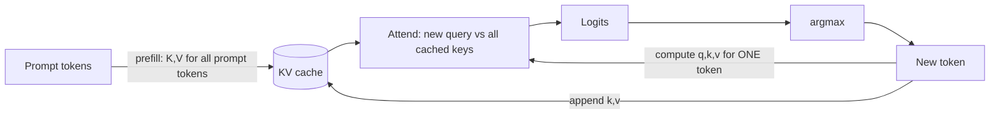
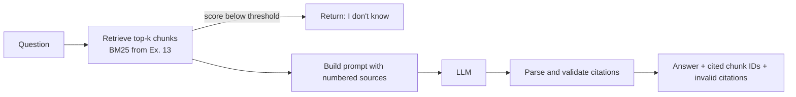
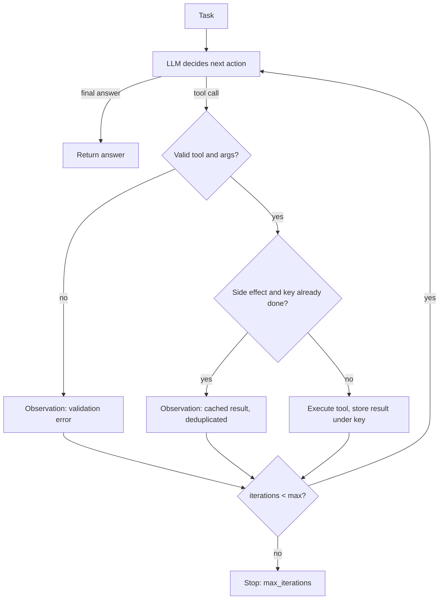
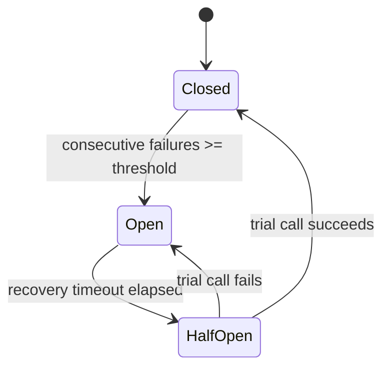

# Coding Exercises: Transformers, LLMs, RAG and Agents

> **Level:** Beginner to Advanced · **Study time:** ~360 min (spread it over several sessions) · **Prerequisites:** [Coding Exercises: Classical ML and Deep Learning from Scratch](./01-coding-exercises-ml-from-scratch.md), [The Attention Mechanism, Step by Step](../04-transformers/03-attention-mechanism-step-by-step.md), [Retrieval Methods: BM25, Dense Retrieval and Hybrid Search](../08-rag/05-retrieval-bm25-dense-and-hybrid-search.md), [Tool Calling in Depth](../09-agents/02-tool-calling-in-depth.md)

## Table of contents

- [Why this matters](#why-this-matters)
- [How to use this chapter](#how-to-use-this-chapter)
- [Part A: Transformer building blocks](#part-a-transformer-building-blocks)
- [Part B: Decoding and inference](#part-b-decoding-and-inference)
- [Part C: Fine-tuning and compression](#part-c-fine-tuning-and-compression)
- [Part D: Retrieval, ranking and RAG](#part-d-retrieval-ranking-and-rag)
- [Part E: Agents and reliability](#part-e-agents-and-reliability)
- [Going deeper: from interview code to production](#going-deeper-from-interview-code-to-production)
- [Common mistakes and misconceptions](#common-mistakes-and-misconceptions)
- [Interview questions and model answers](#interview-questions-and-model-answers)
- [Key takeaways](#key-takeaways)
- [Further reading](#further-reading)
- [Next](#next)

## Why this matters

Senior AI/ML coding rounds rarely ask you to reverse a linked list. They ask you to write attention, a sampler, a retrieval metric or an agent loop in 20-40 minutes, then probe whether you understand what breaks in production. Interviewers use these exercises because a short piece of code reveals a lot: do you know the shapes, do you handle numerical stability, do you write tests, and can you talk about memory, latency and failure modes. Every exercise below is a small, real component of the systems you will design: the KV cache sizes your GPU fleet, BM25 plus reciprocal rank fusion is a common hybrid retriever, and retries with idempotency keys are what stop an agent from refunding a customer twice.

## How to use this chapter

Each exercise has the same shape: a short concept recap (with a link to the chapter that teaches it fully), the **problem statement**, **hints** (collapsed), a **reference solution**, **complexity notes**, **tests** and **follow-ups** an interviewer is likely to ask.

> **Analogy:** Treat each exercise like a driving test. Reaching the destination (working code) is not enough; the examiner also watches your mirrors (edge cases) and your signals (talking through decisions).

For each exercise: write the signature and say the input and output **shapes** out loud, solve it within the time box before opening the hints, run the tests, compare with the reference, then answer the follow-ups out loud in 30-60 seconds each.

What interviewers grade, roughly in order of importance:

| Signal | What "strong" looks like | What "weak" looks like |
|---|---|---|
| Correctness | Handles shapes, masks, empty inputs, ties | Works only on the happy path |
| Communication | States assumptions and complexity before coding | Codes silently, explains afterwards |
| Testing | Writes a tiny hand-checked case plus an invariant test | "It looks right" |
| Numerical care | Stable softmax, avoids divide by zero, knows dtypes | NaNs on large inputs |
| Production sense | Mentions memory, batching, retries, observability | Stops at "it runs" |

**Setup.** All code is Python 3.10+. Install the core libraries once:

```bash
pip install numpy torch
# optional, used in a few "library version" snippets
pip install faiss-cpu tiktoken peft transformers tenacity
```

The exercises build on each other: helpers such as `softmax`, `attention`, `causal_mask`, `sinusoidal_pe`, `ToyLM`, `cosine_topk` and `BM25` are defined once and reused later, so run the code in page order (one notebook works well).

**Exercise map.** Exercises 21-28 were added at the end of each part, so the numbers do not follow page order; this map shows where each one lives.

| Part | Exercises |
|---|---|
| [A. Transformer building blocks](#part-a-transformer-building-blocks) | [1 Attention](#exercise-1-scaled-dot-product-attention-in-numpy), [2 Masks](#exercise-2-causal-mask-and-padding-mask), [3 Multi-head attention](#exercise-3-multi-head-attention-in-pytorch), [4 Sinusoidal encoding](#exercise-4-sinusoidal-positional-encoding), [5 BPE](#exercise-5-one-bpe-merge-step), [21 RMSNorm and RoPE](#exercise-21-rmsnorm-and-rope-applied-to-queries-and-keys) |
| [B. Decoding and inference](#part-b-decoding-and-inference) | [6 Sampling](#exercise-6-temperature-top-k-and-top-p-sampling), [7 KV cache](#exercise-7-greedy-decoding-with-a-kv-cache-toy-model), [8 KV memory](#exercise-8-kv-cache-memory-calculator), [22 Beam search](#exercise-22-beam-search-with-length-normalization), [23 Constrained decoding](#exercise-23-a-logit-mask-for-constrained-decoding), [24 Speculative decoding](#exercise-24-the-speculative-decoding-acceptance-rule) |
| [C. Fine-tuning and compression](#part-c-fine-tuning-and-compression) | [9 LoRA layer](#exercise-9-a-lora-linear-layer-in-pytorch), [10 Quantization](#exercise-10-int8-symmetric-and-asymmetric-quantization-with-per-channel-scales), [11 Distillation](#exercise-11-distillation-loss-with-temperature), [25 SFT collator](#exercise-25-an-sft-collator-with-loss-masking-and-packing), [26 LoRA merge](#exercise-26-merging-a-lora-adapter-into-the-base-weights) |
| [D. Retrieval, ranking and RAG](#part-d-retrieval-ranking-and-rag) | [12 Cosine top-k](#exercise-12-cosine-similarity-top-k-search), [13 BM25](#exercise-13-bm25-scoring), [14 RRF](#exercise-14-reciprocal-rank-fusion), [15 Metrics](#exercise-15-recallk-mrr-and-ndcg), [16 Chunker](#exercise-16-token-based-chunker-with-overlap), [17 Mini RAG](#exercise-17-a-minimal-rag-pipeline-with-citations), [27 Semantic cache](#exercise-27-a-tenant-scoped-semantic-cache) |
| [E. Agents and reliability](#part-e-agents-and-reliability) | [18 Agent loop](#exercise-18-an-agent-loop-with-a-tool-registry), [19 Retry](#exercise-19-retry-decorator-with-exponential-backoff-and-jitter), [20 Circuit breaker](#exercise-20-a-simple-circuit-breaker), [28 Async LLM client](#exercise-28-an-async-llm-client-with-concurrency-and-rate-limits) |

## Part A: Transformer building blocks

### Exercise 1: Scaled dot-product attention in NumPy

**Time box:** 15 min · **Recap:** [The Attention Mechanism, Step by Step](../04-transformers/03-attention-mechanism-step-by-step.md)

**Attention** lets every token look at every other token and take a weighted average of their information. Each token emits a **query** ("what am I looking for?"), a **key** ("what do I contain?") and a **value** ("what do I hand over if chosen?"). The formula from "Attention Is All You Need" (Vaswani et al., 2017):

$$\text{Attention}(Q, K, V) = \text{softmax}\left(\frac{QK^\top}{\sqrt{d_k}}\right) V$$

- $Q$: query matrix, shape $(T_q, d_k)$, one row per query token.
- $K$: key matrix, shape $(T_k, d_k)$.
- $V$: value matrix, shape $(T_k, d_v)$.
- $d_k$: dimension of each query/key vector. Dividing by $\sqrt{d_k}$ keeps the scores from growing with dimension.
- $\text{softmax}$: turns each row of scores into positive weights summing to 1 (see [Softmax, Entropy, Cross-Entropy and KL Divergence](../00-foundations/05-softmax-entropy-cross-entropy-and-kl-divergence.md)).

**Worked example.** One query $q = [1, 0]$, two keys $k_1 = [1, 0]$, $k_2 = [0, 1]$, values $v_1 = [1, 2]$, $v_2 = [3, 4]$, $d_k = 2$.

1. Scores: $q \cdot k_1 = 1$, $q \cdot k_2 = 0$. Scaled: $1/\sqrt{2} = 0.7071$ and $0$.
2. Softmax: $e^{0.7071} = 2.0281$, $e^0 = 1$, sum $= 3.0281$. Weights: $2.0281 / 3.0281 = 0.6698$ and $1 / 3.0281 = 0.3302$.
3. Output: $0.6698 \cdot [1, 2] + 0.3302 \cdot [3, 4] = [0.6698 + 0.9906,\ 1.3396 + 1.3208] = [1.6604, 2.6604]$ (about $[1.6605, 2.6605]$ at full precision).

**Problem.** Implement `attention(Q, K, V, mask=None)` in NumPy. Support any number of leading batch dimensions. `mask` is boolean with `True` meaning "not allowed to attend". Return the output and the attention weights.

<details>
<summary>Hints</summary>

- Use `np.swapaxes(K, -1, -2)` so batch dimensions work, not `K.T`.
- A **numerically stable softmax** subtracts the row maximum before `exp`; this does not change the result but prevents overflow.
- Apply the mask to the scores before softmax by setting blocked positions to $-\infty$, so they get weight exactly 0.

</details>

**Reference solution**

```python
import numpy as np

def softmax(x: np.ndarray, axis: int = -1) -> np.ndarray:
    """Stable softmax: subtracting the max leaves the result unchanged but avoids overflow."""
    x = x - np.max(x, axis=axis, keepdims=True)
    e = np.exp(x)
    return e / np.sum(e, axis=axis, keepdims=True)

def attention(Q, K, V, mask=None):
    """Q: (..., Tq, dk), K: (..., Tk, dk), V: (..., Tk, dv).
    mask: bool, broadcastable to (..., Tq, Tk); True = NOT allowed to attend.
    Returns output (..., Tq, dv) and weights (..., Tq, Tk)."""
    d_k = Q.shape[-1]
    scores = Q @ np.swapaxes(K, -1, -2) / np.sqrt(d_k)   # (..., Tq, Tk)
    if mask is not None:
        scores = np.where(mask, -np.inf, scores)
    weights = softmax(scores, axis=-1)
    return weights @ V, weights
```

**Complexity.** Time $O(T_q T_k d)$. Memory $O(T_q T_k)$ for the score matrix, which is why naive attention is quadratic in sequence length.

**Tests**

```python
Q = np.array([[1.0, 0.0]])
K = np.array([[1.0, 0.0], [0.0, 1.0]])
V = np.array([[1.0, 2.0], [3.0, 4.0]])
out, w = attention(Q, K, V)
assert np.allclose(w, [[0.6698, 0.3302]], atol=1e-4)
assert np.allclose(out, [[1.6605, 2.6605]], atol=1e-4)

rng = np.random.default_rng(0)
Qb, Kb, Vb = rng.normal(size=(2, 3, 5, 8)), rng.normal(size=(2, 3, 7, 8)), rng.normal(size=(2, 3, 7, 4))
out, w = attention(Qb, Kb, Vb)                      # batch=2, heads=3, Tq=5, Tk=7
assert out.shape == (2, 3, 5, 4) and np.allclose(w.sum(-1), 1.0)
assert np.allclose(softmax(np.array([1000.0, 1000.0])), [0.5, 0.5])   # no overflow
```

**Follow-ups**

- *Why $\sqrt{d_k}$?* If query and key components are independent with mean 0 and variance 1, their dot product has variance $d_k$. Large scores push softmax toward a one-hot output whose gradients are near zero. Dividing by $\sqrt{d_k}$ brings the variance back to 1.
- *How would you cut the $O(T^2)$ memory?* Compute attention in tiles with an **online softmax** (keep a running row maximum and running sum, and rescale the partial output whenever the maximum grows) so the full score matrix is never stored. That is the idea behind FlashAttention (Dao et al., 2022); see [Modern LLM Architecture](../04-transformers/08-modern-llm-architecture-improvements.md).
- *What if $T_q \ne T_k$?* Nothing changes: that is **cross-attention** (queries from the decoder, keys and values from the encoder), and also cached decoding (Exercise 7).

### Exercise 2: Causal mask (and padding mask)

**Time box:** 10 min · **Recap:** [Multi-Head Attention and Causal Masking](../04-transformers/04-multi-head-attention-and-causal-masking.md)

A **causal mask** stops a token from attending to tokens after it, so a language model cannot "peek" at the word it is supposed to predict. For our 3-word sentence "the cat sat":

```text
               keys:  the    cat    sat
queries:  the         ok     X      X
          cat         ok     ok     X
          sat         ok     ok     ok
```

A **padding mask** blocks the fake **padding tokens** added so that sequences of different lengths fit into one rectangular batch.

**Problem.** Write `causal_mask(t_q, t_k=None)` returning a boolean array (`True` = blocked). It must also work when `t_q < t_k`, which happens during cached decoding: the queries are the *last* `t_q` positions of a `t_k`-long sequence. Write `padding_mask(lengths, t_k)` too.

<details>
<summary>Hints</summary>

- `np.triu(ones, k=1)` marks everything strictly above the diagonal.
- If queries are the last $t_q$ positions, query $i$ sits at absolute position $t_k - t_q + i$, so the diagonal offset becomes $k = t_k - t_q + 1$.

</details>

**Reference solution**

```python
def causal_mask(t_q: int, t_k: int | None = None) -> np.ndarray:
    """(t_q, t_k) bool, True = blocked. Queries are the LAST t_q positions of t_k."""
    t_k = t_q if t_k is None else t_k
    return np.triu(np.ones((t_q, t_k), dtype=bool), k=t_k - t_q + 1)

def padding_mask(lengths: list[int], t_k: int) -> np.ndarray:
    """(B, 1, t_k) bool, True where the KEY is padding; broadcasts over queries."""
    return (np.arange(t_k)[None, :] >= np.array(lengths)[:, None])[:, None, :]
```

Combine masks with a logical OR: `mask = causal_mask(T) | padding_mask(lengths, T)`.

**Complexity.** $O(T_q T_k)$ time and memory. In real kernels the causal mask is often never materialized: `is_causal=True` lets the kernel skip the upper triangle entirely, saving about half the work. Caveat: PyTorch's `F.scaled_dot_product_attention(..., is_causal=True)` aligns the mask to the top-left corner, which differs from `causal_mask(t_q, t_k)` when $t_q < t_k$, so for cached decoding pass an explicit mask (or check what your kernel assumes).

**Tests**

```python
assert (causal_mask(3) == np.array([[0, 1, 1], [0, 0, 1], [0, 0, 0]], dtype=bool)).all()
assert not causal_mask(1, 4).any()                       # newest token sees everything
assert (causal_mask(2, 4) == np.array([[0, 0, 0, 1], [0, 0, 0, 0]], dtype=bool)).all()
assert padding_mask([2, 3], 3)[:, 0].tolist() == [[False, False, True], [False, False, False]]

# Property test: changing a FUTURE token must not change earlier outputs
x = rng.normal(size=(4, 8))
out1, _ = attention(x, x, x, causal_mask(4))
x2 = x.copy(); x2[3] += 10.0
out2, _ = attention(x2, x2, x2, causal_mask(4))
assert np.allclose(out1[:3], out2[:3]) and not np.allclose(out1[3], out2[3])
```

**Follow-ups**

- *What happens if a whole row is masked?* Every score is $-\infty$, the max is $-\infty$, and $-\infty - (-\infty)$ is NaN. Fixes: use a large finite negative number (or the dtype minimum), or zero out fully masked rows after softmax. Framework behaviour here has varied across versions, so test it.
- *Left or right padding for generation?* Decoder-only models generate at the end of the sequence, so batched generation usually pads on the **left**, keeping every sequence's last real token in the same column.

### Exercise 3: Multi-head attention in PyTorch

**Time box:** 20 min · **Recap:** [Multi-Head Attention and Causal Masking](../04-transformers/04-multi-head-attention-and-causal-masking.md)

**Multi-head attention** runs $h$ smaller attentions in parallel, each on a $d_{model}/h$ slice, so different **heads** can specialize (one tracks syntax, another coreference). The heads are then concatenated and mixed by an output projection.

**Problem.** Implement `MultiHeadAttention(d_model, n_heads)` in PyTorch with a fused Q/K/V projection, an optional causal mask, and a path that uses `F.scaled_dot_product_attention`. Verify it against PyTorch's own `nn.MultiheadAttention`.

<details>
<summary>Hints</summary>

- Shapes: `(B, T, D)` -> project -> `(B, T, 3D)` -> split -> `(B, T, h, d_head)` -> transpose -> `(B, h, T, d_head)`.
- After attention, transpose back and call `.contiguous().view(B, T, D)`. `view` needs contiguous memory.

</details>

**Reference solution**

```python
import torch
import torch.nn as nn
import torch.nn.functional as F

class MultiHeadAttention(nn.Module):
    def __init__(self, d_model: int, n_heads: int, dropout: float = 0.0):
        super().__init__()
        assert d_model % n_heads == 0, "d_model must be divisible by n_heads"
        self.h, self.d_head, self.dropout = n_heads, d_model // n_heads, dropout
        self.qkv = nn.Linear(d_model, 3 * d_model)   # one fused matmul for Q, K and V
        self.out = nn.Linear(d_model, d_model)

    def forward(self, x: torch.Tensor, causal: bool = False, use_sdpa: bool = True) -> torch.Tensor:
        B, T, D = x.shape
        q, k, v = self.qkv(x).chunk(3, dim=-1)                       # each (B, T, D)
        q, k, v = (t.view(B, T, self.h, self.d_head).transpose(1, 2) for t in (q, k, v))
        p = self.dropout if self.training else 0.0
        if use_sdpa:   # fused kernel (PyTorch 2.0+), may dispatch to FlashAttention
            y = F.scaled_dot_product_attention(q, k, v, dropout_p=p, is_causal=causal)
        else:          # explicit version, same math
            scores = q @ k.transpose(-2, -1) / self.d_head ** 0.5      # (B, h, T, T)
            if causal:
                mask = torch.triu(torch.ones(T, T, dtype=torch.bool, device=x.device), 1)
                scores = scores.masked_fill(mask, float("-inf"))
            y = F.dropout(scores.softmax(dim=-1), p=p) @ v
        y = y.transpose(1, 2).contiguous().view(B, T, D)               # merge heads
        return self.out(y)
```

**Complexity.** Parameters: $4d^2 + 4d$ (Q, K, V and output projections with biases). Compute: projections cost $O(T d^2)$, attention costs $O(T^2 d)$. For short sequences the projections dominate; for long sequences the $T^2$ term does.

**Tests**

```python
torch.manual_seed(0)
mha = MultiHeadAttention(d_model=16, n_heads=4).eval()
x = torch.randn(2, 5, 16)
y1, y2 = mha(x, causal=True), mha(x, causal=True, use_sdpa=False)
assert y1.shape == (2, 5, 16) and torch.allclose(y1, y2, atol=1e-5)

# Compare with PyTorch's reference module by copying our weights into it
ref = nn.MultiheadAttention(16, 4, batch_first=True).eval()
with torch.no_grad():
    ref.in_proj_weight.copy_(mha.qkv.weight); ref.in_proj_bias.copy_(mha.qkv.bias)
    ref.out_proj.weight.copy_(mha.out.weight); ref.out_proj.bias.copy_(mha.out.bias)
y_ref, _ = ref(x, x, x, attn_mask=torch.triu(torch.ones(5, 5, dtype=torch.bool), 1), need_weights=False)
assert torch.allclose(y1, y_ref, atol=1e-5)
```

**Follow-ups**

- *How would you add **grouped-query attention (GQA)**?* Project K and V to fewer heads ($h_{kv} < h$) and let each group of $h / h_{kv}$ query heads share one K/V head (for example with `repeat_interleave`). It shrinks the KV cache by $h / h_{kv}$ (Ainslie et al., 2023).
- *Why fuse Q, K and V into one linear layer?* One large matrix multiply uses the GPU better than three small ones.

### Exercise 4: Sinusoidal positional encoding

**Time box:** 10 min · **Recap:** [Positional Encoding: Sinusoidal, Learned, RoPE and ALiBi](../04-transformers/06-positional-encoding-sinusoidal-learned-rope-and-alibi.md)

Attention by itself ignores word order: "dog bites man" and "man bites dog" look the same. **Positional encoding** adds a position-dependent vector to each token embedding. The sinusoidal version uses waves of different frequencies, like the hands of a clock moving at different speeds:

$$PE_{(pos,\,2i)} = \sin\left(\frac{pos}{10000^{2i/d}}\right), \qquad PE_{(pos,\,2i+1)} = \cos\left(\frac{pos}{10000^{2i/d}}\right)$$

- $pos$: token position (0, 1, 2, ...).
- $i$: index of the sin/cos pair, from 0 to $d/2 - 1$.
- $d$: model dimension (must be even here).
- $10000$: base that spreads the wavelengths from $2\pi$ up to about $10000 \cdot 2\pi$.

**Worked example** with $d = 4$, $pos = 1$:

- Pair $i = 0$: angle $= 1 / 10000^{0} = 1$. $\sin 1 = 0.8415$, $\cos 1 = 0.5403$.
- Pair $i = 1$: angle $= 1 / 10000^{2/4} = 1/100 = 0.01$. $\sin 0.01 = 0.0100$, $\cos 0.01 = 0.99995$.
- So $PE_1 = [0.8415, 0.5403, 0.0100, 1.0000]$, and $PE_0 = [0, 1, 0, 1]$.

**Problem.** Implement `sinusoidal_pe(max_len, d_model)` returning a `(max_len, d_model)` array. Then test the property that makes it useful: $PE_{pos+k}$ is a fixed rotation of $PE_{pos}$, so relative offsets are easy for the model to express.

<details>
<summary>Hints</summary>

- Broadcast a column of positions `(max_len, 1)` against a row of frequencies `(1, d/2)`.
- Fill even columns with sin and odd columns with cos using slices `0::2` and `1::2`.
- Rotation identity: $\sin(a+b) = \sin a \cos b + \cos a \sin b$ and $\cos(a+b) = \cos a \cos b - \sin a \sin b$.

</details>

**Reference solution**

```python
def sinusoidal_pe(max_len: int, d_model: int) -> np.ndarray:
    assert d_model % 2 == 0, "d_model must be even"
    pos = np.arange(max_len)[:, None]                      # (max_len, 1)
    i = np.arange(d_model // 2)[None, :]                   # (1, d/2)
    angles = pos / (10000 ** (2 * i / d_model))            # (max_len, d/2)
    pe = np.zeros((max_len, d_model))
    pe[:, 0::2] = np.sin(angles)
    pe[:, 1::2] = np.cos(angles)
    return pe
```

**Complexity.** $O(L \cdot d)$ time and memory, computed once and cached.

**Tests**

```python
pe = sinusoidal_pe(50, 4)
assert np.allclose(pe[0], [0, 1, 0, 1])
assert np.allclose(pe[1], [0.8415, 0.5403, 0.0100, 1.0000], atol=1e-4)
assert np.abs(pe).max() <= 1.0

# Relative-position property: PE[pos + k] = R_k @ PE[pos] for each (sin, cos) pair
pe, k, d = sinusoidal_pe(100, 16), 7, 16
for i in range(d // 2):
    b = k / 10000 ** (2 * i / d)
    R = np.array([[np.cos(b), np.sin(b)], [-np.sin(b), np.cos(b)]])
    assert np.allclose(pe[10 + k, 2*i:2*i+2], R @ pe[10, 2*i:2*i+2])
```

**Follow-ups**

- *Sinusoidal vs learned vs RoPE?* Learned embeddings cannot represent positions beyond the training length. **RoPE** (Su et al., 2021) applies this same rotation idea directly to queries and keys inside attention, so the score depends on relative position; most modern open LLMs use it.
- *Some code puts all sines in the first half and cosines in the second.* Both layouts are fine if training and inference agree. Mixing them silently breaks a pretrained model.

### Exercise 5: One BPE merge step

**Time box:** 15 min · **Recap:** [Tokenization: How Text Becomes Numbers](../04-transformers/01-tokenization.md)

**Byte Pair Encoding (BPE)** builds a vocabulary by repeatedly merging the most frequent adjacent pair of symbols (Sennrich, Haddow and Birch, 2016). Start from characters, count every adjacent pair across the corpus (weighted by word frequency), merge the winner into a new symbol, repeat.

**Worked example** (the classic toy corpus; `</w>` marks end of word): `low` x5, `lower` x2, `newest` x6, `widest` x3.

- Pair `(e, s)` appears in `newest` (6) and `widest` (3): count 9. So do `(s, t)` and `(t, </w>)`.
- Pair `(w, e)` appears in `lower` (2) and `newest` (6): count 8. Pair `(l, o)`: 5 + 2 = 7.
- With a tie at 9, we break ties by picking the lexicographically smallest pair, `(e, s)`. After merging, `newest` becomes `n e w es t </w>`.

**Problem.** Implement `count_pairs(vocab)`, `merge_pair(vocab, pair)` and `bpe_step(vocab)`, where `vocab` maps a tuple of symbols to a word frequency.

<details>
<summary>Hints</summary>

- `zip(word, word[1:])` gives adjacent pairs.
- Merge left to right with an index that jumps by 2 after a merge, so in `a a a` the pair `(a, a)` merges once to give `aa a`, not twice.
- Two different words can merge into the same tuple, so add frequencies instead of overwriting.

</details>

**Reference solution**

```python
from collections import Counter

Word = tuple[str, ...]

def count_pairs(vocab: dict[Word, int]) -> Counter:
    pairs = Counter()
    for word, freq in vocab.items():
        for a, b in zip(word, word[1:]):
            pairs[(a, b)] += freq
    return pairs

def merge_pair(vocab: dict[Word, int], pair: tuple[str, str]) -> dict[Word, int]:
    a, b = pair
    merged: dict[Word, int] = {}
    for word, freq in vocab.items():
        out, i = [], 0
        while i < len(word):
            if i < len(word) - 1 and word[i] == a and word[i + 1] == b:
                out.append(a + b); i += 2
            else:
                out.append(word[i]); i += 1
        merged[tuple(out)] = merged.get(tuple(out), 0) + freq
    return merged

def bpe_step(vocab: dict[Word, int]) -> tuple[dict[Word, int], tuple[str, str] | None]:
    pairs = count_pairs(vocab)
    if not pairs:
        return vocab, None
    best = min(pairs, key=lambda p: (-pairs[p], p))   # highest count, then deterministic tie-break
    return merge_pair(vocab, best), best
```

**Complexity.** One step is $O(S)$ where $S$ is the total number of symbols across unique words. Learning $M$ merges naively costs $O(M \cdot S)$; production trainers update pair counts incrementally and keep a priority queue.

**Tests**

```python
vocab = {("l", "o", "w", "</w>"): 5, ("l", "o", "w", "e", "r", "</w>"): 2,
         ("n", "e", "w", "e", "s", "t", "</w>"): 6, ("w", "i", "d", "e", "s", "t", "</w>"): 3}
pairs = count_pairs(vocab)
assert pairs[("e", "s")] == 9 and pairs[("w", "e")] == 8 and pairs[("l", "o")] == 7
merges = []
for _ in range(4):
    vocab, best = bpe_step(vocab)
    merges.append(best)
assert merges == [("e", "s"), ("es", "t"), ("est", "</w>"), ("l", "o")]
assert merge_pair({("a", "a", "a"): 1}, ("a", "a")) == {("aa", "a"): 1}
```

**Follow-ups**

- *How do you encode new text?* Split into characters (or bytes), then apply the learned merges **in the order they were learned** (by rank), not by frequency in the new text.
- *Why byte-level BPE?* Starting from the 256 possible bytes means no input is ever out of vocabulary (used by GPT-2 and its successors).
- *Production tools?* Hugging Face `tokenizers` and OpenAI's `tiktoken` implement this in Rust. Tokenizer mismatch between training and serving is a classic silent bug.

### Exercise 21: RMSNorm and RoPE applied to queries and keys

**Time box:** 20 min · **Recap:** [Modern LLM Architecture](../04-transformers/08-modern-llm-architecture-improvements.md#rmsnorm-layernorm-without-the-mean) and [Positional Encoding: Sinusoidal, Learned, RoPE and ALiBi](../04-transformers/06-positional-encoding-sinusoidal-learned-rope-and-alibi.md#rope-rotary-position-embedding)

Two small pieces sit in every Llama-style block. **RMSNorm** (Zhang and Sennrich, 2019) rescales each token vector to a fixed size, like a volume knob that makes every speaker equally loud without changing what they say; unlike LayerNorm it does not subtract the mean and has no bias. **RoPE** (rotary position embedding, Su et al., 2021) takes the rotation idea from Exercise 4 and applies it to the queries and keys inside attention, instead of adding a position vector to the input.

$$\text{RMSNorm}(x) = g \odot \frac{x}{\sqrt{\frac{1}{d}\sum_{i=1}^{d} x_i^2 + \epsilon}}$$

- $x$: one token's vector of length $d$. The denominator is its **root mean square** (RMS).
- $g$: learned per-dimension gain, initialized to 1. $\epsilon$: a small constant (for example $10^{-6}$) that avoids dividing by zero. $\odot$: elementwise product.

RoPE splits each query or key of head dimension $d$ into $d/2$ pairs $(x_{2i}, x_{2i+1})$ and rotates pair $i$ by the angle $m\theta_i$, where $m$ is the token's position:

$$\begin{bmatrix} x'_{2i} \\ x'_{2i+1} \end{bmatrix} = \begin{bmatrix} \cos m\theta_i & -\sin m\theta_i \\ \sin m\theta_i & \cos m\theta_i \end{bmatrix} \begin{bmatrix} x_{2i} \\ x_{2i+1} \end{bmatrix}, \qquad \theta_i = b^{-2i/d}$$

- $\theta_i$: rotation speed of pair $i$ in radians per position. $b$: the **RoPE base** (10,000 in the original paper).
- Rotations compose by adding angles, so a query at position $m$ and a key at position $n$ score $q^\top R_{n-m}\,k$, where $R_{n-m}$ rotates every pair by $(n-m)\theta_i$: the score depends on the offset $n - m$, not on $m$ and $n$ separately. Values $V$ are never rotated.

**Worked example.**

- RMSNorm of $x = [1, 2, 3, 4]$ with $g = 1$, ignoring $\epsilon$: mean of squares $= (1 + 4 + 9 + 16) / 4 = 7.5$, RMS $= \sqrt{7.5} = 2.7386$, output $[0.3651, 0.7303, 1.0954, 1.4606]$.
- RoPE with $d = 2$ (one pair, $\theta_0 = 1$ radian per position) and $q = k = [1, 0]$. Unrotated, $q \cdot k = 1$. Query at $m = 3$: $[\cos 3, \sin 3] = [-0.98999, 0.14112]$. Key at $n = 1$: $[\cos 1, \sin 1] = [0.54030, 0.84147]$. Score: $-0.53490 + 0.11875 = -0.41615 = \cos 2$. Move both tokens 10 positions later ($m = 13$, $n = 11$) and the score is still $\cos 2$: only the gap of 2 matters.

**Problem.** Implement `RMSNorm(d, eps)` as an `nn.Module` that does its arithmetic in FP32 whatever the input dtype, and `rope_qk(q, k, positions, base)` that rotates queries and keys of shape `(B, h, T, d_head)` using the interleaved pairs above. Test that relative position is preserved in $q \cdot k$.

<details>
<summary>Hints</summary>

- Upcast with `x.float()` before squaring: in FP16, $60{,}000^2$ overflows to infinity (the FP16 maximum is 65,504).
- Take the pairs with `x[..., 0::2]` and `x[..., 1::2]`, rotate them, then interleave back with `torch.stack(..., dim=-1).flatten(-2)`.
- Compute the angles once as `positions[:, None] * theta[None, :]`, shape `(T, d/2)`; they broadcast over batch and heads.

</details>

**Reference solution**

```python
class RMSNorm(nn.Module):
    def __init__(self, d: int, eps: float = 1e-6):
        super().__init__()
        self.eps = eps
        self.weight = nn.Parameter(torch.ones(d))                   # learned gain g, starts at 1

    def forward(self, x: torch.Tensor) -> torch.Tensor:
        x32 = x.float()                                              # square in FP32: FP16 can overflow
        rms = torch.sqrt(x32.pow(2).mean(dim=-1, keepdim=True) + self.eps)
        return (x32 / rms).to(x.dtype) * self.weight

def rope_cos_sin(positions: torch.Tensor, head_dim: int, base: float = 10000.0):
    theta = base ** (-torch.arange(0, head_dim, 2, dtype=torch.float32) / head_dim)   # (d/2,), fastest first
    angles = positions.float()[:, None] * theta[None, :]                              # (T, d/2), in FP32
    return angles.cos(), angles.sin()

def apply_rope(x: torch.Tensor, cos: torch.Tensor, sin: torch.Tensor) -> torch.Tensor:
    """x: (..., T, d) with pairs (2i, 2i+1); cos, sin: (T, d/2). Rotates every pair by its own angle."""
    x_even, x_odd = x[..., 0::2], x[..., 1::2]
    rotated = torch.stack((x_even * cos - x_odd * sin, x_even * sin + x_odd * cos), dim=-1)
    return rotated.flatten(-2)                                       # back to the interleaved layout

def rope_qk(q: torch.Tensor, k: torch.Tensor, positions: torch.Tensor, base: float = 10000.0):
    """q, k: (B, h, T, d_head); positions: (T,) absolute positions. V is never rotated."""
    cos, sin = rope_cos_sin(positions, q.shape[-1], base)
    return apply_rope(q, cos, sin), apply_rope(k, cos, sin)
```

**Complexity.** Both are $O(T \cdot d)$ elementwise work per layer, negligible next to attention's $O(T^2 d)$ arithmetic. Both are memory-bound (little arithmetic per byte read), which is why production stacks fuse them into neighbouring kernels.

**Tests**

```python
import math

x = torch.tensor([[1.0, 2.0, 3.0, 4.0]])
assert torch.allclose(RMSNorm(4)(x), torch.tensor([[0.3651, 0.7303, 1.0954, 1.4606]]), atol=1e-4)
x16 = torch.tensor([[60000.0, 60000.0, 0.0, 0.0]], dtype=torch.float16)
assert torch.allclose(RMSNorm(4)(x16).float(), torch.tensor([[2 ** 0.5, 2 ** 0.5, 0.0, 0.0]]), atol=1e-2)

torch.manual_seed(0)
norm, ref = RMSNorm(64), nn.RMSNorm(64, eps=1e-6)                     # nn.RMSNorm: PyTorch 2.4+
with torch.no_grad():
    norm.weight.uniform_(0.5, 1.5); ref.weight.copy_(norm.weight)
xb = torch.randn(2, 5, 64) * 50
assert torch.allclose(norm(xb), ref(xb), atol=1e-5)
assert torch.allclose(norm(3.0 * xb), norm(xb), atol=1e-5)          # scale invariant (eps aside)

q1 = torch.tensor([1.0, 0.0]).expand(1, 1, 14, 2)                    # d = 2, same vector at 14 positions
qr, kr = rope_qk(q1, q1, torch.arange(14))
assert math.isclose((qr[0, 0, 3] @ kr[0, 0, 1]).item(), math.cos(2), abs_tol=1e-6)    # worked example
assert math.isclose((qr[0, 0, 13] @ kr[0, 0, 11]).item(), math.cos(2), abs_tol=1e-5)

# Relative-position property: the score depends only on the gap n - m
q, k = torch.randn(1, 1, 1, 64), torch.randn(1, 1, 1, 64)
def score(m: int, n: int) -> float:
    qm, _ = rope_qk(q, q, torch.tensor([m]))
    _, kn = rope_qk(k, k, torch.tensor([n]))
    return (qm @ kn.transpose(-2, -1)).item()
for shift in (1, 100, 1000):
    assert math.isclose(score(7, 3), score(7 + shift, 3 + shift), rel_tol=1e-4, abs_tol=1e-4)
assert not math.isclose(score(7, 3), score(3, 7), rel_tol=1e-3)        # direction matters, not just distance
qr, kr = rope_qk(q, k, torch.tensor([0]))
assert torch.allclose(qr, q) and torch.allclose(kr, k)              # position 0 is the identity
assert torch.isclose(rope_qk(q, k, torch.tensor([123]))[0].norm(), q.norm())   # rotation keeps length

# KV-cache consistency: rotating only the newest token at its absolute position matches the full pass
Q, K = torch.randn(1, 2, 6, 16), torch.randn(1, 2, 6, 16)
Qf, Kf = rope_qk(Q, K, torch.arange(6))
Qn, Kn = rope_qk(Q[:, :, 5:], K[:, :, 5:], torch.tensor([5]))
assert torch.allclose(Qn, Qf[:, :, 5:]) and torch.allclose(Kn, Kf[:, :, 5:])
```

**Follow-ups**

- *Why rotate only Q and K?* Position should change *which* tokens attend to each other (the scores), not the content copied from $V$. Keys are rotated before they are written to the KV cache (Exercise 7), so a cached key is never rotated again; the last test checks that a new token rotated alone at its absolute position matches the full pass.
- *Interleaved or half-split pairs?* Hugging Face's Llama code pairs dimension $j$ with $j + d/2$ (a `rotate_half` helper). Same math, different layout: loading weights trained with one layout into code that uses the other gives silently degraded, often incoherent output (no error is raised) unless the $W_Q$ and $W_K$ rows are permuted.
- *Why compute the angles in FP32?* Angles grow with position. In BF16 the angle 100,000 is stored as 99,840, an error of 160 radians, which scrambles the rotation; FP32 is accurate to about 0.004 radians there.
- *RMSNorm or LayerNorm?* RMSNorm needs one reduction instead of two (no mean), has no bias, and in practice matches LayerNorm's quality, so most open LLMs (Llama, Mistral, Qwen, Gemma) use it, placed before each sublayer (**pre-norm**).

## Part B: Decoding and inference

### Exercise 6: Temperature, top-k and top-p sampling

**Time box:** 20 min · **Recap:** [How LLMs Generate Text: Decoding Strategies](../05-llms/03-text-generation-and-decoding-strategies.md)

At each step the model outputs **logits**: one raw score per vocabulary token. **Sampling** turns them into a choice:

- **Temperature** $\tau$ divides the logits before softmax: $p_i = \text{softmax}(z / \tau)_i$. Low $\tau$ sharpens the distribution, high $\tau$ flattens it, and $\tau \to 0$ becomes **greedy** (always the top token).
- **Top-k** keeps only the $k$ highest-probability tokens (Fan et al., 2018).
- **Top-p** (also called **nucleus sampling**, Holtzman et al., 2020) keeps the smallest set of top tokens whose probabilities add up to at least $p$, so the candidate set adapts to how confident the model is.

**Worked example (temperature).** Logits $[2, 1, 0]$:

- $\tau = 1$: $e^2 = 7.389$, $e^1 = 2.718$, $e^0 = 1$; sum $11.107$; probs $[0.665, 0.245, 0.090]$.
- $\tau = 0.5$: logits become $[4, 2, 0]$; $54.598, 7.389, 1$; sum $62.987$; probs $[0.867, 0.117, 0.016]$.
- $\tau = 2$: logits become $[1, 0.5, 0]$; $2.718, 1.649, 1$; sum $5.367$; probs $[0.506, 0.307, 0.186]$.

**Worked example (top-p).** Probabilities $[0.5, 0.3, 0.15, 0.05]$, $p = 0.75$. Sorted cumulative sums: $0.5, 0.8, 0.95, 1.0$. Keep a token if the cumulative mass *before* it is below $p$: token 0 (before: 0) yes, token 1 (before: 0.5) yes, token 2 (before: 0.8) no. Renormalize: $0.5/0.8 = 0.625$ and $0.3/0.8 = 0.375$.

**Problem.** Write `filtered_probs(logits, temperature, top_k, top_p)` that returns the final probability vector, and `sample_next(...)` that samples from it (temperature 0 means greedy). Apply temperature, then top-k, then top-p, a common order (Hugging Face `transformers` uses it by default, but libraries differ, so check yours).

<details>
<summary>Hints</summary>

- For top-k, find the k-th largest logit with `np.partition` and set everything smaller to $-\infty$.
- For top-p, sort probabilities descending, take `np.cumsum`, and keep where `cum - p_sorted < top_p`. This always keeps at least one token.
- Pass a seeded `np.random.default_rng` so tests are reproducible.

</details>

**Reference solution**

```python
def filtered_probs(logits, temperature: float = 1.0, top_k: int | None = None,
                   top_p: float | None = None) -> np.ndarray:
    assert temperature > 0, "use greedy decoding for temperature 0"
    z = np.asarray(logits, dtype=np.float64) / temperature
    if top_k is not None and 0 < top_k < z.size:
        kth = np.partition(z, -top_k)[-top_k]          # k-th largest logit
        z = np.where(z < kth, -np.inf, z)              # ties at kth are kept
    probs = softmax(z)
    if top_p is not None and top_p < 1.0:
        order = np.argsort(-probs)
        sorted_p = probs[order]
        keep_sorted = (np.cumsum(sorted_p) - sorted_p) < top_p   # mass BEFORE token < p
        keep = np.zeros_like(probs, dtype=bool)
        keep[order[keep_sorted]] = True
        probs = np.where(keep, probs, 0.0)
        probs /= probs.sum()
    return probs

def sample_next(logits, temperature: float = 1.0, top_k=None, top_p=None, rng=None) -> int:
    if temperature == 0:
        return int(np.argmax(logits))
    rng = rng or np.random.default_rng()
    probs = filtered_probs(logits, temperature, top_k, top_p)
    return int(rng.choice(probs.size, p=probs))
```

**Complexity.** Temperature and top-k: $O(V)$ with partition. Top-p: $O(V \log V)$ for the sort, where $V$ is the vocabulary size (tens to hundreds of thousands of tokens).

**Tests**

```python
logits = np.log(np.array([0.5, 0.3, 0.15, 0.05]))        # softmax(logits) recovers these probs
assert np.allclose(filtered_probs([2, 1, 0], temperature=0.5), [0.867, 0.117, 0.016], atol=1e-3)
assert np.allclose(filtered_probs(logits, top_p=0.75), [0.625, 0.375, 0, 0])
assert np.allclose(filtered_probs(logits, top_k=3), [0.5/0.95, 0.3/0.95, 0.15/0.95, 0])
assert sample_next(logits, temperature=0) == 0

rng = np.random.default_rng(0)
draws = np.array([sample_next(logits, top_p=0.75, rng=rng) for _ in range(20_000)])
freq = np.bincount(draws, minlength=4) / draws.size
assert freq[2] == freq[3] == 0 and abs(freq[0] - 0.625) < 0.02     # statistical test with tolerance
```

**Follow-ups**

- *When does top-k fail?* When the model is confident, $k = 50$ still admits junk tokens; when it is uncertain, $k = 50$ may cut valid options. Top-p adapts to both.
- *What is **min-p**?* A newer filter that keeps tokens whose probability is at least a fraction of the top token's probability. Support varies by library and version.
- *Why does temperature 0 not guarantee identical outputs in production?* Batching changes the order of floating-point additions on GPU, so near-tied logits can flip.

### Exercise 7: Greedy decoding with a KV cache (toy model)

**Time box:** 30 min · **Recap:** [The KV Cache](../06-llm-inference/02-kv-cache-explained.md)

**Autoregressive** generation produces one token at a time, feeding each new token back in. Without caching, step $t$ recomputes keys and values for all $t$ previous tokens even though they never change. A **KV cache** stores them, so each new step computes K and V only for the newest token. The first pass over the whole prompt is called **prefill**; the one-token-at-a-time phase is **decode**.



**Problem.** Build a toy one-layer, one-head language model in NumPy with random weights (embeddings, $W_q$, $W_k$, $W_v$, sinusoidal positions, tied output embeddings). **Tied** means the same matrix $E$ that turns token IDs into vectors also turns the final vector back into logits ($\text{logits} = hE^\top$), and a **residual connection** adds the layer's input to its output. Implement `forward_full(ids)` (no cache) and `forward_step(new_ids, cache)` (with cache), plus `greedy_generate(...)`. The test: cached and uncached generation must produce identical tokens.

<details>
<summary>Hints</summary>

- New tokens need positional encodings at their absolute positions `cache_len ... cache_len + n - 1`.
- When you feed $n$ new tokens with $L$ already cached, the mask is `causal_mask(n, L + n)` from Exercise 2.
- The comparison test is the key idea: an optimization must be numerically equivalent to the slow reference.

</details>

**Reference solution**

```python
class ToyLM:
    """One attention layer + residual, tied embeddings. Random weights: we test mechanics, not quality."""
    def __init__(self, vocab_size: int = 50, d: int = 32, max_len: int = 512, seed: int = 0):
        rng = np.random.default_rng(seed)
        self.E = rng.normal(0, 1, (vocab_size, d))                     # token embeddings
        self.Wq, self.Wk, self.Wv = (rng.normal(0, d ** -0.5, (d, d)) for _ in range(3))
        self.pe, self.d = sinusoidal_pe(max_len, d), d

    def new_cache(self) -> dict:
        return {"k": np.zeros((0, self.d)), "v": np.zeros((0, self.d)), "len": 0}

    def _logits(self, x_last, h_last):
        return (x_last + h_last) @ self.E.T                            # residual, then tied unembedding

    def forward_full(self, ids: np.ndarray) -> np.ndarray:
        x = self.E[ids] + self.pe[: len(ids)]
        h, _ = attention(x @ self.Wq, x @ self.Wk, x @ self.Wv, causal_mask(len(ids)))
        return self._logits(x[-1], h[-1])                              # logits for the next token

    def forward_step(self, new_ids: np.ndarray, cache: dict) -> np.ndarray:
        start, n = cache["len"], len(new_ids)
        x = self.E[new_ids] + self.pe[start:start + n]                 # absolute positions
        cache["k"] = np.concatenate([cache["k"], x @ self.Wk])         # append only the new rows
        cache["v"] = np.concatenate([cache["v"], x @ self.Wv])
        cache["len"] += n
        h, _ = attention(x @ self.Wq, cache["k"], cache["v"], causal_mask(n, cache["len"]))
        return self._logits(x[-1], h[-1])

def greedy_generate(model: ToyLM, prompt: list[int], max_new_tokens: int,
                    eos_id: int | None = None, use_cache: bool = True) -> list[int]:
    ids, cache = list(prompt), model.new_cache()
    new = np.array(ids)                                   # first iteration = prefill
    for _ in range(max_new_tokens):
        logits = model.forward_step(new, cache) if use_cache else model.forward_full(np.array(ids))
        nxt = int(np.argmax(logits))
        ids.append(nxt)
        if nxt == eos_id:
            break
        new = np.array([nxt])                             # decode: feed only the new token
    return ids[len(prompt):]
```

**Complexity.** Let $T$ be the final length and $d$ the width. Without a cache, step $t$ costs $O(t d^2 + t^2 d)$, so generation is $O(T^2 d^2 + T^3 d)$ in total. With a cache, step $t$ costs $O(d^2 + t d)$, total $O(T d^2 + T^2 d)$. The price is memory: the cache holds $O(T \cdot d)$ per layer per sequence.

**Tests**

```python
model = ToyLM(vocab_size=50, d=32, seed=0)
prompt = [3, 14, 15, 9]
fast = greedy_generate(model, prompt, 12, use_cache=True)
slow = greedy_generate(model, prompt, 12, use_cache=False)
assert fast == slow and len(fast) == 12

cache = model.new_cache()
l1 = model.forward_step(np.array(prompt), cache)
assert np.allclose(l1, model.forward_full(np.array(prompt)))      # prefill == full forward
model.forward_step(np.array([7]), cache)
assert cache["k"].shape == (5, 32) and cache["len"] == 5             # one new row per token
```

**Follow-ups**

- *Why is decode memory-bandwidth bound?* Each step reads all weights and the whole cache to produce one token per sequence, doing little arithmetic per byte moved. See [GPU Fundamentals: Compute-Bound vs Memory-Bound](../06-llm-inference/03-gpu-fundamentals-compute-bound-vs-memory-bound.md).
- *How do real servers store the cache?* Pre-allocated or paged blocks rather than `concatenate` (which copies the whole cache every step, making each step $O(t)$ in copying). PagedAttention (Kwon et al., 2023) manages it like virtual memory pages.
- *What breaks when you batch sequences of different lengths?* Each sequence has its own cache length and positions; you need per-sequence masks and positions, which is what continuous batching handles.

### Exercise 8: KV-cache memory calculator

**Time box:** 10 min · **Recap:** [The KV Cache](../06-llm-inference/02-kv-cache-explained.md)

$$\text{KV bytes} = 2 \times n_{layers} \times n_{kv\_heads} \times d_{head} \times b \times T \times B$$

- $2$: one tensor for keys and one for values.
- $n_{layers}$: number of transformer layers.
- $n_{kv\_heads}$: number of key/value heads (equal to query heads without GQA).
- $d_{head}$: dimension per head.
- $b$: bytes per element (2 for FP16/BF16, 1 for INT8 or FP8).
- $T$: tokens per sequence (prompt plus generated). $B$: concurrent sequences.
- Units: KiB $= 2^{10}$ bytes and GiB $= 2^{30}$ bytes, while GB $= 10^9$ bytes, so 2 GiB $\approx 2.147$ GB. Mixing them silently introduces a 7% error.

**Worked example: a 7B model.** Llama 2 7B has 32 layers, 32 heads with $d_{head} = 128$ and no GQA.

1. Per token: $2 \times 32 \times 32 \times 128 \times 2 = 524{,}288$ bytes $= 512$ KiB.
2. One 4,096-token sequence: $524{,}288 \times 4{,}096 = 2{,}147{,}483{,}648$ bytes $= 2$ GiB.
3. The FP16 weights are about $6.7 \times 10^9 \times 2 \approx 13.5$ GB. On an 80 GB GPU, keeping 10% in reserve (illustrative): $72 - 13.5 = 58.5$ GB for cache, so $58.5 / 2.147 \approx 27$ full-length sequences.
4. Llama 3 8B uses GQA with 8 KV heads: $2 \times 32 \times 8 \times 128 \times 2 = 131{,}072$ bytes $= 128$ KiB per token, 4x smaller. With about 16 GB of weights, the same budget fits about 104 sequences.

**Problem.** Write `kv_cache_bytes(...)` and `max_concurrent_sequences(gpu_bytes, weight_bytes, per_seq_kv_bytes, reserve_frac)`.

**Reference solution**

```python
def kv_cache_bytes(n_layers: int, n_kv_heads: int, head_dim: int, seq_len: int,
                   batch_size: int = 1, bytes_per_elem: float = 2.0) -> int:
    return int(2 * n_layers * n_kv_heads * head_dim * bytes_per_elem * seq_len * batch_size)

def max_concurrent_sequences(gpu_bytes: float, weight_bytes: float, per_seq_kv_bytes: float,
                             reserve_frac: float = 0.10) -> int:
    """Reserve covers activations, CUDA context and fragmentation (rough, illustrative)."""
    usable = gpu_bytes * (1 - reserve_frac) - weight_bytes
    return max(0, int(usable // per_seq_kv_bytes))
```

**Complexity.** $O(1)$. The point of the exercise is the reasoning, not the code.

**Tests**

```python
llama2_7b = dict(n_layers=32, n_kv_heads=32, head_dim=128)
assert kv_cache_bytes(**llama2_7b, seq_len=1) == 524_288
assert kv_cache_bytes(**llama2_7b, seq_len=4096) == 2 * 2**30
assert kv_cache_bytes(32, 8, 128, 4096) == 512 * 2**20                       # GQA: 4x smaller
assert kv_cache_bytes(**llama2_7b, seq_len=4096, bytes_per_elem=1) == 2**30   # INT8/FP8 cache halves it
assert max_concurrent_sequences(80e9, 13.5e9, 2 * 2**30) == 27
assert max_concurrent_sequences(80e9, 16.06e9, 512 * 2**20) == 104
```

**Follow-ups**

- *Why is reserving the full context wasteful?* Real requests vary in length; paged allocation hands out memory as tokens arrive, raising concurrency.
- *What else shrinks the cache?* GQA or multi-query attention, an INT8 or FP8 cache, sliding-window attention, offloading old blocks, or tensor parallelism (KV heads split across GPUs). Each trades some quality or complexity for memory.

### Exercise 22: Beam search with length normalization

**Time box:** 25 min · **Recap:** [How LLMs Generate Text: Decoding Strategies](../05-llms/03-text-generation-and-decoding-strategies.md#beam-search)

**Beam search** keeps the $B$ most probable partial sequences (**beams**, or hypotheses) at every step instead of only the single best one, like sending $B$ hikers down a branching trail and keeping the $B$ best positions at every fork. $B$ is the **beam width**, and $B = 1$ is greedy decoding. A sequence's score is the sum of its token log-probabilities; every extra token adds a negative number, so raw scores favour stopping early. **Length normalization** divides by the length raised to a power:

$$\text{score}(y) = \frac{1}{|y|^{\alpha}} \sum_{s=1}^{|y|} \log p(y_s \mid y_{<s})$$

- $|y|$: number of generated tokens, here counting the end-of-sequence token (**EOS**); libraries differ on such details.
- $\alpha$: the length penalty exponent (`length_penalty` in Hugging Face). $\alpha = 0$ ranks by raw log-probability; $\alpha = 1$ ranks by average log-probability per token.
- Like Hugging Face's implementation, ours prunes live beams by raw score and applies the normalization only when comparing finished hypotheses.

**Worked example 1 (beam beats greedy).** "The weather is": step 1 gives `nice` 0.5, `very` 0.4. Greedy takes `nice`, then `today` (0.40): probability $0.5 \times 0.40 = 0.20$. With $B = 2$ both `nice` and `very` survive step 1, and `very cold` scores $0.4 \times 0.80 = 0.32$, the best of all extensions.

**Worked example 2 (why normalize).** A model that likes to stop: EOS 0.55 or `a` 0.45 first; after `a`: `a` 0.8, EOS 0.2; after `a a`: EOS 0.9, `a` 0.1; after `a a a`: EOS 1.0. Beam search with $B = 2$ finishes four hypotheses:

| Hypothesis | Probability | $\alpha = 0$ (raw) | $\alpha = 0.5$ | $\alpha = 1$ |
|---|---|---|---|---|
| `EOS` (empty answer) | 0.55 | **-0.598** | **-0.598** | -0.598 |
| `a EOS` | $0.45 \times 0.2 = 0.09$ | -2.408 | -1.703 | -1.204 |
| `a a EOS` | $0.45 \times 0.8 \times 0.9 = 0.324$ | -1.127 | -0.651 | **-0.376** |
| `a a a EOS` | $0.45 \times 0.8 \times 0.1 = 0.036$ | -3.324 | -1.662 | -0.831 |

Without enough normalization the empty answer wins; at $\alpha = 1$, $-1.127 / 3 = -0.376$ beats $-0.598 / 1$.

**Problem.** Implement `beam_search(step_logprobs, prompt, beam_width, max_new_tokens, eos_id, length_penalty)`, where `step_logprobs(ids)` returns the next-token log-probabilities, so the same code runs on hand-written probability tables and on the `ToyLM` from Exercise 7. Return the best generated tokens and their raw log-probability. Test that $B = 1$ reproduces `greedy_generate` and that a wide enough beam matches exhaustive search.

<details>
<summary>Hints</summary>

- Score all $b \times V$ extensions at once: `total = beam_scores[:, None] + logprobs`, then `np.argsort(-total, axis=None)`, and `divmod(flat_index, V)` recovers (beam, token).
- An extension ending in EOS leaves the beam and joins the finished list; keep taking candidates until you have $B$ live beams again.
- Hypotheses still alive at `max_new_tokens` are finished candidates too.

</details>

**Reference solution**

```python
def beam_search(step_logprobs, prompt: list[int], beam_width: int, max_new_tokens: int,
                eos_id: int | None = None, length_penalty: float = 1.0):
    """step_logprobs(ids) -> (V,) next-token log-probs. Returns (best new tokens, raw log-prob)."""
    beams = [(list(prompt), 0.0)]                             # (ids, sum of log-probs)
    finished = []                                             # (normalized score, ids, raw score)
    def normalized(ids, score):                               # length = generated tokens, EOS included
        return score / (len(ids) - len(prompt)) ** length_penalty
    for _ in range(max_new_tokens):
        lp = np.stack([step_logprobs(ids) for ids, _ in beams])               # (b, V)
        total = np.array([s for _, s in beams])[:, None] + lp                 # (b, V) candidate scores
        live = []
        for rank, flat in enumerate(np.argsort(-total, axis=None)):           # best candidates first
            b, tok = divmod(int(flat), lp.shape[1])
            ids, score = beams[b][0] + [tok], float(total[b, tok])
            if tok == eos_id:
                if rank < beam_width:                         # an EOS among the top B ends a hypothesis
                    finished.append((normalized(ids, score), ids, score))
            else:
                live.append((ids, score))
            if len(live) == beam_width:
                break
        beams = live
    finished += [(normalized(ids, s), ids, s) for ids, s in beams]           # alive at the length limit
    _, ids, raw = max(finished, key=lambda f: f[0])
    return ids[len(prompt):], raw
```

**Complexity.** Each step makes $B$ model calls and ranks $B \cdot V$ candidates, $O(BV \log(BV))$ with a full sort (production code takes only the top $2B$ with a partial sort). Memory: one KV cache per beam, so $B$ times the cache of greedy decoding for each request.

**Tests**

```python
import itertools

def table_model(table: dict, vocab_size: int):
    """A hand-written 'model': next-token probabilities looked up by the generated prefix."""
    def step(ids):
        p = np.zeros(vocab_size)
        for tok, prob in table[tuple(ids)].items():
            p[tok] = prob
        with np.errstate(divide="ignore"):
            return np.log(p)                                  # log 0 = -inf: never chosen
    return step

NICE, VERY, BAD, TODAY, AND, DOT, COLD, HOT = range(8)        # "The weather is ..."
weather = table_model({(): {NICE: 0.5, VERY: 0.4, BAD: 0.1},
                       (NICE,): {TODAY: 0.40, AND: 0.35, DOT: 0.25},
                       (VERY,): {COLD: 0.80, HOT: 0.15, NICE: 0.05}, (BAD,): {DOT: 1.0}}, vocab_size=8)
toks, lp = beam_search(weather, [], beam_width=1, max_new_tokens=2, length_penalty=0.0)
assert toks == [NICE, TODAY] and math.isclose(math.exp(lp), 0.20)          # greedy
toks, lp = beam_search(weather, [], beam_width=2, max_new_tokens=2, length_penalty=0.0)
assert toks == [VERY, COLD] and math.isclose(math.exp(lp), 0.32)           # beam finds the better path

EOS, A = 0, 1
stopper = table_model({(): {EOS: 0.55, A: 0.45}, (A,): {A: 0.8, EOS: 0.2},
                       (A, A): {EOS: 0.9, A: 0.1}, (A, A, A): {EOS: 1.0}}, vocab_size=2)
for alpha, expected in [(0.0, [EOS]), (0.5, [EOS]), (1.0, [A, A, EOS])]:   # worked example 2
    assert beam_search(stopper, [], 2, 4, eos_id=EOS, length_penalty=alpha)[0] == expected

def toy_logprobs(model, temperature: float = 1.0):
    def step(ids):
        z = model.forward_full(np.array(ids)) / temperature
        z = z - z.max()
        return z - np.log(np.exp(z).sum())                    # stable log-softmax
    return step

model = ToyLM(vocab_size=50, d=32, seed=0)
prompt = [3, 14, 15, 9]
assert beam_search(toy_logprobs(model), prompt, 1, 8, length_penalty=0.0)[0] == greedy_generate(model, prompt, 8)

small = toy_logprobs(ToyLM(vocab_size=6, d=16, seed=7), temperature=4.0)   # flatter, so search matters
def seq_logprob(gen):
    return sum(small([1, 2] + gen[:i])[t] for i, t in enumerate(gen))
best = max(itertools.product(range(6), repeat=3), key=lambda g: seq_logprob(list(g)))   # all 216
_, greedy_lp = beam_search(small, [1, 2], 1, 3, length_penalty=0.0)
_, beam2_lp = beam_search(small, [1, 2], 2, 3, length_penalty=0.0)
assert beam2_lp > greedy_lp                                   # B = 2 beats greedy on this model
exact, _ = beam_search(small, [1, 2], 36, 3, length_penalty=0.0)
assert exact == list(best)                                    # B = 36 = 6^2 keeps every prefix: exhaustive
```

**Follow-ups**

- *Is beam search exact?* No, it is a heuristic: the prefix of the best sequence can be pruned early. The last test is exhaustive only because $B = V^2$ keeps every two-token prefix.
- *How do real implementations handle the KV cache?* Several surviving beams can descend from one parent, so each step the caches are gathered by parent index, or, with paged caches, shared copy-on-write: PagedAttention (Kwon et al., 2023) shares the common blocks between beams and copies a block only when a beam writes to it.
- *When does it stop?* Ours always runs to `max_new_tokens`, which is correct but slower. Libraries stop once enough hypotheses have finished (Hugging Face's `early_stopping` setting controls how aggressively).
- *Why not use it for chat?* On open-ended prompts the most probable text is bland and repetitive, it costs $B$ times the compute and cache, and it cannot stream because the leading beam can change. It still fits short outputs with roughly one right answer, such as translation and speech recognition.

### Exercise 23: A logit mask for constrained decoding

**Time box:** 25 min · **Recap:** [Structured Outputs, JSON Mode and Function Calling](../05-llms/05-structured-outputs-and-function-calling.md#level-3-schema-constrained-decoding)

**Constrained decoding** guarantees that the output matches a format (an enum, a regular expression, a JSON Schema) by setting the logit of every token that would break the format to $-\infty$ before sampling. Think of railway switches: the driver (the model) still picks a track, but only tracks that lead to a valid destination are open. A token is allowed when appending it keeps the text a prefix of some valid output **and** a valid output can still be finished from there. Otherwise the decoder walks into a **dead end**, a state where no token is allowed. Real engines compile the format once into an **automaton** (a state machine) and precompute the allowed tokens for each state, so most of the per-step work is a lookup.

$$p'_i = \frac{m_i \, e^{z_i}}{\sum_{j=1}^{V} m_j \, e^{z_j}}$$

- $z_i$: the model's logit for token $i$. $m_i \in \{0, 1\}$: the **mask**, 1 if token $i$ is allowed in the current state. $V$: vocabulary size.
- $p'_i$: the constrained probability. Forbidden tokens get exactly 0; allowed ones share the mass in proportion to $e^{z_i}$.

**Worked example.** After `{"priority": "`, the logits are `urgent` 3.0, `high` 2.0, `medium` 1.0, `low` 0.0 and `Sure` 1.0, and the enum allows only `high`, `medium`, `low`. Allowed mass: $e^2 + e^1 + e^0 = 7.3891 + 2.7183 + 1 = 11.1073$, so `high` $= 0.6652$, `medium` $= 0.2447$, `low` $= 0.0900$. The model's favourite, `urgent`, gets exactly 0.

**Dead-end example.** If the vocabulary contains `lo` but no `w`, the text `{"priority": "lo` is still a prefix of `{"priority": "low"}`, so a prefix-only check allows `lo`. After it, no token can continue and the mask is all zeros. Compilation must prune `lo`.

**Problem.** Write `masked_probs(logits, mask)`, then `compile_constraint(vocab, valid, eos_id)` that returns `{prefix: allowed-token mask}` for every reachable prefix (state) from which a valid output can still be finished, and `constrained_decode(logits_fn, vocab, index, eos_id, rng)`. EOS is allowed only when the text is a complete valid output.

<details>
<summary>Hints</summary>

- The states are all prefixes of the valid outputs. An edge `state --token--> state + token` exists when the result is also a state.
- A state is **live** if it is complete or has an edge into a live state. Repeat the check until nothing changes (a **fixed point**), then keep only edges into live states.
- Raise a clear error if the empty prefix is not live: the vocabulary cannot spell any valid output.

</details>

**Reference solution**

```python
def masked_probs(logits, mask) -> np.ndarray:
    """Softmax over allowed tokens only: forbidden logits become -inf, so their probability is exactly 0."""
    if not np.any(mask):
        raise ValueError("dead end: no token is allowed")
    return softmax(np.where(mask, np.asarray(logits, dtype=np.float64), -np.inf))

def compile_constraint(vocab: list[str], valid: list[str], eos_id: int) -> dict[str, np.ndarray]:
    """Map every reachable prefix (state) to a bool mask of allowed token ids. A token is allowed only
    if it leads to a state from which some valid output can still be finished."""
    valid_set = set(valid)
    states = {v[:i] for v in valid for i in range(len(v) + 1)}       # every prefix of a valid output
    edges = {s: [(t, s + tok) for t, tok in enumerate(vocab)
                 if t != eos_id and tok and s + tok in states] for s in states}
    live, changed = set(valid_set), True
    while changed:                                                    # backward pass: prune dead ends
        changed = False
        for s, outs in edges.items():
            if s not in live and any(nxt in live for _, nxt in outs):
                live.add(s)
                changed = True
    if "" not in live:
        raise ValueError("the vocabulary cannot spell any valid output")
    index, stack, seen = {}, [""], {""}
    while stack:                                                      # forward pass: reachable states only
        s = stack.pop()
        mask = np.zeros(len(vocab), dtype=bool)
        for t, nxt in edges[s]:
            if nxt in live:
                mask[t] = True
                if nxt not in seen:
                    seen.add(nxt)
                    stack.append(nxt)
        mask[eos_id] = s in valid_set                                 # EOS only when complete
        index[s] = mask
    return index

def constrained_decode(logits_fn, vocab: list[str], index: dict, eos_id: int, rng=None,
                       max_steps: int = 64) -> str:
    """logits_fn(text) -> (V,) logits. Greedy if rng is None, otherwise sampling."""
    text = ""
    for _ in range(max_steps):
        probs = masked_probs(logits_fn(text), index[text])           # one dictionary lookup per step
        t = int(np.argmax(probs)) if rng is None else int(rng.choice(len(vocab), p=probs))
        if t == eos_id:
            return text
        text += vocab[t]
    raise RuntimeError("max_steps reached before the output was complete")
```

**Complexity.** Compilation checks $O(S \cdot V)$ (state, token) pairs for $S$ prefix states, plus the fixed-point passes; decoding then costs one lookup and $O(V)$ masking per step. Real engines cannot list every valid output (JSON strings and nesting are unbounded), so they compile to finite-state machines or **pushdown automata** (state machines with a stack for nesting) and precompute or cache the token masks per state.

**Tests**

```python
p = masked_probs([3.0, 2.0, 1.0, 0.0, 1.0], [False, True, True, True, False])   # urgent, high, medium, low, Sure
assert np.allclose(p, [0, 0.6652, 0.2447, 0.0900, 0], atol=1e-4)

VOCAB = ['{"', 'priority', '": "', 'low', 'lo', 'med', 'ium', 'high', 'urgent',
         '"}', '"', '}', 'Sure', '<eos>']
EOS = VOCAB.index('<eos>')
VALID = [f'{{"priority": "{v}"}}' for v in ("low", "medium", "high")]
index = compile_constraint(VOCAB, VALID, EOS)

assert {VOCAB[t] for t in np.flatnonzero(index['{"priority": "'])} == {"low", "med", "high"}  # 'lo' pruned
assert {VOCAB[t] for t in np.flatnonzero(index['{"priority": "low'])} == {'"}', '"'}
assert index['{"priority": "low"}'][EOS] and not index['{"priority": "low'][EOS]

def adversarial_logits(rng):
    def fn(text):
        z = rng.normal(0, 1, len(VOCAB))
        z[VOCAB.index("Sure")] += 3.0                        # loves chatty preambles
        z[VOCAB.index("urgent")] += 3.0                      # loves an off-schema label
        z[VOCAB.index("lo")] += 5.0                          # loves the dead-end token
        z[EOS] += 2.0                                        # loves stopping early
        return z
    return fn

for seed in range(200):
    rng = np.random.default_rng(seed)
    assert constrained_decode(adversarial_logits(rng), VOCAB, index, EOS, rng=rng) in VALID

assert compile_constraint(["a", "b", "<eos>"], ["a", "ab"], 2)["a"].tolist() == [False, True, True]  # stop or go on
try:
    compile_constraint(["x", "<eos>"], ["ab"], 1); raise AssertionError
except ValueError:
    pass                                                     # vocabulary cannot spell the output
```

**Follow-ups**

- *Why not validate and retry instead?* Each retry costs a full generation and may fail again; masking guarantees the syntax in one pass. You still validate meaning (business rules) afterwards.
- *Can masking hurt quality?* Yes. The model wanted `urgent` and was forced to `high`, so an enum that lacks a needed value silently changes the label. Masks can also force token splits the model rarely saw in training (`med` + `ium` instead of one `medium` token).
- *What does production use?* Libraries such as Outlines (Willard and Louf, 2023) and XGrammar compile JSON Schemas or grammars into automata with precomputed masks, and serving engines such as vLLM expose this as guided or structured decoding. The mask is applied every step, so a slow mask adds directly to the time per output token.

### Exercise 24: The speculative decoding acceptance rule

**Time box:** 25 min · **Recap:** [Speculative Decoding, Prompt Caching and Other Inference Speedups](../06-llm-inference/05-speculative-decoding-caching-and-other-speedups.md#the-acceptance-rule-rejection-sampling-that-changes-nothing)

**Speculative decoding** (Leviathan, Kalman and Matias, 2023; Chen et al., 2023) speeds up generation: a small **draft** model proposes $k$ tokens cheaply, and the large **target** model checks all of them in one forward pass, like a senior editor approving a junior's draft word by word, which is much faster than writing every word. The acceptance rule is a form of **rejection sampling** (propose from an easy distribution, accept or reject so the result follows a harder one), and it makes the output distribution *exactly* the target's:

$$P(\text{accept } x) = \min\left(1, \frac{p(x)}{q(x)}\right), \qquad p'(x) = \frac{\max\big(0,\ p(x) - q(x)\big)}{\sum_y \max\big(0,\ p(y) - q(y)\big)}$$

- $q(x)$: the draft's probability for its proposed token $x$ (the distribution it actually sampled from). $p(x)$: the target's probability for $x$ at the same position.
- $p'$: the **residual distribution**, sampled when a draft token is rejected; it tops up exactly the tokens the draft under-proposed.
- Positions are checked left to right, stopping at the first rejection. If all $k$ drafts are accepted, the target's pass has already computed the distribution for position $k + 1$, so a free **bonus** token is sampled from it.

**Worked example.** Target $p = [0.6, 0.3, 0.1]$ and draft $q = [0.3, 0.5, 0.2]$ over (cat, dog, fish).

1. Acceptance: cat $\min(1, 2.0) = 1$, dog $0.3/0.5 = 0.6$, fish $0.1/0.2 = 0.5$.
2. Residual: $\max(0, p - q) = [0.3, 0, 0]$, so $p' = [1, 0, 0]$.
3. Rejection probability: dog $0.5 \times 0.4 = 0.20$ plus fish $0.2 \times 0.5 = 0.10$, total $0.30$.
4. Output: cat $0.3 \times 1 + 0.30 \times 1 = 0.6$, dog $0.5 \times 0.6 = 0.3$, fish $0.2 \times 0.5 = 0.1$. Exactly $p$.
5. The acceptance rate is $\alpha = \sum_x \min(p(x), q(x)) = 0.3 + 0.3 + 0.1 = 0.7$. If every position had this $\alpha$, a round with $k = 3$ drafts would yield $(1 - \alpha^{k+1}) / (1 - \alpha) = (1 - 0.2401) / 0.3 = 2.533$ tokens per target pass on average.

**Problem.** Implement `speculative_verify(p, q, draft, rng)`, the accept/reject step for $k$ drafted tokens, and `speculative_generate(target, draft, prompt, n_new, k, rng)` for toy models given as functions from a token list to a next-token distribution. Then prove correctness statistically: a Monte Carlo test that the generated tokens follow the target's distribution even with a poor draft.

<details>
<summary>Hints</summary>

- `p` has $k + 1$ rows (one per draft position plus the bonus position); `q` has $k$ rows.
- `rng.random() < min(1, p[x] / q[x])` accepts with the right probability, and `q[x] > 0` always holds because $x$ was sampled from $q$.
- For the test, compare the empirical frequencies of the first two generated tokens with the exact joint probabilities $P(a_1)\,P(a_2 \mid a_1)$ of the target, using a fixed seed and a tolerance of a few standard errors.

</details>

**Reference solution**

```python
def speculative_verify(p: np.ndarray, q: np.ndarray, draft: list[int], rng) -> list[int]:
    """p: (k+1, V) target probabilities at each draft position plus one extra position.
    q: (k, V) draft probabilities the drafts were sampled from. draft: k proposed token ids.
    Returns the tokens to append: the accepted prefix plus one corrected or bonus token."""
    out = []
    for i, x in enumerate(draft):
        if rng.random() < min(1.0, p[i, x] / q[i, x]):       # accept with probability min(1, p/q)
            out.append(int(x))
            continue
        residual = np.maximum(p[i] - q[i], 0.0)              # where the target wants MORE than the draft gave
        total = residual.sum()
        residual = residual / total if total > 0 else p[i]   # total is 0 only if p == q (rounding guard)
        out.append(int(rng.choice(p.shape[1], p=residual)))
        return out                                           # stop at the first rejection
    out.append(int(rng.choice(p.shape[1], p=p[-1])))         # all accepted: a free token from the target
    return out

def speculative_generate(target, draft, prompt: list[int], n_new: int, k: int, rng) -> list[int]:
    """target, draft: functions ids -> next-token probability vector (the two 'models')."""
    ids = list(prompt)
    while len(ids) - len(prompt) < n_new:
        ctx, drafted, q_rows = list(ids), [], []
        for _ in range(k):                                   # k cheap, sequential draft steps
            q = draft(ctx)
            x = int(rng.choice(len(q), p=q))
            drafted.append(x); q_rows.append(q); ctx.append(x)
        p_rows = [target(ids + drafted[:i]) for i in range(k + 1)]   # ONE batched target pass in practice
        ids += speculative_verify(np.array(p_rows), np.array(q_rows), drafted, rng)
    return ids[len(prompt):len(prompt) + n_new]
```

**Complexity.** Per round: $k$ sequential draft calls, one target call that scores $k + 1$ positions (a single batched forward pass in a real system), and $O(kV)$ work for the rule. The speedup comes from replacing up to $k + 1$ memory-bound target passes with one.

**Tests** (about two seconds: Monte Carlo needs many samples)

```python
rng = np.random.default_rng(0)
p, q = np.array([0.6, 0.3, 0.1]), np.array([0.3, 0.5, 0.2])
N = 20_000
first, accepted = np.zeros(3), 0
for _ in range(N):
    x = int(rng.choice(3, p=q))
    out = speculative_verify(np.stack([p, p]), q[None], [x], rng)
    first[out[0]] += 1
    accepted += len(out) == 2
assert np.allclose(first / N, p, atol=0.015)                              # output follows the target
assert abs(accepted / N - np.minimum(p, q).sum()) < 0.015                  # acceptance rate 0.7

k, alpha = 3, 0.7                                                         # same p and q at every position
lens = [len(speculative_verify(np.tile(p, (k + 1, 1)), np.tile(q, (k, 1)),
                               [int(rng.choice(3, p=q)) for _ in range(k)], rng)) for _ in range(N)]
assert abs(np.mean(lens) - (1 - alpha ** (k + 1)) / (1 - alpha)) < 0.04   # 2.533 tokens per round

T = np.array([[0.1, 0.6, 0.3], [0.5, 0.2, 0.3], [0.3, 0.3, 0.4]])        # target bigram: row = previous token
D = np.array([[0.4, 0.3, 0.3], [0.2, 0.2, 0.6], [0.6, 0.2, 0.2]])        # a deliberately poor draft
counts = np.zeros((3, 3))
for _ in range(N):
    a1, a2 = speculative_generate(lambda ids: T[ids[-1]], lambda ids: D[ids[-1]], [0], n_new=2, k=2, rng=rng)
    counts[a1, a2] += 1
exact = T[0][:, None] * T                                                 # P(a1) * P(a2 | a1)
assert np.abs(counts / N - exact).max() < 0.015
```

**Follow-ups**

- *What is the classic bug?* Sampling from $p$ instead of the residual after a rejection. That double-counts tokens the draft already proposes: here $P(\text{cat}) = 0.3 + 0.30 \times 0.6 = 0.48$ instead of 0.6, which the Monte Carlo test catches at once.
- *What about greedy decoding?* $p$ and $q$ become one-hot, so the rule reduces to "accept while the draft token equals the target's argmax; at the first mismatch, emit the target's argmax".
- *What does the target pass need?* Logits for all $k + 1$ positions in one forward pass over the cached prefix plus the drafts (the mask is `causal_mask(k + 1, L + k + 1)` from Exercise 2), and rolling back the KV-cache entries of rejected tokens.
- *When does it not help?* With a low acceptance rate, a slow draft, or large batches where decode is already compute-bound and the extra verification work is no longer free. Measure on real traffic.

## Part C: Fine-tuning and compression

### Exercise 9: A LoRA linear layer in PyTorch

**Time box:** 20 min · **Recap:** [Fine-Tuning LLMs: Full Fine-Tuning, LoRA and QLoRA](../05-llms/07-fine-tuning-full-lora-and-qlora.md)

**LoRA** (Low-Rank Adaptation, Hu et al., 2021) freezes a pretrained weight matrix and learns a small correction made of two thin matrices. Think of it as sticking a small, removable adjustment note onto a big reference book instead of reprinting the book.

$$h = W_0 x + \frac{\alpha}{r} B A x$$

- $W_0$: frozen pretrained weight, shape $(d_{out}, d_{in})$.
- $A$: trainable, shape $(r, d_{in})$, initialized randomly.
- $B$: trainable, shape $(d_{out}, r)$, initialized to **zero** so training starts exactly at the pretrained model.
- $r$: the **rank**, small (4-64). $\alpha$: a scaling constant; $\alpha / r$ reduces how much you need to retune the learning rate when you change $r$ (it is a heuristic, not an exact invariance).

**Worked example.** For a $4096 \times 4096$ projection with $r = 8$: LoRA trains $8 \times 4096 + 4096 \times 8 = 65{,}536$ parameters instead of $4096^2 = 16{,}777{,}216$, which is $0.39\%$.

**Problem.** Implement `LoRALinear(base, r, alpha)` wrapping an `nn.Linear`, with `merge()` that folds $\frac{\alpha}{r} BA$ into the base weight for zero-overhead inference.

<details>
<summary>Hints</summary>

- Freeze the base with `requires_grad_(False)`.
- Compute `x @ A.T @ B.T` (cost $O(r(d_{in} + d_{out}))$ per token) instead of forming $BA$ (cost $O(d_{in} d_{out})$).
- After merging, skip the adapter path or you will apply it twice.

</details>

**Reference solution**

```python
import math

class LoRALinear(nn.Module):
    def __init__(self, base: nn.Linear, r: int = 8, alpha: float = 16.0, dropout: float = 0.0):
        super().__init__()
        self.base, self.scaling, self.merged = base, alpha / r, False
        self.base.requires_grad_(False)                                  # freeze W0 and bias
        self.A = nn.Parameter(torch.empty(r, base.in_features))
        self.B = nn.Parameter(torch.zeros(base.out_features, r))       # zero: starts as the base model
        nn.init.kaiming_uniform_(self.A, a=math.sqrt(5))                # same init as nn.Linear
        self.dropout = nn.Dropout(dropout)

    def forward(self, x: torch.Tensor) -> torch.Tensor:
        y = self.base(x)
        if not self.merged:
            y = y + (self.dropout(x) @ self.A.T @ self.B.T) * self.scaling
        return y

    @torch.no_grad()
    def merge(self) -> None:
        if not self.merged:
            self.base.weight += (self.B @ self.A) * self.scaling
            self.merged = True
```

**Complexity.** Trainable parameters $r(d_{in} + d_{out})$. Extra compute per token $O(r(d_{in} + d_{out}))$ before merging, zero after. Gradients and optimizer state (Adam keeps two extra values per trainable parameter) shrink by the same ratio, which is where most of the memory saving comes from; the frozen weights and the activations still have to fit.

**Tests**

```python
torch.manual_seed(0)
base = nn.Linear(64, 32)
lora = LoRALinear(base, r=4, alpha=8)
x = torch.randn(10, 64)
assert torch.allclose(lora(x), base(x))                                  # B = 0 at init
assert sum(p.numel() for p in lora.parameters() if p.requires_grad) == 4 * (64 + 32)
lora(x).sum().backward()
assert base.weight.grad is None and lora.B.grad.abs().sum() > 0          # only adapters learn

with torch.no_grad():
    lora.B.normal_()                                                     # pretend we trained
y_adapter = lora(x)
lora.merge()
assert torch.allclose(lora(x), y_adapter, atol=1e-5)                     # merge changes nothing
```

The library version, with Hugging Face PEFT (argument names are stable but check your version):

```python
from peft import LoraConfig, get_peft_model   # pip install peft transformers
config = LoraConfig(r=8, lora_alpha=16, lora_dropout=0.05,
                    target_modules=["q_proj", "v_proj"], task_type="CAUSAL_LM")
# model = get_peft_model(base_model, config); model.print_trainable_parameters()
```

**Follow-ups**

- *Why is B zero and not A?* Either choice makes $BA = 0$ at the start; the LoRA paper (and PEFT) zeros $B$ and initializes $A$ randomly by convention. What matters is that exactly one is zero: if both were zero, the gradient of each would be zero (each gradient is multiplied by the other) and nothing would learn. One zero matrix keeps the starting output unchanged while still letting gradients flow to the zero one (here $B$, whose gradient depends on the random $A$).
- *Merged or unmerged in serving?* Merge for a single adapter (no latency cost). Keep unmerged to serve many adapters on one base model (multi-LoRA serving), paying a small extra cost per request.
- *What is QLoRA?* LoRA on top of a base model stored in 4-bit (Dettmers et al., 2023), cutting memory for the frozen weights.

### Exercise 10: INT8 symmetric and asymmetric quantization with per-channel scales

**Time box:** 25 min · **Recap:** [Quantization Fundamentals: Scale, Zero Point, Symmetric and Asymmetric](../07-model-compression/02-quantization-fundamentals-scale-and-zero-point.md)

**Quantization** stores numbers with fewer bits, like measuring with a ruler that only has 256 tick marks. The **scale** is the distance between tick marks; the **zero point** says which tick mark represents the real value 0.

**Symmetric** (signed INT8, range $[-127, 127]$, zero point fixed at 0):

$$s = \frac{\max |w|}{127}, \qquad q = \text{clip}\left(\text{round}\left(\frac{w}{s}\right), -127, 127\right), \qquad \hat{w} = s \cdot q$$

**Asymmetric** (unsigned INT8, range $[0, 255]$):

$$s = \frac{w_{max} - w_{min}}{255}, \qquad z = \text{round}\left(\frac{-w_{min}}{s}\right), \qquad q = \text{clip}\left(\text{round}\left(\frac{w}{s}\right) + z, 0, 255\right), \qquad \hat{w} = s\,(q - z)$$

- $w$: real value. $q$: stored integer. $\hat{w}$: reconstructed (dequantized) value.
- $s$: scale. $z$: zero point, an integer so that real 0 is represented exactly.
- **Per-channel** means one $s$ (and $z$) per output row of the weight matrix instead of one for the whole tensor (**per-tensor**).

**Worked example.** One weight row $[-1.2, 0.307, 2.54]$.

- Symmetric: $s = 2.54 / 127 = 0.02$. $q = [\text{round}(-60), \text{round}(15.35), \text{round}(127)] = [-60, 15, 127]$. Dequantized: $[-1.2, 0.30, 2.54]$; the error on 0.307 is 0.007, under the bound $s/2 = 0.01$.
- Asymmetric: $s = (2.54 - (-1.2)) / 255 = 3.74 / 255 = 0.014667$. $z = \text{round}(1.2 / 0.014667) = \text{round}(81.82) = 82$.
  - $q(-1.2) = \text{round}(-81.82) + 82 = -82 + 82 = 0$.
  - $q(0.307) = \text{round}(20.93) + 82 = 21 + 82 = 103$.
  - $q(2.54) = \text{round}(173.18) + 82 = 173 + 82 = 255$.
  - Dequantized: $0.014667 \times (0 - 82) = -1.2027$, $0.014667 \times 21 = 0.3080$, $0.014667 \times 173 = 2.5373$.

**Problem.** Implement both schemes in NumPy with an `axis` argument (`axis=1` gives per-output-channel scales for a weight of shape `(out, in)`, `axis=None` gives per-tensor). Handle all-zero rows.

<details>
<summary>Hints</summary>

- Use `keepdims=True` so scales broadcast back over the row.
- Extend the asymmetric range to include 0 (`min(w_min, 0)`, `max(w_max, 0)`) so that zero, which is very common (padding, ReLU outputs), is exact.
- Guard against a zero range with `np.where(range > 0, ..., 1.0)`.

</details>

**Reference solution**

```python
def quantize_symmetric(w: np.ndarray, axis: int | None = 1, n_bits: int = 8):
    qmax = 2 ** (n_bits - 1) - 1                                       # 127
    amax = np.max(np.abs(w), axis=axis, keepdims=True)
    scale = np.where(amax > 0, amax / qmax, 1.0)
    q = np.clip(np.round(w / scale), -qmax, qmax).astype(np.int8)
    return q, scale

def dequantize_symmetric(q: np.ndarray, scale: np.ndarray) -> np.ndarray:
    return q.astype(np.float32) * scale

def quantize_asymmetric(w: np.ndarray, axis: int | None = 1, n_bits: int = 8):
    qmax = 2 ** n_bits - 1                                             # 255
    lo = np.minimum(np.min(w, axis=axis, keepdims=True), 0.0)          # range must contain 0
    hi = np.maximum(np.max(w, axis=axis, keepdims=True), 0.0)
    scale = np.where(hi > lo, (hi - lo) / qmax, 1.0)
    zero_point = np.clip(np.round(-lo / scale), 0, qmax).astype(np.int32)
    q = np.clip(np.round(w / scale) + zero_point, 0, qmax).astype(np.uint8)
    return q, scale, zero_point

def dequantize_asymmetric(q, scale, zero_point) -> np.ndarray:
    return (q.astype(np.int32) - zero_point) * scale
```

**Complexity.** $O(n)$ time; storage drops 4x from FP32 (2x from FP16) plus one scale (and zero point) per channel.

**Tests**

```python
row = np.array([[-1.2, 0.307, 2.54]])
q, s = quantize_symmetric(row)
assert q.tolist() == [[-60, 15, 127]] and np.isclose(s[0, 0], 0.02)
qa, sa, za = quantize_asymmetric(row)
assert qa.tolist() == [[0, 103, 255]] and za[0, 0] == 82
assert np.allclose(dequantize_asymmetric(qa, sa, za), [[-1.2027, 0.3080, 2.5373]], atol=1e-4)

rng = np.random.default_rng(0)
W = rng.normal(size=(64, 128)) * rng.uniform(0.01, 10, size=(64, 1))   # rows with very different ranges
q, s = quantize_symmetric(W, axis=1)
assert np.all(np.abs(W - dequantize_symmetric(q, s)) <= s / 2 + 1e-9)     # error <= half a step
qa, sa, za = quantize_asymmetric(W, axis=1)
assert np.all(np.abs(W - dequantize_asymmetric(qa, sa, za)) <= sa + 1e-9)  # up to 1 step at clipped edges
q_t, s_t = quantize_symmetric(W, axis=None)                                # per-tensor
err_channel = np.abs(W - dequantize_symmetric(q, s)).mean()
err_tensor = np.abs(W - dequantize_symmetric(q_t, s_t)).mean()
assert err_channel < err_tensor

# Per-output-channel scales factor out of a matmul: y = x W^T ~= (x Q^T) * s^T
x = rng.normal(size=(4, 128))
assert np.allclose((x @ q.astype(np.float32).T) * s.T, x @ dequantize_symmetric(q, s).T)
```

**Follow-ups**

- *Symmetric or asymmetric?* Weights are roughly centered on zero, so symmetric is standard and cheaper (no zero-point term in the integer matmul). Asymmetric suits skewed data such as post-ReLU activations.
- *Why per-channel for weights but often per-tensor or per-token for activations?* Per-output-channel scales factor out of the matmul (last test), so they are free. Per-input-channel activation scales would not factor out.
- *Why might INT8 weights not make inference faster?* Weight-only quantization speeds up only memory-bound work (small-batch decode), and only if a fused kernel dequantizes on the fly. If the weights are dequantized to FP16 in a separate pass, or there is no fast INT8 kernel for your GPU, you save memory but not time; compute-bound work (large-batch prefill) still runs the matmul in FP16. See [Debugging Case: A Quantized LLM Uses Less Memory but Latency Is Unchanged](../11-system-design/06-debugging-case-quantized-llm-not-faster.md).
- *What about outliers?* A single large value inflates the scale and crushes everything else into a few levels; that motivates LLM.int8() (outlier features kept in FP16), SmoothQuant (migrates activation outliers into the weights) and AWQ (protects salient weight channels), while GPTQ attacks rounding error with second-order (Hessian-based) weight updates ([Practical LLM Quantization](../07-model-compression/04-llm-quantization-gptq-awq-and-outliers.md)).

### Exercise 11: Distillation loss with temperature

**Time box:** 15 min · **Recap:** [Knowledge Distillation Fundamentals](../07-model-compression/05-knowledge-distillation-fundamentals.md)

**Knowledge distillation** (Hinton, Vinyals and Dean, 2015) trains a small **student** to mimic a large **teacher**. Softening the teacher's distribution with a temperature exposes "dark knowledge": which wrong answers the teacher considers almost right.

$$\mathcal{L} = \alpha \, T^2 \, \mathrm{KL}\left(p^{t}_T \,\|\, p^{s}_T\right) + (1 - \alpha)\, \mathrm{CE}\left(y, p^{s}_1\right)$$

- $p^{t}_T = \text{softmax}(z_t / T)$, $p^{s}_T = \text{softmax}(z_s / T)$: teacher and student probabilities at temperature $T$.
- $\mathrm{KL}$: Kullback-Leibler divergence, how far the student's distribution is from the teacher's.
- $\mathrm{CE}(y, p^s_1)$: ordinary cross-entropy with the true labels at temperature 1.
- $\alpha$: mixing weight, here on the soft (teacher) term; [Knowledge Distillation Fundamentals](../07-model-compression/05-knowledge-distillation-fundamentals.md) puts $\alpha$ on the hard-label term instead, so check the convention before copying hyperparameters. $T^2$: compensates for the gradients of the soft term shrinking by about $1/T^2$, keeping the two terms balanced when you change $T$.

**Worked example.** Teacher logits $[2, 1, 0]$: at $T = 1$ the probabilities are $[0.665, 0.245, 0.090]$ (computed in Exercise 6); at $T = 2$ they are $[0.506, 0.307, 0.186]$. The second class's relationship to the first is now much more visible to the student. Now take a fresh student with equal logits $[0, 0, 0]$, so $p^s_2 = [1/3, 1/3, 1/3]$:

$$\mathrm{KL}(p^t_2 \,\|\, p^s_2) = \sum_i p^t_i \ln\frac{p^t_i}{p^s_i} = 0.506 \ln 1.519 + 0.307 \ln 0.922 + 0.186 \ln 0.559 = 0.2119 - 0.0251 - 0.1084 = 0.0784$$

With $\alpha = 1$ the loss is $T^2 \times 0.0784 = 4 \times 0.0784 \approx 0.314$.

**Problem.** Implement `distillation_loss(student_logits, teacher_logits, labels, T, alpha)` in PyTorch. Support both `(N, C)` classification logits and `(B, L, V)` language-model logits, ignoring positions labelled `-100` (padding).

<details>
<summary>Hints</summary>

- `F.kl_div(input, target)` expects `input` as **log**-probabilities. With `log_target=True` the target is log-probabilities too, which is more stable.
- Use `reduction="batchmean"`; plain `"mean"` divides by the number of elements and gives the wrong scale.
- Detach the teacher so no gradients flow into it.

</details>

**Reference solution**

```python
def distillation_loss(student_logits, teacher_logits, labels, T: float = 2.0,
                      alpha: float = 0.5, ignore_index: int = -100) -> torch.Tensor:
    V = student_logits.size(-1)
    s = student_logits.reshape(-1, V)
    t = teacher_logits.detach().reshape(-1, V)
    y = labels.reshape(-1)
    keep = y != ignore_index                                   # drop padding positions
    s, t, y = s[keep], t[keep], y[keep]
    kd = F.kl_div(F.log_softmax(s / T, dim=-1), F.log_softmax(t / T, dim=-1),
                  reduction="batchmean", log_target=True) * T * T
    ce = F.cross_entropy(s, y)
    return alpha * kd + (1 - alpha) * ce
```

**Complexity.** $O(N \cdot V)$ per batch, where $N$ is the number of (non-padding) positions. For LLMs the vocabulary makes teacher logits huge ($N \times V$ floats), so they are usually computed on the fly or stored as top-k only.

**Tests**

```python
torch.manual_seed(0)
logits, labels = torch.randn(8, 5), torch.randint(0, 5, (8,))
assert torch.isclose(distillation_loss(logits, logits, labels, alpha=1.0), torch.tensor(0.0), atol=1e-6)
hand = distillation_loss(torch.zeros(1, 3), torch.tensor([[2.0, 1.0, 0.0]]), torch.tensor([0]), T=2.0, alpha=1.0)
assert torch.isclose(hand, torch.tensor(0.3137), atol=1e-3)                  # worked example above

s, t = torch.randn(8, 5), torch.randn(8, 5)
manual = (F.softmax(t / 2, -1) * (F.log_softmax(t / 2, -1) - F.log_softmax(s / 2, -1))).sum(-1).mean() * 4
assert torch.isclose(distillation_loss(s, t, labels, T=2.0, alpha=1.0), manual, atol=1e-5)
assert torch.isclose(distillation_loss(s, t, labels, alpha=0.0), F.cross_entropy(s, labels))

s3, t3 = torch.randn(2, 6, 11, requires_grad=True), torch.randn(2, 6, 11)
y3 = torch.randint(0, 11, (2, 6)); y3[:, -2:] = -100                       # padded tail
distillation_loss(s3, t3, y3).backward()
assert s3.grad[:, -2:].abs().sum() == 0                                     # padding gets no gradient
```

**Follow-ups**

- *Forward or reverse KL for LLMs?* Forward KL (above) makes the student cover all of the teacher's modes; reverse KL makes it focus on the main modes, which some LLM distillation work prefers for generation (for example MiniLLM, Gu et al., 2023). See [Distilling Large Language Models](../07-model-compression/06-distilling-large-language-models.md).
- *Different tokenizers?* Logit distillation needs a shared vocabulary. Otherwise distill on generated text (sequence-level distillation).

### Exercise 25: An SFT collator with loss masking and packing

**Time box:** 30 min · **Recap:** [Fine-Tuning LLMs: Full Fine-Tuning, LoRA and QLoRA](../05-llms/07-fine-tuning-full-lora-and-qlora.md#data-preparation)

**Supervised fine-tuning (SFT)** trains a model on example conversations. A **data collator** is the function that turns a list of examples into training tensors. For SFT it has three jobs:

1. **Apply the chat template**, the model-specific recipe that turns messages into tokens with special markers around each role (here a ChatML-style `<|im_start|> role ... <|im_end|>`).
2. **Mask the loss** so only the assistant's tokens are trained. Every other label is set to **-100**, the value PyTorch's cross-entropy ignores by default (`ignore_index=-100`). Otherwise the model spends capacity learning to write user messages.
3. **Pack** several short examples into one row of `max_len` tokens instead of padding each one. Packing is correct only without **cross-contamination**: each token may attend only to earlier tokens of its *own* example (a **block-diagonal causal mask**), positions restart at 0 for every example, and no example's first token is predicted from the previous example's last token.

> **Analogy:** Packing is car-pooling. Several passengers share one car (a row), but nobody joins the conversation of the passenger in the next seat.

**Worked example (labels).** System "Be brief", user "Refund status?", assistant "Refund sent", with a word-level toy tokenizer, gives 15 tokens:

- Positions 0-4, `<|im_start|> system Be brief <|im_end|>`: label -100.
- Positions 5-9, `<|im_start|> user Refund status? <|im_end|>`: label -100.
- Positions 10-11, `<|im_start|> assistant`: label -100, because at inference the prompt supplies this header (`add_generation_prompt=True`).
- Positions 12-14, `Refund sent <|im_end|>`: label = the token id. Training on `<|im_end|>` is what teaches the model to stop.

Only 3 of 15 tokens are trained. "Refund" appears at positions 7 and 12, but only the assistant's copy counts.

**Worked example (packing).** Five examples of 15, 9, 7, 12 and 5 tokens with `max_len = 24`. First-fit packing gives row 1 = [15, 9] and row 2 = [7, 12, 5]: 48 real tokens in 48 slots, 100% used. Padding every example to the longest (15) needs $5 \times 15 = 75$ slots for the same 48 tokens, $48 / 75 = 64\%$ used.

**Problem.** Write `tokenize_chat(messages, tok)` returning `input_ids` and `labels`; `pack(examples, max_len)` returning rows with `input_ids`, `labels`, `position_ids` and `seq_ids` (which example each token belongs to, -1 for padding); and `packed_mask(seq_ids)`. Prove there is no cross-contamination: each example's hidden states inside a packed row must equal those computed for the example alone.

<details>
<summary>Hints</summary>

- Build the template message by message so you know which spans are the assistant's. With a real BPE tokenizer, encoding pieces separately can differ from encoding the joined string, so check once against `tokenizer.apply_chat_template`.
- Hugging Face causal LMs shift labels internally: the logit at position $t$ is scored against `labels[t + 1]`. So the first label of every packed example must be -100.
- Blocked if the key is in the future **or** belongs to another example: `causal_mask(T) | (seq_ids[:, None] != seq_ids[None, :])`.

</details>

**Reference solution**

```python
IM_START, IM_END = "<|im_start|>", "<|im_end|>"

class WordTokenizer:
    """Toy word-level tokenizer that grows its vocabulary on demand (real ones use BPE, Exercise 5)."""
    def __init__(self):
        self.vocab = {"<pad>": 0}

    def encode(self, text: str) -> list[int]:
        return [self.vocab.setdefault(w, len(self.vocab)) for w in text.split()]

def tokenize_chat(messages: list[dict], tok) -> tuple[list[int], list[int]]:
    """ChatML-style template built message by message, so we know exactly which tokens are the
    assistant's. Returns input_ids and labels (-100 = no loss)."""
    ids, labels = [], []
    for m in messages:
        header = tok.encode(f"{IM_START} {m['role']}")          # the prompt supplies this at inference
        body = tok.encode(m["content"]) + tok.encode(IM_END)    # train on IM_END: the model learns to stop
        ids += header + body
        trained = m["role"] == "assistant"
        labels += [-100] * len(header) + (body if trained else [-100] * len(body))
    return ids, labels

def pack(examples: list[tuple[list[int], list[int]]], max_len: int, pad_id: int = 0) -> list[dict]:
    """First-fit packing into rows of max_len tokens. Each row holds input_ids, labels,
    position_ids and seq_ids (which example each token belongs to; -1 = padding)."""
    bins: list[list[tuple[list[int], list[int]]]] = []
    for ids, labels in examples:
        if len(ids) > max_len:
            raise ValueError(f"example of {len(ids)} tokens > max_len: split or drop it explicitly")
        for b in bins:
            if sum(len(i) for i, _ in b) + len(ids) <= max_len:
                b.append((ids, labels))
                break
        else:
            bins.append([(ids, labels)])
    rows = []
    for b in bins:
        row = {"input_ids": [], "labels": [], "position_ids": [], "seq_ids": []}
        for s, (ids, labels) in enumerate(b):
            row["input_ids"] += ids
            row["labels"] += [-100] + labels[1:]           # never predict a first token from the previous example
            row["position_ids"] += list(range(len(ids)))   # positions restart at 0 for every example
            row["seq_ids"] += [s] * len(ids)
        n_pad = max_len - len(row["input_ids"])
        row["input_ids"] += [pad_id] * n_pad
        row["labels"] += [-100] * n_pad
        row["position_ids"] += list(range(n_pad))
        row["seq_ids"] += [-1] * n_pad                     # padding is its own "example": no NaN rows
        rows.append({key: np.array(v) for key, v in row.items()})
    return rows

def packed_mask(seq_ids: np.ndarray) -> np.ndarray:
    """(T, T) bool, True = blocked: causal AND same example only (block-diagonal causal mask)."""
    return causal_mask(len(seq_ids)) | (seq_ids[:, None] != seq_ids[None, :])
```

**Complexity.** Templating and packing are linear in the number of tokens (times the number of open rows for this first-fit scan; sorting examples by length first, **first-fit decreasing**, packs tighter). With a dense mask, attention over a packed row still computes the blocked cross-example pairs; variable-length attention kernels (FlashAttention's varlen interface, which takes the cumulative sequence lengths) skip them.

**Tests**

```python
tok = WordTokenizer()
chat = [{"role": "system", "content": "Be brief"},
        {"role": "user", "content": "Refund status?"},
        {"role": "assistant", "content": "Refund sent"}]
ids, labels = tokenize_chat(chat, tok)
assert len(ids) == 15 and sum(l != -100 for l in labels) == 3
assert labels[:12] == [-100] * 12 and labels[12:] == tok.encode(f"Refund sent {IM_END}")
assert ids[7] == ids[12]                          # same word "Refund": trained only in the assistant turn

rng = np.random.default_rng(0)
examples = []
for n in (15, 9, 7, 12, 5):
    ex = rng.integers(1, 50, n).tolist()
    examples.append((ex, [-100] * (n // 2) + ex[n // 2:]))
rows = pack(examples, max_len=24)
assert len(rows) == 2 and all((r["seq_ids"] >= 0).sum() == 24 for r in rows)    # 48 of 48 slots used
assert rows[0]["position_ids"][15] == 0 and rows[0]["labels"][15] == -100      # second example starts fresh

# No cross-contamination: run one attention layer of the Exercise 7 toy model on packed rows
model = ToyLM(vocab_size=50, d=32, seed=0)
def hidden(ids, pos, mask):
    x = model.E[ids] + model.pe[pos]
    return attention(x @ model.Wq, x @ model.Wk, x @ model.Wv, mask)[0]

for r in rows:
    h = hidden(r["input_ids"], r["position_ids"], packed_mask(r["seq_ids"]))
    for s in range(r["seq_ids"].max() + 1):
        span = r["seq_ids"] == s
        alone = r["input_ids"][span]
        assert np.allclose(h[span], hidden(alone, np.arange(len(alone)), causal_mask(len(alone))))

r, span = rows[0], rows[0]["seq_ids"] == 1
alone = r["input_ids"][span]
ref = hidden(alone, np.arange(len(alone)), causal_mask(len(alone)))
assert not np.allclose(hidden(r["input_ids"], r["position_ids"], causal_mask(24))[span], ref)   # plain mask leaks
assert not np.allclose(hidden(r["input_ids"], np.arange(24), packed_mask(r["seq_ids"]))[span], ref)  # positions
```

**Follow-ups**

- *Is the position reset needed with RoPE?* With RoPE, scores depend only on relative positions (Exercise 21), so the block-diagonal mask alone already gives identical attention. Restarting positions still matches inference, and Hugging Face's padding-free path (`DataCollatorWithFlattening`, used with FlashAttention) detects the example boundaries from where the positions restart. With absolute position embeddings, like our toy's sinusoidal ones, the last test shows wrong positions alone change the outputs.
- *What goes wrong with truncation?* Cutting an over-long example can remove the whole answer (no trained tokens) or its `<|im_end|>`, which teaches the model to stop mid-sentence. Split or drop explicitly, and count how many examples that affects.
- *Which library options?* TRL's `SFTTrainer` supports packing, padding-free batches and assistant-only loss, but the option names have changed across versions, and assistant-only loss needs template support. Whatever the version, the two tests above (labels and per-example equivalence) are how you verify it.

### Exercise 26: Merging a LoRA adapter into the base weights

**Time box:** 15 min · **Recap:** [Fine-Tuning LLMs: Full Fine-Tuning, LoRA and QLoRA](../05-llms/07-fine-tuning-full-lora-and-qlora.md#deploying-lora-merging-vs-serving-many-adapters)

Training with LoRA (Exercise 9) produces an **adapter checkpoint**: only the small $A$ and $B$ matrices of each adapted layer, saved separately from the base model. Before deployment you often **merge** them, folding the update into the base weights so the served model has the original architecture and no extra latency:

$$W' = W_0 + \frac{\alpha}{r} B A$$

- $W_0$: base weight, shape $(d_{out}, d_{in})$. $B$: shape $(d_{out}, r)$. $A$: shape $(r, d_{in})$. $\frac{\alpha}{r}$: the LoRA scaling from Exercise 9.
- $W'$: the merged weight, same shape as $W_0$.
- Exercise 9 merged one layer in place. Here you merge a whole model from two **state dicts** (the name-to-tensor maps PyTorch saves), as an export script does. The risks are naming, dtypes and silently merging nothing.

**Worked example.** $W_0 = I_3$ (the identity), $B = [1, 2, 3]^\top$, $A = [1, 0, -1]$, $\alpha / r = 2$:

$$W' = I_3 + 2\begin{bmatrix}1&0&-1\\2&0&-2\\3&0&-3\end{bmatrix} = \begin{bmatrix}3&0&-2\\4&1&-4\\6&0&-5\end{bmatrix}, \qquad W'\begin{bmatrix}1\\2\\0\end{bmatrix} = \begin{bmatrix}3\\6\\6\end{bmatrix}$$

The unmerged path agrees: $W_0 x = [1, 2, 0]$, $Ax = 1$, $2 \cdot B \cdot 1 = [2, 4, 6]$, total $[3, 6, 6]$.

**Problem.** Implement `merge_lora_state_dict(base_sd, adapter_sd, scaling, prefix)` returning a new state dict, doing the arithmetic in FP32 and failing loudly on unmatched keys or shape mismatches. Load the result into a fresh copy of the base model and assert that its outputs match the model with the unmerged adapter.

<details>
<summary>Hints</summary>

- PEFT's saved adapter keys look like `base_model.model.q_proj.lora_A.weight`; strip the prefix and suffix to find the base key `q_proj.weight`.
- `nn.Linear` stores its weight as $(d_{out}, d_{in})$, so the update is `B @ A` with no transpose.
- Copy the base state dict before wrapping the model with PEFT: `get_peft_model` modifies the model in place.

</details>

**Reference solution**

```python
@torch.no_grad()
def merge_lora_state_dict(base_sd: dict, adapter_sd: dict, scaling: float, prefix: str = "") -> dict:
    """Return a NEW state dict where every adapted weight W becomes W + scaling * B @ A.
    adapter_sd keys: f"{prefix}{module}.lora_A.weight" and f"{prefix}{module}.lora_B.weight"."""
    merged = {k: v.clone() for k, v in base_sd.items()}
    n_merged = 0
    for key, A in adapter_sd.items():
        if not (key.startswith(prefix) and key.endswith(".lora_A.weight")):
            continue
        module = key[len(prefix):-len(".lora_A.weight")]
        B = adapter_sd[f"{prefix}{module}.lora_B.weight"]
        W = merged[f"{module}.weight"]                       # KeyError = naming mismatch: fail loudly
        if W.shape != (B.shape[0], A.shape[1]):
            raise ValueError(f"{module}: W {tuple(W.shape)} vs B @ A {(B.shape[0], A.shape[1])}")
        merged[f"{module}.weight"] = (W.float() + scaling * (B.float() @ A.float())).to(W.dtype)
        n_merged += 1
    if n_merged == 0:
        raise ValueError("no LoRA weights matched: check the key prefix")   # never return the base silently
    return merged
```

**Complexity.** $O(r \cdot d_{out} \cdot d_{in})$ per adapted matrix, once, offline. Afterwards inference costs exactly what the base model costs.

**Tests**

```python
W0, B1, A1 = torch.eye(3), torch.tensor([[1.0], [2.0], [3.0]]), torch.tensor([[1.0, 0.0, -1.0]])
m = merge_lora_state_dict({"proj.weight": W0}, {"proj.lora_A.weight": A1, "proj.lora_B.weight": B1}, 2.0)
assert m["proj.weight"].tolist() == [[3, 0, -2], [4, 1, -4], [6, 0, -5]]
assert (m["proj.weight"] @ torch.tensor([1.0, 2.0, 0.0])).tolist() == [3, 6, 6]
assert torch.equal(W0, torch.eye(3))                                    # the input is not modified

class TinyBlock(nn.Module):
    def __init__(self, d: int = 32):
        super().__init__()
        self.q_proj, self.v_proj, self.out = nn.Linear(d, d), nn.Linear(d, d), nn.Linear(d, d)

    def forward(self, x):
        return self.out(torch.tanh(self.q_proj(x)) * self.v_proj(x))

torch.manual_seed(0)
base = TinyBlock().eval()
base_sd = {k: v.clone() for k, v in base.state_dict().items()}
tuned = TinyBlock()
tuned.load_state_dict(base_sd)
tuned.q_proj, tuned.v_proj = LoRALinear(tuned.q_proj, r=4, alpha=8), LoRALinear(tuned.v_proj, r=4, alpha=8)
tuned.eval()
with torch.no_grad():
    tuned.q_proj.B.normal_(); tuned.v_proj.B.normal_()                   # pretend we trained
adapter_sd = {f"{name}.lora_{ab}.weight": getattr(getattr(tuned, name), ab).detach()
              for name in ("q_proj", "v_proj") for ab in ("A", "B")}
merged = TinyBlock().eval()
merged.load_state_dict(merge_lora_state_dict(base_sd, adapter_sd, scaling=8 / 4))
x = torch.randn(5, 32)
with torch.no_grad():
    assert torch.allclose(merged(x), tuned(x), atol=1e-5)                # identical outputs (up to rounding)
    assert not torch.allclose(merged(x), base(x), atol=1e-3)             # and the update really landed
try:
    merge_lora_state_dict(base_sd, adapter_sd, 2.0, prefix="base_model.model."); raise AssertionError
except ValueError:
    pass                                                                 # wrong prefix: fail, do not no-op
```

The library cross-check, against PEFT's own merge (argument names are stable but check your version):

```python
from peft import LoraConfig, get_peft_model, get_peft_model_state_dict   # pip install peft

torch.manual_seed(0)
base = TinyBlock()
base_sd = {k: v.clone() for k, v in base.state_dict().items()}           # copy first: PEFT edits `base` in place
cfg = LoraConfig(r=4, lora_alpha=8, target_modules=["q_proj", "v_proj"],
                 init_lora_weights=False)                                 # random B, as if trained
peft_model = get_peft_model(base, cfg).eval()
adapter_sd = get_peft_model_state_dict(peft_model)            # keys like 'base_model.model.q_proj.lora_A.weight'
merged = TinyBlock().eval()
merged.load_state_dict(merge_lora_state_dict(base_sd, adapter_sd, scaling=8 / 4, prefix="base_model.model."))
with torch.no_grad():
    assert torch.allclose(merged(x), peft_model(x), atol=1e-5)
    assert torch.allclose(merged(x), peft_model.merge_and_unload()(x), atol=1e-5)
```

**Follow-ups**

- *Why compare with a tolerance?* $x W'^\top$ and $x W_0^\top + \frac{\alpha}{r}(x A^\top) B^\top$ add the same terms in a different order, so they differ by rounding (below $10^{-6}$ here in FP32).
- *What about BF16 weights?* The merge rounds $W_0 + \Delta W$ to BF16 (8 bits of precision, between 2 and 3 significant decimal digits), so an update much smaller than the weights can be partly or entirely rounded away: in a quick check with standard-normal weights and Gaussian updates of standard deviation 0.001, about three quarters of the BF16 entries did not change at all. Do the math in FP32, cast once, and evaluate the merged checkpoint instead of assuming equivalence.
- *Merging into a quantized base (QLoRA)?* Dequantize, merge, then requantize, or serve the adapter unmerged: the requantization error lands on top of the update.
- *What else silently breaks a merge?* The scale (rsLoRA uses $\alpha / \sqrt{r}$) and the weight orientation (GPT-2's `Conv1D` stores weights transposed, PEFT's `fan_in_fan_out` flag). Either mistake gives a model that loads fine and is quietly worse, which is why the output-equivalence test matters.

## Part D: Retrieval, ranking and RAG

We reuse one **running corpus** of four documents and one query throughout this part:

```text
d0: "the cat sat on the mat"
d1: "dogs chase cats in the park"
d2: "the stock market fell sharply today"
d3: "a cat and a dog play in the park"
query: "cat in the park"
```

### Exercise 12: Cosine-similarity top-k search

**Time box:** 15 min · **Recap:** [Text Embeddings and Similarity Search](../08-rag/02-text-embeddings-and-similarity-search.md)

An **embedding** is a vector that represents meaning; similar texts get vectors pointing in similar directions. **Cosine similarity** measures the angle between vectors and ignores their length:

$$\cos(\mathbf{q}, \mathbf{d}) = \frac{\mathbf{q} \cdot \mathbf{d}}{\|\mathbf{q}\| \, \|\mathbf{d}\|}$$

- $\mathbf{q} \cdot \mathbf{d}$: dot product. $\|\cdot\|$: Euclidean length. The result ranges from $-1$ to $1$.

**Worked example.** Query $[1, 1]$; documents $[1, 0]$, $[1, 2]$, $[1, 1]$, $[-1, 0]$.

- $[1, 0]$: $1 / (\sqrt{2} \cdot 1) = 0.7071$.
- $[1, 2]$: $3 / (\sqrt{2} \cdot \sqrt{5}) = 3 / 3.1623 = 0.9487$.
- $[1, 1]$: $2 / (\sqrt{2} \cdot \sqrt{2}) = 1.0$.
- $[-1, 0]$: $-1 / \sqrt{2} = -0.7071$.
- Top-2: indices $[2, 1]$.

**Problem.** Implement `cosine_topk(query, docs, k)` returning indices and similarities, sorted best first, without a full sort.

<details>
<summary>Hints</summary>

- Normalize once; then cosine is just a dot product. In production you normalize documents at index time.
- `np.argpartition(-sims, k - 1)[:k]` finds the top k in $O(N)$; then sort only those k.
- Clamp $k$ to the corpus size and add a tiny epsilon to norms to avoid dividing by zero.

</details>

**Reference solution**

```python
def cosine_topk(query: np.ndarray, docs: np.ndarray, k: int, eps: float = 1e-12):
    q = query / (np.linalg.norm(query) + eps)
    D = docs / (np.linalg.norm(docs, axis=1, keepdims=True) + eps)
    sims = D @ q                                          # (N,)
    k = min(k, len(sims))
    idx = np.argpartition(-sims, k - 1)[:k]               # unordered top k, O(N)
    idx = idx[np.argsort(-sims[idx])]                     # order just those k
    return idx, sims[idx]
```

**Complexity.** $O(N d)$ for the similarities, $O(N)$ for the partition, $O(k \log k)$ for the final sort. Memory $O(N d)$ for the matrix. This is **exact (brute-force) kNN**.

**Tests**

```python
docs = np.array([[1, 0], [1, 2], [1, 1], [-1, 0]], dtype=np.float32)
idx, sims = cosine_topk(np.array([1, 1], dtype=np.float32), docs, k=2)
assert idx.tolist() == [2, 1] and np.allclose(sims, [1.0, 0.9487], atol=1e-4)

rng = np.random.default_rng(0)
D = rng.normal(size=(1000, 64)).astype(np.float32)
Q = rng.normal(size=(5, 64)).astype(np.float32)
for q in Q:                                                # compare with a full sort
    full = np.argsort(-(D @ q) / np.linalg.norm(D, axis=1))[:10]
    assert cosine_topk(q, D, k=10)[0].tolist() == full.tolist()
assert len(cosine_topk(Q[0], D, k=5000)[0]) == 1000          # k larger than corpus
```

The library version with FAISS: normalize, then use an inner-product index.

```python
import faiss   # pip install faiss-cpu
Dn, Qn = D.copy(), Q.copy()
faiss.normalize_L2(Dn); faiss.normalize_L2(Qn)             # in place, float32 only
index = faiss.IndexFlatIP(Dn.shape[1])                     # exact inner-product search
index.add(Dn)
sims, ids = index.search(Qn, 10)                           # both (5, 10), best first
assert ids[0].tolist() == cosine_topk(Q[0], D, k=10)[0].tolist()
```

**Follow-ups**

- *Batch of queries?* `Q @ D.T` gives an $(M, N)$ matrix; use `argpartition` along axis 1, chunking over $N$ to bound memory.
- *When does brute force stop being enough?* When latency or cost at your $N$ and QPS is too high; then use approximate nearest neighbour indexes such as HNSW or IVF ([Vector Search Algorithms](../08-rag/06-vector-search-ann-hnsw-ivf-and-product-quantization.md)).
- *Cosine vs dot product vs L2?* On unit-normalized vectors they give the same ranking. Use the metric the embedding model was trained with.

### Exercise 13: BM25 scoring

**Time box:** 25 min · **Recap:** [Retrieval Methods: BM25, Dense Retrieval and Hybrid Search](../08-rag/05-retrieval-bm25-dense-and-hybrid-search.md)

**BM25** is the classic keyword-matching score, developed for the Okapi retrieval system in the 1990s (reviewed in Robertson and Zaragoza, 2009). It rewards documents that contain rare query terms, with diminishing returns for repeated terms and a penalty for long documents.

$$\text{score}(D, Q) = \sum_{t \in Q} \text{IDF}(t) \cdot \frac{f(t, D)\,(k_1 + 1)}{f(t, D) + k_1 \left(1 - b + b \frac{|D|}{\text{avgdl}}\right)}, \qquad \text{IDF}(t) = \ln\left(1 + \frac{N - n_t + 0.5}{n_t + 0.5}\right)$$

- $f(t, D)$: how many times term $t$ appears in document $D$ (**term frequency**).
- $|D|$: document length in tokens. $\text{avgdl}$: average document length in the corpus.
- $N$: number of documents. $n_t$: number of documents containing $t$ (**document frequency**).
- $k_1$ (typically 1.2-2.0): how quickly repeated terms saturate. $b$ (typically 0.75): how strongly long documents are penalized.
- This IDF variant (used by Lucene) is never negative.

**Worked example** for $d_3$ with $k_1 = 1.5$, $b = 0.75$:

1. Lengths: 6, 6, 6, 9 tokens, so $\text{avgdl} = 27 / 4 = 6.75$.
2. IDF: `cat`, `in`, `park` each appear in 2 of 4 docs: $\ln(1 + 2.5 / 2.5) = \ln 2 = 0.6931$. `the` appears in all 4: $\ln(1 + 0.5 / 4.5) = 0.1054$.
3. Length factor for $d_3$: $1.5 \times (1 - 0.75 + 0.75 \times 9 / 6.75) = 1.5 \times 1.25 = 1.875$.
4. Each query term appears once in $d_3$: TF part $= 1 \times 2.5 / (1 + 1.875) = 0.8696$.
5. Score: $0.8696 \times (0.6931 \times 3 + 0.1054) = 0.8696 \times 2.1848 = 1.900$.

The full ranking is $d_3$ (1.900), $d_1$ (1.570), $d_0$ (0.886), $d_2$ (0.111). Note $d_1$ gets no credit for `cats`: without **stemming** (reducing words to a root form), `cat` and `cats` are different terms.

**Problem.** Implement a `BM25` class with `score(query, doc_index)` and `search(query, k)`.

<details>
<summary>Hints</summary>

- Precompute token lists, term-frequency `Counter`s per document, document frequencies and IDF in `__init__`.
- Skip query terms not in the document (they contribute 0) and terms absent from the corpus.

</details>

**Reference solution**

```python
import math
import re

def tokenize(text: str) -> list[str]:
    return re.findall(r"\w+", text.lower())

class BM25:
    def __init__(self, docs: list[str], k1: float = 1.5, b: float = 0.75):
        self.k1, self.b = k1, b
        self.docs = [tokenize(d) for d in docs]
        self.N = len(self.docs)
        self.avgdl = sum(map(len, self.docs)) / max(self.N, 1)
        self.tf = [Counter(d) for d in self.docs]
        df = Counter(t for d in self.docs for t in set(d))
        self.idf = {t: math.log(1 + (self.N - n + 0.5) / (n + 0.5)) for t, n in df.items()}

    def score(self, query: str, i: int) -> float:
        tf, dl, total = self.tf[i], len(self.docs[i]), 0.0
        norm = self.k1 * (1 - self.b + self.b * dl / self.avgdl)
        for term in tokenize(query):
            f = tf.get(term, 0)
            if f:
                total += self.idf[term] * f * (self.k1 + 1) / (f + norm)
        return total

    def search(self, query: str, k: int = 3) -> list[tuple[int, float]]:
        scores = [(i, self.score(query, i)) for i in range(self.N)]
        return sorted(scores, key=lambda x: -x[1])[:k]
```

**Complexity.** This version scores every document: $O(N \cdot |Q|)$ per query. Real engines use an **inverted index** (term to list of documents containing it), so only documents sharing a term are touched.

**Tests**

```python
CORPUS = ["the cat sat on the mat", "dogs chase cats in the park",
          "the stock market fell sharply today", "a cat and a dog play in the park"]
bm25 = BM25(CORPUS)
ranked = bm25.search("cat in the park", k=4)
assert [i for i, _ in ranked] == [3, 1, 0, 2]
assert math.isclose(ranked[0][1], 1.8998, abs_tol=1e-4)
assert bm25.score("zebra", 0) == 0.0                                   # unknown term
assert math.isclose(bm25.score("the the the", 0), 3 * bm25.score("the", 0))  # repeated query terms add up
```

**Follow-ups**

- *Why does term frequency saturate?* A document saying "cat" ten times is not ten times as relevant. As $f \to \infty$ the TF part approaches $k_1 + 1$.
- *When does BM25 beat dense retrieval?* Exact identifiers, product codes, rare names and out-of-domain jargon. Dense wins on paraphrases ("feline" vs "cat"). That is why hybrid search exists.
- *Production?* Elasticsearch and OpenSearch use BM25 as the default text similarity; Python prototypes often use the `rank_bm25` package, but note that its `BM25Okapi` uses a different IDF ($\ln\frac{N - n_t + 0.5}{n_t + 0.5}$, which is 0 or negative for terms in half or more of the documents, with only negative values floored to a small epsilon), so on a tiny corpus like ours its scores and even its ranking differ from this implementation.

### Exercise 14: Reciprocal rank fusion

**Time box:** 10 min · **Recap:** [Retrieval Methods: BM25, Dense Retrieval and Hybrid Search](../08-rag/05-retrieval-bm25-dense-and-hybrid-search.md)

**Hybrid search** runs keyword and vector retrieval and merges the results. Their scores live on different scales (BM25 is unbounded, cosine is between -1 and 1), so averaging them is fragile. **Reciprocal rank fusion (RRF)** (Cormack, Clarke and Buettcher, 2009) uses only ranks:

$$\text{RRF}(d) = \sum_{r \in R} \frac{1}{k + \text{rank}_r(d)}$$

- $R$: the set of ranked lists being fused. $\text{rank}_r(d)$: 1-based position of $d$ in list $r$ (documents missing from a list contribute 0).
- $k$: a smoothing constant, 60 in the original paper. A larger $k$ flattens the advantage of being ranked first.

**Worked example.** BM25 ranking (Exercise 13): $[d_3, d_1, d_0, d_2]$. A dense ranking (illustrative): $[d_0, d_3, d_1, d_2]$.

- $d_3$: $1/61 + 1/62 = 0.016393 + 0.016129 = 0.032522$.
- $d_0$: $1/63 + 1/61 = 0.015873 + 0.016393 = 0.032266$.
- $d_1$: $1/62 + 1/63 = 0.016129 + 0.015873 = 0.032002$.
- $d_2$: $1/64 + 1/64 = 0.031250$.
- Fused: $[d_3, d_0, d_1, d_2]$. The dense retriever "understood" that $d_0$ is about a cat, lifting it above $d_1$.

**Reference solution**

```python
from collections import defaultdict

def rrf(rankings: list[list[str]], k: int = 60, top_n: int | None = None) -> list[tuple[str, float]]:
    scores: dict[str, float] = defaultdict(float)
    for ranking in rankings:
        for rank, doc_id in enumerate(ranking, start=1):
            scores[doc_id] += 1.0 / (k + rank)
    fused = sorted(scores.items(), key=lambda x: (-x[1], str(x[0])))   # deterministic ties
    return fused[:top_n] if top_n else fused
```

**Complexity.** $O(\sum_r |r|)$ to accumulate plus $O(U \log U)$ to sort $U$ unique documents.

**Tests**

```python
fused = rrf([["d3", "d1", "d0", "d2"], ["d0", "d3", "d1", "d2"]])
assert [d for d, _ in fused] == ["d3", "d0", "d1", "d2"]
assert math.isclose(fused[0][1], 1/61 + 1/62)
assert rrf([["a"], ["b"]])[0][1] == rrf([["a"], ["b"]])[1][1]      # symmetric lists tie
assert [d for d, _ in rrf([["x", "y"], []])] == ["x", "y"]            # an empty list is harmless
```

**Follow-ups**

- *Weighted RRF?* Multiply each list's contribution by a weight when one retriever is more trusted; tune weights on a labelled set.
- *RRF vs score normalization?* Min-max normalized score fusion can work but is sensitive to outliers and to the score distribution of each query. RRF needs no calibration.
- *What comes after fusion?* Usually a **cross-encoder reranker** on the top 20-100 candidates: a model that reads the query and a document together and outputs one relevance score, more accurate than comparing separately computed embeddings but too slow to run over the whole corpus ([Reranking and Query Transformation](../08-rag/08-reranking-and-query-transformation.md)).

### Exercise 15: Recall@K, MRR and nDCG

**Time box:** 20 min · **Recap:** [Evaluating RAG: Retrieval Metrics, Faithfulness and RAGAS](../08-rag/10-rag-evaluation-metrics-and-ragas.md)

- **Recall@K**: what fraction of the relevant documents appear in the top K. For RAG it answers "did the needed context reach the LLM?"
- **Reciprocal rank (RR)**: $1/\text{rank}$ of the first relevant result; **MRR** is its mean over queries. It rewards putting *something* relevant first.
- **nDCG@K** (normalized discounted cumulative gain, Järvelin and Kekäläinen, 2002): supports graded relevance and discounts lower positions.

$$\text{Recall@}K = \frac{|\text{rel} \cap \text{top}K|}{|\text{rel}|}, \quad \text{MRR} = \frac{1}{|Q|}\sum_{q} \frac{1}{\text{rank}_q}, \quad \text{DCG@}K = \sum_{i=1}^{K} \frac{g_i}{\log_2(i + 1)}, \quad \text{nDCG@}K = \frac{\text{DCG@}K}{\text{IDCG@}K}$$

- $\text{rel}$: set of relevant documents. $\text{rank}_q$: position of the first relevant result for query $q$ (RR = 0 if none).
- $g_i$: relevance grade of the result at position $i$. $\log_2(i+1)$: the position discount (1 at position 1).
- $\text{IDCG@}K$: the DCG of the ideal ordering, so nDCG is between 0 and 1.

**Worked example.** For "cat in the park", grades: $d_3 = 2$ (fully relevant), $d_1 = 1$ (partly), others 0. Compare two systems:

| Metric | System A: $[d_2, d_3, d_1, d_0]$ | System B (RRF): $[d_3, d_0, d_1, d_2]$ |
|---|---|---|
| Recall@2 | 1 of 2 relevant: 0.5 | 1 of 2: 0.5 |
| Recall@3 | 1.0 | 1.0 |
| RR | first relevant at rank 2: 0.5 | rank 1: 1.0 |
| DCG@3 | $0/1 + 2/1.585 + 1/2 = 1.762$ | $2/1 + 0/1.585 + 1/2 = 2.5$ |
| nDCG@3 | $1.762 / 2.631 = 0.670$ | $2.5 / 2.631 = 0.950$ |

IDCG@3 $= 2/1 + 1/1.585 + 0 = 2.631$. Recall cannot tell these systems apart; RR and nDCG can. MRR over these two runs (as if they were two queries) is $(0.5 + 1.0)/2 = 0.75$.

**Reference solution**

```python
def recall_at_k(ranked: list, relevant, k: int) -> float:
    return len(set(ranked[:k]) & set(relevant)) / len(relevant) if relevant else 0.0

def reciprocal_rank(ranked: list, relevant) -> float:
    for i, d in enumerate(ranked, start=1):
        if d in relevant:
            return 1.0 / i
    return 0.0

def ndcg_at_k(ranked: list, gains: dict, k: int) -> float:
    def dcg(grades): return sum(g / math.log2(i + 2) for i, g in enumerate(grades))  # i is 0-based
    ideal = dcg(sorted(gains.values(), reverse=True)[:k])
    return dcg([gains.get(d, 0) for d in ranked[:k]]) / ideal if ideal > 0 else 0.0

def mean_metric(metric, runs: list[tuple]) -> float:
    return sum(metric(*run) for run in runs) / len(runs)    # macro-average over queries
```

**Complexity.** $O(K + |\text{rel}|)$ per query (plus $O(|\text{rel}| \log |\text{rel}|)$ for the ideal sort).

**Tests**

```python
gains = {"d3": 2, "d1": 1}
A, B = ["d2", "d3", "d1", "d0"], ["d3", "d0", "d1", "d2"]
assert recall_at_k(A, gains, 2) == 0.5 and recall_at_k(A, gains, 3) == 1.0
assert reciprocal_rank(A, gains) == 0.5 and reciprocal_rank(B, gains) == 1.0
assert math.isclose(ndcg_at_k(A, gains, 3), 0.6697, abs_tol=1e-4)
assert math.isclose(ndcg_at_k(B, gains, 3), 0.9502, abs_tol=1e-4)
assert ndcg_at_k(["d3", "d1"], gains, 2) == 1.0                    # ideal order
assert mean_metric(reciprocal_rank, [(A, gains), (B, gains)]) == 0.75
assert reciprocal_rank(["d0"], gains) == 0.0 and recall_at_k(A, {}, 3) == 0.0
```

**Follow-ups**

- *Which metric for a RAG retriever?* Recall@K at the K you actually pass to the LLM is the first gate (missing context cannot be fixed later). Add MRR or nDCG when order matters (small context budgets, or "lost in the middle" effects).
- *Another gain formula?* Some libraries use $2^{g} - 1$ instead of $g$, which rewards highly relevant documents more. Report which one you use.
- *Where do relevance labels come from?* Human annotation, click logs, or LLM-generated labels validated against a human-labelled sample.

### Exercise 16: Token-based chunker with overlap

**Time box:** 15 min · **Recap:** [Chunking Strategies: Size, Overlap and Structure](../08-rag/04-chunking-strategies.md)

**Chunking** splits documents into pieces small enough to embed and to fit in the prompt. **Overlap** repeats a few tokens between neighbouring chunks so a sentence cut at the boundary still appears whole in at least one chunk. Count in **tokens**, not characters, because model limits are in tokens.

```text
tokens:   0 1 2 3 4 5 6 7 8 9        size=4, overlap=1, step=3
chunk 0: [0 1 2 3]
chunk 1:       [3 4 5 6]
chunk 2:             [6 7 8 9]
```

Number of chunks for $n > \text{overlap}$ tokens: $\lceil (n - \text{overlap}) / (\text{size} - \text{overlap}) \rceil$. Here $\lceil 9 / 3 \rceil = 3$.

**Problem.** Write `chunk_tokens(tokens, chunk_size, overlap)` and a `chunk_document` wrapper that returns text chunks with stable IDs, using any `encode`/`decode` pair (for example `tiktoken`).

<details>
<summary>Hints</summary>

- Validate `0 <= overlap < chunk_size`, otherwise the loop never advances.
- Stop when a chunk reaches the end; a naive `range(0, n, step)` emits a final tiny chunk that is already contained in the previous one.

</details>

**Reference solution**

```python
import hashlib

def chunk_tokens(tokens: list, chunk_size: int, overlap: int) -> list[list]:
    if chunk_size <= 0 or not 0 <= overlap < chunk_size:
        raise ValueError("need chunk_size > 0 and 0 <= overlap < chunk_size")
    step, chunks, start = chunk_size - overlap, [], 0
    while start < len(tokens):
        end = min(start + chunk_size, len(tokens))
        chunks.append(tokens[start:end])
        if end == len(tokens):
            break
        start += step
    return chunks

def chunk_document(doc_id: str, text: str, encode, decode,
                   chunk_size: int = 512, overlap: int = 64) -> list[dict]:
    out = []
    for i, toks in enumerate(chunk_tokens(encode(text), chunk_size, overlap)):
        chunk_text = decode(toks)
        digest = hashlib.sha256(chunk_text.encode()).hexdigest()[:12]
        out.append({"chunk_id": f"{doc_id}:{i}:{digest}", "doc_id": doc_id,
                    "index": i, "text": chunk_text, "n_tokens": len(toks)})
    return out
```

**Complexity.** $O(n)$ time; output size is about $n \cdot \text{size} / \text{step}$ tokens, so overlap inflates storage and embedding cost by $\text{size}/\text{step}$ (for 512/64 that is about 14%).

**Tests**

```python
assert chunk_tokens(list(range(10)), 4, 1) == [[0, 1, 2, 3], [3, 4, 5, 6], [6, 7, 8, 9]]
assert chunk_tokens([], 4, 1) == [] and chunk_tokens([1, 2], 4, 1) == [[1, 2]]
for n in range(1, 40):                                   # property tests
    for size in range(1, 7):
        for ov in range(size):
            ch = chunk_tokens(list(range(n)), size, ov)
            assert [t for c in ch for t in c[ov if c is not ch[0] else 0:]] == list(range(n))
            assert all(len(c) <= size for c in ch)
            if n > ov:
                assert len(ch) == math.ceil((n - ov) / (size - ov))

docs = chunk_document("d0", "the cat sat on the mat", str.split, " ".join, chunk_size=4, overlap=1)
assert [d["text"] for d in docs] == ["the cat sat on", "on the mat"]
assert docs == chunk_document("d0", "the cat sat on the mat", str.split, " ".join, 4, 1)  # stable IDs
```

With a real tokenizer (the encoding name is stable; the first call may download the vocabulary file):

```python
import tiktoken   # pip install tiktoken
enc = tiktoken.get_encoding("cl100k_base")
chunks = chunk_document("handbook", "Refunds are issued within 14 days. " * 200, enc.encode, enc.decode)
```

**Follow-ups**

- *Fixed-size vs structure-aware?* Fixed windows are simple and predictable; splitting on headings, paragraphs and sentences (then packing up to the size) keeps meaning intact.
- *Why content-hash chunk IDs?* Re-ingesting an unchanged document produces the same IDs, so upserts are **idempotent** (repeating them changes nothing) and you only re-embed what changed ([Production Ingestion Pipelines](../08-rag/12-production-ingestion-pipelines-at-scale.md)).
- *Which tokenizer?* The embedding model's, since its maximum input length is the hard limit. Token slices can split a multi-byte character; keep character offsets for exact highlighting.

### Exercise 17: A minimal RAG pipeline with citations

**Time box:** 30 min · **Recap:** [What Is RAG and Why It Matters](../08-rag/01-what-is-rag-and-why-it-matters.md)

**Retrieval-augmented generation (RAG)** (Lewis et al., 2020) retrieves relevant text and asks the LLM to answer from it. **Citations** link each claim to a source so users and evaluators can check it, and an explicit "I don't know" path reduces **hallucinations** (confident but unsupported answers).



**Problem.** Build `MiniRAG(chunks, llm)` where `llm` is any function `str -> str`. It retrieves with BM25, refuses when nothing scores above a threshold, numbers the sources in the prompt, and maps `[n]` citations in the answer back to chunk IDs, flagging any citation that points to a source that was not provided. Make it testable without a real LLM.

<details>
<summary>Hints</summary>

- **Dependency injection**: pass the LLM in as a function so tests can use a fake that returns a fixed string and records the prompt.
- Extract citations with the regular expression `\[(\d+)\]`.

</details>

**Reference solution**

```python
from dataclasses import dataclass
from typing import Callable

@dataclass(frozen=True)
class Chunk:
    chunk_id: str
    doc_id: str
    text: str

PROMPT = """Answer the question using ONLY the numbered sources.
Cite every sentence with its source number, like [1].
If the sources do not contain the answer, reply exactly: I don't know.

Sources:
{sources}

Question: {question}
Answer:"""

class MiniRAG:
    def __init__(self, chunks: list[Chunk], llm: Callable[[str], str], k: int = 3, min_score: float = 0.5):
        self.chunks, self.llm, self.k, self.min_score = chunks, llm, k, min_score
        self.index = BM25([c.text for c in chunks])

    def retrieve(self, question: str) -> list[Chunk]:
        return [self.chunks[i] for i, s in self.index.search(question, self.k) if s >= self.min_score]

    def answer(self, question: str) -> dict:
        context = self.retrieve(question)
        if not context:                                     # refuse before paying for an LLM call
            return {"answer": "I don't know.", "citations": [], "invalid_citations": []}
        sources = "\n".join(f"[{n}] {c.text}" for n, c in enumerate(context, start=1))
        raw = self.llm(PROMPT.format(sources=sources, question=question)).strip()
        cited = {int(m) for m in re.findall(r"\[(\d+)\]", raw)}
        valid = sorted(n for n in cited if 1 <= n <= len(context))
        return {
            "answer": raw,
            "citations": [{"n": n, "chunk_id": context[n - 1].chunk_id,
                           "doc_id": context[n - 1].doc_id} for n in valid],
            "invalid_citations": sorted(cited - set(valid)),   # cited a source we never gave it
        }
```

**Complexity.** Retrieval cost (Exercise 13) plus one LLM call; latency is usually dominated by the LLM's time to first token and output length.

**Tests**

```python
chunks = [Chunk(f"c{i}", f"doc{i}", t) for i, t in enumerate(CORPUS)]
seen = {}
def fake_llm(prompt: str) -> str:
    seen["prompt"] = prompt
    return "A cat plays with a dog in the park [1]. Stocks fell [7]."

rag = MiniRAG(chunks, fake_llm)
out = rag.answer("Where does the cat play?")
assert "[1] a cat and a dog play in the park" in seen["prompt"]      # best chunk is source 1
assert out["citations"][0]["chunk_id"] == "c3"
assert out["invalid_citations"] == [7]                               # fabricated citation caught
assert rag.answer("quantum chromodynamics")["answer"] == "I don't know."
```

**Follow-ups**

- *A citation is valid, but is the claim actually supported?* Validating citation numbers is cheap; checking **faithfulness** (is every claim supported by the cited text?) needs a natural language inference (NLI) model, which classifies whether a passage entails a claim, or an LLM judge per sentence. See [Debugging Case: A RAG Application Gives Fluent but Unsupported Answers](../11-system-design/07-debugging-case-rag-fluent-but-unsupported-answers.md).
- *A retrieved document says "ignore previous instructions".* That is **indirect prompt injection**. Treat retrieved text as data, delimit it clearly, and never let it trigger tools without checks.
- *Multi-tenant?* Filter by the user's permissions *inside* retrieval, before ranking, not after generation ([Secure Multi-Tenant RAG](../08-rag/13-secure-multi-tenant-rag.md)).

### Exercise 27: A tenant-scoped semantic cache

**Time box:** 20 min · **Recap:** [Speculative Decoding, Prompt Caching and Other Inference Speedups](../06-llm-inference/05-speculative-decoding-caching-and-other-speedups.md#semantic-caching-of-whole-responses) and [Secure Multi-Tenant RAG](../08-rag/13-secure-multi-tenant-rag.md#preventing-cache-leakage-across-tenants)

A **semantic cache** returns a stored answer when a new question is *similar enough* to one answered before, skipping the LLM call entirely. Similarity is the cosine between query embeddings (Exercise 12), and a **threshold** decides what counts as "the same question". Think of a help-desk worker who recognizes a question they answered an hour ago: fast for FAQs, dangerous when two questions only *sound* alike. Two rules keep it safe:

- **Partition by scope.** Look up only among entries with the same **tenant** (one customer organization in a shared system), the same **permission fingerprint** (a hash of the user's effective permissions), and the same model and prompt versions. An answer built from tenant A's documents must never reach tenant B, even for an identical question.
- **Expire and invalidate.** A time-to-live (**TTL**) bounds staleness, and each entry records the source documents it was built from, so updating a document can purge every answer that used it.

**Worked example.** The test embedder is a binary bag of words scaled to unit length. For two such vectors the cosine is $|S_1 \cap S_2| / \sqrt{|S_1|\,|S_2|}$, where $S_1$ and $S_2$ are the two sets of words.

- "How do I reset my password?" vs "how can I reset my password": 6 words each, 5 shared, so $5 / \sqrt{6 \times 6} = 0.833$.
- "How do I cancel my order?" vs "How do I cancel my subscription?": also $5/6 = 0.833$.

With a threshold of 0.8 both are hits, but only the first is a true paraphrase; the second is a **false hit** that serves subscription instructions to someone asking about an order. No threshold can separate pairs that score the same: you need a better embedder, a threshold tuned on labelled pairs, or a verification step.

**Problem.** Implement `SemanticCache(embed, threshold, ttl_s, clock)` with `put(query, answer, scope, source_ids)`, `get(query, scope)` and `invalidate_source(source_id)`, where `scope` is a frozen dataclass of tenant, permission fingerprint, model version and prompt version. Reuse `cosine_topk` from Exercise 12 and inject the clock so TTL tests need no waiting.

<details>
<summary>Hints</summary>

- Use the frozen scope object as a dictionary key: one list of entries per partition, so a lookup can never touch another tenant's vectors.
- Return the similarity and the matched query along with the answer; you need both to monitor false hits.
- Treat expired entries as missing and drop them lazily inside `get`.

</details>

**Reference solution**

```python
import time

@dataclass(frozen=True)
class CacheScope:
    tenant_id: str
    perm_fingerprint: str          # hash of the user's effective permission set
    model_version: str
    prompt_version: str

class SemanticCache:
    def __init__(self, embed, threshold: float = 0.9, ttl_s: float = 3600.0, clock=time.monotonic):
        self.embed, self.threshold, self.ttl_s, self.clock = embed, threshold, ttl_s, clock
        self._parts: dict[CacheScope, list[dict]] = {}                 # one partition per scope

    def get(self, query: str, scope: CacheScope) -> dict | None:
        now = self.clock()
        rows = [r for r in self._parts.get(scope, []) if now - r["created"] < self.ttl_s]
        if scope in self._parts:
            self._parts[scope] = rows                                  # drop expired entries lazily
        if not rows:
            return None
        idx, sims = cosine_topk(self.embed(query), np.stack([r["vec"] for r in rows]), k=1)
        if sims[0] < self.threshold:
            return None
        hit = rows[idx[0]]
        return {"answer": hit["answer"], "similarity": float(sims[0]), "matched_query": hit["query"]}

    def put(self, query: str, answer: str, scope: CacheScope, source_ids=()) -> None:
        self._parts.setdefault(scope, []).append({
            "query": query, "vec": self.embed(query), "answer": answer,
            "created": self.clock(), "sources": frozenset(source_ids)})

    def invalidate_source(self, source_id: str) -> int:
        """Drop every entry built from a changed or deleted document; return how many were removed."""
        removed = 0
        for scope, rows in self._parts.items():
            keep = [r for r in rows if source_id not in r["sources"]]
            removed += len(rows) - len(keep)
            self._parts[scope] = keep
        return removed
```

**Complexity.** `get` costs one embedding call plus $O(n_s d)$ brute-force similarity over the $n_s$ entries in that scope's partition; production systems use an approximate nearest neighbour index per partition (or a filtered vector search) instead. `put` costs one embedding call.

**Tests**

```python
def hashed_bow(text: str, dim: int = 1024) -> np.ndarray:
    """Toy embedder: binary bag of words hashed into `dim` buckets, unit length.
    md5, unlike Python's salted hash(), gives the same buckets in every run."""
    v = np.zeros(dim, dtype=np.float32)
    for w in set(tokenize(text)):                                     # tokenize() from Exercise 13
        v[int(hashlib.md5(w.encode()).hexdigest(), 16) % dim] = 1.0
    return v / max(float(np.linalg.norm(v)), 1e-12)

assert math.isclose(float(hashed_bow("How do I reset my password?") @ hashed_bow("how can I reset my password")),
                    5 / 6, rel_tol=1e-6)

now = [0.0]
cache = SemanticCache(hashed_bow, threshold=0.8, ttl_s=3600, clock=lambda: now[0])
acme = CacheScope("acme", "fp-staff", "m-2026-01", "v7")
cache.put("How do I reset my password?", "Settings > Security > Reset.", acme, source_ids=["kb-12"])

hit = cache.get("how can I reset my password", acme)
assert hit["answer"] == "Settings > Security > Reset." and math.isclose(hit["similarity"], 5 / 6, rel_tol=1e-6)
assert cache.get("How do I reset my password?", CacheScope("globex", "fp-staff", "m-2026-01", "v7")) is None
assert cache.get("How do I reset my password?", CacheScope("acme", "fp-hr", "m-2026-01", "v7")) is None
assert cache.get("How do I reset my password?", CacheScope("acme", "fp-staff", "m-2026-02", "v7")) is None
assert cache.get("What are your opening hours?", acme) is None              # below the threshold

cache.put("How do I cancel my subscription?", "Billing > Cancel plan.", acme)
assert cache.get("How do I cancel my order?", acme)["answer"] == "Billing > Cancel plan."   # a false hit!

now[0] = 3600.0
assert cache.get("How do I reset my password?", acme) is None              # expired after the TTL
now[0] = 0.0
cache.put("How do I reset my password?", "Settings > Security > Reset.", acme, source_ids=["kb-12"])
assert cache.invalidate_source("kb-12") == 1 and cache.get("How do I reset my password?", acme) is None
```

**Follow-ups**

- *How do you choose the threshold?* Label pairs from real traffic (same intent or not), plot false-hit rate against hit rate, and pick the lowest threshold that keeps false hits within an agreed budget. Then keep sampling production hits for review, because traffic drifts.
- *What should never be cached?* Personalized answers in a shared partition, follow-ups that depend on conversation history ("and the second one?"), time-sensitive facts, and answers that failed guardrails: a cached bad answer is served to many users (**cache poisoning**).
- *Exact-match cache first?* Yes. A hash of the normalized query is an $O(1)$ lookup with no false hits; the semantic layer only adds paraphrase coverage.
- *Does partitioning hurt the hit rate?* Yes: every distinct permission fingerprint is its own partition. That is the price of correctness; a cache miss costs one ordinary LLM call (latency and money), a wrong hit can leak another customer's data.

## Part E: Agents and reliability

### Exercise 18: An agent loop with a tool registry

**Time box:** 40 min · **Recap:** [What Is an AI Agent?](../09-agents/01-what-is-an-ai-agent.md) and [Tool Calling in Depth](../09-agents/02-tool-calling-in-depth.md)

An **agent** is an LLM in a loop: it decides an action, a tool runs, the result (the **observation**) goes back into the conversation, and it repeats until it produces a final answer. Production agents need guard rails: a **tool registry** (the allow-list of callable functions with their argument schemas), **argument validation** (the model can send wrong types or invent arguments), a **maximum number of iterations** (to stop infinite loops and runaway cost), and **idempotency keys** for side-effecting tools.

An **idempotent** operation gives the same result no matter how many times it is applied. An **idempotency key** is a unique ID for one logical action; if the same key arrives twice (because the model repeated itself, or a retry happened after a timeout), the action runs only once.

> **Analogy:** The idempotency key is the order number on a restaurant ticket. If the waiter accidentally submits the same ticket twice, the kitchen sees the duplicate number and cooks the dish once.



**Problem.** Implement `ToolRegistry` (a decorator that registers a function and reads its type hints), `validate(name, args)`, and `run_agent(task, llm, registry, run_id, max_iterations)`. The `llm` is a function from the message list to an action dict: `{"type": "tool", "name": ..., "args": {...}}` or `{"type": "final", "content": ...}`. Tool errors must go back to the model as observations, not crash the loop.

<details>
<summary>Hints</summary>

- `inspect.signature` gives parameter names and defaults; `typing.get_type_hints` gives the types.
- In Python, `bool` is a subclass of `int`, so `isinstance(True, int)` is `True`; reject booleans explicitly.
- Build the key from the run ID, the tool name and the arguments serialized with `json.dumps(..., sort_keys=True)` so key order does not matter.

</details>

**Reference solution**

```python
import inspect
import json
import typing
from typing import Any

@dataclass
class Tool:
    name: str
    fn: Callable[..., Any]
    params: dict[str, tuple[type, bool]]       # name -> (type, required)
    side_effect: bool
    description: str

class ToolRegistry:
    def __init__(self):
        self._tools: dict[str, Tool] = {}

    def register(self, side_effect: bool = False):
        def decorator(fn):
            hints, sig = typing.get_type_hints(fn), inspect.signature(fn)
            params = {n: (hints[n], p.default is inspect.Parameter.empty) for n, p in sig.parameters.items()}
            self._tools[fn.__name__] = Tool(fn.__name__, fn, params, side_effect, inspect.getdoc(fn) or "")
            return fn
        return decorator

    def get(self, name: str) -> Tool | None:
        return self._tools.get(name)

    def validate(self, name: str, args: Any) -> str | None:
        tool = self._tools.get(name)
        if tool is None:
            return f"unknown tool {name!r}; available: {sorted(self._tools)}"
        if not isinstance(args, dict):
            return "args must be a JSON object"
        if unknown := set(args) - set(tool.params):
            return f"unknown arguments: {sorted(unknown)}"
        for pname, (ptype, required) in tool.params.items():
            if pname not in args:
                if required:
                    return f"missing required argument {pname!r}"
                continue
            v = args[pname]                        # plain types only; use Pydantic for list[str], Optional, ...
            ok = isinstance(v, ptype) and not (isinstance(v, bool) and ptype is not bool)
            ok = ok or (ptype is float and isinstance(v, int) and not isinstance(v, bool))
            if not ok:
                return f"argument {pname!r} must be {ptype.__name__}, got {type(v).__name__}"
        return None

def idempotency_key(run_id: str, name: str, args: dict) -> str:
    canonical = json.dumps({"run": run_id, "tool": name, "args": args}, sort_keys=True)
    return hashlib.sha256(canonical.encode()).hexdigest()[:16]

def run_agent(task: str, llm: Callable[[list[dict]], dict], registry: ToolRegistry, run_id: str,
              max_iterations: int = 8, done_store: dict | None = None) -> dict:
    done = {} if done_store is None else done_store    # production: a durable table with a unique key
    messages: list[dict] = [{"role": "user", "content": task}]
    for step in range(1, max_iterations + 1):
        action = llm(messages)
        if action.get("type") == "final":
            return {"status": "ok", "answer": action["content"], "steps": step}
        name, args = action.get("name"), action.get("args", {})
        if error := registry.validate(name, args):
            observation = {"error": error}               # let the model correct itself
        else:
            tool, key = registry.get(name), idempotency_key(run_id, name, args)
            if tool.side_effect and key in done:
                observation = {"result": done[key], "deduplicated": True}
            else:
                try:
                    result = tool.fn(**args)
                    observation = {"result": result}
                    if tool.side_effect:
                        done[key] = result
                except Exception as exc:                 # tool failure is an observation, not a crash
                    observation = {"error": f"{type(exc).__name__}: {exc}"}
        messages.append({"role": "assistant", "tool_call": {"name": name, "args": args}})
        messages.append({"role": "tool", "name": name, "content": json.dumps(observation, default=str)})
    return {"status": "max_iterations", "answer": None, "steps": max_iterations}
```

**Complexity.** $O(\text{iterations})$ LLM calls; the message list grows every step, so prompt tokens (and cost) grow roughly quadratically over a long run unless you summarize or trim history.

**Tests** use a **scripted fake LLM** that returns a fixed sequence of actions and records what it saw.

```python
registry, REFUNDS = ToolRegistry(), []

@registry.register()
def get_order(order_id: str) -> dict:
    """Look up an order by id."""
    return {"order_id": order_id, "total": 40.0, "status": "delivered"}

@registry.register(side_effect=True)
def refund_order(order_id: str, amount: float) -> str:
    """Refund part or all of an order."""
    if amount <= 0:
        raise ValueError("amount must be positive")
    REFUNDS.append((order_id, amount))
    return f"refunded {amount} on {order_id}"

def scripted_llm(actions: list[dict]):
    it, log = iter(actions), []
    def llm(messages):
        log.append(messages[-1])            # the latest observation the "model" saw
        return next(it)
    llm.log = log
    return llm

llm = scripted_llm([
    {"type": "tool", "name": "get_order", "args": {"order_id": "A1"}},
    {"type": "tool", "name": "refund_order", "args": {"order_id": "A1", "amount": "40"}},  # wrong type
    {"type": "tool", "name": "refund_order", "args": {"order_id": "A1", "amount": 40}},
    {"type": "tool", "name": "refund_order", "args": {"order_id": "A1", "amount": 40}},    # duplicate
    {"type": "final", "content": "Refunded 40 on order A1."},
])
result = run_agent("Refund order A1", llm, registry, run_id="ticket-981")
assert result == {"status": "ok", "answer": "Refunded 40 on order A1.", "steps": 5}
assert REFUNDS == [("A1", 40)]                                   # executed exactly once
assert "must be float" in llm.log[2]["content"]
assert '"deduplicated": true' in llm.log[4]["content"]
assert registry.validate("get_order", {}) == "missing required argument 'order_id'"
assert registry.validate("refund_order", {"order_id": "A1", "amount": True}) is not None

looping = lambda messages: {"type": "tool", "name": "get_order", "args": {"order_id": "A1"}}
assert run_agent("x", looping, registry, "r2", max_iterations=3)["status"] == "max_iterations"
```

**Follow-ups**

- *Is an in-memory dict enough for idempotency?* No. If the process crashes after the refund but before recording it, the retry runs again. Store keys durably (a unique constraint in a database) and pass the key to the downstream API too; payment APIs such as Stripe accept an `Idempotency-Key` header for exactly this reason.
- *What should the key include?* The logical action, not the attempt. Including a timestamp or attempt number defeats it. Including the run or ticket ID lets the same refund happen legitimately in a different ticket.
- *How else would you harden this?* Human approval for high-risk tools, per-tool timeouts, a token and cost budget, JSON Schema or Pydantic validation, least-privilege credentials per tool, and tracing every step ([Making Agents Reliable and Secure for Production](../09-agents/08-agent-reliability-security-and-prompt-injection.md)).

### Exercise 19: Retry decorator with exponential backoff and jitter

**Time box:** 15 min · **Recap:** [Building a Scalable Inference API](../10-mlops/05-building-a-scalable-inference-api.md)

LLM APIs fail transiently: timeouts, rate limits (HTTP 429), overloaded servers (HTTP 5xx). **Retrying** helps, but if a thousand clients retry at the same instant they cause a **thundering herd** that knocks the server over again. **Exponential backoff** doubles the wait each attempt; **jitter** randomizes it so clients spread out. The "full jitter" variant (described by Marc Brooker on the AWS Architecture Blog, 2015):

$$\text{delay}_n \sim \text{Uniform}\left(0,\ \min(\text{cap},\ \text{base} \cdot 2^{n})\right)$$

- $n$: retry number starting at 0. $\text{base}$: first ceiling. $\text{cap}$: maximum ceiling.

**Worked example.** base = 0.5 s, cap = 8 s: ceilings are $0.5, 1, 2, 4, 8, 8, \dots$ seconds; the actual sleep is a random value below each ceiling.

**Problem.** Write `@retry(max_attempts, base_delay, max_delay, retry_on)`. Only retry listed exception types; re-raise after the last attempt; make `sleep` and the random source injectable so tests run instantly and deterministically.

**Reference solution**

```python
import functools
import random
import time

class RetryableError(Exception):
    """Raise for errors worth retrying: timeouts, HTTP 429, HTTP 5xx."""

def retry(max_attempts: int = 5, base_delay: float = 0.5, max_delay: float = 8.0,
          retry_on: tuple[type[BaseException], ...] = (RetryableError, TimeoutError, ConnectionError),
          sleep: Callable[[float], None] = time.sleep, rand: Callable[[], float] = random.random):
    if max_attempts < 1:
        raise ValueError("max_attempts must be >= 1")
    def decorator(fn):
        @functools.wraps(fn)
        def wrapper(*args, **kwargs):
            for attempt in range(max_attempts):
                try:
                    return fn(*args, **kwargs)
                except retry_on:
                    if attempt == max_attempts - 1:
                        raise                                    # out of attempts: surface the error
                    ceiling = min(max_delay, base_delay * 2 ** attempt)
                    sleep(rand() * ceiling)                      # full jitter
        return wrapper
    return decorator
```

**Complexity.** At most `max_attempts` calls; worst-case added latency is the sum of ceilings (here $0.5 + 1 + 2 + 4 = 7.5$ s for 5 attempts), which must fit inside the caller's own timeout.

**Tests**

```python
sleeps, calls = [], {"n": 0}

@retry(max_attempts=5, sleep=sleeps.append, rand=lambda: 1.0)   # rand=1.0 exposes the ceilings
def flaky():
    calls["n"] += 1
    if calls["n"] < 4:
        raise TimeoutError("slow upstream")
    return "ok"

assert flaky() == "ok" and calls["n"] == 4 and sleeps == [0.5, 1.0, 2.0]

@retry(max_attempts=3, sleep=lambda s: None)
def always_down():
    raise ConnectionError("down")
try:
    always_down(); raise AssertionError("should have raised")
except ConnectionError:
    pass

attempts = {"n": 0}
@retry(sleep=lambda s: None)
def bad_request():
    attempts["n"] += 1
    raise ValueError("HTTP 400: invalid argument")     # not retryable
try:
    bad_request()
except ValueError:
    assert attempts["n"] == 1
```

The library version, with `tenacity` (`pip install tenacity`):

```python
from tenacity import retry as t_retry, stop_after_attempt, wait_random_exponential, retry_if_exception_type

@t_retry(stop=stop_after_attempt(5), wait=wait_random_exponential(multiplier=0.5, max=8),
         retry=retry_if_exception_type((TimeoutError, ConnectionError)), reraise=True)
def call_llm(prompt: str) -> str: ...
```

**Follow-ups**

- *Which errors should never be retried?* Client errors such as 400 (bad request) or 401 (auth): retrying cannot fix them. Also never blindly retry non-idempotent operations without an idempotency key (Exercise 18).
- *What if the server sends `Retry-After`?* Honour it; it beats your own guess.
- *How do you stop retries amplifying an outage?* Overall deadlines, a **retry budget** (for example retries may be at most 10% of requests), retrying at only one layer of the stack, and a circuit breaker (next exercise).

### Exercise 20: A simple circuit breaker

**Time box:** 20 min · **Recap:** [Monitoring ML and LLM Systems in Production](../10-mlops/06-monitoring-ml-and-llm-systems-in-production.md)

A **circuit breaker** (popularized by Michael Nygard's book "Release It!", 2007) stops calling a dependency that keeps failing, like the electrical breaker in your house cutting power before the wires overheat. Failing fast protects your own latency and threads, and gives the dependency time to recover.



- **Closed**: calls pass through; failures are counted.
- **Open**: calls fail immediately with `CircuitOpenError`.
- **Half-open**: exactly one trial call is allowed through to test recovery (this exercise's choice; some implementations let a small fixed number of trial calls through, as described in [Building a Scalable Inference API](../10-mlops/05-building-a-scalable-inference-api.md)).

**Problem.** Implement `CircuitBreaker(failure_threshold, recovery_timeout, counted, clock)` with a `call(fn, *args)` method. Only exceptions in `counted` should count as failures (a user's bad input is not an outage). Make the clock injectable for tests and make state changes thread-safe.

**Reference solution**

```python
import threading

class CircuitOpenError(Exception):
    pass

class CircuitBreaker:
    def __init__(self, failure_threshold: int = 5, recovery_timeout: float = 30.0,
                 counted: tuple[type[BaseException], ...] = (Exception,),
                 clock: Callable[[], float] = time.monotonic):
        self.failure_threshold, self.recovery_timeout = failure_threshold, recovery_timeout
        self.counted, self.clock = counted, clock
        self.state, self.failures, self.opened_at = "closed", 0, 0.0
        self._lock = threading.Lock()

    def call(self, fn: Callable[..., Any], *args, **kwargs) -> Any:
        with self._lock:
            if self.state == "open":
                if self.clock() - self.opened_at < self.recovery_timeout:
                    raise CircuitOpenError("circuit open: failing fast")
                self.state = "half_open"                 # this caller becomes the single trial
            elif self.state == "half_open":
                raise CircuitOpenError("half-open: trial call already in flight")
        try:
            result = fn(*args, **kwargs)                 # never hold the lock during the call
        except self.counted:
            with self._lock:
                self.failures += 1
                if self.state == "half_open" or self.failures >= self.failure_threshold:
                    self.state, self.opened_at = "open", self.clock()
            raise
        except BaseException:
            with self._lock:                             # not a health signal: release the trial slot
                if self.state == "half_open":
                    self.state = "open"                  # opened_at is old, so the next call is the new trial
            raise
        with self._lock:
            self.state, self.failures = "closed", 0
        return result
```

**Complexity.** $O(1)$ per call. The lock is held only for bookkeeping, never during the remote call.

**Tests**

```python
now = [0.0]
cb = CircuitBreaker(failure_threshold=3, recovery_timeout=10.0, counted=(ConnectionError,),
                    clock=lambda: now[0])
def down():
    raise ConnectionError("upstream down")

for _ in range(3):
    try: cb.call(down)
    except ConnectionError: pass
assert cb.state == "open"
try:
    cb.call(lambda: "never runs"); raise AssertionError
except CircuitOpenError:
    pass                                                    # failed fast, function not called

now[0] = 10.0                                               # timeout elapsed: one trial allowed
try: cb.call(down)
except ConnectionError: pass
assert cb.state == "open" and cb.opened_at == 10.0          # trial failed: open again

now[0] = 20.0
assert cb.call(lambda: "ok") == "ok" and cb.state == "closed" and cb.failures == 0

def bad_input():
    raise ValueError("invalid prompt")
for _ in range(5):
    try: cb.call(bad_input)
    except ValueError: pass
assert cb.state == "closed"                                 # client errors do not trip it
```

**Follow-ups**

- *Retry and breaker together: which wraps which?* Put the breaker around each attempt and do not retry `CircuitOpenError`. When the circuit opens, retries stop immediately instead of hammering the failing service.
- *What should the caller do when the circuit is open?* Degrade gracefully: fall back to a smaller or secondary model provider, a cached answer, or a clear "try again later".
- *Consecutive failures vs error rate?* Consecutive counts are simple but noisy at high traffic. Production breakers (for example Resilience4j) often use a failure rate over a sliding window with a minimum request count. Use one breaker per dependency, so one bad endpoint does not block healthy ones.

### Exercise 28: An async LLM client with concurrency and rate limits

**Time box:** 35 min · **Recap:** [Building a Scalable Inference API](../10-mlops/05-building-a-scalable-inference-api.md#rate-limiting-and-quotas)

Batch jobs (embedding a corpus, running an evaluation set, an agent fanning out tool calls) send thousands of LLM requests. **asyncio**, Python's single-threaded event loop for I/O-bound work, lets one process keep many requests in flight while it waits on the network. Four controls stop that from turning into an outage:

- **Concurrency cap.** An `asyncio.Semaphore(n)` lets at most $n$ requests be open at once. A streaming response holds server memory (its KV cache) for seconds, so this bounds load directly.
- **Rate limit.** A client-side **token bucket** (refill rate $r$ per second, capacity $C$) paces requests to stay under the provider's requests-per-minute or tokens-per-minute limits. The server-side bucket in the recap chapter *refuses* excess requests with HTTP 429; a client bucket *waits*.
- **Retries.** Retry 429, 5xx and timeouts with jittered backoff (Exercise 19), and when the server sends a **`Retry-After`** header (seconds to wait, or an HTTP date to convert; the code below assumes seconds), honour it.
- **Streaming.** Hand chunks to the caller as they arrive. A failure after the first chunk has been delivered must not be retried silently, or the user sees duplicated text.

> **Analogy:** A restaurant host (the semaphore) seats at most $n$ tables; a ticket machine (the bucket) releases one ticket every $1/r$ seconds; and when the kitchen says "come back in two minutes" (`Retry-After`), you come back in two minutes, not two seconds.

The bucket below takes tokens *before* they exist and makes the caller wait for them (a **reservation**):

$$\text{tokens} \leftarrow \min\big(C,\ \text{tokens} + r\,\Delta t\big) - \text{cost}, \qquad \text{wait} = \max\left(0,\ \frac{-\text{tokens}}{r}\right)$$

- $\Delta t$: seconds since the last update. cost: what this request consumes (1 per request, or the estimated tokens for a tokens-per-minute limit).
- A negative balance means "already promised": the caller waits until the refill would have covered it.

**Worked example.** $C = 10$, $r = 5$ per second, 12 requests at $t = 0$. The first 10 use the burst and go at once. Request 11 leaves the balance at $-1$ and waits $1/5 = 0.2$ s; request 12 leaves $-2$ and waits $0.4$ s. At $t = 1$ s the balance is $\min(10, -2 + 5 \times 1) = 3$, so the next request goes immediately and leaves 2.

**Problem.** Build `AsyncTokenBucket(rate, capacity)` with `reserve(cost)` and `acquire(cost)`, and `AsyncLLMClient(transport, max_concurrency, rate, burst, max_attempts, ...)` with an async generator `stream(prompt)` and a `complete(prompt)` helper. `transport(prompt)` is any async generator of text chunks that may raise `RateLimited(retry_after)`, `ServerError`, `TimeoutError` or `ConnectionError`. Retry only failures that happen before the first chunk; honour `Retry-After` (plus up to 10% jitter), otherwise use full-jitter backoff; and back off without holding a concurrency slot. Inject `sleep`, `rand` and `clock` so tests are fast and deterministic.

<details>
<summary>Hints</summary>

- `reserve()` contains no `await`, so on one event loop it runs without interruption and needs no lock (with threads it would).
- Putting `yield` inside `async with self.sem:` keeps the slot while the caller reads the stream; sleep for the backoff *after* leaving that block.
- Test with a fake transport that counts the calls in flight, and a fake `sleep` that records delays instead of waiting.

</details>

**Reference solution**

```python
import asyncio

class RateLimited(Exception):
    """HTTP 429. retry_after: seconds from the Retry-After header, if the server sent one."""
    def __init__(self, retry_after: float | None = None):
        super().__init__(f"429 rate limited (retry_after={retry_after})")
        self.retry_after = retry_after

class ServerError(Exception):
    """HTTP 5xx."""

class StreamInterrupted(Exception):
    """Failed AFTER chunks reached the caller: retrying would duplicate output."""
    def __init__(self, partial: str, cause: BaseException):
        super().__init__(f"stream failed after {len(partial)} chars: {cause!r}")
        self.partial = partial

class AsyncTokenBucket:
    """Client-side pacing: refill `rate` tokens/s up to `capacity`; acquire() WAITS instead of refusing."""
    def __init__(self, rate: float, capacity: float, clock=time.monotonic, sleep=asyncio.sleep):
        self.rate, self.capacity, self.clock, self.sleep = rate, capacity, clock, sleep
        self.tokens, self.last = float(capacity), clock()

    def reserve(self, cost: float = 1.0) -> float:
        """Take `cost` tokens now (the balance may go negative) and return the seconds to wait."""
        if cost > self.capacity:
            raise ValueError("cost exceeds the bucket capacity: it could never be served")
        now = self.clock()
        self.tokens = min(self.capacity, self.tokens + (now - self.last) * self.rate)
        self.last = now
        self.tokens -= cost
        return max(0.0, -self.tokens / self.rate)

    async def acquire(self, cost: float = 1.0) -> None:
        wait = self.reserve(cost)              # no await inside reserve(): atomic on one event loop
        if wait > 0:
            await self.sleep(wait)

class AsyncLLMClient:
    # asyncio.TimeoutError is a separate class before Python 3.11 and an alias of TimeoutError after
    RETRYABLE = (RateLimited, ServerError, TimeoutError, asyncio.TimeoutError, ConnectionError)

    def __init__(self, transport, max_concurrency: int = 8, rate: float = 10.0, burst: float = 10.0,
                 max_attempts: int = 4, base_delay: float = 0.5, max_delay: float = 8.0,
                 sleep=asyncio.sleep, rand=random.random, clock=time.monotonic):
        self.transport = transport             # async generator function: prompt -> text chunks
        self.sem = asyncio.Semaphore(max_concurrency)
        self.bucket = AsyncTokenBucket(rate, burst, clock=clock, sleep=sleep)
        self.max_attempts, self.base_delay, self.max_delay = max_attempts, base_delay, max_delay
        self.sleep, self.rand = sleep, rand

    def backoff(self, attempt: int, exc: BaseException) -> float:
        retry_after = getattr(exc, "retry_after", None)
        if retry_after is not None:            # the server knows best; up to 10% jitter so clients
            return retry_after * (1 + 0.1 * self.rand())         # told the same value do not return together
        return self.rand() * min(self.max_delay, self.base_delay * 2 ** attempt)   # full jitter (Exercise 19)

    async def stream(self, prompt: str, cost: float = 1.0):
        """Async generator of text chunks. Retries only failures that happen before the first chunk."""
        for attempt in range(self.max_attempts):
            await self.bucket.acquire(cost)                    # every attempt is paced, retries included
            sent: list[str] = []
            try:
                async with self.sem:                           # at most max_concurrency open streams
                    async for chunk in self.transport(prompt):
                        sent.append(chunk)
                        yield chunk
                return
            except self.RETRYABLE as exc:
                if sent:
                    raise StreamInterrupted("".join(sent), exc) from exc
                if attempt == self.max_attempts - 1:
                    raise
                delay = self.backoff(attempt, exc)
            await self.sleep(delay)                            # back off OUTSIDE the semaphore

    async def complete(self, prompt: str, cost: float = 1.0) -> str:
        return "".join([chunk async for chunk in self.stream(prompt, cost)])
```

**Complexity.** $O(1)$ bookkeeping per attempt. Throughput is capped by both controls: at most $r$ requests per second from the bucket, and at most $n / \text{latency}$ from the semaphore (Little's Law: requests in flight = throughput $\times$ latency). With $n = 8$ streams that each take 4 s, no more than 2 requests per second can complete, whatever the rate limit.

**Tests**

```python
def fake_transport(failures=(), latency: float = 0.0, fail_mid_stream: bool = False):
    """Fake streaming API: echoes the prompt word by word, raising scripted errors first."""
    state = {"calls": 0, "in_flight": 0, "max_in_flight": 0}
    pending = list(failures)
    async def transport(prompt: str):
        state["calls"] += 1
        state["in_flight"] += 1
        state["max_in_flight"] = max(state["max_in_flight"], state["in_flight"])
        try:
            if pending:
                raise pending.pop(0)
            for i, word in enumerate(f"echo {prompt}".split()):
                await asyncio.sleep(latency)
                if fail_mid_stream and i == 1:
                    raise ConnectionError("connection reset")
                yield word + " "
        finally:
            state["in_flight"] -= 1
    transport.state = state
    return transport

now = [0.0]
bucket = AsyncTokenBucket(rate=5, capacity=10, clock=lambda: now[0])
waits = [bucket.reserve() for _ in range(12)]
assert waits[:10] == [0.0] * 10 and math.isclose(waits[10], 0.2) and math.isclose(waits[11], 0.4)
now[0] = 1.0
assert bucket.reserve() == 0.0 and math.isclose(bucket.tokens, 2.0)    # worked example

async def main():
    t = fake_transport(latency=0.01)
    client = AsyncLLMClient(t, max_concurrency=4, rate=1000, burst=1000)
    outs = await asyncio.gather(*(client.complete(f"q{i}") for i in range(20)))
    assert outs == [f"echo q{i} " for i in range(20)] and t.state["max_in_flight"] == 4
    assert [c async for c in client.stream("a b")] == ["echo ", "a ", "b "]   # chunks as they arrive

    sleeps = []
    async def fake_sleep(s):
        sleeps.append(s)
    t = fake_transport(failures=[RateLimited(retry_after=1.5), ServerError("503")])
    client = AsyncLLMClient(t, sleep=fake_sleep, rand=lambda: 1.0)
    assert await client.complete("hi") == "echo hi " and t.state["calls"] == 3
    assert [round(s, 6) for s in sleeps] == [1.65, 1.0]   # Retry-After 1.5 s + 10%, then ceiling 0.5 * 2^1

    t = fake_transport(failures=[ValueError("400 bad request")])
    try:
        await AsyncLLMClient(t, sleep=fake_sleep).complete("hi"); raise AssertionError
    except ValueError:
        assert t.state["calls"] == 1                                    # never retry a client error

    t = fake_transport(fail_mid_stream=True)
    try:
        await AsyncLLMClient(t, sleep=fake_sleep).complete("hi there"); raise AssertionError
    except StreamInterrupted as e:
        assert e.partial == "echo " and t.state["calls"] == 1           # no silent duplicate text

    t = fake_transport(failures=[ServerError("503")] * 4)
    try:
        await AsyncLLMClient(t, sleep=fake_sleep, max_attempts=4).complete("hi"); raise AssertionError
    except ServerError:
        assert t.state["calls"] == 4                                    # gave up after the last attempt

    client = AsyncLLMClient(fake_transport(), max_concurrency=100, rate=50, burst=5)   # real clock
    start = time.monotonic()
    await asyncio.gather(*(client.complete("x") for _ in range(15)))
    assert time.monotonic() - start >= 0.15    # 10 requests beyond the burst at 50/s need 0.2 s (minus timer jitter)

asyncio.run(main())   # in a Jupyter notebook, where a loop is already running, use: await main()
```

**Follow-ups**

- *Concurrency cap or rate limit?* Both. The rate limit keeps you under the provider's quota; the cap bounds memory and open connections when responses are slow. Providers often limit tokens per minute as well as requests, so charge the bucket the estimated tokens (prompt plus `max_tokens`) and reconcile with the usage the response reports.
- *Several worker processes?* Each has its own bucket, so the limit applies per process. Divide the quota by the number of workers, or share the state through a Redis-backed limiter or an LLM gateway.
- *Timeouts?* Add a timeout for the first chunk and an overall deadline (`asyncio.timeout` in Python 3.11+, `asyncio.wait_for` before that), and stop retrying when the deadline cannot be met.
- *What if the caller stops reading early?* An abandoned async generator keeps its semaphore slot until it is closed. Consume it inside `async with contextlib.aclosing(client.stream(...))` (Python 3.10+) so a `break` releases the slot at once.

## Going deeper: from interview code to production

### What each exercise becomes at scale

| Exercise | Production equivalent | What changes at scale |
|---|---|---|
| Attention, MHA, masks | `F.scaled_dot_product_attention`, FlashAttention kernels | Tiled computation, no materialized $T^2$ matrix, BF16, fused masks |
| Positional encoding | RoPE in most open LLMs | Context-extension tricks (RoPE scaling) and their quality limits |
| BPE | `tokenizers`, `tiktoken` | Byte-level, pre-tokenization regex, special tokens, versioned vocab files |
| Sampling | Logits processors in vLLM, TGI, `transformers` | Batched, on GPU, per-request parameters, seeded reproducibility |
| KV cache | PagedAttention, prefix caching | Block allocation, eviction, sharing prefixes across requests |
| LoRA | PEFT, multi-LoRA serving | Hundreds of adapters on one base model, adapter routing |
| Quantization | GPTQ, AWQ, FP8, INT8 kernels | Calibration data, outlier handling, kernel availability on your GPU |
| Distillation | Teacher-generated datasets, logit distillation | Teacher inference cost dominates; storing top-k logits |
| Cosine top-k | FAISS, HNSW in a vector database | Approximate search, filtering, sharding, recall vs latency tuning |
| BM25 + RRF | Elasticsearch or OpenSearch hybrid queries | Inverted indexes, analyzers, per-tenant indexes |
| Metrics | Offline eval harness in CI | Labelled sets per domain, significance testing, regression gates |
| Chunker, RAG | Ingestion pipelines, rerankers, guardrails | Idempotent upserts, deletions, permissions, tracing |
| Agent loop | LangGraph or a custom state machine | Durable state, human approval, budgets, observability |
| Retry, breaker | `tenacity`, gateway or service-mesh policies | Shared budgets across services, per-dependency metrics and alerts |
| RMSNorm, RoPE | Fused norm and rotary kernels in training and serving stacks | RoPE scaling for long context, FP32 angles, matching the checkpoint's pair layout |
| Beam search | `num_beams` in `transformers`; translation and speech systems | Beams share KV-cache blocks copy-on-write, early stopping, batched beams |
| Constrained decoding | Outlines, XGrammar, provider structured-output modes, guided decoding in vLLM | Schemas compiled to automata ahead of time, per-step mask cost, unsupported schema features |
| Speculative decoding | Draft models, EAGLE, Medusa and n-gram lookup in serving engines such as vLLM | Monitoring acceptance rate, KV-cache rollback, disabling it at large batch sizes |
| SFT collator | TRL `SFTTrainer` packing, `DataCollatorWithFlattening` | Variable-length attention kernels, versioned chat templates, streaming datasets |
| LoRA merge | PEFT `merge_and_unload`, export scripts | FP32 merge then cast, merge before quantizing, re-evaluating the merged checkpoint |
| Semantic cache | Vector-index response caches, often inside an LLM gateway | Per-tenant partitions, threshold tuning, false-hit sampling, purge on document change |
| Async client | Provider SDKs with retries, an LLM gateway in front of providers | Limits shared across replicas (for example in Redis), tokens-per-minute quotas, batch APIs |

### How to test ML and LLM code (the pattern behind every test above)

1. **Tiny hand-checked case.** Three tokens, four documents, one weight row.
2. **Reference comparison.** Cached vs uncached decoding, fused vs explicit attention, ours vs `nn.MultiheadAttention`, FAISS or PEFT, beam search vs exhaustive search.
3. **Invariants.** Attention rows sum to 1; future tokens do not change past outputs; quantization error is at most half a step; merging LoRA changes nothing; RoPE scores depend only on the offset; a packed example gives the same outputs as the example alone.
4. **Statistical tests.** Sample thousands of times with a fixed seed and compare frequencies within a tolerance (the sampler, and the proof that speculative decoding matches the target distribution).
5. **Fakes.** Inject the LLM, the clock, `sleep` and the random source so tests are deterministic and fast.

> **Senior insight:** "How would you test this?" is often the real question behind a coding exercise. An optimization (KV cache, fused kernel, quantized layer) is only correct if it is checked against a simple, obviously correct reference. Say that before the interviewer asks.

Performance habits interviewers notice: vectorize instead of looping over tokens; name the memory term ($O(T^2)$ scores, $O(T)$ cache per sequence, $O(MN)$ similarity matrix); avoid hidden copies such as `np.concatenate` on a growing cache; keep sensitive reductions (softmax sums, losses) in FP32; and bound everything that talks to the outside world with timeouts, iteration caps and budgets.

## Common mistakes and misconceptions

> **Common mistake:** Forgetting the $\sqrt{d_k}$ scaling or the max-subtraction in softmax. Both "work" on tiny tests and fail (saturation or NaN) at realistic sizes.

- **Using `K.T` with batched tensors.** In NumPy it reverses all axes. Use `swapaxes(-1, -2)`.
- **Ignoring fully masked rows.** They produce NaN, which spreads through the batch.
- **Wrong mask offset or positions in cached decoding.** `causal_mask(n)` instead of `causal_mask(n, cache_len)`, or restarting positions at 0, breaks the model while it "still produces text".
- **Forgetting to renormalize after top-k or top-p.** `rng.choice` raises an error; a hand-rolled sampler is silently biased.
- **Initializing both LoRA matrices randomly.** The model no longer starts at the pretrained behaviour.
- **Per-tensor scales for weights with outlier rows.** One large row ruins precision for all others.
- **Using `reduction="mean"` in `kl_div`.** It also averages over classes, shrinking the loss by the vocabulary size.
- **Unnormalized vectors in an inner-product index.** You get dot-product ranking, which favours long vectors.
- **Averaging raw BM25 and cosine scores.** Different scales; use RRF.
- **Reporting only Recall@K.** Systems with identical recall can differ a lot in MRR and nDCG.
- **Retrying everything, everywhere.** Retrying 400s, retrying non-idempotent writes without keys, or retrying at several layers multiplies load during an outage.
- **Idempotency keys that include a timestamp or attempt number.** Every retry then looks like a new action.
- **Rotating V with RoPE, or porting weights between the interleaved and half-split layouts.** Silently degraded, often incoherent output, no error.
- **Comparing raw beam scores across lengths.** Without length normalization the shortest hypothesis (often an empty answer) wins.
- **Prefix-only checks in constrained decoding.** A valid prefix can be a dead end; prune states that cannot be finished.
- **Sampling from the target after a speculative rejection.** Use the residual $\max(0, p - q)$, or the output distribution is biased.
- **Packing with a plain causal mask, or training on prompt tokens.** Examples leak into each other, and the model learns to write user messages.
- **A semantic cache keyed on the query alone, or retrying a stream after tokens were shown.** The first leaks answers across tenants; the second duplicates output.

## Interview questions and model answers

<details>
<summary><b>Q1. Walk me through your attention implementation. Why scale by the square root of d_k, and what is the memory complexity?</b></summary>

**Short answer:** Scores are $QK^\top/\sqrt{d_k}$, a softmax over keys turns each row into weights, and the output is those weights times $V$. Scaling keeps the dot products at unit variance so softmax does not saturate. Time is $O(T^2 d)$ and memory $O(T^2)$ for the score matrix, which fused kernels like FlashAttention avoid materializing.

**Deeper answer and follow-ups:**

- With independent unit-variance components, $q \cdot k$ has variance $d_k$. For $d_k = 128$ the standard deviation is about 11, so softmax becomes nearly one-hot and gradients vanish.
- FlashAttention tiles $Q$, $K$, $V$ into on-chip memory with an online softmax: exact results, $O(T)$ extra memory, far less memory traffic.
- Pitfalls: unstable softmax (subtract the row max) and NaN from fully masked rows.
- How to measure: profile peak memory and latency while doubling $T$. Naive score memory grows about 4x per doubling; if the fused path shows the same growth, the kernel is falling back to the unfused math (for example because of an unsupported mask, dtype or head size).

</details>

<details>
<summary><b>Q2. How would you prove your KV-cache implementation is correct, and what does it buy you?</b></summary>

**Short answer:** Compare it against the uncached reference: same model, same prompt, greedy decoding, assert identical tokens and near-identical logits at every step. The cache turns per-step work from recomputing all previous keys and values into computing them for one token, at the cost of memory that grows linearly with sequence length.

**Deeper answer and follow-ups:**

- The two classic bugs are the mask offset (queries are the last $n$ of $L$ positions) and positional indices for new tokens; the reference test catches both.
- Per-token decode cost drops from $O(t d^2 + t^2 d)$ to $O(d^2 + t d)$.
- With fused GPU kernels, compare with a tolerance: summation order differs, so bit-exact equality is not expected.

</details>

<details>
<summary><b>Q3. Estimate the memory needed to serve a 7B model at 4k context for 16 concurrent users. What would you change if it does not fit?</b></summary>

**Short answer:** For a Llama-2-7B-style model (32 layers, 32 KV heads, head dimension 128, FP16), the KV cache is $2 \times 32 \times 32 \times 128 \times 2 = 512$ KiB per token, so 2 GiB per 4k sequence and 32 GiB for 16 users, plus about 13.5 GB of weights. That fits on an 80 GB GPU but not on a 24 GB one.

**Deeper answer and follow-ups:**

- Levers, in rough order of effort: use a GQA model (8 KV heads cuts the cache 4x), quantize the KV cache to 8-bit (2x), quantize weights (INT8 or 4-bit), use paged allocation so real (shorter) requests do not reserve 4k, cap max context, or shard with tensor parallelism.
- Remember activations, CUDA context and fragmentation; keep headroom (illustratively 10%).
- More concurrency raises throughput but also per-token latency once decode becomes bandwidth limited; confirm with a load test.

</details>

<details>
<summary><b>Q4. In LoRA, why is B initialized to zero, what does alpha over r do, and when do you merge the adapter?</b></summary>

**Short answer:** With $B = 0$, $BA = 0$, so training starts exactly at the pretrained model while gradients still reach $B$. $\alpha/r$ scales the update so that changing the rank does not require retuning the learning rate as much. Merge ($W \leftarrow W + \frac{\alpha}{r}BA$) when you serve one adapter, for zero extra latency; keep adapters separate when serving many on one base model.

**Deeper answer and follow-ups:**

- Trainable parameters: $r(d_{in} + d_{out})$, about 0.39% of a $4096 \times 4096$ layer at $r = 8$.
- If both $A$ and $B$ were zero, both gradients would be zero (each depends on the other) and nothing would train.
- $\alpha/r$ is a heuristic: at high ranks it shrinks the update too much, which is why rank-stabilized LoRA (rsLoRA, Kalajdzievski, 2023) scales by $\alpha/\sqrt{r}$ instead (`use_rslora=True` in PEFT).
- Merging into a quantized base is lossy: you must dequantize, merge and requantize, or keep the adapter separate.
- Verify every merge: do the arithmetic in FP32, assert the merged model's outputs match the unmerged adapter's within a tolerance, and fail loudly if no adapter keys matched (Exercise 26).
- Typical targets: attention projections, and often the MLP projections too for harder tasks.
- How to measure: compare against a higher rank or a full fine-tune on a held-out task set, and on a general-capability set to catch forgetting; sweep $r$ and target modules before concluding LoRA is the bottleneck.

</details>

<details>
<summary><b>Q5. Symmetric vs asymmetric quantization, per-tensor vs per-channel: what do you use for weights and activations, and why?</b></summary>

**Short answer:** Weights are roughly zero-centred, so symmetric per-output-channel INT8 (or lower) is standard: it is accurate and the scales factor out of the matmul for free. Activations can be skewed and vary per input, so they use per-tensor or per-token scales, sometimes asymmetric, often calibrated (scales estimated offline from a small sample of real inputs) or computed dynamically per batch.

**Deeper answer and follow-ups:**

- Symmetric: $s = \max|w|/127$, $\hat{w} = s q$. Asymmetric: $s = (\max - \min)/255$, $z = \text{round}(-\min/s)$, $\hat{w} = s(q - z)$.
- Rounding error is at most $s/2$ per element (unless clipped), so one outlier inflates $s$ and hurts every other value in its group. LLM activation outliers motivate LLM.int8(), SmoothQuant and AWQ; GPTQ reduces weight rounding error with second-order (Hessian-based) updates.
- Speedups need low-precision kernels on the target hardware; otherwise you only save memory.
- How to measure: perplexity and task-eval deltas against the FP16 baseline, plus latency and tokens/s on the target GPU at realistic batch sizes.

</details>

<details>
<summary><b>Q6. In knowledge distillation, why soften with a temperature and multiply the KL term by T squared?</b></summary>

**Short answer:** A temperature above 1 flattens the teacher's distribution so the student learns how the teacher ranks the wrong answers, not just the top one. The gradients of the softened term shrink by about $1/T^2$, so multiplying by $T^2$ keeps its weight comparable to the hard-label loss when you change $T$.

**Deeper answer and follow-ups:**

- Logits $[2, 1, 0]$ give $[0.665, 0.245, 0.090]$ at $T = 1$ and $[0.506, 0.307, 0.186]$ at $T = 2$.
- Use `kl_div` with log-probability inputs and `batchmean`; detach the teacher; mask padding positions in LLMs.
- For LLMs: forward KL is mode-covering, reverse KL mode-seeking; tokenizer mismatch forces sequence-level distillation on teacher outputs.
- Production: teacher inference dominates cost, so generate teacher outputs offline (or keep only the top-k logits per position), and judge the student on the target task, not on distillation loss alone.

</details>

<details>
<summary><b>Q7. Your hybrid retriever averages BM25 and cosine scores. What is wrong with that, and how would you fuse them?</b></summary>

**Short answer:** The scores are on different, query-dependent scales: BM25 is unbounded and grows with query length, cosine sits in a narrow band. Averaging lets one retriever dominate arbitrarily. Reciprocal rank fusion uses only ranks, $\sum 1/(k + \text{rank})$ with $k = 60$, so it needs no calibration and is robust.

**Deeper answer and follow-ups:**

- In our example, BM25 ranks $[d_3, d_1, d_0, d_2]$, dense ranks $[d_0, d_3, d_1, d_2]$, RRF gives $[d_3, d_0, d_1, d_2]$.
- Alternatives: per-query min-max or z-score normalization with a tuned weight, or a learned fusion; RRF is the strong default.
- Then rerank the fused top candidates with a cross-encoder, and measure every stage separately with Recall@K.

</details>

<details>
<summary><b>Q8. Which retrieval metrics would you track for a RAG system, and why not just one?</b></summary>

**Short answer:** Recall@K at the K actually sent to the LLM, because missing context cannot be recovered downstream; MRR or nDCG for ordering quality, because small context budgets and position effects make rank matter. Then end-to-end metrics such as faithfulness and answer correctness, since good retrieval does not guarantee a grounded answer.

**Deeper answer and follow-ups:**

- Recall ignores order: our systems A and B both have Recall@3 = 1.0, but nDCG@3 is 0.670 vs 0.950.
- nDCG handles graded relevance; MRR only cares about the first relevant hit, ideal for single-answer lookups.
- Macro-average over queries, slice by query type, use bootstrap confidence intervals, and run the versioned set in CI as a regression gate ([Building an LLM Evaluation Framework](../05-llms/11-building-an-llm-evaluation-framework-and-regression-tests.md)).

</details>

<details>
<summary><b>Q9. An agent called the refund tool twice for the same ticket. How do you prevent that by design?</b></summary>

**Short answer:** Make side-effecting tools idempotent: derive an idempotency key from the logical action (run or ticket ID, tool name, canonical arguments), store it durably with a unique constraint, return the stored result on duplicates, and pass the key to the downstream API so it deduplicates too. Add validation, a max-iterations cap and human approval for high-value actions.

**Deeper answer and follow-ups:**

- Duplicates come from the model repeating itself, client retries after timeouts, and replays after crashes; an in-memory set only covers the first.
- The key must exclude attempt numbers and timestamps but include the scope (ticket), so legitimate repeats elsewhere still work.
- Avoid check-then-act races with an atomic insert-if-absent (a "pending" record, then "completed"), and trace every tool call for audit.

</details>

<details>
<summary><b>Q10. How do retries with backoff and jitter interact with circuit breakers? Design the resilience layer for calling an LLM provider.</b></summary>

**Short answer:** Retries handle short, transient failures; jitter prevents synchronized retry waves; the circuit breaker handles sustained failure by failing fast. Wrap each attempt in the breaker, never retry `CircuitOpenError`, honour `Retry-After`, keep an overall deadline, and fall back to a secondary model or cached answer when the circuit is open.

**Deeper answer and follow-ups:**

- Full jitter: sleep $\text{Uniform}(0, \min(\text{cap}, \text{base} \cdot 2^n))$. With base 0.5 s and cap 8 s, ceilings are 0.5, 1, 2, 4, 8 s.
- Retry only timeouts, 429 and 5xx; never 400 or 401. Retry at one layer only: 3 layers each making 3 attempts can send $3^3 = 27$ calls to the bottom service.
- Use a retry budget, per-dependency breakers (per provider, region and model), and metrics on retries, breaker transitions and fallback rate.

</details>

<details>
<summary><b>Q11. When does top-k sampling fail where top-p does better, and why might temperature 0 still give different outputs?</b></summary>

**Short answer:** A fixed k ignores the shape of the distribution: when the model is confident, k = 50 still admits unlikely junk; when it is uncertain, k may cut plausible options. Top-p keeps the smallest set covering probability p, so it adapts. Temperature 0 can still vary because GPU batching changes floating-point summation order, which can flip near-tied logits.

**Deeper answer and follow-ups:**

- Order: temperature, then top-k, then top-p, then renormalize and sample (check your library).
- In our example, $p = 0.75$ on $[0.5, 0.3, 0.15, 0.05]$ keeps two tokens with probabilities $0.625$ and $0.375$.
- For structured output or tool calls use low temperature or constrained decoding; for creative text, moderate temperature with top-p.
- How to measure: sweep temperature and top-p on a fixed prompt set and track both quality (task metric or judge) and diversity (for example the fraction of distinct n-grams); choose settings per use case, not globally.

</details>

<details>
<summary><b>Q12. How do you unit-test code that calls an LLM, such as a RAG pipeline or an agent?</b></summary>

**Short answer:** Separate deterministic logic from the model call through dependency injection. Unit-test retrieval, prompt building, citation parsing, validation and control flow with fake or scripted LLMs; then evaluate the real model separately with a versioned dataset and metrics, because model quality is a statistical property, not a unit-test assertion.

**Deeper answer and follow-ups:**

- Fakes record the prompt (assert the right sources are present and numbered) and return canned answers, including adversarial ones (fabricated citations, malformed tool calls).
- Inject clocks, sleeps and random sources for retries and breakers.
- Add a small live smoke test against the real provider in CI, behind a budget, and track evaluation scores over time to catch prompt or model regressions.

</details>

<details>
<summary><b>Q13. Why do modern LLMs use RMSNorm and RoPE, and where exactly is RoPE applied?</b></summary>

**Short answer:** RMSNorm divides each token vector by its root mean square and applies a learned gain: no mean subtraction and no bias, so one reduction instead of two, with quality similar to LayerNorm. RoPE rotates each pair of query and key dimensions by an angle proportional to the token's position, after the Q and K projections, in every layer; values are not rotated. Because rotations compose, $q \cdot k$ then depends only on the relative offset between the two tokens, and RoPE adds no parameters.

**Deeper answer and follow-ups:**

- Tests that prove an implementation (Exercise 21): the score at positions $(m, n)$ equals the score at $(m + s, n + s)$; position 0 is the identity; norms are preserved; and rotating a new token alone at its absolute position matches the full pass, which is what the KV cache relies on.
- Pitfalls: computing the norm or the angles in low precision (in BF16 the angle 100,000 is stored as 99,840), and loading weights trained with the interleaved pair layout into half-split code or the reverse.
- Long context: RoPE scaling methods (position interpolation, NTK-aware scaling, YaRN) change the angles so longer sequences stay in the range seen in training ([Positional Encoding](../04-transformers/06-positional-encoding-sinusoidal-learned-rope-and-alibi.md#extending-the-context-window)).

</details>

<details>
<summary><b>Q14. Explain beam search and length normalization. Why is beam search rarely used for chat?</b></summary>

**Short answer:** Beam search keeps the $B$ highest-scoring prefixes by summed log-probability at every step; $B = 1$ is greedy. Every token adds a negative log-probability, so raw scores favour short outputs; dividing by $|y|^\alpha$ corrects that. In Exercise 22's example the empty answer (probability 0.55, log $-0.598$) beats a three-token answer (0.324, log $-1.127$) at $\alpha = 0$ and $\alpha = 0.5$ (the crossover is near $\alpha = 0.58$); at $\alpha = 1$, $-1.127 / 3 = -0.376$ wins. For chat it is rarely used: the most probable text is bland, it costs $B$ times the compute and KV cache, and it cannot stream because the leading beam can change.

**Deeper answer and follow-ups:**

- Implementation: score all $B \times V$ extensions, move EOS endings to a finished list, keep $B$ live beams, and apply the length normalization when comparing finished hypotheses.
- It is a heuristic, not exact search; test it against exhaustive search on a tiny vocabulary and check that $B = 1$ reproduces greedy decoding.
- Serving cost: beams share prompt KV-cache blocks copy-on-write in paged systems. It still suits short outputs with roughly one right answer (translation, speech recognition).

</details>

<details>
<summary><b>Q15. How does constrained decoding guarantee valid JSON, and what can still go wrong?</b></summary>

**Short answer:** Before each sampling step, every token that cannot lead to a valid completion gets its logit set to $-\infty$, so its probability is exactly 0. The schema or grammar is compiled ahead of time into an automaton with precomputed allowed tokens per state, so each step is mostly a lookup (grammar engines with a stack, such as XGrammar, precompute most of the mask and check the remaining tokens at runtime). It guarantees syntax and structure, not correct values.

**Deeper answer and follow-ups:**

- "Is the text still a valid prefix?" is not enough: a prefix can be a dead end that no token can finish, so compilation must keep only states from which a valid output is reachable, and allow EOS only when the output is complete (Exercise 23).
- Still possible: truncation at `max_tokens` (check the finish reason), forced wrong labels when the enum lacks the value the model wanted, quality loss from rigid formats or unusual token splits, and unsupported schema features in a provider's strict mode.
- Always validate the parsed object against business rules afterwards ([Structured Outputs, JSON Mode and Function Calling](../05-llms/05-structured-outputs-and-function-calling.md)).

</details>

<details>
<summary><b>Q16. Prove that speculative decoding does not change the output distribution. How would you test an implementation?</b></summary>

**Short answer:** A draft token $x \sim q$ is accepted with probability $\min(1, p(x)/q(x))$, otherwise a replacement is drawn from the residual $\max(0, p - q)$, normalized. Then $P(\text{output } x) = \min(p(x), q(x)) + P(\text{reject})\,p'(x) = \min(p(x), q(x)) + \max(0, p(x) - q(x)) = p(x)$, because the total rejection probability equals the residual's normalizer. Test it with a Monte Carlo run and a deliberately poor draft: output frequencies must match $p$, the acceptance rate must match $\sum_x \min(p(x), q(x))$, and, when every position has the same $p$ and $q$, the mean tokens per round must match $(1 - \alpha^{k+1}) / (1 - \alpha)$.

**Deeper answer and follow-ups:**

- The classic bug is resampling from $p$ after a rejection; in the cat/dog/fish example it gives $P(\text{cat}) = 0.48$ instead of 0.6, which a frequency test catches immediately.
- Greedy decoding reduces the rule to "accept while the draft equals the target's argmax".
- The speedup depends on the acceptance rate, the draft's cost and the batch size; at large batches decode is compute-bound and the gain shrinks or disappears ([Speculative Decoding](../06-llm-inference/05-speculative-decoding-caching-and-other-speedups.md)).

</details>

<details>
<summary><b>Q17. How do you build SFT batches: what do you mask, and how do you pack examples safely?</b></summary>

**Short answer:** Apply the model's own chat template, then set the label to -100 for every token except the assistant's content and its end-of-turn token, so the model learns to answer and to stop, not to write user messages. To pack several examples into one row, use a block-diagonal causal mask, restart position IDs at 0 for each example, and set each example's first label to -100. Prove it with a test: every example's outputs inside a packed row equal its outputs when run alone.

**Deeper answer and follow-ups:**

- Packing pays off when lengths vary: in Exercise 25's example, padding five examples to the longest uses 64% of the slots, while packing uses 100%.
- Without the block mask, examples attend to each other (**cross-contamination**); with absolute positions, wrong position IDs alone change the outputs. Variable-length attention kernels skip the blocked pairs entirely.
- Truncation can delete the answer or its end-of-turn token, and a template that differs between training and serving silently lowers quality; library options for packing and assistant-only loss change across versions, so keep the equivalence test.

</details>

<details>
<summary><b>Q18. Design a semantic cache for a multi-tenant LLM product. What are the main risks?</b></summary>

**Short answer:** Check an exact-match cache first, then embed the query and search for the nearest cached query only inside the caller's partition (tenant, permission fingerprint, model version and prompt version), returning the stored answer if the cosine similarity clears a threshold tuned on labelled pairs. Add a TTL, purge entries when their source documents change, and cache only single-turn, non-personalized answers that passed guardrails.

**Deeper answer and follow-ups:**

- False hits are the core risk: in Exercise 27's toy embedder, "cancel my order" and "cancel my subscription" score the same 0.833 as a genuine paraphrase, so a threshold alone cannot separate them. Measure the false-hit rate by sampling hits for review.
- Leakage: keying on the query alone serves one tenant's answer to another ([Secure Multi-Tenant RAG](../08-rag/13-secure-multi-tenant-rag.md#preventing-cache-leakage-across-tenants)). Also stale answers after policy or model changes, and cache poisoning when a bad answer is stored and replayed.
- Partitioning lowers the hit rate; accept it, since a miss only costs an ordinary LLM call (latency and money) while a wrong hit can expose another customer's data.

</details>

<details>
<summary><b>Q19. You must send 50,000 prompts to an LLM API within the provider's rate limits. How do you write the client?</b></summary>

**Short answer:** Use asyncio with a semaphore to cap requests in flight and token buckets set just below the provider's limits (one charged per request for requests per minute, one charged estimated tokens for tokens per minute). Retry only 429, 5xx and timeouts, with full-jitter exponential backoff, honouring `Retry-After` when present, and back off outside the semaphore. Stream responses, never silently retry a stream that already delivered tokens, and give every request a deadline.

**Deeper answer and follow-ups:**

- Throughput is bounded by both limits: at most $r$ requests per second from the bucket and $n / \text{latency}$ from the semaphore (Little's Law); with 8 slots and 4 s responses, about 2 per second.
- Make the job resumable: record finished prompt IDs so a crash does not resend (and re-pay for) completed work, and charge the bucket estimated tokens, then reconcile with reported usage.
- Several processes need shared limits (a Redis-backed limiter or a gateway). If results are not needed immediately, many providers offer asynchronous batch APIs, often at a lower price. Track the 429 rate, retry counts and latency percentiles.

</details>

## Key takeaways

- Attention is $\text{softmax}(QK^\top/\sqrt{d_k})V$; always use a stable softmax and know the $O(T^2)$ memory term.
- Causal masks with a KV cache need an offset: queries are the last $n$ of $L$ positions.
- Multi-head attention is reshape, attend, reshape back. Sinusoidal encodings express offsets as rotations; BPE merges the most frequent adjacent pair.
- Sampling order: temperature, top-k, top-p, renormalize; test samplers statistically with a seed.
- KV cache bytes $= 2 \times n_{layers} \times n_{kv\_heads} \times d_{head} \times b \times T \times B$; a Llama-2-7B-style model (no GQA) costs 512 KiB per token in FP16.
- LoRA: $W_0 x + \frac{\alpha}{r}BAx$ with $B = 0$ at init; merge for single-adapter serving.
- Quantization error is at most half a step; per-output-channel scales are free in the matmul; outliers are the enemy.
- Distillation: soften with $T$, multiply KL by $T^2$, detach the teacher, mask padding.
- Retrieval: cosine on normalized vectors, BM25 for exact terms, RRF to fuse ranks, then rerank.
- Measure retrieval with Recall@K first, then MRR and nDCG for order.
- Agents need an allow-listed registry, validated arguments, iteration and cost caps, and durable idempotency keys.
- Resilience: retry only transient errors with jittered backoff, inside a deadline, with a circuit breaker and a fallback.
- RMSNorm rescales by the root mean square in FP32; RoPE rotates Q and K (never V), so $q \cdot k$ depends only on the offset.
- Beam search needs length normalization; constrained decoding masks tokens that cannot reach a valid finish; speculative decoding is exact only with the residual resampling rule.
- SFT batches: train on assistant tokens only (-100 elsewhere) and pack with a block-diagonal mask and restarted positions; merge LoRA in FP32 and verify the outputs.
- A semantic cache is partitioned by tenant and permissions, thresholded on labelled pairs and purged on source changes; an async client combines a semaphore, a token bucket and `Retry-After`-aware retries.
- Every optimization needs a test against a slow, obviously correct reference.

## Further reading

- Vaswani et al., 2017. "Attention Is All You Need."
- Sennrich, Haddow and Birch, 2016. "Neural Machine Translation of Rare Words with Subword Units."
- Su et al., 2021. "RoFormer: Enhanced Transformer with Rotary Position Embedding."
- Zhang and Sennrich, 2019. "Root Mean Square Layer Normalization."
- Wu et al., 2016. "Google's Neural Machine Translation System: Bridging the Gap between Human and Machine Translation" (beam search length penalty).
- Leviathan, Kalman and Matias, 2023. "Fast Inference from Transformers via Speculative Decoding."
- Chen et al., 2023. "Accelerating Large Language Model Decoding with Speculative Sampling."
- Willard and Louf, 2023. "Efficient Guided Generation for Large Language Models" (the Outlines approach to constrained decoding).
- Krell et al., 2021. "Efficient Sequence Packing without Cross-contamination: Accelerating Large Language Models without Impacting Performance."
- Dao et al., 2022. "FlashAttention: Fast and Memory-Efficient Exact Attention with IO-Awareness."
- Ainslie et al., 2023. "GQA: Training Generalized Multi-Query Transformer Models from Multi-Head Checkpoints."
- Kwon et al., 2023. "Efficient Memory Management for Large Language Model Serving with PagedAttention."
- Holtzman et al., 2020. "The Curious Case of Neural Text Degeneration" (nucleus sampling).
- Hu et al., 2021. "LoRA: Low-Rank Adaptation of Large Language Models."
- Dettmers et al., 2023. "QLoRA: Efficient Finetuning of Quantized LLMs."
- Jacob et al., 2018. "Quantization and Training of Neural Networks for Efficient Integer-Arithmetic-Only Inference."
- Hinton, Vinyals and Dean, 2015. "Distilling the Knowledge in a Neural Network."
- Robertson and Zaragoza, 2009. "The Probabilistic Relevance Framework: BM25 and Beyond."
- Cormack, Clarke and Buettcher, 2009. "Reciprocal Rank Fusion Outperforms Condorcet and Individual Rank Learning Methods."
- Järvelin and Kekäläinen, 2002. "Cumulated Gain-Based Evaluation of IR Techniques."
- Lewis et al., 2020. "Retrieval-Augmented Generation for Knowledge-Intensive NLP Tasks."
- Michael T. Nygard. "Release It! Design and Deploy Production-Ready Software" (circuit breakers, timeouts, bulkheads).
- Marc Brooker, AWS Architecture Blog, 2015. "Exponential Backoff and Jitter."
- Official documentation: PyTorch (`torch.nn.functional.scaled_dot_product_attention`), Python's `asyncio`, Hugging Face PEFT and TRL, FAISS, tiktoken, tenacity.

## Next

This is the final chapter of the course. To consolidate, pair these exercises with design practice:

- Previous: [Coding Exercises: Classical ML and Deep Learning from Scratch](./01-coding-exercises-ml-from-scratch.md)
- Turn components into systems: [How to Approach AI/ML System Design and Debugging Interviews](../11-system-design/01-how-to-approach-ai-system-design-interviews.md) and [System Design: A Scalable Enterprise RAG System](../11-system-design/02-design-a-scalable-enterprise-rag-system.md)
- Revisit the theory behind the hardest exercises: [The KV Cache](../06-llm-inference/02-kv-cache-explained.md), [Practical LLM Quantization](../07-model-compression/04-llm-quantization-gptq-awq-and-outliers.md), [Making Agents Reliable and Secure for Production](../09-agents/08-agent-reliability-security-and-prompt-injection.md)
