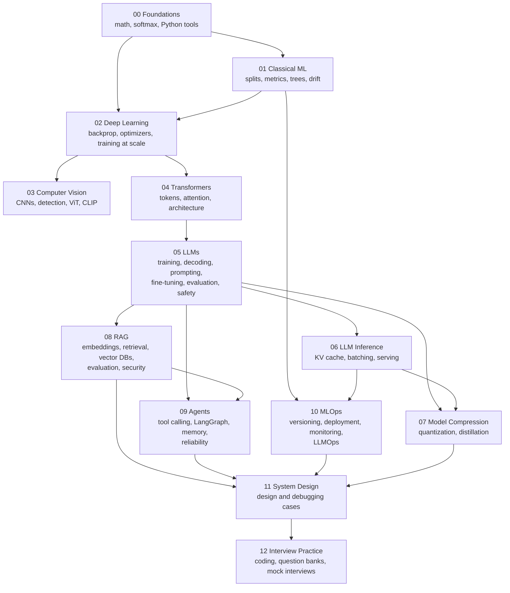

# AI/ML Engineer Interview Prep: From Zero to Senior

A complete, self-paced course that starts from the absolute basics (vectors, derivatives, "what is a model?") and builds up to everything a **Senior Software Engineer (AI/ML)** is expected to explain in an interview: transformers, LLM training and inference, prompting, fine-tuning (LoRA/QLoRA), RAG and vector databases, AI agents, quantization and distillation, MLOps, and AI system design.

You do not need to remember anything from university. Every chapter assumes you are starting fresh, explains the intuition first, works through the math with small numbers by hand, shows runnable Python, and then goes deep into the trade-offs and production details that senior interviews test.

> **How big is this?** There are 105 chapters plus 12 practice files, and each chapter is a full lesson (typically 60 to 150 minutes of study). Treat it like a textbook: you are not expected to read every page before a near interview. If time is short, follow the [Fast track](#fast-track-about-4-weeks-2-to-3-hours-per-day) and use the **Key takeaways** and **Interview questions** sections of the other chapters.

## Contents

- [How every chapter is organized](#how-every-chapter-is-organized)
- [The learning roadmap](#the-learning-roadmap)
- [Study plans](#study-plans)
- [Set up your Python environment](#set-up-your-python-environment)
- [How to answer interview questions well](#how-to-answer-interview-questions-well)
- [Full course checklist](#full-course-checklist)

## How every chapter is organized

Each chapter follows the same structure, so you always know where to look:

| Section | What it gives you |
|---|---|
| **Metadata line** | Level, estimated study time and the chapters to read first |
| **Why this matters** | Where the topic shows up in real systems and in interviews |
| **Core sections** | Plain-English intuition, analogies, definitions, formulas with every symbol explained, worked examples by hand, diagrams and Python code |
| **Going deeper** | Senior-level material: trade-offs, failure modes, scaling, cost, debugging |
| **Common mistakes** | Misconceptions that cost candidates points |
| **Interview questions and model answers** | Every relevant question from real interview guides, plus extra senior-level questions. Answers are hidden in collapsible blocks so you can quiz yourself |
| **Key takeaways** | A one-screen revision summary |
| **Further reading** | Papers, books and official docs, if you want more |

> **Tip:** Click a question to reveal the answer only after you have answered it out loud. Answering out loud is the single best predictor of doing well in the real interview.

## The learning roadmap



Parts 00 to 03 build the foundation. Parts 04 to 09 are the core of a GenAI-focused senior interview. Parts 10 and 11 turn the knowledge into production and system-design answers. Part 12 is for practice and revision.

## Study plans

Pick the plan that matches the time you have. Whatever plan you choose, use this **daily routine** for each chapter:

1. Read the chapter once, slowly. Do every worked example yourself on paper.
2. Run the code. Change a number and predict what happens before you run it again.
3. Close the chapter and answer its interview questions **out loud**, then open the answers and compare.
4. Write the Key takeaways from memory in your own notes. Tick the chapter in the checklist below.

### Full track: about 10 weeks (1.5 to 2 hours per day)

| Week | Read | Goal by the end of the week |
|---|---|---|
| 1 | [00 Foundations](#00-foundations) | Comfortable with vectors, dot products, gradients, probability, softmax and cross-entropy |
| 2 | [01 Classical ML](#01-classical-ml) | Can explain leakage, imbalanced metrics, trees vs boosting, drift |
| 3 | [02 Deep Learning](#02-deep-learning) | Can explain backprop, Adam, normalization, mixed precision, distributed training |
| 4 | [03 Computer Vision](#03-computer-vision), [04 Transformers](#04-transformers) chapters 1 to 4 | Can compute attention by hand |
| 5 | [04 Transformers](#04-transformers) chapters 5 to 8, [05 LLMs](#05-llms) chapters 1 to 6 | Can walk from tokens to generated text and explain decoding and prompting |
| 6 | [05 LLMs](#05-llms) chapters 7 to 13 | Can compare RAG, LoRA and QLoRA, and design an LLM evaluation |
| 7 | [06 LLM Inference](#06-llm-inference), [07 Model Compression](#07-model-compression) | Can do KV cache and memory math, explain quantization and distillation |
| 8 | [08 RAG](#08-rag) | Can design, evaluate, debug and secure a RAG system |
| 9 | [09 Agents](#09-agents), [10 MLOps](#10-mlops) | Can design a reliable, secure agent and a production ML service |
| 10 | [11 System Design](#11-system-design), [12 Interview Practice](#12-interview-practice) | Two mock interviews done, every question bank attempted |

### Fast track: about 4 weeks (2 to 3 hours per day)

Use this if your interview is soon. It prioritizes what GenAI-focused senior interviews ask most, and skims the rest. Chapters are written as part/chapter: for example, 05/03 means Part 05, chapter 03 ([Decoding Strategies](05-llms/03-text-generation-and-decoding-strategies.md)).

| Week | Must read | Skim (read Why this matters, Key takeaways and the interview questions) |
|---|---|---|
| 1 | 00/02, 00/05, 01/01, 01/03, 01/04, 02/02, 02/04, 02/05 | rest of 00, 01 and 02, all of 03 |
| 2 | all of 04 Transformers, 05/01 to 05/06 | 05/12, 05/13 |
| 3 | 05/07 to 05/11, all of 06 LLM Inference, 07/01 to 07/05 | 07/06, 07/07 |
| 4 | all of 08 RAG, 09/01, 09/02, 09/04, 09/08, 11/01, 11/02, 11/06 to 11/08 | rest of 09, 10/04 to 10/06, 10/08, then the question banks and mock interviews in 12 |

### The final week before the interview

- Re-read every **Key takeaways** section (about 5 minutes per chapter).
- Work through the question banks in [12 Interview Practice](#12-interview-practice) and mark every question you could not answer fluently. Go back to the linked chapter for each one.
- Practice the [mock interviews](12-interview-practice/12-mock-interviews.md) out loud, ideally with a friend playing the interviewer.
- Memorize the core formulas and estimates in the [Formula and Numbers Cheat Sheet](12-interview-practice/10-formula-and-numbers-cheat-sheet.md).
- Do 2 or 3 exercises from each [coding exercise](12-interview-practice/01-coding-exercises-ml-from-scratch.md) [file](12-interview-practice/02-coding-exercises-llm-rag-and-agents.md) without looking at the solutions.

## Set up your Python environment

The code in this course uses Python 3.10 or newer. The easiest setup on Windows, macOS or Linux is [uv](https://docs.astral.sh/uv/). From this folder, create a virtual environment:

```bash
uv venv --python 3.12 .venv
```

Activate it (PowerShell on Windows):

```powershell
.venv\Scripts\Activate.ps1
```

Or on macOS and Linux:

```bash
source .venv/bin/activate
```

Install the libraries used across the course (PyTorch CPU build is enough for every example; models download on first use):

```bash
uv pip install numpy scipy pandas matplotlib scikit-learn xgboost lightgbm shap imbalanced-learn torch transformers datasets peft trl sentence-transformers faiss-cpu rank_bm25 tiktoken pydantic fastapi uvicorn
```

Then start with [What AI, Machine Learning, Deep Learning and Generative AI Are](00-foundations/01-what-is-ai-ml-dl-and-genai.md).

## How to answer interview questions well

A strong senior answer usually has five parts. Practice this shape until it is automatic:

1. **Definition:** one plain sentence saying what the thing is.
2. **Mechanism:** how it actually works (the math or the data flow), not just its name.
3. **Trade-offs:** when you would use it, when you would not, and what it costs (latency, memory, money, complexity).
4. **Example:** a concrete number, scenario or system you have reasoned about.
5. **Measurement:** how you would know it works (which metric, which test, which dashboard).

Other habits interviewers reward:

- State your assumptions and ask clarifying questions before designing anything.
- Think out loud. Silence hides good reasoning.
- When you do not know, say so, then reason from first principles. That is a senior signal, not a weakness.
- For any LLM or agent security question, put authorization and policy enforcement **outside** the model, in deterministic code.
- For any debugging question, start by measuring and inspecting evidence before changing anything.

## Full course checklist

Tick each chapter as you finish it.

### 00 Foundations

Math, probability, softmax and cross-entropy, Python tools.

- [ ] 01. [What AI, Machine Learning, Deep Learning and Generative AI Are](00-foundations/01-what-is-ai-ml-dl-and-genai.md)
- [ ] 02. [Linear Algebra for Machine Learning](00-foundations/02-linear-algebra-for-ml.md)
- [ ] 03. [Calculus for ML: Derivatives, Gradients and the Chain Rule](00-foundations/03-calculus-and-gradients.md)
- [ ] 04. [Probability and Statistics for Machine Learning](00-foundations/04-probability-and-statistics.md)
- [ ] 05. [Softmax, Entropy, Cross-Entropy and KL Divergence](00-foundations/05-softmax-entropy-cross-entropy-and-kl-divergence.md)
- [ ] 06. [Python Tooling for ML: NumPy, pandas, scikit-learn, PyTorch and Hugging Face](00-foundations/06-python-numpy-pandas-pytorch-essentials.md)

### 01 Classical ML

Data splits, overfitting and leakage, metrics and fairness, trees and boosting, features, drift.

- [ ] 01. [The ML Workflow, Train/Validation/Test Splits and Cross-Validation](01-classical-ml/01-ml-workflow-data-splits-and-cross-validation.md)
- [ ] 02. [Linear and Logistic Regression from Scratch](01-classical-ml/02-linear-and-logistic-regression.md)
- [ ] 03. [Overfitting, Bias-Variance, Regularization and Data Leakage](01-classical-ml/03-overfitting-regularization-and-data-leakage.md)
- [ ] 04. [Classification Metrics and Imbalanced Data](01-classical-ml/04-classification-metrics-and-imbalanced-data.md)
- [ ] 05. [Regression Metrics, Baselines and Model Selection](01-classical-ml/05-regression-metrics-baselines-and-model-selection.md)
- [ ] 06. [Decision Trees, Random Forests and Gradient Boosting (XGBoost, LightGBM, CatBoost)](01-classical-ml/06-decision-trees-random-forests-and-gradient-boosting.md)
- [ ] 07. [Feature Engineering: Missing Values, Categorical Encoding and Scaling](01-classical-ml/07-feature-engineering-missing-values-and-encoding.md)
- [ ] 08. [Data Drift, Concept Drift and When to Retrain](01-classical-ml/08-data-drift-concept-drift-and-retraining.md)
- [ ] 09. [k-Nearest Neighbors, SVMs, Naive Bayes and Other Classic Algorithms](01-classical-ml/09-knn-svm-naive-bayes-and-other-classic-algorithms.md)
- [ ] 10. [Unsupervised Learning: Clustering, Dimensionality Reduction and Anomaly Detection](01-classical-ml/10-unsupervised-learning-clustering-and-dimensionality-reduction.md)

### 02 Deep Learning

Neural networks, backpropagation, optimizers, losses, normalization, mixed precision, distributed training.

- [ ] 01. [Neural Networks from Scratch: Neurons, Layers and Activations](02-deep-learning/01-neural-networks-from-scratch.md)
- [ ] 02. [Backpropagation and Gradient Descent Explained](02-deep-learning/02-backpropagation-and-gradient-descent.md)
- [ ] 03. [Optimizers: SGD, Momentum, RMSProp, Adam, AdamW and Learning Rate Schedules](02-deep-learning/03-optimizers-sgd-momentum-adam-and-learning-rate-schedules.md)
- [ ] 04. [Loss Functions: What They Are and How to Choose Them](02-deep-learning/04-loss-functions.md)
- [ ] 05. [Vanishing and Exploding Gradients, Initialization, Normalization and Residual Connections](02-deep-learning/05-vanishing-exploding-gradients-initialization-normalization-and-residuals.md)
- [ ] 06. [Regularization and Debugging Neural Network Training](02-deep-learning/06-regularization-and-debugging-neural-network-training.md)
- [ ] 07. [Convolutional Neural Networks and Transfer Learning](02-deep-learning/07-cnns-and-transfer-learning.md)
- [ ] 08. [RNNs, LSTMs, Seq2Seq and Why Transformers Replaced Them](02-deep-learning/08-rnns-lstms-and-the-road-to-transformers.md)
- [ ] 09. [Mixed-Precision Training: FP32, FP16 and BF16](02-deep-learning/09-mixed-precision-training.md)
- [ ] 10. [Distributed Training and Training Memory: Data, Tensor and Pipeline Parallelism, ZeRO and FSDP](02-deep-learning/10-distributed-training-and-training-memory.md)

### 03 Computer Vision

Classification, detection, segmentation, augmentation, production issues, ViT, CLIP, multimodal LLMs and speech.

- [ ] 01. [Computer Vision Tasks: Classification, Detection and Segmentation](03-computer-vision/01-image-classification-detection-and-segmentation.md)
- [ ] 02. [Object Detection in Depth: Faster R-CNN, YOLO, DETR and mAP](03-computer-vision/02-object-detection-yolo-faster-rcnn-and-map.md)
- [ ] 03. [Data Augmentation, Transfer Learning and Small Datasets in Vision](03-computer-vision/03-data-augmentation-transfer-learning-and-small-datasets.md)
- [ ] 04. [Computer Vision in Production: Domain Shift, Debugging and Latency](03-computer-vision/04-computer-vision-in-production.md)
- [ ] 05. [Vision Transformers, CLIP and Multimodal LLMs](03-computer-vision/05-vision-transformers-clip-and-multimodal-models.md)

### 04 Transformers

Tokenization, embeddings, attention, the full architecture, positional encoding, modern variants.

- [ ] 01. [Tokenization: How Text Becomes Numbers](04-transformers/01-tokenization.md)
- [ ] 02. [Embeddings: From One-Hot Vectors to Word2Vec to Contextual Embeddings](04-transformers/02-embeddings-from-one-hot-to-contextual.md)
- [ ] 03. [The Attention Mechanism, Step by Step](04-transformers/03-attention-mechanism-step-by-step.md)
- [ ] 04. [Multi-Head Attention and Causal Masking](04-transformers/04-multi-head-attention-and-causal-masking.md)
- [ ] 05. [The Full Transformer Architecture: From Input Tokens to Output Text](04-transformers/05-the-full-transformer-architecture.md)
- [ ] 06. [Positional Encoding: Sinusoidal, Learned, RoPE and ALiBi](04-transformers/06-positional-encoding-sinusoidal-learned-rope-and-alibi.md)
- [ ] 07. [Encoder-Only, Encoder-Decoder and Decoder-Only Models (BERT, T5, GPT)](04-transformers/07-encoder-only-encoder-decoder-and-decoder-only-models.md)
- [ ] 08. [Modern LLM Architecture: Pre-Norm, RMSNorm, SwiGLU, GQA, MoE and FlashAttention](04-transformers/08-modern-llm-architecture-improvements.md)

### 05 LLMs

Pretraining, alignment, decoding, prompting, structured output, hallucinations, fine-tuning, evaluation, safety.

- [ ] 01. [How LLMs Are Trained, Part 1: Pretraining and Next-Token Prediction](05-llms/01-pretraining-and-next-token-prediction.md)
- [ ] 02. [How LLMs Are Trained, Part 2: Instruction Tuning, RLHF and DPO](05-llms/02-instruction-tuning-rlhf-and-dpo.md)
- [ ] 03. [How LLMs Generate Text: Decoding Strategies](05-llms/03-text-generation-and-decoding-strategies.md)
- [ ] 04. [Prompt Engineering for Production](05-llms/04-prompt-engineering-for-production.md)
- [ ] 05. [Structured Outputs, JSON Mode and Function Calling](05-llms/05-structured-outputs-and-function-calling.md)
- [ ] 06. [Hallucinations: Why LLMs Make Things Up and How to Reduce It](05-llms/06-hallucinations-and-grounding.md)
- [ ] 07. [Fine-Tuning LLMs: Full Fine-Tuning, LoRA and QLoRA](05-llms/07-fine-tuning-full-lora-and-qlora.md)
- [ ] 08. [Prompting vs RAG vs Fine-Tuning: A Decision Guide](05-llms/08-prompting-vs-rag-vs-fine-tuning-decision-guide.md)
- [ ] 09. [Catastrophic Forgetting, Data Contamination and Memorization](05-llms/09-catastrophic-forgetting-contamination-and-memorization.md)
- [ ] 10. [Evaluating LLMs: Metrics, Benchmarks and LLM-as-a-Judge](05-llms/10-llm-evaluation-metrics-and-llm-as-a-judge.md)
- [ ] 11. [Building an LLM Evaluation Framework and Regression Tests](05-llms/11-building-an-llm-evaluation-framework-and-regression-tests.md)
- [ ] 12. [Reasoning Models and Test-Time Compute](05-llms/12-reasoning-models-and-test-time-compute.md)
- [ ] 13. [LLM Safety, Guardrails and Responsible AI](05-llms/13-llm-safety-guardrails-and-responsible-ai.md)

### 06 LLM Inference

Prefill and decode, KV cache, GPU math, batching, speculative decoding, serving, benchmarking.

- [ ] 01. [LLM Inference Fundamentals: Prefill, Decode, TTFT and Throughput](06-llm-inference/01-inference-fundamentals-prefill-decode-and-latency-metrics.md)
- [ ] 02. [The KV Cache: What It Is and Why It Dominates Memory](06-llm-inference/02-kv-cache-explained.md)
- [ ] 03. [GPU Fundamentals for LLMs: Compute-Bound vs Memory-Bound](06-llm-inference/03-gpu-fundamentals-compute-bound-vs-memory-bound.md)
- [ ] 04. [Batching, Continuous Batching and PagedAttention](06-llm-inference/04-batching-continuous-batching-and-paged-attention.md)
- [ ] 05. [Speculative Decoding, Prompt Caching and Other Inference Speedups](06-llm-inference/05-speculative-decoding-caching-and-other-speedups.md)
- [ ] 06. [LLM Serving Frameworks: vLLM, SGLang, TGI, TensorRT-LLM, llama.cpp and Ollama](06-llm-inference/06-serving-frameworks-vllm-sglang-tgi-tensorrt-llm-and-ollama.md)
- [ ] 07. [Optimizing and Benchmarking LLM Latency and Cost](06-llm-inference/07-optimizing-and-benchmarking-llm-latency-and-cost.md)

### 07 Model Compression

Number formats, quantization, GPTQ and AWQ, distillation, pruning.

- [ ] 01. [Number Formats and Model Memory: FP32, FP16, BF16, FP8, INT8 and INT4](07-model-compression/01-number-formats-and-model-memory.md)
- [ ] 02. [Quantization Fundamentals: Scale, Zero Point, Symmetric and Asymmetric](07-model-compression/02-quantization-fundamentals-scale-and-zero-point.md)
- [ ] 03. [Post-Training Quantization vs Quantization-Aware Training](07-model-compression/03-ptq-vs-qat-and-calibration.md)
- [ ] 04. [Practical LLM Quantization: Outliers, LLM.int8(), SmoothQuant, GPTQ, AWQ, GGUF and FP8](07-model-compression/04-llm-quantization-gptq-awq-and-outliers.md)
- [ ] 05. [Knowledge Distillation Fundamentals](07-model-compression/05-knowledge-distillation-fundamentals.md)
- [ ] 06. [Distilling Large Language Models into Smaller Ones](07-model-compression/06-distilling-large-language-models.md)
- [ ] 07. [Pruning, Low-Rank Factorization and Choosing a Compression Strategy](07-model-compression/07-pruning-low-rank-factorization-and-choosing-a-compression-method.md)

### 08 RAG

Embeddings, ingestion, chunking, hybrid retrieval, ANN search, vector databases, reranking, evaluation, debugging, security.

- [ ] 01. [What Is RAG and Why It Matters](08-rag/01-what-is-rag-and-why-it-matters.md)
- [ ] 02. [Text Embeddings and Similarity Search](08-rag/02-text-embeddings-and-similarity-search.md)
- [ ] 03. [Document Ingestion and Parsing: PDFs, Tables and Structured Data](08-rag/03-document-ingestion-and-parsing.md)
- [ ] 04. [Chunking Strategies: Size, Overlap and Structure](08-rag/04-chunking-strategies.md)
- [ ] 05. [Retrieval Methods: BM25, Dense Retrieval and Hybrid Search](08-rag/05-retrieval-bm25-dense-and-hybrid-search.md)
- [ ] 06. [Vector Search Algorithms: Exact kNN, HNSW, IVF and Product Quantization](08-rag/06-vector-search-ann-hnsw-ivf-and-product-quantization.md)
- [ ] 07. [Vector Databases in Practice](08-rag/07-vector-databases-in-practice.md)
- [ ] 08. [Reranking and Query Transformation](08-rag/08-reranking-and-query-transformation.md)
- [ ] 09. [Advanced RAG Patterns: Parent-Child, Contextual Retrieval, Multi-Hop, GraphRAG and Agentic RAG](08-rag/09-advanced-rag-patterns.md)
- [ ] 10. [Evaluating RAG: Retrieval Metrics, Faithfulness and RAGAS](08-rag/10-rag-evaluation-metrics-and-ragas.md)
- [ ] 11. [Debugging RAG Systems: A Systematic Playbook](08-rag/11-debugging-rag-systems.md)
- [ ] 12. [Production Ingestion Pipelines: Idempotency, Updates, Deletions and Re-Embedding](08-rag/12-production-ingestion-pipelines-at-scale.md)
- [ ] 13. [Secure Multi-Tenant RAG: Permissions, Isolation and Auditing](08-rag/13-secure-multi-tenant-rag.md)

### 09 Agents

Agents vs workflows, tool calling, patterns, LangGraph, multi-agent, memory, MCP, reliability, evaluation.

- [ ] 01. [What Is an AI Agent? Agents vs Workflows](09-agents/01-what-is-an-ai-agent.md)
- [ ] 02. [Tool Calling in Depth: Reliable and Secure Execution](09-agents/02-tool-calling-in-depth.md)
- [ ] 03. [Agent Design Patterns: ReAct, Plan-and-Execute, Reflection and Routing](09-agents/03-agent-design-patterns.md)
- [ ] 04. [Orchestrating Agents with LangGraph and State Machines](09-agents/04-orchestration-with-langgraph-and-state-machines.md)
- [ ] 05. [Multi-Agent Systems: When They Help and When They Hurt](09-agents/05-multi-agent-systems.md)
- [ ] 06. [Memory for AI Agents](09-agents/06-agent-memory.md)
- [ ] 07. [The Model Context Protocol (MCP) and Tool Ecosystems](09-agents/07-model-context-protocol-and-tool-ecosystems.md)
- [ ] 08. [Making Agents Reliable and Secure for Production](09-agents/08-agent-reliability-security-and-prompt-injection.md)
- [ ] 09. [Evaluating and Observing Agents](09-agents/09-evaluating-and-observing-agents.md)
- [ ] 10. [Case Study: Designing a Production Procurement and Support Agent](09-agents/10-case-study-designing-a-production-agent.md)

### 10 MLOps

Experiment tracking, versioning, reproducibility, deployment (Kubernetes, canaries, A/B tests and bandits), inference APIs, monitoring, CI/CD, LLMOps.

- [ ] 01. [The ML Lifecycle, MLOps and Experiment Tracking](10-mlops/01-ml-lifecycle-and-experiment-tracking.md)
- [ ] 02. [Data Versioning, Model Versioning and the Model Registry](10-mlops/02-data-and-model-versioning-and-model-registry.md)
- [ ] 03. [Reproducible Training and Training-Serving Skew](10-mlops/03-reproducibility-and-training-serving-skew.md)
- [ ] 04. [Model Deployment Patterns: Batch, Online, Canary, Shadow and Rollback](10-mlops/04-model-deployment-patterns.md)
- [ ] 05. [Building a Scalable Inference API](10-mlops/05-building-a-scalable-inference-api.md)
- [ ] 06. [Monitoring ML and LLM Systems in Production](10-mlops/06-monitoring-ml-and-llm-systems-in-production.md)
- [ ] 07. [CI/CD and Testing for ML Pipelines](10-mlops/07-ci-cd-and-testing-for-ml-pipelines.md)
- [ ] 08. [LLMOps: Tracing, Prompt Management, Langfuse and RAGAS in Practice](10-mlops/08-llmops-tracing-prompt-management-and-langfuse.md)

### 11 System Design

How to approach design interviews, four design problems (enterprise RAG, an LLM serving platform, a support chatbot, and fraud detection with a recommendation-system extension) and three debugging cases.

- [ ] 01. [How to Approach AI/ML System Design and Debugging Interviews](11-system-design/01-how-to-approach-ai-system-design-interviews.md)
- [ ] 02. [System Design: A Scalable Enterprise RAG System](11-system-design/02-design-a-scalable-enterprise-rag-system.md)
- [ ] 03. [System Design: A Multi-Tenant LLM Inference Platform](11-system-design/03-design-a-multi-tenant-llm-inference-platform.md)
- [ ] 04. [System Design: An Enterprise Support Chatbot and Its Evaluation Framework](11-system-design/04-design-an-enterprise-support-chatbot-with-evaluation.md)
- [ ] 05. [System Design: A Classic ML System (Real-Time Fraud Detection)](11-system-design/05-design-a-real-time-fraud-detection-system.md)
- [ ] 06. [Debugging Case: A Quantized LLM Uses Less Memory but Latency Is Unchanged](11-system-design/06-debugging-case-quantized-llm-not-faster.md)
- [ ] 07. [Debugging Case: A RAG Application Gives Fluent but Unsupported Answers](11-system-design/07-debugging-case-rag-fluent-but-unsupported-answers.md)
- [ ] 08. [Debugging Case: Rising p95 Latency and Memory Usage in an Inference Service](11-system-design/08-debugging-case-rising-p95-latency-and-memory.md)

### 12 Interview Practice

Coding exercises, question banks, cheat sheet, glossary and mock interviews.

- [ ] 01. [Coding Exercises: Classical ML and Deep Learning from Scratch](12-interview-practice/01-coding-exercises-ml-from-scratch.md)
- [ ] 02. [Coding Exercises: Transformers, LLMs, RAG and Agents](12-interview-practice/02-coding-exercises-llm-rag-and-agents.md)
- [ ] 03. [Question Bank: Classical Machine Learning](12-interview-practice/03-question-bank-classical-ml.md)
- [ ] 04. [Question Bank: Deep Learning and Computer Vision](12-interview-practice/04-question-bank-deep-learning-and-computer-vision.md)
- [ ] 05. [Question Bank: Transformers, LLMs, Prompting, Fine-Tuning and Evaluation](12-interview-practice/05-question-bank-transformers-and-llms.md)
- [ ] 06. [Question Bank: LLM Inference, Serving, Quantization and Distillation](12-interview-practice/06-question-bank-llm-inference-and-model-compression.md)
- [ ] 07. [Question Bank: RAG, Embeddings and Vector Databases](12-interview-practice/07-question-bank-rag-and-vector-databases.md)
- [ ] 08. [Question Bank: AI Agents, Tool Calling and Orchestration](12-interview-practice/08-question-bank-ai-agents.md)
- [ ] 09. [Question Bank: MLOps, Deployment and AI System Design](12-interview-practice/09-question-bank-mlops-and-system-design.md)
- [ ] 10. [Formula and Numbers Cheat Sheet](12-interview-practice/10-formula-and-numbers-cheat-sheet.md)
- [ ] 11. [Glossary](12-interview-practice/11-glossary.md)
- [ ] 12. [Mock Interviews with Model Answers](12-interview-practice/12-mock-interviews.md)
